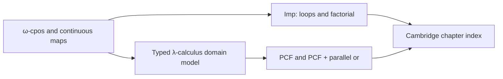

# Denotational semantics

The Part II course follows Meven Lennon-Bertrand's *Lecture Notes on
Denotational Semantics*, version of December 5, 2024, building on notes by
Pitts, Winskel and Fiore. The chapter modules preserve item numbers and
printed-page references, so readers can work from a theorem or exercise in
the notes to its Lean statement.

```sh
lake build Silmaril.Courses.Cambridge.DenotationalSemantics
```

The course index is a leaf over reusable libraries. Its imports are restricted
to the developments used by the wrappers; the course does not pull in separate
game-semantics or categorical-model developments through broad umbrellas.

## Read-only L1

The Cambridge L1 adapter interprets integer and Boolean literals, `skip`,
dereferences, addition, comparison, and conditionals. `ReadOnly` requires both
branches of a conditional to belong to the fragment. It admits untyped terms
and arbitrary finite partial stores. Assignment, sequencing, and loops are
outside this grammar. [Fragment and adequacy](../../Silmaril/Courses/Cambridge/L1/Denotational.lean)

`denote` is a structural function `Expr → Store → Option Expr`. A read uses
`Store.lookup`, each operator acts on the results of its operands, and a
conditional interprets only the branch selected by its Boolean guard. The
same store is passed to each subexpression. The result of a successful
evaluation is one of L1's existing value expressions.

An `atomicInstitution` sentence pairs a `ReadOnly` source configuration with
a proposed full target configuration. The model checks the denoted value and
requires the target store to equal the original store. `sat_iff` identifies
that truth with the existing L1 `OpSem.May` return. `stronglyNormal` rules out
infinite reductions in this fragment, and `denote_eq_none_iff` shows that
`none` means a stuck term is finitely reachable. The option carries no error
payload. A missing location in an unselected branch is harmless. The checked
examples change the input store, reject a changed return store, and reach
stuck after selecting a missing read. [Institution](../../Silmaril/Courses/Cambridge/L1/DenotationalInstitution.lean) ·
[Examples](../../Silmaril/Courses/Cambridge/DenotationalSemantics/L1Examples.lean)

## Effectful L1

`EffectfulDenotational.denote` interprets the entire L1 expression grammar
compositionally in `ExceptT Unit (StateT L1.Store Part)`. Reads and writes
use `Store.lookup` and `Store.update`. The original evaluation order matters
on untyped input too. A binary operator evaluates its right operand after
any left value and checks the operand shapes once both have returned.
Sequencing runs its second expression after a `skip` result.
[Structural denotation](../../Silmaril/Courses/Cambridge/L1/EffectfulDenotational/Defs.lean)

A while iteration evaluates the guard in the current store. A false guard
returns `Sum.inl .skip`. A true guard runs the body and requests another
iteration with `Sum.inr ()` when the body returns `skip`. The existing Elgot
transformer instances thread the store and propagate finite errors.
The fixed-point law validates the original unfolding rule. For the converse
proof, `Silmaril.Elgot.Part.mem_iter_iff` supplies a finite derivation of any
result of the transformed iteration. [Iteration laws](../../Silmaril/Semantics/ElgotMonads/Thms.lean)

| Denotational observation | Checked operational correspondence |
| --- | --- |
| `(.ok v, s')` is a member of the denotation | `return_iff` gives a finite run to the value `v` in store `s'`. |
| `(.error (), s')` is a member of the denotation | `error_iff` gives a finite run to a stuck expression in store `s'`. |
| The `Part` is undefined | `diverges_iff` gives an `InfiniteTrace` of actual L1 steps. |

All three correspondences are bidirectional. The divergence proof uses
L1 determinacy and the fact that a terminal configuration has a defined
outcome. A finite stuck result retains the store, including writes that
preceded the failure. [Adequacy proofs](../../Silmaril/Courses/Cambridge/L1/EffectfulDenotational/Thms.lean)

The existing `atomicInstitution` now also has a model of full L1 return
sentences. Its satisfaction relation agrees with `L1.OperationalInstitution`
finite may returns, and its reduct along inclusion of the read-only sentences
is the earlier read-only model. Stuckness and divergence are expressed by the
semantic theorems above. The regression checks three loop iterations which
update a counter and an accumulator, then return `6` with counter `0`. It
also checks a stuck write after a successful update and a diverging loop.
[Institution and reduct](../../Silmaril/Courses/Cambridge/L1/EffectfulDenotational/Institution.lean) ·
[Checked examples](../../Silmaril/Courses/Cambridge/DenotationalSemantics/L1EffectfulExamples.lean)

## L1 in LetIter

`L1.LetIter.lower` consumes an original `L1.HasType Γ e T` judgment and
produces a LetIter term with its proof-relevant typing derivation. This covers
all L1 typing rules. It interprets integers as integers, `skip` as unit, and
Booleans as a sum of two units. Reads and writes are typed instructions over
the same L1 computation monad. LetIter pairs evaluate arithmetic operands,
`let₁` sequences commands, `case` selects a branch, and `iter` implements
while. The loop has a unit argument because the monad threads the L1 store.
[Lowering](../../Silmaril/Courses/Cambridge/L1/LetIter/Lowering.lean) ·
[Instruction model](../../Silmaril/Courses/Cambridge/L1/LetIter/Model.lean)


`evalLower_agrees` proves agreement with the direct LetIter interpretation.
The loop case uses Elgot naturality to decode a typed unit exit as L1's `skip`.
`evaluate_agrees` uses the library's `categorical_denote_eq` to close the
diagram in the existing Kleisli model of
`ExceptT Unit (StateT L1.Store Part)`. The equality holds for arbitrary initial
stores, including holes. `return_iff` gives agreement with the existing
L1 finite may observation, including the complete final store. `error_iff`
identifies finite errors with reachable stuck configurations and preserves
their stores. `diverges_iff` identifies undefined computations with infinite
L1 reductions. The checked countdown from `2` to `0` connects an explicit L1
reduction path to the categorical result. The examples also check a missing
store location and a loop with an infinite reduction. The translation
requires L1 typing and uses this particular Kleisli model.
[Commuting theorems](../../Silmaril/Courses/Cambridge/L1/LetIter/Thms.lean) ·
[Examples](../../Silmaril/Courses/Cambridge/DenotationalSemantics/L1LetIterExamples.lean) ·
[LetIter soundness API](../../Silmaril/SSA/Isotope/LetIter/Thms.lean)

To check the course, including the regressions, run
`lake build --wfail +Silmaril.Courses.Cambridge.DenotationalSemantics`.

`Compilation.compiler` packages the typed lowering in the behavioural
compiler category. Its graph relates source programs to actual closed
LetIter terms. The compiler transports specifications through the result-type
map, and `behaviours_eq` identifies the complete observation sets.
[Compiler adapter](../../Silmaril/Courses/Cambridge/L1/LetIter/Compilation.lean)

### Next slices

L2 shares L1's store. Extend the deterministic state model with lexical
closures and a call-by-value application interpretation. `L2.RuntimeValue`
and `RuntimeEnv` give existing closure representations. Reification or a
simulation must relate closure application and recursive calls to L2's
substitution rules. The fuel bound of `evalClosureFuel` is a separate concern.
[L2 closure interpreter](../../Silmaril/Courses/Cambridge/L2/ClosureInterpreter.lean)

The L3 data and reference fragment has a compositional `StateT L3.Store SetM`
denotation. The checked may-adequacy theorem retains each fresh allocation
choice and final store. The guide states the admitted syntax, typed ground
observations, and the requirements for an extension to higher-order store.
[L3 data and reference denotation](cambridge-l3-denotation.md)

Specification-format institutions need a representation of configurations and
sentences and a proof that interpretation preserves satisfaction.

## Part II course index



| Chapter | Checked material |
| --- | --- |
| `Introduction` | Partial-function denotations for Imp, loop unfolding, the factorial loop's finite approximants and final result, agreement with big-step execution |
| `LeastFixedPoints` | Partial orders, chains and least upper bounds; finite/discrete/flat examples and counterexamples; ω-continuity; Kleene's least fixed-point theorem |
| `Constructions` | Flat lifting, products, function spaces, evaluation, currying, composition, continuity of the fixed-point operator and threshold predicates |
| `ScottInduction` | Admissible predicates and closure rules; fixed-point induction; the factorial nonnegativity invariant; counterexamples for images and separately chain-closed slices |
| `PCF` | Intrinsic/extrinsic typing correspondence, typed substitution, call-by-name evaluation, determinism, big-step/small-step correspondence, call-by-value comparison and defined-result simulation for partial recursive functions |
| `Denotation` | Continuous interpretation of terms, substitution and context compositionality, operational soundness and semantic equality implying contextual equivalence |
| `Adequacy` | The formal approximation relation, its fundamental lemma and Scott-induction fix case; ground-type adequacy; contextual tests and extensionality |
| `FullAbstraction` | Parallel-or undefinability in PCF; a concrete failure of full abstraction; full abstraction for PCF + parallel or, including open terms and the contextual preorder; first-order stability, finite Boolean fragments and closed-term applicative bisimilarity |

**PCF** is a simply typed functional language with natural numbers, booleans,
conditionals and general recursion. **Parallel or**, written `por`, can return
true when either argument is true even if the other diverges. The library
uses a Boolean flag: `Term false` is PCF and `Term true` additionally has
`por`. Application is call by name; big-step evaluation relates closed terms
to values. The `Part` domains used for numbers and booleans include an
undefined element, written `⊥`.

The theorem statements distinguish three useful contracts:

- **Soundness:** evaluation to a value preserves the denotation.
- **Ground adequacy:** at natural-number and Boolean types, a term denoting a
  value evaluates to that value.
- **Full abstraction:** semantic equality agrees with contextual equivalence,
  where every closing program context observes ground results. The corresponding
  preorder agrees with the semantic order.

`example19` retains the defined-result simulation contract.
`example19_exact` and `partrec_definable_exact` prove exact representation:
`t n̄ ⇓ ȳ ↔ y ∈ f n`, including undefined inputs. The vector theorem covers
every finite arity. `partrec_definable_exact_with_domain` also states that a
generated program has no evaluation result exactly when the source function
is undefined.

The exact compiler uses `ExactRealizes.compTerm`, which forces every inner
result before applying the outer function. This matches strict composition
of partial functions under PCF's call-by-name evaluation. Its minimisation
proof shows that every returned index is the first zero. The original
`Realizes` contract and call-by-name composition remain available; their
limitation is exhibited by the proved counterexamples
`realizes_does_not_imply_exact` and `nonStrict_comp_ignores_undefined`.

Soundness and ground adequacy cover both PCF variants. For sequential PCF,
`theorem41` gives two contextually equivalent closed terms with different
function-space denotations, and `theorem41_not_fullyAbstract` records the
consequence. A `por` context distinguishes their embeddings. For PCF + `por`,
`theorem42`, `theorem42_fullyAbstract`, `theorem42_le_closed` and `theorem42_le`
prove equality and order correspondences for closed and open terms.

The full-abstraction proof constructs an increasing sequence of finite
idempotent deflations on each semantic type. Each element is the supremum of
its projected approximations, and each approximation is definable by a PCF +
`por` term. `TypedLambda.Observation.denote_le_of_ctxLe` then derives the generic
order-reflection argument from density and ground reflection. The proof uses
ω-chains; it does not require an identification of these finite projections
with compact elements.

Reusable entry points are:

- `Silmaril.Semantics.Domain`: ω-cpos, least fixed points, continuity,
  flat/product/function domains, Scott induction, bounded completeness,
  finite projections, Sieber's ternary relation and order-theoretic stability.
- Modules under `Silmaril.Calculi.TypedLambda`, including `.Denotation`,
  `.LogicalRelation`, `.FullAbstraction`, `.Finite`, `.Stability` and
  `.Applicative`, extend the signature-parametric syntax with continuous
  domain models, logical relations and observation results. Import the
  individual extension modules to use these APIs.
- `Silmaril.Calculi.Imp`: the integer-state while language and the factorial
  example, whose denotation agrees with big-step execution.
- `Silmaril.Calculi.PCF`: syntax and operational semantics for both flags,
  morphisms, domain semantics, soundness, adequacy and the concrete
  full-abstraction results.

An **ω-cpo** supplies least upper bounds for increasing countable chains; a
**domain** here additionally has a least element. A **continuous** map is
monotone and preserves those suprema. **Admissible** predicates contain the
least element and are closed under chain suprema. These are the exact domain
notions used by the library.

The closing background topics are deliberately distinguished from the results
above. `por_not_stable` and `pcf_bool₂_stable` concern uncurried first-order
Boolean maps. They do not construct a cartesian closed category of stable
functions or a dI-domain model. Finiteness of the Boolean-fragment domains and
contextual-equivalence quotients is proved; Loader's undecidability theorem is
background. The applicative-similarity/bisimilarity correspondence covers
closed terms. The second example of the notes' Remark 14 remains unindexed.

The chapter statements identify several corrections or explicit restrictions
relative to the cited edition:

| Printed location | Checked statement |
| --- | --- |
| p. 10, factorial approximation table | The displayed formula is stated for `n ≥ 1`; the zeroth approximation is undefined everywhere |
| p. 28, Proposition 15 | For `f : E → F` and `g : D → E`, composition applies `f` after `g` |
| p. 30, Exercise 5 | The constant alternative includes the undefined input; constancy only on defined inputs is insufficient |
| pp. 34–35, Example 16 | The positive-guard case applies the recursive approximation `w` to the updated state before using its invariant |
| p. 46, Remark 8 | Joint divergence is stated for closed terms of ground type, where the empty context is an observation |
| p. 22, Exercise 3 | The Imp guard is total because expressions terminate; the wrapper states that specialization explicitly |

The cited composition, constancy, factorial-approximation and invariant
formulas were checked against rendered pages of the source PDF. Its
bibliography record carries SHA-256
`fd34a46f6cc1039f10668bb5e8a1ff509fba28cd172162cdbe8408ff4553517f`.
The numbered index documents its own scope instead of claiming every
background discussion in the notes as a theorem of this development.
