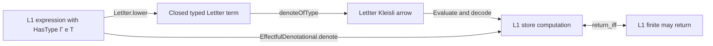
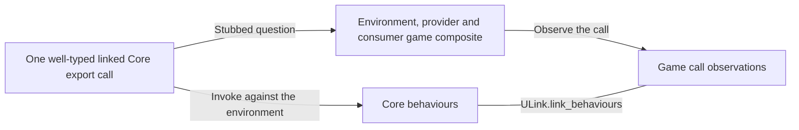

# Cambridge integration and compilation coverage

## The checked L1 boundary



`LetIter.evaluate_agrees` identifies the two routes to the same
`ExceptT Unit (StateT Store Part)` computation. Its premise is expression
typing. It covers assignment, sequencing and while at **every** initial
store, including stores with missing locations. `return_iff` retains the
returned expression and complete final store. `error_iff` reads a defined
error as reachability of a stuck configuration with that store, and
`diverges_iff` reads an undefined computation as an infinite L1 reduction.
The countdown regression starts at `x = 2`, writes twice and ends with
result `0` and `x = 0`. [Lowering](../../Silmaril/Courses/Cambridge/L1/LetIter/Lowering.lean) ·
[Correspondence theorems](../../Silmaril/Courses/Cambridge/L1/LetIter/Thms.lean) ·
[Checked regressions](../../Silmaril/Courses/Cambridge/DenotationalSemantics/L1LetIterExamples.lean)

For a compilation relation in `Compile.Category`, the immediate interface is
the location declaration environment and result type. `Convention.Φ` keeps
the locations and applies `lowerTy` to the result. Observations can share the
same carrier once the LetIter result is decoded. Include the initial store,
the returned value and final store, the store of a stuck outcome, or an
explicit divergence observation. The bidirectional L1 theorems establish
equality of these behaviour sets. The compiler framework's `valid_iff_beh`
asks for interface agreement and target-behaviour inclusion. That inclusion
alone admits empty behaviour sets. An end-to-end backend claim also needs
the intended outcome-existence or reflection theorem. [Convention](../../Silmaril/Compile/Category/Convention.lean) ·
[Valid compilation](../../Silmaril/Compile/Category/Valid.lean)

A deterministic machine proof could instead use `CompilesTo.Corr` with paired
cut points, a state relation, and segments that establish the next cut or a
return. Its `Source.Safe` premise rules out reachable wrong states and infinite
runs, so it suits terminating, non-stuck inputs. A divergence-sensitive
backend claim needs a different contract. [Cut-point definitions](../../Silmaril/Compiler/CompilesTo/Sim/Defs.lean) ·
[Segment composition](../../Silmaril/Compiler/CompilesTo/Sim/Thms.lean)

The existing Wasm SSA entry point `compileFunc_iff` covers finite outcomes of
`FragFunc`, the call-free, integer/local structured fragment. Its input is a
different representation from the L1 LetIter term. Reuse for a bounded L1
slice would require a translation to that fragment and a proof relating L1
store cells to locals and recovering the observed final store. Mutable
closure environments, heap allocation and host calls need a richer target
boundary. [Wasm SSA fragment](../../Silmaril/Wasm/SSA/Fragment/Defs.lean) ·
[Finite outcome theorem](../../Silmaril/Wasm/SSA/Translate/Thms.lean)

## Worked convention parameter for a Wasm boundary

Consider a synchronous component export of the countdown, with WIT signature
`func(x: s32) -> tuple<s32, s32>`. The first result is the returned integer
and the second is the final value of the sole source store cell `x`. At this
boundary `Φ` would use the canonical `flattenFunc` with memory width and
lift/lower direction chosen explicitly. The two result fields exceed the
one-slot synchronous result limit. A lift returns a pointer to the result
area. A lower appends an output pointer after the `i32` argument and returns
through that pointer. Memory64 widens the pointer to `i64` and leaves the
source integer slots at `i32`. These are checked static signature equations.
[Canonical ABI calling](../../Silmaril/Wasm/Component/Reference/ABI/Calling/Defs.lean)

```lean
module

import Silmaril.Wasm.Component.Reference.ABI.Calling.Defs

open Silmaril.Wasm.Component.ABI

private def countdownABI : FuncType Empty :=
  ⟨[.prim .s32], [.tuple [.prim .s32, .prim .s32]]⟩

example (memory : Silmaril.Wasm.AddrType) :
    flattenFunc { memory } .lift countdownABI =
      ⟨[.int .i32], [pointerType memory]⟩ := by
  cases memory <;> cbv

example (memory : Silmaril.Wasm.AddrType) :
    flattenFunc { memory } .lower countdownABI =
      ⟨[.int .i32, pointerType memory], []⟩ := by
  cases memory <;> cbv
```

For the `x = 2` call, the proposed `Convention.R` would relate the Core
input word to the initial singleton store and decode the result area as two
signed words representing `(0, 0)`. A return relation for other inputs needs
signed 32-bit bounds on source values and intermediates, a layout with
aligned, in-bounds result storage, and a frame condition for writes. The
full L1 model also admits other stores, errors and divergence. A backend
needs a proof that its entry restriction and execution preserve the chosen
observations, including any mapped trap or divergence behaviour. The
static signature equations leave the body and observation relation as proof
obligations. The existing resolved Core invocation theorem is a reference point for
entry and outcomes on its integer/local fragment. [Typed Core calls](../projects/wasm-intrinsic-call.md) ·
[Checked Core entry](../projects/wasm-opsem-entry.md)

## Wasm coverage for higher-order Cambridge

| Layer | Verified infrastructure that fits | Cambridge obligation |
| --- | --- | --- |
| **Core** | `call_ref` invokes a resolved reference in the current store. `call_indirect` uses a table lookup, type cast and reference call. The restricted intrinsic `DirectCall` checks entry and execution of resolved integer/local callees. [Core steps](../../Silmaril/Wasm/Execution/Core/Step.lean) · [Intrinsic call theorems](../../Silmaril/Wasm/Execution/Core/Intrinsic/Call/Thms.lean) | L2 evaluates the function and argument in CBV order and applies lexical or recursive closures. Relate a closure's code plus captured environment to the source function and prove application, recursive calls and store threading. A Core function address supplies code identity only. The L2 fuelled closure interpreter has checked examples of ground agreement. [L2 closure interpreter](../../Silmaril/Courses/Cambridge/L2/ClosureInterpreter.lean) |
| **Core games** | The scalar strategy presents import and export call/answer plays. The shared-store `ULink` game supports a function reference passed to a provider and called back into consumer code. [Scalar strategy](../../Silmaril/Wasm/Game/Strategy/Defs.lean) · [Shared-store linker and callback](../../Silmaril/Wasm/Game/ULink/Thms.lean) | Use shared-store linking for code that already has a closure/environment representation. Give a relation between source values, saved environments and target stores across calls. The scalar game alone leaves an unanswered play for either host-free divergence or stuckness. |
| **Components** | Canonical ABI flattening fits finite ground records, tuples and variants. WIT resource handles have own/borrow discipline, and the resource-table proofs track successful table operations. The reference export observer includes instantiation traps and divergence. [WIT values](../../Silmaril/Wasm/Component/Reference/WIT/Defs.lean) · [Resource histories](../../Silmaril/Wasm/Resource/CompTable/Thms.lean) · [Reference export outcomes](../../Silmaril/Wasm/Component/Reference/Defs.lean) | WIT functions sit at the interface, while value carriers include data and resource handles. Keep closures inside Core or design an explicit callable-handle protocol and prove lifetime and call behaviour. L3 references require alias preservation and a source-to-target heap relation extended at each allocation. A resource handle's lifetime discipline needs its own proof against source aliasing. |



The checked Wasm diagram assumes `Layout`, `StubsIn`, `UEnvOk` and
`EnvNoStub` for that call. It compares results and divergence. At play
level `link_eq_comp` relates stores through stubbing under `LayoutPlay`.
The theorem is for an already linked instance. [Game theorem and hypotheses](../../Silmaril/Wasm/Game/ULink/Thms.lean)

L2's operational view observes finite values including functions. The pure
CBV L2 denotation gives ground-type adequacy and termination for every closed
derivation in its fragment, including function-valued terms. That fragment
covers lexical binding and application, with store effects and recursion
outside its grammar. It supplies a source-side theorem for a small
closure-conversion slice. [Pure CBV L2 denotation](cambridge-l2-denotational.md)

L3's direct rules allow **every** fresh concrete address and its finite may
observations keep that address and the full final store. A deterministic
allocator could support a refinement proof by choosing an allowed fresh
address. Equality of all concrete may observations would require representing
all choices. A quotient by renaming would require a proof that observations
respect that quotient. Effectful L2 and L3 denotations and specification-format
institutions have separate proof obligations.
[Cambridge operational institution coverage](../projects/operational-institutions.md#cambridge-l1-and-l2)
