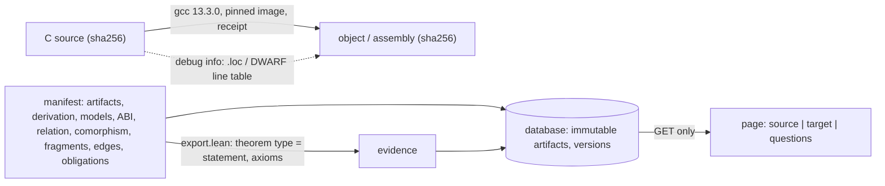

# A verified compiler explorer: problems, mappings, comorphisms

A compiler explorer puts a source program beside the target code a compiler made from it and
links fragments of the two. This page describes a first vertical slice of one whose links and
claims are statements in Lean, with their status decided from the Lean build:

* a generic Lean API: compilation problems, segment mappings, and relations generated by
  comorphisms (`Silmaril.Compiler.Explorer`);
* its instance for C functions, Cerberus Core and x86-64 (`Silmaril.Project.CompilesTo.Explorer`),
  over the existing segment proofs of [compiles-to](compiles-to.md);
* an evidence exporter that decides each obligation from the Lean environment
  (`tools/compiler-explorer/export.lean`);
* a database and a read-only API (`tools/compiler-explorer/cexplorer.py`), and a page
  (`tools/compiler-explorer/ui/`);
* fixtures: the compiles-to objects (gcc 13.3.0, pinned by digest) and four staged C programs
  compiled to assembly by the same image (`examples/compiler-explorer/`).



## Four questions, asked separately

| question | Lean | what a "proved" answer means |
| --- | --- | --- |
| **Translation**: does the target implement the source? | `Problem.Valid` | from every entry the convention relates, if the source cannot go wrong and terminates, the target returns with a result the source can produce. No mapping occurs in it. |
| **One link**: is this segment correct? | `Mapping.EdgeValid M k` | the segment from program point `k` is simulated (`Corr.Segment`). |
| **Whole mapping**: are all links correct? | `Mapping.Valid M` | every segment, at every point number, including points nobody listed. |
| **Refinement of a generated relation** | `Mapping.RefinesComorphism M c scope K` | at the points `K`, the mapping's relation implies the relation the comorphism `c` generates on the observables `scope k`. |

They are independent:

* `Problem.valid_of_mapping`: a valid mapping that starts at the entry (`Mapping.Starts`) proves
  the translation.
* `Mapping.valid_of_edges`: valid listed edges make a valid mapping *with coverage*
  (`Mapping.Covers L`: at points outside `L` no states are related).
* `Counterexample.edges_not_valid`: a problem and a mapping that starts at the entry, whose one
  listed edge is valid, whose listed points do not cover it, and whose mapping and translation
  are not valid. A set of individually valid links proves neither.
* A mapping can refine a comorphism relation without being valid, and conversely:
  `branch.c -O2` below has its refinement proved and its segment open.

### Directions

* **Program refinement.** `Problem.Valid` is a forward simulation from a safe source state. The
  target is a deterministic machine (`τ → Option τ`), so its run from an entry is unique and the
  statement says that this run reaches a return state whose result some source run produces. It
  does not say that this is the first return; the C rows' `c.compiles_to` statement adds that
  (`FnData.compilesTo_of_segments`, through `wholeFirst_of_segments`). A nondeterministic or multithreaded target needs a backward
  statement over all its runs; the API does not provide one yet (below).
* **Relation refinement.** `M.RefinesAt G K` says that the mapping's relation is at least as
  strong as `G` on `K` (`M.rel k ⊆ G k`). `Problem.Valid.mono`: a stronger entry convention and
  weaker return and result conditions keep a translation valid.

### Undefined behaviour, divergence, I/O, nondeterminism, concurrency

* Source undefined behaviour (`Source.wrong`) permits every target behaviour: each statement
  assumes `Source.Safe`, which also asks that every source run terminates. **Divergent sources
  are not covered.**
* Non-vacuity is separate (`Problem.Inhabited`; per C function `Task.<f>_safe`, open, and the
  canonical-entry row, proved for the examples): a valid translation whose source is never safe
  says nothing.
* Source nondeterminism (Core's unsequenced operands) is handled by the existential over source
  runs.
* I/O: there is no event trace; what is observed is the `result` relation (for C functions, the
  System V return: callee-saved registers, frame-only writes, the value in `rax`).
* Concurrency: one deterministic target thread. Replacing x86 by a multithreaded model changes
  `Problem.tgt` into a relation and `Valid` into a backward statement; `Mapping`, the comorphisms
  and the database are unaffected.

## Segment relations

The explorer keeps two kinds of link, which it never mixes:

* **Navigation links** come from the compiler's debug information: the DWARF line table read by
  `tools/c-tv` for objects, and the `.loc` directives of `gcc -S` for assembly (as Compiler
  Explorer does). They say where code came from. They carry no obligation.
* **Semantic links** are program points of a Lean correspondence (`FnData.mapping`): the source
  fragment is the C statement of the point (`PointOf F k line`, proved by `rfl`), and the target
  fragment is where the segment starts, laid out up to the next point. The proved statement is
  about the run from that point to the next one it reaches, which may jump (`branch.c`'s `if`).

What a line table shows, seen in the fixtures:

| phenomenon | where |
| --- | --- |
| one line, several discontiguous instruction ranges | `msort.c -O2`, line 8 (inside the inlined `merge`) |
| one line, copies in several functions (duplication) | `lisp.c -O2`: `cons` and `mk` inlined into `read` and `eval` |
| a call with no code of its own (inlining, elimination) | `msort.c -O2`, line 24 (`merge(…)`) |
| instructions from another file | `lisp.c -O2`: 16 instructions of `putchar` from `bits/stdio.h` |
| generated code (prologue, argument spills) | `-O0`: attributed to the opening brace |
| a statement-level point impossible | every `-O2` object: c-tv's reason is shown on the link |
| optimized-away or partially covered source | listed in the page's footer |

**Fragments** are sets of ranges in one artifact's coordinate space (bytes of a text, or `.text`
offsets of an object), identified by `sha256(artifact sha256 : space : ranges)`. A fragment's
identity therefore changes when the artifact's bytes do, not when a line number is reused.

## The DWARF comorphism and its refinement theorem

An observation logic (`ObsLogic S V`) has observables and a relation `Holds s o v`. A comorphism
(`ObsComorphism`) reads each source observable at a target observable; it is the signature part
of an institution comorphism whose sentences are the equations `o = v`. There is no model
translation: a machine state does not determine a Core state. The relation it generates on
observables `Φ` (`Generated`) says that each observable of `Φ` has a value holding in the source
and, translated, in the target. Generated relations compose through a functional middle logic
(`generated_comp`, for multi-stage pipelines such as C → LLVM IR → x86) and, for functional
logics, fix every observed value (`generated_iff`).

For C functions (`Silmaril.Project.CompilesTo.Explorer`):

* `coreObjects`: a C object holds `n` when its symbol is bound, in the Core environment, to an
  allocation whose `int` slot holds `n` in the Core memory (`Locals.Slot`);
* `frameSlots`: a DWARF frame location (`DW_OP_fbreg off`, frame base the CFA) holds `n` when its
  bytes are the little-endian bytes of `n`;
* `dwarf`: each C object is read at its DWARF location: what a debugger does.

`FnData.refines_dwarf` proves, for **every** function, that the mapping's relation implies the
relation `dwarf` generates on the objects with a value at each point. The proof goes through the
verified Core library's invariant (`StateMem.Inv`): it binds the object's symbol to its allocation
and puts its definition in the Core slot, and `ObjectsAgree` puts the same definition in the
DWARF slot. Together with a valid mapping, this is the statement "at every point the run passes,
a debugger reading the DWARF locations of the defined objects shows a value the C object holds".
The source logic is not functional (a slot fixes four bytes, not an integer), so it says *a*
common value, not that every read agrees.

The generic construction for the usual case is `Mapping.ofComorphism` (a frame relation and the
generated relation); `ofComorphism_refines` is its specification. The C instance is not built by
it: its relation is richer (control, stack, the library invariant), and the refinement theorem is
what connects them.

## Persistence and statuses

`cexplorer.py` stores (schema version 1, `schema_migrations`):

* `artifacts`: bytes by SHA-256, insert-only; ingest re-reads every file a manifest names and
  rejects it unless its SHA-256 and size are the manifest's;
* `problem_versions`: one per manifest (by its SHA-256), with direction (`compiled`,
  `decompiled`, `imported`), derivation, models, ABI, relation and comorphism, Lean family,
  names and modules, and a context hash over all of them; `problems` points at the current one;
* `fragments`, `edges`, `edge_ends`: the many-to-many mapping;
* `obligations`: statement and declaration, or the reason none is stated;
* `evidence`: exporter results, bound to the manifest SHA-256 and context hash;
* `tests`: executions, bound to the SHA-256 of the code they ran;
* `rejections`: every refused manifest or evidence file, with the reason.

Checks on ingest: artifact bytes; a compiled problem's receipt is about its source and target
bytes and its image is the derivation's; fragment ids are their content addresses; edge ends
are fragments of the right side; every statement is the template of its obligation kind applied
to the manifest's Lean names (`TEMPLATES`: a manifest cannot pair an obligation with `True`);
registered artifacts (`silmaril/artifacts.toml`) are the artifacts the Lean values read. Evidence
is accepted only for a manifest the database holds, with the same modules, statements and
declarations, a recorded Lean version and commit, and the standard axioms for `kernel`.

| status | meaning |
| --- | --- |
| proved | the exporter found a theorem whose type is the statement (up to reducible unfolding) with the standard axioms, for this manifest |
| open | stated in Lean, no proof named |
| unchecked | a proof is named, no exporter result recorded |
| rejected | the exporter found the named proof absent, not a theorem, about another statement, or with other axioms |
| stale | proved for another version of the problem only; evidence never moves between versions |
| unsupported | not stated: no model covers it (with the reason) |

Tests have their own statuses (passed, failed, stale) and never make an obligation proved.

**Trust.** The exporter reads theorems from the `.olean` files Lake built; their proofs were
checked by Lean's kernel then. The database trusts the exporter's output file (it does not run
Lean); `check.sh` produces both in one run. The server opens the database read-only, answers GET
only, serves three fixed files and two JSON routes, sets a restrictive Content-Security-Policy,
and has no endpoint that compiles or runs anything. The page inserts every text with
`textContent`.

## The page

`python3 -I tools/compiler-explorer/cexplorer.py serve DB` (127.0.0.1:8765). The source is on the
left, the target on the right (the object's `objdump` listing, or the assembly), and the side
panel has the selection, the four questions, other obligations (elaboration, artifact identity,
non-vacuity), tests, provenance and assumptions. **Links** switches between debug-info and
semantic links; hovering or clicking a line highlights every link through it on both sides. The
**Build** selector chooses among precompiled builds; nothing is compiled on request.

## Fixtures and results

`examples/compiler-explorer/` (see its README). Statuses from `tools/compiler-explorer/check.sh`
at the commit of this page:

| problem | translation | mapping | links | refinement | ABI (enterable) | non-vacuity |
| --- | --- | --- | --- | --- | --- | --- |
| `straight.c -O0 add3` | proved | proved | 5/5 | proved | proved | canonical proved, universal open |
| `straight.c -O2 add3` | proved | proved | 1/1 | proved | proved | canonical proved, universal open |
| `branch.c -O0 max2` | proved | proved | 5/5 | proved | proved | canonical proved, universal open |
| `branch.c -O2 max2` | open | open | 0/1 | proved | open | open |
| `loop.c sum_to` (both) | unsupported: the elaborator has no `while` | | | | | |
| `hello`, `msort`, `fft`, `lisp` (`-O0`, `-O2`) | unsupported | unsupported | debug info only | unsupported | unsupported | executions match the expected output (tests) |

Every proved row also has its C-to-Core points, the elaboration (`c.elaborates_to`) and the
object's code at the function's symbol (`elf.object_fn`, through the artifact registry) proved.

## Acceptance

| requirement | state |
| --- | --- |
| Abstract API: problem, independently chosen models, arbitrary relations, identities, provenance | done: `Problem`, `Mapping`, `ObsLogic`, `ObsComorphism`; identities in the manifest and database |
| Comorphism-generated relations, reusable theorems, separate refinement theorem | done: `Generated`, `generated_comp`, `generated_iff`, `ofComorphism`, `RefinesComorphism`; `FnData.refines_dwarf` |
| Grounded in existing semantics, no sorry/axiom | done: over `Corr`/`whole_of_segments`, Cerberus Core and `X86.Open.isa`; standard axioms only |
| Direction, UB, I/O, divergence, nondeterminism, concurrency stated | done (above and in `Defs`) |
| Per-edge vs whole-mapping, coverage, counterexample | done |
| Navigation vs semantic links, many-to-many, discontiguous, inlining, duplication, elimination | done for display; semantic links exist only where c-tv has points |
| Content-addressed fragments | done |
| Database: immutable artifacts, direction, derivation, models, ABI, relation, comorphism, obligations, evidence, versions, stale rejection, tests ≠ proofs | done (`cexplorer.py`, 27 tests) |
| Page: source/target, build selection, highlighting, distinct question cards, honest states | done; screenshots in the pull request |
| Interactive compilation | not done by design: no sandboxed compile service exists here |
| Decompiled direction | data model only: no decompiled fixture (`sil decompile` exists, no C output to pair) |
| hello, merge sort, FFT, tiny Lisp | compiled, linked, run and navigable; no semantics (unsupported) |
| Wiring into `make check`, CI and `sil project`'s database and Pages | not done: hot spots of open pull requests (#900–#943, #890) |

## Residual work

* Statement templates per family live in `cexplorer.py`; a Lean-side registry of obligation
  shapes (as `sil project` shapes) would make them data.
* A backward refinement statement for nondeterministic and multithreaded targets, and the Wasm
  and LLVM instances.
* Semantic links for more of C: loops, calls, memory; universal safety (`Task.<f>_safe`).
* Integration with the C TV stack's `TV.Provenance`/`TV.Profile` (#894, #911) and the explorer's
  C and assembly tabs (#900, #890) once they land, and with `sil project` records.

## Build

```sh
tools/compiler-explorer/check.sh            # Lean modules, manifests, exporter, database, tests
python3 -I tools/compiler-explorer/cexplorer.py serve .lake/compiler-explorer/explorer.sqlite
python3 -I tools/compiler-explorer/fixtures.py build      # Docker: recompile the programs
python3 -I tools/compiler-explorer/fixtures.py listings   # Docker: re-list the objects
```
