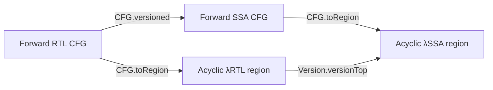

# LambdaIter family and flat CFG semantics

The two flat graph representations below have different variable interfaces. The forward
three-address graph uses named registers and a shrinking suffix of a block list. The typed
Isotope graph uses positional variables and finite labels, with a shared captured context and a
typed payload per label. The suffix semantics can report an earlier label as an exit. The finite
Isotope graph can instead follow cyclic internal edges.

**Scope.** “Absent” refers to the identified current headers and implementation files in the
row. “Not audited” leaves the question open. The model hypotheses listed here govern the stated
comparisons.

| Calculus or boundary | Syntax, semantics and models | Translations, institutions and missing comparisons |
| --- | --- | --- |
| LetSeq | [Locally nameless syntax](../../Silmaril/Raw/SSA/Isotope/LetSeq.lean), proof-relevant typed [monadic denotation](../../Silmaril/Raw/SSA/Isotope/LetSeq/Semantics/Monadic.lean), and [`eval_iff_denote`](../../Silmaril/Raw/SSA/Isotope/LetSeq/Semantics/OperationalDenotation.lean) for finite outcomes. The comparison uses `StateT σ SetM`, a compatible instruction relation and matching encoded free and bound environments. [`syntacticModelIsInitial`, `semantic_iff`](../../Silmaril/Raw/SSA/Isotope/Theory/Models/LetSeq.lean) concern operation algebras satisfying the base equations. | [`LetSeq.inst`](../../Silmaril/Raw/SSA/Isotope/Institution/LetSeq.lean) gives the equational institution. [`seqCaseCoHom`](../../Silmaril/Raw/SSA/Isotope/Institution/Inclusions.lean) has [unconditional borrowing](../../Silmaril/Raw/SSA/Isotope/Institution/Borrowing.lean). The inclusion preserves [typed monadic denotation](../../Silmaril/Raw/SSA/Isotope/Morphism/SeqCase/Monadic.lean) and preserves and reflects [operational evaluation](../../Silmaril/Raw/SSA/Isotope/Morphism/SeqCase/Operational.lean). Full Freyd categorical initiality and an ITree comparison were not audited. |
| LetCase | [Locally nameless syntax](../../Silmaril/Raw/SSA/Isotope/LetCase.lean) with sums and case; proof-relevant typed [monadic denotation](../../Silmaril/Raw/SSA/Isotope/LetCase/Semantics/Monadic.lean). [`eval_iff_denote`](../../Silmaril/Raw/SSA/Isotope/LetCase/Semantics/OperationalDenotation.lean) has the same comparison hypotheses as LetSeq. [`syntacticModelIsInitial`, `semantic_iff`](../../Silmaril/Raw/SSA/Isotope/Theory/Models/LetCase.lean) concern the base equational algebras. | [`LetCase.inst`](../../Silmaril/Raw/SSA/Isotope/Institution/LetCase.lean), [`caseIterCoHom`](../../Silmaril/Raw/SSA/Isotope/Institution/Inclusions.lean) and [unconditional borrowing](../../Silmaril/Raw/SSA/Isotope/Institution/Borrowing.lean). The inclusion has [monadic](../../Silmaril/Raw/SSA/Isotope/Morphism/CaseIter/Monadic.lean) and [operational](../../Silmaril/Raw/SSA/Isotope/Morphism/CaseIter/Operational.lean) agreement. [`CaseSSA`](../../Silmaril/Raw/SSA/Isotope/Morphism/CaseSSA.lean) embeds expressions into Isotope λSSA with [operational agreement](../../Silmaril/Raw/SSA/Isotope/Morphism/CaseSSASemantics.lean). Full Freyd categorical initiality and an ITree comparison were not audited. |
| LetIter | [Proof-relevant `sound` and `categorical_denote_eq`](../../Silmaril/SSA/Isotope/LetIter/Thms.lean) compare equations and their Kleisli arrows for lawful Elgot monads. [Thesis categorical models](../../Silmaril/SSA/Thesis/Categorical/Thms.lean) give initiality into their strong Elgot Freyd models with the thesis model laws and typing coherence. The two formulations have an [explicit bridge](../../Silmaril/SSA/Isotope/Bridge/Thms.lean). [Closed let-η counterexample](../../Silmaril/SSA/Isotope/LetIter/Counterexample/Thms.lean) limits soundness for the weaker unrestricted exact categorical interface. | [`LetIter.inst`](../../Silmaril/Raw/SSA/Isotope/Institution/LetIter.lean) is equational. [`iterSSAIso`](../../Silmaril/Raw/SSA/Isotope/Institution/Observational/Isomorphism.lean) is an isomorphism after the observational quotient, for single-exit λSSA. [`Silmaril.Semantics.ITree`](../../Silmaril/Semantics/ITree/Thms.lean) supplies a lawful Elgot model and [`ITree.Interpret.initial`](../../Silmaril/Semantics/ITreeInterpret/Thms.lean) gives unique interpretation for a handler into a lawful Elgot monad under the tree smallness hypothesis. The [written-source tree development](../../Silmaril/SSA/Isotope/LetIter/PaperExpression/Source/FreeTree/Response/Thms.lean) has its own hypotheses and observations. Its full coverage was not audited here. |
| Acyclic λSSA and acyclic λRTL | The named [`Region`](../../Silmaril/SSA/LambdaRTL/Defs.lean) has lexical `evalSSA` and mutable `evalRTL`. The instruction `Model` is over one value carrier with monadic operations and total input stores. [`evalObs_eq_evalSSA` and `evalObs_eq_evalSSA_of_isSSA`](../../Silmaril/SSA/LambdaRTL/Thms.lean) drop the final store and assume `LawfulMonad` plus `NoClobber` or `IsSSA`, respectively. | [`ssaToRTL`](../../Silmaril/SSA/LambdaRTL/Institution/Defs.lean) goes from SSA to the observation-only RTL institution. `rtlFull` observes the final store as well. [`versionTop_evalSSA`](../../Silmaril/SSA/LambdaRTL/Version/Thms.lean) and [`versionCoHom`](../../Silmaril/SSA/LambdaRTL/Version/Institution/Defs.lean) go in the other direction using initial version zero and `unpair (pair a b) = pure (a, b)`. A typed store model and categorical interpretation are absent from these headers. |
| λSSA with general CFGs | Isotope [`Region` and `Region.Eval`](../../Silmaril/SSA/Isotope/LambdaSSA/Defs.lean) use positional variables and jumps. [`Region.denote`](../../Silmaril/Raw/SSA/Isotope/LambdaSSA/Denotation/Monadic/Region.lean) uses exact typing, typed label coproducts and Elgot iteration. The [categorical graphs](../../Silmaril/SSA/Isotope/LambdaSSA/Categorical/Thms.lean) use distributive Freyd structure with strong Elgot iteration for regions. [`categoricalTermDenote_eq` and `categoricalRegionDenote_eq`](../../Silmaril/SSA/Isotope/LambdaSSA/Kleisli/Thms.lean) specialize to Kleisli models with the corresponding typing-coherence premises and a lawful Elgot monad for regions. | The [observational compilations](../../Silmaril/Raw/SSA/Isotope/Institution/Observational/Compilations.lean) and quotient isomorphism above use operational observations. [Machine RTL](../../Silmaril/Machine/RTL/Thms.lean) is a separate SSA-form register machine; `toLambdaSSA_eval_iff` assumes a matching call oracle, and [`ofLambdaSSA_eval_iff`](../../Silmaril/Machine/OfLambdaSSA/Thms.lean) is restricted to `RootFits`. A general typed operational-to-monadic adequacy theorem for this row was not audited. |
| λRTL with loops | [`Loop.Region`](../../Silmaril/SSA/LambdaRTL/Loop/Defs.lean) extends the named syntax with a self-recursive handler. [`Loop.Region.evalObs_eq_evalSSA_of_isSSA`](../../Silmaril/SSA/LambdaRTL/Loop/Thms.lean) uses a lawful Elgot monad and the loop SSA judgment. | [`acyclicToLoopSSA` and `loopSSAToRTL`](../../Silmaril/SSA/LambdaRTL/Loop/Institution/Defs.lean) are comorphisms at the exit/payload observation. A lowering of those loops to the forward CFG is absent from these headers. |
| Flat typed SSA | [`FiniteCFG.HasType` and `erase_hasType_iff`](../../Silmaril/Raw/SSA/Isotope/LambdaSSA/Flat.lean) relate heterogeneous block arguments and typed exits to ordinary λSSA CFG typing. [`encodeCFG_hasType`](../../Silmaril/Raw/SSA/Isotope/Morphism/SSAIter/Encode.lean) checks the finite-sum LetIter encoding. | [`encodeCFG_eval`](../../Silmaril/Raw/SSA/Isotope/Morphism/SSAIter/Correctness.lean) preserves finite evaluation under matching captured environments and the same primitive relation. [`encodeCFG_diverges`](../../Silmaril/Raw/SSA/Isotope/Morphism/SSAIter/Divergence.lean) is the forward divergence comparison. A translation between this representation and the named forward graph is absent from the cited modules. A separate flat institution and an ITree-specific adequacy result were not audited. |
| Forward flat SSA / mutable RTL | [`CFG`, `flatten`, `toRegion`, `run`](../../Silmaril/SSA/LambdaRTL/CFG/Defs.lean) operate on explicit block arguments. [`run_flatten` and `run_eq_toRegion`](../../Silmaril/SSA/LambdaRTL/CFG/Thms.lean) preserve the full mutable result in a lawful monad. | [`validate_obs_eq_evalSSA`](../../Silmaril/SSA/LambdaRTL/CFG/Version/Thms.lean) requires validator acceptance and a dominance-scoped source region. `validate_versionTop_obs` replaces source SSA with the pair law and version-zero input. Both compare to the existing **region** semantics. At the audited baseline, a direct lexical runner for forward blocks was absent. Classical φ syntax, global name uniqueness and a flat CFG institution are outside this bridge. |
| Cyclic named flat RTL and SSA | [`Cyclic.step` and `Cyclic.run`](../../Silmaril/SSA/LambdaRTL/CFG/Cyclic/Defs.lean) search the full table for each jump and iterate on the incoming label, payload and store. [`Versioning.compile`](../../Silmaril/SSA/LambdaRTL/CFG/Cyclic/Version/Defs.lean) generates a flat table with block-local SSA and packed edge arguments. | [`Cyclic.run_eq_forward`](../../Silmaril/SSA/LambdaRTL/CFG/Cyclic/Thms.lean) compares the full outcome when table and suffix lookup agree on every named block's syntactic targets. [`Versioning.run_commutes`](../../Silmaril/SSA/LambdaRTL/CFG/Cyclic/Version/Thms.lean) compares exit and payload for the compiled graph, with version-zero inputs, a lawful Elgot monad and the pair law. |
| Named compiler to typed Isotope | [`NamedFlat.compileTyped`](../../Silmaril/SSA/Isotope/Bridge/NamedFlat/Thms.lean) elaborates the generated named table and checks exact capture, packet and exit types for the product and primitive fragment, including case on primitive sums. | [`entry_iff` and `step_iff`](../../Silmaril/SSA/Isotope/Bridge/NamedFlat/Thms.lean) compare finite entry and internal-step outcomes with numbered Isotope labels. The comparison uses shared stateless partial primitives and tagged values. [The whole-run bridge](../../Silmaril/SSA/Isotope/Bridge/NamedFlat/WholeRun/Thms.lean) extends this to whole finite lexical runs, with an exact capture packet for the packed endpoint. |

The public thesis formalization provides a separate reference point. Its
[`TypedDominanceWellFormedFlat`](https://github.com/imbrem/thesis/blob/69a8126f2d3eb6d32050e0bd9511251b33dbcea7/formalization/thesis/Isotope/TAC/Bridge/DomFlatSemantics.lean)
denotes via a typed chosen dominator tree. `CoherentReordering` carries the evidence that
the reorderings have equal lexicalizations. The thesis also proves a direct complete-Elgot
[`denote_convert_cfg`](https://github.com/imbrem/thesis/blob/69a8126f2d3eb6d32050e0bd9511251b33dbcea7/formalization/thesis/Isotope/TAC/Densem/MonadicValid.lean)
for its φ-free classical source CFG, assuming the model's failure law and an input defined
on the source variables. These use the thesis graph and store definitions.

## Forward CFG agreement

`CFG.runSSA` executes the same forward block list as `CFG.run`. It gives each
selected block the graph's original environment and the incoming parameter.
The mutable runner instead extends the store at the jump site. The same suffix
order governs both runners, including when a label is repeated.



The vertical paths preserve the mutable result and the lexical result,
respectively, by `CFG.run_eq_toRegion` and `CFG.runSSA_eq_evalSSA`. The names and
labels have decidable equality, and both comparisons use a lawful monad.
`CFG.versioned_toRegion` states the exact equality
`g.versioned.toRegion = Version.versionTop g.toRegion`.
`CFG.versioned_runSSA` uses it to give the same exit label and payload from
either path, assuming the pair law and source inputs at version zero.
`CFG.versioned_isSSA` gives dominance-scoped SSA, and
`CFG.versioned_blockLabels` preserves the ordered block-label list including
repetitions.
[Flat versioning header](../../Silmaril/SSA/LambdaRTL/CFG/Version/Flat/Thms.lean)

`CFG.ofRegion?` recognizes precisely the image of `CFG.toRegion`. It peels
outer joins to recover the block list and keeps conditional terminators inline.
The existence proof shows that structured versioning preserves this image.
At runtime the total `CFG.versioned` runs the structured versioner and the
reifier, using an erased proof that the reifier succeeds. This preserves
the original labels and the forward suffix lookup convention, including
targets absent from the current suffix.
[Reifier definitions](../../Silmaril/SSA/LambdaRTL/CFG/Version/Flat/Defs.lean)

For running the **same** CFG in both modes,
`CFG.runSSA_eq_obs_of_isSSA` uses the readback's `IsSSA` judgment with the same lawful monad.
[Forward CFG theorem header](../../Silmaril/SSA/LambdaRTL/CFG/Lexical/Thms.lean)

The diamond regression has two named branch blocks and a shared join. The
unversioned mutable graph returns 12 or 21 after overwriting a live-in, whereas
reading the same graph lexically leaves the original value 7 at the join. The
generated flat graph passes the new value in its jump argument and gives
the two mutable results. The regression checks that the generator returns
the expected block list and both runs compute directly on that output.
[Checked regression](../../Silmaril/SSA/LambdaRTL/CFG/Lexical/Examples/Thms.lean)

```sh
lake build --wfail Silmaril.SSA.LambdaRTL.CFG.Version.Flat.Thms \
  Silmaril.SSA.LambdaRTL.CFG.Lexical.Examples.Thms \
  Silmaril.SSA.LambdaRTL.CFG.Version.Examples.Thms
```

## Cyclic named CFG execution

`Cyclic.step` uses first-match lookup in the whole block table. A hit writes
the parameter in the incoming store and executes one block, so a transfer
can reenter an earlier block. A missing label exits with the label, argument
and store. The entry executes once, then `Cyclic.run` iterates the step.
`Cyclic.IsForward` compares lookup results for every syntactic target of each
named block, using the suffix after that block. The entry searches the whole
table in both modes. The agreement proof uses lawful monadic sequencing and
the iteration fixpoint law.
[Cyclic semantics and agreement](../../Silmaril/SSA/LambdaRTL/CFG/Cyclic/Thms.lean)

The `Part` regression counts down along `10 → 20 → 10`, incrementing a
register on each visit to block 20. After two back-edge transfers, full-table
lookup exits at label 99 with payload 2 and final registers `(0, 2)`. The forward
runner exits on the first backward transfer at label 10 with payload 1 and
final registers `(1, 1)`.
[Finite back-edge trace](../../Silmaril/SSA/LambdaRTL/CFG/Cyclic/Examples/Thms.lean)

### Cyclic versioning

`Versioning.compile` collects a finite support from the syntactic free reads
of the entry and all named bodies. Every internal edge carries the original
argument plus that support's register values, omitting the destination's
parameter because the argument replaces it. The first matching label fixes
the packet layout. Missing labels keep the original exit payload. Each target
block decodes its packet into fresh local versions before executing its body.
Reentry starts a new lexical scope with the block parameter as its only free
variable. Version-zero inputs supply the entry context. Register and label
names need decidable equality, and the support comes from the graph alone.
[Compiler definitions](../../Silmaril/SSA/LambdaRTL/CFG/Cyclic/Version/Defs.lean)

`entry_commutes` and `step_commutes` are equalities of effectful computations
in the same lawful monad. They reuse the same primitive interpretation and
require `unpair (pair a b) = pure (a, b)` for the inserted tuple decoders.
`run_commutes` uses `iter_obs_of_step_encoding` in a lawful Elgot monad to
preserve the exit and payload. The generated countdown uses the same back
edges and returns payload 2 at exit 99. This result concerns the named flat
table and its block-local SSA scopes. The typed Isotope dispatcher adapter
has a separate syntax and interface.
[Cyclic versioning theorems](../../Silmaril/SSA/LambdaRTL/CFG/Cyclic/Version/Thms.lean)

```sh
lake build --wfail Silmaril.SSA.LambdaRTL.CFG.Cyclic.Version.Thms \
  Silmaril.SSA.LambdaRTL.CFG.Cyclic.Examples.Thms
```

### Named compiler to typed Isotope

`NamedFlat.compileTyped` runs the named cyclic compiler before scoping and
checking its output. Callers supply the version-zero capture names and their
types, the ordered external labels, the heterogeneous packet and exit
profiles, and each primitive's exact source and result types. First-match
lookup numbers the named blocks before the external labels. Blocks can
access their packet parameter and the locals they bind. Their shared
Isotope capture slots remain inaccessible to source block code. A packet
type uses products for the original payload and the destination's slots.
The fragment accepts variables, unit, products, primitive applications,
single and pair bindings, and cases on sum-valued operands. Explicit
injections and abort are rejected by this adapter, and callers supply the
profile for the checker.
[Scoped elaboration and type checking](../../Silmaril/SSA/Isotope/Bridge/NamedFlat/Thms.lean)

The finite semantic comparison uses tagged Isotope values for the named
model, with ordinary partial pair and sum destructors. The primitive
relation is membership in the shared `Part` implementation, with
`Unit` state. Entry environments agree at the named captures. An internal
step runs the selected block with the same incoming packet in both
presentations. These are comparisons with erased `Region.Eval`; a typed
model also needs primitives that respect the supplied type profile.
The countdown's original implicit numeric split has a checked obstruction
for every common finite countdown type in its packet profiles. The
discriminant type would have to be its own right summand. Exposing
classification as a `num → num + num` primitive on the same source loop
allows the generated table to check. Its entry and the `20 → 10`
transfer agree at the numbered label and updated packet.
[Countdown interface regression](../../Silmaril/SSA/LambdaRTL/CFG/Cyclic/Examples/Thms.lean)

### Closing the generated entry for the dispatcher

`NamedFlat.Capture.close` takes a checked graph and a closed expression of
the exact type `Region.packedInputType β.toList`, where `β` is the graph's
capture profile. The graph evaluates that expression once and destructures
its result before entering the original code. The input can come from a
caller-supplied primitive. The adapter retains the same block labels and
erased bodies and checks the blocks again in scopes containing only their
typed incoming parameters. It returns an `Option` whose successful result
carries `HasType .nil R E` and the erasure equations. Its execution proofs
use those equations. Acceptance is checked for each supplied graph and packet
producer.
[Capture closure and finite execution](../../Silmaril/SSA/Isotope/Bridge/NamedFlat/Capture/Thms.lean)

When the packet expression has exactly the original environment's packed
values and the initial primitive state as its sole finite outcome,
`entry_eval_iff` preserves and reflects entry evaluation. `graph_eval_iff`
uses `Follow.map_block` to extend this to whole finite Isotope runs.
`packed_eval_at` then compares the packed dispatcher with the original open
graph, preserving the exit index in the packed sum, the payload, and the
final primitive state. The classified countdown exercise closes the actual
compiled graph over both captures, follows two back edges, and returns
payload 2 at external slot zero.
[Closed countdown regression](../../Silmaril/SSA/LambdaRTL/CFG/Cyclic/Examples/Thms.lean)

### Whole finite runs from the named compiler

`NamedFlat.compile_run_iff` composes the entry and transfer theorems on the
table produced by `Versioning.compile`. It consumes the exact elaboration
equation carried by a successful `compileTyped`. The named runner and Isotope
share tagged values and one stateless `Part` primitive implementation, and
the entry environment agrees with the named store at every capture's
version-zero name. Induction on `Part.Runs` and on Isotope's `Follow`
constructs a finite exit witness in both directions. Successful named jump
targets have a number because elaboration checks every branch target.
[Finite execution correspondence](../../Silmaril/SSA/Isotope/Bridge/NamedFlat/WholeRun/Thms.lean)

The generated destination packet is already a tagged value and is passed
unchanged to the Isotope block parameter. A named hit uses the first matching
block's index. A miss at the first occurrence `e` in the explicit exit list
has raw jump index `blocks.length + e`, and `Follow` reports external index
`e`. `numberExit` maps the named runner's exit observation to that same index
and payload. With an accepted capture closure and a state-preserving producer
of the exact original capture packet, `packed_run_iff` gives exit zero with
`packedExitValue e payload`, which is `e` right injections around one left
injection of the original payload. The finite proof observes primitive outcomes. Divergence and ITree events
require different observations.

`mutable_packed_run_iff` composes `Versioning.run_commutes` with
`packed_run_iff`. The shared tagged-value `Part` model satisfies the pair
law because its destructor immediately returns the two fields of a
constructed pair. The source starts with the version-zero store, and
`obs` retains its exit label and payload. The Isotope hypotheses remain
accepted elaboration, capture agreement, and the exact state-preserving
capture packet.
[Mutable source corollary](../../Silmaril/SSA/Isotope/Bridge/NamedFlat/WholeRun/Thms.lean)

The classified countdown uses the actual compiled graph and both captures.
The named runner exits at label 99 with payload 2, which the open graph reports
at external slot zero and the packed graph reports with its sum tag. Five
named step calls leave the jump to 99 pending. The sixth call observes the
exit because table lookup misses. The packed evaluation also reflects back
to the mutable source's numbered exit with the same payload.
[Checked named and packed countdown](../../Silmaril/SSA/LambdaRTL/CFG/Cyclic/Examples/Thms.lean)

### Infinite internal paths

`NamedFlat.InfiniteRun` witnesses a successful entry followed by a sequence
of successful internal `stepSSA` transfers at every natural-number position.
`compile_infinite_run_iff` compares that witness with Isotope divergence on
the actual graph admitted by `compileTyped`, using the same version-zero
capture agreement and shared stateless `Part` primitives. The forward map
numbers each transfer by the first matching block. The reverse map lifts the
selected Isotope path to a named transfer at each position, preserving its
label index and tagged payload. Atomic Isotope divergence on a flat table can
only continue by completing successive internal block evaluations. Each
individual flat body has finite syntax and contains no nested CFG.
[Infinite execution correspondence](../../Silmaril/SSA/Isotope/Bridge/NamedFlat/Infinite/Thms.lean)

`Capture.diverges_iff` transports the path using entry and block evaluation
under the exact state-preserving capture packet. `packed_infinite_run_iff`
then applies the existing dispatcher may-divergence theorem for atomic
instructions. A separate primitive-local divergence predicate would need its
own correspondence. Undefined `Part` results supply no such predicate, and
neither comparison observes visible ITree events.

The same two-capture table admits a primitive interpretation that repeats
`10 → 20 → 10` indefinitely. A second interpretation leaves classification
undefined at the first block. Both runners return `Part.none`. Only the
repeating interpretation has an infinite transfer witness and packed
divergence.
[Repeated back edge and stuck-primitive regression](../../Silmaril/SSA/LambdaRTL/CFG/Cyclic/Examples/Thms.lean)

### Visible requests on the generated named table

`treeModel` instantiates the existing named evaluator with the same tagged
values and primitive trees as erased Isotope. Its carrier sits one universe
above the event replies, as in `Interaction.Typed.ModelTree`. The local
`entry_tree` and `step_tree` equalities preserve each request and every reply
continuation, including the tagged packet at the next jump. The hypotheses
are successful elaboration and matching initial captures. Each side uses the
same primitive evaluator, so a primitive's supplied tree determines its
behavior. The proof preserves the existing erased semantics for structural
shape mismatches.
[Entry, step, and whole-run ITree theorems](../../Silmaril/SSA/Isotope/Bridge/NamedFlat/ITree/Thms.lean)

`compile_run_tree` consumes the elaboration equation carried by the actual
`compileTyped` result. It lifts the local equations through weak ITree
feedback using naturality, uniformity, and codiagonal. The first matching
block determines the internal index. External returns use their first
position in the exit list. Total numbering uses a sentinel for unlisted
names, which successful elaboration excludes from all written branches.

`Interaction.flat_rename_tree` preserves the tree of an erased flat body
when the environments agree at each renamed in-scope position. It lifts
agreement through local binders. The capture decoder uses this lemma with
the actual product-field renaming. In feedback, the closed block's sole
original slot is its incoming tagged packet. The closure's block erasure
equation and agreement on that slot identify the block trees.
[Scoped erased-tree transport](../../Silmaril/SSA/Isotope/LambdaSSA/Semantics/ITree/Scoped/Thms.lean)

`Capture.graph_tree` accepts an arbitrary producer tree. The typed capture
expression must have the tree of that producer followed by `packEnv n` of
the environment chosen by its reply. The theorem preserves the producer's
requests and continues with the original graph after each returned reply.
`packed_run_tree` also requires the accepted elaboration carried by
`compileTyped`, pointwise agreement with the named version-zero store for
every reply, and `HasType .nil R E` and `Closes` for the closed graph.
`Capture.close` checks the producer expression at the exact type
`packedInputType β.toList`. The packed result uses the original external
index and tagged payload to form the dispatcher's single exit value.
[Effectful capture and packed execution](../../Silmaril/SSA/Isotope/Bridge/NamedFlat/ITree/Capture/Thms.lean)

The fixture checks `Interaction.Typed.Compatible` for typed `Nat` replies
and the exact capture packet. The general corollary applies to its actual
capture-closed table. The resulting packed tree feeds the capture reply
into the seed request and each tick reply into the next tick's operand.
[Typed capture and repeated back-edge requests](../../Silmaril/Proofs/SSA/Isotope/Bridge/NamedFlat/ITree/Examples.lean)

### Refinement through a common capture producer

`packed_run_tree_refines_of_mono` transports a pointwise relation on named
runs to the accepted packed dispatcher. It uses the same effectful producer
on both sides, the exact capture packet equation, and version-zero agreement
at every returned capture value. The relation must be preserved by the
return map that applies `treeExitNumber` and `packedTreeOutput`. The packed
relation must also be preserved by binding pointwise related continuations
to the common producer. When the other continuation also has an accepted
packed dispatcher, its `packed_run_tree` equation rewrites the specification
side to that dispatcher.
[Conditional refinement transport](../../Silmaril/SSA/Isotope/Bridge/NamedFlat/ITree/Capture/Refinement/Thms.lean)

`TraceLE` instantiates the transport with inclusion of finite observations.
Each completed exchange records a request and a reply of its actual reply
type. A path can stop at a prefix, at a pending request (including a request
with no possible reply), or at a return with its result. Weak tree equality
allows substitution on either side and `τ` is invisible. The proofs follow
the same replies through the common producer and show that a pure return map
changes only result endpoints. Literal inclusion of whole `Tree.observe`
nodes fails this bind law because it compares their children by equality.
[Trace definitions](../../Silmaril/Semantics/ITree/Trace/Defs.lean)
· [Trace composition laws](../../Silmaril/Semantics/ITree/Trace/Thms.lean)
· [Whole-node counterexample](../../Silmaril/SSA/Isotope/Bridge/NamedFlat/ITree/Capture/Refinement/Examples/Thms.lean)

`packed_run_tree_traceLE` uses the existing accepted elaboration, typed
closure, capture packet equation and version-zero agreement at each value
returned by the common producer. The regression reuses the generated cyclic
capture fixture and makes seed reply `0` go silent. After capture reply `7`
and seed reply `0`, the richer specification has a terminating trace with
the tagged exit `(0, .inl (atom 0))`. The accepted packed run has no such
trace, and its observations are included in the specification's.
[Packed refinement theorem](../../Silmaril/SSA/Isotope/Bridge/NamedFlat/ITree/Capture/Refinement/Trace/Thms.lean)
· [Directed capture regression](../../Silmaril/Proofs/SSA/Isotope/Bridge/NamedFlat/ITree/Examples.lean)

On deterministic weak trees, `eq_iff_traceLE` equates mutual finite
inclusion with weak tree equality. A terminal observation fixes the return
value, a pending request fixes the indexed event even without replies, and
each exchange gives mutual inclusion after that actual reply. Induction on
observation depth then determines the tree. `Tree.tracePartialOrder` exposes
this order on the existing weak-tree type, where equality already identifies
the weakly equal representatives. `packed_run_tree_eq_iff_traceLE` compares
a packed specification with the whole named run after capture and exit
retagging. The visible capture fixture checks the equivalence and uses the
partial order for its strict comparison.
[Weak tree partial order](../../Silmaril/Semantics/ITree/Trace/Thms.lean)
· [Packed comparison](../../Silmaril/SSA/Isotope/Bridge/NamedFlat/ITree/Capture/Refinement/Trace/Thms.lean)
· [Capture regressions](../../Silmaril/Proofs/SSA/Isotope/Bridge/NamedFlat/ITree/Examples.lean)

Silent divergence contributes only an empty prefix at the point where it
occurs. Inclusion can replace it with further events or a return, so it
does not preserve may-divergence as a positive observation. The relation
compares attainable finite progress and returns. It does not assert
must-termination, fairness, or an infinite-path witness. The equality result
concerns deterministic weak-tree denotations.
[Silent divergence law](../../Silmaril/Semantics/ITree/Trace/Thms.lean)

### Ordered sequencing and feedback

`TraceLE.bind_left` follows the same typed requests through refined
producers and passes the same returned value to a common continuation.
Together with `bind_right`, this gives monotonicity in both arguments.
`out_resume_runs_iff` describes observation of the actual weak Elgot
iterator's resumed body by a finite normalizer run. Recursive returns
continue at the same feedback state in both trees. A final return or
request is preserved, and replies are compared by induction on the
remaining finite trace. This gives pointwise body monotonicity
`TraceLE.iter` for the existing iterator.
[Ordered weak ITree laws](../../Silmaril/Semantics/ITree/Trace/Thms.lean)

`packedExecution_traceLE` lifts entry and block comparisons to the actual
packed CFG executions at a common positional interface. Each block
comparison uses the same incoming packet, and the conclusion applies the
same outward tagging to the result. The primitive interpreters and
ambient environments can differ. The captured back-edge fixture compares
two interpretations that share the capture and seed requests and differ
after tick reply `0`.
[Packed CFG refinement](../../Silmaril/SSA/Isotope/LambdaSSA/Semantics/ITree/PackedTrace/Thms.lean)
· [Capture and back-edge regression](../../Silmaril/Proofs/SSA/Isotope/Bridge/NamedFlat/ITree/Examples.lean)

These laws use finite observations of deterministic weak trees. They give
no arbitrary suprema, preservation of may-divergence, or completeness for
syntactic rewrites.

### Ordered Kleisli semantics and primitive reduct

`WeakKleisli` is the existing Type–Kleisli category of weak deterministic
ITrees with pointwise `TraceLE` on arrows. Composition is monotone in both
arguments, and the categorical iterator is monotone using its existing
coproduct comparison and weak-tree implementation.
[Ordered Kleisli category](../../Silmaril/Semantics/ITree/Kleisli/Thms.lean)

`Program.ofCFG` uses the literal typed singleton representative of packed
execution. Its existing typed denotation agrees with the actual guarded
packed arrow. For two such programs at a common exit interface,
`satisfies_ofCFG_iff` identifies the typed hom order with the comparison of
their erased packed trees. The reflection uses injective pure result
encoding in the same event family.
[Packed semantics and satisfaction](../../Silmaril/SSA/Isotope/LambdaSSA/Semantics/ITree/Ordered/Thms.lean)

`Model.reduct` accepts the existing primitive `SignatureMap` with identity
type component and a bottom-preserving Boolean effect component. The value
carriers and indexed event family are shared. The source and target profile
equations transport typed primitive arguments and results, and the effect
map transports purity witnesses. The erased interpreter precomposes with
the instruction map. `satisfies_map_iff` compares typed satisfaction after
relabelling the already packed representative with satisfaction in the
reduct. The regression identifies two opcodes through a non-injective map
and checks a strict comparison between a silent and a visible packed
program.
[Reduct definition](../../Silmaril/SSA/Isotope/LambdaSSA/Semantics/ITree/Ordered/Thms.lean)
· [Packed relabelling regression](../../Silmaril/Proofs/SSA/Isotope/LambdaSSA/Semantics/ITree/Ordered/Regression.lean)

This comparison uses a shared event family. Type-changing maps and
reflection along event renaming are outside the checked law.

### Relabelling before closure and packing

`FiniteCFG.mapInstr` applies the existing primitive map to the scoped
entry and every block at its original index. The mapped table has the same
capture context and block and exit profiles. `close_mapInstr` runs the
existing capture-closure algorithm on the mapped table and mapped producer.
After projecting out the certificates, its result is the mapped original
result, including failure. The decoder and position of each packed capture
are unchanged.
[Flat table typing](../../Silmaril/SSA/Isotope/LambdaSSA/Flat/InstructionMap/Thms.lean)
· [Executable capture closure](../../Silmaril/SSA/Isotope/Bridge/NamedFlat/Capture/InstructionMap/Thms.lean)

The routed entry and the literal dispatcher commute with relabelling.
`packedExecutionRegion_mapInstr` is a propositional equality of written
region syntax over the target instruction signature. `Program.ofCFG_mapInstr`
also identifies the exact typed singleton representatives using proof
irrelevance for their typing certificates. `satisfies_ofCFG_map_iff` applies
the ordered reduct law to the repacked tables, with an identity type map, a
bottom-preserving Boolean effect map, and a shared event family.
[Packed syntax](../../Silmaril/SSA/Isotope/LambdaSSA/Flat/InstructionMap/Packing/Thms.lean)
· [Ordered satisfaction square](../../Silmaril/SSA/Isotope/LambdaSSA/Semantics/ITree/Ordered/Flat/Thms.lean)

The generated capture fixture maps seed and tick to the same opcode. It
reruns capture closure on the mapped table, then checks the typed packed
equality and strict satisfaction against a silent self-loop. The separating
trace uses the capture reply and follows the back edge to the next tick.
[Capture and back-edge regression](../../Silmaril/Proofs/SSA/Isotope/Bridge/NamedFlat/ITree/Examples.lean)

### Institution of ordered flat comparisons

`FlatInstitution.institution` uses the existing room and corridor API.
A sentence pairs two capture-free typed flat tables with one ordered
external payload profile and the unit entry of packed execution. Each side
keeps its own internal labels and types. Sentence translation maps the
actual tables, with identity and composition checked on the syntax and
proof irrelevance for the typing witnesses.
[Signatures and sentences](../../Silmaril/SSA/Isotope/LambdaSSA/Semantics/ITree/Ordered/Flat/Institution/Defs.lean)

Models are discrete categories of the compatible typed and erased weak
ITree interpretations with fixed atomic carriers and a shared event family.
The signature maps have identity type component and preserve bottom in the
Boolean effect component. Model reduct is the existing primitive reduct.
It respects identity and composition as equality of models. The proof
recovers the typed computations from the erased primitive interpretation
using injective result encoding, then recovers the pure functions on
bottom-effect instructions. The corridor's satisfaction field is the
ordered packed comparison square on the two written tables.
[Institution and functor laws](../../Silmaril/SSA/Isotope/LambdaSSA/Semantics/ITree/Ordered/Flat/Institution/Thms.lean)

An open table is input to the executable partial `Capture.close` front end.
A successful result supplies a capture-free table for a sentence. In the
cyclic non-injective fixture, the institution translates to the table
returned by relabelling and rerunning closure. The corridor checks strict
satisfaction using the existing visible back-edge trace.
[Capture and back-edge regression](../../Silmaril/Proofs/SSA/Isotope/Bridge/NamedFlat/ITree/Examples.lean)

### Edge arguments for a normalized φ port

`Versioning.encode` and `Versioning.step_commutes` show the current
destination-packet contract. On a hit, `Versioning.slots` orders the
stored fields for the destination, and `Version.enc` pairs the original
argument with a right-nested tuple of those fields terminated by unit.
On a miss, the original argument is the exit payload. `Cyclic.stepSSA`
gives the chosen block one packet argument in a fresh lexical invocation.
A lowering of normalized φ rows can supply packets to this same lexical
interface. Its transfer proof needs to show that encoding the incoming
predecessor's row before binding any destinations gives the same values
as simultaneous φ assignment. Predecessor and parallel-edge conditions
belong to that lowering, as described in the thesis crosswalk.
[Edge encoding](../../Silmaril/SSA/LambdaRTL/CFG/Cyclic/Version/Defs.lean)
· [Step theorem](../../Silmaril/SSA/LambdaRTL/CFG/Cyclic/Version/Thms.lean)
· [Thesis crosswalk](lambdassa-theorem-crosswalk.md#conventional-φ-nodes-and-block-arguments)

`NamedFlat.run_iff` applies to an accepted named lexical table with those
packet arguments, with the same shared `Part` primitives and capture
agreement. This endpoint is independent of which lowering produced the
table.
[Lexical whole-run theorem](../../Silmaril/SSA/Isotope/Bridge/NamedFlat/WholeRun/Thms.lean)

```sh
lake build --wfail Silmaril.SSA.Isotope.Bridge.NamedFlat.WholeRun.Thms \
  Silmaril.SSA.Isotope.Bridge.NamedFlat.Infinite.Thms \
  Silmaril.SSA.LambdaRTL.CFG.Cyclic.Examples.Thms
```

```sh
lake build --wfail Silmaril.SSA.Isotope.Bridge.NamedFlat.ITree.Capture.Thms \
  Silmaril.SSA.Isotope.Bridge.NamedFlat.ITree.Examples.Thms
```

### Packing as an institution comorphism

`PackedInstitution.packingComorphism` has the identity signature functor
and uses the same model categories and reduct functors as the flat
institution. A packed sentence compares two written singleton programs
from unit to the sum of one shared external payload profile. Packing
preserves that profile and applies `Program.ofCFG` to each written table.
The packed room evaluates both programs with the existing weak ITree
order.
[Packed rooms and sentence map](../../Silmaril/SSA/Isotope/LambdaSSA/Semantics/ITree/Ordered/Packed/Institution/Defs.lean)

`packSentence_map` is an equality of typed syntax. Its two program
equalities come from `Program.ofCFG_mapInstr`. The model side of the
naturality square uses the shared reduct and the identity model functors.
Packing preserves and reflects satisfaction in each model and semantic
consequence between translated sentences. The relabelled cyclic
capture fixture checks the bundled square against the program obtained
by rerunning closure and checks strict satisfaction in the packed room.
[Comorphism and laws](../../Silmaril/SSA/Isotope/LambdaSSA/Semantics/ITree/Ordered/Packed/Institution/Thms.lean)
· [Cyclic regression](../../Silmaril/Proofs/SSA/Isotope/Bridge/NamedFlat/ITree/Examples.lean)

The sentence map is noninjective on typed flat syntax. A graph that exits
immediately can have an unreachable self-loop carrying either a unit or an
empty parameter. The two annotations give distinct flat sentences and
the same written packed program. The witness concerns internal profile
annotations.
[Noninjectivity witness](../../Silmaril/Proofs/SSA/Isotope/LambdaSSA/Semantics/ITree/Ordered/Packed/Institution.lean)

### Packing with a typed external entry

`EntryInstitution.institution Events κ β` fixes an exact bound context
`β` for the room family. Each sentence shares an ordered exit profile
between its two tables. Each table keeps its own heterogeneous block
parameter types. The entry can read `β`, and every block can read the
same context under its own local payload binder. `Program.ofCFGEntry`
runs the existing one-label packed dispatcher under the pure decoder for
`Region.packedInputType β.toList`. The context head is the right field
and the product terminates in unit.
[Entry representative](../../Silmaril/SSA/Isotope/LambdaSSA/Semantics/ITree/Ordered/Flat/Entry/Defs.lean)
· [Institution data](../../Silmaril/SSA/Isotope/LambdaSSA/Semantics/ITree/Ordered/Flat/Entry/Institution/Thms.lean)

`satisfies_ofCFGEntry_iff` compares weak traces at every value of the
packed input type using the compatible typed and raw model. The
comorphism targets the existing packed institution at that input type.
Packing commutes with relabelling as equality of typed syntax, and the
shared models give satisfaction and entailment in both directions. The
signature maps still have identity type components and preserve bottom
Boolean effect in a fixed event family. The original unit-entry
`FlatInstitution` and its packing map remain available.
[Pointwise satisfaction and relabelling](../../Silmaril/SSA/Isotope/LambdaSSA/Semantics/ITree/Ordered/Flat/Entry/Thms.lean)

`Capture.close` accepts a producer typed in the empty context and returns
a capture-free graph. The supplied-entry path starts with the existing
open `HasType β R E` judgment. `packed_entry_run_tree` relates the actual
packed code with an encoded input record to the named runner on matching
version-zero captures, and applies the existing exit tag. The regression
uses the actual `compileTyped` back-edge graph with input `((), 7)`.
The first mapped tick receives 7, and successive replies 3 and 5 become
the next tick operands. A silent loop refines the relabelled cycle at
every typed input, and that trace at 7 separates the reverse comparison.
[Named supplied-entry theorem](../../Silmaril/SSA/Isotope/Bridge/NamedFlat/ITree/Capture/Thms.lean)
· [Cyclic regression](../../Silmaril/Proofs/SSA/Isotope/Bridge/NamedFlat/ITree/Examples.lean)

### Admitted named comparisons at a typed entry

`NamedFlat.Entry.Interface` fixes the typed entry context, distinct names
for its slots, and an ordered exit list with a payload type at each
position. The product input is the same record as in `Program.ofCFGEntry`.
`inputEnv_packet` checks its runtime encoding, `store_at` checks a
lookup at each supplied name, and `store_version_zero` checks the
projection to a mutable input store. Names outside the supplied profile
have the default value unit.
[Typed record and store](../../Silmaril/SSA/Isotope/Bridge/NamedFlat/ITree/Entry/Thms.lean)

`Entry.SSA.admit` checks a named lexical table at its supplied internal
profile. `Entry.RTL.admit` uses the actual `compileTyped` result of cyclic
versioning. A certificate records the elaborated open table and its
exact typing. `elaborateAt_mapOp` commutes with primitive relabelling at
the original block count, including failure of untyped elaboration.
`Versioning.compile_mapOp` commutes with the literal generated syntax.
Sentence translation transports the certificate at its written internal
profile, so both squares use literal syntax equality and proof
irrelevance. They require no independent choice of a typing profile.
[Elaboration law](../../Silmaril/SSA/Isotope/Bridge/NamedFlat/InstructionMap/Thms.lean)
· [Versioning law](../../Silmaril/SSA/LambdaRTL/CFG/Cyclic/Version/InstructionMap/Thms.lean)
· [Admission and translation](../../Silmaril/SSA/Isotope/Bridge/NamedFlat/ITree/Entry/Institution/Defs.lean)

The named rooms use the flat room's models and reducts. Their satisfaction
compares finite weak traces of the actual named runners at every typed
input after numbering and tagging external exits. The RTL observation
forgets the final store. `RTL.observe_version` uses the weak ITree
instance of the lawful Elgot versioning theorem, with the structural pair
law. `SSA.observe_tree` agrees with the actual packed execution at the
same typed input. The two comorphisms compose with the open flat packing
map and their satisfaction laws hold in both directions. Named lexical
admission checks the supported table and its typed elaboration. Global
φ certification, and named `Part` linking, have separate APIs.
[Runner agreement and comorphisms](../../Silmaril/SSA/Isotope/Bridge/NamedFlat/ITree/Entry/Institution/Thms.lean)

The generated cyclic example supplies `((), 7)` directly. The
noninjective seed/tick map is tested against fresh execution of the
admission checker at the same profile. The named mutable trace witnesses
strict refinement from a silent self-loop, and the composed comorphism
transports the comparison to packed satisfaction.
[Cyclic regression](../../Silmaril/Proofs/SSA/Isotope/Bridge/NamedFlat/ITree/Examples.lean)

### Typed live-outs at mutable exits

The existing `Versioning.run_commutes` observes the exit label and
argument. `Cyclic.LiveOut.attach` makes selected final-store reads explicit
in the original mutable CFG before invoking that versioner. For each
branch to a missing label it pairs the old argument with an ordered,
right-nested register record ending in unit. The same lookup determines
internal edges, and their arguments are preserved. The transformation
uses only variables, pairs, and unit.
[Exit transformation](../../Silmaril/SSA/LambdaRTL/CFG/Cyclic/LiveOut/Defs.lean)

`run_project` proves the whole-run equation with the projected original
exit, including the same effects and final store in the underlying
mutable execution. It uses a step square and lawful Elgot iteration.
`versioned_run_project` applies the existing pair-law versioner to the
transformed source. The new reads go through the versioner's existing
register support and current-version calculation, including when a
register was only written in the original CFG.
[Mutable and lexical runner equations](../../Silmaril/SSA/LambdaRTL/CFG/Cyclic/LiveOut/Thms.lean)

The typed checker admits the actual versioned table at the supplied
block profiles and the enlarged external payload types. The original
typed entry record supplies the same named store as before. For every
accepted graph, `Admission.denote_tree` identifies the encoded typed
packed result with the original mutable runner's projected exit.
`satisfies_iff` gives both directions of pointwise trace comparison at a
common projection interface. This adds a separate observation with
selected fields alongside the existing forgetful institution.
[Typed admission and comparison](../../Silmaril/SSA/Isotope/Bridge/NamedFlat/ITree/Entry/LiveOut/Thms.lean)

The fixture picks one of two fields from the same supplied record, writes
it to a register, then jumps to a block that exits with unit. The old
exit observations agree for every input. The packed observations at
`(((), 7), 9)` return the distinct live-outs 7 and 9. The checker also
rejects a unit declaration for the numeric live-out.
[Checked fixture](../../Silmaril/Proofs/SSA/Isotope/Bridge/NamedFlat/ITree/Entry/LiveOutExamples.lean)

### Relabelling typed live-out comparisons

`Cyclic.run_mapOp` exposes the existing cyclic runner reduct law at the
universes of the typed weak-tree model. It preserves the final store.
`attach_mapOp` commutes on the written syntax because opcode relabelling
preserves lookup hits and misses. `project_reduct` uses the same pair and
unit operations for the caller's ordered register list. Together the laws
give `observe_mapOp`, an equality of whole weak trees at the same typed
input record, including the tagged old argument and ordered fields.
[Runner reduct](../../Silmaril/SSA/LambdaRTL/CFG/Cyclic/InstructionMap/Thms.lean)
· [Attachment and projection](../../Silmaril/SSA/LambdaRTL/CFG/Cyclic/LiveOut/InstructionMap/Thms.lean)

`Admission.map` transports an existing certificate through the named
versioning and elaboration maps at its supplied block profiles. The
live-out room fixes the input context, the ordered exits, and the typed
field lists. It uses the same models and reduct functors as the named
typed-entry room. The attachment comorphism composes with the existing
named-to-packed comorphism. Both packing orders give equal typed syntax,
and `toPacked_satisfies_map_iff` preserves and reflects pointwise
satisfaction in the reduct. The signature maps fix types and the event
family and preserve bottom Boolean effect. The admission law concerns
certificate transport at those profiles.
[Certificate transport and institution](../../Silmaril/SSA/Isotope/Bridge/NamedFlat/ITree/Entry/LiveOut/Institution/Thms.lean)

The fixture identifies two effectful opcodes. Both renamed sources can
request the same operation with argument 7 and receive reply 11. One
source keeps the reply and the other overwrites it with 7 before the
internal jump. Their old unit results agree at that trace, while their
ordered live-out records are `(11, 7)` and `(7, 7)`. The fixture also
reruns admission of the renamed reply-carrying graph at the same
profile.
[Checked relabelling fixture](../../Silmaril/Proofs/SSA/Isotope/Bridge/NamedFlat/ITree/Entry/LiveOutExamples.lean)

### Structural captures under event relabelling

The typed-entry room uses one `Interface` for both members of an RTL
sentence. It supplies the same record of type `packedInputType I.context.toList`
to both runners. Its primitive signature maps also preserve that interface.
A structural capture comparison starts from a common named store, but its two
public dispatchers can have different packet types and receive different
decoded packets. Feeding those dispatchers directly to the typed-entry room
would require changing its common-record interface. It would also require
expressing the joint store restriction and exposing the selected live-outs
in the result type.
[Typed-entry sentences](../../Silmaril/SSA/Isotope/Bridge/NamedFlat/ITree/Entry/Institution/Defs.lean)

The handled-trace institution compares the actual executions at the two
independent checked packets, over a common primitive event signature and
ordered output profile. Its existing signature arrows inject the complete
typed request key and bijectively transport each key's replies. The packed
execution square gives satisfaction in each target policy exactly when the
original named comparison satisfies its reduct at the same store. The
aggregate verdict decides validity across all target policies at every
jointly typed store. The comparison fixes the exit list, payload types and
ordered selected live-outs. Label and register renaming belongs to a
different signature action.
[Structural satisfaction and witness transport](../../Silmaril/SSA/Isotope/Bridge/NamedFlat/ITree/Entry/Public/Structural/Refinement/Institution/Thms.lean)

The regression repeats a capture at two compatible types. A completed
request leads to the same ordered exit on both sides, with distinct
selected live-outs. The extracted directed witness still separates the
actual packed runs after embedding the request key in a larger signature.
[Repeated-capture fixture](../../Silmaril/Proofs/SSA/Isotope/Bridge/NamedFlat/ITree/Entry/Public/StructuralRegression.lean)

### Renaming registers in structural capture comparisons

Register renaming acts on the named entry, row operands, binders, and
block parameters. Live-out attachment uses the corresponding register at
each position in the original field list. The packet-closed cyclic run
theorems then give equality of the numbered exit and selected payload
trees at corresponding stores, using the same primitive interpretation.
[Mutable run theorem](../../Silmaril/SSA/LambdaRTL/CFG/Cyclic/RegisterRename/Thms.lean)

Exact named elaboration produces the same positional table after
an injective register map. `StructuralEntry.rename` carries its admission
certificate, the checked dispatcher, and the structural seed to the
renamed graph. Under a register bijection, the joint store enumeration maps
each representative by inverse lookup. Repeated occurrences keep their
types and continue to share one register value. The decoder, empty-domain
flag, directed verdict, and extracted trace agree. The witness store moves
to the corresponding register names.
[Elaboration theorem](../../Silmaril/SSA/Isotope/Bridge/NamedFlat/RegisterRename/Thms.lean)
· [Structural decision and witness theorems](../../Silmaril/SSA/Isotope/Bridge/NamedFlat/ITree/Entry/Public/Structural/RegisterRename/Thms.lean)

At the two checked seeds, register renaming composes with the handled-trace
satisfaction square for a faithful event relabelling. The regression moves
both the repeated capture and the selected live-out register and exercises
the renamed extractor after a completed primitive request. The same ordered
exit and encoded payload still distinguish the two runs.
[Repeated-capture fixture](../../Silmaril/Proofs/SSA/Isotope/Bridge/NamedFlat/ITree/Entry/Public/StructuralRegression.lean)

### Structural comparisons on the original named SSA translations

The structural certificate computes its packed verdict at two independently
decoded public packets. The original written graphs also have a separate
named SSA translation. Attach the ordered live-out reads to each graph,
then run the existing cyclic versioner. The returned `LexicalGraph` certifies
the version-zero entry scope and each block's singleton parameter scope.
`observeVersioned_eq` identifies the actual `runSSA` result with the
original mutable observation at any corresponding store. It numbers the
original exit and keeps the written payload and selected live-out values.

At a decoded seed, `observeVersioned_eq_public` also identifies that tree
with the checked public program's named SSA runner at its own packet type.
The finite verdict decides the existing handled-trace sentence on the
original versioned endpoints for every jointly typed store and shared
reply policy. An extracted directed trace refutes that sentence in the
all-replies model, including when the separation occurs in the selected
live-out after a completed request.
[Named SSA refinement and witness](../../Silmaril/SSA/Isotope/Bridge/NamedFlat/ITree/Entry/Public/Structural/Refinement/NamedSSA/Thms.lean)

The lexical certificate gives scoped named SSA. Exact typed admission for
the independently supplied packets comes from the checked public entries.
In the repeated-capture fixture, one written register supplies two
different sum types with overlapping encodings. The ordinary open entry
checker assigns one type to that slot and cannot type the pair at those
two distinct types. Structural decoding establishes each packet from the
same raw value instead.
[Repeated-capture fixture](../../Silmaril/Proofs/SSA/Isotope/Bridge/NamedFlat/ITree/Entry/Public/StructuralRegression.lean)

### A typed named entry for individual capture occurrences

The structural entry footprint already records each use in packet order.
The occurrence adapter gives each variable use a distinct numbered name
and its own declared type. A unit requires no slot, and products traverse
their left and right operands in order. The existing shared-store decoder
supplies the packet, and its structural assignment supplies the individual
slots. Each slot is a typed encoding of the value of its source register,
including when several slots read that same register.

The adapter rebuilds only the public entry jump from these slots. It
dispatches the same packet to the same label, and packet closure keeps
the public rows independent of the entry store. Ordinary exact named
elaboration and type checking admit the resulting graph at the public
row and exit profiles. Successful admission relates the actual named
runner to its exact flat code. With a checked source seed, that runner
agrees with both the original mutable graph and its existing lexical SSA
translation, with the same ordered exit, payload and selected live-outs.
[Occurrence adapter and runner equations](../../Silmaril/SSA/Isotope/Bridge/NamedFlat/ITree/Entry/Public/Structural/Occurrences/Thms.lean)

The existing directed verdict decides the handled-trace sentence on the
two admitted occurrence-entry runners. Each side supplies its exact named
admission, and each comparison uses both independently typed packets
decoded from the same store. A failed decode yields no pointwise verdict.
The aggregate quantifies over the jointly decoded domain and retains
its separate empty-domain flag. The extracted representative and trace
supply a counterexample in the all-replies model.
[Occurrence-entry satisfaction and witness](../../Silmaril/SSA/Isotope/Bridge/NamedFlat/ITree/Entry/Public/Structural/Occurrences/Refinement/Thms.lean)

The repeated-capture fixture admits two distinct slots at different sum
types and initializes both from the same value. The first compatible
capture assignment gives equal weak trees. The later compatible assignment
changes the right live-out at the same ordered exit, and the extracted
trace refutes the admitted comparison after a completed request. An
injection accepted only by the wider type fails shared-store decoding.
[Checked fixture](../../Silmaril/Proofs/SSA/Isotope/Bridge/NamedFlat/ITree/Entry/Public/StructuralRegression.lean)

A bijection on the source registers also renames the selected live-outs.
Rebuilding the occurrence adapter from the renamed structural certificate
gives the same numbered graph and the same type at every slot. Exact admission
agrees after erasing the scope indices from the checked code. Decoding the
transported store gives the same packet, so the rebuilt named runner preserves
ordered exits and live-out values. A directed trace witness keeps its trace
and uses the transported initial store.
[Occurrence adapter register-renaming laws](../../Silmaril/SSA/Isotope/Bridge/NamedFlat/ITree/Entry/Public/Structural/Occurrences/RegisterRename/Thms.lean)

### Reverse lowering of open flat SSA to mutable RTL

`NamedFlat.Entry.Reverse.lowerChecked` generates an ordinary named mutable CFG
from the actual scoped table. It supports straight-line `let₁` and `let₂`
prefixes ending in jumps or sum cases. Operands are variables, unit,
pairs, or primitive applications to values. Labelled bodies use their
incoming packet and their local binders. The open entry can use the supplied typed record. The
caller supplies block labels, a packet register, and local binder names by
depth. Each body starts at depth zero, so different blocks can update the
same physical registers. A single incoming packet captures every source of
an edge copy before the destination overwrites its registers.

The source's external branch argument must be a pair of the old payload and
the selected exit record. The lowerer emits a branch with the old payload.
The checker attaches reads of the selected registers and checks exact scoped
readback of every body and the entry, including the order of the exit fields.
It also checks packet closure of the attached blocks. An inadmissible scope,
used name collision that changes the readback, or incompatible projection
causes rejection. The checker uses decidable equality on opcodes.

`Lowered.packed_observe` identifies the source's packed weak tree with the
actual mutable runner followed by the caller's live-out projection.
`Lowered.packed_roundTrip` identifies that tree with the typed reversion
accepted by `LiveOut.admit` at caller-supplied internal packet types. Both
equalities use the same compatible typed instruction model, supplied entry
record, ordered exits, and tagged payloads. Source typing and successful
re-admission are separate premises. The compiler checks the reversion
profile supplied by the caller. A sum case lowers its operand before
introducing either arm binder. The two mutually exclusive arms can use the
same mutable register at that binder depth. Arms must be terminators, so they
can branch or contain another case. Let prefixes inside arms and ambient
reads in labelled blocks are outside this fragment.

The acyclic swap fixture reuses both mutable registers across an internal
jump. From the supplied values `(7, 9)`, the admitted round trip returns the
old unit payload with the ordered live-outs `(9, 7)` at the second declared
exit. A sequential copy in the actual named runner returns `(9, 9)` at the
same exit. Reversing the projection fields fails the exact readback check.

The case fixture passes a typed sum from the open entry to an internal block.
Each arm returns its bound value and projects the same binder from the final
store. The two exits have identical payload types and can return identical
values. Their packed tags still follow the declared exit order, which differs
from the numeric label order. The fixture checks the actual lowerer and
re-admission and proves the selected result for every input to either arm.

[Lowerer and certificate](../../Silmaril/SSA/Isotope/Bridge/NamedFlat/ITree/Entry/Reverse/Defs.lean)
· [Weak-tree agreement](../../Silmaril/SSA/Isotope/Bridge/NamedFlat/ITree/Entry/Reverse/Thms.lean)
· [Checked swap](../../Silmaril/Proofs/SSA/Isotope/Bridge/NamedFlat/ITree/Entry/Reverse/Swap.lean)
· [Checked sum case](../../Silmaril/Proofs/SSA/Isotope/Bridge/NamedFlat/ITree/Entry/Reverse/Case.lean)

### Reversion packet profile synthesis

`Reverse.lowerFresh` numbers the newest-first capture slots from zero,
uses the next number for the common block parameter, and assigns successive
numbers to local binders by scope depth. The selected exit registers use
this same numbering. The ordinary exact reverse readback and packet closure
checks still decide whether the source table is accepted.

For every successful numbered lowering, `Lowered.savesCaptures_of_lowerFresh`
proves that the cyclic versioner's saved registers all come from the typed
entry context. Exact entry readback accounts for the entry's free reads.
Packet closure confines a block's free reads to its parameter, and the
versioner omits that common parameter from the saved record. The synthesized
type at each destination pairs its original typed block argument with the
types of the saved captures in the versioner's actual slot order, ending
the record in unit. The versioner's block map preserves the block indices.

`Lowered.reAdmit` feeds that profile to the existing compiler and admission
checker. The remaining certificate is successful scoped elaboration of
the actual versioned table and a local typing check of the entry and every
block at the synthesized profile. `Lowered.admitOfChecks` constructs the
admission from those conditions. The swap and two ordered sum exits run the
actual checker with the synthesized profiles, then use the existing weak-tree
round trip.

[Profile synthesis](../../Silmaril/SSA/Isotope/Bridge/NamedFlat/ITree/Entry/Reverse/Profile/Defs.lean)
· [Scope and admission](../../Silmaril/SSA/Isotope/Bridge/NamedFlat/ITree/Entry/Reverse/Profile/Thms.lean)
· [Swap](../../Silmaril/Proofs/SSA/Isotope/Bridge/NamedFlat/ITree/Entry/Reverse/Swap.lean)
· [Ordered sum exits](../../Silmaril/Proofs/SSA/Isotope/Bridge/NamedFlat/ITree/Entry/Reverse/Case.lean)

### Checked re-admission with empty saved records

`Reverse.Straight.compiled_success` closes the scoped readback and pointwise
typing obligations for a numbered lowering whose saved-register lists are
empty. Its finite source check runs the usual body elaborator and type checker
on the attached, unversioned entry and blocks at their original types, using
the compiler's preserved label order. It admits single and product lets
followed by a jump or a sum case. Cases may nest, with terminators in their
arms. A checked fresh lowering with no entry captures has empty saved lists
by `empty_of_no_captures`.

The constructor proof tracks each visible source register at its current
typed version. A case checks its discriminator in the incoming scope, then
extends that scope separately in each arm with the type of its own payload.
The proof follows the actual versioner's binder at the next depth, including
when both arms share the same register. Internal jumps add a unit saved
record, and the generated decoder binds the original argument at its original
type. External jumps keep the ordered exits and live-out payloads. Internal
back edges require no rank or termination premise.

`Straight.admit` computes scoped readback of the actual versioner and uses the
derived checks to construct the live-out admission. The original ordered
sum fixture saves its input capture across an internal jump. Its entry-only
variant needs no saved records, uses a nested case, and agrees with the
original packed execution for both exits at every supplied sum. A separate
closed-entry fixture has an internal block with differently typed arms. One
returns its binder at the second exit and the other passes the original sum
back to the block.

[Source checks](../../Silmaril/SSA/Isotope/Bridge/NamedFlat/ITree/Entry/Reverse/Profile/Straight/Defs.lean)
· [Admission theorem](../../Silmaril/SSA/Isotope/Bridge/NamedFlat/ITree/Entry/Reverse/Profile/Straight/Thms.lean)
· [Ordered exits and nested case](../../Silmaril/Proofs/SSA/Isotope/Bridge/NamedFlat/ITree/Entry/Reverse/Case.lean)
· [Case and back-edge fixture](../../Silmaril/Proofs/SSA/Isotope/Bridge/NamedFlat/ITree/Entry/Reverse/Straight/Examples.lean)

### Checked re-admission with a saved entry capture

`Straight.admitWithCapture` covers tables where every destination saves the
same numbered entry slot and the attached source does not assign that
register. The actual slot lists exclude the destination parameter. The
finite source checks still inspect the original bodies, including nested
cases, at their original types.

The selected input slot supplies the saved field's type. The proof types the
actual jump packet and the compiler's decoder, then tracks the argument and
the saved field in scope at their respective current versions. The proof
also checks that the resulting destination type is the synthesized profile
from the actual slot list. It derives scoped readback and local typing of
the generated table from these premises.

`capture_at_version_zero` relates the version-zero store lookup to the tagged
field of the supplied input. `encode_capture` gives the actual packet at a
transfer whose destination saves that register and whose carried value
agrees with the field. The original ordered-exit fixture now uses
`admitWithCapture` and checks that the transfer carries the supplied sum at
that slot. Its weak-tree round trip keeps the original input and both exits.
The singleton constructor is a specialization of the uniform-list result.

[Capture admission and packet equations](../../Silmaril/SSA/Isotope/Bridge/NamedFlat/ITree/Entry/Reverse/Profile/Straight/Thms.lean)
· [Original ordered-exit fixture](../../Silmaril/Proofs/SSA/Isotope/Bridge/NamedFlat/ITree/Entry/Reverse/Case.lean)

### Checked re-admission with a uniform list of saved entry captures

`Straight.admitWithCaptures` takes one ordered list of numbered entry
slots. The actual versioner must save exactly that list at every destination,
and the attached entry and block bodies must leave those registers
unassigned. The original source-local typing checks still apply, including
nested sum cases. The slot positions determine the types from the supplied
entry context. The compiler's actual slot lists are deduplicated and
exclude each destination's argument register, so neither fact needs a
separate certificate.

`Straight.compiled_success_captures` proves readback and pointwise typing
at the synthesized profile. A jump pairs its original argument with the
right-nested saved record. The proof follows the actual decoder through
each field and temporary, then tracks the typed fields at their current
versions through the body. `Straight.encode_captures` gives the corresponding
tagged packet value from an explicit equality between the store and the
input record at each selected slot.

The two-capture regression uses a sum and an atom in saved-register order
`[1, 0]`. It checks the actual jump packets, a transfer between the two
internal blocks, the live-out at both ordered exits, and the packed round
trip on the same input. The projected admission below handles
destination-varying layouts when each outgoing edge has the required slots.

[Uniform admission and packet equations](../../Silmaril/SSA/Isotope/Bridge/NamedFlat/ITree/Entry/Reverse/Profile/Straight/Thms.lean)
· [Two-capture regression](../../Silmaril/Proofs/SSA/Isotope/Bridge/NamedFlat/ITree/Entry/Reverse/Case.lean)

### Checked re-admission with destination-specific capture projections

`Straight.admitWithProjections` takes an ordered entry slot list and a
sublist for each destination. Each sublist must equal the actual saved
layout, and the original source typing and nonassignment checks still
apply. `checksCaptureEdges` checks every syntactic edge using the first
matching internal destination. Entry can supply every slot. A block can
supply only the slots in its own decoded record, so an internal edge can
drop a slot while a later edge cannot request it again. Exits have no
saved capture record. The compiler packs and decodes each destination's
own record in the written slot order.

The versioner computes one global ordered support from syntactic free
reads and filters out the destination's argument register.
`Versioning.slots_subset_iff` gives the exact availability criterion:
the source's parameter is outside that support, or the destination has the
same parameter. The standard reverse lowerer uses the same parameter in
every row and therefore only emits uniform layouts. The projected
constructor works on an already certified packet-local named table. Its
body check keeps the saved fields unchanged. A destination may use an
omitted field's register as its new argument, and the argument supplies no
agreement with the former entry field.

The two-destination regression reads back the named source and re-admits
its actual versioned result. It checks the lexical step shrinking `[1, 0]`
to `[1]`, the smaller packet reaching the declared exit, and the packed
round trip. Adding the reverse edge still passes the original source
typing and scoped versioned readback, but the target checker rejects
the unit argument used where the recovered atom would be required.

[Projected admission](../../Silmaril/SSA/Isotope/Bridge/NamedFlat/ITree/Entry/Reverse/Profile/Straight/Thms.lean)
· [Actual slot rule](../../Silmaril/SSA/LambdaRTL/CFG/Cyclic/Version/Thms.lean)
· [Projection and rejected back edge](../../Silmaril/Proofs/SSA/Isotope/Bridge/NamedFlat/ITree/Entry/Reverse/Case.lean)

### Backward capture demand and installed reference layouts

`CaptureDemand.infer` computes the least set of entry slots demanded at
each written row. It starts with free entry-slot reads other than the
block argument, and propagates requirements from each first-match
internal successor. The finite-height solver materializes row-slot pairs
on each round. `infer_closed` and `infer_le` prove the local read and
edge equations' least closed solution. A demanded slot shadowed by a
parameter rules out every closed plan for carrying the unchanged entry
value, as stated by `noShadow_iff`. The cycle regression exercises this
obstruction as well as propagation to a row with no direct read.

The existing `Lowered` certificate is packet-local. Its blocks use the
original argument for all free reads, so the least extra capture plan is
empty at every row. `ordered_installed_iff` characterizes exact agreement
with the actual compiler in that fragment. At every row, the global
support must be contained in the singleton of that row's parameter.
In particular, backward analysis does not shrink existing packets.
Outside the packet-local fragment, a compiler that installs inferred
layouts would need to share a per-destination layout between branch
packing, transfer encoding and block decoding, and prove readback for
the resulting ambient reads.

`admitReference` constructs the installed layouts from the current slot
rule and checks the existing numbered-slot, nonassignment, edge supply
and source typing premises. Slot types come from the original context.
It uses the ordered union of the slots actually saved by some row as the
entry list. The certified two-destination fixture re-admits at the
installed layouts `[1, 0]` and `[1]`, although its least demand is empty.
Its step and packed round trip still use the same caller record.
`Straight.encode_capture` requires equality between the saved store slot
and that record field at the transfer.

[Backward analysis and reference admission](../../Silmaril/SSA/Isotope/Bridge/NamedFlat/ITree/Entry/Reverse/Profile/CaptureDemand/Thms.lean)
· [Cycle and shadowing regression](../../Silmaril/Proofs/SSA/Isotope/Bridge/NamedFlat/ITree/Entry/Reverse/Profile/CaptureDemand/Examples.lean)
· [Certified reference regression](../../Silmaril/Proofs/SSA/Isotope/Bridge/NamedFlat/ITree/Entry/Reverse/Case.lean)

### Opt-in versioning with the least packet-local capture layout

`Versioning.compilePacketLocal` and `encodePacketLocal` use a unit saved
record on every first-match internal jump. The compiler allocates current
versions through the same block and tuple decoder used by the default
path. It keeps the original argument in its packet, uses the same written
labels and order, and leaves external payloads as written. The default
compiler's packet rule and output are definitionally the same after
factoring the shared block constructor.

The entry correspondence uses the caller's version-zero reads and the
same pair-lawful model. The step and whole-run correspondences require
`RoundTrip.PacketClosed`: every labelled body reads only its original
argument and local bindings. `PacketLocal.least_layout` identifies the
unit record with the empty list inferred by backward demand for this
fragment. A shadowed slot required by a downstream ambient read still
fails `CaptureDemand.noShadow_iff`'s unchanged-capture feasibility check.
Installing nonempty inferred layouts needs an ambient-read admission
proof beyond the current packet-local certificate.

`PacketLocal.admit` uses the original source checks to derive exact named
elaboration and Isotope typing for the actual opt-in graph. Its internal
type at each row is the original argument type paired with unit. The
packed theorem uses the original typed caller record, ordered exits and
live-out projection. It compares weak trees in the same typed primitive
model, via the existing runner and packed interpreter.

The projected two-destination fixture compares the default saved lists
`[1, 0]` and `[1]` with the actual empty packets and checks both packed
executions agree at the supplied record. The original sum fixture checks
both ordered exit tags and the caller-dependent live-out. The opt-in path
also admits the packet-local back-edge variant that previously failed target typing when
the default layout requested the overwritten atom again.

[Compiler and encoder](../../Silmaril/SSA/LambdaRTL/CFG/Cyclic/Version/Defs.lean)
· [Entry, step and run equations](../../Silmaril/SSA/LambdaRTL/CFG/Cyclic/Version/Thms.lean)
· [Typed admission and packed execution](../../Silmaril/SSA/Isotope/Bridge/NamedFlat/ITree/Entry/Reverse/Profile/PacketLocal/Thms.lean)
· [Packet and back-edge regression](../../Silmaril/Proofs/SSA/Isotope/Bridge/NamedFlat/ITree/Entry/Reverse/Case.lean)

### Packet-local admission of a supplied named RTL table

`LiveOut.admit` already checks the default compiler result at a supplied
saved-packet profile. `LiveOut.PacketLocal.admit` accepts the named graph, typed entry interface
with distinct caller register names, ordered exit types, selected register
fields per exit, and original block argument types in written order. It
checks the entry and every written row after attaching the live-out reads.
Entry inputs are resolved against the caller names and jump targets use the
actual versioner's first-match numbering. Each row starts with only its
packet parameter in scope, so this check rejects ambient block reads,
including ones introduced by live-out attachment.

`Straight.packetLocalSource_sound` derives packet closure and exact
elaboration of `compilePacketLocal` at the original argument types paired
with unit. `LiveOut.PacketLocal.Admission.packed_tree` reuses the original
typed caller record, its version-zero store projection, and the shared
primitive model to equate complete weak trees of the actual named run and
packed reversion. The reverse lowerer's packet-local admission uses the
same constructor.

The hand-written two-block example revisits its first block with the two
sum fields swapped. The next case takes the second ordered exit and
returns the replacement sum's payload from the case-assigned live-out
register. Lean checks the versioned entry and backward jump packets, the
named and packed results, and rejection by the existing LetCase rank gate.

[Named typed admission and packed agreement](../../Silmaril/SSA/Isotope/Bridge/NamedFlat/ITree/Entry/LiveOut/PacketLocal/Thms.lean)
· [Cyclic packet and live-out regression](../../Silmaril/Proofs/SSA/Isotope/Bridge/NamedFlat/ITree/Entry/LiveOut/PacketLocalRegression.lean)

### Request-guarded transport for named packet-local RTL

`LiveOut.PacketLocal.Guarded.Corresponds` relates an admitted named table
to an independently supplied `OpenOperands.Table`. The adapter encodes
each exact typed block packet and pending exit. It checks an entry equation
and a local weak-tree equation for every encoded state. Requests use one
shared evaluator returning the typed reply position and payload. A
terminal lookup keeps the original ordered tag and the payload
`(unit, unit)`, the original unit paired with an empty live-out record.

The fixture proves literal readback of the emitted entry and loop row.
The named entry wraps the caller in an argument-plus-unit packet and the
loop row begins with a product decoder. The guarded native entry forwards
its caller directly and its row requests on the incoming value. The local
equation accounts for that wrapper and decoder and for the named nested
sum cases that route the replies. `Corresponds.mutable_step` composes it
with the actual original mutable step and exit projection.
`Corresponds.observe_eq` lifts through feedback, and
`Corresponds.packed_eq` uses the same typed caller record and a compatible
packed model to expose the dispatcher equation.

`observe_eq_of_checkProduct` transports an accepted native certificate
with ordinary target exits. Its matched query heads share the evaluator
and each typed reply leads to a related pair. Iteration uniformity maps
this coupled execution to both original named weak trees. The
`observe_eq_of_searchProduct` corollary uses the existing positive search
theorem, with the same exhaustive reply and configuration inventories.
This transport concerns ordinary weak trees with ordered unit exits.
The shaped model's designated UB exits require a separate observation
bridge. A caller supplies the guarded table and the local proof.

The hand-written loop polls on a constructor bit. Reply tag zero changes
the bit and transfers back to the loop. The next query observes the
changed bit, and reply tag two leads to the second ordered unit exit.
Lean checks the two named register allocations, accepted certificate,
successful search and the actual terminating weak trace.

[Transport theorem](../../Silmaril/SSA/Isotope/Bridge/NamedFlat/ITree/Entry/LiveOut/PacketLocal/Guarded/Thms.lean)
· [Exact cyclic regression](../../Silmaril/Proofs/SSA/Isotope/Bridge/NamedFlat/ITree/Entry/LiveOut/PacketLocal/GuardedRegression.lean)

### Exact readback recognition of the guarded request loop

`Guarded.Recognize.recognizeAdapter` checks the admitted lexical code for
one bit input, three internal rows and two ordered unit exits. The entry
packs the caller bit with unit. The first row decodes that packet and
queries the supplied opcode on the bit. `readRoutes` extracts the written
destination for each occupied reply in `[bit, unit, unit]` and checks that
the destination packet type equals the reply type. Tag zero therefore
returns to the bit row, and either unit reply can select either unit row.
The recognizer compares the exact readback with the reconstruction from
these destinations, including the operand that forwards each reply, the
empty-tail arm, and the fixed outward unit rows.

The supplied bijection names the three blocks and the two ordered exits.
The recognizer checks those five positions against the actual compiled
table's first-match numbering. The proof uses `SSA.accepted` to obtain
literal scoped readback, then applies `NamedFlat.entry_tree` and
`NamedFlat.step_tree`. The checked numbering recovers the named transfers
from their positional encodings. The caller supplies the version-zero bit
equality and raw primitive agreement with the shared typed evaluator.
The adapter returns the extracted routing and a correspondence for its
generated guarded table.

The cyclic regression still transports its positive certificate and
changed-packet trace. The variant that redirects reply tag one now
produces a distinct guarded table with a checked named correspondence.
Product search reports the syntactic mismatch at row pair `(1, 2)`
after reply tags `[0, 1]`. A variant with a second primitive that changes
the bit before the poll passes ordinary typed admission and fails this
one-request recognition.

[Executable recognizer and checked adapter](../../Silmaril/SSA/Isotope/Bridge/NamedFlat/ITree/Entry/LiveOut/PacketLocal/Guarded/Recognize/Thms.lean)
· [Extracted reply routes and exact search mismatch](../../Silmaril/Proofs/SSA/Isotope/Bridge/NamedFlat/ITree/Entry/LiveOut/PacketLocal/GuardedRegression.lean)

#### Fixed-carrier decision at the named endpoints

For the same constructor-bit profile, `FixedCarrier.observeNamed` runs
the original named weak tree with typed opcode and argument requests.
A total deterministic interpreter supplies each typed reply and next
machine state, retains the state on a primitive fault, or reports ordinary
divergence. The observer reuses positional feedback with the residual
tree as the internal packet. The proof matches each replay step against
the existing guarded classifier, including successful typed replies and
internal cycles. The outward packed tag decodes to the original ordered
unit exit and retains the final machine state.

Exact named recognition and native readback give the same decorated
observation. The existing fixed-carrier checker therefore decides
refinement of the original named endpoints at the supplied caller bit
and all initial states of that carrier. The hypotheses include exhaustive
typed configuration, reply and machine-state inventories. Each endpoint
can supply its own selection over the two ordered unit exits. The named
observer applies the native exit continuations after decoding the result.
A selected tag yields fresh top. An unselected tag keeps its unit payload
and final machine state. The default agrees with the unadorned native
CFG. Selection leaves the exact emitted native syntax and its readback
unchanged. The named live-out projection is empty.

The reroute regression uses one total interpreter at both checked
endpoints. It sends a new bit and changes the machine state at the
backedge, then sends reply tag one. The original runner exits at position
zero and the rerouted runner exits at position one, both in state one.
Selecting position one makes the original refine the reroute for every
interpreter and initial state on the same carrier. The shared interpreter
witnesses failure in the reverse direction, with fresh top on the reroute
and the ordinary exit at position zero in state one on the original.
The forward proof uses the existing guarded product certificate. Separate
runs check retained primitive faults and a state-changing cycle.
[Named observation and decision](../../Silmaril/SSA/Isotope/Bridge/NamedFlat/ITree/Entry/LiveOut/PacketLocal/Guarded/FixedCarrier/Thms.lean)

#### One assigned live-out bit

The packet-local guarded profile can project one register of type
`unit + unit` at either ordered exit. The admitted terminal row assigns
it from a typed unit-to-bit instruction immediately before branching
with the original unit. Exact readback checks the instruction and the
use of its freshly assigned version in the attached exit packet. The
shared pure interpretation assigns that instruction its constructor bit.
Only the polling query consumes interpreter replies. The caller's
version-zero seed agrees with the input bit, and the terminal assignment
supplies the live-out value.

The named observer decodes the actual projected value into a typed
record. At exact native control readback, a generated typed native
continuation emits the same `unit × (bit × unit)` payload on the original
tag. Selection uses the established UB continuation before the payload
is emitted. The fixed-carrier comparison uses the same exhaustive
interpreter restrictions and accounts for the checked bit at each
terminal tag. This applies to a bit fixed by the terminal assignment,
with no additional state in the native carrier.

The regression changes the bit packet at the backedge before both
original named programs return unit at exit zero in machine state one.
Their projected bits differ, yielding a negative verdict. Selecting
that exit makes both observations fresh top under the same script.
[Typed live-out decoder and decision](../../Silmaril/SSA/Isotope/Bridge/NamedFlat/ITree/Entry/LiveOut/PacketLocal/Guarded/FixedCarrier/LiveBit/Thms.lean)

### From the opt-in packet-local versioner to LetCase

`PacketLocal.Admission.letCase` expands the actual flat table produced by
the opt-in compiler and retained by its typed admission. The
finite rank checker requires a removal round for each written local target
of the entry. Ranked rows have strictly earlier ranked successors, so
expansion follows precisely the reachable portion of the written CFG. Expansion
reuses the structured acyclic `Code` let, case and join grammar,
`Code.toLetCase`, and `FiniteExit.tag`. A local jump evaluates its argument
before entering the target, with a typed weakening that skips the source's
local binders. The original flat entry and product decoders are handled
by the same expansion. The typed witnesses come from the admitted
propositional typing proof by choice. The rank check and expansion on
explicit witnesses are executable.

`Admission.packed_letCase_tree` compares the existing packed LambdaSSA
interpreter with native typed LetCase monadic evaluation in the same
ordered weak ITree model. The caller record is projected into LetCase's
bound environment and decoded by the packed program. Primitive agreement
is the model's existing typed-to-erased compatibility on encoded inputs
and replies. The outward observation uses the exact ordered exit tag and
attached live-out payload. `letCase_observe` composes this equality with
the named mutable runner. `letCase_observe_forward` uses the existing
suffix-lookup runner when its `IsForward` hypothesis holds.

The sum fixture expands the actual opt-in result and checks both caller
choices at distinct ordered exits with the same payload type and an
observed assigned live-out. An admitted addition of a dead self-loop
passes the entry check and preserves both results. Redirecting a case arm
to that self-loop is rejected. The original reachable back-edge fixture
also fails the rank check.

[Ranked expansion](../../Silmaril/SSA/Isotope/Bridge/Acyclic/FlatLetCase/Thms.lean)
· [Typed interpreter square](../../Silmaril/SSA/Isotope/Bridge/NamedFlat/ITree/Entry/Reverse/Profile/PacketLocal/LetCase/Thms.lean)
· [Branch and cycle regression](../../Silmaril/Proofs/SSA/Isotope/Bridge/NamedFlat/ITree/Entry/Reverse/Case.lean)

### Exact equations at the ranked packet-local interface

`PacketLocal.Admission.equation` produces a sentence of the existing
`LetCase.inst` from the two actual expansions. The sentence fixes the
shared typed caller context and the result sum over ordered exits with
the selected live-outs. Its sides may have different internal tables.
The weak-tree algebra interprets each exact sort as a function from its
typed bound environment to a weak tree. Every such environment is
supplied by a caller record. The pure result encoding is injective,
including the exit tag, so comparing the named observations reflects
equality of the native typed trees.

`Admission.satisfies_iff_named` and `Admission.satisfies_iff_packed`
give preservation and reflection for the actual named runners and
their existing packed LambdaSSA denotations in the same compatible
typed and erased primitive model. Both admissions require the
packet-local checker and the entry rank check. The exact LetCase
signature here uses the same universe for instructions and type
codes, with the Boolean effect sort and empty free-name type lifted
to that universe.

The reduct comparison fixes value types and the indexed event family.
It uses the existing exact institution's sentence translation along
effect-preserving opcode maps and the existing compatible weak-tree
primitive reduct. The translated equation compares the original
named tables in the reduct and the relabelled packed programs in
the target model. Re-admission and rank checking of a relabelled
source are separate operations.

The typed sum fixture proves the equation between an internal-block
and an entry-only program for every caller input. Reversing the ordered
exits refutes the equation on the caller's left injection, even though
the payload and selected live-out at that input agree. Adding an
unreachable self-loop preserves the equation at the same interface.

`Rank.checkFrom_iff` characterizes acceptance by a bounded decreasing rank
on a successor-closed set containing all entry targets. The check counts
both arms of every written case. The LetCase expansion reuses the original
block indices, packet typing, caller captures and ordered exits.
`compileReachable_tree` compares against the interpreter of the whole
admitted table, including the unexpanded rows. The earlier whole-table
check remains sufficient, and the entire original table must still
pass typed packet-local admission.

[Weak-tree model and reduct](../../Silmaril/SSA/Isotope/Institution/LetCase/WeakITree/Thms.lean)
· [Entry rank criterion](../../Silmaril/SSA/Isotope/Bridge/Acyclic/Positional/Rank/Thms.lean)
· [Exact satisfaction comparison](../../Silmaril/SSA/Isotope/Bridge/NamedFlat/ITree/Entry/Reverse/Profile/PacketLocal/LetCase/Institution/Thms.lean)
· [Ordered-exit regression](../../Silmaril/Proofs/SSA/Isotope/Bridge/NamedFlat/ITree/Entry/Reverse/Case.lean)

### From witnessed LetCase to admitted named RTL

`ResultGrammar.toTable` numbers the existing captured grammar witness for
the written term. `CheckedTable.toFlat` materializes those rows with the
same exact operands, numbered targets and caller context. Erasure is the
literal native table, typing uses the original internal packet family
and ordered exits, and the existing rank check still passes.
`ResultGrammar.flat_tree` uses the compiler's exact syntax round trip
and the ordinary weak-tree interpreter for this table.

`PacketLocal.Witnessed.compile?` runs the existing reverse emitter on
that materialized table with caller-supplied internal labels. It checks
scoped readback including the attached live-out registers, packet-local
reversion and the reachable rank check on the actual admission. It uses
the existing packet-local fragment. Blocks read caller values through
their incoming packets. An outward operand supplies the old payload
and live-out record as the pair expected by the reverse emitter. Scoped
readback checks the exact ordered register projection after reattachment.
In the older-ambient fixture, the raw emitter succeeds. The original
positional row reads slot one, while the attached live-out register
reads slot zero, the incoming packet. Literal readback rejects that
allocation even when the two values happen to agree.

`PacketLocal.Witnessed.compileCarryList?` accepts an ordered list of
caller slots and an explicit register plan. The types come from the
original caller context. For selected values `a, b` and a destination
argument `p`, the internal packet is `((p, a), b)`. Each row projects
the added fields from the outside in with ordinary product decoders.
`Capture.Carry.graphList_hasType` tracks the resulting heterogeneous
internal families. `graphList_row_tree` compares the actual rows on
these packets, re-encoding internal transfers and preserving outward
transfers. `graphList_tree` preserves the whole weak ITree at the same
caller environment. The original single-slot entry point is the
singleton specialization.

Literal readback checks the register plan, packet closure, and ordered
live-out reattachment. The actual opt-in reversion still checks typing
and entry-reachable rank. Used register collisions, unsupported operands,
and remaining ambient reads can cause the checks to reject.

`PacketLocal.Witnessed.compileInferred?` derives the shared list from the
actual numbered typed rows. The scan uses LambdaSSA's free occurrence
predicate inside operands and shifts past each local binder and the
packet parameter. `Carry.inferSlots` keeps exactly the caller slots
read in at least one written row, in oldest-to-newest order. Entry-only
reads and purely local reads do not add fields. `Carry.infer_packetOnly`
proves every carried row is scoped at one value, its packet, before
Lowered readback or versioning. The caller still supplies labels and
registers. A nested operand regression has packet-only rows and is
rejected by the narrower named emitter. The mixed-type round trip
exercises the inferred layout through actual admission.

`Materialize.graph` moves one leading jump-operand let to a flat
let prefix where the named body can bind a register. The RHS runs once
in the original order. Inside a named case arm, the corresponding rule
only contracts a variable alias by scoped renaming. A computed arm
operand needs a separate block under the current named grammar. The transform
preserves exact typing, weak ITree execution, and any existing
packet-only scope.

The original inference regression's alias now lowers. Its pair of
numbers still cannot be the attached live-out packet, whose second
field must be a unit-ended record. The admission regression keeps
both numbers as the old payload and adds an explicit selected live-out.
It infers the same two older slots, checks the emitted register
assignment for an effectful entry let, and returns both original
payload components and the live-out after either reply. The fresh
register comes from the supplied plan. A plan that overwrites a used
caller input is rejected by exact readback. The flat and witnessed
routes use the same inferred capture, readback, versioning and rank gates.

`Materialize.Outline.read` recognizes either side of a nominated flat
block beginning with a case. The selected arm must jump with a leading
operand let. It sends its sum payload and the original block packet
to one appended row. That row decodes the fields and the ordinary
materializer puts the computation in its let prefix. The bypass keeps
its original computation with relocated labels. Old block indices and
packet types, the typed caller record, and the ordered exit types
stay intact. Only absolute outward indices shift. Other caller reads
use the inferred capture list.

`Outline.graph_tree` groups only transfers to the newly appended
destination into the inner weak iterator. Both arms may target
original internal rows, including a backedge to the selecting row.
The weak-tree equality has no termination premise. `Outline.readBoth`
selects left first and reads right from the first emitted flat graph at
the same row index. The second pass treats the first appended row as
an old destination. `Outline.compileBoth?` runs the existing admission
checks on the resulting graph with caller-supplied labels and registers.

The admission regressions cover the left and right outlines with a
pure bypass, then a double outline with one visible request on each
arm. The double outline returns at different ordered exits and
projects the old packet on the left and the case payload on the right.
`Outline.compileChecked?` stops before the reachable-rank gate. Its
inferred layout comes from the materialized rows. `lowerChecked`
checks the written block count, packet closure after live-out
attachment, and literal readback of the carried table.
`Straight.packetLocalChecks` checks the source entry and every row at
the actual versioner's label numbering, then `PacketLocal.admit`
supplies exact elaboration and pointwise typing for `compilePacketLocal`.
These checks use the supplied labels, register plan and packet types.
`CheckedFlat.checkRank` adds the reachable-rank check needed for finite
LetCase expansion. The existing ranked entry points still apply it.

`Outline.checked_packed_observe` and `checked_packed_roundTrip` compare the
original typed graph, emitted named run and packed reversion as weak
trees at the same caller record, with the same ordered exit types and
selected live-outs. The self-loop regression passes `compileChecked?`
and fails the ranked path. The left arm feeds the same packet back
forever and has weak tree `diverge`. On the right, the named runner
issues one request using that packet and returns at the second ordered
exit with the case payload as the selected live-out.

For the witnessed LetCase entry points, successful compilation equates
the written LetCase tree, the actual named run, and its packed LambdaSSA
reversion at every caller record. `Compiled.satisfies` validates the equation from the written term to
the re-expanded admission in `LetCase.inst`, with the same compatible
typed and erased primitives. `Compiled.packed_eq` compares the two
existing typed packed denotations. The fixture supplies a number at
entry, uses a visible Boolean reply to select either ordered exit, and
checks the returned live-out while the original payload is unit.
The carried-slot regression admits the formerly rejected row and
a second row whose original incoming argument is unit. Both keep
live-out register 1. In the second row the actual named and packed
runs return the supplied number at the first ordered exit. The two-slot
regression carries a number and a sum through rows with unit and number
arguments. Both runners return the same selected fields at the second
ordered exit. Omitting the sum or reversing the list with the same
register plan fails admission.

[Captured table adapter](../../Silmaril/SSA/Isotope/Bridge/Acyclic/Positional/Capture/Reverse/Flat/Tree/Thms.lean)
· [Named and institutional round trip](../../Silmaril/SSA/Isotope/Bridge/NamedFlat/ITree/Entry/Reverse/Profile/PacketLocal/LetCase/Witnessed/Thms.lean)
· [Computed arm outlining and reverse admission](../../Silmaril/SSA/Isotope/Bridge/NamedFlat/ITree/Entry/Reverse/Materialize/Outline/Admission/Thms.lean)
· [Jump-operand materialization and admitted execution](../../Silmaril/SSA/Isotope/Bridge/NamedFlat/ITree/Entry/Reverse/Materialize/Admission/Thms.lean)
· [Exact capture inference and packet-only scope](../../Silmaril/SSA/Isotope/Bridge/NamedFlat/Capture/Carry/Infer/Thms.lean)
· [Internal packet typing and weak-tree preservation](../../Silmaril/SSA/Isotope/Bridge/NamedFlat/Capture/Carry/Thms.lean)
· [Visible branching, exact rejection and carried-slot admission](../../Silmaril/Proofs/SSA/Isotope/Bridge/NamedFlat/ITree/Entry/Reverse/Profile/PacketLocalLetCaseWitnessedRegression.lean)
