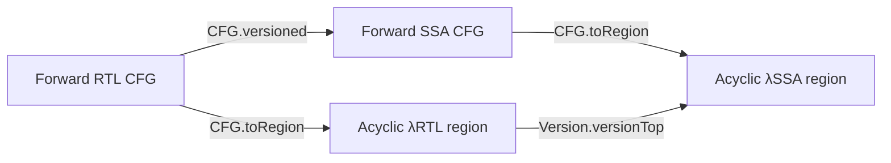

# LambdaIter family and flat CFG semantics

The two flat graph representations below have different variable interfaces. The forward
three-address graph uses named registers and a shrinking suffix of a block list. The typed
Isotope graph uses positional variables and finite labels, with a shared captured context and a
typed payload per label. The suffix semantics can report an earlier label as an exit. The finite
Isotope graph can instead follow cyclic internal edges.

**Scope.** “Absent” refers to the identified current headers and implementation files in the
row. “Not audited” leaves the question open. The model hypotheses listed here govern the stated
comparisons.

| Calculus or boundary | Syntax, semantics and models | Translations, institutions and missing comparisons |
| --- | --- | --- |
| LetSeq | [Locally nameless syntax](../../Silmaril/Raw/SSA/Isotope/LetSeq.lean), proof-relevant typed [monadic denotation](../../Silmaril/Raw/SSA/Isotope/LetSeq/Semantics/Monadic.lean), and [`eval_iff_denote`](../../Silmaril/Raw/SSA/Isotope/LetSeq/Semantics/OperationalDenotation.lean) for finite outcomes. The comparison uses `StateT σ SetM`, a compatible instruction relation and matching encoded free and bound environments. [`syntacticModelIsInitial`, `semantic_iff`](../../Silmaril/Raw/SSA/Isotope/Theory/Models/LetSeq.lean) concern operation algebras satisfying the base equations. | [`LetSeq.inst`](../../Silmaril/Raw/SSA/Isotope/Institution/LetSeq.lean) gives the equational institution. [`seqCaseCoHom`](../../Silmaril/Raw/SSA/Isotope/Institution/Inclusions.lean) has [unconditional borrowing](../../Silmaril/Raw/SSA/Isotope/Institution/Borrowing.lean). The inclusion preserves [typed monadic denotation](../../Silmaril/Raw/SSA/Isotope/Morphism/SeqCase/Monadic.lean) and preserves and reflects [operational evaluation](../../Silmaril/Raw/SSA/Isotope/Morphism/SeqCase/Operational.lean). Full Freyd categorical initiality and an ITree comparison were not audited. |
| LetCase | [Locally nameless syntax](../../Silmaril/Raw/SSA/Isotope/LetCase.lean) with sums and case; proof-relevant typed [monadic denotation](../../Silmaril/Raw/SSA/Isotope/LetCase/Semantics/Monadic.lean). [`eval_iff_denote`](../../Silmaril/Raw/SSA/Isotope/LetCase/Semantics/OperationalDenotation.lean) has the same comparison hypotheses as LetSeq. [`syntacticModelIsInitial`, `semantic_iff`](../../Silmaril/Raw/SSA/Isotope/Theory/Models/LetCase.lean) concern the base equational algebras. | [`LetCase.inst`](../../Silmaril/Raw/SSA/Isotope/Institution/LetCase.lean), [`caseIterCoHom`](../../Silmaril/Raw/SSA/Isotope/Institution/Inclusions.lean) and [unconditional borrowing](../../Silmaril/Raw/SSA/Isotope/Institution/Borrowing.lean). The inclusion has [monadic](../../Silmaril/Raw/SSA/Isotope/Morphism/CaseIter/Monadic.lean) and [operational](../../Silmaril/Raw/SSA/Isotope/Morphism/CaseIter/Operational.lean) agreement. [`CaseSSA`](../../Silmaril/Raw/SSA/Isotope/Morphism/CaseSSA.lean) embeds expressions into Isotope λSSA with [operational agreement](../../Silmaril/Raw/SSA/Isotope/Morphism/CaseSSASemantics.lean). Full Freyd categorical initiality and an ITree comparison were not audited. |
| LetIter | [Proof-relevant `sound` and `categorical_denote_eq`](../../Silmaril/SSA/Isotope/LetIter/Thms.lean) compare equations and their Kleisli arrows for lawful Elgot monads. [Thesis categorical models](../../Silmaril/SSA/Thesis/Categorical/Thms.lean) give initiality into their strong Elgot Freyd models with the thesis model laws and typing coherence. The two formulations have an [explicit bridge](../../Silmaril/SSA/Isotope/Bridge/Thms.lean). [Closed let-η counterexample](../../Silmaril/SSA/Isotope/LetIter/Counterexample/Thms.lean) limits soundness for the weaker unrestricted exact categorical interface. | [`LetIter.inst`](../../Silmaril/Raw/SSA/Isotope/Institution/LetIter.lean) is equational. [`iterSSAIso`](../../Silmaril/Raw/SSA/Isotope/Institution/Observational/Isomorphism.lean) is an isomorphism after the observational quotient, for single-exit λSSA. [`Silmaril.Semantics.ITree`](../../Silmaril/Semantics/ITree/Thms.lean) supplies a lawful Elgot model and [`ITree.Interpret.initial`](../../Silmaril/Semantics/ITreeInterpret/Thms.lean) gives unique interpretation for a handler into a lawful Elgot monad under the tree smallness hypothesis. The [written-source tree development](../../Silmaril/SSA/Isotope/LetIter/PaperExpression/Source/FreeTree/Response/Thms.lean) has its own hypotheses and observations. Its full coverage was not audited here. |
| Acyclic λSSA and acyclic λRTL | The named [`Region`](../../Silmaril/SSA/LambdaRTL/Defs.lean) has lexical `evalSSA` and mutable `evalRTL`. The instruction `Model` is over one value carrier with monadic operations and total input stores. [`evalObs_eq_evalSSA` and `evalObs_eq_evalSSA_of_isSSA`](../../Silmaril/SSA/LambdaRTL/Thms.lean) drop the final store and assume `LawfulMonad` plus `NoClobber` or `IsSSA`, respectively. | [`ssaToRTL`](../../Silmaril/SSA/LambdaRTL/Institution/Defs.lean) goes from SSA to the observation-only RTL institution. `rtlFull` observes the final store as well. [`versionTop_evalSSA`](../../Silmaril/SSA/LambdaRTL/Version/Thms.lean) and [`versionCoHom`](../../Silmaril/SSA/LambdaRTL/Version/Institution/Defs.lean) go in the other direction using initial version zero and `unpair (pair a b) = pure (a, b)`. A typed store model and categorical interpretation are absent from these headers. |
| λSSA with general CFGs | Isotope [`Region` and `Region.Eval`](../../Silmaril/SSA/Isotope/LambdaSSA/Defs.lean) use positional variables and jumps. [`Region.denote`](../../Silmaril/Raw/SSA/Isotope/LambdaSSA/Denotation/Monadic/Region.lean) uses exact typing, typed label coproducts and Elgot iteration. The [categorical graphs](../../Silmaril/SSA/Isotope/LambdaSSA/Categorical/Thms.lean) use distributive Freyd structure with strong Elgot iteration for regions. [`categoricalTermDenote_eq` and `categoricalRegionDenote_eq`](../../Silmaril/SSA/Isotope/LambdaSSA/Kleisli/Thms.lean) specialize to Kleisli models with the corresponding typing-coherence premises and a lawful Elgot monad for regions. | The [observational compilations](../../Silmaril/Raw/SSA/Isotope/Institution/Observational/Compilations.lean) and quotient isomorphism above use operational observations. [Machine RTL](../../Silmaril/Machine/RTL/Thms.lean) is a separate SSA-form register machine; `toLambdaSSA_eval_iff` assumes a matching call oracle, and [`ofLambdaSSA_eval_iff`](../../Silmaril/Machine/OfLambdaSSA/Thms.lean) is restricted to `RootFits`. A general typed operational-to-monadic adequacy theorem for this row was not audited. |
| λRTL with loops | [`Loop.Region`](../../Silmaril/SSA/LambdaRTL/Loop/Defs.lean) extends the named syntax with a self-recursive handler. [`Loop.Region.evalObs_eq_evalSSA_of_isSSA`](../../Silmaril/SSA/LambdaRTL/Loop/Thms.lean) uses a lawful Elgot monad and the loop SSA judgment. | [`acyclicToLoopSSA` and `loopSSAToRTL`](../../Silmaril/SSA/LambdaRTL/Loop/Institution/Defs.lean) are comorphisms at the exit/payload observation. A lowering of those loops to the forward CFG is absent from these headers. |
| Flat typed SSA | [`FiniteCFG.HasType` and `erase_hasType_iff`](../../Silmaril/Raw/SSA/Isotope/LambdaSSA/Flat.lean) relate heterogeneous block arguments and typed exits to ordinary λSSA CFG typing. [`encodeCFG_hasType`](../../Silmaril/Raw/SSA/Isotope/Morphism/SSAIter/Encode.lean) checks the finite-sum LetIter encoding. | [`encodeCFG_eval`](../../Silmaril/Raw/SSA/Isotope/Morphism/SSAIter/Correctness.lean) preserves finite evaluation under matching captured environments and the same primitive relation. [`encodeCFG_diverges`](../../Silmaril/Raw/SSA/Isotope/Morphism/SSAIter/Divergence.lean) is the forward divergence comparison. A translation between this representation and the named forward graph is absent from the cited modules. A separate flat institution and an ITree-specific adequacy result were not audited. |
| Forward flat SSA / mutable RTL | [`CFG`, `flatten`, `toRegion`, `run`](../../Silmaril/SSA/LambdaRTL/CFG/Defs.lean) operate on explicit block arguments. [`run_flatten` and `run_eq_toRegion`](../../Silmaril/SSA/LambdaRTL/CFG/Thms.lean) preserve the full mutable result in a lawful monad. | [`validate_obs_eq_evalSSA`](../../Silmaril/SSA/LambdaRTL/CFG/Version/Thms.lean) requires validator acceptance and a dominance-scoped source region. `validate_versionTop_obs` replaces source SSA with the pair law and version-zero input. Both compare to the existing **region** semantics. At the audited baseline, a direct lexical runner for forward blocks was absent. Classical φ syntax, global name uniqueness and a flat CFG institution are outside this bridge. |
| Cyclic named flat RTL and SSA | [`Cyclic.step` and `Cyclic.run`](../../Silmaril/SSA/LambdaRTL/CFG/Cyclic/Defs.lean) search the full table for each jump and iterate on the incoming label, payload and store. [`Versioning.compile`](../../Silmaril/SSA/LambdaRTL/CFG/Cyclic/Version/Defs.lean) generates a flat table with block-local SSA and packed edge arguments. | [`Cyclic.run_eq_forward`](../../Silmaril/SSA/LambdaRTL/CFG/Cyclic/Thms.lean) compares the full outcome when table and suffix lookup agree on every named block's syntactic targets. [`Versioning.run_commutes`](../../Silmaril/SSA/LambdaRTL/CFG/Cyclic/Version/Thms.lean) compares exit and payload for the compiled graph, with version-zero inputs, a lawful Elgot monad and the pair law. |
| Named compiler to typed Isotope | [`NamedFlat.compileTyped`](../../Silmaril/SSA/Isotope/Bridge/NamedFlat/Thms.lean) elaborates the generated named table and checks exact capture, packet and exit types for the product and primitive fragment, including case on primitive sums. | [`entry_iff` and `step_iff`](../../Silmaril/SSA/Isotope/Bridge/NamedFlat/Thms.lean) compare finite entry and internal-step outcomes with numbered Isotope labels. The comparison uses shared stateless partial primitives and tagged values. |

The public thesis formalization provides a separate reference point. Its
[`TypedDominanceWellFormedFlat`](https://github.com/imbrem/thesis/blob/69a8126f2d3eb6d32050e0bd9511251b33dbcea7/formalization/thesis/Isotope/TAC/Bridge/DomFlatSemantics.lean)
denotes via a typed chosen dominator tree. `CoherentReordering` carries the evidence that
the reorderings have equal lexicalizations. The thesis also proves a direct complete-Elgot
[`denote_convert_cfg`](https://github.com/imbrem/thesis/blob/69a8126f2d3eb6d32050e0bd9511251b33dbcea7/formalization/thesis/Isotope/TAC/Densem/MonadicValid.lean)
for its φ-free classical source CFG, assuming the model's failure law and an input defined
on the source variables. These use the thesis graph and store definitions.

## Forward CFG agreement

`CFG.runSSA` executes the same forward block list as `CFG.run`. It gives each
selected block the graph's original environment and the incoming parameter.
The mutable runner instead extends the store at the jump site. The same suffix
order governs both runners, including when a label is repeated.



The vertical paths preserve the mutable result and the lexical result,
respectively, by `CFG.run_eq_toRegion` and `CFG.runSSA_eq_evalSSA`. The names and
labels have decidable equality, and both comparisons use a lawful monad.
`CFG.versioned_toRegion` states the exact equality
`g.versioned.toRegion = Version.versionTop g.toRegion`.
`CFG.versioned_runSSA` uses it to give the same exit label and payload from
either path, assuming the pair law and source inputs at version zero.
`CFG.versioned_isSSA` gives dominance-scoped SSA, and
`CFG.versioned_blockLabels` preserves the ordered block-label list including
repetitions.
[Flat versioning header](../../Silmaril/SSA/LambdaRTL/CFG/Version/Flat/Thms.lean)

`CFG.ofRegion?` recognizes precisely the image of `CFG.toRegion`. It peels
outer joins to recover the block list and keeps conditional terminators inline.
The existence proof shows that structured versioning preserves this image.
At runtime the total `CFG.versioned` runs the structured versioner and the
reifier, using an erased proof that the reifier succeeds. This preserves
the original labels and the forward suffix lookup convention, including
targets absent from the current suffix.
[Reifier definitions](../../Silmaril/SSA/LambdaRTL/CFG/Version/Flat/Defs.lean)

For running the **same** CFG in both modes,
`CFG.runSSA_eq_obs_of_isSSA` uses the readback's `IsSSA` judgment with the same lawful monad.
[Forward CFG theorem header](../../Silmaril/SSA/LambdaRTL/CFG/Lexical/Thms.lean)

The diamond regression has two named branch blocks and a shared join. The
unversioned mutable graph returns 12 or 21 after overwriting a live-in, whereas
reading the same graph lexically leaves the original value 7 at the join. The
generated flat graph passes the new value in its jump argument and gives
the two mutable results. The regression checks that the generator returns
the expected block list and both runs compute directly on that output.
[Checked regression](../../Silmaril/SSA/LambdaRTL/CFG/Lexical/Examples/Thms.lean)

```sh
lake build --wfail Silmaril.SSA.LambdaRTL.CFG.Version.Flat.Thms \
  Silmaril.SSA.LambdaRTL.CFG.Lexical.Examples.Thms \
  Silmaril.SSA.LambdaRTL.CFG.Version.Examples.Thms
```

## Cyclic named CFG execution

`Cyclic.step` uses first-match lookup in the whole block table. A hit writes
the parameter in the incoming store and executes one block, so a transfer
can reenter an earlier block. A missing label exits with the label, argument
and store. The entry executes once, then `Cyclic.run` iterates the step.
`Cyclic.IsForward` compares lookup results for every syntactic target of each
named block, using the suffix after that block. The entry searches the whole
table in both modes. The agreement proof uses lawful monadic sequencing and
the iteration fixpoint law.
[Cyclic semantics and agreement](../../Silmaril/SSA/LambdaRTL/CFG/Cyclic/Thms.lean)

The `Part` regression counts down along `10 → 20 → 10`, incrementing a
register on each visit to block 20. After two back-edge transfers, full-table
lookup exits at label 99 with payload 2 and final registers `(0, 2)`. The forward
runner exits on the first backward transfer at label 10 with payload 1 and
final registers `(1, 1)`.
[Finite back-edge trace](../../Silmaril/SSA/LambdaRTL/CFG/Cyclic/Examples/Thms.lean)

### Cyclic versioning

`Versioning.compile` collects a finite support from the syntactic free reads
of the entry and all named bodies. Every internal edge carries the original
argument plus that support's register values, omitting the destination's
parameter because the argument replaces it. The first matching label fixes
the packet layout. Missing labels keep the original exit payload. Each target
block decodes its packet into fresh local versions before executing its body.
Reentry starts a new lexical scope with the block parameter as its only free
variable. Version-zero inputs supply the entry context. Register and label
names need decidable equality, and the support comes from the graph alone.
[Compiler definitions](../../Silmaril/SSA/LambdaRTL/CFG/Cyclic/Version/Defs.lean)

`entry_commutes` and `step_commutes` are equalities of effectful computations
in the same lawful monad. They reuse the same primitive interpretation and
require `unpair (pair a b) = pure (a, b)` for the inserted tuple decoders.
`run_commutes` uses `iter_obs_of_step_encoding` in a lawful Elgot monad to
preserve the exit and payload. The generated countdown uses the same back
edges and returns payload 2 at exit 99. This result concerns the named flat
table and its block-local SSA scopes. The typed Isotope dispatcher adapter
has a separate syntax and interface.
[Cyclic versioning theorems](../../Silmaril/SSA/LambdaRTL/CFG/Cyclic/Version/Thms.lean)

```sh
lake build --wfail Silmaril.SSA.LambdaRTL.CFG.Cyclic.Version.Thms \
  Silmaril.SSA.LambdaRTL.CFG.Cyclic.Examples.Thms
```

### Named compiler to typed Isotope

`NamedFlat.compileTyped` runs the named cyclic compiler before scoping and
checking its output. Callers supply the version-zero capture names and their
types, the ordered external labels, the heterogeneous packet and exit
profiles, and each primitive's exact source and result types. First-match
lookup numbers the named blocks before the external labels. Blocks can
access their packet parameter and the locals they bind. Their shared
Isotope capture slots remain inaccessible to source block code. A packet
type uses products for the original payload and the destination's slots.
The fragment accepts variables, unit, products, primitive applications,
single and pair bindings, and cases on sum-valued operands. Explicit
injections and abort are rejected by this adapter, and callers supply the
profile for the checker.
[Scoped elaboration and type checking](../../Silmaril/SSA/Isotope/Bridge/NamedFlat/Thms.lean)

The finite semantic comparison uses tagged Isotope values for the named
model, with ordinary partial pair and sum destructors. The primitive
relation is membership in the shared `Part` implementation, with
`Unit` state. Entry environments agree at the named captures. An internal
step runs the selected block with the same incoming packet in both
presentations. These are comparisons with erased `Region.Eval`; a typed
model also needs primitives that respect the supplied type profile.
The countdown's original implicit numeric split has a checked obstruction
for every common finite countdown type in its packet profiles. The
discriminant type would have to be its own right summand. Exposing
classification as a `num → num + num` primitive on the same source loop
allows the generated table to check. Its entry and the `20 → 10`
transfer agree at the numbered label and updated packet.
[Countdown interface regression](../../Silmaril/SSA/LambdaRTL/CFG/Cyclic/Examples/Thms.lean)

The adapted countdown has two entry captures. Applying a capture-free
guarded dispatcher requires a separate input-closing step. Isotope
divergence and the comparison with typed monadic denotations are outside
the finite, operational interface here.

```sh
lake build --wfail Silmaril.SSA.Isotope.Bridge.NamedFlat.Thms \
  Silmaril.SSA.LambdaRTL.CFG.Cyclic.Examples.Thms
```
