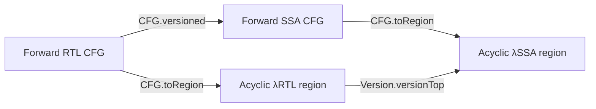

# LambdaIter family and flat CFG semantics

The two flat graph representations below have different variable interfaces. The forward
three-address graph uses named registers and a shrinking suffix of a block list. The typed
Isotope graph uses positional variables and finite labels, with a shared captured context and a
typed payload per label. The suffix semantics can report an earlier label as an exit. The finite
Isotope graph can instead follow cyclic internal edges.

**Scope.** “Absent” refers to the identified current headers and implementation files in the
row. “Not audited” leaves the question open. The model hypotheses listed here govern the stated
comparisons.

| Calculus or boundary | Syntax, semantics and models | Translations, institutions and missing comparisons |
| --- | --- | --- |
| LetSeq | [Locally nameless syntax](../../Silmaril/Raw/SSA/Isotope/LetSeq.lean), proof-relevant typed [monadic denotation](../../Silmaril/Raw/SSA/Isotope/LetSeq/Semantics/Monadic.lean), and [`eval_iff_denote`](../../Silmaril/Raw/SSA/Isotope/LetSeq/Semantics/OperationalDenotation.lean) for finite outcomes. The comparison uses `StateT σ SetM`, a compatible instruction relation and matching encoded free and bound environments. [`syntacticModelIsInitial`, `semantic_iff`](../../Silmaril/Raw/SSA/Isotope/Theory/Models/LetSeq.lean) concern operation algebras satisfying the base equations. | [`LetSeq.inst`](../../Silmaril/Raw/SSA/Isotope/Institution/LetSeq.lean) gives the equational institution. [`seqCaseCoHom`](../../Silmaril/Raw/SSA/Isotope/Institution/Inclusions.lean) has [unconditional borrowing](../../Silmaril/Raw/SSA/Isotope/Institution/Borrowing.lean). The inclusion preserves [typed monadic denotation](../../Silmaril/Raw/SSA/Isotope/Morphism/SeqCase/Monadic.lean) and preserves and reflects [operational evaluation](../../Silmaril/Raw/SSA/Isotope/Morphism/SeqCase/Operational.lean). Full Freyd categorical initiality and an ITree comparison were not audited. |
| LetCase | [Locally nameless syntax](../../Silmaril/Raw/SSA/Isotope/LetCase.lean) with sums and case; proof-relevant typed [monadic denotation](../../Silmaril/Raw/SSA/Isotope/LetCase/Semantics/Monadic.lean). [`eval_iff_denote`](../../Silmaril/Raw/SSA/Isotope/LetCase/Semantics/OperationalDenotation.lean) has the same comparison hypotheses as LetSeq. [`syntacticModelIsInitial`, `semantic_iff`](../../Silmaril/Raw/SSA/Isotope/Theory/Models/LetCase.lean) concern the base equational algebras. | [`LetCase.inst`](../../Silmaril/Raw/SSA/Isotope/Institution/LetCase.lean), [`caseIterCoHom`](../../Silmaril/Raw/SSA/Isotope/Institution/Inclusions.lean) and [unconditional borrowing](../../Silmaril/Raw/SSA/Isotope/Institution/Borrowing.lean). The inclusion has [monadic](../../Silmaril/Raw/SSA/Isotope/Morphism/CaseIter/Monadic.lean) and [operational](../../Silmaril/Raw/SSA/Isotope/Morphism/CaseIter/Operational.lean) agreement. [`CaseSSA`](../../Silmaril/Raw/SSA/Isotope/Morphism/CaseSSA.lean) embeds expressions into Isotope λSSA with [operational agreement](../../Silmaril/Raw/SSA/Isotope/Morphism/CaseSSASemantics.lean). Full Freyd categorical initiality and an ITree comparison were not audited. |
| LetIter | [Proof-relevant `sound` and `categorical_denote_eq`](../../Silmaril/SSA/Isotope/LetIter/Thms.lean) compare equations and their Kleisli arrows for lawful Elgot monads. [Thesis categorical models](../../Silmaril/SSA/Thesis/Categorical/Thms.lean) give initiality into their strong Elgot Freyd models with the thesis model laws and typing coherence. The two formulations have an [explicit bridge](../../Silmaril/SSA/Isotope/Bridge/Thms.lean). [Closed let-η counterexample](../../Silmaril/SSA/Isotope/LetIter/Counterexample/Thms.lean) limits soundness for the weaker unrestricted exact categorical interface. | [`LetIter.inst`](../../Silmaril/Raw/SSA/Isotope/Institution/LetIter.lean) is equational. [`iterSSAIso`](../../Silmaril/Raw/SSA/Isotope/Institution/Observational/Isomorphism.lean) is an isomorphism after the observational quotient, for single-exit λSSA. [`Silmaril.Semantics.ITree`](../../Silmaril/Semantics/ITree/Thms.lean) supplies a lawful Elgot model and [`ITree.Interpret.initial`](../../Silmaril/Semantics/ITreeInterpret/Thms.lean) gives unique interpretation for a handler into a lawful Elgot monad under the tree smallness hypothesis. The [written-source tree development](../../Silmaril/SSA/Isotope/LetIter/PaperExpression/Source/FreeTree/Response/Thms.lean) has its own hypotheses and observations. Its full coverage was not audited here. |
| Acyclic λSSA and acyclic λRTL | The named [`Region`](../../Silmaril/SSA/LambdaRTL/Defs.lean) has lexical `evalSSA` and mutable `evalRTL`. The instruction `Model` is over one value carrier with monadic operations and total input stores. [`evalObs_eq_evalSSA` and `evalObs_eq_evalSSA_of_isSSA`](../../Silmaril/SSA/LambdaRTL/Thms.lean) drop the final store and assume `LawfulMonad` plus `NoClobber` or `IsSSA`, respectively. | [`ssaToRTL`](../../Silmaril/SSA/LambdaRTL/Institution/Defs.lean) goes from SSA to the observation-only RTL institution. `rtlFull` observes the final store as well. [`versionTop_evalSSA`](../../Silmaril/SSA/LambdaRTL/Version/Thms.lean) and [`versionCoHom`](../../Silmaril/SSA/LambdaRTL/Version/Institution/Defs.lean) go in the other direction using initial version zero and `unpair (pair a b) = pure (a, b)`. A typed store model and categorical interpretation are absent from these headers. |
| λSSA with general CFGs | Isotope [`Region` and `Region.Eval`](../../Silmaril/SSA/Isotope/LambdaSSA/Defs.lean) use positional variables and jumps. [`Region.denote`](../../Silmaril/Raw/SSA/Isotope/LambdaSSA/Denotation/Monadic/Region.lean) uses exact typing, typed label coproducts and Elgot iteration. The [categorical graphs](../../Silmaril/SSA/Isotope/LambdaSSA/Categorical/Thms.lean) use distributive Freyd structure with strong Elgot iteration for regions. [`categoricalTermDenote_eq` and `categoricalRegionDenote_eq`](../../Silmaril/SSA/Isotope/LambdaSSA/Kleisli/Thms.lean) specialize to Kleisli models with the corresponding typing-coherence premises and a lawful Elgot monad for regions. | The [observational compilations](../../Silmaril/Raw/SSA/Isotope/Institution/Observational/Compilations.lean) and quotient isomorphism above use operational observations. [Machine RTL](../../Silmaril/Machine/RTL/Thms.lean) is a separate SSA-form register machine; `toLambdaSSA_eval_iff` assumes a matching call oracle, and [`ofLambdaSSA_eval_iff`](../../Silmaril/Machine/OfLambdaSSA/Thms.lean) is restricted to `RootFits`. A general typed operational-to-monadic adequacy theorem for this row was not audited. |
| λRTL with loops | [`Loop.Region`](../../Silmaril/SSA/LambdaRTL/Loop/Defs.lean) extends the named syntax with a self-recursive handler. [`Loop.Region.evalObs_eq_evalSSA_of_isSSA`](../../Silmaril/SSA/LambdaRTL/Loop/Thms.lean) uses a lawful Elgot monad and the loop SSA judgment. | [`acyclicToLoopSSA` and `loopSSAToRTL`](../../Silmaril/SSA/LambdaRTL/Loop/Institution/Defs.lean) are comorphisms at the exit/payload observation. A lowering of those loops to the forward CFG is absent from these headers. |
| Flat typed SSA | [`FiniteCFG.HasType` and `erase_hasType_iff`](../../Silmaril/Raw/SSA/Isotope/LambdaSSA/Flat.lean) relate heterogeneous block arguments and typed exits to ordinary λSSA CFG typing. [`encodeCFG_hasType`](../../Silmaril/Raw/SSA/Isotope/Morphism/SSAIter/Encode.lean) checks the finite-sum LetIter encoding. | [`encodeCFG_eval`](../../Silmaril/Raw/SSA/Isotope/Morphism/SSAIter/Correctness.lean) preserves finite evaluation under matching captured environments and the same primitive relation. [`encodeCFG_diverges`](../../Silmaril/Raw/SSA/Isotope/Morphism/SSAIter/Divergence.lean) is the forward divergence comparison. A translation between this representation and the named forward graph is absent from the cited modules. A separate flat institution and an ITree-specific adequacy result were not audited. |
| Forward flat SSA / mutable RTL | [`CFG`, `flatten`, `toRegion`, `run`](../../Silmaril/SSA/LambdaRTL/CFG/Defs.lean) operate on explicit block arguments. [`run_flatten` and `run_eq_toRegion`](../../Silmaril/SSA/LambdaRTL/CFG/Thms.lean) preserve the full mutable result in a lawful monad. | [`validate_obs_eq_evalSSA`](../../Silmaril/SSA/LambdaRTL/CFG/Version/Thms.lean) requires validator acceptance and a dominance-scoped source region. `validate_versionTop_obs` replaces source SSA with the pair law and version-zero input. Both compare to the existing **region** semantics. At the audited baseline, a direct lexical runner for forward blocks was absent. Classical φ syntax, global name uniqueness and a flat CFG institution are outside this bridge. |
| Cyclic named flat RTL and SSA | [`Cyclic.step` and `Cyclic.run`](../../Silmaril/SSA/LambdaRTL/CFG/Cyclic/Defs.lean) search the full table for each jump and iterate on the incoming label, payload and store. [`Versioning.compile`](../../Silmaril/SSA/LambdaRTL/CFG/Cyclic/Version/Defs.lean) generates a flat table with block-local SSA and packed edge arguments. | [`Cyclic.run_eq_forward`](../../Silmaril/SSA/LambdaRTL/CFG/Cyclic/Thms.lean) compares the full outcome when table and suffix lookup agree on every named block's syntactic targets. [`Versioning.run_commutes`](../../Silmaril/SSA/LambdaRTL/CFG/Cyclic/Version/Thms.lean) compares exit and payload for the compiled graph, with version-zero inputs, a lawful Elgot monad and the pair law. |
| Named compiler to typed Isotope | [`NamedFlat.compileTyped`](../../Silmaril/SSA/Isotope/Bridge/NamedFlat/Thms.lean) elaborates the generated named table and checks exact capture, packet and exit types for the product and primitive fragment, including case on primitive sums. | [`entry_iff` and `step_iff`](../../Silmaril/SSA/Isotope/Bridge/NamedFlat/Thms.lean) compare finite entry and internal-step outcomes with numbered Isotope labels. The comparison uses shared stateless partial primitives and tagged values. [The whole-run bridge](../../Silmaril/SSA/Isotope/Bridge/NamedFlat/WholeRun/Thms.lean) extends this to whole finite lexical runs, with an exact capture packet for the packed endpoint. |

The public thesis formalization provides a separate reference point. Its
[`TypedDominanceWellFormedFlat`](https://github.com/imbrem/thesis/blob/69a8126f2d3eb6d32050e0bd9511251b33dbcea7/formalization/thesis/Isotope/TAC/Bridge/DomFlatSemantics.lean)
denotes via a typed chosen dominator tree. `CoherentReordering` carries the evidence that
the reorderings have equal lexicalizations. The thesis also proves a direct complete-Elgot
[`denote_convert_cfg`](https://github.com/imbrem/thesis/blob/69a8126f2d3eb6d32050e0bd9511251b33dbcea7/formalization/thesis/Isotope/TAC/Densem/MonadicValid.lean)
for its φ-free classical source CFG, assuming the model's failure law and an input defined
on the source variables. These use the thesis graph and store definitions.

## Forward CFG agreement

`CFG.runSSA` executes the same forward block list as `CFG.run`. It gives each
selected block the graph's original environment and the incoming parameter.
The mutable runner instead extends the store at the jump site. The same suffix
order governs both runners, including when a label is repeated.



The vertical paths preserve the mutable result and the lexical result,
respectively, by `CFG.run_eq_toRegion` and `CFG.runSSA_eq_evalSSA`. The names and
labels have decidable equality, and both comparisons use a lawful monad.
`CFG.versioned_toRegion` states the exact equality
`g.versioned.toRegion = Version.versionTop g.toRegion`.
`CFG.versioned_runSSA` uses it to give the same exit label and payload from
either path, assuming the pair law and source inputs at version zero.
`CFG.versioned_isSSA` gives dominance-scoped SSA, and
`CFG.versioned_blockLabels` preserves the ordered block-label list including
repetitions.
[Flat versioning header](../../Silmaril/SSA/LambdaRTL/CFG/Version/Flat/Thms.lean)

`CFG.ofRegion?` recognizes precisely the image of `CFG.toRegion`. It peels
outer joins to recover the block list and keeps conditional terminators inline.
The existence proof shows that structured versioning preserves this image.
At runtime the total `CFG.versioned` runs the structured versioner and the
reifier, using an erased proof that the reifier succeeds. This preserves
the original labels and the forward suffix lookup convention, including
targets absent from the current suffix.
[Reifier definitions](../../Silmaril/SSA/LambdaRTL/CFG/Version/Flat/Defs.lean)

For running the **same** CFG in both modes,
`CFG.runSSA_eq_obs_of_isSSA` uses the readback's `IsSSA` judgment with the same lawful monad.
[Forward CFG theorem header](../../Silmaril/SSA/LambdaRTL/CFG/Lexical/Thms.lean)

The diamond regression has two named branch blocks and a shared join. The
unversioned mutable graph returns 12 or 21 after overwriting a live-in, whereas
reading the same graph lexically leaves the original value 7 at the join. The
generated flat graph passes the new value in its jump argument and gives
the two mutable results. The regression checks that the generator returns
the expected block list and both runs compute directly on that output.
[Checked regression](../../Silmaril/SSA/LambdaRTL/CFG/Lexical/Examples/Thms.lean)

```sh
lake build --wfail Silmaril.SSA.LambdaRTL.CFG.Version.Flat.Thms \
  Silmaril.SSA.LambdaRTL.CFG.Lexical.Examples.Thms \
  Silmaril.SSA.LambdaRTL.CFG.Version.Examples.Thms
```

## Cyclic named CFG execution

`Cyclic.step` uses first-match lookup in the whole block table. A hit writes
the parameter in the incoming store and executes one block, so a transfer
can reenter an earlier block. A missing label exits with the label, argument
and store. The entry executes once, then `Cyclic.run` iterates the step.
`Cyclic.IsForward` compares lookup results for every syntactic target of each
named block, using the suffix after that block. The entry searches the whole
table in both modes. The agreement proof uses lawful monadic sequencing and
the iteration fixpoint law.
[Cyclic semantics and agreement](../../Silmaril/SSA/LambdaRTL/CFG/Cyclic/Thms.lean)

The `Part` regression counts down along `10 → 20 → 10`, incrementing a
register on each visit to block 20. After two back-edge transfers, full-table
lookup exits at label 99 with payload 2 and final registers `(0, 2)`. The forward
runner exits on the first backward transfer at label 10 with payload 1 and
final registers `(1, 1)`.
[Finite back-edge trace](../../Silmaril/SSA/LambdaRTL/CFG/Cyclic/Examples/Thms.lean)

### Cyclic versioning

`Versioning.compile` collects a finite support from the syntactic free reads
of the entry and all named bodies. Every internal edge carries the original
argument plus that support's register values, omitting the destination's
parameter because the argument replaces it. The first matching label fixes
the packet layout. Missing labels keep the original exit payload. Each target
block decodes its packet into fresh local versions before executing its body.
Reentry starts a new lexical scope with the block parameter as its only free
variable. Version-zero inputs supply the entry context. Register and label
names need decidable equality, and the support comes from the graph alone.
[Compiler definitions](../../Silmaril/SSA/LambdaRTL/CFG/Cyclic/Version/Defs.lean)

`entry_commutes` and `step_commutes` are equalities of effectful computations
in the same lawful monad. They reuse the same primitive interpretation and
require `unpair (pair a b) = pure (a, b)` for the inserted tuple decoders.
`run_commutes` uses `iter_obs_of_step_encoding` in a lawful Elgot monad to
preserve the exit and payload. The generated countdown uses the same back
edges and returns payload 2 at exit 99. This result concerns the named flat
table and its block-local SSA scopes. The typed Isotope dispatcher adapter
has a separate syntax and interface.
[Cyclic versioning theorems](../../Silmaril/SSA/LambdaRTL/CFG/Cyclic/Version/Thms.lean)

```sh
lake build --wfail Silmaril.SSA.LambdaRTL.CFG.Cyclic.Version.Thms \
  Silmaril.SSA.LambdaRTL.CFG.Cyclic.Examples.Thms
```

### Named compiler to typed Isotope

`NamedFlat.compileTyped` runs the named cyclic compiler before scoping and
checking its output. Callers supply the version-zero capture names and their
types, the ordered external labels, the heterogeneous packet and exit
profiles, and each primitive's exact source and result types. First-match
lookup numbers the named blocks before the external labels. Blocks can
access their packet parameter and the locals they bind. Their shared
Isotope capture slots remain inaccessible to source block code. A packet
type uses products for the original payload and the destination's slots.
The fragment accepts variables, unit, products, primitive applications,
single and pair bindings, and cases on sum-valued operands. Explicit
injections and abort are rejected by this adapter, and callers supply the
profile for the checker.
[Scoped elaboration and type checking](../../Silmaril/SSA/Isotope/Bridge/NamedFlat/Thms.lean)

The finite semantic comparison uses tagged Isotope values for the named
model, with ordinary partial pair and sum destructors. The primitive
relation is membership in the shared `Part` implementation, with
`Unit` state. Entry environments agree at the named captures. An internal
step runs the selected block with the same incoming packet in both
presentations. These are comparisons with erased `Region.Eval`; a typed
model also needs primitives that respect the supplied type profile.
The countdown's original implicit numeric split has a checked obstruction
for every common finite countdown type in its packet profiles. The
discriminant type would have to be its own right summand. Exposing
classification as a `num → num + num` primitive on the same source loop
allows the generated table to check. Its entry and the `20 → 10`
transfer agree at the numbered label and updated packet.
[Countdown interface regression](../../Silmaril/SSA/LambdaRTL/CFG/Cyclic/Examples/Thms.lean)

### Closing the generated entry for the dispatcher

`NamedFlat.Capture.close` takes a checked graph and a closed expression of
the exact type `Region.packedInputType β.toList`, where `β` is the graph's
capture profile. The graph evaluates that expression once and destructures
its result before entering the original code. The input can come from a
caller-supplied primitive. The adapter retains the same block labels and
erased bodies and checks the blocks again in scopes containing only their
typed incoming parameters. It returns an `Option` whose successful result
carries `HasType .nil R E` and the erasure equations. Its execution proofs
use those equations. Acceptance is checked for each supplied graph and packet
producer.
[Capture closure and finite execution](../../Silmaril/SSA/Isotope/Bridge/NamedFlat/Capture/Thms.lean)

When the packet expression has exactly the original environment's packed
values and the initial primitive state as its sole finite outcome,
`entry_eval_iff` preserves and reflects entry evaluation. `graph_eval_iff`
uses `Follow.map_block` to extend this to whole finite Isotope runs.
`packed_eval_at` then compares the packed dispatcher with the original open
graph, preserving the exit index in the packed sum, the payload, and the
final primitive state. The classified countdown exercise closes the actual
compiled graph over both captures, follows two back edges, and returns
payload 2 at external slot zero.
[Closed countdown regression](../../Silmaril/SSA/LambdaRTL/CFG/Cyclic/Examples/Thms.lean)

### Whole finite runs from the named compiler

`NamedFlat.compile_run_iff` composes the entry and transfer theorems on the
table produced by `Versioning.compile`. It consumes the exact elaboration
equation carried by a successful `compileTyped`. The named runner and Isotope
share tagged values and one stateless `Part` primitive implementation, and
the entry environment agrees with the named store at every capture's
version-zero name. Induction on `Part.Runs` and on Isotope's `Follow`
constructs a finite exit witness in both directions. Successful named jump
targets have a number because elaboration checks every branch target.
[Finite execution correspondence](../../Silmaril/SSA/Isotope/Bridge/NamedFlat/WholeRun/Thms.lean)

The generated destination packet is already a tagged value and is passed
unchanged to the Isotope block parameter. A named hit uses the first matching
block's index. A miss at the first occurrence `e` in the explicit exit list
has raw jump index `blocks.length + e`, and `Follow` reports external index
`e`. `numberExit` maps the named runner's exit observation to that same index
and payload. With an accepted capture closure and a state-preserving producer
of the exact original capture packet, `packed_run_iff` gives exit zero with
`packedExitValue e payload`, which is `e` right injections around one left
injection of the original payload. The finite proof observes primitive outcomes. Divergence and ITree events
require different observations.

`mutable_packed_run_iff` composes `Versioning.run_commutes` with
`packed_run_iff`. The shared tagged-value `Part` model satisfies the pair
law because its destructor immediately returns the two fields of a
constructed pair. The source starts with the version-zero store, and
`obs` retains its exit label and payload. The Isotope hypotheses remain
accepted elaboration, capture agreement, and the exact state-preserving
capture packet.
[Mutable source corollary](../../Silmaril/SSA/Isotope/Bridge/NamedFlat/WholeRun/Thms.lean)

The classified countdown uses the actual compiled graph and both captures.
The named runner exits at label 99 with payload 2, which the open graph reports
at external slot zero and the packed graph reports with its sum tag. Five
named step calls leave the jump to 99 pending. The sixth call observes the
exit because table lookup misses. The packed evaluation also reflects back
to the mutable source's numbered exit with the same payload.
[Checked named and packed countdown](../../Silmaril/SSA/LambdaRTL/CFG/Cyclic/Examples/Thms.lean)

### Infinite internal paths

`NamedFlat.InfiniteRun` witnesses a successful entry followed by a sequence
of successful internal `stepSSA` transfers at every natural-number position.
`compile_infinite_run_iff` compares that witness with Isotope divergence on
the actual graph admitted by `compileTyped`, using the same version-zero
capture agreement and shared stateless `Part` primitives. The forward map
numbers each transfer by the first matching block. The reverse map lifts the
selected Isotope path to a named transfer at each position, preserving its
label index and tagged payload. Atomic Isotope divergence on a flat table can
only continue by completing successive internal block evaluations. Each
individual flat body has finite syntax and contains no nested CFG.
[Infinite execution correspondence](../../Silmaril/SSA/Isotope/Bridge/NamedFlat/Infinite/Thms.lean)

`Capture.diverges_iff` transports the path using entry and block evaluation
under the exact state-preserving capture packet. `packed_infinite_run_iff`
then applies the existing dispatcher may-divergence theorem for atomic
instructions. A separate primitive-local divergence predicate would need its
own correspondence. Undefined `Part` results supply no such predicate, and
neither comparison observes visible ITree events.

The same two-capture table admits a primitive interpretation that repeats
`10 → 20 → 10` indefinitely. A second interpretation leaves classification
undefined at the first block. Both runners return `Part.none`. Only the
repeating interpretation has an infinite transfer witness and packed
divergence.
[Repeated back edge and stuck-primitive regression](../../Silmaril/SSA/LambdaRTL/CFG/Cyclic/Examples/Thms.lean)

### Visible requests on the generated named table

`treeModel` instantiates the existing named evaluator with the same tagged
values and primitive trees as erased Isotope. Its carrier sits one universe
above the event replies, as in `Interaction.Typed.ModelTree`. The local
`entry_tree` and `step_tree` equalities preserve each request and every reply
continuation, including the tagged packet at the next jump. The hypotheses
are successful elaboration and matching initial captures. Each side uses the
same primitive evaluator, so a primitive's supplied tree determines its
behavior. The proof preserves the existing erased semantics for structural
shape mismatches.
[Entry, step, and whole-run ITree theorems](../../Silmaril/SSA/Isotope/Bridge/NamedFlat/ITree/Thms.lean)

`compile_run_tree` consumes the elaboration equation carried by the actual
`compileTyped` result. It lifts the local equations through weak ITree
feedback using naturality, uniformity, and codiagonal. The first matching
block determines the internal index. External returns use their first
position in the exit list. Total numbering uses a sentinel for unlisted
names, which successful elaboration excludes from all written branches.

`Interaction.flat_rename_tree` preserves the tree of an erased flat body
when the environments agree at each renamed in-scope position. It lifts
agreement through local binders. The capture decoder uses this lemma with
the actual product-field renaming. In feedback, the closed block's sole
original slot is its incoming tagged packet. The closure's block erasure
equation and agreement on that slot identify the block trees.
[Scoped erased-tree transport](../../Silmaril/SSA/Isotope/LambdaSSA/Semantics/ITree/Scoped/Thms.lean)

`Capture.graph_tree` accepts an arbitrary producer tree. The typed capture
expression must have the tree of that producer followed by `packEnv n` of
the environment chosen by its reply. The theorem preserves the producer's
requests and continues with the original graph after each returned reply.
`packed_run_tree` also requires the accepted elaboration carried by
`compileTyped`, pointwise agreement with the named version-zero store for
every reply, and `HasType .nil R E` and `Closes` for the closed graph.
`Capture.close` checks the producer expression at the exact type
`packedInputType β.toList`. The packed result uses the original external
index and tagged payload to form the dispatcher's single exit value.
[Effectful capture and packed execution](../../Silmaril/SSA/Isotope/Bridge/NamedFlat/ITree/Capture/Thms.lean)

The fixture checks `Interaction.Typed.Compatible` for typed `Nat` replies
and the exact capture packet. The general corollary applies to its actual
capture-closed table. The resulting packed tree feeds the capture reply
into the seed request and each tick reply into the next tick's operand.
[Typed capture and repeated back-edge requests](../../Silmaril/Proofs/SSA/Isotope/Bridge/NamedFlat/ITree/Examples.lean)

### Refinement through a common capture producer

`packed_run_tree_refines_of_mono` transports a pointwise relation on named
runs to the accepted packed dispatcher. It uses the same effectful producer
on both sides, the exact capture packet equation, and version-zero agreement
at every returned capture value. The relation must be preserved by the
return map that applies `treeExitNumber` and `packedTreeOutput`. The packed
relation must also be preserved by binding pointwise related continuations
to the common producer. When the other continuation also has an accepted
packed dispatcher, its `packed_run_tree` equation rewrites the specification
side to that dispatcher.
[Conditional refinement transport](../../Silmaril/SSA/Isotope/Bridge/NamedFlat/ITree/Capture/Refinement/Thms.lean)

`TraceLE` instantiates the transport with inclusion of finite observations.
Each completed exchange records a request and a reply of its actual reply
type. A path can stop at a prefix, at a pending request (including a request
with no possible reply), or at a return with its result. Weak tree equality
allows substitution on either side and `τ` is invisible. The proofs follow
the same replies through the common producer and show that a pure return map
changes only result endpoints. Literal inclusion of whole `Tree.observe`
nodes fails this bind law because it compares their children by equality.
[Trace definitions](../../Silmaril/Semantics/ITree/Trace/Defs.lean)
· [Trace composition laws](../../Silmaril/Semantics/ITree/Trace/Thms.lean)
· [Whole-node counterexample](../../Silmaril/SSA/Isotope/Bridge/NamedFlat/ITree/Capture/Refinement/Examples/Thms.lean)

`packed_run_tree_traceLE` uses the existing accepted elaboration, typed
closure, capture packet equation and version-zero agreement at each value
returned by the common producer. The regression reuses the generated cyclic
capture fixture and makes seed reply `0` go silent. After capture reply `7`
and seed reply `0`, the richer specification has a terminating trace with
the tagged exit `(0, .inl (atom 0))`. The accepted packed run has no such
trace, and its observations are included in the specification's.
[Packed refinement theorem](../../Silmaril/SSA/Isotope/Bridge/NamedFlat/ITree/Capture/Refinement/Trace/Thms.lean)
· [Directed capture regression](../../Silmaril/Proofs/SSA/Isotope/Bridge/NamedFlat/ITree/Examples.lean)

On deterministic weak trees, `eq_iff_traceLE` equates mutual finite
inclusion with weak tree equality. A terminal observation fixes the return
value, a pending request fixes the indexed event even without replies, and
each exchange gives mutual inclusion after that actual reply. Induction on
observation depth then determines the tree. `Tree.tracePartialOrder` exposes
this order on the existing weak-tree type, where equality already identifies
the weakly equal representatives. `packed_run_tree_eq_iff_traceLE` compares
a packed specification with the whole named run after capture and exit
retagging. The visible capture fixture checks the equivalence and uses the
partial order for its strict comparison.
[Weak tree partial order](../../Silmaril/Semantics/ITree/Trace/Thms.lean)
· [Packed comparison](../../Silmaril/SSA/Isotope/Bridge/NamedFlat/ITree/Capture/Refinement/Trace/Thms.lean)
· [Capture regressions](../../Silmaril/Proofs/SSA/Isotope/Bridge/NamedFlat/ITree/Examples.lean)

Silent divergence contributes only an empty prefix at the point where it
occurs. Inclusion can replace it with further events or a return, so it
does not preserve may-divergence as a positive observation. The relation
compares attainable finite progress and returns. It does not assert
must-termination, fairness, or an infinite-path witness. The equality result
concerns deterministic weak-tree denotations.
[Silent divergence law](../../Silmaril/Semantics/ITree/Trace/Thms.lean)

### Ordered sequencing and feedback

`TraceLE.bind_left` follows the same typed requests through refined
producers and passes the same returned value to a common continuation.
Together with `bind_right`, this gives monotonicity in both arguments.
`out_resume_runs_iff` describes observation of the actual weak Elgot
iterator's resumed body by a finite normalizer run. Recursive returns
continue at the same feedback state in both trees. A final return or
request is preserved, and replies are compared by induction on the
remaining finite trace. This gives pointwise body monotonicity
`TraceLE.iter` for the existing iterator.
[Ordered weak ITree laws](../../Silmaril/Semantics/ITree/Trace/Thms.lean)

`packedExecution_traceLE` lifts entry and block comparisons to the actual
packed CFG executions at a common positional interface. Each block
comparison uses the same incoming packet, and the conclusion applies the
same outward tagging to the result. The primitive interpreters and
ambient environments can differ. The captured back-edge fixture compares
two interpretations that share the capture and seed requests and differ
after tick reply `0`.
[Packed CFG refinement](../../Silmaril/SSA/Isotope/LambdaSSA/Semantics/ITree/PackedTrace/Thms.lean)
· [Capture and back-edge regression](../../Silmaril/Proofs/SSA/Isotope/Bridge/NamedFlat/ITree/Examples.lean)

These laws use finite observations of deterministic weak trees. They give
no arbitrary suprema, preservation of may-divergence, or completeness for
syntactic rewrites.

### Ordered Kleisli semantics and primitive reduct

`WeakKleisli` is the existing Type–Kleisli category of weak deterministic
ITrees with pointwise `TraceLE` on arrows. Composition is monotone in both
arguments, and the categorical iterator is monotone using its existing
coproduct comparison and weak-tree implementation.
[Ordered Kleisli category](../../Silmaril/Semantics/ITree/Kleisli/Thms.lean)

`Program.ofCFG` uses the literal typed singleton representative of packed
execution. Its existing typed denotation agrees with the actual guarded
packed arrow. For two such programs at a common exit interface,
`satisfies_ofCFG_iff` identifies the typed hom order with the comparison of
their erased packed trees. The reflection uses injective pure result
encoding in the same event family.
[Packed semantics and satisfaction](../../Silmaril/SSA/Isotope/LambdaSSA/Semantics/ITree/Ordered/Thms.lean)

`Model.reduct` accepts the existing primitive `SignatureMap` with identity
type component and a bottom-preserving Boolean effect component. The value
carriers and indexed event family are shared. The source and target profile
equations transport typed primitive arguments and results, and the effect
map transports purity witnesses. The erased interpreter precomposes with
the instruction map. `satisfies_map_iff` compares typed satisfaction after
relabelling the already packed representative with satisfaction in the
reduct. The regression identifies two opcodes through a non-injective map
and checks a strict comparison between a silent and a visible packed
program.
[Reduct definition](../../Silmaril/SSA/Isotope/LambdaSSA/Semantics/ITree/Ordered/Thms.lean)
· [Packed relabelling regression](../../Silmaril/Proofs/SSA/Isotope/LambdaSSA/Semantics/ITree/Ordered/Regression.lean)

This comparison uses a shared event family. Type-changing maps and
reflection along event renaming are outside the checked law.

### Relabelling before closure and packing

`FiniteCFG.mapInstr` applies the existing primitive map to the scoped
entry and every block at its original index. The mapped table has the same
capture context and block and exit profiles. `close_mapInstr` runs the
existing capture-closure algorithm on the mapped table and mapped producer.
After projecting out the certificates, its result is the mapped original
result, including failure. The decoder and position of each packed capture
are unchanged.
[Flat table typing](../../Silmaril/SSA/Isotope/LambdaSSA/Flat/InstructionMap/Thms.lean)
· [Executable capture closure](../../Silmaril/SSA/Isotope/Bridge/NamedFlat/Capture/InstructionMap/Thms.lean)

The routed entry and the literal dispatcher commute with relabelling.
`packedExecutionRegion_mapInstr` is a propositional equality of written
region syntax over the target instruction signature. `Program.ofCFG_mapInstr`
also identifies the exact typed singleton representatives using proof
irrelevance for their typing certificates. `satisfies_ofCFG_map_iff` applies
the ordered reduct law to the repacked tables, with an identity type map, a
bottom-preserving Boolean effect map, and a shared event family.
[Packed syntax](../../Silmaril/SSA/Isotope/LambdaSSA/Flat/InstructionMap/Packing/Thms.lean)
· [Ordered satisfaction square](../../Silmaril/SSA/Isotope/LambdaSSA/Semantics/ITree/Ordered/Flat/Thms.lean)

The generated capture fixture maps seed and tick to the same opcode. It
reruns capture closure on the mapped table, then checks the typed packed
equality and strict satisfaction against a silent self-loop. The separating
trace uses the capture reply and follows the back edge to the next tick.
[Capture and back-edge regression](../../Silmaril/Proofs/SSA/Isotope/Bridge/NamedFlat/ITree/Examples.lean)

### Institution of ordered flat comparisons

`FlatInstitution.institution` uses the existing room and corridor API.
A sentence pairs two capture-free typed flat tables with one ordered
external payload profile and the unit entry of packed execution. Each side
keeps its own internal labels and types. Sentence translation maps the
actual tables, with identity and composition checked on the syntax and
proof irrelevance for the typing witnesses.
[Signatures and sentences](../../Silmaril/SSA/Isotope/LambdaSSA/Semantics/ITree/Ordered/Flat/Institution/Defs.lean)

Models are discrete categories of the compatible typed and erased weak
ITree interpretations with fixed atomic carriers and a shared event family.
The signature maps have identity type component and preserve bottom in the
Boolean effect component. Model reduct is the existing primitive reduct.
It respects identity and composition as equality of models. The proof
recovers the typed computations from the erased primitive interpretation
using injective result encoding, then recovers the pure functions on
bottom-effect instructions. The corridor's satisfaction field is the
ordered packed comparison square on the two written tables.
[Institution and functor laws](../../Silmaril/SSA/Isotope/LambdaSSA/Semantics/ITree/Ordered/Flat/Institution/Thms.lean)

An open table is input to the executable partial `Capture.close` front end.
A successful result supplies a capture-free table for a sentence. In the
cyclic non-injective fixture, the institution translates to the table
returned by relabelling and rerunning closure. The corridor checks strict
satisfaction using the existing visible back-edge trace.
[Capture and back-edge regression](../../Silmaril/Proofs/SSA/Isotope/Bridge/NamedFlat/ITree/Examples.lean)

### Edge arguments for a normalized φ port

`Versioning.encode` and `Versioning.step_commutes` show the current
destination-packet contract. On a hit, `Versioning.slots` orders the
stored fields for the destination, and `Version.enc` pairs the original
argument with a right-nested tuple of those fields terminated by unit.
On a miss, the original argument is the exit payload. `Cyclic.stepSSA`
gives the chosen block one packet argument in a fresh lexical invocation.
A lowering of normalized φ rows can supply packets to this same lexical
interface. Its transfer proof needs to show that encoding the incoming
predecessor's row before binding any destinations gives the same values
as simultaneous φ assignment. Predecessor and parallel-edge conditions
belong to that lowering, as described in the thesis crosswalk.
[Edge encoding](../../Silmaril/SSA/LambdaRTL/CFG/Cyclic/Version/Defs.lean)
· [Step theorem](../../Silmaril/SSA/LambdaRTL/CFG/Cyclic/Version/Thms.lean)
· [Thesis crosswalk](lambdassa-theorem-crosswalk.md#conventional-φ-nodes-and-block-arguments)

`NamedFlat.run_iff` applies to an accepted named lexical table with those
packet arguments, with the same shared `Part` primitives and capture
agreement. This endpoint is independent of which lowering produced the
table.
[Lexical whole-run theorem](../../Silmaril/SSA/Isotope/Bridge/NamedFlat/WholeRun/Thms.lean)

```sh
lake build --wfail Silmaril.SSA.Isotope.Bridge.NamedFlat.WholeRun.Thms \
  Silmaril.SSA.Isotope.Bridge.NamedFlat.Infinite.Thms \
  Silmaril.SSA.LambdaRTL.CFG.Cyclic.Examples.Thms
```

```sh
lake build --wfail Silmaril.SSA.Isotope.Bridge.NamedFlat.ITree.Capture.Thms \
  Silmaril.SSA.Isotope.Bridge.NamedFlat.ITree.Examples.Thms
```

### Packing as an institution comorphism

`PackedInstitution.packingComorphism` has the identity signature functor
and uses the same model categories and reduct functors as the flat
institution. A packed sentence compares two written singleton programs
from unit to the sum of one shared external payload profile. Packing
preserves that profile and applies `Program.ofCFG` to each written table.
The packed room evaluates both programs with the existing weak ITree
order.
[Packed rooms and sentence map](../../Silmaril/SSA/Isotope/LambdaSSA/Semantics/ITree/Ordered/Packed/Institution/Defs.lean)

`packSentence_map` is an equality of typed syntax. Its two program
equalities come from `Program.ofCFG_mapInstr`. The model side of the
naturality square uses the shared reduct and the identity model functors.
Packing preserves and reflects satisfaction in each model and semantic
consequence between translated sentences. The relabelled cyclic
capture fixture checks the bundled square against the program obtained
by rerunning closure and checks strict satisfaction in the packed room.
[Comorphism and laws](../../Silmaril/SSA/Isotope/LambdaSSA/Semantics/ITree/Ordered/Packed/Institution/Thms.lean)
· [Cyclic regression](../../Silmaril/Proofs/SSA/Isotope/Bridge/NamedFlat/ITree/Examples.lean)

The sentence map is noninjective on typed flat syntax. A graph that exits
immediately can have an unreachable self-loop carrying either a unit or an
empty parameter. The two annotations give distinct flat sentences and
the same written packed program. The witness concerns internal profile
annotations.
[Noninjectivity witness](../../Silmaril/Proofs/SSA/Isotope/LambdaSSA/Semantics/ITree/Ordered/Packed/Institution.lean)

### Packing with a typed external entry

`EntryInstitution.institution Events κ β` fixes an exact bound context
`β` for the room family. Each sentence shares an ordered exit profile
between its two tables. Each table keeps its own heterogeneous block
parameter types. The entry can read `β`, and every block can read the
same context under its own local payload binder. `Program.ofCFGEntry`
runs the existing one-label packed dispatcher under the pure decoder for
`Region.packedInputType β.toList`. The context head is the right field
and the product terminates in unit.
[Entry representative](../../Silmaril/SSA/Isotope/LambdaSSA/Semantics/ITree/Ordered/Flat/Entry/Defs.lean)
· [Institution data](../../Silmaril/SSA/Isotope/LambdaSSA/Semantics/ITree/Ordered/Flat/Entry/Institution/Thms.lean)

`satisfies_ofCFGEntry_iff` compares weak traces at every value of the
packed input type using the compatible typed and raw model. The
comorphism targets the existing packed institution at that input type.
Packing commutes with relabelling as equality of typed syntax, and the
shared models give satisfaction and entailment in both directions. The
signature maps still have identity type components and preserve bottom
Boolean effect in a fixed event family. The original unit-entry
`FlatInstitution` and its packing map remain available.
[Pointwise satisfaction and relabelling](../../Silmaril/SSA/Isotope/LambdaSSA/Semantics/ITree/Ordered/Flat/Entry/Thms.lean)

`Capture.close` accepts a producer typed in the empty context and returns
a capture-free graph. The supplied-entry path starts with the existing
open `HasType β R E` judgment. `packed_entry_run_tree` relates the actual
packed code with an encoded input record to the named runner on matching
version-zero captures, and applies the existing exit tag. The regression
uses the actual `compileTyped` back-edge graph with input `((), 7)`.
The first mapped tick receives 7, and successive replies 3 and 5 become
the next tick operands. A silent loop refines the relabelled cycle at
every typed input, and that trace at 7 separates the reverse comparison.
[Named supplied-entry theorem](../../Silmaril/SSA/Isotope/Bridge/NamedFlat/ITree/Capture/Thms.lean)
· [Cyclic regression](../../Silmaril/Proofs/SSA/Isotope/Bridge/NamedFlat/ITree/Examples.lean)

### Admitted named comparisons at a typed entry

`NamedFlat.Entry.Interface` fixes the typed entry context, distinct names
for its slots, and an ordered exit list with a payload type at each
position. The product input is the same record as in `Program.ofCFGEntry`.
`inputEnv_packet` checks its runtime encoding, `store_at` checks a
lookup at each supplied name, and `store_version_zero` checks the
projection to a mutable input store. Names outside the supplied profile
have the default value unit.
[Typed record and store](../../Silmaril/SSA/Isotope/Bridge/NamedFlat/ITree/Entry/Thms.lean)

`Entry.SSA.admit` checks a named lexical table at its supplied internal
profile. `Entry.RTL.admit` uses the actual `compileTyped` result of cyclic
versioning. A certificate records the elaborated open table and its
exact typing. `elaborateAt_mapOp` commutes with primitive relabelling at
the original block count, including failure of untyped elaboration.
`Versioning.compile_mapOp` commutes with the literal generated syntax.
Sentence translation transports the certificate at its written internal
profile, so both squares use literal syntax equality and proof
irrelevance. They require no independent choice of a typing profile.
[Elaboration law](../../Silmaril/SSA/Isotope/Bridge/NamedFlat/InstructionMap/Thms.lean)
· [Versioning law](../../Silmaril/SSA/LambdaRTL/CFG/Cyclic/Version/InstructionMap/Thms.lean)
· [Admission and translation](../../Silmaril/SSA/Isotope/Bridge/NamedFlat/ITree/Entry/Institution/Defs.lean)

The named rooms use the flat room's models and reducts. Their satisfaction
compares finite weak traces of the actual named runners at every typed
input after numbering and tagging external exits. The RTL observation
forgets the final store. `RTL.observe_version` uses the weak ITree
instance of the lawful Elgot versioning theorem, with the structural pair
law. `SSA.observe_tree` agrees with the actual packed execution at the
same typed input. The two comorphisms compose with the open flat packing
map and their satisfaction laws hold in both directions. Named lexical
admission checks the supported table and its typed elaboration. Global
φ certification, and named `Part` linking, have separate APIs.
[Runner agreement and comorphisms](../../Silmaril/SSA/Isotope/Bridge/NamedFlat/ITree/Entry/Institution/Thms.lean)

The generated cyclic example supplies `((), 7)` directly. The
noninjective seed/tick map is tested against fresh execution of the
admission checker at the same profile. The named mutable trace witnesses
strict refinement from a silent self-loop, and the composed comorphism
transports the comparison to packed satisfaction.
[Cyclic regression](../../Silmaril/Proofs/SSA/Isotope/Bridge/NamedFlat/ITree/Examples.lean)

### Typed live-outs at mutable exits

The existing `Versioning.run_commutes` observes the exit label and
argument. `Cyclic.LiveOut.attach` makes selected final-store reads explicit
in the original mutable CFG before invoking that versioner. For each
branch to a missing label it pairs the old argument with an ordered,
right-nested register record ending in unit. The same lookup determines
internal edges, and their arguments are preserved. The transformation
uses only variables, pairs, and unit.
[Exit transformation](../../Silmaril/SSA/LambdaRTL/CFG/Cyclic/LiveOut/Defs.lean)

`run_project` proves the whole-run equation with the projected original
exit, including the same effects and final store in the underlying
mutable execution. It uses a step square and lawful Elgot iteration.
`versioned_run_project` applies the existing pair-law versioner to the
transformed source. The new reads go through the versioner's existing
register support and current-version calculation, including when a
register was only written in the original CFG.
[Mutable and lexical runner equations](../../Silmaril/SSA/LambdaRTL/CFG/Cyclic/LiveOut/Thms.lean)

The typed checker admits the actual versioned table at the supplied
block profiles and the enlarged external payload types. The original
typed entry record supplies the same named store as before. For every
accepted graph, `Admission.denote_tree` identifies the encoded typed
packed result with the original mutable runner's projected exit.
`satisfies_iff` gives both directions of pointwise trace comparison at a
common projection interface. This adds a separate observation with
selected fields alongside the existing forgetful institution.
[Typed admission and comparison](../../Silmaril/SSA/Isotope/Bridge/NamedFlat/ITree/Entry/LiveOut/Thms.lean)

The fixture picks one of two fields from the same supplied record, writes
it to a register, then jumps to a block that exits with unit. The old
exit observations agree for every input. The packed observations at
`(((), 7), 9)` return the distinct live-outs 7 and 9. The checker also
rejects a unit declaration for the numeric live-out.
[Checked fixture](../../Silmaril/Proofs/SSA/Isotope/Bridge/NamedFlat/ITree/Entry/LiveOutExamples.lean)

### Relabelling typed live-out comparisons

`Cyclic.run_mapOp` exposes the existing cyclic runner reduct law at the
universes of the typed weak-tree model. It preserves the final store.
`attach_mapOp` commutes on the written syntax because opcode relabelling
preserves lookup hits and misses. `project_reduct` uses the same pair and
unit operations for the caller's ordered register list. Together the laws
give `observe_mapOp`, an equality of whole weak trees at the same typed
input record, including the tagged old argument and ordered fields.
[Runner reduct](../../Silmaril/SSA/LambdaRTL/CFG/Cyclic/InstructionMap/Thms.lean)
· [Attachment and projection](../../Silmaril/SSA/LambdaRTL/CFG/Cyclic/LiveOut/InstructionMap/Thms.lean)

`Admission.map` transports an existing certificate through the named
versioning and elaboration maps at its supplied block profiles. The
live-out room fixes the input context, the ordered exits, and the typed
field lists. It uses the same models and reduct functors as the named
typed-entry room. The attachment comorphism composes with the existing
named-to-packed comorphism. Both packing orders give equal typed syntax,
and `toPacked_satisfies_map_iff` preserves and reflects pointwise
satisfaction in the reduct. The signature maps fix types and the event
family and preserve bottom Boolean effect. The admission law concerns
certificate transport at those profiles.
[Certificate transport and institution](../../Silmaril/SSA/Isotope/Bridge/NamedFlat/ITree/Entry/LiveOut/Institution/Thms.lean)

The fixture identifies two effectful opcodes. Both renamed sources can
request the same operation with argument 7 and receive reply 11. One
source keeps the reply and the other overwrites it with 7 before the
internal jump. Their old unit results agree at that trace, while their
ordered live-out records are `(11, 7)` and `(7, 7)`. The fixture also
reruns admission of the renamed reply-carrying graph at the same
profile.
[Checked relabelling fixture](../../Silmaril/Proofs/SSA/Isotope/Bridge/NamedFlat/ITree/Entry/LiveOutExamples.lean)

### Reverse lowering of open flat SSA to mutable RTL

`NamedFlat.Entry.Reverse.lowerChecked` generates an ordinary named mutable CFG
from the actual scoped table. It supports straight-line `let₁` and `let₂`
prefixes ending in jumps or sum cases. Operands are variables, unit,
pairs, or primitive applications to values. Labelled bodies use their
incoming packet and their local binders. The open entry can use the supplied typed record. The
caller supplies block labels, a packet register, and local binder names by
depth. Each body starts at depth zero, so different blocks can update the
same physical registers. A single incoming packet captures every source of
an edge copy before the destination overwrites its registers.

The source's external branch argument must be a pair of the old payload and
the selected exit record. The lowerer emits a branch with the old payload.
The checker attaches reads of the selected registers and checks exact scoped
readback of every body and the entry, including the order of the exit fields.
It also checks packet closure of the attached blocks. An inadmissible scope,
used name collision that changes the readback, or incompatible projection
causes rejection. The checker uses decidable equality on opcodes.

`Lowered.packed_observe` identifies the source's packed weak tree with the
actual mutable runner followed by the caller's live-out projection.
`Lowered.packed_roundTrip` identifies that tree with the typed reversion
accepted by `LiveOut.admit` at caller-supplied internal packet types. Both
equalities use the same compatible typed instruction model, supplied entry
record, ordered exits, and tagged payloads. Source typing and successful
re-admission are separate premises. The compiler checks the reversion
profile supplied by the caller. A sum case lowers its operand before
introducing either arm binder. The two mutually exclusive arms can use the
same mutable register at that binder depth. Arms must be terminators, so they
can branch or contain another case. Let prefixes inside arms and ambient
reads in labelled blocks are outside this fragment.

The acyclic swap fixture reuses both mutable registers across an internal
jump. From the supplied values `(7, 9)`, the admitted round trip returns the
old unit payload with the ordered live-outs `(9, 7)` at the second declared
exit. A sequential copy in the actual named runner returns `(9, 9)` at the
same exit. Reversing the projection fields fails the exact readback check.

The case fixture passes a typed sum from the open entry to an internal block.
Each arm returns its bound value and projects the same binder from the final
store. The two exits have identical payload types and can return identical
values. Their packed tags still follow the declared exit order, which differs
from the numeric label order. The fixture checks the actual lowerer and
re-admission and proves the selected result for every input to either arm.

[Lowerer and certificate](../../Silmaril/SSA/Isotope/Bridge/NamedFlat/ITree/Entry/Reverse/Defs.lean)
· [Weak-tree agreement](../../Silmaril/SSA/Isotope/Bridge/NamedFlat/ITree/Entry/Reverse/Thms.lean)
· [Checked swap](../../Silmaril/Proofs/SSA/Isotope/Bridge/NamedFlat/ITree/Entry/Reverse/Swap.lean)
· [Checked sum case](../../Silmaril/Proofs/SSA/Isotope/Bridge/NamedFlat/ITree/Entry/Reverse/Case.lean)

### Reversion packet profile synthesis

`Reverse.lowerFresh` numbers the newest-first capture slots from zero,
uses the next number for the common block parameter, and assigns successive
numbers to local binders by scope depth. The selected exit registers use
this same numbering. The ordinary exact reverse readback and packet closure
checks still decide whether the source table is accepted.

For every successful numbered lowering, `Lowered.savesCaptures_of_lowerFresh`
proves that the cyclic versioner's saved registers all come from the typed
entry context. Exact entry readback accounts for the entry's free reads.
Packet closure confines a block's free reads to its parameter, and the
versioner omits that common parameter from the saved record. The synthesized
type at each destination pairs its original typed block argument with the
types of the saved captures in the versioner's actual slot order, ending
the record in unit. The versioner's block map preserves the block indices.

`Lowered.reAdmit` feeds that profile to the existing compiler and admission
checker. The remaining certificate is successful scoped elaboration of
the actual versioned table and a local typing check of the entry and every
block at the synthesized profile. `Lowered.admitOfChecks` constructs the
admission from those conditions. The swap and two ordered sum exits run the
actual checker with the synthesized profiles, then use the existing weak-tree
round trip.

[Profile synthesis](../../Silmaril/SSA/Isotope/Bridge/NamedFlat/ITree/Entry/Reverse/Profile/Defs.lean)
· [Scope and admission](../../Silmaril/SSA/Isotope/Bridge/NamedFlat/ITree/Entry/Reverse/Profile/Thms.lean)
· [Swap](../../Silmaril/Proofs/SSA/Isotope/Bridge/NamedFlat/ITree/Entry/Reverse/Swap.lean)
· [Ordered sum exits](../../Silmaril/Proofs/SSA/Isotope/Bridge/NamedFlat/ITree/Entry/Reverse/Case.lean)
