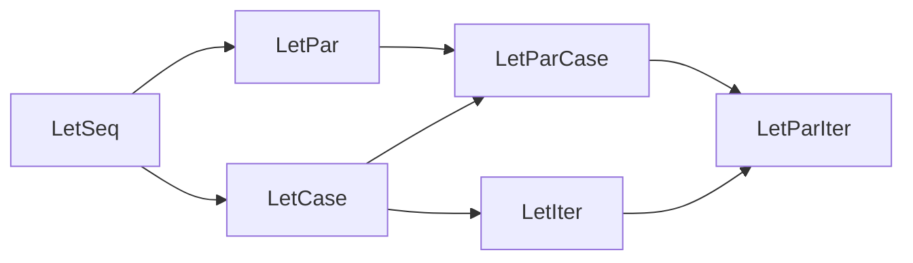

# LetParIter

Import `Silmaril.SSA.Isotope.LetParIter.Thms` for the iteration tier of the
shared `Silmaril.Isotope.Parallel.Tm`. In the `LetParIter` scope, `p || q`
takes two computations in the same free and bound contexts. If they return
`A` and `B`, the result is `product A B` in branch order. The branches
cannot refer to each other's bound results. They may use the same variables
and their instructions may interact through shared state. Destructure the
result with `let₂` when subsequent code needs both values. The ordinary
`pair` still evaluates its arguments from left to right.

`iter` uses the native LetIter typing convention. The seed supplies a value
of type `A`. Its body has one additional bound slot of type `A` and returns
`coprod B A`. The left injection returns a `B` and the right injection
supplies another `A`. A parallel computation can appear in the seed or in
the body, and either branch of a parallel computation can itself iterate.

[Syntax and embedding](../../Silmaril/SSA/Isotope/LetParIter/Defs.lean) ·
[Typed examples](../../Silmaril/Proofs/SSA/Isotope/LetParIter/Regression/Terms.lean)

## Equations

`LetParIter.Equiv` is the inductively generated equivalence at fixed free
context, bound context and result type. Its endpoints retain exact typing
derivations. This keeps the intermediate types consistent through a rule,
including when multiple choices of intermediate types type-check the same raw
term. The inductive constructors give reflexivity, symmetry, transitivity,
congruence for every compound term constructor, type-preserving bound renaming,
and simultaneous bound substitution with pure images. Under a binder the
substitution preserves the new variable and weakens its older images. Iteration
congruence compares seeds in the ambient context and bodies in the extended
context. It introduces no equation relating iteration to parallel pairing.

The parallel generators are tuple swap and reassociation, projection past
either pure unit, agreement with the sequential product of two certified pure
terms, and naturality for pure result maps. The inherited case rules also
allow a branch to choose a case arm before the fork when the scrutinee is
certified pure. In each arm the unchanged partner is weakened into scope.
Syntactic purity is the shared `Parallel.Pure` predicate at the primitive
effect bottom for soundness. Both operands of a pure parallel term have to be
pure. An iteration has no purity constructor.

The mixed syntax also has pure let beta, let eta, feedback unfolding and the
native feedback seed-binding equation. `Equiv.iterUniformity` takes a pure
state map and a recursive typed equation. On one side of that equation, the
first body transports its continue result along the map. On the other side,
the second body runs at the mapped state. The directed use of the state map
preserves returned values. The premise can itself use parallel equations.
Soundness uses pure Elgot uniformity.

The `native` constructor admits the
existing `LetIter.ProofRelevant.LocallyNameless.TypedEquiv` judgments at exact
native endpoints, including the native guarded uniformity premise and the
other sequential, case and Elgot equations there. The rule uses a proof at
the original typing derivations. `embed_related` exposes that edge without
restricting the native equality derivation. For raw diagrams,
`native_uniformity_of_aligned_square` consumes a witnessed native square
once its two typing fibers are aligned. Compatibility of the other raw
generators and alignment for transitivity remain separate premises. The full
native axiom schemata are not automatically extended to mixed terms by this
import. Full interchange for
two effectful continuations, effectful case distribution, and commuting
parallel with feedback have no generating equations.

[Equational constructors](../../Silmaril/SSA/Isotope/LetParIter/Equations/Defs.lean) ·
[Raw uniformity under alignment](../../Silmaril/SSA/Isotope/LetParIter/Uniformity/Thms.lean)

## Interpreting programs

Supply a lawful monad, its `Iterate` and `LawfulElgotMonad` instances, the
native type and instruction model, and an explicit
`Silmaril.Elgot.ParallelPairing m`. The record requires an ordered pairing,
naturality for ordinary functions via functor map, symmetry, associativity,
and the right unitor at monadic `pure ()`. The left unitor and compatibility
of pairing with one or two pure values follow from those fields. The record
has no law about Kleisli bind, iteration, scheduler fairness, or an effect
observation model. Use `LetParIter.interpret` to run the common tier evaluator
with this model. `interpret_eq_denote` relates that evaluator to the direct
native-model denotation. `interpret_sound` preserves the common evaluator
under every generated equation and every ambient valuation.

The model regression uses a partial writer whose bind adds counters and
whose parallel operation takes their maximum. The two sequential orders for
identical increments produce two, while the parallel operation produces one.
A separate example refutes full bind interchange. This writer is a check on
the generic assumptions. An operational shared-state interpretation supplies
its own pairing and proves the record's fields for its chosen observations.

[Pairing record](../../Silmaril/Semantics/Elgot/Parallel/Defs.lean) ·
[Soundness](../../Silmaril/SSA/Isotope/LetParIter/Thms.lean) ·
[Model regression](../../Silmaril/Proofs/SSA/Isotope/LetParIter/Regression/PairingModel.lean)

## Concrete finite-success dialects

Import `Silmaril.SSA.Isotope.LetParIter.Models.Thms` for the typed programs
and soundness theorems in `LetParIter.Models.ReadOnly` and
`LetParIter.Models.Choice`. Both dialects use natural numbers as their atomic
values and instantiate the public `LetParIter.sound` theorem for every
generated typed equation.

- `ReadOnly` uses `ReaderT Env Part`. Each primitive read projects a distinct
  slot, with an independent availability condition and its own effect bit.
  `readPair_mem` characterizes the ordered result coordinate by coordinate.
  `countAndRead_run` starts with the left slot, counts down through feedback,
  and reads the right slot in the return case. Either unavailable read
  produces an undefined result.
- `Choice` uses `SetM`. `choosePair_mem` gives the cartesian product of two
  binary choices. `chooseLoop_outcomes` gives exactly `{10, 20}`. The value 20 can return
  immediately, and 10 requires taking a back edge from a positive seed. Zero
  also has a self-loop, so the same program admits an infinite execution.

The reader transformer uses the existing pointwise Elgot iteration.
`ParallelPairing.reader` lifts any pairing pointwise, and environment
precomposition, evaluation at a fixed environment, and constant reader
lifting preserve pure, bind, iteration, and pairing. For `Part` and `SetM`,
the result of parallel pairing agrees with both orders of monadic sequencing
when the tuple coordinates are kept in branch order.

These are denotational observations of finite successful results. An
unavailable read and divergence both give no value in `Part`. `SetM` collects
all may-outcomes of finite successful runs, with no bound on the size of an
outcome set. It identifies runs by their returned value and records no
multiplicity, scheduling, fairness, or must-termination information.

[Dialect API](../../Silmaril/SSA/Isotope/LetParIter/Models/Thms.lean) ·
[Pairing and preservation laws](../../Silmaril/Semantics/ElgotMonads/Parallel/Thms.lean) ·
[Elgot laws](../../Silmaril/Semantics/ElgotMonads/Thms.lean)

## Tier inclusions



The vertical embeddings and the parallel-tier widenings are injective on
constructor trees. `LetParCase.embed_seqCase` and `LetParIter.embed_caseIter`
give the adjacent squares. `LetParIter.embed_seqIter` gives the composite
rectangle. The widening from LetParCase and the composite widening from LetPar
also preserve exact typing and their common monadic denotation.

[LetParCase squares](../../Silmaril/SSA/Isotope/LetParCase/Thms.lean) ·
[LetParIter squares](../../Silmaril/SSA/Isotope/LetParIter/Thms.lean)

## Native compatibility and reflection

`embed` preserves native constructors and `toLetIter?` is its left inverse.
The embedding commutes with bound renaming and simultaneous bound substitution.
`denote_embed` preserves exact native denotation independently of the choice
of pairing in that model. These are facts about syntax, typing, and
interpretation at fixed derivations.

Equational conservativity asks whether equality between two embedded native
typing derivations implies the original native proof-relevant equation.
`native_denote_eq` gives the semantic step: equality of embedded endpoints
implies native denotational equality in every model equipped with lawful
parallel pairing.

The word separation test proves this reflection for canonical closed
straight-line programs over two effectful `unit → unit` instructions. The
partial writer's sequential bind concatenates instruction words in order.
Its symmetric parallel operation retains a lone nonempty word and uses a
fixed nonempty word when both operands have output. The resulting model
distinguishes every pair of distinct words even when a proposed equality
uses parallel terms in the derivation. In particular, emitting the two
instructions in opposite orders stays inequivalent.

General equational reflection still needs a family of models that validates
parallel pairing and separates all inequivalent native typed endpoints,
including arbitrary sums, environments, and feedback. The partial writer
argument identifies only the listed canonical programs. Its log records
terminating output and carries no observation of an infinite run. The
reflection target is native `TypedEquiv.Related` at exact endpoints. The
lower tiers' raw, independently typed equations and the iteration tier's
aligned proof-relevant equations are different judgments.

[Word separation test](../../Silmaril/Proofs/SSA/Isotope/LetParIter/Regression/PairingModel.lean)

The `Silmaril` library includes both LetParIter regression modules. The
lower-tier regressions and their axiom reports run with the maintained
`LetIterWeakTreeSoundnessTests` suite. To run both:

```bash
make check CHECK_TARGETS='LetIterWeakTreeSoundnessTests +Silmaril.Proofs.SSA.Isotope.LetParIter.Regression.Terms +Silmaril.Proofs.SSA.Isotope.LetParIter.Regression.PairingModel'
```

To include the concrete dialects, add
`+Silmaril.SSA.Isotope.LetParIter.Models.Thms` to `CHECK_TARGETS`.
