# Algebraic specification and matching logic

Many-sorted, varying-sort, order-sorted and dependent-family equational logics, initial algebras and quotients, the finite-sorted compiler, equational λ-calculi, and matching logic (first-order, fixed-point, guarded and general fixed-point variants, sort maps) with the translations between them, as institutions registered in the [logic graph](logic-graph.md). The sections below are the guides of each development.

## Many-sorted algebraic logic

`Silmaril.Logic.Algebraic.ManySorted.Defs` defines finitary signatures, intrinsically
sorted terms, equations with finite sorted contexts, algebras, homomorphisms and
the equational institution. Signature maps genuinely rename operations; model
reducts interpret those renamed operations. The satisfaction theorem is proved
by induction on terms. Arbitrary sort sets, nullary operations and empty carriers
are supported. The sort set is fixed within each signature category; maps that
merge or rename sorts are a separate extension.

Axiom sets reuse the shared `Presentation` and `Theory` APIs. This supplies a
semantic home for the explicitly elaborated algebraic fragment of LATIN; native
MMT parsing alone does not produce one of these typed presentations.

The construction follows the equational-logic example in Goguen and Burstall,
“Institutions: Abstract model theory for specification and programming” (1992).
Single-sorted ordinary algebra is the special case with one sort. Conditional
identities are added as universal equational Horn clauses; they are distinct
from relational Horn logic and existential CSP satisfiability.

`Horn` adds equality atoms sharing one sorted context, finite premise lists,
universal satisfaction and a genuine Horn institution. Empty-premise clauses
embed equations through `equationHornComorphism`; both model functors use the
same algebra category. This is equational Horn logic: it has equality and
operation symbols, without predicates, existential heads or false conclusions.

`Substitution` proves evaluation commutes with simultaneous sorted substitution,
and that valid identities remain valid under substitution. `SingleSorted`
specializes to `PUnit` and injects ordinary arity-indexed operations, algebra
interpretations and operation renamings into the shared API.

`Examples` includes a two-sort signature with nullary symbols and two algebras
that disagree on an equation. It also proves a toy no-op elimination identity
and a Horn congruence clause whose premise is satisfiable. These are algebraic
toy examples, not a theorem about a WASM executable or a real compiler pass.

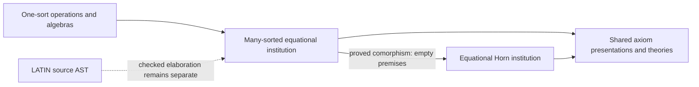

The singleton algebra satisfies every pure equation; a nullary operation forces
its result carrier to be inhabited. The examples also provide a nontrivial
countermodel so the API is tested beyond this universal singleton model.


## Dependent-family equations

This fragment adds indexed sorts to the algebraic institution network. A sort
constructor has a finite number of base arguments. For example, `Hom` has two:
`Hom(x,y)`. Models choose a base carrier and a separate carrier for each indexed
sort. The fibers can be empty or differ between indices.

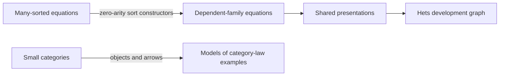

- `Defs` contains intrinsic terms, indexed operation profiles, actual models and
  homomorphisms, signature maps, evaluation, reducts and the institution square.
- `Equational` embeds ordinary terms and equations, proves injectivity of the
  sentence map, and proves satisfaction preservation and reflection for the
  singleton-base interpretation. Erasure is its left inverse. The shared
  `Inst.Hom` packages the signature functor, sentence erasure and model
  interpretation with proved naturality.
- `Category` represents identity, composition, and their three category laws as
  actual indexed equations. Every small category satisfies the presentation.
  A discrete two-object category has empty off-diagonal fibers; a Boolean
  countermodel fails the identity law. The presentation is also a Hets graph.

Operation symbols have a base-variable context and a finite list of fiber
arguments. A term can instantiate an operation's base variables by renaming.
Signature maps preserve these indexed profiles. Model homomorphisms map both
base elements and their corresponding fibers, preserving the operations.

## Scope

This is a one-layer fragment toward generalized algebraic theories. It does not
implement operations returning the base sort, sorts depending on fiber terms,
arbitrary iterated dependent contexts, or equations between types. Those are
part of the full Cartmell target tracked in issue #1239. The category-law example
is a model construction, not a classification of every model as a category:
its context-indexed operation symbols are not all identified by coherence axioms.

The equational embedding proves a signature functor and exact
term/sentence/model correspondence. Its bundled institution map is a morphism:
sentences erase indices and ordinary models acquire a singleton base. The
forward sentence inclusion is an injective section. A comorphism reducing
every dependent model back to an ordinary algebra is separate work. No
equivalence with full generalized algebraic theories or with the MMT/LATIN
parser is claimed.

Sources: John Cartmell, *Generalised Algebraic Theories and Contextual Categories*,
Oxford DPhil thesis (1978); APAL 32 (1986), 209–243,
DOI [10.1016/0168-0072(86)90053-9](https://doi.org/10.1016/0168-0072(86)90053-9).
The [nLab overview, revision 11](https://ncatlab.org/nlab/revision/generalized+algebraic+theory/11)
distinguishes dependent declarations from ordinary many-sorted algebra and from
general type-formation schemes.


## Public equations and private many-sorted equations

`Silmaril.Logic.Algebraic.ManySorted.PublicEQ` connects two independently defined
presentations of equational logic. The source uses the actual public Silmaril
`EQ.Term`, `EQ.Equation`, `EQ.Algebra` and algebra homomorphisms. The target uses
the existing private `ManySorted.Term`, `Equation`, `Model` and homomorphisms.
Terms and equations are translated structurally; the bridge is not an identity
on labels or a replacement semantics.

A signature declares operation symbols with sorted inputs and a result sort.
Here the set of sorts `S` is fixed but arbitrary. Both institutions use the
existing private `ManySorted.Signature S` category as their common signature
base. The `signatures S` functor constructs genuine public EQ signatures and
maps. Its sort maps are identity; its operation maps may be noninjective, so two
symbols with the same profile may become one. This is the restriction of public
EQ along that functor, not a claim about all sort-changing public EQ maps.

An equation declares a finite sorted context of universally quantified variables
and two terms of the same sort. For example, `x = y` with two Boolean variables
is false, witnessed by assigning `true` and `false`. It is true when that sort's
carrier is empty: there are no assignments of its declared context. The bridge
preserves both cases, including empty carriers and nullary operations.

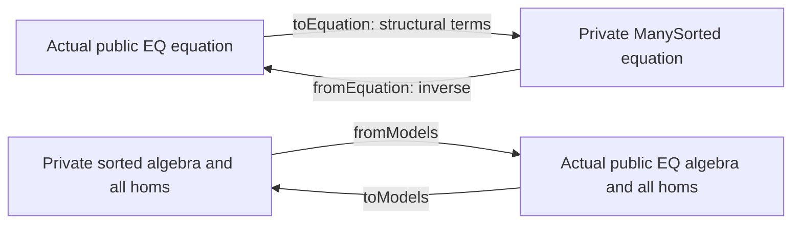

A model interprets each sort by a carrier and each operation by a function.
A homomorphism is a sorted map preserving those functions; it need not be
injective. The bridge copies carrier and operation data into the other API's
actual model type and copies each homomorphism's maps and preservation proof.
Both model functor round trips equal the identity on whole categories, including
arrows. They commute exactly with signature reducts, which interpret a source
symbol using its mapped target symbol. The concrete controls retain the map
from a Boolean carrier to a one-element carrier.

`toTerm` and `fromTerm` recursively preserve variables and operation application.
Their round trips are identities. The same holds for `toEquation` and
`fromEquation`, preserving each declared context, result sort and both terms.
Evaluation and satisfaction agree, and both translations commute with every
admitted signature map. A checked control distinguishes two nullary source
symbols interpreted as `false` and `true`; after mapping both to one target
symbol, the translated equation is true. No injectivity assumption is hidden
in the naturality theorem.

A small client:

```lean
import Silmaril.Logic.Algebraic.ManySorted.PublicEQ.Examples

open Silmaril.Logic.Algebraic.ManySorted
open Silmaril.Logic.Algebraic.ManySorted.PublicEQ
open Silmaril.Logic.Algebraic.ManySorted.PublicEQ.Examples

example : Equation.Satisfies (pureModel Empty) (toEquation distinct) := empty_vacuous
example : ¬ Equation.Satisfies (pureModel Bool) (toEquation distinct) := false_nonreflexive
```

An institution packages signatures, sentences, model categories and satisfaction.
A comorphism translates signatures and sentences forward while reducing models
backward, with an exact satisfaction equivalence. `toManySorted S` is such an
actual `Inst.CoHom` from the restricted public institution to the private one;
`toPublicEQ S` supplies the reverse direction. Both have exact model expansion:
each source model is the reduction of a target model by equality, without an
isomorphism or nonempty-carrier hypothesis. `entails_iff`, `sat_iff` and
`unsat_iff` state preservation and reflection for translated source theories.
They do not identify arbitrary theories by their names.

| Interface | File |
| --- | --- |
| Signature functor, structural translations, model/hom functors | [Defs.lean](../../Silmaril/Logic/Algebraic/ManySorted/PublicEQ/Defs.lean) |
| Round trips, evaluation, satisfaction, signature naturality and reduct squares | [Thms.lean](../../Silmaril/Logic/Algebraic/ManySorted/PublicEQ/Thms.lean) |
| Both actual comorphisms, exact expansion and semantic equivalences | [Institution.lean](../../Silmaril/Logic/Algebraic/ManySorted/PublicEQ/Institution.lean) |
| Empty/false equation, noninjective symbol and actual model-arrow controls | [Examples.lean](../../Silmaril/Logic/Algebraic/ManySorted/PublicEQ/Examples.lean) |
| Exact theorem axiom guards | [Audits.lean](../../Silmaril/Logic/Algebraic/ManySorted/PublicEQ/Audits.lean) |

This is new bridge work over the pinned public dependency and the existing
private many-sorted API. It adds no paper-correspondence claim. Sort-changing
maps and a categorical equivalence of the full varying-sort public institution
are outside its scope. No new term constructors, axioms or computational
execution adapter are introduced.

Targeted validation uses:

```sh
bin/mor build --no-pool Silmaril.Logic.Algebraic.ManySorted.PublicEQ Silmaril.Logic.Algebraic.ManySorted.PublicEQ.Audits
bin/mor check
bin/mor layout
bin/mor isar lint Silmaril/Logic/Algebraic/ManySorted/PublicEQ --deny
git diff origin/main...HEAD --check
```

The validation receipt
pins checked source bytes and retained build output. Registry/layout/style checks
have their stated textual scope; mathematical claims rely on the Lean proofs.
Independent source review and actual full CI are separate checks. No full local
build or full kernel replay is claimed.


## Finite recursive systems with different sorts

A **sort** is a type label. A matching model assigns a **carrier**, the actual
value type, to each sort. A pattern denotes a set of values at its result sort.
Operations may return sets; the compiler does not require single-valued functions.

A recursive system has several equations whose unknowns are sets. For example,
let `Left` and `Right` be different sorts:

```text
X : set of Left  = seed union toLeft(Y)
Y : set of Right = toRight(X)
```

Here `seed` produces `Left` values. `toRight` takes `Left` values to `Right`
values, and `toLeft` goes back. An operation applied to argument sets collects
all outputs obtainable from those sets. The
[Lean example](../../Silmaril/Logic/Matching/FixedPoint/Simultaneous/Examples.lean)
represents this actual two-sort dependency:

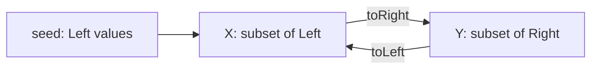

The **least fixed point** is the smallest pair of sets satisfying both
equations. Removing `seed` leaves an unseeded cycle whose least fixed point is
two empty sets, for every model. Native carriers remain inhabited, as required
by the existing matching model API; a subset of a carrier may still be empty.

## The indexed system

[System](../../Silmaril/Logic/Matching/FixedPoint/Simultaneous/Defs.lean) keeps each
unknown in its original finite slot, called a **coordinate**:

| Input | Meaning |
| --- | --- |
| `A` | Operation signature, with input and result sorts |
| `P : Fin r → S` | Sort of each of the `r` recursive coordinates |
| `Q : Fin l → S` | Sort of each of the `l` external set variables |
| `Γ : Fin k → S` | Sort of each of the `k` object variables |
| `body i` | Equation body for recursive coordinate `i` |

An object variable denotes one value. A set variable denotes a subset. External
variables are supplied by the caller; recursive coordinates are determined by
the least fixed point. Operation arguments use subsets at their own input sorts.
Two coordinates may have the same sort and still refer to different sets.

`System.operator` evaluates all bodies together. It is **monotone**: increasing
the recursive input sets cannot decrease a result set. `System.denote` takes
its least fixed point in the **product lattice** of subset families, where
inclusion is compared separately at each coordinate. This definition is
independent of compilation.

## Compile to existing unary binders

Native matching syntax binds one recursive set at a time using `μ`. A
**binder** introduces a local variable. Substitution shifts other variable
indices so the new binder does not accidentally capture them.

`System.compile i` produces an ordinary native pattern for original coordinate
`i`. It uses the Bekič decomposition, which solves a finite mutual least fixed
point with nested unary least fixed points. For equations `X = F(X,Y)` and
`Y = G(X,Y)`:

1. Hold `X` fixed and form `Y_X = μY. G(X,Y)`.
2. Form `X* = μX. F(X,Y_X)`.
3. Substitute `X*` into `Y_X` to obtain `Y*`.

[System.compile_correct](../../Silmaril/Logic/Matching/FixedPoint/Simultaneous/Thms.lean)
proves that evaluating all compiled patterns gives the independently defined
simultaneous least fixed point. Bodies use the existing positive set-variable
syntax: operation application, conjunction/disjunction, object quantifiers and
nested `μ`/`ν` binders. Here `ν` is the greatest-fixed-point binder; the system
compiler solves a least-fixed-point block.

## Sort maps preserve literal syntax

A signature map maps source sorts and operation symbols to target ones. It may
identify different sorts. Mapping both `Left` and `Right` to one target sort
keeps the two original recursion coordinates:

```text
before: coordinate 0 : Left, coordinate 1 : Right
after:  coordinate 0 : Unit, coordinate 1 : Unit
```

**Naturality** here means that mapping and compiling commute:

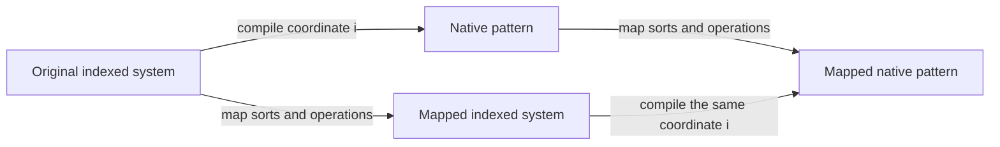

`System.compile_map` proves equality of the resulting syntax, including the
actual binder/context transports. Semantic naturality, which states agreement
of denotations, is a separate theorem. `fixedPattern_substituteSets` supplies
the capture-avoiding substitution law used by the compiler proof. Neither
result assumes an injective sort map.

The [compiler controls](../../Silmaril/Logic/Matching/FixedPoint/Simultaneous/SyntaxExamples.lean)
apply this equality to both original coordinates of a real `Bool`-to-`Unit`
collapse, seeded and unseeded systems, an equal-sort block with two external
coordinates, and an empty block. The
[renaming controls](../../Silmaril/Logic/Matching/FixedPoint/SortNaturality/Examples.lean)
also distinguish actual variable syntax after sort collapse and exercise nested
object and set binders.

For example, using the existing example definitions:

```lean
import Silmaril.Logic.Matching.FixedPoint.Simultaneous.SyntaxExamples

open Silmaril.Logic.Matching
open Silmaril.Logic.Matching.FixedPoint.Simultaneous

example (i : Fin 2) :
    SortMaps.Hom.fixedPattern Examples.collapse (Examples.«mutual».compile i) =
      Examples.collapsedMutual.compile i :=
  SyntaxExamples.mutual_compile_literal i
```

## Scope and checks

- The recursive coordinate block is finite. Ambient sort and operation families
  need not be finite, and different sorts may have different carriers.
- Empty blocks and empty generated subsets are included. Coordinates remain
  distinct when their source sorts or target sorts coincide.
- This compiles a supplied recursive system. Constructing the generation system
  for a many-sorted equation presentation and packaging its initiality
  institution are further steps.
- General infinite recursive families are not compiled to finite native syntax.
- Selected axiom audits allow only `propext`, `Classical.choice` and `Quot.sound`.
  They cover the printed declarations and their transitive dependencies.

Verify the proofs, controls and selected audits with the default remote worker:

```sh
scripts/prove.sh Silmaril.Logic.Matching.FixedPoint.Simultaneous.SyntaxAudits
```

When that worker is unavailable, use the guarded targeted local fallback:

```sh
bin/mor build Silmaril.Logic.Matching.FixedPoint.Simultaneous.SyntaxAudits
```


## Order-sorted algebra through explicit coherent coercions

An 8-bit byte can widen to a 16-bit word and then to a 32-bit address. The same
byte can also widen directly to an address. A useful subsort model must say that
both paths preserve the value and agree. It must also prevent widening from
collapsing two distinct bytes. `Silmaril.Logic.Algebraic.OrderSorted` formalizes this
fragment, reusing public many-sorted equational logic throughout.

## Terms used here

- A **sort** is a kind of value, such as byte or address. Its **carrier** is the
  type of values used by a model: `Fin 256` has the values 0 through 255.
- A **partial order** describes which sorts can widen into which others. It is
  reflexive, transitive and antisymmetric. Unrelated sorts need not be comparable.
- A **signature** declares sorts and operation symbols. An operation's **profile**
  gives its input sorts and output sort; address addition has two address inputs
  and one address output. A constant has no inputs.
- A **coercion** converts a value of one sort to another. It is **injective** if
  distinct inputs stay distinct. **Coherence** here means the identity and
  composition laws listed below, together with injectivity.
- An **institution** packages sentences, models and satisfaction across signature
  translations. An equation is satisfied when both terms evaluate equally for
  every assignment to its declared variables. A **reduct** interprets a target
  model using only the source signature.
- **EQ** is the public many-sorted equational-logic API. A **comorphism** translates
  signatures and sentences forward and models backward, preserving satisfaction.
  **Model expansion** means every source model is the reduct of a target model.


## What the model says

A signature contains an existing public `EQ.Signature` and a partial order on
its sorts. Signature morphisms are actual EQ signature maps with monotone sort
maps. They can change the sort set; they are not restricted to identity maps.
Every operation keeps its one declared profile. There is no shared symbol name
whose overloaded interpretations need to be reconciled.

`compiled A` is an actual public EQ signature. It adds a unary inclusion
operation for every `s ≤ t`. A model is an actual EQ algebra for that signature,
with three proved obligations:

- The inclusion from a sort to itself is the identity.
- Every inclusion is injective.
- Two successive inclusions equal the direct inclusion.

These are the inclusion presentation in Goguen–Meseguer §4.1, J(1–3).
Injectivity is a conditional semantic law. It is not an unconditional equation
silently added to the public EQ syntax. The types of the carriers can differ;
subsorting is witnessed by explicit functions, not definitional equality.
`Coherent` names these model laws. The paper's stronger *coherent signature*
condition (regularity and locally filtered components) is a separate concept
and is not asserted here.

Model morphisms are actual public EQ algebra homomorphisms. Preserving the
inclusion operations forces them to commute with widening (`Model.hom_coerce`).
Signature reducts reindex both operations and carriers, preserve the three
laws, and act on these homomorphisms. The resulting category and functor laws,
term translation and satisfaction condition are proved.

Sentences are existing public EQ equations over the compiled signature, with
finite declared contexts and both terms at a common result sort. Satisfaction
is the public EQ evaluator under every assignment. Explicit widening permits
comparisons at an upper sort; arbitrary connected-component equality and
implicit least-sort elaboration are outside the fragment.

## Institution maps

`fromEquational` is a shared `Inst.CoHom` from public EQ to this institution.
It equips each sort set with the discrete order (equality) and maps operations
into the base operations of the compiled signature. Its model reduct forgets
diagonal inclusions. Every EQ algebra has an exact expansion: diagonal
inclusions are equality casts. This proves model expansion and the explicit
semantic-consequence equivalence `fromEquational_entails_iff`. Naturality holds
for arbitrary public EQ signature maps, including noninjective sort maps.

`toEquational` is a shared `Inst.Hom` in the other direction. It maps each
ordered signature to its actual compiled EQ signature. Its sentence component
is identity, while its model component forgets the inclusion-law proofs.
This gives an actual checked EQ target for every equation. It does not claim
that arbitrary EQ interpretations of the inclusion symbols are coherent, nor
the paper's reduction equivalence with literal-subset algebras.

## Reading the relocation example

`OrderSorted.Examples` uses the chain `byte ≤ word ≤ address` with carriers
`Fin 256`, `Fin 65536` and `Fin 4294967296`. `zeroExtend` preserves the underlying
natural number. `byte_word_address` proves that direct widening equals widening
through a word. The abstract `coherence_valid` proof establishes the same path
independence inside an address-addition equation for *every* model of this
signature, not just the finite arithmetic implementation.

`relocation directAddend` is the actual EQ term for adding a widened byte to an
address. `eval_relocation` identifies its public EQ evaluation with independent
`relocate` arithmetic; `eval_staged_relocation` checks the alternative coercion
path. The concrete result at base 4096 and addend 255 is 4351. Address addition
wraps modulo 2^32. This is an ELF-style toy, with no claim about ELF relocation
kinds, signed addends, instruction encoding or a particular ABI.

The following Lean example uses the public evaluator through the checked toy:

```lean
import Silmaril.Logic.Algebraic.OrderSorted.Examples
open Silmaril.Logic.Algebraic.OrderSorted.Examples

example :
    (relocation stagedAddend).eval algebra
        (assignment ⟨4096, by decide⟩ ⟨255, by decide⟩) = ⟨4351, by decide⟩ :=
  relocation_4096_255
```

The controls matter: `false_in_model` refutes the equation that every byte is
zero, `collapsed_not_coherent` rejects a constant inclusion, and a model with
all carriers empty is accepted when there are no constants. An inhabited
subsort cannot have an empty upper carrier. No general nonemptiness premise is
added to the institution or to the discrete-order model expansion.

## Literal-subset representation

The literal-subset model bridge constructs
actual common-ambient subsets from coherent injections under local filtration.
It proves a model-category equivalence at each fixed non-overloaded signature,
plus exact open equation satisfaction and arbitrary-theory consequence. This
removes the representation gap for that presentation; source overloading and
the full reduction theorem remain outside the result.

## Later initial-algebra work

The existing `Structured.Constraints` APIs define `FreeAt` by unique lifting of
maps and prove its relationship with invertible adjunction counits and initial
objects. Those results can be reused only after constructing an actual free
extension or initial model for the present model categories. This slice supplies
neither that construction nor the paper's regular coherent term/quotient proof.
The order-sorted-to-initial-algebra edge remains pending. Source-specific
coverage is recorded in the pinned paper's `notes.md`.

## Source map and checks

| Claim | Declaration or module |
| --- | --- |
| Sort order, compiled operations, coherent models and homomorphisms | [`OrderSorted/Defs.lean`](../../Silmaril/Logic/Algebraic/OrderSorted/Defs.lean) |
| Institution, reducts, EQ maps and model expansion | [`OrderSorted/Thms.lean`](../../Silmaril/Logic/Algebraic/OrderSorted/Thms.lean) |
| Widening, relocation, empty carriers, false equations and axiom guards | [`OrderSorted/Examples.lean`](../../Silmaril/Logic/Algebraic/OrderSorted/Examples.lean) |
| Exact primary-source files and per-item correspondence | `goguen-meseguer-1992-order-sorted-algebra` in `references.bib` |

```sh
LEAN_NUM_THREADS=2 bin/mor build --no-pool --mem-cap 16 \
  Silmaril.Logic.Algebraic.OrderSorted \
  Silmaril.Logic.Algebraic.OrderSorted.Examples Silmaril.Papers.GoguenMeseguer1992
```

The targeted warnings-as-errors build and eight exact axiom guards pass.
`hom_coerce` is axiom-free; satisfaction uses `Quot.sound`; the other guarded
results use `propext`, `Classical.choice` and `Quot.sound`. Scoped Isar lint,
`mor check`, source-file hash checks and branch whitespace checks pass. The
source PostScript and derived reading PDF remain private reference material.


## Free coherent order-sorted algebras

An order-sorted signature has a partial order on sorts. If `s ≤ t`, a value
of sort `s` can be used at sort `t` through an injective coercion. The existing
`OrderSorted.Model` also requires identity coercions and agreement between
direct and composed coercions. Operation symbols have unique sorted profiles;
shared-name overloading is outside this fragment.

`OrderSorted.Free` constructs a free coherent model for every such signature
and every finite sorted list of generators. **Free** means that assigning each
generator a value in any coherent model extends to exactly one homomorphism.
A **homomorphism** preserves every base operation and coercion; it can identify
different values. With no generators, the constructed model is **initial**:
there is exactly one homomorphism from it to each coherent model.

For example, take two sorts `lower < upper`, a constant `point : lower`, and
`successor : upper → upper`. A concrete coherent model uses a singleton lower
carrier, `Nat` as the upper carrier, and sends the lower value to zero. The
upper value one is outside that coercion's image. The free algebra distinguishes
`point` widened to `upper` from its upper successor.

## Constructing the free model

Keeping every explicit coercion as a syntax constructor would distinguish
identity and composed coercion paths, violating coherence. The construction
instead uses two mutually defined types:

- `Core A Γ s` is a variable or a base operation at its declared result sort.
  Each operation argument is already a `Normal` term at the required input sort.
- `Normal A Γ t` packages a core at some sort `s` and one proof `s ≤ t`.
  This `s` is the **principal origin** of that core: its variable or operation
  result sort, before widening.

Coercion retains the core and composes its root order proof. Identity and
composition follow from proof irrelevance, which identifies proofs of the same
proposition. Injectivity follows from retaining the origin and entire core.
There is no quotient identifying different base-operation trees and no assumed
constructor equation. The resulting `Free.model A Γ` is an actual
`OrderSorted.Model A` over the existing compiled public EQ signature.

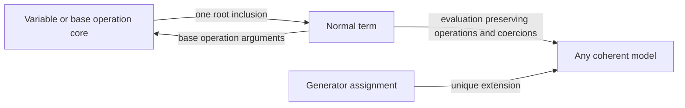

`evalCore` uses the target's base operations. `eval` then applies the target's
root coercion. `foldHom` is the resulting homomorphism in the original model
category. `fold_unique` proves uniqueness for a prescribed assignment;
`freeHomEquiv` gives the bijection between assignments and all homomorphisms.
`fold_natural` proves that evaluation commutes with every target homomorphism,
including noninjective ones. No restricted class of model arrows is substituted.

`Free.closed_isInitial` specializes this property to no generators. It requires
no inhabitance hypothesis. If the only base operation is a constant at `upper`,
the lower carrier of the free model is empty while its upper carrier is
inhabited. This is proved by evaluating into an independently defined coherent
model with carriers `Empty` and `Unit`.

## Initiality as an actual freeness constraint

`OrderSorted.Initial` applies the existing institutional freeness-constraint
construction to the coherent order-sorted institution. Its models remain all
coherent algebras, with all their original homomorphisms. Its sentences are
either an original equation or a freeness constraint. A **theory** is a signature
with a set of axioms; its model category contains the models satisfying them.

The target is `Constraints.institution Initial.ordered`, a qualified
order-sorted initial/free semantics. It is distinct from the public-EQ-based
`Algebraic.Initial.institution`. The signature order and coherence obligations
are retained. An explicit `ULift` changes the equation universe so that
constraints can quantify over signatures; it changes no equation semantics,
carrier, operation or homomorphism.

A **reduct** forgets structure along a signature map. The empty signature has
no sorts or operations, so any two of its reduct models admit exactly one
homomorphism. Consequently, for every theory `T` and model `M` of `T`,
`Initial.freeAt_iff_initial` identifies the existing `Constraints.FreeAt`
condition along the empty-theory map with `Nonempty (IsInitial M)`.
`initialConstraint_sat_iff` proves the same equivalence for satisfaction of the
actual shared `initialConstraint T` sentence.

The closed free model satisfies this constraint for every empty-axiom
presentation. The subsequent reflection-saturated quotient
constructs an actual initial coherent model for every equation theory, including
empty sorts, and proves satisfaction of the same constraint. Initiality follows
from the universal property; it is not a certificate field added to each model.

`Initial.fromOrderSorted` embeds the lifted original equations into this
constraint institution as an actual comorphism. It retains all ordered
signature maps, coherent models and model reducts. Its model expansion is exact:
the target model is the same source model. `original_entails_iff` states
preservation and reflection of semantic consequence for original equations.
This embedding accompanies the new free construction; by itself, adding a
sentence constructor would not construct an initial algebra.

## Controls and a small client

The examples use genuine coercions and operations:

- `proper_coercion_image` and `distinct_free_values` distinguish widening from
  upper successor in the two-sort model.
- `numericCollapse_not_injective` retains the actual homomorphism from the
  numeric model to a singleton model.
- `no_collapsed_hom` proves there is no reverse homomorphism: preserving successor
  would force a natural number to equal its successor. Thus the coherent
  singleton is not initial and fails the actual initiality constraint.
- `free_lower_empty`, `free_upper_inhabited` and `actual_initial_constraint`
  exercise the upper-only signature without assuming nonempty carriers.

```lean
import Silmaril.Logic.Algebraic.OrderSorted.Initial.Examples

open CategoryTheory.Limits
open Silmaril.Logic.Algebraic.OrderSorted

example (A : Signature) : IsInitial (Free.closedModel A) :=
  Free.closed_isInitial A

example : IsEmpty ((Free.closedModel Initial.Examples.upperSignature).algebra.carrier
    Initial.Examples.Sorts.lower) := Initial.Examples.free_lower_empty

example : ¬ Nonempty (IsInitial Initial.Examples.collapsed) :=
  Initial.Examples.collapsed_not_initial
```

| Contract | Source |
| --- | --- |
| Principal cores, normalized coercions, coherent model and evaluation homomorphism | [Free/Defs.lean](../../Silmaril/Logic/Algebraic/OrderSorted/Free/Defs.lean) |
| Full free universal property, homomorphism naturality and closed initiality | [Free/Thms.lean](../../Silmaril/Logic/Algebraic/OrderSorted/Free/Thms.lean) |
| Lifted coherent institution, theories and actual initiality constraint | [Initial/Defs.lean](../../Silmaril/Logic/Algebraic/OrderSorted/Initial/Defs.lean) |
| Empty-reduct uniqueness, arbitrary-theory characterization and exact equation embedding | [Initial/Thms.lean](../../Silmaril/Logic/Algebraic/OrderSorted/Initial/Thms.lean) |
| Coercion, empty-sort, noninjective-arrow and noninitial-model controls | [Initial/Examples.lean](../../Silmaril/Logic/Algebraic/OrderSorted/Initial/Examples.lean) |
| Exact axiom guards | [Initial/Audits.lean](../../Silmaril/Logic/Algebraic/OrderSorted/Initial/Audits.lean) |

## Provenance and validation

This is new private construction over the existing coherent-coercion model API
and the shared freeness constraints. It qualifies the Order-Sorted → Initial
It adds no paper-correspondence coverage claim. The existing order-sorted
fragment's nonoverloading boundary remains; full overloaded order-sorted algebra
and a categorical equivalence with all public EQ initial semantics remain
outside this result. Arbitrary-equation coherent quotients are supplied by the
separate construction.

The validation receipt
records the pinned source/dependency revisions, source hashes, targeted guarded
Lean build, exact axiom guards and other checks. Registry and layout checks do
not establish mathematical correctness. Independent source review and actual
full CI are separate checks; no full local build is claimed.


## Initial quotients for coherent order-sorted theories

`OrderSorted.Presented` constructs a model for every equation theory over the
existing coherent order-sorted institution. For every finite sorted generator
context, assignments into any model of the theory correspond to all actual
homomorphisms out of the constructed model. With no generators, this gives an
initial model and proves satisfaction of the existing `Initial.initialConstraint`.
Sorts may be empty. Operation symbols retain unique profiles; this result makes
no claim about shared-name overloading or the source reduction theorem.

## Terms used here

- A **sort** is a value category, such as `lower` or `upper`; its **carrier** is
  the set of values of that sort in a model, such as `Unit` or `Bool`.
- A **coercion** turns a lower-sort value into an upper-sort value. It is
  **injective** when equal outputs imply equal inputs; singleton-to-`false`
  is an example of an injective coercion into `Bool`.
- A **congruence** is an equivalence relation preserved by operations. Its
  **quotient** replaces each value with its equivalence class. Here reflection
  additionally ensures that quotient coercions stay injective.
- A **finite generator context** lists finitely many variables and their sorts,
  for example `x : lower, y : upper`. An assignment supplies both values.
- An **initial model** has exactly one operation-preserving homomorphism into
  each model of the theory. With generators, uniqueness holds after fixing
  their assignment; this is the **free** property.

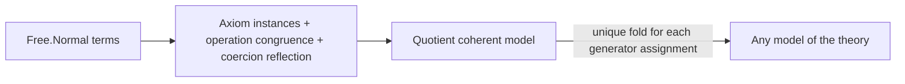

## Why the congruence reflects coercions

The starting terms are the actual `Free.Normal` terms from the
free coherent construction. Their coercions already
satisfy identity, composition and injectivity. `Presented.Rel T Γ` closes under
reflexivity, symmetry, transitivity, every compiled operation (base operations
and inclusions), and every axiom instance with a substitution for every declared
context variable. It additionally closes under coercion reflection:

```text
coerce h a ~ coerce h b  implies  a ~ b
```

This rule ensures that quotient coercions remain injective. It is sound in
every target coherent model because its coercions are injective. No injectivity
is required of homomorphisms between models.

For example, take `lower < upper`, two distinct lower constants `a,b`, and an
axiom only at upper sort: `up(a) = up(b)`. Reflection forces the two lower
quotient classes together. The independent separating model has singleton
lower carrier, Boolean upper carrier, coercion to `false`, and a fresh upper
constant interpreted as `true`. It satisfies the axiom and proves that the
fresh quotient value stays outside the image of every lower quotient value.
Thus the forced collapse preserves a proper subsort.

A second signature has no lower constructors and two upper constants `c,d`.
Its axiom is `∀ x : lower, c = d`, with the variable unused by both terms.
A model with empty lower carrier and Boolean upper carrier satisfies this
vacuously. The quotient keeps its lower carrier empty and the two upper
constants distinct. Requiring complete substitutions preserves this behavior.

## The actual universal property

`coherentModel T Γ` descends every compiled operation to quotient classes.
`coherent` proves identity and composition using the existing normal-term laws;
injectivity uses `Rel.reflect`. `projection` is an actual coherent-model
homomorphism. `model_models` proves every axiom under every complete quotient
valuation, using finite dependent quotient induction without a global
inhabitance assumption.

`rel_sound` proves evaluation into any model of `T` respects the relation.
It yields `foldHom`; `fold_unique` and `freeHomEquiv` prove uniqueness and the
bijection for all actual model arrows. `quotientModel_isInitial` specializes to
the empty generator context. `quotientModel_satisfies` applies the existing
initiality/constraint equivalence. `emptyPresentationIso` identifies this
construction with the previous closed free model for an empty axiom set.
The examples retain a noninjective arrow both between coherent models and
between actual models of the nonempty equation theory.

```lean
import Silmaril.Logic.Algebraic.OrderSorted.Quotient.Thms

open CategoryTheory.Limits Silmaril.Logic.Algebraic.OrderSorted

example (T : Initial.Theory) : IsInitial (Presented.quotientModel T) :=
  Presented.quotientModel_isInitial T
```

| Contract | Source |
| --- | --- |
| Saturated relation and quotient operations | [Defs.lean](../../Silmaril/Logic/Algebraic/OrderSorted/Quotient/Defs.lean) |
| Actual coherent model and projection | [Models.lean](../../Silmaril/Logic/Algebraic/OrderSorted/Quotient/Models.lean) |
| Coercion coherence | [Coherence.lean](../../Silmaril/Proofs/Logic/Algebraic/OrderSorted/Quotient/Coherence.lean) |
| Evaluation soundness, theory satisfaction and descended fold | [Universal.lean](../../Silmaril/Proofs/Logic/Algebraic/OrderSorted/Quotient/Universal.lean) |
| All-hom freeness, initiality, constraint and empty-presentation isomorphism | [Thms.lean](../../Silmaril/Logic/Algebraic/OrderSorted/Quotient/Thms.lean) |
| Forced collapse, proper subsort, empty-lower vacuity and noninjective arrows | [Examples.lean](../../Silmaril/Logic/Algebraic/OrderSorted/Quotient/Examples.lean) |
| 21 exact axiom-output guards | [Audits.lean](../../Silmaril/Logic/Algebraic/OrderSorted/Quotient/Audits.lean) |

## Provenance and limits

These are new private proofs over the existing coherent-model API and shared
freeness constraints, reusing public-EQ evaluation preservation and mathlib
finite quotient lifting. No external source was copied and no paper coverage
claim is added. This constructs arbitrary-equation coherent initial models;
it does not prove an equational consequence-completeness theorem, an executable
normalizer or decision procedure, overloaded order-sorted algebra, or the
source reduction equivalence (recovering the original ordered semantics from
a many-sorted encoding). The finite constructor-to-matching compiler
retains its existing no-equation profile.

The validation receipt
records exact source/log hashes, targeted builds, historical failures and
structural checks. Independent final source/doc/receipt review approved
`7103e4db749e270ecf1fa081e29041346b68f146`; the full catalogue check passed in an
existing full-catalogue worktree detached at that exact head. This subsequent
documentation/receipt append changes no Lean source. The integration PR records
full CI at its final head; no full local Lean build is claimed.


## Changing signatures of literal-subset models

The literal-subset representation
compares two model categories at a fixed signature. The institution layer adds
actual signature changes: sorts and operations may be renamed or identified,
and every existing monotone signature map remains admitted. A map is
**monotone** when `s ≤ t` implies `f(s) ≤ f(t)`.

A **reduct** views a model through a signature map. Here it keeps the original
ambient type, selects the carrier of the mapped sort, and interprets each
operation by its mapped operation. Widening follows the map's monotonicity
proof. It acts on every sorted homomorphism as well as on models.

For example, two different source sorts may both map to one target sort, and
two different source operation symbols may map to one target symbol. The
checked collapse example uses both identifications. The translated equation
and its original equation in the reduct have exactly the same satisfaction.
No sort or operation injectivity hypothesis is added.

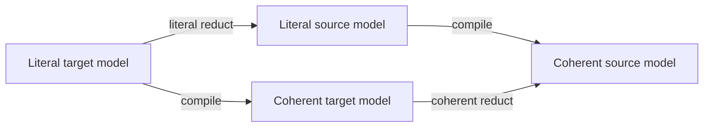

`literalInstitution` uses the existing equation sentences and their existing
translation. `literal_satisfaction` proves its satisfaction law;
`literalReductFunctor_id` and `literalReductFunctor_comp` prove the reduct laws.
`compile_reductFunctor` states equality of the two entire model functors in the
diagram, including their actions on all sorted homomorphisms.

`toLiteral` is a genuine institution comorphism from the coherent
explicit-coercion institution to the literal-subset institution. Its signature
and sentence translations are identity; target literal models compile backward
to coherent source models. This comparison is natural under every existing
monotone signature map, without a filtration premise.

At locally filtered signatures, the comparison also supplies the existing
public institution borrowing interfaces:

- `toLiteral_isoExpansive`: every coherent model is isomorphic to the reduct
  of a literal model.
- `toLiteral_elemExpansive`: every coherent model has a literal model whose
  reduct satisfies exactly the same equation sentences. This agreement is
  called **elementary equivalence** here.
- `toLiteral_faithful`: translated semantic consequence reflects back to the
  source. **Faithful** means that semantic consequence in the target reflects
  back to semantic consequence from the original source assumptions.
- `toLiteral_room_entails_iff`: arbitrary-theory consequence agrees in the
  actual source and target `Room` APIs, obtained through the pinned public
  elementary-expansiveness borrowing theorem.

The existing representation also supplies exact arbitrary-theory
satisfiability in both presentations. These properties use isomorphism or
sentence agreement; they do not require equality of original and represented
model objects. No strict model-expansiveness theorem or strictly natural
reverse quotient construction is asserted. Local filtration is needed for
these representation/borrowing results, while the comorphism itself retains
all existing monotone signature maps.

The signature remains non-overloaded. Shared-name overload compatibility J(4),
regular least-rank machinery, connected-component equation syntax and the full
source reduction theorem remain open. Literal arrows remain sorted
homomorphisms of compiled algebras; no global map on unused ambient values is
part of the model category.

The header is
[`Representation/Institution/Thms.lean`](../../Silmaril/Logic/Algebraic/OrderSorted/Representation/Institution/Thms.lean).
Its `Examples` module checks the collapse and complete compile/reduct square;
its `Audits` module enforces the standard three-axiom ceiling on sixteen selected
endpoints. All sixteen ceilings, including the public borrowing results, and
the actual collapse controls pass targeted Lean validation with warnings treated
as failures. Registry, textual layout and
whitespace checks also pass; these structural checks do not elaborate Lean.

The portable targeted validation command is:

```sh
bin/mor build --no-pool \
  Silmaril.Logic.Algebraic.OrderSorted.Representation.Institution.Audits
```

No full Lean build was run for this increment; ordinary full exact-head PR CI
remains a separate merge gate.


## From explicit widening to literal subsets

The existing order-sorted model gives each sort its own type and uses injective
widening functions between comparable sorts. The new representation constructs
literal subsets of one ambient type and proves that they give the same equation
semantics. It retains every original sorted homomorphism and permits empty
carriers.

For example, the existing relocation model has separate 8-bit byte, 16-bit word
and 32-bit address types. A byte value 7 and its widened address value are not
originally elements of the same type. Their images in the representation are
exactly the same ambient value. The checked relocation example transports the
actual original evaluator, including wrapping address addition; it does not
replace the arithmetic by a new specification.

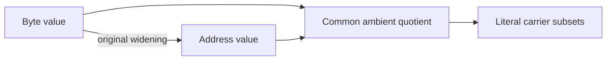

A **carrier** is the set of values of a sort. A **homomorphism** maps carrier
values while preserving operations and widening. The representation identifies
two tagged values precisely when their widened images agree at some common
upper sort. A **quotient** collects these equivalent tagged values into single
ambient values.

The signature must be **locally filtered**: any two sorts in the same connected
component have a common upper sort. Different disconnected components need not
meet. The implementation proves this source formulation equivalent to its
upper-cone amalgamation condition. This condition makes the tagged-value
relation transitive. Widening injectivity proves that no two distinct original
values of the same sort become equal.

The principal results in
[`Representation/Thms.lean`](../../Silmaril/Logic/Algebraic/OrderSorted/Representation/Thms.lean)
are:

- `embed_injective` and `embed_coerce`: each original carrier embeds faithfully,
  and widening becomes literal identity on ambient values.
- `representationIso`: the original compiled algebra is isomorphic to the
  constructed literal-subset algebra.
- `eval_represent` and `satisfies_represent_iff`: exact open-term evaluation and
  equation satisfaction, retaining all original variable contexts.
- `representationEquivalence`: the categories of coherent explicit-coercion
  models and literal-subset models are equivalent at each locally filtered
  signature. The unit and counit are natural in all sorted homomorphisms.
- `theory_satisfiable_iff` and `theory_entails_iff`: exact satisfiability and
  consequence for arbitrary equation theories.

Literal model arrows are sorted operation/coercion-preserving maps. They need
not specify a function on ambient values outside every carrier. This prevents
irrelevant unused ambient values from changing the model category. No
nonemptiness, finite-sort or global-directedness premise is imposed.

This follows the construction of Goguen–Meseguer (1992), §4.1, Lemma 4.1 and the
model-representation part of Theorem 4.2. The existing signature has uniquely
profiled operations, so shared-name overloading and its compatibility law J(4)
remain outside this result. The source's regular least-rank machinery and
connected-component equations are also absent. This is a substantive reduction
for the existing presentation, not a proof of the full source theorem or
completion of the entire source graph. The categorical equivalence is at each
fixed signature; no additional signature-natural institution equivalence is
claimed here.

`Representation/Examples.lean` uses the existing relocation model and proves
that disconnected empty sorts remain admitted. `Representation/Audits.lean`
enforces the standard `propext`, `Classical.choice`, `Quot.sound` ceiling on
thirteen selected endpoints. Validation status and private run receipts are
recorded separately; structural registry/layout checks do not elaborate Lean or
establish the theorem's mathematical interpretation.

The targeted remote command passes with warnings treated as failures:

```sh
scripts/prove.sh Silmaril.Logic.Algebraic.OrderSorted.Representation.Audits
```

All thirteen selected axiom ceilings pass. `bin/mor check`,
`scripts/check-layout.sh` and whitespace checks also pass. No full Lean build
was run for this increment; full exact-head PR CI remains a separate merge gate.


## Constructor algebras, freeness constraints and Wasm evaluation

An instruction expression is syntax before it is a number. The expression
`i32.add(i32.const 0xffffffff, i32.const 1)` is a constructor tree; evaluating it
produces zero by 32-bit wrapping addition. `Silmaril.Logic.Algebraic.Initial`
connects these two views with a genuine algebra universal property and then
connects the resulting fold to actual native Wasm execution.

For generation through native fixed-point syntax, see the
finite sorted compiler guide. It explains
how original sort coordinates and equations characterize initiality even when
an ambient map identifies sorts or operations.

## Terms used below

| Term | Meaning here |
| --- | --- |
| EQ | Many-sorted equational logic: typed operations, equations and their interpretations. |
| Algebra | A type of values for each sort, with a function interpreting each operation. |
| Homomorphism (`hom`) | A map between algebras that preserves their operations. |
| Free algebra | Constructor syntax with chosen generators; assigning those generators determines exactly one homomorphism. |
| Initial algebra | An algebra with exactly one homomorphism to every other algebra of the same signature; constructor syntax with no generators is an example. |
| Fold | Evaluate a constructor tree using another algebra's operations. |
| Constraint | A sentence asking for a universal property, such as unique lifting of homomorphisms. |
| Reduct | View an algebra through a signature map, retaining the sorts and operations named by that map. |
| Universe wrapper | Lean's `ULift` size wrapper around equation sentences; it leaves their mathematical meaning unchanged. |

## Try the wrapping example

This complete Lean client constructs the expression, checks its wrapped value,
and states that every homomorphism to the arithmetic algebra is this evaluator:

```lean
import Silmaril.Logic.Algebraic.Initial.Wasm

open CategoryTheory
open Silmaril.Logic.Algebraic.Initial

namespace WrappingClient

def wrap : Wasm.Expr :=
  Wasm.add (Wasm.lit (4294967295#32)) (Wasm.lit (1#32))

example : Wasm.evaluate.map () wrap = 0#32 :=
  Wasm.wrapping_example

example (h : closedAlgebra Wasm.signature ⟶ Wasm.arithmetic) :
    h = Wasm.evaluate :=
  Wasm.evaluate_unique h

end WrappingClient
```

The same expression also compiles to actual Wasm instructions. The execution
proof connects their result to the unique fold:

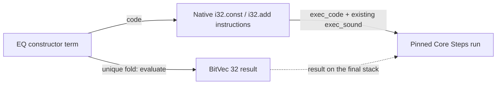

## The term model is an existing EQ algebra

`termAlgebra A Γ` uses public `EQ.Term A Γ s` as the carrier at each sort `s`.
Its operations build the existing public term constructors. Operation profiles
are explicit, matching the source's disambiguated-signature convention; no
name-based overloading or quotient equations are imposed. An assignment of
the finite declared variables in `Γ` to an actual `EQ.Algebra A` extends to
`foldHom`, whose function is exactly `EQ.Term.eval`. `fold_unique` proves every
constructor-preserving homomorphism is determined by those variable images.
`freeHomEquiv` packages the resulting assignment/homomorphism bijection;
`fold_natural` proves it respects actual target algebra homomorphisms.

With no variables, there is exactly one homomorphism from `closedAlgebra A`
to every algebra. `closed_isInitial` is the actual categorical initial-object
proof. Sorts need not be inhabited: without any constants or generators, a
sort can have no terms, and the examples verify this case explicitly. The
construction supports the finite contexts of the reused public syntax. It does
not construct free objects on arbitrary large generator families.

## Expressing initiality without changing the models

Restricting every signature's model category to its initial algebras would need
a proof that reducts preserve initiality. They do not do so in general. This
slice instead specializes the existing `Structured.Constraints` institution:
models and their morphisms remain the actual public EQ algebras and sorted
homomorphisms. A sentence is either an ordinary equation or an existing
freeness constraint specifying a theory map and a context map.

Constraint satisfaction tests `FreeAt`: every morphism from a model's reduct
must lift uniquely. This quantifies over actual objects and homomorphisms; no
satisfaction or initiality flag is stored in the model. Translating the context
map gives the existing proved satisfaction condition for arbitrary signature
morphisms. In particular, translating an initial constraint keeps its target
theory; it does not assert initiality of the entire expanded signature.

`initialConstraint T` starts at the empty-axiom theory over the genuinely empty
sort/operation signature. Every pair of its reduced models has a unique
homomorphism, proved directly in `emptyReductHomUnique`.
`initialConstraint_sat_iff` then uses the existing exact `FreeAt`/`IsInitial`
theorem to identify satisfaction with actual initiality in `Models T`.
No global exactness premise is assumed. The term model witnesses this property
for empty presentations. The arbitrary-theory quotient construction
now supplies an actual initial model satisfying this same constraint for every
public-EQ equation theory, with empty sorts allowed. It also proves the finite
generator universal property and compatibility with the old empty presentation.

## The shared EQ comparison and its size boundary

Constraints quantify over signatures and theories, so their sentence type lives
one universe above ordinary equations. `equational` explicitly uses
`ULift (EQ.Equation A)` and preserves the exact public algebra category and
equation satisfaction. No carriers or morphisms are lifted or replaced.
`fromEquational` is a genuine shared institution comorphism from this explicit
universe variant to the existing constraint institution. The inclusion is
natural in the original public EQ signature category; its model reduct is
identity, giving model expansion and semantic-consequence equivalence.
`publicEquational_entails_iff` states the same result directly using the original
small public equations, so users need not reason with the universe wrapper.

## The native Wasm client and controls

`Initial.Wasm` selects literals and addition at a single expression sort.
Its arithmetic model uses actual `BitVec 32` values and wrapping addition.
`evaluate` is the unique algebra homomorphism from the constructor term model.
`code` emits actual native `.intConst .i32` and `.intBinOp .i32 .add` instructions.
`exec_code` proves the existing Wasm straight-line interpreter leaves exactly
the folded value on any operand-stack tail, preserving the store and frame.
`executes` applies the existing interpreter soundness theorem to obtain a run
of pinned Core `Steps`, for every profile and host semantics. The final stack
value is therefore connected to both the fold and an actual execution run.

The example checks wrapping `0xffffffff + 1 = 0`. A collapsed one-point algebra
satisfies the constructor equation equating literal zero and literal one but
has no homomorphism to the arithmetic model. It is not initial and fails the
actual initiality constraint. This distinguishes satisfying some equations
from the free constructor property. Another example proves an initial term
algebra can have empty carriers; a variable supplies a term even in an
operation-free signature.

## Declaration map and checks

- [Definitions](../../Silmaril/Logic/Algebraic/Initial/Defs.lean): `termAlgebra`, `foldHom`, `initialConstraint`, and the explicit equation universe wrapper.
- [Universal properties and comparison](../../Silmaril/Logic/Algebraic/Initial/Thms.lean): `freeHomEquiv`, `fold_natural`, `closed_isInitial`, `initialConstraint_sat_iff`, and `fromEquational`.
- Wasm client: `evaluate_unique`, `wrapping_example`, `exec_code`, and `executes`.
- Controls and nine exact axiom guards: the populated term model, rejected collapsed model, false constructor equation, empty sorts and generators.

From the repository root, run the targeted build and catalogue checks:

```sh
LEAN_NUM_THREADS=2 bin/mor build --no-pool --mem-cap 16 \
  Silmaril.Logic.Algebraic.Initial \
  Silmaril.Logic.Algebraic.Initial.Examples \
  Silmaril.Papers.GoguenBurstall1992
bin/mor check
bin/mor isar lint --detail --deny Silmaril/Logic/Algebraic/Initial \
```

The examples target imports the Wasm client and checks the axiom guards. To
check the client above independently, save its Lean block as
`/tmp/initial-client.lean` and run:

```sh
scripts/worktree-setup.sh lake env lean /tmp/initial-client.lean
```

## Sources and remaining work

The exact pinned sources supporting this slice are Goguen–Burstall (1992),
Appendix A1 Theorem 55, and Durán–Meseguer (1999), Definition 4.14. Their coverage
notes state what is reused and proved. The graph's 1977 *Initial Algebra
Semantics and Continuous Algebras* article was identified, but its publisher PDF
returned 403; a metadata-only record states this. No uninspected 1977 theorem
is claimed. Public-EQ arbitrary-equation quotients now have constructed initial
models, and coherent order-sorted constructor
initiality is separate. Continuous algebras, recursive
domains, parameterized extension adjunctions and arbitrary-equation order-sorted
quotients remain pending.


## Initial models for arbitrary equation theories

Every theory in the existing public many-sorted equational API now has a
constructed initial model. `Presented.quotientModel T` satisfies all of `T`'s
actual equations; `quotientModel_isInitial` proves there is exactly one
homomorphism from it to each model of `T`. `quotientModel_satisfies` then proves
satisfaction of the existing institutional `initialConstraint T`. No initiality
witness or satisfaction flag is added to the algebra definition.

**EQ** is equational logic. A **sort** distinguishes a carrier type, and an
**equation** has two same-sort terms and an explicitly declared finite variable
context. A **theory** is a signature and a set of such equations. A
**homomorphism** preserves every operation; it may identify values. An
**initial model** has exactly one such homomorphism into every other theory
model. Carrier types may be empty throughout this API. A **valuation** assigns model
values to context variables; a **substitution** assigns terms to them. A
**generator** is a free variable whose image chooses a value in the target model.

## Building the quotient

The construction reuses the actual public `EQ.Term` and existing `termAlgebra`.
For any finite sorted generator context, `Rel` generates an equivalence relation
at each sort from operation congruence and complete substitution instances of
the theory's axioms. **Congruence** means related arguments remain related after
applying the same operation. Each quotient carrier consists of equivalence
classes of terms, rather than raw constructor trees.

Operation interpretation descends through dependent finite quotient lifting:
each argument has the quotient carrier of its own declared sort. `op_mk`
proves that interpreting an operation on term classes gives the class of the
corresponding compound term. `projection` is therefore an actual public algebra
homomorphism. Nullary operations, which have no arguments, are included.

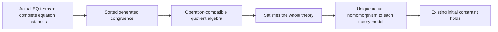

`rel_sound` proves each generated equality holds under every assignment in
every theory model. Conversely, to establish that the quotient itself satisfies
an axiom, `algebra_models` lifts its entire quotient valuation to representative
terms and applies that axiom's instance constructor. A general evaluation lemma
shows that algebra homomorphisms commute with terms. These are proofs about the
existing equation semantics, rather than a new source AST or assumed quotient
correctness property.

For every finite generator context, `freeHomEquiv` gives a bijection between
all homomorphisms out of the presented algebra and sorted assignments of those
generators in a target theory model. With no generators this proves initiality
in the existing full category `Models T`, retaining all original model arrows.
The existing `initialConstraint_sat_iff` supplies the actual shared freeness
constraint. No new institution edge is introduced.

`emptyPresentationIso` is an isomorphism in that same model category between the
old closed constructor model and the new quotient of the empty theory. Thus the
new arbitrary-axiom construction agrees with the original API when there are no
equations. It does not make arbitrary nonempty equation theories constructor
models with distinct syntax trees.

## Why complete contexts matter

Suppose sort `L` has no constructors, while sort `U` has constants `c` and `d`.
The closed equation `c = d` genuinely identifies their two distinct raw terms
in its quotient. But the equation `∀ x : L, c = d` has no valuation when `L` is
empty. It is vacuously true and must leave the constants distinct. The declared
variable matters even though neither displayed term uses it.

The axiom-instance rule therefore requires a substitution for **every** declared
variable. The examples prove both behaviors, using an independent separating
model with empty `L`, Boolean `U`, `c = false` and `d = true`. They also prove the
lower quotient carrier stays empty. `nonempty_carrier_iff` states generally that
a quotient carrier has an element exactly when its raw term sort does; no global
inhabitance assumption is introduced. Another example retains the noninjective
homomorphism from the separating model to a singleton model.

```lean
import Silmaril.Logic.Algebraic.Initial.Quotient.Thms

open Silmaril.Logic.Algebraic.Initial
open Silmaril.Logic.Institution.Structured

example (T : Theory) :
    Constraints.Sat equational (Presented.quotientModel T).obj (initialConstraint T) :=
  Presented.quotientModel_satisfies T
```

## Sources and limits

These are new proofs over the existing interfaces at private main `5c46b6a91`,
public EQ in `silmaril-lean@fe6a59ea53b716d38370db747f322311a9034e99`, and
mathlib `569134c2fc750d92baa85d50cd925a7e20a93dd2`. Mathlib supplies `Quotient`,
`finLiftOn` and dependent quotient induction; the sorted congruence, compatibility,
axiom satisfaction and universal property are proved here. No external paper
coverage or equational consequence-completeness theorem is claimed.

This removes the arbitrary-equation initial-model existence caveat for public
EQ. The order-sorted quotient additionally
saturates its congruence under coercion reflection, preserving the required
injectivity and constructing initial coherent models for arbitrary equations.
The finite constructor initiality-to-matching
compiler still requires its stated no-equation constructor profile. No
normalization algorithm, decision procedure, continuous algebra or generator
extension adjunction is claimed by this result.

| Contract | Source |
| --- | --- |
| Complete-instance congruence, quotient operations and projection | [Quotient/Defs.lean](../../Silmaril/Logic/Algebraic/Initial/Quotient/Defs.lean) |
| Evaluation, soundness, theory satisfaction and descended fold | [Universal.lean](../../Silmaril/Proofs/Logic/Algebraic/Initial/Quotient/Universal.lean) |
| All-hom free property, initial model, compatibility and actual constraint | [Quotient/Thms.lean](../../Silmaril/Logic/Algebraic/Initial/Quotient/Thms.lean) |
| Nonempty equations, empty-sort context and noninjective-arrow controls | [Examples.lean](../../Silmaril/Logic/Algebraic/Initial/Quotient/Examples.lean) |
| Exact axiom guards | [Audits.lean](../../Silmaril/Logic/Algebraic/Initial/Quotient/Audits.lean) |

The private validation receipt
records exact sources, commands, successful targeted checks and historical
failures. Root independent review approved the source/doc/receipt at
`e085516be`, including the actual compatibility isomorphism and empty-carrier
controls. The full catalogue check passed in an existing full-catalogue worktree
detached at that exact head. The subsequent documentation/receipt append changes
no Lean source. The integration PR records full CI at its final head.


## Equational terms as typed lambda terms

EQ means **equational logic**; STLC means **simply typed lambda calculus**.
`Silmaril.Logic.Algebraic.Lambda.toSTLC` translates actual public many-sorted
equations into actual public STLC equations. It fixes an arbitrary set of base
sorts and allows arbitrary maps of operation symbols at each profile. Every
public EQ algebra, including empty carriers, expands to a full-function STLC
set model whose reduct is exactly the original algebra.

An EQ **signature** lists sorts and operation symbols with input/output sorts.
An **algebra** chooses carriers and actual functions for those symbols. An
**equation** includes a finite variable context and asserts equality under
every assignment. STLC adds function types, lambda abstraction and application.
Its **full-function semantics** interprets a function type by all functions
between its two carrier sets. A **comorphism** translates sentences forward
and models backward while preserving and reflecting satisfaction.

## Concrete translation

For an operation `o : A.Op n w s`, the target contains a genuine typed operator
`Operation.original o`. Its inputs are the base types for `w`, and its output
is the base type for `s`. First-order variables become typed lambda variables;
operation applications become fully applied `TypedLambda.Term.op` terms.
An equation becomes `STLC.Sentence.equation` of the two translated terms.
There is no decision procedure replacing an equation by a truth constant.

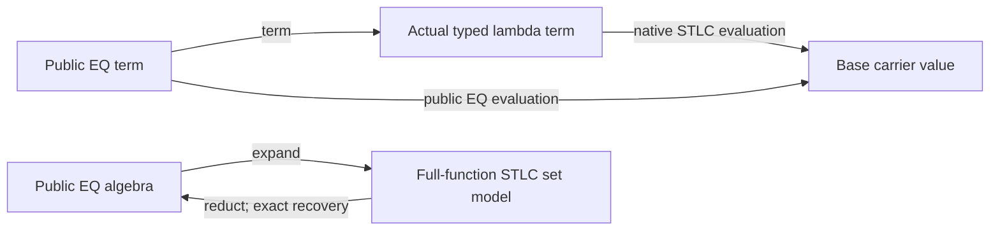

The finite-context conversion is structural: a `Fin n` context becomes a list
of base types, preserving each position. `envTuple_contextVar` and
`envTuple_eta` prove that the conversion covers exactly the original variable
assignments. The translation introduces no binders. `eval_term` proves actual
native evaluation correspondence for every open term and environment.

`satisfies_equation` derives the equation satisfaction equivalence.
`reduct_expand` is an equality of actual public EQ algebra structures, including
their operation interpretations. These results give `toSTLC_modelExpansive`,
`sat_iff`, `unsat_iff` and `entails_iff` for arbitrary equation theories.

## Scope of signature and model maps

The source signature category is `FixedSignature B`: its associated signatures,
terms, equations, models and homomorphisms are actual public EQ objects. Its
signature maps keep the arbitrary chosen base set `B` fixed and may collapse
operation names. This is a restriction of signature change only.

The target reuses `STLCMatching.FixedSignature B` and its arbitrary `OpMap`
arrows. It admits all actual STLC sentences, including lambda equations and raw
typing assertions. Models are wrappers around unrestricted `STLC.SetModel`;
there is no inhabited-base assumption. Target model arrows express equality.
The source retains every public algebra homomorphism, including nonidentity
carrier maps. The model reduct sends target equality arrows to the induced
actual algebra homomorphisms.

The equality arrows use `PLift (M = N)` in hom universe 0. This aligns the two
rooms without lifting or discretizing the public EQ algebra category. Public
STLC's existing institution uses a higher-universe `Discrete` presentation;
this slice packages the same set-model objects and satisfaction with explicitly
small equality arrows. No functor lifting arbitrary algebra homomorphisms
through full-function types is claimed.

The separate equation-only construction admits
all public EQ sort maps. This fixed-base map retains raw typing sentences.
Full varying-sort signature change remains outside this map. Public EQ permits
noninjective sort maps, whereas public `STLC.SigMap` requires its base map to
be injective to reflect raw typing. In particular, this is not a comorphism
from the whole public `EQ.inst` to the whole public `STLC.inst`.

## Checked controls and a client

`Examples` checks nullary and binary arithmetic operators (`1 + 1 = 2`), a
native lambda beta evaluation, an open equation with reversed argument order,
operation-name collapse, a false equation, and an empty carrier both unused
and used by a context. The same open equation that is vacuous over empty
carriers fails in a Boolean model. A complement homomorphism is proved unequal
to the identity in the actual public algebra category.

```lean
module
public import Silmaril.Logic.Algebraic.Lambda

open Silmaril.Logic.Algebraic.Lambda
open Silmaril.Logic.Institution.Examples
open Silmaril.Calculi.TypedLambda Silmaril.Calculi.LambdaCube

example : STLC.eval (expand Examples.arithmetic) (term Examples.two) Tuple.nil = (2 : Nat) :=
  Examples.actual_lambda_arithmetic

example {B : Type} (A : FixedSignature B) (M : EQ.Algebra A.equational) :
    reduct (expand M) = M := reduct_expand M

example {B : Type} (A : FixedSignature B)
    (H : Set (EQ.Equation A.equational)) (e : EQ.Equation A.equational) :
    (EQ.room A.equational).Entails H e ↔
      (lambdaRoom A.lambda).Entails (equation '' H) (equation e) := entails_iff H e
```

This is a directly proved construction using the pinned public EQ and STLC
APIs. It adds no paper correspondence claim. It does not prove equation
completeness, arbitrary quotient existence, a lambda-to-EQ inverse or a
varying-sort translation.

Validation commands:

```sh
bin/mor build --no-pool Silmaril.Logic.Algebraic.Lambda
bin/mor check
bin/mor isar lint Silmaril/Logic/Algebraic/Lambda Silmaril/Proofs/Logic/Algebraic/Lambda --deny
```


## Ground generation as a sorted least fixed point

**EQ** is the public many-sorted equational-logic API. A **sort** is a type
label. An **algebra** assigns a **carrier**, the actual type of values, to each
sort and interprets each declared operation as a function with the declared
input and output sorts. Different sorts have independent carriers; a carrier
may be empty.

A **ground term** is a finite expression made only from declared operations,
with no variables. For example, a constant followed by two unary operations is
a ground term. Evaluating it in an algebra produces a value at its result sort.

[Initial.Generation](../../Silmaril/Logic/Algebraic/Initial/Generation/Thms.lean)
describes exactly which values can be obtained this way. Start with one subset
of each carrier. `groundStep M` collects all results of operation applications
whose arguments belong to those subsets at their own input sorts. A nullary
operation needs no arguments, so its value is included.

This is a **monotone operator**: enlarging the argument subsets cannot remove
any operation result. The subset families form a **product lattice**: families
are compared one sort at a time, and unions and intersections are also taken
one sort at a time. Its **least fixed point** is the smallest family that is
unchanged by `groundStep M`. The definition `generated M` uses this fixed
point, independently of the ground-term evaluator.

The theorem `groundStep_lfp_eq_range` proves, for every sort `s`:

```lean
(groundStep M).lfp s = Set.range (evaluate M (s := s))
```

The right side is the set of values of the existing public ground terms.
The proof shows that these ranges are closed under operations and uses induction
on ground terms for the reverse inclusion. `generated_iff_eq_top` connects
coverage of every carrier by the fixed point to the existing
`Presented.Characterization.Generated` definition.

## An infinite chain of actual sorts

The `InfiniteChain` control has a different sort for each natural number.
Every carrier is independently chosen to be `Nat`. A seed produces value
`0` at sort `0`; `advance s` takes a value at sort `s`, adds one, and
returns it at sort `s + 1`.

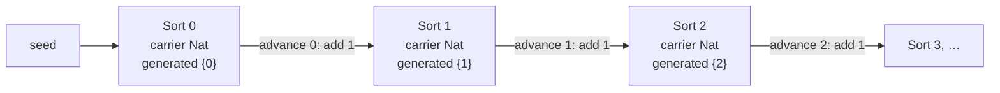

At sort `1`, the carrier contains `0`, `1`, `2`, and every other
natural number, but only `1` is generated. The only operation producing that
sort is `advance 0`, and its only generated argument is the seed value
`0`. There is no ground term at sort `1` that evaluates to `2`.
Equal carrier types therefore do not merge the different sorts or their
generated subsets.

The [authored controls](../../Silmaril/Logic/Algebraic/Initial/Generation/Examples.lean)
also include a mutual two-sort system with actual `Nat` and `Bool` carrier
types, an unseeded cycle with empty generation, a genuinely empty algebra, and
a zero-sort signature.

## Scope

- Sort and operation-symbol families may be infinite. Each operation has finite
  arity, as required by the public EQ language.
- No constant, carrier inhabitant, equation set, initiality certificate or new
  term encoding is assumed.
- Existing equations, full variable contexts and model categories are unchanged.
- This is an algebraic semantic result. It does not compile infinite fixed-point
  families to finite native syntax. The finite many-sorted native compiler and
  literal compilation naturality are separate next steps.
- The [audit module](../../Silmaril/Logic/Algebraic/Initial/Generation/Audits.lean)
  prints transitive dependencies of selected generic theorems and controls, and
  rejects dependencies outside `propext`, `Classical.choice` and
  `Quot.sound`. It does not audit the whole library.

## Verify the result

From the repository root, build the targeted audit module through the default
remote prove worker:

```sh
scripts/prove.sh Silmaril.Logic.Algebraic.Initial.Generation.Audits
```

When the remote worker is unavailable, use the guarded local fallback:

```sh
bin/mor build Silmaril.Logic.Algebraic.Initial.Generation.Audits
```

The audit target imports the examples and proofs, checks their Lean
elaboration, prints the selected axiom dependencies, and enforces the stated
axiom ceiling. These commands preserve the repository's targeted-build workflow.


## Compiling finite sorted generation

The ground-generation result describes which
values come from constructor expressions. This compiler expresses that condition
as native matching-logic fixed-point syntax, then combines it with the equations
needed to characterize an initial algebra. Matching logic interprets a pattern
as a set of possible values. **Native syntax** means this repository's pattern
representation, with fixed-point binders that describe recursive sets.

A **sort** is a type label. A **carrier** is the actual type of values assigned
to that label by an algebra. A **signature** declares sorts and operations,
including each operation's input and output sorts. A **ground term** is a finite
expression built from those operations with no variables. Its evaluation is a
value in the carrier of its result sort.

- An **ambient signature** is the surrounding signature in which the original
  constructors are interpreted.
- A **variable context** lists every declared variable and its sort, including
  variables absent from an equation's two terms.

An **initial algebra** for equations `E` satisfies those equations and has
exactly one operation-preserving map, a **homomorphism**, to every other algebra
satisfying `E`. Having every value represented by a ground term is one part of
this property. The other part says exactly when two ground terms have equal
values: precisely when their equality follows from `E`.

## Two sorts can share a carrier without sharing generation

Consider the original signature

```text
a     : S
left  : T → S
right : S → T
```

Starting from no values, `a` supplies the first value at `S`. Applying `right`
supplies a value at `T`; applying `left` supplies another at `S`, and so on.
Each operation must take its arguments from the subsets at its original input
sorts.

Now map both sorts to one ambient sort with carrier `Nat`, interpret `a` as
zero, and map both unary operations to the same successor function. At the
original `S` coordinate the generated values are `0, 2, 4, …`; at the original
`T` coordinate they are `1, 3, 5, …`. This describes the mathematical example.
The concrete controls prove parity for every original ground-term value, check
`0, 2` at `S` and `1, 3` at `T`, and separate the actual compiled denotations
by excluding zero at `T` and one at `S`.

The ambient map has **collapsed** two sorts and two operation symbols. The
compiler still keeps two subset coordinates. Its `S` body contains the seed
and `left` applied to the `T` subset; its `T` body contains `right` applied to
the `S` subset. Selecting constructors by their ambient output sort instead
would lose this distinction.

## From an operation profile to native syntax

`Profile` records finitely many original sorts and operation symbols. Every
operation records its finite arity, its input sorts and its output sort. An
ambient signature map `σ` chooses target sorts and operation symbols in another
signature; a model supplies their interpretations. The map may identify sorts
or operation symbols.

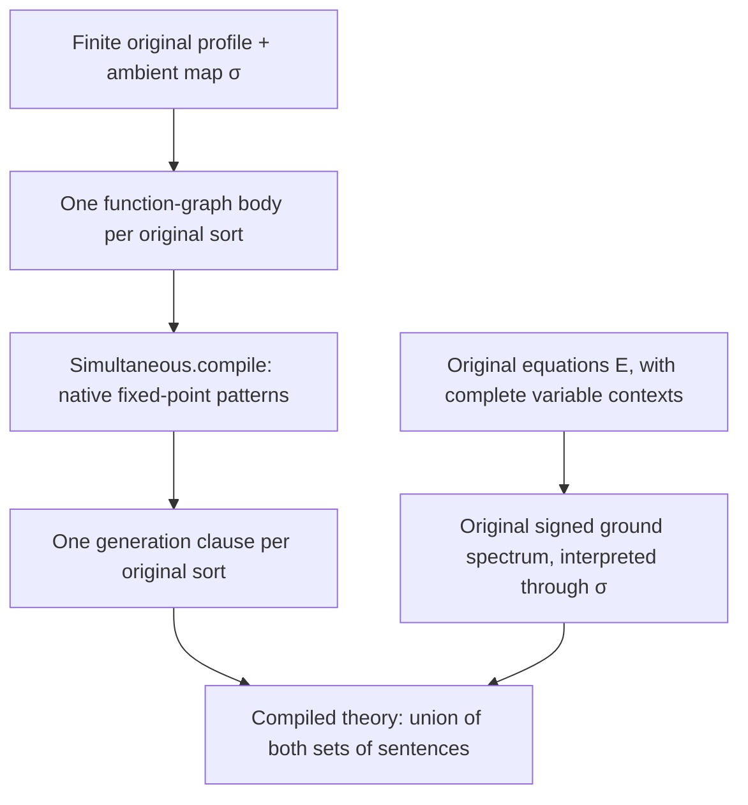

A **function graph** describes an operation by its possible argument and result
values. Each constructor pattern applies the native function graph to the
recursive subsets at the constructor's original input coordinates. A finite
disjunction combines precisely the constructors whose original output is the
chosen coordinate. With no such constructors, the body denotes the empty set.

The resulting simultaneous system is **monotone**: enlarging its argument
subsets cannot remove a result. Its **least fixed point** is the smallest
family of subsets unchanged by these bodies. `Simultaneous.compile` expresses
this family using the existing native fixed-point syntax.

## Why the result is the actual ground-term range

Native models use an **active** subset of each carrier for actual algebra
values. The remaining values are **padding**: they let the native carrier be
inhabited even when the corresponding algebra carrier is empty. Decoding keeps
only active values. The proof embeds each subset of the decoded algebra into
the native carrier by forgetting the active-membership proof.

`operator_embed` proves that one native body step on these embedded subsets is
exactly one algebraic operation step, embedded back into the native carriers.
The native function-graph law is used only on active argument tuples.

Both least-fixed-point bounds follow from that identity. First, the embedded
algebraic generated family is a native fixed point, so the native least fixed
point lies inside it. Conversely, intersect the native least fixed point with
the active carriers. Monotonicity and the same operator identity show that this
family is closed under the algebra's operations. Algebraic leastness puts every
generated value inside it. Together these bounds identify the two families.

`generated_denote` then identifies each compiled pattern with the values of the
existing public ground terms at that original sort. Each generation clause
requires every active value to belong to this range. It allows padding values
without requiring them to be generated. No active inhabitant or seed constant
is assumed; unseeded systems, genuinely empty active carriers and zero original
sorts are covered by the source controls.

## Adding equations and recovering initiality

The **signed spectrum** contains an equality sentence for each pair of original
ground terms whose equality follows from `E`, and a negated equality sentence
for each pair whose equality does not. Satisfaction therefore specifies the
exact ground-evaluation kernel: the pairs of terms with equal values.

The compiler reuses this spectrum for the original theory. `E` may be arbitrary,
and its equations retain their complete variable contexts, including unused
variables. The ambient map interprets these original terms; it does not replace
`E` by equations over a merged presentation after a sort collapse.

`compiled_satisfaction` says that the compiled theory holds exactly when every
value is generated and the ground-evaluation kernel is exact.
`compiled_initial_iff` recovers satisfaction of all original equations and
actual initiality among their models. Finally, `compiled_actual_iff` identifies
this with satisfaction of the existing translated initiality constraint in the
ambient algebra. These properties are conclusions of the proof, not fields
added to the native model.

## Interfaces and scope

Import the public [theorem header](../../Silmaril/Logic/Algebraic/Initial/Matching/FiniteSorted/Thms.lean).
The [definitions](../../Silmaril/Logic/Algebraic/Initial/Matching/FiniteSorted/Defs.lean)
contain `Profile`, `body`, `system`, `generated`, `generationClause`, `compiled`
and `actual`. The [proof module](../../Silmaril/Proofs/Logic/Algebraic/InitialMatching/FiniteSorted.lean)
contains the operator identity, both fixed-point bounds and the satisfaction
equivalences. The [examples](../../Silmaril/Logic/Algebraic/Initial/Matching/FiniteSorted/Examples.lean)
exercise original-coordinate selection, ambient collapse, unseeded generation,
empty active carriers and zero sorts.

Finiteness applies to the original sort and operation profile. Ambient
signatures and carriers remain arbitrary. The output theory can be infinite
because the signed spectrum ranges over ground-term pairs; this is not a
procedure for deciding their equational consequences. The finite core proves the
actual constraint equivalence. Compilation of infinite original profiles remains
separate work. The global packaging below builds on this finite core.

The [ambient naturality header](../../Silmaril/Logic/Algebraic/Initial/Matching/FiniteSorted/Naturality/Thms.lean)
adds literal syntax transport under a further ambient signature map `f`. It keeps
the same original coordinates, constructor order, equations and signed ground
witnesses. Mapping the complete compiled sentence set equals compiling with
`σ ≫ f`, even when ambient sorts or operations are identified. Intermediate
pattern comparisons use **heterogeneous equality** to compare terms whose
dependent types may be presented differently;
final generation clauses and compiled sentence sets use ordinary equality.

## Global institution packaging

An **institution** organizes signatures, sentences and model categories so that
translating a sentence agrees with taking a model's **reduct**: interpreting the
source symbols through a signature map. A **comorphism** translates sentences
forwards and models backwards, preserving satisfaction in both directions.
Here a **theory-valued** output is a set of native fixed-point sentences,
interpreted conjunctively: every clause must hold. A **room** collects the
sentences, models and satisfaction relation for one signature.

The [global theorem header](../../Silmaril/Logic/Algebraic/Initial/Matching/FiniteSorted/Institution/Thms.lean)
packages a source sentence as an original finite `Profile`, its equation set
`E`, and a context map `σ` from that profile to the ambient signature. Source
models are actual ambient equational algebras. Target models are the existing
guarded native models, with all homomorphisms of their decoded first-order
structures. The target admits arbitrary sets of native fixed-point sentences;
`Sentence.compile` selects the complete compiled set for this source sentence.

For the two-sort example above, `σ` may already identify `S` and `T` and both
unary symbols. A further ambient map `f` changes the context to `σ ≫ f`.
The source sentence still stores the same two-sort profile and the same `E`;
its two original subset coordinates and signed ground-term witnesses remain.
The compiled theory translates to exactly the theory compiled in that new
context. This illustrates the global interface; the earlier parity
controls validate the finite compiler's concrete denotations.

`sourceInstitution` and `theoryInstitution` provide these two organizations;
`translation` and `toMatching` package their comparison. The decoder retains
actual homomorphisms: every algebra homomorphism between decoded target models
lifts to a target arrow, and distinct target arrows remain distinct after
decoding. `decode_reduct_square` states equality of the full model functors,
including their arrow maps. A **model functor** maps models and homomorphisms
while preserving identities and composition. `Sentence.compile_satisfaction` reuses the finite
compiler's actual constraint equivalence. `entails_map` transports source
consequences forwards, where a **consequence** holds in every model satisfying
the given assumptions.

## Expansion and consequence reflection

An **isomorphism** here is a pair of operation-preserving maps that compose to
the identity in both directions. The
[expansion header](../../Silmaril/Logic/Algebraic/Initial/Matching/FiniteSorted/Expansion/Thms.lean)
uses the actual guarded expansion of each source algebra. Its decoded algebra
is isomorphic to that source algebra, including when some carriers are empty.
For each fixed ambient signature, `expandModels` also sends every actual source
homomorphism to an arrow between these expansions; `expansionDecodeIso` makes
the decoder comparison natural with respect to all those arrows.

For the collapsed two-sort example, an ambient carrier `Nat` is expanded using
`Option Nat`: `none` is padding and `some n` is active. Decoding retains the
active subtype, which is isomorphic to `Nat`. The original `S` and `T` subset
coordinates still come from the source sentence's profile. No equality of the
active subtype with `Nat` is used. The same chosen expansion of an ambient
algebra works for every source sentence true there, even when a set of
assumptions mixes different original finite profiles, equations and contexts.

The checked [global expansion examples](../../Silmaril/Logic/Algebraic/Initial/Matching/FiniteSorted/Expansion/Examples.lean)
use a positive free ground-term algebra for a seeded two-sort profile with no
equations. They exercise the complete compiled theory, the actual decoded
isomorphism in both directions, and naturality for a nonidentity evaluation
homomorphism. A negative control keeps the whole ambient `Nat` carrier under
the collapsing context: active value `1` is not generated at original sort
`S`. It targets failure of the complete theory and the corresponding source
and decoded sentences. Both controls passed the warnings-as-errors Lean build,
including all four isomorphism-composition identities and the nonidentity fold
naturality theorem.

The proof first transports complete equation contexts along algebra
isomorphisms. A general constraint lemma then transports both required
target-modelhood and the full free-extension **hom-set bijection**: the
one-to-one correspondence between all relevant homomorphisms. This proves
that the source room's satisfaction is invariant under isomorphism, rather
than assuming an extra validity condition on its models.

A comparison is **elementarily expansive** when every source model has a
target model whose decoder satisfies exactly the same source sentences.
`comparison_elemExpansive` and `toMatching_elemExpansive` derive this property
from the chosen expansion and proved isomorphism invariance. Here a **faithful
comorphism** means that semantic consequence reflects from target to source;
it is distinct from injectivity on model hom-sets. `toMatching_faithful` and
`entails_compile_iff` provide that reflection alongside forward transport.
`satisfiable_compile_iff` and `unsatisfiable_compile_iff` state the corresponding
equivalences for arbitrary sets of source sentences and their compiled image.

Neither the global core nor this expansion claims literal `ModelExpansive`,
which requires every source model to equal a decoded target model. Expansion
up to the actual algebra isomorphism supplies the stated semantic equivalences
without that equality claim.

The [audit module](../../Silmaril/Logic/Algebraic/Initial/Matching/FiniteSorted/Audits.lean)
checks 46 selected declarations and their proof dependencies. An **axiom guard**
rejects assumptions outside the allowed `propext`, `Classical.choice` and
`Quot.sound` set. This checks the selected theorem dependencies; it is separate
from a full source-language correspondence review.

## Validation

The merged slices passed ordinary PR CI, including full warnings-as-errors Lean
builds and the unchanged 240-second time gate. The budget reports distinguish
full measurement from runs where Proof reuse was unselected:

| Slice | Full CI at the recorded source head | Selected axiom guards | Time gate |
| --- | --- | --- | --- |

The expansion audit observed no axioms for `forgetRelations`; its other twenty
selected declarations used only the standard three listed above. These checks
cover selected dependencies. They do not audit every library declaration or
establish correspondence with an external source language.

The private review receipt
binds the complete guide review to the inspected source files and historical CI
records. It retains the earlier expansion run that passed Lean but failed the
time gate. This documentation update runs no new Lean build or solver.
The separate global expansion examples passed normal
at source `c8358434e82e8d655f747214cfcc3182efd19769`. The full warnings-as-errors
Lean build completed 63,981 jobs; tooling and aggregate CI passed. Fourteen jobs
succeeded, with Proof reuse and Pages skipped. The unchanged time gate passed
at 192.6/240 seconds, a partial measurement because Proof reuse was skipped.
All eleven selected axiom outputs used exactly `propext`, `Classical.choice`
and `Quot.sound`.

The guarded source `b795400d08c97b525271645f39795646ebe60fd9` then passed
the full warnings-as-errors Lean build (63,981 jobs), tooling and aggregate CI
All eleven actual outputs again used exactly the standard three axioms, and
all eleven exact dependency-set guards compiled and passed. The overall
workflow failed the unchanged time gate at 268.0/240 seconds, a partial
measurement with Proof reuse skipped. Thirteen jobs passed, two were skipped
and the budget job failed. This guard validation is separate from the earlier
192.6-second source pass; it is not a passing guarded workflow.
The private receipt
retains the earlier failed run, including its rejected recovery outputs and
546.3/240-second partial timing failure, alongside the passing evidence.

At revision `77de63e19b610d2ac4e6ea64b1063327181886fa`, normal
passed the warnings-as-errors Lean build, all eleven exact dependency checks,
all selected correctness jobs and aggregate CI. The unchanged time gate failed
at **297.2/240 seconds**, partial because Proof reuse was skipped. This is
historical correctness evidence with a timing failure, not an overall pass.
For later integrated revisions, consult the exact-head Lean, aggregate CI and


## First-order matching logic

`Silmaril.Logic.Matching.FirstOrder.Defs` implements the many-sorted first-order
core of Roșu, “Matching Logic” (LMCS 2017), syntax, models, denotation and satisfaction in Definitions 2.1–2.3 and 2.5. The source PDF's
pages 7, 11 and 12 were rendered and inspected when checking the syntax and
semantics. SHA-256: `2c4cde808bd889f9633b7a2198b11edada4cd755dada5c38606ccc7211813e3a`.

A **pattern** describes a set of matching values. Its **denotation** is that
set in a particular model and variable assignment. **Global satisfaction**
requires the set to contain every value of its result sort. **Pointwise
satisfaction** asks whether one chosen value belongs to the set.
A **sort** is a type of value; a **signature** lists symbols and their argument
and result sorts. A **reduct** interprets a smaller vocabulary using the meanings
already supplied by a larger model.

- Patterns have variables, symbol applications, complement, intersection and
  existential binding over a variable of any sort. Sorted de Bruijn contexts
  handle binding without variable capture: a bound variable uses an index,
  with zero referring to the nearest binder.
- Models have a nonempty carrier for each sort. Every symbol returns a set;
  empty and nondeterministic results are allowed.
- Set denotation extends symbols over all matching input tuples. Existentials
  take the union over possible bound values. Satisfaction means every result
  matches, under every valuation of the free variables.
- The shared many-sorted signature category supplies operation renamings.
  Actual model reducts and denotation compatibility prove the institution's
  satisfaction condition. Axiom presentations and theories use the shared API.
- Model arrows preserve operation-graph membership. These arrows need not
  preserve complements or global pattern satisfaction; no such claim is made.

The signature categories fix an arbitrary sort set. This module retains the
2017 first-order syntax. The separate positive fixed-point matching
API adds sorted set variables and actual least and
greatest fixed points over the same models. Its global inclusion
`FixedPoint.firstOrderToFixedPoint` preserves the original denotation and is
model-expansive. It does not translate the full 2019 grammar or supply a general
matching proof calculus or completeness theorem. General definedness/equality
packages for this first-order syntax remain separate work; the semantic
predicate API below adds no new primitive.

There are now scoped checked KORE operational profiles,
conditional AB/AC rules, and an
actual Wasm branch-selection client.
They use explicit configuration models and the existing reachability-to-μ
translation. They do not establish full K module processing, a K/Wasm compiler,
or whole-program simulation. Existing multialgebra/FOL encodings likewise do
not replace this sorted pattern semantics.

`Thms` proves the derived truth/falsehood denotations and that nullary patterns
have exactly their set-valued interpretation. `Examples` gives a finite two-state
transition system: one state has two distinct successors and the other has no
successors. It proves the one-step pattern's exact denotation and exhibits a
sentence refuted by the empty interpretation. This is a toy transition system;
no actual WASM program, ELF binary or K definition is imported by this example.

`Algebraic` embeds each ordinary algebra with nonempty sorted carriers as a
singleton-valued matching model and proves that its term patterns denote exactly
the singleton of the ordinary term's value. The nonempty-carrier hypothesis is
explicit because the general equational institution also admits empty sorts.
This realization theorem is not yet an institution comorphism between the full
algebraic and matching institutions.

The KORE first-order pattern fragment has a separate
source AST, direct denotation, institution, and checked lowering comorphism into
this matching institution. That AST remains distinct from the later operational
readers: a pattern's set denotation alone does not install a transition rule.
The operational profiles check particular emitted declarations and prove their
one-step and finite-reachability meanings in selected constructor models.

## Propositional logic and pointwise matching

`Silmaril.Logic.Matching.FirstOrder.Pointed` packages a separate institution of
closed patterns at a chosen result sort. Its models are every set-valued core
model together with a chosen carrier element; its arrows are core relational
homomorphisms preserving that element. No totality, determinism, or two-valued
restriction is imposed on operation interpretations.

`Pointed.propositionalToPointedMatching` is an actual shared institution
comorphism from classical propositional logic. Each propositional atom becomes
a nullary matching operation. The model reduct reads membership of the chosen
point in each atom's arbitrary interpretation. Negation and the Boolean
connectives agree pointwise, and both sentence translation and model reduct
commute with every atom renaming. The comorphism is available to the shared
Hets APIs as an `Inst.CoHom`.

`Pointed.global_iff_all_points` relates this pointwise satisfaction to the core:
a closed matching sentence is globally satisfied exactly when every choice of
point satisfies its pattern. The two-state example gives an atom the proper
subset `{true}` of `Bool`; its atom and its negation both fail globally, while
pointwise satisfaction gives the expected complementary valuations. This is
why the edge is named **propositional to pointed matching**, rather than an
edge to the core's global satisfaction. A nonidentity pointed relational model
arrow also exercises the propositional model reduct.

`Pointed.realizeValuation` realizes every propositional valuation in a populated
singleton model. The resulting comorphism is proved model expansive, so the
shared consequence-borrowing API applies. `Pointed.Hets.logicGraph` registers
the edge as a shared Hets logic graph, with its one-edge path action proved.

## A small example and its evidence

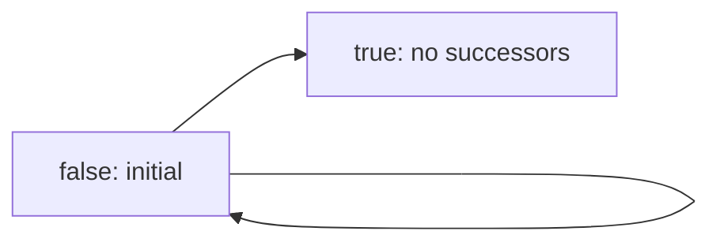

The `step` symbol is interpreted as a set of successors. Applying it to the
initial pattern gives both states, so that pattern is globally satisfied.
An atom interpreted by just `{true}` is different: it is true at the chosen
point `true`, but its denotation does not cover `Bool`. Its complement `{false}`
also fails global satisfaction. This distinction is checked, rather than
assuming every pattern behaves like a Boolean proposition.

| Claim | Implementation evidence |
| --- | --- |
| Syntax, nonempty carriers and set denotation | `Pattern`, `Model`, `Model.denote` in `Defs` |
| Signature satisfaction | `SignatureMap.denote_map`, `Sentence.satisfaction` |
| Ordinary algebra terms denote singletons | `Algebraic.Model.denote_ofTerm` |
| Propositional encoding and model expansion | `Pointed.encodePropositional_satisfies`, `Pointed.propositionalToPointedMatching_modelExpansive` |
| Global versus chosen-point satisfaction | `Pointed.global_iff_all_points`, `Pointed.Examples.both_atom_and_negation_fail_globally` |
| Registered formal edge | `Pointed.Hets.logicGraph`, `Pointed.Hets.edge_path` |
| Same-model global fixed-point inclusion | `FixedPoint/Thms.lean`: `firstOrder_satisfies`, `firstOrderToFixedPoint_modelExpansive`, `firstOrder_entails_iff` |
| Checked conditional rules reach native μ matching | `Conditional/Thms.lean`: `compile_satisfies_iff`, `declaration_matching_sound` |
| Initialized-local Wasm branch selection | `WasmBranch/Thms.lean`: `native_steps`, `related_step`, `compiled_valid` |

Use Thms for core results,
Algebraic for ordinary
algebras and Pointed for the
chosen-point and propositional APIs.
The earlier review checked the archived PDF hash and rendered pages. The
2026-11-11 whole-page follow-up reads the current core, pointed/predicate and
fixed-point interfaces and the linked operational/Wasm contracts, and rechecks
the archived PDF hash. Its private receipt
binds the reviewed inputs and exact guide outputs. This is source-contract
review; no fresh Lean build, solver/backend execution, transitive axiom audit or
rendered-page inspection is claimed.

## Semantic predicates

`Predicate.Defs` implements Definition 2.4: `IsPredicateIn M p` requires that,
for every free-variable valuation, `p` denotes either the whole result carrier
or the empty set. `IsPredicate p` quantifies this condition over every model.
The truth value may vary with the valuation. `Predicate.Thms` proves closure
under truth, falsehood, complement, conjunction, derived disjunction and
existential binding. The existential bound sort need not be the result sort.
No ceil or equality primitive is added to the pattern language.

`Predicate.Examples` reuses the finite transition model to show that its atom
with denotation `{false}` in Bool is not a predicate in that model, hence is not
a universal predicate. A whole-carrier pattern is a predicate in the same
model. A separate model with Unit carriers gives a positive singleton-valued
atom example: its singleton is the entire carrier. More generally every
pattern is a predicate in a model with a subsingleton result carrier. These are
semantic interfaces for later definedness work; they do not supply a matching
proof calculus. The pinned paper's per-item coverage is recorded in
`notes.md`.


## Positive fixed-point matching logic

A **matching pattern** describes a set of results. An element variable matches
one value; a set variable can match many. For example, over Boolean values, an
element variable assigned `false` matches `{false}`, while a set variable can
match `{false, true}`. `Examples.element_set_difference` proves this distinction.

`Silmaril.Logic.Matching.FixedPoint` adds recursion to the existing 2017 first-order
matching logic, using a positive fragment of Chen–Roșu 2019. It reuses the same
`FirstOrder.Model` and original pattern denotation. Every sort has a nonempty
carrier, and an operation can return an empty set, one result or many results.
A **sort** is a type of value. An **n-ary operation** takes `n` arguments, with
their declared sorts.

## Recursion by sets

**Positive** means that enlarging the sets assigned to free set variables cannot
remove a match. This monotonicity lets a recursive body define actual least and
greatest fixed points:

- `μX.body` is the least set equal to the interpretation of `body` with that set
  assigned to `X`.
- `νX.body` is the greatest such set.
- Object variables captured outside the recursion keep their assigned values.

For a unary step relation, `μX.(goal ∨ step(X))` describes states with a finite
path to a goal. On this chain, the successive sets are `∅`, `{2}`, `{1,2}` and
`{0,1,2}`:


The implementation uses Mathlib's least/greatest fixed points on arbitrary sets;
its definition has no finite iteration bound. The finite-path equivalence is a
proved result. A greatest-fixed-point example, `νX.step(X)`, holds on a cycle
that can continue forever and fails at a state with no outgoing step.

The syntax keeps separate sorted element and set contexts. It includes original
2017 patterns as recursion-independent leaves, n-ary application, conjunction,
disjunction, element quantifiers, and `μ`/`ν`. `dualApp` means the complement of
application to complemented arguments: `¬σ(¬args)`. It is derived from the same
operation interpretation. For a unary modal action it gives “every successor
matches,” including vacuous truth when there are no successors.

All free set variables are positive. General negation remains available in the
2017 leaves, which have no set variables. Translation of the full 2019 grammar
into this positive fragment remains unproved. The separate
general Boolean fixed-point layer now admits mixed
free polarity and checks positivity locally for each bound recursion variable,
with an exact positive embedding and independent named module semantics.

## Variables and substitution

- `Ren`, `renameObjects` and `renameSets` preserve each variable's sort. Their
  semantic laws evaluate a renamed pattern by looking up the corresponding
  original values.
- `substituteSets` replaces set variables by positive patterns. It shifts free
  variables under both element and set binders to avoid **capture**, where a
  newly entered binder would accidentally change which variable a term means.
- `denote_substituteSets` proves the general semantic substitution law; semantic
  identity and composition follow. Examples check capture avoidance under both
  an existential binder and `μ`.

Substituting an arbitrary set-valued pattern for a singleton element variable
needs an appropriate single-value condition. That operation, syntactic
substitution fusion and a full bound-variable equivalence API remain pending.

## Finite simultaneous equations

A system can have several recursive sets with different result sorts. The
finite many-sorted compiler turns such a system
into the existing unary `μ` syntax. Its denotation equals an independently
defined product-lattice least fixed point. The literal compiler equality also
commutes with sort maps that identify sorts while retaining every original
variable coordinate.

## Institutions and modal comparison

An **institution** packages signatures, sentences, models and truth, with a law
that vocabulary renaming preserves truth. The global institution requires a
pattern to match every result under every free-variable valuation. The pointed
institution asks whether a closed pattern matches one chosen result.
`global_iff_all_points` proves their exact relationship for closed patterns.

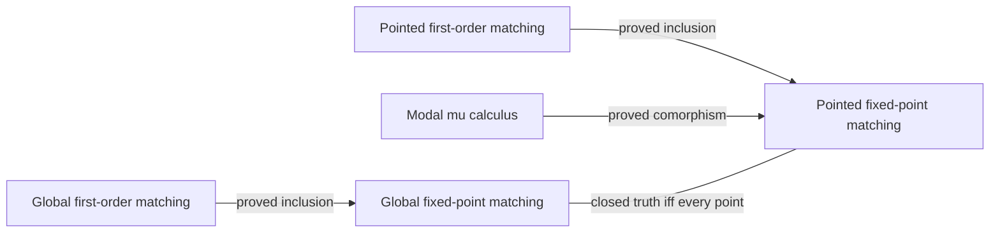

Each inclusion is natural under signature maps and **model-expansive**: every
source model is the decoded form of some target model. This gives preservation
and reflection of semantic entailment. Global model arrows retain the original
relational homomorphisms. Pointed arrows are equality-only; the construction
makes no satisfaction-invariance claim for arbitrary relational homomorphisms.

`modalToMatching` translates atoms to nullary set operations and each primitive
action to a unary set-valued operation. The direction is explicit:
`w ∈ action(a)(v)` exactly when the modal relation has `w →a v`. Its model reduct
works for every pointed target model. Every pointed modal frame expands with the
same worlds, transitions, atom sets and chosen point. Modal box uses `dualApp`;
`global_modal_iff` relates the translation's global truth to modal truth at all
points.

## Source map and checks

| Claim | Declaration or module below `Silmaril/` |
| --- | --- |
| Existing model and operation semantics reused | `Logic/Matching/FixedPoint/Defs.lean`: `Model`, `application_firstOrder`, `Pattern.denote` |
| Unfolding and induction/coinduction | `Proofs/Logic/Matching/FixedPoint/Semantics.lean`: `mu_unfold`, `mu_induction`, `nu_unfold`, `nu_coinduction` |
| Greatest/least complement duality | `Proofs/Logic/Matching/FixedPoint/Dual.lean`: `Pattern.denote_dual` |
| Sorted renaming and capture-avoiding substitution | `Proofs/Logic/Matching/FixedPoint/Variables.lean`, `Substitution.lean` |
| Global/pointed inclusions and all-points law | `Logic/Matching/FixedPoint/Thms.lean` |
| Natural modal map and actual model expansion | `Proofs/Logic/Matching/FixedPoint/Modal.lean`: `modalToMatching`, `modalToMatching_modelExpansive` |
| Finite paths and concrete controls | `Logic/Matching/FixedPoint/Modal/Thms.lean`: `matching_reach_iff`; `Examples.lean` |

Targeted warnings-as-errors builds of the facade and examples passed after main
integration. Five guarded axiom reports contain exactly `propext`,
`Classical.choice` and `Quot.sound`; scoped Isar lint reported 0/29 flagged
proofs, and `mor check` and whitespace checks passed. No full local build ran.

The exact author PDF is pinned privately in
`work.json`, with
`chen-rosu-2019-lics` in `references.bib`.
This slice supplies semantics and the stated institution maps. Proof calculi,
completeness, term-algebra and datatype characterizations, and an executable
model checker remain outside its implemented scope.


## First-order recursion in native matching logic

`Silmaril.Logic.Matching.GuardedLFP` translates the existing positive first-order
least-fixed-point logic into native matching patterns. The translation preserves
truth, satisfiability, unsatisfiability and logical consequence. It supports
predicates with any finite number of arguments, empty source sorts and captured
parameters. The target models satisfy explicit operation-graph laws described
below; those restrictions are part of the theorem.

## A reachability example

A recursive predicate can describe paths in a graph. For example,

```text
reach(x, target) = least R such that
  R(x) holds if x = target, or if edge(x, y) and R(y) for some y.
```

“Least” means that only nodes justified by this rule belong to the result.
A cycle alone does not make its nodes reach a disconnected target. The
`captured_parameter_native` theorem checks the translated pattern on a
three-node graph: node `0` reaches target `0`, but does not reach target `2`.
The target stays fixed while the recursive variable `x` changes.

The translation also handles predicates with no arguments. Such a predicate
is a truth value, like a proposition `ready`. Its argument tuple is `()`, even
when the source has no objects or sorts. This complete Lean example checks a
true recursive proposition in that case:

```lean
import Silmaril.Logic.Matching.GuardedLFP.Examples

open Silmaril.Logic.Matching.GuardedLFP

example : () ∈ (formula Examples.nullaryFixed).denote
    (expand Examples.noSorts.toStructure).base
    (fun i => i.elim0) (fun i => i.elim0) :=
  Examples.no_sorts_nullary_native
```

Here `formula` compiles the source formula, `expand` builds its native matching
model, and `denote` computes the pattern's mathematical meaning as a set.
Membership of the truth element `()` means the pattern is true. This is a
kernel-checked theorem, rather than a finite unfolding of recursion.

## Terms used here

- **FOL** means first-order logic: quantification over objects, with functions,
  relations and equality. A **sort** is an object type, such as `Node`.
- **FO(LFP)** adds least fixed points to FOL. **LFP** and **μ** both mean least
  fixed point: the smallest set closed under the recursive rule.
- **Positive recursion** allows a recursive predicate under conjunction,
  disjunction and quantifiers, but not negation. Enlarging its input set can
  therefore only enlarge its output set. Nonrecursive FOL leaves can use
  negation.
- A **tuple** is an ordered collection of arguments. Its **arity** is the number
  of arguments; its **profile** lists their sorts. For example, a binary
  `edge : Node × Node` has arity two and profile `[Node, Node]`.
- A **captured parameter** is a free object held fixed during recursion, such
  as `target` above. An **environment** assigns values to free variables.
- **Native matching** means the existing matching-pattern syntax and its own
  set-valued semantics. It is not a new evaluator defined by calling the source
  logic.
- A **raw carrier** contains all native values. An **active** value represents
  a source value; other values are padding. A **guard** restricts a quantified
  value to the active part.
- An **institution comorphism** translates signatures and sentences forward
  and models backward, preserving satisfaction. **Naturality** means that this
  translation commutes with renaming symbols and sorts.
- **SAT** means some admitted model satisfies a sentence; **UNSAT** means none
  does. **Consequence** means every model satisfying the premises satisfies
  the conclusion.

## How tuples and padding work

Native matching requires inhabited carriers. A source sort can be empty, so the
canonical expansion uses `Option`: `some x` represents a source object and
`none` is inactive padding. Tuple carriers use the same construction. The truth
carrier is `Unit`.

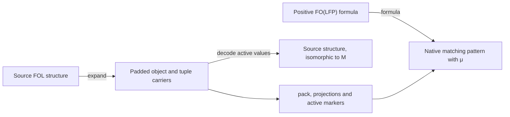

For each profile, admitted models provide actual native operation graphs:

- `pack` produces one active tuple from active components, and produces no
  result if any component is inactive.
- Each projection produces the corresponding active component of an active
  tuple. Packing and projecting obey inverse laws.
- Two active tuples with equal projections are equal.
- Tuple definedness tests whether a pattern has a result. Truth lifting carries
  a true result to the tuple sort.

These structural laws yield `tupleEquiv`, an equivalence between active native
tuples and source argument tuples in **every admitted model**. The model record
stores neither a source structure nor a formula-correctness assumption. A
nullary profile has exactly one active tuple; a positive-arity profile can have
none if one of its source sorts is empty.

A predicate application packs its arguments and tests membership in its native
set variable. A recursive body binds the tuple components existentially, leaves
captured objects free, and applies native μ to the resulting tuple pattern.
The source body describes all combined assignments; the proof reconciles these
clauses by constructing the unique assignment extending the tuple and captured
objects.

## Proved correspondence

| Declaration | Checked result |
| --- | --- |
| `formula_denote` | Full positive source syntax agrees with native truth for every admitted model, active object assignment and arbitrary raw free-set environment. |
| `native_lfp` | Native μ equals the encoded source least fixed point. |
| `native_lfp_active` | Inactive padding never enters a translated μ. |
| `formula_iso`, `decodeExpansionIso` | Source truth is invariant under structure isomorphisms; decoding the canonical expansion recovers the source up to such an isomorphism. |
| `formula_map`, `sentence_map` | Translation commutes exactly with signature maps, including maps that identify sorts. |
| `decodeFunctor_naturality` | Model reduction commutes exactly with decoding. |
| `lfpToGuardedMatching` | The signature, sentence, model and satisfaction maps form an institution comorphism. |
| `lfp_sat_iff`, `lfp_unsat_iff`, `lfp_entails_iff` | SAT, UNSAT and consequence hold exactly when they hold for the translated sentences in the guarded target. |

The fixed-point proof uses `lfp_retraction`: encode source tuples into raw values
and restrict raw sets back to source tuples. Restricting an encoded set recovers
it. Crucially, the operator correspondence holds for **all raw candidate sets**,
including sets containing padding. The proof does not assume an equivalence
between all raw sets and source tuple sets.

## Scope and checks

The target admits every native positive matching fixed-point sentence over the
marked signature, including sentences outside the translation. Its models must
obey the graph laws above. This does not give a translation into unrestricted
matching models.

Both institution model categories use equality-only arrows, as the existing
source FO(LFP) institution does. Expansion recovers the source up to a proved
structure isomorphism; the API does not assert exact `ModelExpansive` equality.
There is no recursive negation or greatest fixed point in the source grammar,
and no finite-carrier or finite-iteration assumption.

The [examples](../../Silmaril/Logic/Matching/GuardedLFP/Examples.lean) check the sortless
nullary case, empty positive-arity tuples, strict inactive packing, a free set
containing only padding, captured-target reachability, binary argument order
and a signature map identifying two source sorts. The
[axiom guards](../../Silmaril/Logic/Matching/GuardedLFP/Audits.lean) check 23 declarations
against exact subsets of Lean's standard `propext`, `Classical.choice` and
`Quot.sound` axioms.

Run the scoped checks with:

```sh
LEAN_NUM_THREADS=2 bin/mor build --no-pool --mem-cap 16 \
  Silmaril.Logic.Matching.GuardedLFP.Examples \
  Silmaril.Logic.Matching.GuardedLFP.Audits
bin/mor isar lint Silmaril/Proofs/Logic/Matching/GuardedLFP --deny
bin/mor check
```

The [public facade](../../Silmaril/Logic/Matching/GuardedLFP.lean) exposes the
[translation](../../Silmaril/Logic/Matching/GuardedLFP/Translation.lean) and
[institution map](../../Silmaril/Logic/Matching/GuardedLFP/Institution.lean). The
[fixed-point proof](../../Silmaril/Proofs/Logic/Matching/GuardedLFP/FixedPoint.lean)
contains the semantic correspondence. These are new proofs over existing source
and native semantics; this slice copies no mathematical statements from a paper.


## Matching signatures with changing sorts

`Silmaril.Logic.Matching.SortMaps` adds a category of actual sorted matching
signatures and arbitrary profile-preserving sort maps. A **sort** is a type of
value, such as a byte or an address. An operation's **profile** lists its input
sorts and result sort. An arrow maps each
source sort, and each operation of profile `(s₁,…,sₙ) → s` to an operation
of profile `(f(s₁),…,f(sₙ)) → f(s)`. Sort maps may identify sorts; arity is
preserved. The implementation reuses the existing first-order and positive μ/ν
matching syntax and model semantics.

For example, a source operation can take a byte and return an address. A map may
send both sorts to one target sort, provided it sends that operation to a unary
operation on the target sort. The `boundStep` example checks both a matching
result and a result outside the translated pattern.

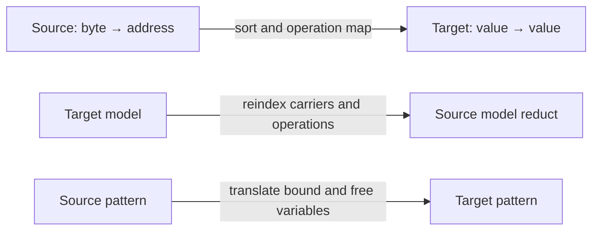

A **model reduct** interprets a smaller or translated vocabulary using a target
model. A **denotation** is the set matched by a pattern. An **institution**
packages vocabularies, models, sentences and truth, with a law connecting
sentence translation to model reducts. A **comorphism** packages compatible
translations over signatures; **model-expansive** means every source model is
recovered from some target model. Here a **set variable** ranges over subsets;
`μ` and `ν` denote least and greatest fixed points of positive recursive bodies.

`Hom.reduct` reindexes carrier families along the sort map and interprets
source symbols using their actual target operations. `Hom.reductFunctor`
also reindexes actual relational model homomorphisms. Identity and composition
laws are proved for both objects and functors.

`Hom.pattern` translates element contexts and result sorts, including the
context equation required by existential binders. `Hom.fixedPattern` additionally
reindexes set-variable contexts and handles native μ, ν, dual application,
and universal object quantification. The universal `denote_pattern` and
`denote_fixedPattern` theorems assert equality of native denotations for every
model and valuation. The μ/ν proof uses equality of the actual monotone operators
and their least/greatest fixed points; no new evaluator is introduced.

`institution` and `fixedInstitution` are the actual varying-sort institutions,
with proved sentence/reduct laws and satisfaction conditions. `fixedSortSignatures`,
`fixedSortFirstOrder` and `fixedSortFixedPoint` recover the previous fixed-sort
APIs with identity sentence/model components. The first-order → fixed-point
inclusion is also an actual natural, model-expansive comorphism over the new
signature category. The global `fixedInstitution` retains the existing relational
model homomorphisms; this does not assert arbitrary formula invariance along
those homomorphisms. Only the existing **pointed** fixed-point institution uses
equality-only model arrows. No varying-sort pointed institution is added here.

The examples identify two source sorts with one target sort, translate a binder
whose operation has a different input and output sort, and exercise nested μ/ν
and object binders with nonempty free object/set contexts. Counterexamples
record the remaining FO(LFP) boundary precisely:

- Existing matching carriers are nonempty. `no_empty_carrier_equivalence`
  rules out even a carrier equivalence with an empty FOL sort. The actual
  FO(LFP) empty model falsifies existential top, whereas unguarded existential
  top is true at every matching point. Merely padding the carrier changes truth.
- Source recursive predicates have arbitrary finite tuple profiles. There
  are sixteen binary relations on Bool and only four subsets of Bool;
  `no_binary_relations_in_same_unary_carrier` proves that encoding all of the
  former in the original unary carrier cannot be injective.
- An empty object domain has no binary tuples, but its nullary tuple domain
  has one element. `empty_binary_tuple` and `empty_nullary_tuple` check both.
  Nullary recursive predicates must therefore retain their Boolean content.

## Requirements for the full FO(LFP) source arrow

Changing sorts removes the previous signature-category obstruction. It does
**not** supply a full FO(LFP) translation or model expansion.

An empty-sort-compatible encoding into the current nonempty target can use
padded object carriers with explicit active-domain predicates and a separate
inhabited truth sort. Source quantifiers must range over active elements:
existentials conjoin the guard and universals use its implication. Function
symbols must denote singleton outputs on active tuples and preserve the active
domains; source relations need their actual truth-valued operation graphs.
No such constrained presentation or formula translation is claimed here.

Arbitrary recursive predicates require a carrier for each finite tuple profile,
with packing/projection graphs and a valid-tuple guard. A canonical padded
carrier is `Option (∀ i, sourceCarrier (profile i))`; its active tuples are the
`some` values. This stays nonempty even if one component sort is empty and gives
one valid tuple for the nullary profile. Sort maps must also map these profiles.
The μ body must be guarded so that its least fixed point ranges over valid
tuples. A full proof must relate that fixed point to the source lattice of tuple
relations, retaining the ambient object valuation as captured parameters, and
must show that admitted target models decode and all source models expand.
An alternative is a genuinely empty-carrier matching semantics, but that would
need a separate source-specific institution and a careful nonvacuous truth sort;
it is not obtained by deleting the nonemptiness field in the existing paper API.

The next honest slice is therefore the guarded object/tuple signature and its
canonical expansion/decoding, followed by base-FOL denotation and the relational
LFP translation. Restricting to nonempty carriers and unary recursion would be
a smaller named subinstitution, not the full existing FO(LFP) source.

## Validation

Import the intended interface with `import Silmaril.Logic.Matching.SortMaps`.

| Claim | Source |
| --- | --- |
| Signatures, operation profiles, carrier reducts and native translations | [`Defs.lean`](../../Silmaril/Logic/Matching/SortMaps/Defs.lean) |
| Binder transport, full native denotation laws and translation identity/composition | [`Semantics.lean`](../../Silmaril/Proofs/Logic/Matching/SortMaps/Semantics.lean) |
| Varying-sort institutions, fixed-sort compatibility and first-order inclusion | [`Thms.lean`](../../Silmaril/Logic/Matching/SortMaps/Thms.lean) |
| Sort identification, nested binders, empty sorts and recursive tuple controls | [`Examples.lean`](../../Silmaril/Logic/Matching/SortMaps/Examples.lean) |

The branch starts at main `47cab6052127` and integrates main `566490984`. Validation uses targeted
`LEAN_NUM_THREADS=2 bin/mor build --no-pool --mem-cap 16
Silmaril.Logic.Matching.SortMaps.Examples Silmaril.Logic.Matching.FixedPoint.Examples`,
with `--wfail`; no full build was run. The final build passed with zero errors,
sorry warnings or other compiler warnings (log
`.lake/mor-build/1794295678-551874.log`, 3s, 0.9 GiB peak resident memory).
Nine exact guarded axiom audits use only `propext`, `Classical.choice` and
`Quot.sound`. Scoped `mor isar lint --deny` passed with 0 of 30 tactic proofs
flagged. `mor check` and staged `git diff --check` passed. Existing dependency
olean-version guard warnings are separate from compiler diagnostics.


## Constructor initiality in native matching logic

This slice gives an actual model-expansive institution comorphism from
single-sort equational logic with selected constructor-initiality constraints
to native fixed-point matching logic. It proves SAT, UNSAT and semantic
consequence equivalences. It does not cover initiality for arbitrary equational
presentations, all freeness constraints, empty signatures or multiple sorts.

## Reading the pipeline

A **constructor** is an operation used to build values, such as `zero` or
`succ`. Its **arity** is its number of inputs: `succ` has arity one, while
`zero` has arity zero. An operation with no inputs is **nullary**. A constructor
tree is a finite expression such as `succ (succ zero)`.

An **initial algebra** gives each constructor tree one value and identifies
exactly the trees required by its equations. For the constructors here, no
equations are imposed: every value must come from a tree, and distinct trees
must stay distinct. More generally, the defining property of an initial algebra
is that it has exactly one operation-preserving map into every other algebra.

```mermaid
flowchart TD
  S["Source: ordinary equations + retained constructor constraint"]
  T["Compile to native patterns: equality + μ generation + no-confusion"]
  N["Native model: singleton constructor graphs + universal ceil"]
  A["Decode to an actual EQ algebra"]
  E["Expand any actual EQ algebra to a native model"]
  S -->|sentence translation| T
  N -->|satisfies compiled sentence iff| A
  A -->|satisfies original sentence| S
  E --> N
  A --> E
```

The diagram separates the translated formulas from the models that interpret
them. The model laws specify how operations act; the compiled formula checks
whether those operations generate all values without collapsing trees.

## Source and target

The source signature has arbitrary arity-indexed operation symbols and a chosen
nullary symbol. Its models and homomorphisms are the existing public
`EQ.Algebra` category; every algebra is admitted. Signature maps preserve
arities and may identify operation symbols. They need not preserve the chosen
nullary witness. Ordinary single-sort terms and equations are interpreted by
`Term.actual` and `Equation.actual` in the existing public `EQ.Term` and
`EQ.Equation.Holds` interfaces.

A selected initiality constraint retains a finite constructor domain, including
a nullary constructor, and a contextual operation map into the ambient
signature. `Constraint.actual` is the existing
`Initial.initialConstraint (Initial.emptyPresentation …)`, translated along
that context. It uses actual initiality in the empty-theory model category,
not an assertion stored in a model. Under another ambient signature map the
original constructor domain is retained. Consequently distinct original
constructors still have to be disjoint if their contextual symbols collapse.

The target accepts every native fixed-point sentence over the extended native
signature. Its models are independently specified native matching models.
Constructor operation graphs must be total singletons and the extra unary
`ceil` graph must be universal. These are the only additional model laws.
All native graph homomorphisms between these models are admitted. Decoding
chooses the unique constructor result; expansion gives actual algebra
operations singleton graphs. The model functors, roundtrips and exact
reduct square are proved.

The nullary witness ensures every actual source algebra is nonempty, matching
the existing native model convention. The existing unrestricted Initial API
also admits empty carriers (see `Initial.Examples.empty_initial_exists`), so
this restriction cannot silently be dropped.

## Native formula and proved equivalence

**Generatedness** means every value can be built by applying constructors a
finite number of times, starting with nullary constructors. For example, zero
and successor generate every natural number. For a retained finite constructor
domain `A` and context map `f`, the formula is the genuine native least fixed point

```text
μ X. ⋁ c ∈ A, f(c)(X, …, X).
```

**No-confusion** means constructors preserve the distinctions between trees:
different constructors cannot give the same result, and applying the same
constructor to different inputs cannot give the same result. For natural
numbers, zero is never a successor, and equal successors have equal inputs.
The native formula is a finite conjunction of universally closed formulas
checking those two conditions. Equality is expressed by
`ceil(a ∧ b)` on singleton-valued term patterns. There are no sentence truth
atoms, extra predicates interpreted by the desired property, or initiality
fields in target models.

`generated_denote` proves that the μ denotation is exactly the range of an
independently defined finite constructor-tree evaluation. The algebraic proof
constructs the actual initial tree algebra and shows that its fold is bijective
exactly for initial algebras. Fold bijectivity is equivalent to generatedness
and no-confusion. `compile_actual_iff` joins these results to the existing
freeness-constraint satisfaction relation.

A **comorphism** translates sentences forwards and models backwards so that a
translated sentence holds exactly when its original holds in the decoded model.
**Model expansion** means every source model has a target model that decodes
back to it. Together these give both directions of the SAT and UNSAT claims: a
set of source sentences has a model exactly when its translated set has a model.

**Semantic consequence** means a conclusion holds in every model in which all
the assumptions hold. Its preservation and reflection here mean that checking
consequence after translation gives exactly the source answer. This concerns
meaning in models; it does not claim a proof-search algorithm.

`toMatching` is the actual `Inst.CoHom`; `Sentence.compile_map` proves exact
syntactic naturality for unrestricted ambient symbol maps.
`decode_reduct_square` includes actual homomorphisms. Model expansion proves
`satisfiable_iff`, `unsatisfiable_iff` and `entails_iff`.

## Controls and scope

The checked examples include:

- Natural numbers with zero and successor: actual source constraint and native
  compiled sentence both hold.
- The singleton collapsed algebra: generatedness holds, but no-confusion and
  native satisfaction fail.
- Two disjoint successor chains: no-confusion holds, but the second chain is
  junk and native generatedness/satisfaction fail.
- A permitted noninjective ambient map identifying two distinct original
  nullaries: the translated actual constraint and native formula both fail.

This result concerns constructors with no equations imposed. General equation
quotients can
legitimately identify constructors, so the displayed no-confusion condition
would be wrong for them. Infinite constructor sets need infinitary syntax or a
different encoding; multiple sorts need a simultaneous generation argument.
The presented compiler separately handles
arbitrary original equations for finite one-sort profiles, including profiles
with no constants and empty generated carriers. It uses an equation-dependent signed ground spectrum in place of
no-confusion; its result is a native theory, with the existing actual initiality
constraint as its satisfaction criterion. General many-sort and infinite-family
generation remain pending. No external source code or paper text was
copied for this slice; it reuses the repository's existing Initial, public EQ,
structured constraint and native matching interfaces.

## A small Lean client

This client reuses the checked natural-number and collapsed-algebra examples.
The first sentence holds; the second is false even though every value of the
singleton algebra is generated. The two statements exercise the combined
formula, including no-confusion.

```lean
import Silmaril.Logic.Algebraic.Initial.Matching.Examples

open Silmaril.Logic.Algebraic.Initial.Matching
open Silmaril.Logic.Algebraic.Initial.Matching.Examples

example : (compile natConstraint).Satisfies (expand naturals).native :=
  naturals_native

example : ¬ (compile natConstraint).Satisfies (expand collapsed).native :=
  collapsed_native_false
```

The validation receipt records an exact extraction and targeted compilation of
this block, alongside the implementation checks.

## Source map and validation

- [Definitions](../../Silmaril/Logic/Algebraic/Initial/Matching/Defs.lean)
- [Actual algebra proof header](../../Silmaril/Logic/Algebraic/Initial/Matching/Algebra.lean)
- [Model conversion](../../Silmaril/Logic/Algebraic/Initial/Matching/Models.lean)
- [Native semantic theorem header](../../Silmaril/Logic/Algebraic/Initial/Matching/Thms.lean)
- [Institution header](../../Silmaril/Logic/Algebraic/Initial/Matching/Institution.lean)
- [Checked controls and axiom guards](../../Silmaril/Logic/Algebraic/Initial/Matching/Examples.lean)

Run the targeted check with:

```sh
bin/mor check
bin/mor layout
bin/mor isar lint --deny Silmaril/Logic/Algebraic/Initial/Matching Silmaril/Proofs/Logic/Algebraic/InitialMatching
bin/mor build --no-pool Silmaril.Logic.Algebraic.Initial.Matching.Examples
```

The private validation receipt
records the checked revision base, commands and results. Full CI and independent
review are separate from these local targeted checks.


## Equation-presented initiality in native matching logic

An **algebra** gives each declared operation a meaning on a set of values.
For example, constants `left` and `right` name two values. A theory adds
equations that those meanings must satisfy, such as `left = right`.
An **initial model** has exactly one operation-preserving map into every other
model of the same theory.

The native compiler represents initiality for arbitrary equation sets over a
finite, one-sort constructor profile. A **constructor
profile** lists the operations and their arities, or numbers of inputs. A
constant has arity zero. A profile may have no constants or no operations at
all. Constructor names need not denote different values.

The compiler uses two properties of ground-term evaluation. A **ground term**
has no variables, such as `succ (succ zero)`.

- **Generatedness:** every value is the evaluation of a ground term.
- **Exact ground kernel:** two ground terms have the same value exactly when
  the original equations relate them. Here the **kernel** means the pairs that
  evaluation identifies. The equation relation is the least congruence
  containing complete substitution instances of the equations; a congruence
  is an equivalence relation preserved by every operation.

The general characterization proves
that these properties recover both satisfaction of the equations and actual
initiality. The compiler expresses them using native matching patterns.

```mermaid
flowchart LR
  E["Original operations and equations"] --> K["Signed ground equality theory"]
  E --> G["Least fixed point: constructor generation"]
  K --> C["Compiled native theory"]
  G --> C
  N["Native model with active domains and function graphs"] --> D["Decoded algebra"]
  C -->|"satisfaction iff"| I["Decoded algebra satisfies the original initiality constraint"]
  D --> I
```

## What the native theory says

Matching patterns denote sets of values. The **least fixed point** `μ X. F(X)`
is the smallest set closed under the construction described by `F`. For zero
and successor, `μ X. zero ∨ succ(X)` contains exactly finite successor chains
starting at zero.

`FinitePresentedCompiler.generated_denote` proves that this native pattern denotes
the range of an independently defined constructor-tree evaluation. Its global
generation clause requires every **active** value to belong to that range.
Active values represent the source algebra's carrier; additional native values
serve as padding and do not have to be constructor-generated.

The **signed ground spectrum** contains an equality for each pair related by
the original equations and an inequality for each unrelated pair.
`SignedSpectrum.satisfies_iff_exactGroundKernel` proves that this theory checks
the exact ground kernel. The source relation retains every declared equation
variable, including unused variables. The compiler does not silently discard
part of an equation's context.

The target models use independently specified active domains and singleton
function graphs. A singleton graph gives one result for each active argument
tuple. Initiality is established by satisfaction of the compiled theory;
it is not a field supplied with a target model.

## Two constants that should be equal

With constructors `left` and `right` and the equation `left = right`, the
initial quotient identifies those two terms. Their syntax remains different.
The compiler includes their positive equality, and
`Examples.compiled_quotient` supplies a satisfying native expansion of the
actual quotient model.

The earlier constructor compiler handles the
empty constructor theory using injectivity and disjointness conditions, often
called **no-confusion**. Applying those conditions to the equation above would
incorrectly reject its initial quotient. The presented compiler instead uses
the equation-dependent spectrum.

With no equations, `left` and `right` must remain different. If a contextual
signature map sends both to the same ambient operation, the translated negative
equality fails. `Examples.collision_rejected` checks this case. A **contextual
signature map** specifies which ambient sort and operations interpret the
original constructors. The original equation relation is retained under this
map; it is not recomputed after symbol collisions.

## Proved interface and limits

The public namespace is
`Silmaril.Logic.Algebraic.Initial.Matching.FinitePresentedCompiler`.

| Declaration | Result |
| --- | --- |
| `compiled` | Generation clause together with the encoded signed ground spectrum |
| `compiled_satisfaction` | Native satisfaction iff generatedness and the exact original ground kernel |
| `compiled_initial_iff` | Native satisfaction iff the decoded reduct is a model and initial in the original theory's model category |
| `compiled_actual_iff` | Native satisfaction iff satisfaction of the existing translated `Initial.initialConstraint` |
| `quotient_expansion_satisfies` | The actual presented quotient has a satisfying native expansion |

The equation set and equation contexts are arbitrary. Ambient signature maps
may identify operations. The current native compiler requires a finite
one-sort constructor profile. General many-sort generation and infinite
constructor families remain separate work. The earlier `PresentedCompiler`
interface, with its selected nullary witness, remains available.

The compiled result is a **theory**, a set of native sentences. Even a finite
constructor signature can have infinitely many ground terms. An arbitrary
equation relation need not be decidable, so this construction supplies neither
a finite output file nor an equality decision procedure. The global institution
compiler below packages this theory-valued translation across ambient signatures.

## Across ambient signatures

`GlobalPresented` packages the compiler as an institution map over the full
public EQ signature category. An **ambient signature** is the collection of
sorts and operations in which a selected constructor profile is interpreted.
Its maps may rename or identify sorts and operations.

A source sentence stores three items:

- The original finite one-sort constructor profile.
- Its original equation set, including every equation's full variable context.
- A context map from that profile into the ambient signature.

Translating the sentence composes only the context map. It retains the original
profile and equations, so identifying ambient symbols cannot silently remove
a required negative ground equality. This also means that the arbitrary ambient
signature does not generalize the selected profile to multiple sorts.

```mermaid
flowchart LR
  SB["Selected presentation in signature B"] -->|"compile"| TB["Set of native sentences over B"]
  SB -->|"compose context with f"| SC["Same presentation in signature C"]
  TB -->|"translate every native sentence along f"| TC["Set of native sentences over C"]
  SC -->|"compile"| TC
```

The square commutes as equality of sentence sets: compiling after translation
produces exactly the direct image of the original compiled theory. A **direct
image** here translates each sentence in a set. The target uses the generic
`SetSentences` construction, whose satisfaction requires every member to hold;
the possibly infinite spectrum is retained.

The source models are all existing public EQ algebras, with their actual
operation-preserving homomorphisms. The target models are all models of the
existing guarded native category, with every arrow of that category. An
**active domain** selects the values belonging to each decoded source sort;
additional native padding permits that domain to be empty. Neither selected
initiality nor compiler satisfaction is a model field.

| Declaration in `GlobalPresented` | Proved result |
| --- | --- |
| `compile_actual_satisfaction` | The compiled theory holds exactly when the decoded algebra satisfies the selected initiality constraint. |
| `compile_map` | The displayed square commutes for every ambient signature map. |
| `decode_reduct_square` | Decoding commutes with reducts as equality of whole functors, on objects and homomorphisms. A reduct views a model through a signature map. |
| `compiler` | The actual institution comorphism, translating source sentences forward and target models backward. |
| `compilerHom` | The same corridor as a reversed institution morphism; this is not an inverse compiler. |
| `compiler_isoExpansive` | Every source algebra has a native expansion whose decoded algebra is isomorphic to it. An isomorphism is an invertible operation-preserving map. |

Expansion is pointwise: the theorem supplies an expansion for each algebra.
The interface does not assert naturality of a chosen expansion under all
signature maps, or literal equality of its decoded carriers.

The [global controls](../../Silmaril/Logic/Algebraic/Initial/Matching/GlobalPresented/Examples.lean)
check the actual target room on the equated two-constant quotient, reject the
unrelated-symbol collision, and retain the empty active unary algebra with its
original two-variable equation context. The [definitions](../../Silmaril/Logic/Algebraic/Initial/Matching/GlobalPresented/Defs.lean)
and [public theorem header](../../Silmaril/Logic/Algebraic/Initial/Matching/GlobalPresented/Thms.lean)
are separate from the [naturality and model proofs](../../Silmaril/Proofs/Logic/Algebraic/InitialMatching/GlobalPresented.lean).

Its exact head `ab119fcfdf15755cfbb37c7c103ef6a33ab0e2b0` passed full
including the warnings-as-errors Lean build, selected correctness checks and
176.7/240-second budget. The 63 named axiom guards below belong to the earlier
finite compiler; they do not audit every new global declaration.

## When there are no ground terms

With no constants, finite constructor trees cannot start. The generated source
carrier is empty, even if there is a unary constructor such as `step`. Native
models still have a nonempty raw carrier: the active predicate selects the
empty source domain, and padding does not satisfy that predicate.

The checked examples include both a profile with no operations and a profile
with one unary operation and the original equation
`forall x y, x = step(x)`. The variable `y` is declared but unused. There is no
complete ground substitution for its two-variable context. The compiler
retains that context and proves that the empty active algebra is initial;
it does not invent a default value or a term for an unused variable.

`Examples.empty_compiled` handles every original equation set for a profile
whose operations all have positive arity. `Examples.unary_active_empty` and
`Examples.raw_nonempty` distinguish the empty decoded carrier from its native
padding.

## Source and validation

- [Compiler definitions](../../Silmaril/Logic/Algebraic/Initial/Matching/FinitePresented/Defs.lean)
- [Public theorem header](../../Silmaril/Logic/Algebraic/Initial/Matching/FinitePresented/Thms.lean)
- [Proofs](../../Silmaril/Proofs/Logic/Algebraic/InitialMatching/FinitePresented.lean)
- [Equation, collision and empty-carrier examples](../../Silmaril/Logic/Algebraic/Initial/Matching/FinitePresented/Examples.lean)
- [Signed spectrum theorems](../../Silmaril/Logic/Algebraic/Initial/Matching/SignedSpectrum/Thms.lean)

The merged compiler passed the warnings-as-errors Lean build in
That run also passed the selected correctness and timing gates.

[`FinitePresented/Audits`](../../Silmaril/Logic/Algebraic/Initial/Matching/FinitePresented/Audits.lean)
prints axiom dependencies and enforces the ceiling
`propext`, `Classical.choice`, `Quot.sound` for 63 explicitly named declarations,
including selected examples. These guards passed in
This is a named-declaration check, not a whole-library or structural-assumption
audit. This guide adds no fresh compiler execution.


## Program-logic institution network

20 logical systems from the matching-logic.org diagram. The
machine-readable inventory preserves
27 source arrows and separately records 51 formal relationships, all integrated
on private main or the pinned public dependency. These formal records include
restricted presentations and extra relationships absent from the source image;
the two counts answer different questions. The latest registrations include the
varying-sort public/private EQ correspondence and
EQ to lambda equations with changing base types.
The Common Logic Core-to-finite-list FOL comparison
and finite-sorted global initiality comparison
retain their existing scopes and validation records.

The source image is archived at
its SHA-256 is `9b838563dd1018ae301a89d60e56c51d3135cdde57f811f0b49bbcc8bbfd2422`.
The public definitions use the pinned dependency
[`fe6a59ea`](https://github.com/hiloopai/silmaril-lean/commit/fe6a59ea53b716d38370db747f322311a9034e99).
The JSON records the private implementation revisions, merge commits and source
paths. Its initial audit at `3a30cc127efee68d944dfe81617af19041081b23` and later
updates remain separate evidence checkpoints. This guide reviews those sources
and retained checks; it does not run a new Lean build.

Two applications extend the execution evidence without adding institution maps:

- The Hoare add-block application, #1530, proves completion and an
  exact postcondition for native `i32.const`/`i32.add` instructions.
- The four-byte store application,
  #1545, updates an owned `i32` word while preserving the original disjoint frame.

With infinite-trace LTL, the merged modal μ-calculus,
PDL, FO(LFP), hybrid/polyadic logic
and CTL, plus reachability, Hoare logic,
rewriting, base/recursive separation and
order-sorted algebras and
initial-algebra constraints, all twenty source boxes
have at least one scoped institution API. CTL* adds
mutual state/path syntax with direct maximal-path semantics, exact CTL inclusion
and independent infinite-path agreement on serial frames. Fairness restrictions
on temporal-system paths and concrete execution adapters remain open within the
temporal box; finite families of recurring acceptance sets already occur in the
generalized Büchi compiler.
The Büchi automaton product bridge relates an independent
automaton run to a path in the product of a graph and its automaton states.
**Büchi acceptance** requires one infinite run to visit accepting states
infinitely often. The finite simultaneous fixed-point compiler
turns uniform finite systems of least or greatest fixed-point equations into
scalar modal μ syntax, which binds one set variable at a time. The
LTL occurrence tableau composes these components into
a full LTL compiler: its scalar formula holds exactly when one infinite path
from the original graph state satisfies the source formula. Deadlocks reject
this existential infinite-path property. This does not provide a trace-to-branching
institution comorphism or a general CTL* translation, and adds no source arrows
to the inventory.
The endpoint-aware path components and their scalar assemblies are also available:

| Component | What is proved |
| --- | --- |
| Finite path NNF | Negation normal form with strong/weak next, bounded Until/Release and correspondence to existing CTL* path satisfaction. |
| Finite occurrence tableau | Actual transition and endpoint guards accept exactly the bounded word language; the endpoint consumes its final letter without an extra transition. |
| Finite automaton compiler | A finite guarded automaton compiles to scalar modal μ syntax on the original graph; its accepting path must end at a deadlock for the selected action. |
| Finite NNF scalar compiler | Packs the tableau into that automaton and emits a scalar formula true exactly when one coherent finite maximal path satisfies the NNF formula over ordinary atoms. |
| Infinite NNF bridge | Erases the strong/weak-next distinction only without a finite endpoint, reusing the existing generalized Büchi tableau and scalar compiler; correctness uses one coherent infinite original path. |
| Maximal-path scalar assembly | Disjoins the finite and infinite scalar formulas for the entire input NNF formula; correctness is existence of one maximal original `CTLStar.Path`, with either a finite endpoint or no endpoint. |
| Universal maximal-path adapter | Emits the closed scalar dual of the existential compiler for the temporal dual; correctness quantifies over every original maximal path, including finite zero-edge deadlock paths. |

**Negation normal form (NNF)** puts negation only at atom leaves. An
**occurrence tableau** keeps a Boolean truth assignment for each syntactic
position, so two occurrences remain separate even when they name the same atom.
For a deadlocked singleton, strong next true is false because there is no next
state; weak next false is true at that endpoint. This differs from extending
the state with a self-loop, which would make weak next false fail.

The finite scalar assembly preserves the original worlds, selected action and
atom valuation. Its correctness theorem uses one path for all constraints;
two branches that separately satisfy next-p and next-q cannot jointly witness
next-p-and-next-q. It also proves equality of emitted syntax under arbitrary
atom and action renaming, including atom maps that identify names.

The maximal-path assembly combines both lifetimes. Its scalar disjunction
chooses one finite or infinite witness for the entire formula; a conjunction
cannot borrow different paths or lifetimes for its operands. It also connects
to existing CTL* existential-path satisfaction and normalization of a path
formula or its negation on that chosen path. State formulas remain interpreted
leaves. Emitted syntax is preserved under atom and action renaming.

The universal adapter complements the existential counterexample formula.
Its `formula_correct` theorem states that every original maximal path
from the chosen world satisfies the input NNF formula. Its `all_iff_allPaths`
theorem connects this to existing CTL* universal-path satisfaction with interpreted
state leaves. Finite endpoints and infinite paths are both included.

These finite/infinite path-component compilers add no institution map on their
own. The merged full nested compiler, #1770,
recursively compiles arbitrary nested CTL* state formulas. Its merged
rich and discrete institution packaging,
#1774, supplies the separate comorphisms after full exact-head CI passed. The archived source topology is unchanged.

These are scoped presentations: Equational Logic and Many-Sorted Algebras share
one public API; the structural private bridge relates
the independent private equation syntax at fixed sorts; Type Systems and λ-Calculus are concrete families; Matching is
the 2017 first-order fragment plus a positive set-variable μ/ν extension.
These counts measure available scoped APIs; they do not measure full logic coverage.

A source arrow expresses the site's subsumption/definability claim. It is not
an institution map merely because two Lean modules have the corresponding
names. An institution map additionally specifies signature and sentence
translations, model translation/reduct, naturality and satisfaction laws.
A Hets graph records such formal relationships together with their evidence.
A **reduct** interprets a target model as a source model. **Model-expansive** means
every source model is exactly the reduct of a target expansion, so translating a
logic cannot lose source countermodels. A **pointed** model has a chosen state;
**global** satisfaction requires a sentence at every state and assignment.

For example, the rewriting model on natural numbers interprets `n ↝ m` as
`n ≤ m`. Its sentence `n ↝ successor(n)` is valid. The canonical reachability
compiler translates that sentence to a path property in a generated model, and
the satisfaction theorem proves the two meanings agree. The compiler also
works for other admitted models; a checked example alone would not establish
that general statement. See the institution tutorial
for the basic signature, model and sentence definitions.

Terms and abbreviations used in the tables:

- **PL**: propositional logic, such as `p ∧ q` over proposition names.
- **FOL**: first-order logic, which also quantifies over values, as in `∀ x, P x`.
- **EQ**: equational logic, with sentences such as `f(x) = x`.
- **STLC**: simply typed lambda calculus, with functions such as
  `fun x : Bool => x`. Its function types contain all set functions in the
  model used by the translation below.
- **LFP** and **μ**: least fixed point, the smallest set closed under a chosen
  operation; finite reachability is an example. **ν** is a greatest fixed point.
- **PDL**: propositional dynamic logic, using program relations in formulas
  such as “after every execution of p, q holds.”
- **LTL**, **CTL**, **CTL***: linear-time temporal logic, computation tree logic
  and its more expressive CTL* extension. LTL describes individual traces;
  CTL and CTL* can quantify over paths through a branching system.
- **KORE**: the K framework's intermediate pattern language. **Normal modal K**
  is the separate logic of box/diamond modalities over arbitrary Kripke frames.
- A **Kripke frame** is a set of states with transition relations. A
  **homomorphism** maps model values while preserving the specified operations
  or relations; its required laws depend on the presentation.
- **Hets** refers here to the typed graph of logics and proved relationships;
  **CSP** means constraint satisfaction problem, such as assigning colors to
  vertices while requiring adjacent vertices to have different colors.

## The source diagram

All arrows below are **transcribed source arrows**, not a display of completed
Lean proofs. Normal modal K and the K framework are separate subjects.

```mermaid
flowchart BT
  matching["Matching Logic: The Underlying Core Logic of K"]
  types["Type Systems"]
  initial["Initial Algebra Semantics"]
  fol_lfp["First-Order Logic with Least Fixpoints"]
  sep_rec["Separation Logic with Recursive Definitions"]
  reachability["Reachability Logic"]
  modal_mu["Modal μ-Logic"]
  separation["Separation Logic"]
  order_sorted["Order-Sorted Algebras"]
  rewriting["Rewriting Logic"]
  lambda["λ-Calculus"]
  hoare["Hoare Logic"]
  temporal["Temporal Logics (LTL,CTL,CTL*,...)"]
  many_sorted["Many-Sorted Algebras"]
  polyadic_hybrid["Polyadic and/or Hybrid Modal Logic"]
  dynamic["Dynamic Logic"]
  fol["First-Order Logic"]
  normal_modal["Normal Modal Logic"]
  equational["Equational Logic"]
  propositional["Propositional Logic"]
  types -.-> matching
  initial -.-> matching
  fol_lfp -.-> matching
  sep_rec -.-> matching
  reachability -.-> matching
  polyadic_hybrid -.-> matching
  modal_mu -.-> matching
  lambda -.-> types
  equational -.-> lambda
  equational -.-> many_sorted
  many_sorted -.-> order_sorted
  order_sorted -.-> initial
  fol -.-> many_sorted
  fol -.-> fol_lfp
  fol -.-> separation
  fol -.-> hoare
  equational -.-> rewriting
  rewriting -.-> reachability
  hoare -.-> reachability
  separation -.-> sep_rec
  propositional -.-> fol
  propositional -.-> normal_modal
  normal_modal -.-> polyadic_hybrid
  normal_modal -.-> temporal
  normal_modal -.-> dynamic
  temporal -.-> modal_mu
  dynamic -.-> modal_mu
```

## Implemented connections and boundaries

The source topology is separate from the formal maps below. `CoHom` translates
signatures and sentences forward and models backward. For the `Hom` records
below, signatures still go forward, but sentences go backward and models go
forward. Thus the FOL→EQ morphism below translates EQ equations to FOL sentences;
it does not translate arbitrary FOL sentences to equations. A scoped map does not establish every relationship in the
source diagram. Sharing the public EQ API alone does not prove the
Equational→Many-Sorted arrow; the structural bridge below realizes it over
fixed sorts and the private signature category. The current inventory has
**48 integrated formal connection records**, distinct from the unchanged 27 source arrows.
Direct scoped records represent all 27 source directions. These counts
include qualified presentations and do not measure full logic or source-reference
coverage. The two independent FOL→Common Logic maps and the Core→finite-list FOL
comparison are extra relationships outside the source picture.

The target description includes both its sentences and its admitted models.
**Native** means the target logic’s own syntax and semantics. Using native
syntax does not by itself admit every native model. **Havoc** changes a selected
store slot to any value of its type. A **nominal** names a distinguished state.
The model arrows must also be read separately from the sentence translation:

| Target qualification | What it means here | Model arrows |
| --- | --- | --- |
| Canonical native models | Compute a native interpretation from a source model, while admitting all target sentences over the generated signature. For example, FOL→Hoare uses partial stores and havoc transitions. | The FOL→Hoare and FOL→separation targets retain every actual FOL homomorphism. The STLC canonical target instead has equality-only arrows. |
| Guarded native matching | Constrain raw operation graphs, such as active domains and singleton function graphs. Active carriers can be empty even though raw matching carriers are inhabited. | Guarded FOL retains homomorphisms of decoded FOL structures; guarded FO(LFP) uses equality-only arrows. |
| Constrained pointed hybrid matching | Retain a chosen point, singleton nominal operations and a full-definedness operation. This is a distinct target from unrestricted pointed matching. | Injective tuple-bounded maps of the decoded hybrid models. |

These choices are explicit in the
FOL→Hoare room,
FOL→separation room,
[STLC rooms](../../Silmaril/Logic/STLCMatching/Institution.lean),
[guarded FOL model](../../Silmaril/Logic/Matching/GuardedFOL/Defs.lean) and
hybrid target.
A model-expansion theorem concerns objects; it does not assert that arbitrary
source model arrows lift through the reduct.

Terminology used in the table:

- **Thin** rewriting records a proposition for each pair of terms, without
  retaining distinct concurrent derivations.
- **EU/EG** mean that some path satisfies until/globally; **AF/AU** mean that
  every path satisfies eventually/until, with the endpoint conventions below.
- A **principal core** retains the original sort of a variable or base-operation
  term before an outer coercion. **Coherent** coercions are injective, preserve
  identities and compose consistently along the sort order.

| Result | Pinned source evidence | Scope and status |
| --- | --- | --- |
| PL→FOL (`CoHom`) | Public [`plToFol`](https://github.com/hiloopai/silmaril-lean/blob/fe6a59ea53b716d38370db747f322311a9034e99/Silmaril/Logic/Institution/Examples/Comorphisms.lean#L185) | On dependency pin; nullary-relation encoding, exact satisfaction, naturality and model-expansiveness. Implements the source PL→FOL relationship. |
| EQ→FOL (`CoHom`) | Public [`eqToFol`](https://github.com/hiloopai/silmaril-lean/blob/fe6a59ea53b716d38370db747f322311a9034e99/Silmaril/Logic/Institution/Examples/Comorphisms.lean#L341) | On dependency pin; equations become universally closed FOL sentences; model-expansive. Extra edge outside the source picture. |
| FOL→EQ (`Hom`) | Public [`folToEq`](https://github.com/hiloopai/silmaril-lean/blob/fe6a59ea53b716d38370db747f322311a9034e99/Silmaril/Logic/Institution/Examples/Comorphisms.lean#L401) | On dependency pin; signature functor forgets relations, while sentences translate EQ→FOL. Qualified realization of source FOL→Many-Sorted; does not encode arbitrary FOL formulas as equations. |
| Fixed-sort equations→Horn (`CoHom`) | [`equationHornComorphism`](../../Silmaril/Logic/Algebraic/ManySorted/Horn.lean) | On pinned main via #1353; pure universally quantified equational Horn. Silmaril fixed-sort equations are distinct from public EQ. |
| PL→pointed FO matching (`CoHom`) | [`propositionalToPointedMatching`](../../Silmaril/Logic/Matching/FirstOrder/Pointed/Propositional.lean) | On pinned main via #1355; arbitrary nullary set interpretations at a chosen point; model-expansive and registered in Hets. |
| FO KORE→global FO matching (`CoHom`) | `loweringComorphism` | On pinned main via #1356; source AST has independent direct semantics and exact lowering; identity signature/model maps, model-expansive and registered in Hets. |
| Fixed-sort EQ→thin rewriting (`CoHom`, qualified source arrow) | `fromEquational`, merged #1506 at `908be3d4d` | Actual equality sentences; every algebra, including empty carriers, has an exact discrete-preorder expansion. This source is Silmaril fixed-sort EQ, distinct from public sort-changing EQ. |
| Inhabited rewriting→canonical reachability (`CoHom`, qualified source arrow) | `toCanonicalReachability`, merged #1506 | Arbitrary reachability sentences in a generated equality/preorder family; natural and model-expansive. Restriction from all rewriting models to the inhabited slice is proved **not** model-expansive. Two-DROP client. |
| Hoare→canonical phased reachability←pulled-back unrestricted reachability (`CoHom` span, qualified source arrow) | `toCanonicalReachability`, `restrictReachability`, merged #1493 at `2f456e553` | Hoare leg is model-expansive; the restriction leg is proved **not** model-expansive. A no-result phase loop abstracts partial correctness and does not establish source divergence. Wasm localGet client. |
| Full FOL→guarded native matching (`CoHom`, extra edge) | [`folToGuardedMatching`](../../Silmaril/Logic/Matching/GuardedFOL/Thms.lean), merged #1502 at `90e499f16` | Varying sorts and possibly empty carriers; active-domain markers and singleton function graphs constrain the target. Expansion decodes to a proved FOL isomorphism, giving SAT/UNSAT/consequence iff. No exact model-expansion theorem; target arrows are decoded public FOL homomorphisms. |
| Base separation→positive recursive separation (`CoHom`, source arrow) | `baseToRecursive`, merged #1514 at `71fcc812d` | Same resource models, independent positive μ semantics, natural model expansion and consequence equivalence. |
| Recursive separation→canonical native matching (`CoHom`, qualified source arrow) | `toCanonicalMatching`, merged #1514 | All native target sentences over resource-generated models; denotation/satisfaction, naturality, model expansion and consequence equivalence. An unrestricted matching countermodel records the restriction. Native Wasm field-read/recursive-tail client. |
| Public many-sorted EQ→discrete order-sorted (`CoHom`, source arrow) | [`fromEquational`](../../Silmaril/Logic/Algebraic/OrderSorted/Thms.lean), merged #1517 at `183eea4d3` | Arbitrary public signature maps, including sort collapse; exact model expansion includes empty carriers, with consequence iff. |
| Order-sorted→compiled EQ (`Hom`, extra edge) | [`toEquational`](../../Silmaril/Logic/Algebraic/OrderSorted/Thms.lean), merged #1517 | Explicit coercion symbols; coherent models forget to actual EQ algebras, while compiled equations enter the order-sorted room. This is not the source reduction equivalence. Relocation arithmetic and coherence example. |
| Positive FO(LFP)→guarded native matching (`CoHom`, qualified source arrow) | [`lfpToGuardedMatching`](../../Silmaril/Logic/Matching/GuardedLFP/Institution.lean), merged #1518 at `f84bf162b` | Arbitrary finite predicate arities, captured parameters, nested μ, empty source sorts and sort collapse. Actual native μ correspondence holds for every admitted tuple-graph model and raw set environment; SAT/UNSAT/consequence iff. Equality-only model arrows; expansion decodes up to isomorphism. Example and scope. |
| Positive→signed Boolean FO(LFP) (`CoHom`, extra presentation edge) | [`fromPositive`](../../Silmaril/Logic/FirstOrderLFP/Boolean/Thms.lean), merged #1728, source checkpoint `d240ff4978` | Exact open positive inclusion, identity actual models/equality arrows and reducts; exact model expansion and consequence iff. Compiler agrees syntactically with the positive map. |
| Public EQ with lifted sentence universe→freeness constraints (`CoHom`, extra edge) | [`fromEquational`](../../Silmaril/Logic/Algebraic/Initial/Thms.lean), merged #1520 at `1e23cc0c2` | Same public EQ models and homomorphisms; identity model expansion and consequence iff. Actual initiality is expressed by a proved universal-property constraint. Finite-context constructor algebras are free, and the closed algebra is initial even with empty sorts. Native i32 const/add execution client. |
| Inhabited fixed-base STLC→canonical native matching (`CoHom`, qualified source arrow) | [`toMatching`](../../Silmaril/Logic/STLCMatching/Institution.lean), merged #1525 at `303a18a12` | Actual public STLC terms, equations and raw typing; typed S/K/I compilation preserves every open environment and yields singleton native denotations. Arbitrary operator maps over fixed base types, nonempty base carriers, full function spaces and equality-only model arrows; exact model expansion and SAT/UNSAT/consequence iff. All native target sentences use canonical models. Checked client and boundary counterexamples. |
| Fixed-sort public EQ→unrestricted STLC (`CoHom`, qualified source arrow) | [`toSTLC`](../../Silmaril/Logic/Algebraic/Lambda/Institution.lean), merged #1528 at `0261429b8` | Actual public EQ terms, equations, algebras and all algebra homomorphisms, including empty carriers. Arbitrary operation maps over fixed base sorts; all native STLC sentences and unrestricted full-function set models with explicitly small equality arrows. Native open evaluation, exact model expansion and SAT/UNSAT/consequence iff. Full varying-sort signature maps and general algebra-hom lifting remain outside this map. Checked arithmetic client. |
| Unrestricted fixed-base STLC→canonical native matching (`CoHom`, extra composed edge) | `toMatching`, same merged #1598 | Composes the restriction with the existing structural S/K/I compiler. Same exact expansion criterion and transport directions; no unrestricted target or equivalence claim. |
| Fixed-sort public FOL→canonical owned-store separation (`CoHom`, qualified source arrow) | `toSeparation`, merged #1532 at `d415e4904` | Actual public formulas and all FOL structures/homs, including empty carriers. Arbitrary function/relation maps over fixed sorts; primitive cell/term/relation atoms and existing native separation semantics. Fresh-cell wand encoding has exact open finite-store correctness and closed emp-entailment equivalence, native reduct/model-arrow naturality and exact model expansion. All native base entailments use canonical store models; arbitrary native targets and Reynolds first-order heap-language semantics remain outside this map. Complete checked client and controls. |
| Nonempty independent single-sort FOL→full admitted CL (`CoHom`, extra edge) | [`nonemptyComorphism`](../../Silmaril/Logic/CommonLogic/FirstOrder/Thms.lean), same merged #1643 | Separate source institution uses the full nonempty model subcategory, retaining all homomorphisms. Model expansion and theory SAT/UNSAT/consequence iff; this comparison claims no arbitrary many-sorted/full-CL equivalence, reverse computed-head/sequence compiler or functorial expansion selection. The separate merged Core-to-finite-list FOL comparison, #2004, translates every implemented Core constructor into a target constrained by actual finite-list freeness, with all ordinary FOL arrows and arbitrary-source-theory SAT/UNSAT/consequence iff. |

The following diagram selects implemented relationships; the table and JSON
retain the individual formal records.

```mermaid
flowchart LR
  SEP["Base resource separation"] -->|CoHom| SEPR["Positive recursive separation"]
  SEPR -->|CoHom; resource-generated models| SCM["Canonical native fixed-point matching"]
  PL[Public propositional logic] -->|CoHom; model-expansive| FOL[Public many-sorted FOL]
  FOL -->|CoHom; merged| LFP[Positive parameterized FO LFP]
  LFP -->|CoHom; guarded tuple graphs| GLFP[Guarded native tuple μ]
  EQ[Public many-sorted EQ] -->|CoHom; model-expansive| FOL
  EQ -->|CoHom; discrete sort order| OS[Coherent explicit-coercion algebras]
  EQ -->|CoHom; explicit sentence universe lift| FC[EQ with freeness constraints]
  CINIT[Finite retained constructor initiality] -->|CoHom; native μ and no-confusion| CMATCH[Structural singleton-constructor native matching]
  IFOL[Independent single-sort actual FOL] -->|CoHom; expansion iff nonempty| CL[Full admitted Common Logic]
  NFOL[Full nonempty subcategory of independent FOL] -->|CoHom; model-expansive| CL
  CL -->|CoHom; model-expansive| FLFOL[Finite-list-constrained FOL]
  OS -->|Hom; compiled coercion signature| EQ
  OS -->|CoHom; free construction| OSC[Coherent order-sorted freeness constraints]
  FOL -->|Hom; forget relations| EQ
  PublicEQFixed[Actual public EQ over Silmaril fixed-sort signatures] -->|CoHom; exact expansion| FixedEQ[Silmaril fixed-sort equations]
  FixedEQ -->|CoHom; exact expansion| PublicEQFixed
  FixedEQ -->|CoHom| Horn[Pure equational Horn]
  PL -->|CoHom; model-expansive| Point[Pointed FO matching]
  Kore[Pre-elaborated FO KORE] -->|CoHom; model-expansive| Match[Global FO matching; 2017 core]
  Point -.->|all-points satisfaction theorem; no institution edge| Match
  PL -->|CoHom; merged PR1265| Modal[Normal modal K]
  Modal -->|CoHom; model-expansive; merged| Mu[Positive scoped modal μ]
  Modal -->|CoHom; merged PDL| PDL[Test-inclusive PDL]
  PDL -->|CoHom; capture-safe; merged| Mu
  PL -->|CoHom; merged LTL| LTL[Infinite-trace LTL]
  Mu -->|CoHom; model-expansive| FP[Pointed fixed-point matching]
  Modal -->|CoHom; model-expansive| Hybrid[Hybrid and polyadic]
  Modal -->|CoHom; weak AX| CTL[Direct branching CTL]
  CTL -->|CoHom; finite EU and infinite EG| Mu
  CTL -->|CoHom; EG infinity guard| CTLStarDiscrete[Full CTL*; discrete models]
  CTLStarRich[Full CTL*; frame isomorphisms] -->|CoHom; same sentences| CTLStarDiscrete
  CTLStarRich -->|CoHom; closed scalar compiler| Mu
  CTLStarDiscrete -->|CoHom; closed scalar compiler| Mu
  Hybrid -->|CoHom; singleton names and universal definedness| HC[Constrained pointed fixed-point matching]
  RL[Finite and partial reachability] -->|CoHom; shared valuations| GF[Global fixed-point matching]
  Wasm[Pinned Wasm Core Step] -->|two DROP steps; compiled validity| RL
  FixedEQ -->|CoHom; model-expansive| RW[Thin rewriting]
  RW -->|CoHom; restriction excludes empty carriers| RWI[Inhabited thin rewriting]
  RWI -->|CoHom; model-expansive| RWC[Canonical rewriting reachability]
  HL[Relational partial-correctness Hoare] -->|CoHom; model-expansive| HRC[Canonical phased reachability]
  HR[Unrestricted reachability on generated signatures] -->|CoHom; model restriction| HRC
  FOL -->|CoHom; isomorphic decoded expansion| GFM[Guarded native FO matching]
  STLC[Inhabited fixed-base STLC] -->|CoHom; exact expansion| SMC[Canonical full-function native matching]
  USTLC -->|CoHom; inhabited-model restriction| STLC
  FEQ[Fixed-sort public EQ] -->|CoHom; exact expansion| USTLC[Unrestricted STLC set models]
  FFOL[Fixed-sort public FOL] -->|CoHom; exact expansion| OSS[Canonical owned-store separation]
  FFOL -->|CoHom; structural havoc boxes| FHC[Canonical typed-store native Hoare]
```

The pointed/global distinction matters: a proper-subset atom interpretation on
Bool makes both the atom and its negation fail global validity. The PL map
therefore targets pointed matching. `Pointed.global_iff_all_points` is an exact
satisfaction theorem, not a new institution edge. Ordinary algebras with a nonempty carrier at every sort
also have singleton matching interpretations (`Model.ofAlgebra`, `Pattern.ofTerm`,
`Model.denote_ofTerm`). That module proves a term-denotation result; it does not
package an equation-sentence translation as a comorphism. The canonical and
guarded comparisons in the table are separate constructions with their own
sentence languages and model restrictions.

The first-order matching institution permits arbitrary nonempty sorted carriers and empty
or nondeterministic operation results. Its model arrows preserve operation-graph
membership; they do not in general preserve complements or global validity.
Its signature reducts do satisfy the proved institution law. Sort sets stay
fixed in that original presentation. Bundled varying-sort maps
also handle renaming and collapsing sorts, including binder transport, for both
native first-order and positive μ/ν patterns. The positive fixed-point extension
reuses those model objects, adds scoped set variables and actual μ/ν, and retains
relational homomorphisms in its global institution. Its pointed institution uses
equality-only model arrows. It proves complement duality and capture-safe
simultaneous set substitution. The modal μ map targets its pointed presentation;
its all-points/global theorem does not create a global institution map.

The STLC restriction connects the unrestricted
and inhabited presentations without claiming equivalence. For both the direct
and composed map, consequence and UNSAT transport from source to target; SAT
witnesses reduce from target to source. Reverse SAT transport requires an
explicitly inhabited source witness. Nonexpansivity alone does not prove failure
of consequence reflection.

The base FO KORE syntax is pre-elaborated: names and sort parameters are
adds a checked parsed-tree frontend for a pinned emitted TEST.CD operational
actual text reader for one alias followed by the complete list of profile
axioms and claims, preserving quoted strings and rejecting trailing or
unsupported input. The original archived bytes parse and check through Lean's
kernel; source-recovery and exact axiom-origin theorems bind the installed
rules to the checked declarations. Twenty exact guards passed. Claims remain
goals rather than transition edges. Independent configurations/steps, native
matching and finite reachability concern the recorded emitted c→d profile.
The separate monomorphic module frontend checks
complete definitions, ordered imports, declaration visibility and terminating
first-order aliases. Its imported axioms form actual shared institution
presentations; claims remain separate judgments. The
general fixed-point alias profile also
supports terminating aliases with element and set parameters, Boolean
connectives and locally positive μ/ν bodies. Its raw interpreter gives an
independent meaning to the original alias calls. A sibling
Bool/Int builtin extension retains this full envelope,
adds checked domain values and exact `INT.eq`/`BOOL.not` hooks, and compares
original source/native theories over actual restricted builtin models at a fixed
scope. General cross-signature builtin transport remains separate.
The checked general rewrite profile connects installed
local/imported source axioms to typed matching rules and finite-complete-path
reachability. Its soundness theorem requires every enabled rule instance to have
a nonempty right side; the guide includes branching and empty-right-side controls.

These frontends do not establish correctness of the K source compiler or every
K-generated definition. Their default profiles remain monomorphic and reject
unsupported attributes, domain values and hooked declarations explicitly. The
narrow operational profile above has its own selected constructors and rules;
it is not a replacement for those module frontends. See the
operational guide, matching semantics
and FO KORE boundary.

The separate conditional operational profile
checks the genuine emitted TEST.AB/AC bytes from the pinned branching fixture.
It retains integer value and counter cells, all four captures and the val(X)/Gen5
as-pattern intersection. Explicit total singleton INT.eq/BOOL.not semantics give
a source equality-to-true/ceil equivalence; independent guarded steps have exact
native next/reachability iff results and checked declaration-origin soundness.
Seventeen axiom guards and zero/nonzero/negative, false-guard, incoherent-capture,
malformed-source and claim-only controls passed targeted builds, alongside the
existing CD regressions. This is a declaration-only source profile in a selected
constructor/hook model, not whole-module parsing, arbitrary hook semantics or
backend/K-source compiler correctness. The
initialized-local Wasm branch client now connects
this checked profile to actual native `local.get`/`if` selection for signed-i32
represented fields, retaining source captures and native context. It does not
execute branch bodies or establish a full K/Wasm simulation; no graph count changes. The initial CD archive's unconditional
AB/AC rules are not substituted for this distinct conditional source. The subsequent
Isar repair retains statements and assumptions; targeted header/examples/axiom
audits and style/catalogue/layout checks passed. Original CI42882136882's Isar
failure remains in the receipt. Independent final review and
passed at `321f8143bde8d5ccb806b51c5a641453b160e2e5`; #1667 merged as
`224d3db505f1ace24c0f4cf1f2ec45e7556dc3d8`.

The conditional all-path extension, merged in
captures and proves finite-complete-path partial correctness for installed rules
under an explicit enabled-competitor exclusivity condition. Checked AB/AC
instances allow arbitrary integer values and counters. The proof excludes a
zero-length complete path by installed progress and reaches the exact captured
post at position one. Overlapping-rule, claim-only and infinite-vacuity controls
explain the boundary. It proves no termination, infinite-path liveness or
all-path native Wasm simulation. It composes the existing reachability-to-matching
edge, so graph nodes and edge counts stay unchanged.

| PR | Current state | Concrete result and boundary |
| --- | --- | --- |

All 27 source directions have direct scoped formal records. In particular,
constructor initiality→matching requires
finite single-sort constructors with a nullary and no constructor equations.
This directional tally does not assert full logic coverage: that #1642 map
does not translate arbitrary existing freeness constraints or arbitrary
equational presentations. The separate #1977 map admits arbitrary original
equation sets for finite original profiles, as described below.

The registered maps remain scoped: CTL supplies the existing temporal-to-μ
relationship. Full CTL* has its own direct state/path semantics
and the CTL→discrete CTL*←rich CTL* span. Here the discrete presentation
retains the same state semantics with only equality model arrows; the richer
presentation admits actual pointed Kripke-model isomorphisms, including
state permutations. The full nested compiler
has merged institution packaging in
source comorphisms both target the existing closed scalar ModalMu institution.
The target-to-source model functors retain original worlds and points, commute
strictly with signature reducts and admit exact model expansion; SAT, UNSAT and
arbitrary-theory entailment are equivalent. Target model arrows stay equalities;
no general model-hom invariance or decision procedure is asserted. These two
extra presentation-specific records leave the archived source topology intact.
PR #1774 merged as `f76270d0b0` after full exact-head
at `ead42fea259a67673cc281e814bb4621272d5079` passed. This documentation
update performs no fresh Lean replay. The Boolean FO(LFP) records strengthen one source endpoint;
raw-grammar correspondence, unrestricted matching targets and other endpoint
qualifications remain. Private gap audit records the next slices.

## Finite-sorted global initiality comparison

Merged #1977 supplies the actual global map
`Silmaril.Logic.Algebraic.Initial.Matching.FiniteSortedCompiler.Institution.toMatching`.
Its public [header](../../Silmaril/Logic/Algebraic/Initial/Matching/FiniteSorted/Institution/Thms.lean)
imports the [implementation](../../Silmaril/Proofs/Logic/Algebraic/InitialMatching/FiniteSortedInstitution.lean).
It is a separate scoped presentation of the Initial Algebra Semantics→Matching
direction, so the archived twenty boxes and twenty-seven arrows stay unchanged.

| Component | Exact scope |
| --- | --- |
| Source `sourceInst` | A sentence `(D, E, σ)` stores a finite original profile `D`, an arbitrary set `E` of its equations with full variable contexts, and an interpretation `σ : D.signature ⟶ B` into an arbitrary ambient EQ signature. Satisfaction is the actual translated `Initial.initialConstraint`. All actual EQ algebras and homomorphisms remain. |
| Target `theoryInst` | A sentence is a conjunction set of guarded native fixed-point sentences, including all sentences outside the compiler image. Guarded models admit empty active carriers; arrows are all homomorphisms of decoded FOL structures, with no relation symbols added to the ambient EQ signature. |
| Compiler `Sentence.compile` | Emits every per-original-sort generation clause together with the signed original ground-equation spectrum. The emitted set can be infinite. Its satisfaction is equivalent to actual source-constraint satisfaction in the decoded target model. |
| Ambient map `f : B ⟶ C` | Changes only `σ` to `σ ≫ f`. The original `D` and `E` stay fixed even when `f` identifies sorts or operations. `compiled_map` proves equality of the entire translated compiler set, and `decode_reduct_square` is equality of full model functors. |
| Size and consequence | Both endpoints have type `Inst.{1,0,1,0,1}`. An explicit `ULift` changes only the target sentence type size; models, carriers and arrows are unchanged. `entails_map` transports source consequence forward; merged #1988 `entails_compile_iff` and `entails_reflect` add reflection for arbitrary sets of source sentences. |

```mermaid
flowchart LR
  P["Original finite profile D, equations E, ambient interpretation σ"] --> S["sourceInst sentence"]
  S -->|"Sentence.compile; global CoHom toMatching"| T["theoryInst: conjunction of native clauses"]
  N["Guarded native model and actual FOL homs"] -->|"decodeModels; reduct naturality"| M["Actual EQ algebra and homs"]
  T -.->|"exact satisfaction in N"| N
  S -.->|"actual initiality constraint in decoded N"| M
```

A **finite profile** has finitely many sort and operation declarations; its
generated terms and equation set can still be infinite. An **ambient
interpretation** assigns those original declarations to an ambient signature.
A **theory conjunction** requires every sentence in its set, rather than one
finite formula. A **model homomorphism** maps model values while respecting
operations. **ULift** changes a type's universe size here for sentences only.

For a two-sort example, let `N` and `U` be original sorts,
with `zero : N` and `succ : N → N` and no constructor producing `U`.
An original equation may be `succ(succ(x)) = succ(x)` in the full context
`(x : N, y : U)`. The unused `y` is retained: if `U` is empty,
that universally quantified equation is vacuous. The generation clause for
`U` requires its active carrier to be empty. If an ambient map identifies
`N` and `U`, the compiler still keeps the two original coordinates and
the same original equation/context; it does not recompute an equation theory
on a merged profile. This is an illustrative input, with no new executed demo
or satisfiability claim.

The merged naturality head `46b38e54b0cc80c89cedb03ca76d57914d0bb14e`
fifteen actual successful jobs, only Pages skipped, and 217.3/240 seconds.
The global institution head `c9deebfbce176e8a6ba22ac19e2037d6fb45da3a`
fourteen actual successful jobs, Proof reuse and Pages skipped, and 213.6/240
seconds. The latter Lean log contains the thirteen selected institution
dependency outputs plus the thirteen naturality and forty-six compiler outputs.
This scoped registration inspects retained results; it runs no fresh Lean build
and makes no whole-network review claim.

9223520a6fe946c2e7e85da169a56e86648d2591 strengthens this existing map.
The [expansion header](../../Silmaril/Logic/Algebraic/Initial/Matching/FiniteSorted/Expansion/Thms.lean)
exposes expandModels, which expands every source algebra and all actual
source homomorphisms at each ambient signature. expansionDecodeIso is a
natural isomorphism from expansion followed by decoding to the identity.
An **isomorphism** consists of maps inverse under composition; it does not
identify the decoded active subtype literally with its source carrier.

Full original equation contexts transport along this algebra isomorphism.
The general constraint proof transports target-modelhood and the complete
free-extension hom-set bijection. Thus **elementary expansiveness** says every
source model has an expanded target agreeing on all source sentences.
toMatching_elemExpansive proves that property; toMatching_faithful gives
**faithful consequence reflection**, meaning compiled target consequences
imply their original source consequences. This use of faithful is distinct
from injectivity on model arrows. satisfiable_compile_iff,
unsatisfiable_compile_iff and entails_compile_iff give equivalences for
arbitrary source theories, including mixed finite profiles/equations/contexts
in one ambient signature. No literal ModelExpansive or model equality is claimed.

For example, guarded expansion can use Option Nat, with none as padding
and some n active; decoding its active subtype is isomorphic to Nat.
This explains the interface; no separately executed expansion control is claimed.

Final source 240416ca96e00f3ddac2b9420cf7f328cafcbc29 passed actual
63,945 full Lean build jobs, all 21 selected expansion/constraint audits and
their exact print/guard match, fifteen successful jobs, only Pages skipped,
and the unchanged 235.6/240-second timing gate. forgetRelations is axiom-free;
the other twenty selected outputs use only propext, Classical.choice and
Quot.sound. This updates the earlier registration checkpoint, when #1988
was unmerged. The earlier 9cc4a735 correctness/audit run remains historical:
its unchanged gate failed at 277.7/240 seconds. These retained checks are
separate from a fresh local build or whole-network review.
Infinite original sort/operation profiles and larger free-generator families
remain boundaries, alongside continuous algebras and recursive domains.

## Toy applications and progress

The issues specify acceptance tests, model morphisms, satisfiable examples and
countermodels. The table distinguishes the requested example from the checked
starting point. Existing execution adapters are named explicitly.

| Node / task | Target toy | Current starting point |
| --- | --- | --- |

Finite semantic examples exist in the merged modal and matching modules. The
modal example is a two-state control-flow frame with a box property and a
countermodel to T. The matching example proves exact nondeterministic and
stuck-state denotations. Neither example yet imports concrete WASM or SSA
execution. The merged CSP institution separately proves an edge-coloring witness and a
self-loop countermodel.

The reachability application is a separate concrete execution adapter: it uses
the pinned Wasm Core `Step` relation and proves both its finite path and the
translated global matching sentence. The constrained hybrid target remains
pointed and has different model arrows from unrestricted pointed fixed-point
matching; it is labelled separately in the graph.

## Next stages

- Extend the scoped source relationships above beyond their stated boundaries,
  preserving explicit model restrictions and satisfaction proofs. Keep the
  closed #1267 head as provenance of the #1353 integration.
- Connect checked source syntax to equation presentations and source-law
  records; parsing alone does not establish typing or preservation.
- Prove concrete execution adapters and register actual institution maps in
  the existing Hets viewer. Preserve source/planned/formal layers in JSON.
- Extend through the node issues, checking positivity, fairness, frame
  conditions, empty sorts and nontriviality where each logic requires them.
  semantics, scripts and checked verification conditions. Matching/K work
  covers KORE, configurations, rules and reachability; it is not supplied by
  the modal K development.

Use this inventory through the existing private reports/index infrastructure.
It does not introduce another registry or assert full coverage of any paper.
