# Common Logic and structured institutions

Common Logic (ISO/IEC 24707): the core, its first-order, many-sorted and finite-list readings, CLIF source presentations and their families; first-order logic over finite lists; and the structured-institution constructions they use (colimits, freeness, liberality, theory reflection). The institutions and their comorphisms are registered in the [logic graph](logic-graph.md). The sections below are the guides of each development.

## Common Logic typed sentence core

`Silmaril.Logic.CommonLogic.Core` is a private formalisation of a well-formed
sentence core with the general reference/discourse semantics of Common Logic.
It is not a claim to implement all CL, all segregated CLIF well-formedness rules,
or the CLIF text language.

## Reading the core

- A **signature** is the vocabulary: three classes of names, without meanings yet.
- A **model** assigns those names meanings and supplies the two universes below.
- A **sentence** has no free individual or sequence variables. Free markers are
  signature symbols interpreted by the model, so a sentence can still use them.
- An **institution** packages sentences, model categories, symbol translations
  and their satisfaction law. That law says renaming a sentence agrees with
  reinterpreting its names in the model.

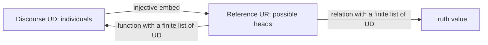

## Source contract

The open semantic source is *Proof Support for Common Logic* (Mossakowski,
Codescu, Kutz, Lange and Gruninger, 2014), especially page 2 and pages 7–10.
The accompanying Hets sources are pinned at commit
`65ca27f4fcafd57f94fbb0908f2d88a16b0977ea`. The private
receipt gives exact archived paths,
verified SHA-256 hashes, and inspected page/line evidence. These sources already
is new work from their semantic descriptions; Haskell code is not copied.
The ISO 24707:2007/2018 catalogue entries have no archived standard. Direct
normative ISO inspection is not claimed.

The source account specifies a reference universe UR, a nonempty discourse
universe UD embedded injectively in UR, and interpretations:

| Item | Interpretation |
| --- | --- |
| Discourse name | An element of UD |
| Non-discourse name | An element of UR outside the image of UD |
| Predicate extension | UR → List UD → Prop |
| Functional extension | UR → List UD → UD, total |
| Free sequence marker | An actual finite list of UD elements |

`Model` retains all these parts. UR and UD are separate carrier types connected
by `embed`, with injectivity and outside-image proofs. The homomorphism category
uses maps on both carriers commuting with the inclusion, names, sequence values,
and functions, and preserving relations. `Model.reduct` changes symbol
interpretations while retaining the carriers and extensions.

## Admitted syntax

`Signature` separates discourse names, non-discourse names, and sequence markers.
Signature maps preserve these three symbol classes. The typed `Expr` grammar has
three kinds: individual, reference, and sequence. Individual terms are variables,
discourse names, or functional applications. Reference heads are non-discourse
names or lifted individual terms. Thus an arbitrary functional application can
itself serve as a head, and a quantified individual can occur in predicate or
function position. This is not a fixed-predicate first-order syntax.

Sequences have empty, singleton-cons, free-marker, bound-sequence-variable and
concatenation constructors. A marker inserts its entire list; it does not stand
for one individual. Multiple markers and empty splices are admitted.

`Formula` has equality of individual terms, reference-headed predication,
true/false, negation, conjunction, disjunction, implication, biconditional,
and universal/existential quantification over both individuals and sequences.
The two variable scopes are independent finite de Bruijn contexts. Individual
quantifiers range over UD. Sequence quantifiers range over **all actual finite
lists** of UD, including the empty list; there is no selected Henkin sequence
carrier or bound on length. Free sequence markers receive their values from
the model. A name and its zero-argument functional application are separate syntax forms;
their meanings can agree or differ in a model.

This typed grammar implements the sort-correct reference/discourse discipline
shown by the paper's two-sort translations. It does not settle maximal acceptance
of raw segregated CLIF. In particular a complete raw occurrence classifier,
non-discourse equality syntax, and correspondence with a named CLIF frontend
remain separate work. Equality in this core compares individual-valued terms;
there is no silent admission of non-discourse objects as ordinary arguments.

## Institution and examples

`Expr.map_id`, `Expr.map_comp`, `Expr.eval_map`, `Formula.map_id`,
`Formula.map_comp` and `Formula.holds_map` prove notation-change invariance.
`room`, `corridor`, `institution` and `inst` assemble the actual model categories
and satisfaction into the public institution interfaces. `entails_map` proves forward
consequence preservation under class-preserving symbol maps, including maps
that identify names. It does not assert converse consequence reflection. `individual_exists` uses the
nonempty discourse hypothesis; the model contract has no empty-discourse option.

`Core.Examples` uses UD = Nat and UR = Option Nat with `some` as the inclusion
and `none` interpreting a non-discourse name. Individual 1 acts as the
nonempty-list predicate, and functional application returns argument length.
Checked examples include an existential predicate `p(p)`, a computed application
used as a predicate head, a nonempty existential sequence inserted between two
ordinary arguments, repeated free-marker splicing, and a bare name unequal to
its nullary application. Concretely, the free marker is `[2,3]`, so splicing it twice gives
`[2,3,2,3]`. The sequence witness uses `[8,9]`: the list `[0,8,9,1]`
and the repeated marker both have length four. The empty-list instance refutes
the universal claim that every sequence satisfies the nonempty predicate.
These are theorems about this explicit model, rather than a CL solver run.

## First-order connection and limits

`Core.FirstOrder` constructs a public single-sorted FOL signature for the
fixed-arity named-head fragment. It has separate symbols for bare discourse
names and nullary functional applications, and allows either discourse or
non-discourse named heads. Every general CL model induces an inhabited FOL model
of this signature. `term_eval`, `formula_holds`, and `sentence_holds` prove exact
meaning of the embedding, including arbitrary FOL Boolean combinations,
equality, functions and individual quantification.

This is a proved fragment connection, not a translation of arbitrary sequence
quantification into ordinary FOL or a model-expansive comorphism for all public
FOL models. The public FOL institution permits empty carriers and independently
interpreted fixed-arity symbols. The induced models inherit CL's nonempty
discourse and coherent reference extensions. No unrestricted SAT or entailment
reflection across arbitrary FOL structures is claimed.

A separate independent FOL translation now
provides varying-signature institution comorphisms for actual public
single-sorted FOL structures and homomorphisms. Every nonempty source structure
has a CL expansion, giving SAT, UNSAT and consequence equivalences for the full
nonempty model subcategory. Empty source carriers prevent unrestricted model
expansion and consequence reflection. This separate construction uses tagged
fixed-arity heads; it does not extend the model-induced fragment above to
arbitrary CL sequence quantification.

Modules, imports, exclusions, text/comment metadata, irregular/that-terms,
CLIF literal datatype requirements, parsing/printing and proof search are
outside this slice. The separate finite-list FOL comparison,
every implemented Core constructor, including computed heads and all four
individual/sequence binders. Its target models carry actual finite lists through
a semantic freeness condition, retain all ordinary FOL model homomorphisms, and
give arbitrary-source-theory SAT, UNSAT and consequence equivalences. This does
not extend the admitted Core to the remaining ISO language features above.

## Implementation and review evidence

The [core definitions](../../Silmaril/Logic/CommonLogic/Core/Defs.lean) contain the
syntax, model category and institution. The [theorem header](../../Silmaril/Logic/CommonLogic/Core/Thms.lean)
exposes consequence and existence results. The [fragment definitions](../../Silmaril/Logic/CommonLogic/Core/FirstOrder/Defs.lean)
and [fragment theorems](../../Silmaril/Logic/CommonLogic/Core/FirstOrder/Thms.lean)
give the model-induced FOL connection; the [example definitions](../../Silmaril/Logic/CommonLogic/Core/Examples/Defs.lean)
and [example theorems](../../Silmaril/Logic/CommonLogic/Core/Examples/Thms.lean)
give the concrete witnesses above.

The whole-page review receipt
records the exact source snapshot, public dependency pin and static checks.
This documentation review did not run Lean or replay the historical build.

The historical implementation report records that the targeted `LEAN_NUM_THREADS=2 bin/mor build --no-pool --mem-cap 16
Silmaril.Logic.CommonLogic.Core` passed with zero Lean errors, sorry warnings or
other warnings (log `.lake/mor-build/1794285766-157903.log`). Permanent
`#guard_msgs` checks audit satisfaction naturality, consequence renaming,
nonempty discourse, the FOL formula/sentence correspondence, higher-predicate
and sequence examples. They admit only `propext`, `Quot.sound`, and where used
`Classical.choice`.

That report also records that `bin/mor check` passed, and scoped `bin/mor isar lint --deny` flags zero of 16
tactic proofs without a baseline. A token scan found no `sorry`, `axiom` or
`native_decide` in this Lean slice. Source hashes in the private receipt were
recomputed and matched the catalogue. A full Lean build remains CI work.
The package guard still reports pre-existing cached 4.35.0-rc4 oleans alongside
the pinned nightly toolchain; those guard notices are separate from the clean
Lean compiler result.


## Single-sorted public FOL into Common Logic

**Proved:** a varying-signature institution comorphism sends single-sorted public
first-order logic (FOL) into the admitted Common Logic (CL) core. Its decoder
uses every CL model and every CL model homomorphism. An actual public FOL structure expands exactly when
its carrier is nonempty. With the nonempty source model convention, theory
satisfiability, unsatisfiability and semantic consequence are preserved and
reflected.

A **single sort** means one kind of individual. A symbol's **arity** is its
number of arguments. A **nullary** symbol takes zero arguments: for example,
a constant `a` or a proposition `q`.

The construction connects three kinds of data:

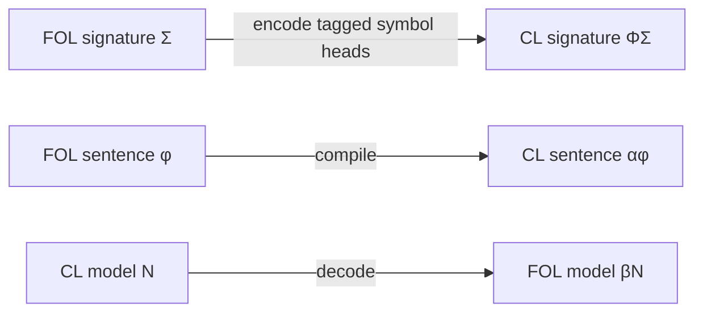

A **signature** lists the symbols and their arities; a signature map renames
symbols while preserving their arities. A **model** supplies individuals and
interpretations of those symbols. A model **homomorphism** maps individuals,
commutes with the operations, and preserves true predicate applications. FOL
quantifies over individuals while function and predicate symbols have fixed
arities.

A **comorphism** pairs the forward translation of sentences with the backward
translation of models shown above. It requires the source sentence to have the
same truth value in the decoded model as its translation has in the CL model;
both translations must also commute with symbol renaming. Those commutation
properties are called **naturality** here. A **reduct** reads a model using the
source symbols of a signature map; the backward CL-to-FOL model translation is
also called a reduct in the expansion statements below. **Model-expansive**
means every admitted source model is exactly the decoded form of some target
model. Here that property holds for the nonempty source model convention.

A **full model subcategory** keeps every original homomorphism between its
retained models. A **full decoder** would let every FOL homomorphism between
decoded models lift to a CL homomorphism. These are different conditions: the
nonempty source subcategories are full, while the decoder is not full, as the
counterexample below proves.

A **discourse** is the universe of individuals over which CL individual
quantifiers range; it is nonempty here. A **reference** can identify either an
individual or an object outside that universe. A **non-discourse name** denotes
such an outside object, which can still act as a function or predicate head.
A **sequence marker** names a finite list of individuals. The translation uses
no sequence markers or sequence quantifiers.

## Signature and model scope

The source `Signature` has independent families `Op n` and `Rel n`, for every
natural arity `n`, including zero. `publicSignature` constructs an actual
`Silmaril.Logic.Institution.Examples.FOL.Signature` with the single sort `Unit`.
`institution` is the public FOL institution precomposed with that signature
functor: its models and homomorphisms are the actual public structures and
arrows. No injectivity or relation-reflection condition is added. This is a
chosen single-sort signature presentation; arbitrary many-sorted public FOL is
outside this result.

Every arity-preserving operation/predicate map is admitted, including symbol
identifications. The CL signature has no individual names and no sequence
markers. Its non-discourse names are the disjoint union of tagged operation and
predicate symbols, each tagged with its arity. Thus a nullary function symbol
and a nullary predicate symbol have distinct heads; the function's individual
value is its application to the empty sequence.

`term`, `formula` and `sentence` compile fixed symbol heads and finite argument
tuples into CL. Equality and all public FOL primitive connectives/binders are
translated. The decoder reads each CL head only at its declared arity. CL models
may identify named heads; the translation does not require them to be distinct.
The existence construction chooses distinct heads so independent source
interpretations can always be represented.

## What the proofs establish

| Contract | Interface |
| --- | --- |
| Signature maps preserve identities and composition | [Defs](../../Silmaril/Logic/CommonLogic/FirstOrder/Defs.lean), `publicSignatures`, `signatures` |
| Open syntax commutes with signature maps | [Thms](../../Silmaril/Logic/CommonLogic/FirstOrder/Thms.lean), `term_map`, `formula_map`, `sentence_map` |
| Every actual CL arrow decodes; reduct squares commute as entire functors | [Defs](../../Silmaril/Logic/CommonLogic/FirstOrder/Defs.lean), `decodeHom`, `models`; [Thms](../../Silmaril/Logic/CommonLogic/FirstOrder/Thms.lean), `models_natural` |
| Open meaning under every individual/sequence assignment agrees | [Thms](../../Silmaril/Logic/CommonLogic/FirstOrder/Thms.lean), `term_eval`, `formula_holds`, `sentence_holds` |
| These data form actual `Inst.CoHom` values | [Thms](../../Silmaril/Logic/CommonLogic/FirstOrder/Thms.lean), `comorphism`, `nonemptyComorphism` |
| An inhabited public structure is exactly a decoded CL structure | [Expansion](../../Silmaril/Logic/CommonLogic/FirstOrder/Expansion/Thms.lean), `decode_expand`, `exists_expansion_iff` |
| Nonempty source models form full subcategories, stable under reduct | [Defs](../../Silmaril/Logic/CommonLogic/FirstOrder/Defs.lean), `NonemptyModel`, `nonemptyInstitution` |
| Nonempty source comparison is model-expansive, with borrowing and SAT/UNSAT equivalences | [Expansion](../../Silmaril/Logic/CommonLogic/FirstOrder/Expansion/Thms.lean), `nonempty_modelExpansive`, `nonempty_entails_iff`, `nonempty_satisfiable_iff`, `nonempty_unsatisfiable_iff` |

The expansion uses `D ⊕ Heads` as its reference universe, embeds the individual
carrier `D` in the left summand, and places symbol names in the right summand.
At a symbol's declared arity it evaluates the original operation or predicate.
Other functional applications return a selected individual; other predicates
are false. The theorem asserts existence and exact reduct equality. It does not
assert a natural or functorial selection of those unused extensions.

## Small client

The positive example is `P(f(a))` with `a = 0`, `f(x) = x + 1`, and `P(x)` meaning
`x = 1`. The examples also cover a nullary predicate, the identification of two
unary symbols, an actual noninjective public FOL arrow, and an actual
noninjective CL arrow whose decoded discourse map is retained.

```lean
import Silmaril.Logic.CommonLogic.FirstOrder
import Silmaril.Logic.CommonLogic.FirstOrder.Examples

open Silmaril.Logic.CommonLogic
open Silmaril.Logic.CommonLogic.FirstOrder
open Silmaril.Logic.Institution.Examples

example : (Core.room (clSignature Examples.signature)).Sat
    (expand Examples.arithmetic 0) (sentence Examples.pfa) :=
  Examples.translated_pfa_true

example (S : Signature) (M : FOL.Structure (publicSignature S))
    (h : Nonempty (M.carrier ())) :
    ∃ N : Core.Model (clSignature S), decode N = M :=
  (exists_expansion_iff M).mpr h

example (S : Signature) (Γ : Set (FOL.Sentence (publicSignature S)))
    (p : FOL.Sentence (publicSignature S)) :
    (nonemptyRoom S).Entails Γ p ↔
      (Core.room (clSignature S)).Entails (sentence '' Γ) (sentence p) :=
  nonempty_entails_iff S Γ p
```

## Boundaries with counterexamples

The empty operation/relation signature has an actual public FOL model with an
empty carrier. `empty_no_expansion` proves it has no CL expansion. The source
sentence `∃x, x=x` is false in that model and its CL translation is true in every
CL model. `unrestricted_reflection_fails` therefore proves that the unrestricted
comorphism does not reflect semantic consequence. Nonemptiness is an explicit
model restriction, not an assumed public FOL convention.

The decoder is not full. In `forgottenIdentity_no_lift`, two CL models have the
same Boolean individual carrier but unused CL operations return different
constants. The actual public FOL identity carrier map between their reducts
cannot lift to a CL homomorphism. This comparison gives no equivalence with
full CL or reverse translation of computed heads and sequence quantifiers.
A separate Core-to-finite-list FOL comparison,
those constructors into ordinary many-sorted FOL syntax over models constrained
by actual finite-list freeness. It retains all ordinary FOL model arrows and
gives arbitrary-source-theory SAT, UNSAT and consequence equivalences. Neither
construction claims coverage of the full ISO Common Logic language.

This construction differs from the older
[named-head view](../../Silmaril/Logic/CommonLogic/Core/FirstOrder/Thms.lean), which
only established meaning in a model-induced FOL structure. The independent
head encoding here provides genuine varying-signature institution data and
arbitrary nonempty actual public source model expansions.

## Provenance and validation

This is new private mathematics over public FOL pinned by `lake-manifest.json`
to `hiloopai/silmaril-lean@fe6a59ea53b716d38370db747f322311a9034e99`.
The finite-tuple and quantifier-assignment proof helpers were adapted from
`Silmaril/Proofs/Logic/CommonLogic/FirstOrder.lean` at private base
`be8e03d435751fbb264d0e66d4697424d2c91313`; the new implementation imports its
header definitions and proves its own helpers. No source paper statement or
public promotion is asserted.

The validation receipt
records the targeted build, exact axiom guards, retained guide client and source
hashes. These are historical validation results, not new builds in this page
passed at `82bf10af6a167e0265e9e68cee06e08e7182c16c`. Full local builds were
not run. To reproduce, use
`scripts/prove.sh Silmaril.Logic.CommonLogic.FirstOrder.Audits`; if the remote worker
is unavailable, use `bin/mor build Silmaril.Logic.CommonLogic.FirstOrder.Audits`. Run
`bin/mor check` separately for registry and catalogue checks.


## Many-sorted first-order logic in Common Logic

First-order logic (FOL) describes objects using operations, relations, and
quantifiers. In many-sorted FOL, each variable has a **sort**, such as `Person`
or `City`; each sort has a **domain**, the set of values it ranges over.

This core translates the public many-sorted `FOL.Signature` syntax into Common
Logic (CL) and decodes **typed CL models** back to FOL structures. Source domains
may be empty. Maps between signatures may identify sorts.

A **guarded translation** replaces a source sort `s` with a unary predicate
`Sort_s(x)` in CL. Operations and relations receive tagged named heads. Terms
retain their variables and operation applications; quantifiers use the sort
predicate to select their source domain. For example, in mathematical notation:

| FOL statement | CL reading |
| --- | --- |
| `∀ x : Person, P(x)` | `∀ x, Sort_Person(x) → P(x)` |
| `∃ x : Person, P(x)` | `∃ x, Sort_Person(x) ∧ P(x)` |

The primitive FOL translation implements universal quantification; the existential
row expresses its usual derivation through negation and universal quantification.
The examples also prove the guarded CL existential behavior directly.

A **typed CL model** satisfies operation closure: whenever arguments satisfy the
input sort predicates, an operation's result satisfies its output sort predicate.
The theorem `wellTyped_iff` identifies this semantic condition with satisfaction
of the generated operation typing theory. The decoded carrier of `s` is the
subtype `{x // Sort_s(x)}`. This supplies the witnesses needed to decode operations.
A **homomorphism** maps values between models while preserving operations and
relations. Every CL homomorphism between typed models restricts to a FOL
homomorphism on the decoded domains. `TypedModel` retains all such CL maps.

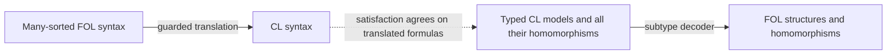

An **empty sort** is a sort whose predicate has no satisfying individual. CL's
whole discourse remains nonempty, and may contain individuals outside every
sort predicate. Thus an empty `Person` sort makes the displayed universal true
and existential false. Omitting the existential guard would incorrectly allow
an outside individual as a witness.

- `emptyModel` exhibits a nonempty CL discourse with every source sort empty;
  `decodedEmpty`, `empty_sort_all`, `empty_sort_not_exists`, and
  `unguarded_exists_junk` establish the boundary.
- A source constant forces its output sort to be inhabited (`constant_inhabited`).
  A raw CL model need not satisfy this requirement (`typing_is_required`).
- Predicates need not be disjoint or exhaustive. `reduct_carrier_eq` permits
  identified source sorts; no injectivity assumption is imposed on sort maps.

The proved interface covers translation of terms and formulas under maps between
signatures, term evaluation, and agreement of formula and sentence truth. A
**reduct** views a model through a map of signatures: it uses the sorts and symbols
selected by that map. Decoder **naturality** means that decoding after taking a
reduct gives the same model and homomorphisms as taking a reduct after decoding
(`models_natural`). The decoder requires typed models.

For every FOL structure `M`, `Expansion.expand M` constructs a typed CL model.
Its discourse consists of an extra **junk** value and tagged source values
`(sort, value)`. A tag remembers which source carrier supplied a value. For
example, if `Person = {Ada}` and `City` is empty, the discourse contains junk
and `(Person, Ada)`; the `Person` predicate contains that tag, while the `City`
predicate is empty. Junk belongs to neither predicate. On correctly tagged
argument tuples, operations and relations use their source interpretations;
off-profile operations return junk and off-profile relations are false. This
construction is noncomputable; it is a mathematical expansion, not an executable
model generator.

Decoding the expansion recovers `M` **up to isomorphism**
(`Expansion.decodeExpandIso`): there are inverse structure maps preserving
operations and relations. The decoded subtype is not asserted to be literally
the original carrier. `Expansion.expanded_satisfaction` proves that translated
sentences have exactly their source truth values.

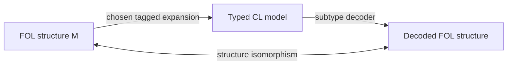

An **institution** packages a logic's signatures, sentences, models and truth,
including how they change along maps between signatures. An **institution
comorphism** translates sentences forward and models back, preserving truth.
`Institution.institution` now bundles the operation-typed CL rooms over the full
public `FOL.Signature` category. `Institution.comorphism` is the global comparison
from public many-sorted FOL to that typed CL institution. Its target at `S` uses
the actual CL signature `signature S`; signature maps act through `signatureMap`.
All source sort, operation and relation maps are retained, including sort collapse.
`Institution.typedForget` connects this typed institution to the raw CL core by
including the typed model categories; it does not remove the typing requirement.

For any FOL theory, entailment and satisfiability agree with those of its translated
theory in typed CL (`Institution.entails_iff`, `satisfiable_iff`, and
`unsatisfiable_iff`). Recovery up to isomorphism supplies the needed models;
literal model-object surjectivity and equivalence of the model categories are
not claimed. For raw CL satisfiability, the operation typing theory must be
included (`Expansion.satisfiable_raw_iff`).

The global comparison uses naturality of the **decoder**. It does not assert that
the chosen expansion commutes with arbitrary signature maps: identifying two
sorts can turn an off-profile tagged tuple into an on-profile tuple. The concrete
`Institution.Examples.collapse` map identifies `Bool`-indexed source sorts with
one target sort and checks the actual decoder equality, comorphism square and
satisfaction transport; both decoded carriers coincide and are inhabited.

The implementation is in
[`Defs`](../../Silmaril/Logic/CommonLogic/ManySorted/Defs.lean),
[`Thms`](../../Silmaril/Logic/CommonLogic/ManySorted/Thms.lean), and
[`Examples`](../../Silmaril/Logic/CommonLogic/ManySorted/Examples.lean).
The tagged expansion and recovery results are in
[`Expansion/Defs`](../../Silmaril/Logic/CommonLogic/ManySorted/Expansion/Defs.lean),
[`Expansion/Thms`](../../Silmaril/Logic/CommonLogic/ManySorted/Expansion/Thms.lean), and
[`Expansion/Examples`](../../Silmaril/Logic/CommonLogic/ManySorted/Expansion/Examples.lean).
The global bundle and sort-collapse controls are in
[`Institution/Defs`](../../Silmaril/Logic/CommonLogic/ManySorted/Institution/Defs.lean),
[`Institution/Thms`](../../Silmaril/Logic/CommonLogic/ManySorted/Institution/Thms.lean), and
[`Institution/Examples`](../../Silmaril/Logic/CommonLogic/ManySorted/Institution/Examples.lean).

[`Audits`](../../Silmaril/Logic/CommonLogic/ManySorted/Audits.lean) prints axiom
dependencies for selected base translation declarations and checks that they use only Lean's
standard three: `propext` identifies equivalent propositions, `Classical.choice`
chooses a value from an inhabited type, and `Quot.sound` identifies equivalent
representatives in a quotient.

Additional guards in
[`Expansion/Audits`](../../Silmaril/Logic/CommonLogic/ManySorted/Expansion/Audits.lean)
and
[`Institution/Audits`](../../Silmaril/Logic/CommonLogic/ManySorted/Institution/Audits.lean)
print axiom dependencies and enforce the same ceiling for 50 and 29 explicitly
named declarations, respectively, including selected examples. These guards
They do not constitute a whole-library or structural-assumption audit.


## Common Logic Core through finite-list first-order models

Status: private development. Revision `6361f402d02ac13fbb2d695f409b95a80a8629cb`
passed normal CI run 43285542643 for all seven modules, including the complete
Examples module, with warnings treated as failures. Eleven exact dependency
checks are included from those actual observations. For guarded revisions, use
The independent finite-list foundation is merged in
not establish the translation results described below.

## What is being compared

**FOL** means first-order logic. Its terms use declared functions, its formulas
use predicates and quantifiers, and a **model** interprets those symbols on
types of values called **carriers**. A **signature** declares the symbols and
their input and output sorts; a **sort** is a type label.

The source is the Common Logic Core implemented here.
It has individual values, references used as application or predicate heads,
and finite sequences of individuals. A head may be computed by another term.
Its three classes of names denote individuals, nondiscourse references and
sequences. A name class may be empty, and values need not have names.

The target uses the independent finite-list FOL foundation.
It has discourse, reference and sequence sorts, and retains **all** FOL
sentences over its signature, including reference quantifiers and list equality.
The translation adds ordinary symbols for:

- the three classes of names;
- embedding an individual as a reference;
- applying a reference to a sequence;
- concatenating two sequences;
- applying a predicate reference to a sequence.

## Why the sequence carrier contains every finite list

**Nil** constructs the empty list, and **cons** adds an element to the front.
The independent foundation requires their **list reduct**, obtained by
forgetting the other symbols, to satisfy a universal property named `FreeAt`:
every map of discourse elements extends uniquely to a map preserving nil and
cons. Its evaluation theorem gives an equivalence
`List discourse ≃ sequenceCarrier`.

This equivalence includes the empty list and lists of every finite length.
It rules out extra sequence values and identifications between distinct lists.
The requirement is a semantic condition on models; ordinary first-order
axioms characterizing standard finite lists are not supplied.

The Common Logic target additionally requires:

- inhabited discourse, as in the source Core;
- an injective embedding of discourse into references;
- named nondiscourse references outside that embedding;
- the nil and cons equations for concatenation.

These conditions retain every ordinary FOL **homomorphism** between admitted
models: a map preserving operations and true predicates. Such a map need not
be injective or reflect predicate truth. Both base carriers may vary between
models; the source's nonempty-discourse condition still applies.

## A sequence quantifier must include the empty list

In the example model, discourse values are Boolean. Let `P(xs)` mean that
`false` occurs in the finite sequence `xs`. Then:

```text
P([true, false])             is true
P([])                       is false
for every sequence xs, P(xs) is false
```

`Examples.everySequence` expresses the last sentence. Its translation
quantifies over every target sequence value and applies the ordinary `holds`
predicate. The list equivalence ensures that the empty-list counterexample
is present in the target too. The authored `everySequence_target_false`
theorem transports this falsity through the comparison.

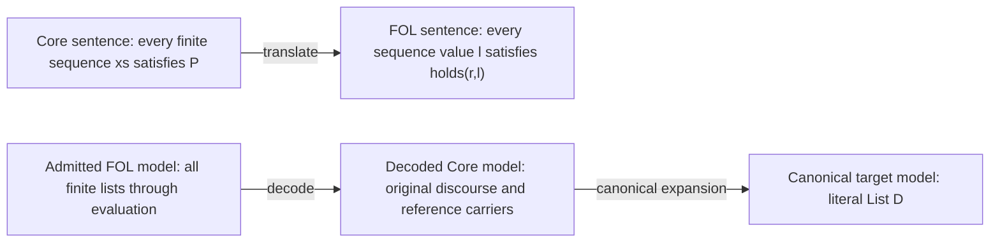

## Translation and model decoding

`translateTerm` handles every admitted Core expression constructor, including
computed heads and concatenation. `translateFormula` handles every connective
and all four quantifiers: universal and existential quantification over
individuals, and universal and existential quantification over sequences.
Variables are translated with sort-preserving substitutions; extending a
binder retains the existing context.

For formulas with free variables, `formula_holds` accepts arbitrary sorted
substitutions. It assumes that each translated individual evaluates to its
source value and each translated sequence evaluates through the list
equivalence. Under both compatibility premises, translated and source
satisfaction are equivalent.

`decode` keeps the target's discourse and reference carriers. It interprets
source sequences through the complete finite-list equivalence. Conversely,
`expand` interprets the target sequence sort as literal Lean `List D`, where
`D` is the source discourse carrier. The candidate API includes:

| API | Statement |
| --- | --- |
| `append_evaluation` | Constructor evaluation respects actual list concatenation. |
| `decode_expand` | `decode (expand M) = M`, as an equality of source model objects. |
| `sentence_holds` | A translated sentence holds in a target model iff the original holds in its decoded source model. |
| `sentence_map` | Translating a sentence commutes with renaming its symbols. |
| `models_natural` | Decoding model objects and arrows commutes with signature reducts. |

A **reduct** interprets a smaller signature by following a symbol map. The
comparison packages sentence translation and backward model decoding with
the satisfaction equivalence. Its institution **comorphism** also requires
these operations to commute with symbol maps. The `ModelExpansive` property
means every source model is exactly the decoded object of some target model;
here `expand` and `decode_expand` supply that witness.

**SAT** means some admitted model satisfies every sentence of a theory, a set
of sentences. **UNSAT** means no such model exists. A theory **entails** a
sentence when every model of that theory satisfies the sentence. The authored
`sat_transport`, `unsat_transport` and `entails_transport` statements give
equivalences for arbitrary sets of source Core sentences and their translations.
Target witnesses may be any admitted target models. These statements do not
identify arbitrary target theories with source theories or assert an
equivalence of the model categories.

## Examples

The Examples module contains:

- computed application and predicate heads, mixed individual/sequence binders,
  an existential sequence witness, and the empty-list universal counterexample;
- a satisfiable mixed theory and a quantified contradiction using universal
  and existential sequence assertions, without a literal false constructor;
- renaming by Boolean negation and a noninjective Boolean-to-Unit symbol map;
- empty name classes with inhabited discourse, exercising all four binders;
- a predicate-preserving FOL model arrow that fails to reflect predicate truth.

| Source | Content |
| --- | --- |
| [Model definitions](../../Silmaril/Logic/CommonLogic/FiniteListFOL/Defs.lean) | Ordinary symbols, model constraints, decoding, expansion and reducts |
| [Model API](../../Silmaril/Logic/CommonLogic/FiniteListFOL/Thms.lean) | Evaluation, model arrows, naturality and target institution |
| [Translation definitions](../../Silmaril/Logic/CommonLogic/FiniteListFOL/Translation/Defs.lean) | Terms, formulas, sentences and target satisfiability |
| [Translation API](../../Silmaril/Logic/CommonLogic/FiniteListFOL/Translation/Thms.lean) | Satisfaction, comorphism and theory transport |
| [Examples](../../Silmaril/Logic/CommonLogic/FiniteListFOL/Examples.lean) | Concrete models, truth/falsity and arrow controls |

Long proofs live in the corresponding `Silmaril/Proofs/Logic/CommonLogic/` modules.
## Current validation

checked revision `6361f402d02ac13fbb2d695f409b95a80a8629cb`:

- All seven modules passed, including the complete Examples module without warnings.
- All eleven actual dependency observations were clean: ten used `propext`,
  `Classical.choice` and `Quot.sound`; `sentence_map` used `propext` and `Quot.sound`.
- Lean, Tooling, aggregate CI and the unchanged budget passed. The budget was
  **196.2/240 seconds**, partial because Proof reuse was skipped.

The Examples module includes an explicit `Lean` import and eleven exact dependency
checks using the observed sets. Each check requires equal size and membership;
it rejects both extra and missing dependencies. All theorem statements and the
other six Lean modules remain exact relative to the tested revision above.
Validation of a guarded revision is recorded by its exact-head Lean and aggregate

The source retains every implemented Core constructor, all four binder kinds,
computed heads, every actual finite list, arbitrary theories, models and ordinary
model arrows. Raw source classification and parsing are separate work. The
private receipt
retains all fifteen CI histories, exact source bindings and complete evidence
links, including earlier contaminated reports, which remain rejected. The
historical guide
retains the earlier diagnostic chronology.


## Named CLIF sources for the represented Common Logic Core

CLIF means **Common Logic Interchange Format**.
`Silmaril.Logic.CommonLogic.Source` gives the existing Common Logic Core
a named source language, structural elaborator and independent raw interpretation.
It covers computed application and predicate heads, multiple sequence splices,
equality, all Core Boolean operators, and individual and sequence quantifiers.
The CLIF reader accepts complete plain-name texts, including a named `cl-text`
wrapper and mixed quantifier lists. Bare texts are nonempty; a named text may
be empty, matching the inspected Hets productions. This is a documented CLIF subset for the
represented Core, not a complete ISO CLIF implementation.

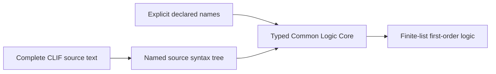

A **computed head** is a term used as a function or predicate, such as `(f x)`
in `((f x) y)`. A **sequence splice** inserts every element of a finite sequence
into the argument list: `(p x ...s y)` includes the empty-sequence case.
Sequence quantifiers range over all actual finite lists, exactly as in Core.

The source vocabulary is an explicit table of spellings and semantic symbols,
partitioned into discourse names, non-discourse names and sequence markers.
Each class has unique spellings; distinct spellings may denote the same symbol.
A discourse name can occur as an individual or a head. Free non-discourse names are
heads only; they are rejected as ordinary arguments or equality operands.
Bound names use separate individual and sequence contexts and innermost lookup.
No implicit symbol declaration or fixture-specific vocabulary inference occurs.

## Grammar and evidence

The inspected implementation grammar is Hets `CommonLogic/Parse_CLIF.hs` and
`Lexer_CLIF.hs`, pinned at `65ca27f4fcafd57f94fbb0908f2d88a16b0977ea`.
Their `sentence`, `atom`, `term`, `termseq`, `boundlist`, `scanClWord` and
`scanSeqMark` productions determine this reader's subset. Exact source hashes,
archived files and the coverage table are recorded in the private
source receipt and `hets-commonlogic-clif-source` in `references.bib`.
Hets references ISO/IEC 24707:2007; the ISO 2007/2018 catalogue entries contain
no archived standard. Direct inspection of normative ISO grammar is not claimed.
The Lean implementation is new work, not copied Haskell source.

The supported forms are:

- Plain ASCII names and `...` sequence markers.
- Computed term heads, equality, nullary applications and multiple splices.
- `and`, `or`, `not`, `if`, `iff`; empty `and` and `or` mean true and false.
- `forall`/`exists` with mixed individual-name and sequence-marker lists.
- Complete nonempty bare texts and optionally named `cl-text`/`cl:text` texts.

A bare name and its nullary application remain distinct. Semicolon is a plain
CLIF word character, not an SMT line comment. Parenthesis grouping reuses the
existing theory-free S-expression stack builder, with a separate CLIF lexer.

The remaining profile boundaries are:

- Quoted/enclosed names, comments and quotation (`that`) are unsupported.
- Modules/imports/prefixes, rolesets and restricted-quantifier sugar are unsupported.
- Non-discourse equality and sequence-valued heads are outside the represented Core.
- Fuel bounds parsing depth and argument traversal; completeness and arbitrary-input
  resource bounds are not proved.

Malformed reserved-operator forms cannot fall back to ordinary predicate names.

`CLIF.Examples.cat` binds the complete unchanged Hets `TestData/Cat.clif`, all six
sentences, explicit declarations and their computed typed elaborations. Authored
controls exercise computed heads, nullary applications, independent/mixed/shadowed
binders, free markers, multiple splices and all Boolean forms. The complete Hets
`sublogic_fullcl.clif` is retained as a rejection boundary: its sequence-valued
heads are outside Core. These checks are not a new solver experiment.

## Semantic boundary and presentation maps

The raw named evaluator resolves spellings directly in an actual `Core.Model`,
without calling the elaborator or interpreting typed terms. Elaboration returns
an optional typed term or formula. `Expr.elaborate_eval` proves evaluation
commutes with elaboration, including open contexts. `Formula.holds_of_elaborated`
proves raw/typed satisfaction equivalence by induction for every formula
constructor. Successful decoding is required; rejected raw input has no theorem
of source acceptance.

A **room** packages sentences, a model category and satisfaction. A **corridor**
translates sentences forward and models backward with a satisfaction equivalence.
A **model reduct** reinterprets the source symbols in a target model.
`Source.room` holds accepted closed formulas; `CLIF.room` holds complete accepted
texts and requires every original sentence in the same model. Their corridors
to `Core.room` use the actual identical Core model category and all its arrows.
Text translation conjoins every typed sentence. The model reduct is the identity,
so the text corridor is model-expansive (every source model has a target model)
and reflects as well as preserves consequence for arbitrary source theories.

An arbitrary class-preserving `Core.Signature.Hom` transports the semantic
symbols in the declaration tables. Spellings and binder names stay fixed, making
this transport capture-safe even when it identifies symbols. Generic elaboration
naturality and source-room corridors use the existing Core model reduct. This
is semantic symbol transport with unchanged text, not arbitrary textual renaming.

`Source.Presentations.fixed` composes the actual source corridor with the
existing full-Core FiniteListFOL comparison. **FOL** means first-order logic. Its
target has arbitrary many-sorted FOL sentences and all homomorphisms between the admitted finite-list models;
its model restrictions remain those of the finite-list guide.
Model-expansiveness and source-theory SAT, UNSAT and consequence equivalences
are retained.

The varying and packaged source presentations
now provide actual named-vocabulary institutions, successful-lookup-preserving
signature extensions, and both predeclared and dynamically local vocabularies
interpreted in one shared global model. Their comparisons retain arbitrary
source-theory SAT, UNSAT and consequence equivalences. A separate raw AST
permutation API preserves open evaluation and satisfaction under simultaneous
renaming of declarations, occurrences and both binder classes. These results
do not claim byte-level parser naturality, unrestricted changes of local
vocabulary along every arrow, or a full-ISO CLIF frontend.


## Common Logic source vocabularies and shared-model presentations

Accepted named Common Logic Interchange Format (CLIF) texts now form varying
presentation families. Each family uses the complete represented
Core language, including computed function and predicate
heads, all finite sequence splices and both kinds of quantification. The
reader and its accepted grammar are unchanged.
Every stored text still carries its original bytes, parser equation and computed
typed elaboration.

A **signature** is the three classes of semantic symbols: discourse names,
nondiscourse names and sequence markers. A **named vocabulary** adds a finite
spelling table for each class. Several spellings may denote one symbol. A
**symbol map** is an actual function on each of these three symbol classes; it
may identify symbols. A **model** interprets symbols, computed heads and finite
sequences. A **model homomorphism** is a pair of actual carrier functions
preserving the operations and truth of atomic relations. All the existing Core
models and all their homomorphisms are retained here.

## Three choices of presentation

| API under `Source.Presentations` | Where local declarations live | Models for a whole theory |
| --- | --- | --- |
| `Family` | One named vocabulary per signature object | One actual Core model of that vocabulary's semantic signature |
| `Packaged` | A predeclared family indexed by an arbitrary fixed type `I`; each sentence chooses an index | One global Core model, reduced along each index's actual local-to-global symbol map |
| `Dynamic` | Each sentence carries its own arbitrary local signature, valid spelling tables, actual local-to-global symbol map and accepted text | One global Core model, reduced along each sentence's symbol map |

`Dynamic` is the symbols-in-sentence variant: its global signature contains no
predeclared local vocabulary collection. Local symbol types need not be strings,
finite declaration indices, or subsets of global symbols. Local-to-global maps
need not be injective. This avoids choosing one spelling for every semantic
symbol and supports arbitrary aliases.

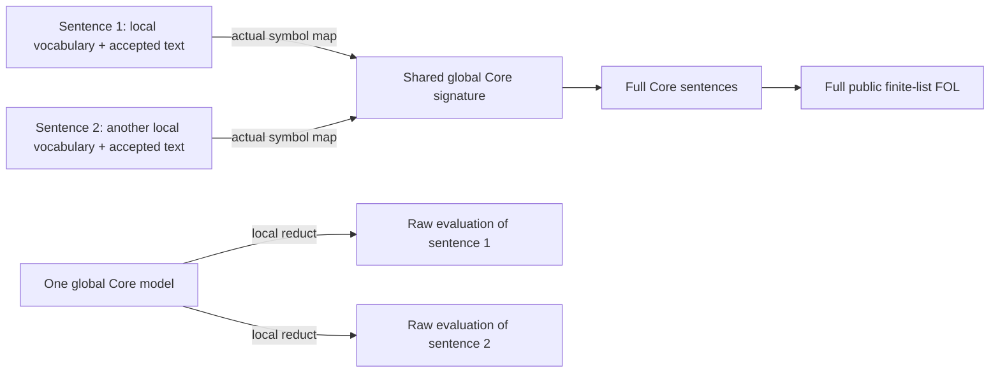

A **reduct** interprets local symbols using their images in a global model. Raw
satisfaction still resolves local spellings directly; it does not call typed
Core evaluation. Adequacy proves this raw evaluation agrees with the translated
Core sentence. A text translates to the conjunction of every original formula,
then through its actual local-to-global symbol map.

The examples make coherence observable. `(= x y)` and `(not (= a b))` carry
different local spelling tables, with `x`/`a` mapping to the same global symbol
and `y`/`b` to another. Each sentence has a model separately. Their joint theory
has none. Choosing an unrelated model for each local vocabulary would lose this
contradiction; neither packaged presentation does that.

## Varying signatures and comparison squares

A **room** packages sentences, their model category and satisfaction. A
**corridor** translates sentences forward and models backward with an exact
satisfaction equivalence. An **institution** arranges rooms and corridors
functorially over signature maps. A **comorphism** is a compatible family of
corridors between institutions, including a signature functor. Its
**naturality** equation says that changing signature before translation has the
same result as translating before changing signature, on both sentences and
entire model functors.

`Family.Signature.Hom` requires successful class-sensitive lookups to be
preserved by its actual symbol functions (`Names.Supports`). Fresh target
declarations are allowed. An old nondiscourse head cannot acquire a conflicting
discourse declaration. Structural elaboration preservation is proved for every
expression and formula constructor and arbitrary open binder contexts. The
accepted-text map keeps the original bytes, fuel, raw syntax and parser equation.
An example both identifies two distinct discourse symbols and adds a fresh
sequence marker. Equality of whole spelling tables is only a helper constructor.

`Packaged` arrows keep the index type and index fixed. They provide actual local
and global symbol maps whose squares commute. `Dynamic` arrows are arbitrary
class-preserving maps of global symbols; they compose with each sentence's
local-to-global map and preserve its local vocabulary and bytes. Neither API
claims an unrestricted change of local vocabulary along these arrows.

For every arrow, the proved Core and finite-list comparison squares have this
shape:

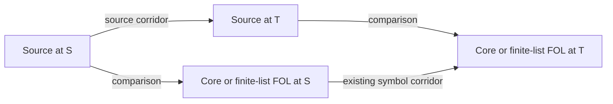

**FOL** means first-order logic. The finite-list target is the existing full
public many-sorted FOL language and its full category of admitted models: actual
standard finite lists, inhabited discourse, injective embedding into references,
nondiscourse separation and the established operation equations. All ordinary
FOL homomorphisms between those models remain. This is not a restriction to
translated FOL sentences or to models selected per example.

Dynamic sentences live in Lean's `Type 1` because they carry arbitrary local
symbol types. The institution library requires the same sentence universe on
both sides of a corridor. `Dynamic.liftRoom` therefore wraps the existing Core
and FOL sentences with `ULift`, a wrapper with an inverse `.down` projection.
Models, model homomorphisms and satisfaction are exactly the originals. No
mathematical language or model restriction is added by this wrapper.

## Theory transport and raw spelling renaming

The comparisons are **model-expansive**: every source model is the exact reduct
of some target model. The source-to-Core comparison has the identity model
functor; the FOL comparison uses the existing full-Core expansion theorem.
This statement concerns the comparison corridors, not arbitrary signature maps.
Consequently SAT (a shared model exists), UNSAT (no shared model exists), and
semantic consequence are equivalent for every source theory and its translated
image. An arbitrary source theory is any set of accepted texts, not just a
finite list of examples. These results do not assert correspondence for every
arbitrary target theory or equivalence of the two model categories.

`Source.Renaming` separately supplies genuine simultaneous **raw AST** spelling
renaming: the abstract syntax tree's declarations, occurrences and both kinds
of binders are renamed by a permutation of strings. Semantic symbols and their
interpretations stay fixed. A permutation is a bijection, so no two spellings
collide. Valid declaration partitions, expression evaluation and formula truth
are preserved for arbitrary open environments, including repeated shadowing and
mixed individual/sequence scopes. Identity and composition laws are proved.
A negative control shows that collapsing two spellings captures a formerly free
occurrence and changes truth.

This raw operation is separate from semantic symbol transport and from rewriting
CLIF bytes. It proves neither parser naturality under textual replacements nor
that a renamed raw tree is accepted by the CLIF lexer. Permutations can produce
reserved or invalid lexical spellings. No printer/reader roundtrip or structural
elaboration commutation theorem for raw renaming is claimed here. The original
accepted-text equations remain unchanged under all presentation arrows.

## Evidence and boundaries

The Lean entry point is
[`Source/Presentations/Examples.lean`](../../Silmaril/Logic/CommonLogic/Source/Presentations/Examples.lean).
It covers actual symbol identification with a fresh declaration, exact retained
bytes, two independently satisfiable but jointly inconsistent local packages,
the existing complete full-grammar authored text, mixed binder shadowing and a
spelling-collision counterexample. Exact axiom guards are in
[`Source/Presentations/Audits.lean`](../../Silmaril/Logic/CommonLogic/Source/Presentations/Audits.lean).
Validation receipts are recorded with the private provenance for this change.

No Core constructors or public FOL sentences are removed. This work does not
extend the documented CLIF grammar to modules, imports, rolesets, quotation,
non-discourse equality or sequence-valued heads. It makes no full ISO Common
Logic coverage claim and adds no copied external mathematics or paper claim.


## Finite-list first-order models

**FOL** means first-order logic.

A **signature** specifies sorted operation and relation symbols. This foundation
uses three sorts:

- **Discourse** is the carrier of elements stored in lists.
- **Reference** is an independent carrier, available for client operations,
  relations and quantification.
- **Sequence** is the carrier required to represent all actual finite lists of
  discourse elements.

The reserved **constructors** build lists: **nil** is the empty list and
**cons** adds one element to the front. For discourse `Bool`,
`cons true (cons false nil)` evaluates to `[true, false]` in the canonical
native model. Clients may supply arbitrary further symbols over all three sorts.
A **structure** interprets those symbols as functions and relations on carriers,
which may be empty when the symbols permit it.

A **list reduct** forgets all symbols except nil and cons. The model condition
requires this reduct to be **free** over its discourse carrier: every element map
extends uniquely to a constructor-preserving list map. The existing ListAlgebras
API identifies this with invertibility of the actual list-evaluation map.
Consequently `evaluationEquiv` identifies the entire sequence carrier with
`List discourse`, and its forward map is the original constructor fold.
This excludes both extra sequence values and collapsed constructors. The
condition is semantic; no ordinary first-order axiomatization is claimed.

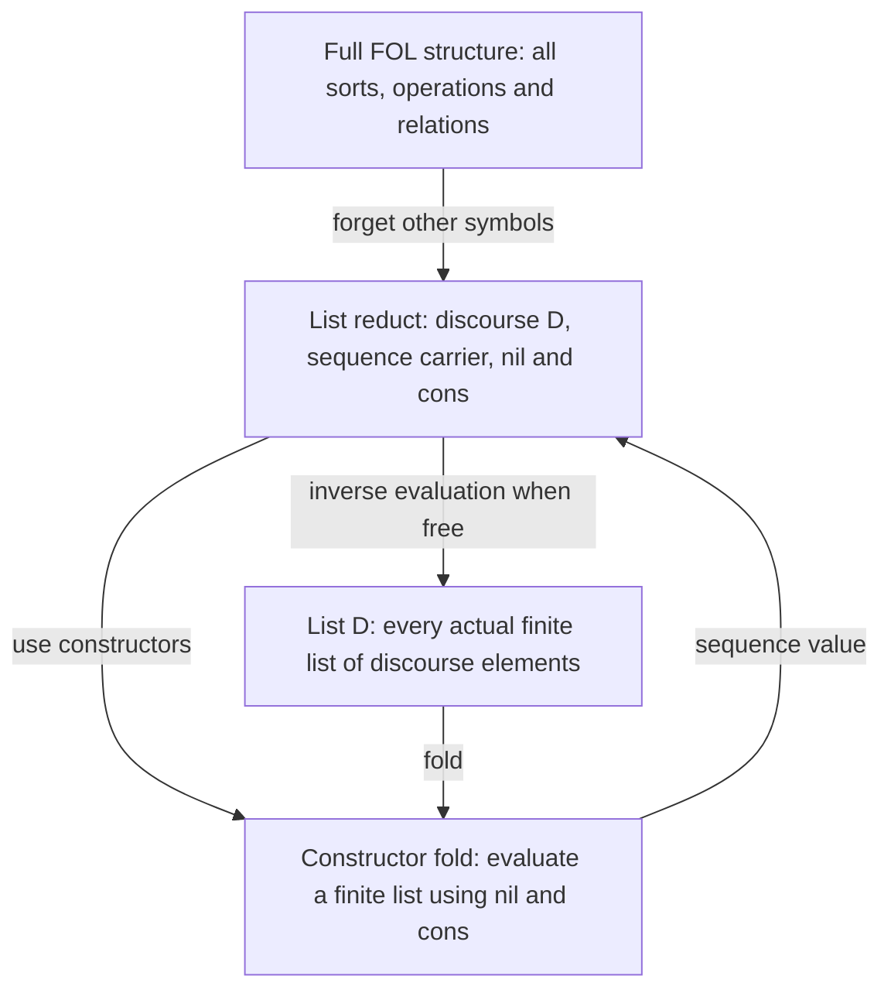

The fold is defined for any list reduct. Freeness supplies its inverse, so the
sequence carrier and `List D` are equivalent.

The target retains every public many-sorted first-order sentence and every
ordinary FOL homomorphism between its free models. A homomorphism preserves
operations and relations; it need not be injective or reflect relations.
`evaluation_natural` states that these arrows commute with finite-list
evaluation. A **reduct** interprets a smaller signature by forgetting or renaming
client symbols. These reducts fix nil and cons and preserve freeness.
A **corridor** packages sentence translation, model reduct and their satisfaction
equivalence; the identity and composition laws assemble the institution.

The API and authored examples are:

- [Defs](../../Silmaril/Logic/FirstOrder/FiniteLists/Defs.lean): signatures,
  models retaining every first-order sentence, list reducts, evaluation equivalence
  and native models.
- [Thms](../../Silmaril/Logic/FirstOrder/FiniteLists/Thms.lean): evaluation naturality
  and identity/composition laws; longer proofs live under
  `Silmaril/Proofs/Logic/FirstOrder/`.
- Examples: a native
  Bool/Nat model and forward/inverse evaluation controls; reference quantification
  in arbitrary target structures; a list-equality sentence false in the native
  model; and rejection of the existing collapsed algebra.

The Examples module retains ten `#print axioms` commands with exact guards
matching the dependency lists first observed at `5547744` and checked under
`--wfail` in successful full CI at
`4ea63e891ba96237c2de663f56c1d6f0a4637a40`:

| Selected declaration | Observed axioms |
| --- | --- |
| `NativeModel.isFree` | `propext, Classical.choice, Quot.sound` |
| `evaluationEquiv_apply` | `propext, Classical.choice, Quot.sound` |
| `fold_natural` | `propext, Quot.sound` |
| `evaluation_natural` | `propext, Classical.choice, Quot.sound` |
| `NativeModel.evaluation` | `propext, Classical.choice, Quot.sound` |
| `NativeModel.evaluation_symm` | `propext, Classical.choice, Quot.sound` |
| `corridor_comp` | `propext, Classical.choice, Quot.sound` |
| `Examples.referenceReflexivity_holds` | `propext, Quot.sound` |
| `Examples.native_not_allListsNil` | `propext, Quot.sound` |
| `Examples.collapsed_not_free` | `propext, Quot.sound` |

These guards check only the selected declarations. They do not audit every
transitive import or establish additional mathematical claims.

This independent foundation contains no Common Logic translation. Sentences
are not restricted to translations from another logic, and sequence values
represent all actual finite lists rather than a selected subset or lists up to a
fixed length. The separate Common Logic Core comparison,
that translation and its own validation, including computed heads and sequence
quantifiers. Its results do not follow from this foundation alone. This semantic
foundation adds no concrete SMT solver or certificate importer.

Validation: at `4ea63e891ba96237c2de663f56c1d6f0a4637a40`, all four foundation modules,
seven example theorems and ten exact axiom guards passed the warnings-as-errors
All fifteen selected jobs passed, including tooling, Reports, proof reuse,
aggregate CI and the full time-budget gate at **239.7/240 seconds**. The full
repository Lean build reported 63,975 jobs; this is not a broader mathematical
completeness or whole-import axiom audit. Complete-page source review covered
the definitions, proof module, public API, examples and the boundaries above.
The only subsequent Lean-file edit is its module comment; statements, proofs,
examples and guards remain those validated at that exact revision. The private
receipt
retains all earlier failures, exact source bindings, measured logs and validation scope.

The historical `2e24d7e2c99c113d72d98e0a2eb4bbba6989dde2` checkpoint passed
but failed its full time budget at **259.8/240 seconds**. The later normal
at `8663008dc639d42a8cc7ad6368664dc8b18fd8b6` passed: all four foundation
modules freshly compiled, all ten exact guards passed, and the warnings-as-errors
repository build completed 63,975 jobs. Fourteen jobs succeeded; Proof reuse
and Pages were skipped. The budget passed at **201.2/240 seconds**, explicitly
reported as partial because Proof reuse was skipped. This tested tree was
merged as `308a8901624666b88ccc2ac3d28b1f8bc5d9b2e0` with exactly the same tree
`076645561342bf52500f1636895ff9ceb39df5cc`. The immutable
retains the complete terminal records. These results validate that tested
source; they do not constitute CI validation of this documentation update.


## Structured institutions

`Silmaril.Logic.Institution.Structured` implements Durán–Meseguer (CTCS 1999),
Definitions 4.1–4.7 and Proposition 4.6. Related modules prove the paper's reflection, colimit, liberality and
freeness-constraint results under their stated hypotheses.

An **institution** packages a language, its models and the truth relation,
with a law saying that renaming symbols preserves meaning. A **diagram** lists
languages and maps between them. For example, two specifications can share one
language of common operation names:

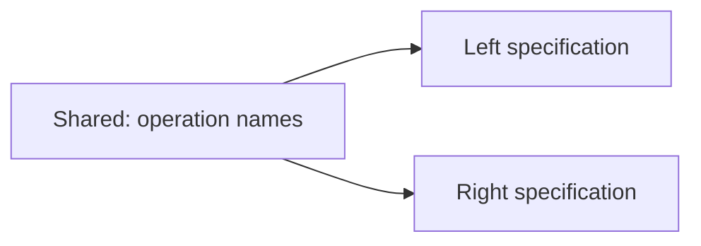

A compatible model gives a model for each specification whose restrictions to
`Shared` are equal. Two arbitrary models that disagree on a shared operation do
not form a compatible family. A sentence is tagged with its node so the library
knows which local model must satisfy it.

- A structured signature is a diagram of ordinary signatures, with variable
  diagram shape. Its maps carry both a node functor and a natural signature
  translation.
- A sentence pairs a node with a sentence over that node's signature.
- A model is a compatible family of local models. Its model maps are compatible
  families of local model maps. The implementation uses Mathlib's strict limit
  category; independent tuples of node models are insufficient.
- A reduct first selects the translated node and then applies the original
  institution's model reduct. The limit universal property supplies the whole
  compatible family, including its action on model maps.
- Satisfaction at a tagged node obeys the institution satisfaction condition.
  `institution` bundles the room functor; `classicInstitution` gives the separate
  sentence/model presentation.

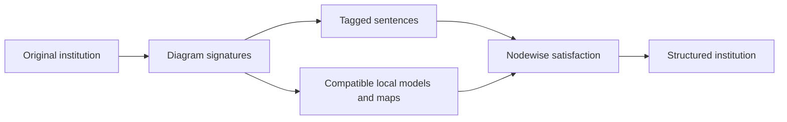

A **universe** is Lean's size bound on a type. The first API uses one universe for index categories, signatures, sentences and
local model categories. Compatibility is strict equality, as in Definition 4.3,
rather than coherence up to isomorphism.

The surrounding development proves the diagram/theory reflection
(Proposition 4.8), small colimit results (Theorems 3.3, 4.9, 4.10, 4.12 and
Corollary 4.11), liberality transfer (Theorem 4.13), and the constrained
institutions (Definitions 4.14–4.15). See the coverage table,
model comparisons, and freeness constraints.

The extended results have separate hypotheses:

- **Colimits** glue diagrams while satisfying a universal mapping property;
  their existence is derived from the corresponding signature or theory
  colimits, with the theorem-specific size assumptions.
- **Liberality** means each theory reduct has a left adjoint, giving free
  extensions. Its transfer also requires exactness (the model functor sends
  theory colimits to model limits) and original theory cocompleteness.
- A **freeness constraint** asks a reduct model to have a specified universal
  extension property. It does not say that every model is free.

| Claim | Source |
| --- | --- |
| Diagram signatures, tagged sentences, model limits and reduct cone | [`Structured/Defs.lean`](../../Silmaril/Logic/Institution/Structured/Defs.lean) |
| Reduct equations, nodewise truth and institution laws | [`Structured/Thms.lean`](../../Silmaril/Logic/Institution/Structured/Thms.lean) |
| Theory reflection and colimits | [`Theories/Adjunction.lean`](../../Silmaril/Logic/Institution/Structured/Theories/Adjunction.lean), [`Colimits.lean`](../../Silmaril/Logic/Institution/Structured/Theories/Colimits.lean) |
| Conditional liberality transfer | [`Theories/Liberality.lean`](../../Silmaril/Logic/Institution/Structured/Theories/Liberality.lean) |
| Freeness constraints | [`Constraints/Defs.lean`](../../Silmaril/Logic/Institution/Structured/Constraints/Defs.lean), [`Structured.lean`](../../Silmaril/Logic/Institution/Structured/Constraints/Structured.lean) |

The source and numbered correspondence are recorded in the
`duran-meseguer-1999-structured-theories-institutions` in `references.bib`.
This page review read the core definitions and proofs and checked the extended
theorem signatures; it did not rerun Lean or audit all transitive proofs.


## Colimits of structured theories

The varying-shape diagram category `CoDiagram.{u,u} C` has colimits of size
`u` whenever the value category `C` does (Durán–Meseguer 1999, Theorem 3.3).
A **diagram** assigns an object of `C` to each node of a category and a
compatible arrow to each edge. **Varying shape** means its maps may change the
node category as well as its values. A **colimit** merges such data with a
universal property: every compatible map out factors uniquely through the
merge. **Cocomplete** means all colimits of the stated size exist.

A **coproduct** combines independent components; a **pushout** combines two
objects along shared input. A **coequalizer** identifies two parallel maps.
An **initial** object has exactly one map to every object.

The implementation constructs:

- an empty initial diagram, without requiring an object in the value category;
- arbitrary size-`u` coproducts by disjoint union of node categories, also
  without value-category colimits (Lemma 3.5);
- pushouts by gluing node categories in `Cat`, taking three left Kan extensions,
  and forming their pointwise pushout (Lemma 3.4).

Each construction has its actual universal property. Mathlib's construction of
colimits from coproducts and coequalizers then supplies general cocompleteness.
Node categories and colimit shapes use the same universe `u`; the value category
and its morphisms may use independent universes. A **universe** is Lean's size
level for a type; “small” here is relative to that displayed `u`.

For example, take two diagrams each consisting of a single node, valued at
objects `X` and `Y` of `C`. Their coproduct is a two-node diagram with no arrows
between components, retaining `X` and `Y`. It does not require a coproduct object
`X ⨿ Y` in `C`. The empty diagram likewise exists even when `C` has no objects.
Pushouts use more structure: they first glue shapes in `Cat` (the category of
categories and functors), then move all three value diagrams onto the glued
shape by **left Kan extension**, the universal extension along a shape functor.
Their final pushout is **pointwise**: at each glued node it is a pushout in `C`.

`Structured.Theories.Colimits` proves these consequences from their original
paper hypotheses:

- cocomplete signatures give cocomplete structured signatures (Theorem 4.9);
- signature colimits give semantic-presentation colimits, preserved by the
  signature-forgetful functor (Theorem 4.10);
- cocomplete original signatures give cocomplete structured theories, with
  colimits preserved by their forgetful functor (Corollary 4.11);
- cocomplete original theories give cocomplete structured theories, even without
  cocompleteness of original signatures (Theorem 4.12).

Theorem 4.10 transports the existing closed-theory construction through the
proved `Spec`/`Theory` equivalence. Here `Spec` consists of a signature with an
axiom set, and its arrows preserve semantic consequence: translated source
axioms must follow from target axioms. `Theory` uses consequence-closed axiom
sets. This is different from the syntactic `Presentation` category, whose
arrows must map axioms into the target axiom set itself.

Theorem 4.12 uses the actual reflection
`R ⊣ J`: `R` assembles tagged axioms and `J` records consequences at each node
of compatible global models. The notation `R ⊣ J` means **adjunction**:
maps out of `R(D)` correspond naturally to maps from `D` into `J(P)`.
`J` is **fully faithful** (it gives a bijection on each hom set), so it identifies
structured presentations with a reflective part of diagrams of theories. The
reflection sends diagram colimits back to structured-theory colimits.

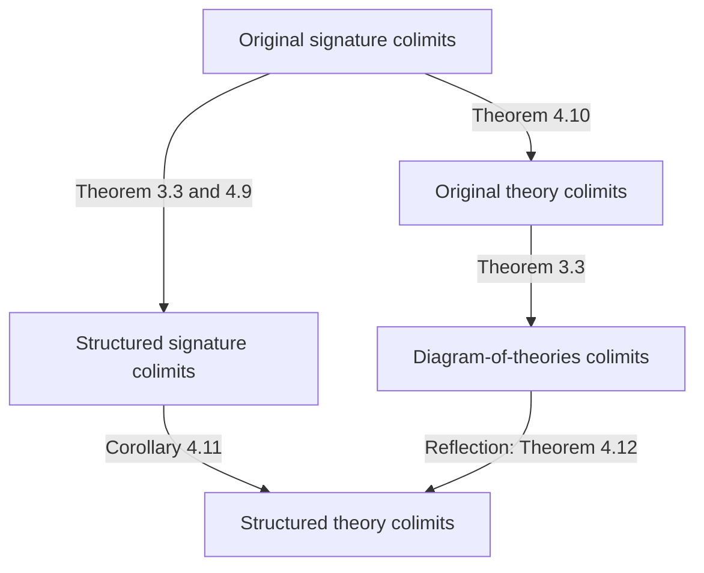

| Paper item | Status |
|---|---|
| Definitions 2.1–2.2 | Existing institution and semantic-presentation categories, plus actual model functor, liberality, and exactness. |
| Theorem 3.1 | Actual Mathlib left Kan extension adjunction; extension existence derived from cocompleteness. |
| Definition 3.2 | Shared varying-shape `Diagram`/`CoDiagram` API. |
| Theorem 3.3 | Small cocompleteness proved. |
| Lemma 3.4 | Actual glued pushout and universal property proved. |
| Lemma 3.5 | Actual arbitrary coproduct and universal property proved. |
| Definitions 4.1–4.7; Proposition 4.6 | Structured institution and satisfaction condition proved. |
| Proposition 4.8 | Actual union/consequence reflection and fully faithful right adjoint proved. |
| Theorem 4.9 | Structured signature cocompleteness proved. |
| Theorem 4.10 | Semantic-presentation colimits and forgetful preservation proved. |
| Corollary 4.11 | Structured theory cocompleteness and forgetful preservation proved. |
| Theorem 4.12 | Structured theory cocompleteness from original theory cocompleteness proved. |
| Theorem 4.13 | Actual model-limit comparisons, naturality, and liberality transfer proved. |
| Definitions 4.14–4.15; §4.3 | Freeness constraints, local/global constrained institutions, and final colimit assertions proved. |

## Scope and source coverage

The numbered items in Sections 2–4 of the pinned 1999 author manuscript have
corresponding constructions or results in the library under the size conventions
below. This is correspondence of statements and constructions, rather than a
claim to reproduce every printed proof.
`Silmaril.Papers.DuranMeseguer1999.Section2`, `Section3`, and `Section4` re-export
them in paper order; the paper modules introduce no replacement definitions or proofs.

The model functor uses **full subcategories** of models satisfying each semantic
presentation: it retains all model morphisms between the selected models.
A structured model is a compatible family of node models, with exact reduct
compatibility along diagram edges. Theorem 4.13 derives actual left adjoints
from original liberality,
original exactness, and original theory cocompleteness. **Liberality** says every
theory reduct functor has a left adjoint, giving free extensions. **Exactness**
says the contravariant model functor sends theory colimits to model-category
limits. The natural comparison isomorphisms apply to changing diagram shapes as well as fixed shapes.
Definition 4.14 uses a pointwise universal-arrow condition, proved equivalent
to invertibility of the **counit** whenever a global adjunction is chosen: the
canonical map from the free extension of a model's reduct back to that model
must be an isomorphism. Here `S` adds diagram structure and `C` adds freeness
constraints. Both
`S(C(I))` and `C(S(I))` are constructed, with their distinct sentence types and
shared model/reduct data. Their final theory-cocompleteness assertions are proved.

The implementation fixes node categories and colimit shapes at one universe
rather than quantifying over all sizes at once. `Diagram` itself has separate
object/morphism universe parameters; the constructed `Structured` institution
uses the common-universe specialization. The constraint construction makes the
larger sentence universe of global structured constraints explicit. These are
size conventions in the theorem statements, not stronger semantic hypotheses.

The informal applications are separate from numbered-result coverage. The
LIST/TRIV follow-up supplies an explicit two-sorted algebra category and actual
free-list adjunction, with positive and negative freeness examples. It does not
yet package these as models of a many-sorted institution. Concrete NAT/BOOL
institutions and the Maude module algebra are further applications; the source
does not prescribe their full axiomatizations here.

A separate public-EQ initial-model specialization now
packages the empty-signature constraint using public many-sorted algebras. It
does not supply the missing many-sorted institution packaging for the LIST/TRIV
algebras, arbitrary quotient models, or a global exactness theorem for EQ.

## Pinned source and declaration map

The source is the 1999 work record,
with its `duran-meseguer-1999-structured-theories-institutions` in `references.bib`.
It pins the authors' `ctcs99.ps` and a PDF converted from it, not a byte-identical
publisher PDF or the differently paginated 2003 journal revision. This page's
source-contract review is against Silmaril checkpoint `3e14a5355` and the manifest's
Silmaril pin `fe6a59ea53b716d38370db747f322311a9034e99`.

There is a notation discrepancy in the manuscript's proof of Proposition 4.8:
it labels the counit's target identity as `1_Dg(ThI)`. With the displayed functor
directions, `R J` acts on structured theories, so the well-typed counit is
`R J → 1_ThS(I)`. The implementation's `theoryAdjunction_counit` uses this latter
type, with the explicit `counitIso` component.

| Result or boundary | Declaration source |
| --- | --- |
| Varying-shape map data | [Pi definitions](../../Silmaril/Logic/Institution/Pi/Defs.lean): `Diagram`, `Diagram.CoHom`, `CoDiagram`; a map contains both a shape functor and a value natural transformation. |
| Empty initial diagram | [DiagramInitial](../../Silmaril/Logic/Institution/Structured/DiagramInitial.lean): `empty`, `emptyTo`, `emptyIsInitial`; no object or colimit assumption on `C`. |
| Lemma 3.5 | [DiagramCoproducts](../../Silmaril/Logic/Institution/Structured/DiagramCoproducts.lean): `coproduct`, `coproductDesc`, `coproductIsColimit`, `hasCoproducts`; no value-category coproduct assumption. |
| Theorem 3.1 and shape changes | [DiagramKan](../../Silmaril/Logic/Institution/Structured/DiagramKan.lean): `lanDiagram`, `lanDesc`, `lanDesc_unique`, `hasLeftKanExtension_of_cocomplete`; Mathlib supplies `Functor.lanAdjunction`. |
| Lemma 3.4 | [DiagramPushouts](../../Silmaril/Logic/Institution/Structured/DiagramPushouts.lean): `pushoutShape`, `leftValue`, `rightValue`, `commonValue`, `pushoutDesc_unique`, `pushoutIsColimit`; values require `HasColimitsOfSize.{u,u} C`. |
| Theorem 3.3 | [DiagramColimits](../../Silmaril/Logic/Institution/Structured/DiagramColimits.lean): `hasColimits`, using initial objects, pushouts, coproducts and Mathlib's coequalizer/colimit constructors. |
| Definitions 4.1–4.7 | [Structured definitions](../../Silmaril/Logic/Institution/Structured/Defs.lean): `Signature`, `Sentence`, `Models`, `Sat`, `reduct`; [theorems](../../Silmaril/Logic/Institution/Structured/Thms.lean): `satisfaction`, `institution`, `classicInstitution`. |
| Proposition 4.8 | [Theory definitions](../../Silmaril/Logic/Institution/Structured/Theories/Defs.lean): `nodeConsequences`, `unionTheory`; [adjunction](../../Silmaril/Logic/Institution/Structured/Theories/Adjunction.lean): `theoryHomEquiv`, `theoryAdjunction`, `counitIso`, `J_fullyFaithful`. |
| Theorems 4.9–4.12 | [Theory colimits](../../Silmaril/Logic/Institution/Structured/Theories/Colimits.lean): `signature_hasColimits`, `spec_hasColimitsOfShape`, `spec_forget_preservesColimitsOfShape`, `structured_hasColimits_of_signatures`, `structured_forget_preservesColimits`, `structured_hasColimits_of_theories`; the last assumes colimits of original `Spec`, without signature cocompleteness. |
| Theorem 4.13 hypotheses and comparison | [Models](../../Silmaril/Logic/Institution/Structured/Theories/Models.lean): `Models`, `modelFunctor`, `Liberal`, `Exact`; [comparison](../../Silmaril/Logic/Institution/Structured/Theories/ModelComparison.lean): `theoryModelConeIsLimit`, `modelComparisonIso_inv_naturality`; [liberality](../../Silmaril/Logic/Institution/Structured/Theories/Liberality.lean): `structured_reduct_conjugate`, `structured_liberal`. |
| Definitions 4.14–4.15 and final §4.3 colimits | [Freeness](../../Silmaril/Logic/Institution/Structured/Constraints/Defs.lean): `FreeAt`, `freeAt_iff_counit_isIso`; [constraint institution](../../Silmaril/Logic/Institution/Structured/Constraints/Institution.lean); [structured variants](../../Silmaril/Logic/Institution/Structured/Constraints/Structured.lean): `localInstitution`, `globalInstitution`, `local_global_models`, `local_theories_hasColimits`, `global_theories_hasColimits`. See the freeness guide for the special cases. |

The source review checks these constructions, theorem hypotheses and paper-order
exports. It does not report a new Lean build or a transitive axiom audit. To
check the main results locally, use bounded targets:

```sh
bin/mor check
bin/mor build Silmaril.Papers.DuranMeseguer1999.Section3 Silmaril.Papers.DuranMeseguer1999.Section4
```


## Freeness constraints

This page covers Definitions 4.14–4.15 and the special cases in §4.3 of the
pinned Durán–Meseguer 1999 manuscript.
Its `duran-meseguer-1999-structured-theories-institutions` in `references.bib`
records correspondence with the author manuscript, rather than the differently
paginated 2003 revision. The source-contract audit below uses Silmaril checkpoint
`de3815e0d76c`.

A **signature** supplies the symbols a model interprets. A **semantic theory
map** translates source axioms to consequences of target axioms; it need not
map them into the target axiom set literally. A **reduct** forgets or
reinterprets a model along a signature or theory map. A **free extension**
adds structure universally: every map from its underlying parameter model
into the reduct of another model extends uniquely to a map of full models.

A constraint on signature `S` records a semantic theory map `H : T'' → T'` and a
context map `G : T'.sig → S`. A model satisfies it when its reduct along `G`
satisfies `T'` and is the free extension of its own reduct along `H`.
Thus `H` specifies the extension being tested, while `G` selects the part of
the ambient model to test. Satisfaction checks:

1. Reduce the ambient model along `G`.
2. Check every target axiom of `T'` in that reduct.
3. Check the universal free-extension property along the model reduct for `H`.

`FreeAt R M` states the universal property directly: for every target model `N`,
every map `R(M) → R(N)` lifts uniquely to `M → N`. This definition needs no
chosen global left adjoint. `freeAt_iff_counit_isIso` proves that, for any chosen
adjunction `L ⊣ R`, this condition is equivalent to invertibility of its counit
at `M`. An **adjunction** `L ⊣ R` means maps from `L(X)` to `N` correspond
naturally to maps from `X` to `R(N)`. Its **counit** at `M` is the canonical
map `L(R(M)) → M`; invertibility means that rebuilding `M` freely from its
reduct recovers it up to isomorphism. `sat_iff_counit_isIso` gives the complete presentation-level form of
Definition 4.14, including satisfaction of the target theory.

Constraint translation composes `G` with a signature map and retains `H`.
The satisfaction condition is proved. The actual institution `C(I)` adds these
constraints as a disjoint summand of the original sentences and retains the
original signatures, model categories and reduct functors. An **institution**
packages these data with satisfaction invariant under signature translation;
the added sentences have the same model translation as the original ones.

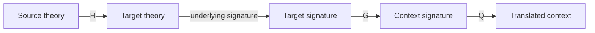

Both structured variants are defined:

- `localInstitution` is `S(C(I))` (Definition 4.15). A sentence retains a node and
  contains either an original sentence or a constraint on that node's signature.
- `globalInstitution` is `C(S(I))`. Its constraints relate whole structured
  theories and have context maps into a whole structured signature.

Their compatible model families and reduct functors are proved equal. Their
sentence types are displayed by `localSentenceEquiv` and `globalSentenceEquiv`;
these equalities do not compare their constraint satisfaction relations or
supply an equivalence of institutions. Both semantic theory categories inherit
size-`u` colimits when original signatures have size-`u` colimits. A **colimit**
combines compatible objects with a universal property; **cocompleteness** means
all colimits of the stated size exist. See structured colimits
for the hypotheses and construction.

The paper's size footnote is handled explicitly. In the common-universe
specialization `ClassicInstitution.{u,u,u,u,u}`, local constraints have universe
`u`; global constraints over the category of size-`u` structured signatures
have universe `u + 1`. Model categories retain universe `u`. A **universe** is
Lean's size level for a type, not a bound on its finite cardinality. The generic
constraint institution permits independent signature-object, signature-arrow,
sentence and model universes; its sentence universe is `max u v s`.

| Source item | Declaration source |
| --- | --- |
| Universal free-extension property | [Defs](../../Silmaril/Logic/Institution/Structured/Constraints/Defs.lean): `FreeAt`, `freeAt_iff_counit_isIso`, `freeAt_iff_initial`. |
| 4.14 constraint data and satisfaction | [Institution](../../Silmaril/Logic/Institution/Structured/Constraints/Institution.lean): `Constraint`, `Sat`, `sat_iff_counit_isIso`. |
| Parameterized-module special case | Examples: `edgeConstraint`, `edgeConstraint_sat_iff`; the chosen edge is in the diagram of node consequences. |
| Initial-model special case | [Initial](../../Silmaril/Logic/Institution/Structured/Constraints/Initial.lean): `initialTheoryModels_isTerminal`, `initialTheoryModelHomUnique`, `emptyTheory_isInitial`, `initialSignatureConstraint_sat_iff`. |
| Translation and actual constraint institution | [Institution](../../Silmaril/Logic/Institution/Structured/Constraints/Institution.lean): `translate`, `satisfaction`, `room`, `corridor`, `institution`. |
| 4.15 local and global structured constraints | [Structured](../../Silmaril/Logic/Institution/Structured/Constraints/Structured.lean): `localInstitution`, `globalInstitution`, both sentence equivalences, `local_global_models`, `local_global_reduct`, `local_theories_hasColimits`, `global_theories_hasColimits`. |
| Populated and rejected cases | Examples: `populated_identity_constraint`, `not_freeAt_constant_bool`. |
| Concrete list adjunction and its boundary | [ListAlgebras](../../Silmaril/Logic/Institution/Structured/Constraints/Applications/ListAlgebras.lean): `Algebra`, `foldHom`, `homEquiv`, `adjunction`, `counit_carrier`, `freeAt_free`, `not_freeAt_collapsed`. |
| Semantic-model and exactness inputs | [Models](../../Silmaril/Logic/Institution/Structured/Theories/Models.lean): `Models`, `reduct`, `Liberal`, `Exact`; models form the full subcategory satisfying the original axiom set. |

The examples include a satisfied identity constraint on a populated theory with
nonempty axioms. A proved negative example reduces two isolated objects to one:
the missing map between the two objects prevents freeness. Thus the universal
condition is neither an assumption that all models are free nor a consequence
of an empty model category.

The source's LIST/TRIV and NAT/BOOL examples motivate the construction. The
concrete LIST/TRIV interpretation below supplies its free-list computation;
many-sorted institution packaging and concrete NAT/BOOL institutions remain
applications to develop. `initialTheoryModels_isTerminal` derives the terminal model category from
original exactness and an actual initial theory. **Exactness** says the
contravariant model functor sends theory colimits to category limits. A
**terminal category** here has a unique map between any two of its objects;
the result does not identify all model objects literally. An **initial model**
has a unique model map into each other model of the theory.
`initialTheoryModelHomUnique`
then derives the unique-reduct-hom premise, and `emptyTheory_isInitial` connects
an actual initial signature to the initial semantic theory. Thus
`initialSignatureConstraint_sat_iff` proves the initial-model special case from
the source assumptions, without adding a trivial-model-category assumption.

## A concrete LIST/TRIV interpretation

`Constraints/Applications/ListAlgebras.lean` gives two sorts: an arbitrary element
type and a list carrier, with nil and cons. Maps may change both sorts and preserve
the constructors. Forgetting the list sort has an actual left adjoint: Lean's
`List`, with constructor evaluation by `List.foldr`. The counit is list evaluation;
its invertibility is exactly the existing `FreeAt` constraint. Free list algebras
satisfy it, while an algebra collapsing nil and cons does not.

This is an explicit interpretation of the paper's informal illustration, which
does not prescribe a unique concrete signature or axiomatization. It does not yet
package these algebras as the models of a many-sorted algebra institution.

For example, list evaluation sends `[a, b]` to
`cons a (cons b nil)` in the chosen algebra. In the actual free list algebra
this returns `[a, b]`, and the counit is the identity. The collapsed example
has one element value and one list value, so `nil = cons unit nil`. If it were
free, the identity map on its element sort would lift to a constructor-preserving
map into genuine lists. That map would send the same list value both to `[]`
and to `[unit]`, a contradiction. The source theorem `not_freeAt_collapsed`
proves this failure using the universal property directly.

The generic pointwise API assumes no global liberality certificate.
**Liberality** means every theory reduct has a left adjoint; a chosen such
adjunction permits the counit formulation used in the paper. The special
initial-model theorem above derives its unique-reduct-map condition from
exactness, so it does not need liberality as an extra input. This separates
characterizing an already supplied model from constructing a free extension
for every parameter model.

This documentation review checks theorem hypotheses, constructions and example
source. It does not report a fresh local Lean build or a transitive axiom audit.
To check the main headers and concrete example locally, use bounded targets:

```sh
bin/mor check
bin/mor build Silmaril.Logic.Institution.Structured.Constraints.Structured \
  Silmaril.Logic.Institution.Structured.Constraints.Initial \
  Silmaril.Logic.Institution.Structured.Constraints.Examples \
  Silmaril.Logic.Institution.Structured.Constraints.Applications.ListAlgebras
```


## Models and liberality of structured theories

`Structured.SemanticModels` implements the model functor on the paper's actual
semantic presentations. Its objects are full subcategories of models satisfying
the original axiom sets; its arrows are reduct functors on models and model
morphisms. Semantic closure leaves the satisfying-model predicate unchanged.

`Liberal` means that every reduct along a semantic theory map has a left adjoint.
`Exact` means that the model functor into `Catᵒᵖ` preserves size-`u` colimits. Neither
definition assumes anything about the structured institution.

Theorem 4.13 is proved from the paper's original assumptions: original liberality,
original exactness, and cocompleteness of original semantic theories. Here
**cocompleteness** is `HasColimitsOfSize.{u,u} (Spec I.toRoomFunctor)`: every
diagram whose objects and arrows have size `u` has a colimit. The conclusion
is `SemanticModels.Liberal (institution I)`; structured liberality is proved,
rather than assumed.

A **semantic presentation** pairs a signature with an axiom set. A map must
send the source axioms to semantic consequences of the target axioms; this
is the public `Spec` category, distinct from the syntactic `Presentation`
category. A **full subcategory** retains every model morphism between its
selected objects. A **reduct** forgets or reinterprets structure along a theory
map, so a map `P → Q` induces models of `Q →` models of `P`. Its **left
adjoint** is a universal extension: maps from that extension to a target
model correspond naturally to maps from the starting model to the target
reduct.

A **limit** of model categories consists of compatible local models and
compatible families of model morphisms. A **colimit** of theories assembles
the node theories universally. Exactness relates these two constructions,
with arrows reversed by the contravariant model functor. The
**comparison isomorphism** identifies the resulting categories; its
**naturality** says that this identification commutes with reducts, even when
a structured map changes the category indexing the nodes.

1. Structured-theory models form the actual limit of the node-theory model
   categories, including their morphisms (`theoryModelConeIsLimit`).
2. Exactness identifies the models of the actual node-theory colimit with that
   same limit (`colimitTheoryModelConeIsLimit`).
3. The resulting category isomorphism commutes with every structured theory
   map, including changes of node category (`modelComparisonIso_inv_naturality`).
4. Each structured reduct is the original colimit-theory reduct conjugated by
   those isomorphisms (`structured_reduct_conjugate`). Composing the original
   adjoint with the equivalence adjoints proves `structured_liberal`.

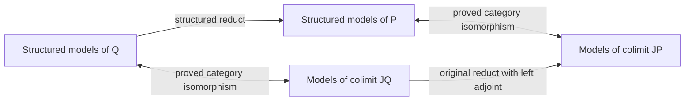

`Theories.Examples` supplies a concrete institution with a model and an
always-true sentence, a presentation with a nonempty axiom set and a satisfying
model, and a two-node structured presentation with all tagged axioms asserted.
For example, `pairSignature` uses the discrete category on `Bool`: two nodes
and no arrows between distinct nodes. Each node has the same one-model,
one-sentence institution; `pairTheory` asserts both tagged always-true
sentences. The chosen local models therefore assemble into `pairModel`, and
`pair_models_inhabited` witnesses the global model and every local model.
There are no nonidentity edge compatibility conditions in this example.
Its global and local model categories are populated. These check the actual
model/cone constructions; they do not assert that this small example exercises
all expressiveness of the abstract liberality theorem.

| Source item | Implementation |
|---|---|
| §2 model categories and reducts | `SemanticModels.Models`, `reduct`, `institution`, `modelFunctor` |
| §2 liberality and exactness | `SemanticModels.Liberal`, `Exact` |
| 4.13 first model-limit comparison | `theoryModelConeIsLimit` |
| 4.13 comparison with colimit-theory models | `modelComparisonIso` |
| 4.13 naturality square | `modelComparisonIso_inv_naturality` |
| 4.13 left-adjoint transport | `structured_liberal` |
| §4.3 freeness constraints | `Constraints`: universal freeness, constraint institution, local/global forms, and colimits |

Node categories, model categories, signatures and sentences in the structured
construction share a universe. The generic semantic-presentation model functor
supports independent universes. The later freeness-constraint development is described in
structured-freeness.md.

The declaration table uses namespace
`Silmaril.Logic.Institution.Structured` (with `SemanticModels` where shown).
The source modules are:

- [Models.lean](../../Silmaril/Logic/Institution/Structured/Theories/Models.lean):
  original axiom satisfaction, reducts, closure invariance, `Liberal` and `Exact`.
- [ModelComparison.lean](../../Silmaril/Logic/Institution/Structured/Theories/ModelComparison.lean):
  both model limits, their comparison, and naturality. The first limit
  `theoryModelConeIsLimit` needs neither exactness nor theory colimits; the
  second limit and comparison need both.
- [Liberality.lean](../../Silmaril/Logic/Institution/Structured/Theories/Liberality.lean):
  the conjugation equality and adjoint transport.
- Examples.lean:
  the populated one-model and two-node examples.
  paper-order public imports and exports, without a second proof.

This page was checked against these source contracts at `de3815e0d76c` and
§2/Theorem 4.13 of the pinned 1999 author manuscript in the
paper record;
`duran-meseguer-1999-structured-theories-institutions` in `references.bib`
record the paper correspondence. The archived PostScript and its derived PDF
are private references, not an assertion of byte identity with the publisher
PDF. This review does not audit all proof internals or transitive axioms,
and does not report a fresh Lean build. To check the relevant targets:

```sh
bin/mor check
bin/mor build Silmaril.Logic.Institution.Structured.Theories.Liberality Silmaril.Logic.Institution.Structured.Theories.Examples
```

`mor check` checks registries and catalogues; the targeted build elaborates
Lean. Neither command by itself establishes the paper correspondence.


## Structured theories and diagrams of theories

`Silmaril.Logic.Institution.Structured.Theories` implements the actual reflective
embedding in Durán–Meseguer (CTCS 1999), §4.1 and Proposition 4.8.

The paper's theories are presentations with semantic-consequence morphisms.
The implementation uses `Spec`, not the stricter syntactic `Presentation` category.

- `R` assembles a diagram of local theories into a structured theory by taking
  the union of its node-tagged axioms.
- `J` takes all consequences of a structured theory visible at each node. These
  consequences quantify over compatible models of the whole diagram. They can
  include information imported through other nodes.
- `nodeConsequences_closed` proves that each resulting local set is semantically
  closed. Diagram edges preserve these consequences by compatibility and the
  original institution's satisfaction condition.
- `theoryHomEquiv` proves the natural correspondence between maps `R(D) → P` and
  diagram maps `D → J(P)`. It constructs the adjunction `R ⊣ J`.
- Assembling all node consequences gives the original structured theory's
  semantic closure. The counit is therefore an isomorphism in `Spec`.
  `J_fullyFaithful` follows from this proved counit isomorphism.

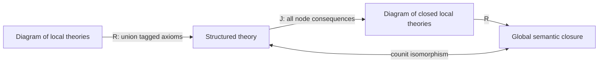

The equivalence of `Spec` and the library's closed `Theory` category remains
available separately. No equality between raw axiom sets and their closures is
assumed: the counit uses semantic-presentation isomorphisms.

The surrounding development also proves the varying-diagram colimit construction
of §3, the colimit and liberality results of §4.2, and the constrained institutions
of §4.3. See the coverage table.
