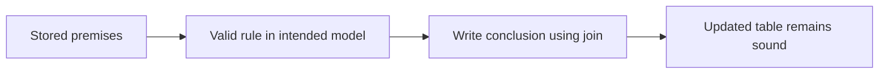
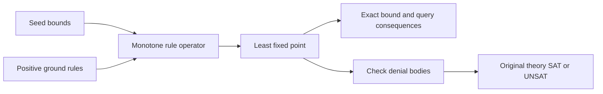
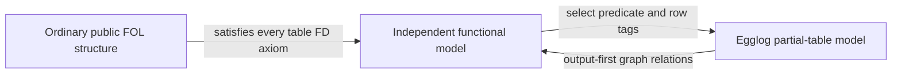
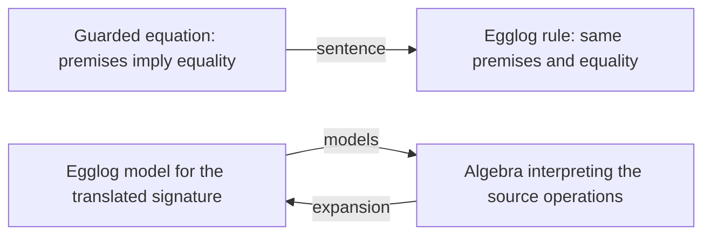
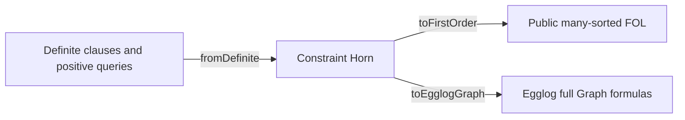
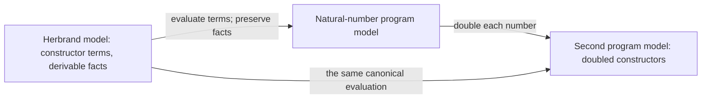

# Egglog and Prolog institutions

The Egglog institutions beyond the core (lattice rules and least models, the functional first-order reading, egg-to-egglog), and Prolog's constraint Horn clauses and Herbrand initiality, with their comorphisms, registered in the [logic graph](logic-graph.md). The egg and egglog core logics and definite programs are in the [first-order LFP and e-graphs guide](logic-lfp-egg.md). The sections below are the guides of each development.

## Lattice-valued ground rules

The merge layer connects table updates to declarative rules. A stored value can
grow by a join, and the proofs explain when that update remains sound with
respect to an intended model. The rule language also supports facts, integrity
constraints and ground queries.

A **key** names an already normalized ground table input. A **join semilattice**
is an ordered set with an operation `a ⊔ b` giving the least value above both
inputs. A **model** assigns an intended value to every key. A **lower bound**
`a ≤ M(key)` says the model contains at least the information `a`.

For natural numbers ordered by `≤`, join is `max`. Writing 5 to a key that stores
2 produces 5. Both lower bounds 2 and 5 hold in an intended model with value 7.
The exact lookup “the table stores 2” has ceased to hold. This distinction is why
the declarative observations are lower bounds.



## Rules, models and renaming

A rule has a finite list of lower bounds as premises and an optional conclusion.
An absent conclusion means that its premises must never all hold: this is an
**integrity constraint**, also called a denial. An empty list of premises with a
conclusion is a fact. A query asks whether every bound in its list holds.

For example, the rule “if key A has information at least 3, then key B has
information at least 4” holds in a model assigning 3 to A and 4 to B. If a sound
table already witnesses its premise, `rule_write_sound` proves that writing 4 to
B keeps the table sound. `table_sound_iff` identifies the existing operational
`Merge.Sound` condition exactly with satisfaction of its stored lower bounds.

A signature is a type of keys. Signature maps rename keys and may identify two
keys. Model reduct reads the target model at each renamed source key. These
operations form an **institution**: a system of signatures, sentences and models
whose satisfaction is unchanged by translating a sentence and reducing a model.
Actual model arrows are pointwise increases in information. Such arrows preserve
lower bounds; arbitrary rules and denials need not remain true along them.

Renaming transports logical consequence and sends an unsatisfiable theory to an
unsatisfiable theory. Satisfiability transports backward. The opposite direction
can fail: a fact requiring A to be at least 2 and a denial forbidding B from being
at least 2 are jointly satisfiable at A=2, B=0. Identifying A and B makes them
inconsistent.

## Relationship to graph and positive Core institutions

For the **two-element Boolean lattice**, a lower bound is either automatic
(`false`) or requires a key to be true. `BooleanGraph.toGraph` translates these
bounds into truth or nullary predicates in `Egglog.Core.Graph`; rules and denials
become full Boolean formulas. This is a natural institution comorphism: it
includes sentence translation, a model decoder and the exact satisfaction law,
all compatible with key renaming. Graph homomorphisms decode to pointwise
information increases.

Every Boolean model expands to a singleton-carrier graph model. Thus SAT, UNSAT
and consequence agree for the translated Boolean ground theories, interpreted
in the graph institution's functional partial-table models. A **model expansion**
here is a target model whose decoded model is exactly the source model.

For any fixed semantic semilattice, no institution comorphism into positive
`Egglog.Core` exists for this language. Positive Core has a singleton model
satisfying every positive sentence, while this rule language has a contradictory
empty-premise denial. This obstruction does not require model expansion.

## Scope and source map

The keys are already normalized and the semantic semilattice is fixed. With
an explicit complete lattice, the least-model extension
constructs the least positive model above a seed. It characterizes consequence
and proves that the full theory is satisfiable exactly when this model obeys
every denial. Term frontends, variable rules and constructor congruence remain
outside this ground-rule institution; the semantic theorem supplies no finite
saturation or scheduling algorithm. The Graph translation is Boolean only.
General lattice orders are not identified with equality-table rows.

| Module under `Silmaril/Logic/Egglog/Merge/Institution/` | Role |
| --- | --- |
| [Defs.lean](../../Silmaril/Logic/Egglog/Merge/Institution/Defs.lean) | Models, information-increasing arrows, bounds, rules and queries |
| [Thms.lean](../../Silmaril/Logic/Egglog/Merge/Institution/Thms.lean) | Institution, renaming laws, joins and operational soundness links |
| Examples.lean | Concrete writes, rule firing and satisfiable-to-inconsistent key collision |
| [Graph.lean](../../Silmaril/Logic/Egglog/Merge/Institution/Graph.lean) | Boolean model-expansive Graph map and positive-Core impossibility |
| Audit.lean | Exact printed axiom dependency guards |

Targeted Lean checks pass with `--wfail`, including the axiom guards. Registry,
textual layout and scoped proof-style checks pass. Independent peer and root source reviews are complete for the semantic source
merged as `afa8474237c21a1c4e2785a7617ac8d376721ff3` after full exact-head
passed at `1f799c5d5e868c9e4580144b8fa9010bc823c4b9`, including Lean, aggregate
CI and the timing gate. The earlier pending status in the retained
receipt
describes its source checkpoint; this documentation refresh runs no new Lean
build. The existing
Core relationship guide and
functional FOL guide cover separate bridges.


## Least models for ground lattice rules

This extension constructs the least valuation satisfying the positive rules
above a supplied seed. It uses the existing ground lower-bound institution and
its actual model order. The theorem API, examples and fourteen endpoint axiom
guards passed strict Lean checking.

A **ground rule** has no variables. Its keys name table inputs whose normalization
has already been supplied. The model assigns an information value to each key:

- `x ≤ y` means that `y` contains at least the information in `x`.
- A **join**, `x ⊔ y`, is the least value above both inputs.
- A **complete lattice** has a join for every set of values, including an empty
  set. This is stronger than the existing join-semilattice assumption, which
  only supplies joins of pairs.
- A **seed** supplies the information that every candidate model must contain.

For example, with Boolean information values, install the fact A and the rule
“A implies B.” The least model contains B. Adding “B is forbidden” makes the
original institution theory unsatisfiable. Removing the rule leaves a model
where A holds and B does not; B is not manufactured by the construction.



The operator joins the seed with every positive head whose entire body currently
holds. It is **monotone**: increasing its input information cannot decrease its
output information. A **fixed point** is a valuation unchanged by the operator.
A monotone operator on a complete lattice has a least fixed point.
`seed_le_closure`, `closure_positive`, and `closure_le` express the resulting
universal property: the closure retains the seed, satisfies the positive rules,
and lies below every other satisfying seed extension. These are the unchanged
pointwise information comparisons used by the institution's actual model arrows.

`bound_consequence_iff` and `query_consequence_iff` identify positive semantic
consequence with truth in this one model. A **denial** is a rule with no
conclusion: its premises must never all hold. Denials need separate treatment:
if a forbidden body holds in the least positive model, it also holds in every
larger model. Thus `satisfiable_iff` states that the original institution theory
is satisfiable exactly when all denials hold in the closure. The theory includes
every submitted rule and one seed-bound sentence per key.

A **room** fixes the signature, sentences, models and their truth relation; here
the signature is the set of keys. `query_entails_iff` connects the least model
directly to the existing room's `Entails` API,
including the denials in the original theory. It explicitly requires that theory
to be satisfiable. Without that premise, inconsistent theories entail every
query even when its bounds fail in the positive closure. `bound_entails_iff`
handles a single bound; `program_entails_B` applies it using `program_sat`.

Import `Silmaril.Logic.Egglog.Merge.LeastModel.Thms`. Definitions are in the matching
`Defs` header; proofs are under `Silmaril/Proofs/Logic/Egglog/Merge/LeastModel.lean`.
`Examples` contains the Boolean chain, actual SAT/UNSAT endpoints and the missing-B
control. `Audits` checks standard-axiom ceilings on fourteen endpoints.

These theorems describe semantic closure. For arbitrary complete lattices,
closure need not be reached after finitely many rule applications. Engine
scheduling and source parsing have separate APIs. Signature maps may identify
two keys; the existing renaming theorems do not imply that this least closure
commutes with such identification.

The checked examples are available directly:

```lean
import Silmaril.Logic.Egglog.Merge.LeastModel.Examples

#check Silmaril.Logic.Egglog.Merge.LeastModel.Examples.program_sat
#check Silmaril.Logic.Egglog.Merge.LeastModel.Examples.program_entails_B
#check Silmaril.Logic.Egglog.Merge.LeastModel.Examples.fact_denial_unsat
```

The strict validation target is `Silmaril.Logic.Egglog.Merge.LeastModel.Audits`.


## Egglog tables as independent first-order models

An Egglog custom table may have no row for an input. Its functional dependency
(**FD**) requires that two rows with the same inputs have equal outputs. For a
`next` table, `next_graph(1, 0)` records output `1` at input `0`. Both
`next_graph(1, 0)` and `next_graph(2, 0)` violate FD when `1 ≠ 2`.

**FOL** means first-order logic. A **signature** specifies the sorts, symbol
names and the sorts of each symbol's arguments and result. Here a custom table
becomes a relation whose first column is the output.



`Graph.Functional` starts with independently supplied public first-order
structures. It keeps their constructor operations, carriers and predicate
relations. The admitted models form a full subcategory: all actual public FOL
**homomorphisms** remain available. These maps send values to values while
preserving constructor operations and true predicate and row facts. They may
identify different values. Sorts may have no values; constructors need not be
injective or distinct.

The `FD` property is expressed by explicit first-order sentences, one per table.
Each sentence universally quantifies two output variables and the common input
variables. A **nullary** table has no inputs, so its axiom still quantifies two
outputs and requires at most one output. If an input sort has no values, there
are no input tuples to check. An output sort with no values needs no witness:
FD never asserts that a row exists.

`reconstruct` interprets the predicate and row tags as an Egglog model.
The inverse results retain the entire FOL structure. Reconstruction preserves
actual homomorphisms and commutes with sort and symbol maps, including maps
that identify sorts. Its functor is full (every target map comes from a FOL map), faithful
(different FOL maps remain different) and surjective on objects:
every Egglog model is reconstructed, and maps between reconstructed models
correspond exactly to the original FOL homomorphisms.

An **institution** packages signatures, sentences, model categories and
satisfaction, with compatibility under signature maps. A **comorphism**
translates signatures and sentences forward and models back, preserving
satisfaction. The independent institution admits all FOL sentences over graph
signatures.
The normalized rule/query translation has exact satisfaction and is
**model-expansive**: each source model has an actual reconstruction witness
under the model map. There is also a restriction comorphism from unrestricted
public FOL to the independent institution. That restriction is not
model-expansive, because unrestricted FOL admits unequal duplicate outputs.

For arbitrary additional FOL theories `H`, the relative results compare ordinary
FOL models of `fdTheory ∪ H` with Egglog graph models of `H`. **SAT** means a
satisfying model exists, **UNSAT** means none exists, and **consequence** means
every model satisfying the theory also satisfies the claimed sentence. All
three comparisons are exact. Omitting the FD axioms changes the model class.

Import `Silmaril.Logic.Egglog.Core.Graph.Functional.Thms` for the interface.

| Claim | Declarations |
| --- | --- |
| Independent public FOL objects and all their maps | `FD`, `IndependentModel`, `models` |
| Inverse objects and exact map correspondence | `graph_reconstruct`, `reconstruct_graph`, `models_full`, `models_faithful`, `models_surjective` |
| Sort/symbol map compatibility | `fd_reduct`, `reconstruct_reduct`, `models_natural` |
| Explicit FD syntax and its semantics | `fdSentence`, `fdTheory`, `fdSentence_holds`, `fdTheory_holds_iff` |
| Relative FOL theory comparisons | `relative_sat_iff`, `relative_unsat_iff`, `relative_entails_iff` |
| Normalized Egglog translation | `fromCore`, `fromCore_modelExpansive`, `normalized_relative_sat_iff`, `normalized_entails_iff` |
| Unrestricted public FOL restriction | `publicInst`, `restriction`, `Examples.restriction_not_modelExpansive` |

The [concrete controls](../../Silmaril/Logic/Egglog/Core/Graph/Functional/Examples.lean)
construct public FOL structures directly. A populated structure gives every
table exactly output seven; its reconstructed unary and nullary lookups hold,
and output eight is rejected. The controls also cover absent rows, unequal
outputs at a nullary table, empty carriers, a noninjective homomorphism and a
sort-identifying reduct.

This characterizes the existing normalized equality-table semantics. It does
not implement an Egglog parser, saturation engine or merge actions, prove
operational completeness, or identify partial tables with total functions.

The targeted `--wfail` Lean build through `Functional.Audit` passed after the
proof-layout cleanup. Build 28
records zero errors, proof-hole warnings, other warnings and OOM kills. All 25
exact axiom guards pass; the observed axioms are subsets of `propext`,
`Classical.choice` and `Quot.sound`. The wrapper warned about pre-existing
foreign-version dependency oleans in the shared warm cache.

The textual layout check and scoped Isar lint pass. The local sparse `mor check`
The integrator reports a full `mor check` pass at `3552b15b7` in the existing full
checkout: 25 regions, 16863 placement modules, 16864 library modules, 1352 works,
1093 files and all manifests. Independent source review passed. Both existing
Node viewer suites pass with the pre-existing runtime. These were targeted
local checks. The private
validation receipt records
commands, source hashes, historical failures, the root-reported check and scopes.

`9716a176a83dfd63f9202a605fde789b9f3d62e8`. Its final reviewed head
`313f86d23f21661a347717c3cbaf79f985cecf2b` passed full
including Lean, aggregate CI and the unchanged time budget. The receipt retains
that result alongside the earlier failed report and targeted build history.


## Guarded equations from egg to egglog

`Core.Egg.fromEgg` translates guarded equations into egglog's normalized rules
and proves that they have the same truth value in corresponding models. The
targeted Lean build checks the translation and its examples. These are new
proofs using the pinned public equational-logic (EQ) and first-order-logic (FOL)
APIs.

A **guarded equation** has premises and an equality conclusion, with variables
quantified universally. For example, over natural numbers, `x = 0` implies
`x + y = y`. The translation retains the premise; dropping it would make a false
claim when `x = 7` and `y = 0`. Egglog's normalized rules admit equality atoms
in both premises and conclusions, so each equation translates directly.

A **signature** lists the sorts (types of values) and operation symbols. A
**model** chooses a carrier, or set of values, for each sort and an interpretation
for each operation. A **homomorphism** maps values between models while preserving
the operations. Signature maps may rename or identify sorts and symbols.



Together these maps form a **comorphism**: sentences translate forward and
models translate backward, preserving satisfaction (truth in a model).

The target signature contains the source constructors, with no predicate or
custom partial-table symbols. Constructors remain total operations with
arbitrary interpretations. This does not reinterpret a partial egglog table
as a total function, add free-constructor assumptions, or restrict independent
model carriers.

- Signatures and arrows are the actual public many-sorted EQ ones. Sort-changing
  maps and maps identifying symbols are allowed.
- `models` reads each actual target model as an algebra and maps every actual
  target homomorphism to its algebra homomorphism.
- `expansion` gives every algebra a target model, including empty carriers when
  its constructor interpretations permit them. `liftHom` lifts every algebra
  map between decoded models without injectivity assumptions.
- `fromEgg` packages these data as a comorphism. The theorems prove exact
  satisfaction, naturality of the entire model functor, model expansion,
  fullness, faithfulness, and SAT/UNSAT/consequence equivalences.

Here **fullness** means every homomorphism between decoded models lifts to the
target; **faithfulness** means decoding distinguishes target homomorphisms.
**SAT** means some model satisfies every rule in a theory (a set of rules);
**UNSAT** means none does. A **consequence** holds in every model of the theory.

The examples retain the guard in the Nat model, reject the unguarded assertion
`7 + 0 = 0`, lift a map collapsing all Nat values to Unit, identify two sorts,
and retain an empty carrier. The targeted build checks these examples, including the unguarded-rule rejection
in an actual expanded Nat model.

## Wider institution audit at main `8bd4165fce`

This historical snapshot records the topic guides and Lean definitions at that
revision, together with
requires real sentence/model translations and careful variance for each graph
edge; it does not make a named syntactic fragment a complete language.

| Topic | Existing meaningful structure | Remaining boundary |
| --- | --- | --- |
| Common Logic | General reference/discourse models, computed predicate/function heads, quantification over all finite sequences; actual institution and model homomorphisms. Independent single-sort FOL comorphism has expansions exactly for nonempty carriers. | Full ISO CLIF syntax/frontend and arbitrary many-sorted FOL translation are not provided. Empty FOL carriers obstruct unrestricted CL model expansion. |
| Prolog | Many-sorted definite clauses and existential queries, actual public FOL models/homs, exact FOL comorphism. | Every positive theory is SAT. Integrity constraints, classical negative clauses and operational Prolog features are absent; the definite institution is not full Prolog. |
| egg | All well-sorted guarded equality rules over arbitrary algebras; actual institution, explanation soundness and model-expansive FOL map. | Mutable e-graph implementation/refinement and callback validity are separate. The direct egg→egglog map is the present construction. |
| egglog | Positive normalized rules/queries over functional partial-table models; full FOL graph institution; independent public FOL FD-model full subcategory with actual all-hom reconstruction and relative theory characterization. | Full frontend and engine refinement remain absent. Semilattice merge has operational lower-bound soundness, but no institution for general lattice merge semantics. |

At that checkpoint, the next priorities were a constraint/Horn Prolog
institution admitting inconsistent theories and a lattice-aware merge
institution. Both have since received scoped implementations:

- Constraint Horn programs add equality tests and
  **denials**, clauses with no conclusion that forbid their premises. A fact
  `P(a)` and a denial `∀ x, P(x) → False` have no common model. The institution
  has exact FOL and full egglog Graph translations; the Graph target admits
  Boolean formulas, including false conclusions. Positive egglog Core remains
  always satisfiable, and a theorem rules out a comorphism from the full
  constraint-Horn institution to that positive target. Prolog search order,
  cuts and negation-as-failure remain outside this declarative semantics.
- Lattice-valued ground rules use lower bounds over
  a fixed join semilattice: an ordered set where `a ⊔ b` is the least value above
  both inputs. **Ground** keys name already normalized inputs without variables.
  Rules, denials and queries form an institution, and rule firing justifies
  sound join updates. Its Graph comorphism is for the two-element Boolean
  lattice only. General variable rules, term frontends and engine refinement
  remain outside this result.

The equality-table functional-dependency (**FD**) characterization remains
separate: an FD says a table input determines at most one exact output. A join
can replace that output, so this characterization does not establish semantics
for arbitrary lattice merges. For example, joining 2 with 5 in the natural-number
`max` semilattice removes the exact row value 2 while preserving the lower bound 2.

For K relationships, these source systems already connect through EQ/FOL and
the existing matching-logic network. The new cross-map alone proves no direct
raw KORE or K frontend translation. The source graph's arrows need their actual
institution variance and model assumptions; no new K edge is claimed here.

Sources: egg and egglog, independent FD models,
definite Prolog, CL core,
independent FOL→CL, and
matching network.

## Public interface and validation

Import `Silmaril.Logic.Egglog.Core.Egg.Thms` for the interface. The source map is:

| Contract | Declarations |
| --- | --- |
| Original sorted constructors, no custom tables | `signature`, `signatures` |
| Actual algebra decoder and all arrows | `models`, `liftHom`, `models_liftHom`, `models_full`, `models_faithful` |
| Full-functor signature compatibility | `models_natural` |
| Guarded rules and exact satisfaction | `sentence`, `sentence_map`, `sentence_holds` |
| Actual algebra expansion and comorphism | `expansion`, `decode_expansion`, `fromEgg`, `fromEgg_modelExpansive` |
| Arbitrary theory comparison | `theory_holds_iff`, `entails_iff`, `satisfiable_iff`, `unsatisfiable_iff` |

The definitions are in [Egg/Defs](../../Silmaril/Logic/Egglog/Core/Egg/Defs.lean),
the longer proofs in [the proof module](../../Silmaril/Proofs/Logic/Egglog/Egg.lean),
and the controls in Egg/Examples.
The scope is the constructor/equality fragment of the target signature; this
is not an equivalence with arbitrary egglog signatures or an engine simulation.

All purely conditional-equation theories have a one-element model. Exact
UNSAT transport does not give this positive source inconsistent theories.
The rejected unguarded rule is a failure in the displayed Nat model, not an
assertion that the rule has no model.

Targeted builds use the pinned nightly and the existing shared warm dependencies;
the wrapper warns about pre-existing foreign-version oleans. No fresh dependency
or full local build is claimed. The validation receipt
records commands, source hashes, exact guards and retained failure history.


## Declarative constraint Horn programs

This institution adds equality tests and integrity constraints to the existing
definite declarative Prolog fragment. It describes truth in mathematical models.
It does not model Prolog search order, cuts or negation-as-failure.

The basic terms are:

- A **sort** is a type of object, such as people or numbers. A model assigns a
  set of values to each sort. That set may be empty when the declared operations
  permit it.
- A **context** is a finite list of variables together with each variable's sort.
  It records every declared variable, including variables unused in a formula.
- An **atom** is either an equality `s = t` between terms of the same sort, or a
  predicate application such as `P(t)`. Terms may use function symbols.
- A **Horn clause** says that a conjunction of positive atoms implies at most
  one positive atom. For example, `P(x) ∧ x = a → Q(x)`. All context variables
  are universally quantified: the clause must hold for every assignment.
- A **denial** has no positive head: `P(x) → False`. It forbids any assignment
  satisfying its premises. In Lean the head is `none`; a present atom is `some a`.
- A **query** asks whether there exists an assignment satisfying all its positive
  goals. For example, `∃ x, P(x) ∧ x = a`. Every context variable needs a witness.

These are the checked [atom, clause and query definitions](../../Silmaril/Logic/Prolog/Horn/Defs.lean).
The models are the actual public many-sorted first-order logic (**FOL**)
structures. Functions may identify different terms, and differently named
constants may denote the same value. Values need not be syntax trees; the
definite-fragment guide explains that alternative model
restriction.

A small inconsistent theory makes the added capability concrete:

```text
P(a)                 a fact: an empty premise list implies P(a)
∀ x, P(x) → False    a denial: P has no members
```

Each sentence has a model by itself: interpret `P` as always true for the fact,
or always false for the denial. Together they have no model, because the
constant `a` supplies an actual witness for the denial. The checked controls are
`fact_sat`, `denial_sat` and `fact_denial_unsat`.
No assumption that every sort is inhabited is needed.

Equality adds a different constraint:

```text
a = b → False
```

This permits a model interpreting `a` and `b` as different natural numbers and
rejects a model identifying them. It does not assume that differently named
constants must denote different values. Both cases are checked in
`EqualityControl`.

Empty carriers affect quantifiers. An empty-goal query with one unused variable
still asks for a value, so it fails on an empty carrier. A universally quantified
denial with an unused variable holds there vacuously. A zero-variable,
empty-body denial is false in every model. The
`EmptyCarrier` and `contradiction_unsat` controls
check these distinctions.

The translations connect the fragments as follows:



A **homomorphism** maps values between models while preserving their operations
and true predicate facts. The model categories here retain all the public FOL
homomorphisms. A **comorphism** translates signatures and sentences forward,
decodes models backward, and proves that truth agrees under that decoding.
Signature maps can change or identify sorts, function symbols and predicates;
the translation laws cover these maps too.

The precise checked claims are:

- [`fromDefinite`](../../Silmaril/Logic/Prolog/Horn/Definite.lean) includes predicate-only
  definite clauses and queries. Signatures, models and their homomorphisms stay
  the same. `entails_iff_definite` preserves and reflects logical consequence.
- [`toFirstOrder`](../../Silmaril/Logic/Prolog/Horn/Defs.lean) universally closes each
  Horn implication and existentially closes each query. Its model functors are
  identities. [`sat_iff_firstOrder`, `unsat_iff_firstOrder` and
  `entails_iff_firstOrder`](../../Silmaril/Logic/Prolog/Horn/Thms.lean) give exact
  comparisons with first-order truth.
- [`toEgglogGraph`](../../Silmaril/Logic/Prolog/Horn/Egglog.lean) uses constructors and
  predicates, with no custom table symbols, and targets the **full graph-formula
  institution**. Every source model has an expansion. `sat_iff_egglogGraph`,
  `unsat_iff_egglogGraph` and `entails_iff_egglogGraph` give exact comparisons.

A theory is **SAT** when at least one model satisfies every sentence. It is
**UNSAT** when no such model exists. A sentence is a **logical consequence** of
a theory when every model of the theory satisfies it. Exact comparisons mean
these properties agree before and after translation; they do not supply a
search algorithm or claim that a solver decides them.

The Graph target matters. Positive normalized egglog Core has positive heads and
positive queries. The checked
[`Core.Positive.sat_every_theory`](../../Silmaril/Logic/Egglog/Core/Positive/Thms.lean)
proves that **every theory in this Core has a model**, for arbitrary constructor,
predicate and custom table signatures. The
[`singletonModel`](../../Silmaril/Logic/Egglog/Core/Positive/Defs.lean) gives each sort
one value, makes every predicate and table row true, and interprets operations
by that value. Rows remain functional because all outputs are equal. The result
concerns this abstract positive Core; it does not cover full Graph formulas or
additional constraints from an external frontend.

The checked
`no_comorphism_to_positiveCore`
therefore rules out **any institution comorphism** from this constraint Horn
institution to positive Core. Truth preservation alone would decode a target
singleton into a model satisfying the source's zero-variable false clause,
which is impossible. No model-expansion assumption is needed for this
obstruction. Full Graph formulas can express false heads, which is why the
available bridge targets them. The older
[`Definite.sat_every_theory`](../../Silmaril/Logic/Prolog/Definite/Thms.lean) records
the corresponding always-satisfiable result for the definite fragment.

Validation is recorded in the private
receipt:

- All six new modules pass the targeted `Horn.Audit` build with `--wfail`, zero
  errors or warnings, and 15 exact axiom guards. The guards record the standard
  Lean axioms used; several controls use fewer or no axioms.
- Scoped structured-proof lint reports 0 of 38 tactic proofs flagged. Final-tree
  textual layout, registry placement and Lake library coverage pass.
  then checked the full checkout: all 1,352 works and 1,093 files passed, as did
  the registry, library coverage and textual layout checks. See the
  integration receipt.
- No local full Lean build was run. The shared dependency foreign-header warning
  is retained in the logs; a strict cache audit is not claimed. Full PR CI remains
  a separate merge gate.

The separate positive Core receipt
records the four-module follow-on build and four additional exact axiom guards.
The singleton results use no axioms; the comorphism obstruction uses only the
standard Lean axioms listed by its guard.


## A unique map from the Herbrand model

The least Herbrand model has a unique structure-preserving map to every model
of the same definite-clause program. The map evaluates each closed constructor
term in the target model. This extends the existing
least-model result from predicate inclusion on one fixed
algebra to actual maps between structures with different carriers and functions.

as `d2695680ae24d170b04c25dfec48170f602e0467` after exact-head
passed at `555efdaf8144668c9278c66decff35895fea4a7a`. The local validation
records below retain their earlier checkpoint status.

## A concrete example

The existing ancestor program contains these facts and rules:

```prolog
parent(alice, bob).
parent(bob, carol).
ancestor(X, Y) :- parent(X, Y).
ancestor(X, Z) :- parent(X, Y), ancestor(Y, Z).
```

A **ground term** is a term without variables. A ground atom applies a predicate
to ground terms; it can be a derived conclusion as well as an asserted fact.
In the Herbrand model a ground term's value is the constructor syntax itself.
In the existing natural-number model, the
three names mean `0`, `1`, and `2`; `next(x)` means `x + 1`; and `ancestor(x,y)`
means `x < y`. The program derives `ancestor(alice,carol)` using the recursive
rule, and the canonical map preserves it as `0 < 2`.



The second model interprets names as `0`, `2`, and `4`, interprets `next(x)` as
`x + 2`, and makes every predicate true. Doubling numbers is a genuine public
structure homomorphism from the first model to the second. The two routes in
the diagram agree. The arrow is not an identity map: it sends `1` to `2`.

The initial map need not be injective (different inputs may have the same
image). In the natural-number model,
`next(alice)` and `bob` both mean `1`, although they are different constructor
terms. Relation preservation also does not require relation reflection (inferring
source truth from target truth): a
target may make additional predicate instances true.

## What initiality means here

A **sort** is a type of values. A **structure homomorphism** is a map for each
sort that commutes with every function and preserves every true predicate
instance. For example, if `ancestor(a,b)` holds
in the source, it holds of the mapped values in the target.
A **category** consists of objects and composable arrows with identities.
Here the objects are exactly the public first-order structures satisfying the
program; its arrows are all public structure homomorphisms between them.
A **full subcategory** keeps all arrows between its selected objects.
An object is **initial** when exactly one arrow goes from it to every object.

`initialModel_isInitial P` proves this categorical property for `leastModel P`
in `Models P`, the full subcategory selected by `ProgramHolds P`. The existence
part is `canonicalHom P M hM`. Its relation-preservation proof invokes existing
`derives_sound`; no preservation certificate is assumed from the caller.
`canonicalHom_unique` derives uniqueness from the existing closed-term algebra
universal property. `canonicalHom_comp` expresses compatibility with arbitrary
public model arrows, as illustrated by doubling above.

No constant is added to an empty sort. A sort with no closed terms has an empty
Herbrand carrier; evaluation out of that carrier is the unique empty function.
The controls use an existing constant-free signature and a vacuous universally
quantified clause. Its least model maps both to an empty target and an inhabited
target, and it remains initial in the full category of program models.

## API and limits

Import `Silmaril.Logic.Prolog.Herbrand.Initiality.Thms` for `canonicalHom`,
`canonicalHom_unique`, `canonicalHom_comp`, and `initialModel_isInitial` in
`Silmaril.Logic.Prolog.Definite.Herbrand`. Import
`Silmaril.Logic.Prolog.Herbrand.Initiality.Examples` for the recursive, function,
nonidentity-arrow and empty-sort controls; `.Audits` contains exact axiom guards.

The result allows arbitrary supported many-sorted signatures and clause sets,
including function symbols and empty sorts. It retains the positive
predicate-atom clause semantics. Equality constraints, false-headed clauses,
negation, search order, unification, SLD resolution and execution completeness
are outside this result. Initiality is in the category of models of `P`.

This is new private mathematics using existing public FOL structures and their
actual arrows, the existing constructor algebra universal property, and the
existing definite-program derivation soundness proof. No external source text
is copied and no alternate model category is introduced. Exact source pins and
validation status are recorded in the
work notes.

## Validation

These are historical validation results. This documentation audit read the
current definitions, proofs and retained receipts without running Lean, Cargo
or a producer, and performs no new transitive axiom audit.

The six new Lean modules, including the proof implementations, examples and
five exact axiom guards, passed a targeted `--wfail` build at `5d315efe60`.
The canonical homomorphism uses `[propext, Quot.sound]`; uniqueness, composition
and initiality use `[propext, Classical.choice, Quot.sound]`. No new axiom is
introduced. The recursive control invokes actual relation preservation; the
doubling control checks a map sending `1` to `2` and its composition law. The
empty-sort controls construct maps to both empty and inhabited structures.

The final run completed in 4 seconds with peak resident memory 1.5 GiB under
an 8 GiB cap. `hiloop` was unavailable, so root-authorized local validation used
a frozen `mor` CLI, the package guard and a host build slot. Retained per-module
argv show actual `lean -j1` invocations, and each temporary Lake configuration
was restored byte-for-byte. An `olean` is a compiled Lean module. Existing cache
and foreign olean metadata warnings
are retained; this was not a clean-toolchain or full local build. No producer
or Cargo build ran.

The work notes retain all four earlier failed runs and their elaboration fixes.
Repository catalogue/module/manifests, textual layout, scoped Isar and whitespace
checks passed separately. These checks have their own scopes; the layout check
is a textual heuristic. Frozen receipts record their checkpoint status;
and exact integration-head CI results.

| Claim | Current source |
| --- | --- |
| Evaluation map and full public model subcategory | `Silmaril/Logic/Prolog/Herbrand/Initiality/Defs.lean` |
| Uniqueness, composition and initiality | `Silmaril/Proofs/Logic/Prolog/HerbrandInitiality/Universal.lean` |
| Nonidentity map, constructor collapse and empty-source controls | Sibling `Examples.lean` |
| Underlying closed-term universal property | `Silmaril/Logic/Algebraic/Initial/Thms.lean`: `closed_isInitial` |
