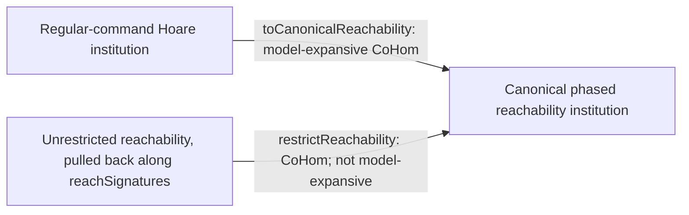
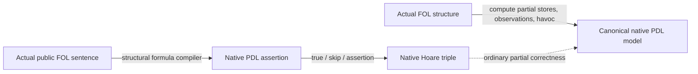
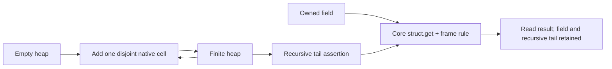
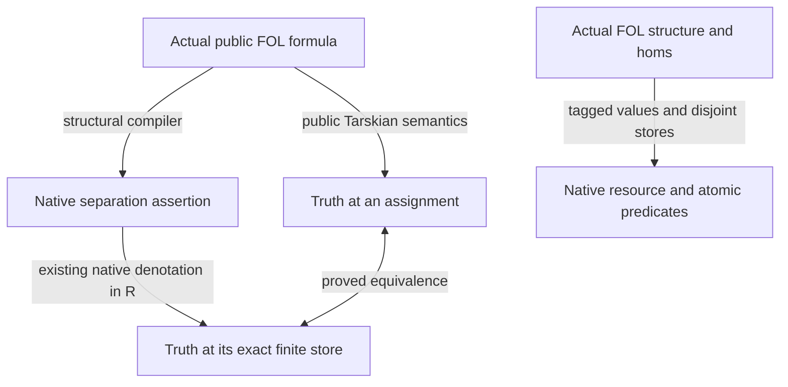
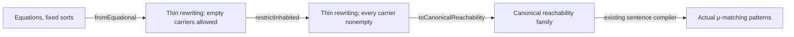
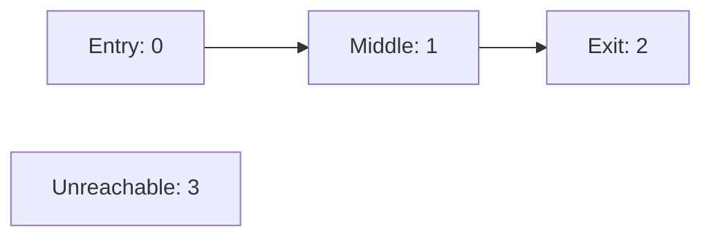
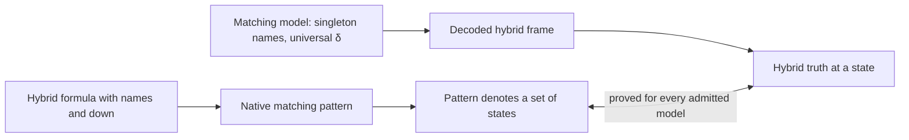
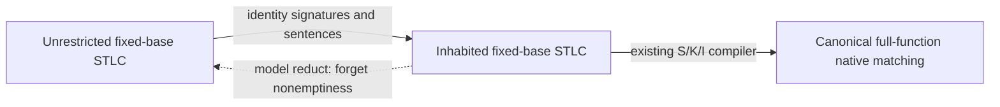

# Hoare, separation and hybrid logics

First-order Hoare logic (with a native Wasm addition example), separation logic (first-order, parameterized heaps and lists, its matching-logic reading, Wasm examples), term rewriting with its reachability reading, hybrid and polyadic modal logic with constrained matching, and model restriction for the simply typed λ-calculus, as institutions registered in the [logic graph](logic-graph.md). Developments that import Wasm live under Silmaril/Wasm/Logic. The sections below are the guides of each development.

## A regular-command Hoare institution and a qualified reachability bridge

`Silmaril.Logic.Hoare` gives ordinary relational **partial correctness** a generic
institution. A triple `{p} c {q}` holds when every completed execution of command
c from a state satisfying p finishes in a state satisfying q. Missing completed
results make this partial triple vacuously true. They do not establish safety,
termination or a real diverging execution.

For a two-state example, let `toggle` switch `false` to `true` and `true` to
`false`. Then `{state = false} toggle {state = true}` is valid, while
`{state = false} toggle {state = false}` is invalid. Executing toggle twice
restores the initial state. These three statements are checked in
`Silmaril.Logic.Hoare.Examples`.

- A **precondition** describes allowed initial states; a **postcondition**
  describes the required completed outputs.
- **PDL** means propositional dynamic logic. Here it supplies commands built
  from actions, sequencing, choice, tests and finite repetition, plus assertions
  about states and possible executions.
- **Reflexive-transitive closure** allows any finite number of steps, including
  zero. It is the meaning of finite repetition (`star`).
- An **institution** packages signatures, sentences, models and satisfaction,
  together with a law saying that consistent symbol renaming preserves truth.
- A **comorphism** translates sentences forward and models backward, with a
  satisfaction equivalence. **Model-expansive** means every source model is
  the reduct of a target model; it lets the translation reflect consequence.
- **HWP** is the existing Wasm Hoare weakest-precondition predicate; **TWP** is
  its total-correctness counterpart. Their contracts are stronger than the
  normal-completion triple used by this bridge.

Commands have actual bodies from the existing PDL syntax: primitive actions,
sequence, nondeterministic choice, tests and finite iteration. Execution is the
independent `PDL.Program.Rel`: sequence composes relations, choice takes their
union, tests inspect assertions, and star is finite reflexive-transitive closure.
Assertions are existing PDL formulas, with their independently defined Boolean
and modal semantics. `Valid.seq`, `Valid.choice`, `Valid.test`, consequence and
the finite-star invariant rule are proved directly from those definitions.

This is a regular-program semantic interface, not a full IMP proof calculus,
an assignment/expression language, or a proof-derivation compiler. The pinned
`rosu-stefanescu-2012-fm` in `references.bib` supplies the
Hoare/reachability comparison context; its Definition 6 preserves code and state
components in the H2M encoding. This development likewise keeps control phases
explicit, but does not claim to implement that source's variable-renaming
compiler, IMP rules, circularity, recursive procedures or Theorem 2.

## Signatures and models

Fix an arbitrary type C of command names, including the empty type. A signature
contains a PDL language (atom and primitive-action types) and an actual body
`C → PDL.Program language`. A signature map renames atoms/actions and preserves
every named command body. Triple translation keeps the command name and renames
both assertions. The satisfaction condition follows from the existing PDL
formula/program renaming theorems.

Models are the existing arbitrary nonempty PDL state models. Their distinguished
point is retained but validity quantifies all states. The model category is the
existing PDL equality-arrow category; no unproved preservation under arbitrary
relational homomorphisms or bounded morphisms is added. Signature reducts use
the existing modal model functor. A future stronger model-arrow category would
require a separate invariance proof for this assertion language.

## Why the reachability target needs phases and constraints

A command input/output relation is a completed execution, not another small
step to run repeatedly. In the toggle example, `{false} toggle {false}` is false,
while finite reachability of false from false is immediately true in zero steps.
Repeating command results therefore cannot supply the intended bridge.

For each source model the canonical target has configurations

```text
(optional command name, entry-or-exit flag, underlying state).
```

The unused `none` component keeps the configuration carrier nonempty even when
C is empty. For each command c, entry state s has exactly these transitions:

- A completed source execution to t gives `entry(c,s) → exit(c,t)`.
- If no completed result exists, `entry(c,s)` loops to itself.
- Exit states have no outgoing transitions. Transitions never restart a command.

Entry labels evaluate the precondition on s; exit labels evaluate the
postcondition on t. This defines actual matching atoms and a predecessor step
operation. The shape is constructed from source operations and command
execution; the model stores no desired Hoare or reachability satisfaction fact.

The no-result loop is an explicit **partial-correctness abstraction**. It
represents absence of completed outputs, including possible stuckness. It does
not prove that a source program diverges, preserve its execution traces or
preserve total correctness. A checked counterexample has a source relation with
no steps but a loop in its canonical phase model.

`phase_bad_iff` proves that a finite avoiding path to a deadlock in this model
exists exactly when there is a completed command output violating q.
`phase_allPartial_iff` and `encode_correct` then prove the exact independent
Hoare/all-path-partial satisfaction equivalence. They do not assume a
path-completeness premise, seriality or fairness.

## The actual institution span



The canonical institution has actual reachability sentences over the generated
entry/exit/step signature, actual canonical phase models, and satisfaction by
the existing direct reachability semantics. Its signature category is the
command-decorated source category. `reachSignatures` gives the nontrivial
translation to the ordinary reachability signature category: it generates
entry/exit atom labels from command names and assertions and preserves the step
symbol. `expand_reduct` proves that this construction commutes with reducts.

`toCanonicalReachability` translates a triple to the all-path-partial rule
between its entry/pre and exit/post atoms. Its model reduct is the identity on
the source presentation of the canonical models. Naturality is proved, every
Hoare model expands, and `entails_iff` gives semantic-consequence equivalence.

`restrictReachability` uses the actual expansion functor from source models to
matching phase models, with a proved naturality square. It restricts the
unrestricted reachability institution to these model shapes. This second map
is **not** model-expansive: `restriction_not_modelExpansive` exhibits an
unrestricted singleton model which cannot equal a canonical phase model with
distinct entry/exit flags. Another checked arbitrary model rejects the encoded
triple which is valid in the toggle source model.

Consequently the graph relationship implemented here is Hoare→**canonical
phased** reachability, with the restriction edge displayed separately. There is
no claimed structural Hoare→unrestricted-reachability comorphism or unrestricted
consequence-reflection theorem. On each actual expansion, the existing
reachability→fixed-point-matching compiler applies to the translated sentence.

## The real existing Wasm Hoare client

`Silmaril.Logic.Hoare.Wasm` reuses the existing every-run Wasm HWP, its
`HWP.sound_vals` theorem, actual Core `Steps`, and the existing `HWP.localGet`
rule. The source command relation is explicitly **one normal completion**:

```text
normalExec(c,d) = actual Core Steps(c,d) and d.code consists of values.
```

`hwp_valid` transports a real HWP proof to the generic relational triple with
singleton initial configuration and its normal-outcome postcondition.
`hwp_reachability` and `hwp_matching` continue to canonical reachability and the
actual μ/ν matching sentence. `localGet_matching` is a concrete client: with a
checked local lookup, LOCAL.GET extends an arbitrary operand-stack prefix by
that value, using the existing Hoare instruction proof and normal-exit rule.

The concrete add-block client in `Silmaril.Logic.Hoare.WasmAdd` runs actual native
instructions:

```text
i32.const x; i32.const y; i32.add
```

`addBlock_hwp` proves its every-run postcondition for every execution profile,
every host relation, arbitrary stores and frames, arbitrary `BitVec 32` operands,
and any older operand stack `vs`. The complete store and frame are unchanged;
the result stack is `vs ++ [i32 (x + y)]`. Addition is the pinned Wasm integer
operation, so it wraps modulo 2³². Here `vs` is in native code order; the
interpreter theorem `addBlock_exec` expresses the same older stack as a top-first
list `rs`.

`addBlock_valid`, `addBlock_reachability` and `addBlock_matching` carry that
same postcondition through the generic triple, canonical phased reachability,
and actual fixed-point matching sentence. `addBlock_steps` separately uses the
existing native interpreter computation and `exec_sound` to construct an actual
completed pinned Core run. Consequently the partial triple is nonvacuous:
`addBlock_false_post` rejects a false postcondition, and the corresponding
compiled reachability and matching statements are rejected as well.

The concrete overflow client checks `0xffffffff + 1 = 0` on every older stack.
`wrapping_add_wrong_post` rejects a claimed result of 1 by using the actual run.
The evidence is a kernel-checked HWP proof, native interpreter equality and
existing Core execution soundness; this slice introduces no external
certificate producer or new translation-validation claim.

```lean
module
public import Silmaril.Logic.Hoare.WasmAdd

open Silmaril.Wasm Silmaril.Wasm.Execution Silmaril.Wasm.Execution.Core Silmaril.Wasm.Numerics
open Silmaril.Logic.Hoare.Wasm

example {H : Type} (s : Store H) (f : Frame) (rs : List Val) :
    Silmaril.Wasm.Logic.Core.exec s f rs (addBlock (4294967295#32) (1#32)) =
      some (s, f, Val.i32 (0#32) :: rs) := wrapping_add_exec s f rs

example {H : Type} (P : Profile) (host : HostSemantics H) (s : Store H) (f : Frame)
    (vs : List Val) (x y : BitVec 32) :
    triple.Satisfies Unit
      (model P host s f (vals vs ++ expression (addBlock x y)) (addPost s f vs x y)) :=
  addBlock_valid P host s f vs x y
```

Existing HWP is stronger than this normal-only partial interface: it enforces
safety and accounts for traps, exceptions and other outcomes. The converse is
false in a real checked example: a trapped configuration validates the
normal-only relational partial triple (no normal completion exists), while
`trap_not_hwp` refutes HWP with a false postcondition. Existing `TWP` additionally
rules out actual infinite executions; no totality claim is transported through
the canonical no-result loop.

Full source proof-rule compilation, generic total/safety institutions,
control-faithful small-step compilation, and broader outcome-aware Hoare
interfaces remain separate increments. The proved source-edge statement and
its model constraints are complete for the scoped partial interface above.

## Claims and implementation

| Claim | Declaration |
| --- | --- |
| Commands have independently defined relational executions | `PDL.Program.Rel`, `Hoare.Signature.body` |
| Partial triples quantify completed outputs | `Triple.Satisfies`, `Valid` |
| Sequence, choice, tests and finite invariants preserve validity | `Valid.seq`, `Valid.choice`, `Valid.test`, `Valid.star` |
| Canonical configurations and steps come from command execution | `Phase`, `phaseStep`, `expand`, `encode` |
| The phase construction preserves partial satisfaction | `phase_bad_iff`, `phase_allPartial_iff`, `encode_correct` |
| Signature renaming commutes with the construction | `body_reduct`, `expand_reduct`, `encode_map`, `canonicalModels_natural` |
| Hoare and canonical reachability have equivalent consequence | `toCanonicalReachability_modelExpansive`, `entails_iff` |
| The unrestricted-model restriction is not model-expansive | `Examples.restriction_not_modelExpansive` |
| Existing Wasm proofs reach actual fixed-point matching | `Wasm.hwp_matching`, `Wasm.localGet_matching`, `Wasm.addBlock_matching` |
| A wrapping add block preserves the older stack, store and frame | `Wasm.addBlock_hwp`, `Wasm.addBlock_steps`, `Wasm.wrapping_add_exec` |
| Actual completion rejects false/wrong result postconditions | `Wasm.addBlock_false_post`, `Wasm.addBlock_false_matching`, `Wasm.wrapping_add_wrong_post` |
| Normal-only partial correctness forgets trap outcomes | `Wasm.trap_relational_partial`, `Wasm.trap_not_hwp` |


## First-order assertions in native Hoare logic

`Silmaril.Logic.Hoare.FirstOrder` gives a qualified first-order logic (FOL)→Hoare
institution comorphism: signatures and sentences translate forward, while
models reduce backward. It compiles actual public first-order formulas into
native propositional dynamic logic (PDL) assertions and closed sentences into
native Hoare skip triples. Quantifiers become modal boxes over actual
nondeterministic assignments. No target atomic label contains a source formula
or its truth value.

A **signature** specifies sorted function and relation symbols. The set of
sorts is fixed but arbitrary; admitted signature maps preserve sorts and may
rename or collapse function and relation symbols of the same profile. All
actual public FOL structures and their homomorphisms remain, including empty
carriers and noninjective homomorphisms. An **open formula** has free variables;
an assignment gives those variables values of the appropriate sorts.

A **Hoare triple** `{P} c {Q}` expresses partial correctness: whenever a state
satisfying `P` completes command `c`, its resulting state satisfies `Q`. The
existing native Hoare logic uses PDL assertions. PDL has Boolean operations,
modal boxes and diamonds, tests, program composition, choice and finite star.
A box `[a] P` says that every result of program `a` satisfies `P`.

The target here admits every native Hoare triple over the computed signature.
Its named commands are `skip` and `havoc(n,s)`: assign any value of sort `s` to
slot `n`. It uses canonical native PDL models computed from actual FOL
structures, rather than arbitrary PDL valuations or transition relations.
Target model arrows are the actual FOL homomorphisms. This is explicitly a
canonical institution; there is no claimed functor taking arbitrary FOL
homomorphisms into native Hoare's equality-only model category.



A state is a partial typed store `Nat → Option (Σ s, M.carrier s)`. It may
contain unrelated or stale entries. The empty store exists even when every
source carrier is empty. For a context of size `k`, variable `i` occupies slot
`k - 1 - i`; extending a context puts its newest variable in slot `k` and leaves
old variable slots unchanged.

The primitive atomic vocabulary contains only actual public term equality and
relation applications, with their contexts. Their native valuations read a
compatible assignment from the store and evaluate those actual terms and
relations. No atomic constructor accepts a compound FOL formula.

The compiler follows the source constructors:

| Source | Native PDL assertion |
| --- | --- |
| Term equality / relation application | Corresponding primitive observation |
| True, negation, conjunction | Native Boolean operations |
| Universal quantifier extending a context of size `k` by sort `s` | `[havoc(k,s)]` applied to the recursively compiled body |

`compile_correct` proves exact open semantics on **every** store encoding the
context, without restricting unrelated slots. A havoc step writes precisely one
value and preserves every old context slot. It realizes each compatible
extended assignment. If the quantified sort is empty, havoc has no results and
the universal box is vacuously true, matching public FOL semantics.

For a closed sentence, the context is empty, so every store encodes its unique
assignment. `closed_correct` therefore holds at every store. `sentence_correct`
then proves:

```text
FOL sentence φ holds in M
  iff {true} skip {compile φ} holds in the computed native model of M.
```

For example, `∀ x, False` is true over an empty carrier and false over `Bool`.
`∀ x, ∀ y, x = y` is false over `Bool`; its compiled skip triple is also false.
Two open Boolean variables with distinct values read distinct slots, even when
all unused slots contain data. A nested reflexive equation is valid, but a malformed compiler that assigns
both binders to slot zero rejects its checked translation. A separate native havoc triple shows that
assigning one variable can invalidate equality with another variable.

A small usable client:

```lean
import Silmaril.Logic.Hoare.FirstOrder.Examples

open Silmaril.Logic.Hoare.FirstOrder
open Silmaril.Logic.Hoare.FirstOrder.Examples

example : (sentence allFalse).Satisfies (Command Unit)
    (native (pureModel Empty)) := empty_allFalse

example : ¬ (sentence collapse).Satisfies (Command Unit)
    (native (pureModel Bool)) := bool_not_collapse
```

The signature translation constructs actual native Hoare signatures. Its maps
translate primitive terms and relation symbols, fix havoc actions, and preserve
named command bodies. `native_reduct` proves exact agreement of the computed
native models with those signature reducts. The compiler commutes with every
admitted map, including noninjective symbol collapse. The comorphism's backward
model functor is identity on actual FOL structures **and all their actual
homomorphisms**; its model-reduct naturality is equality of whole functors.
It does not turn those homomorphisms into native equality arrows.

Every source model has an exact canonical target expansion. The resulting
`entails_iff`, `sat_iff` and `unsat_iff` concern the translated theories and
canonical target models. No equivalence with unrestricted native Hoare models
is asserted: a concrete arbitrary native valuation can reject compiled FOL
reflexivity. Sort-changing signature maps, general assignment expressions as
named command bodies, arbitrary imperative programs and an execution adapter
remain outside this construction. Native PDL programs still occur freely in
the target preconditions and postconditions.

| Declaration / responsibility | Source |
| --- | --- |
| Stores, primitive observations, actual havoc, native model, compiler and skip triple | [Defs.lean](../../Silmaril/Logic/Hoare/FirstOrder/Defs.lean) |
| Open, closed and sentence correctness interfaces | [Thms.lean](../../Silmaril/Logic/Hoare/FirstOrder/Thms.lean) |
| Fixed-sort signatures, arbitrary symbol maps and native signature functor | [Signatures.lean](../../Silmaril/Logic/Hoare/FirstOrder/Signatures.lean) |
| Exact native reduct and compilation naturality interfaces | [Models.lean](../../Silmaril/Logic/Hoare/FirstOrder/Models.lean) |
| Actual source/canonical institutions, comorphism, expansion and semantic iff results | [Institution.lean](../../Silmaril/Logic/Hoare/FirstOrder/Institution.lean) |
| Empty, false, open, unrelated-store, symbol-collapse, relation, model-arrow and native-boundary controls | [Examples.lean](../../Silmaril/Logic/Hoare/FirstOrder/Examples.lean) |
| Exact theorem axiom allowlists | [Audits.lean](../../Silmaril/Logic/Hoare/FirstOrder/Audits.lean) |

The longer proofs live under `Silmaril/Proofs/Logic/Hoare/FirstOrder/`; intended
clients use the public headers. Public FOL syntax, term evaluation, structures,
homomorphisms and satisfaction are imported from the repository's pinned
Silmaril dependency. Native Hoare/PDL syntax and semantics are reused. The
fixed-signature/category and reverse-slot/binder-extension patterns are adapted
from the existing private FOL→separation implementation, at the exact source
revision and hashes in the validation receipt. Havoc semantics and its store
invariant, structural modal quantifier compilation and Hoare correctness are
new work. This adds no paper-correspondence claim.

Targeted validation:

```sh
bin/mor build --no-pool Silmaril.Logic.Hoare.FirstOrder Silmaril.Logic.Hoare.FirstOrder.Audits
bin/mor check
bin/mor layout
bin/mor isar lint Silmaril/Logic/Hoare/FirstOrder Silmaril/Proofs/Logic/Hoare/FirstOrder --deny
git diff origin/main...HEAD --check
```

The receipt and retained logs
pin the checked Lean bytes. Twenty-seven exact guards admit at most Lean's
standard `propext`, `Classical.choice` and `Quot.sound` axioms. Targeted Lean,
registry/layout and style results are recorded there. Independent review and
actual full CI are reported separately; no full local build or full kernel
replay is claimed. Registry and textual style checks do not validate the
mathematical statements.


## Separation logic and recursive heap predicates

Separation logic describes which resources an assertion owns. For heaps,
`P * Q` means the heap splits into disjoint parts: one satisfies `P`, the other
satisfies `Q`. Ordinary conjunction `P ∧ Q` checks both assertions on the same
heap. That distinction lets a field-read proof retain a separate heap predicate
without inspecting its cells.

Import `Silmaril.Logic.Separation` for the generic API, or
`Silmaril.Logic.Separation.Wasm` for its Wasm heap instance and field-read client.

A separate first-order owned-store encoding translates
actual public FOL formulas to native assertions using fresh slot cells and wand.
It retains empty sorts and all FOL homomorphisms over fixed arbitrary sorts.
Its canonical variable-store models do not extend the heap-language paper
coverage described below.

## A one-cell example

The existing Wasm assertion `pointsTo l c` means the heap contains exactly the
single cell `c` at location `l`. It can satisfy the same assertion twice with
ordinary conjunction. It cannot split into two heaps that each own that cell:

```lean
import Silmaril.Logic.Separation.Examples
open Silmaril.Wasm.Logic.Sep
open Silmaril.Logic.Separation.Examples

example (l : Loc) (c : Cell) :
    pointsTo l c (Heap.single l c) ∧ pointsTo l c (Heap.single l c) :=
  same_cell_conjunction l c

example (l : Loc) (c : Cell) (h : Heap) :
    ¬ (pointsTo l c ∗ pointsTo l c) h :=
  same_cell_cannot_separate l c h
```

A **heap** is a partial map from locations to cells. Two heaps are **disjoint**
when no location occurs in both. An **assertion**, or **predicate**, selects the
heaps for which a proposition holds. An **atom** is a named predicate supplied
by a model; generic atoms need not describe single cells.

## Resource models and spatial operations

The generic API uses a **partial commutative monoid**: a resource type with an
empty resource and a combination operation that may be undefined. Combining
disjoint heaps is defined; combining two heaps that own the same location is
undefined. Commutativity means the order of the parts does not matter;
associativity means grouping three compatible parts does not matter.

`Resource` represents the operation by `join a b h`, meaning that combining
`a` and `b` produces `h`. Its fields require unique results, an empty resource
called the **unit**, commutativity and associativity. A model also interprets
the signature's atoms. A **signature** declares those atom names. Signature
maps rename them; model reducts reindex the interpretations and keep the
resource algebra. A **homomorphism** between models is a function preserving
the unit, joins and atomic membership. No claim that it preserves every
negated or separating-implication assertion is needed here.

The assertions have independent resource semantics:

- `emp` holds exactly of the unit.
- `P * Q` holds when a resource splits into joined parts satisfying `P` and `Q`.
- `P -* Q`, called **wand** or **separating implication**, holds of a resource
  when every compatible extension satisfying `P` produces a combined resource
  satisfying `Q`.
- Negation and conjunction have their classical meanings on the same resource.

The API proves commutativity, associativity and the empty-resource law for
`*`. It also proves **residuation**:
`P * Q ⊆ T` exactly when `P ⊆ (Q -* T)`.
Here `⊆` means every resource satisfying the left predicate satisfies the right.

Institution sentences are **entailments** `P ⊆ Q`, checked at every resource.
An **institution** packages signatures, sentences, models, satisfaction and
truth-preserving signature translations. An individual ownership assertion
need not hold of every heap to appear in an entailment.

## Recursion means the least closed set

The Wasm example defines

```text
finiteHeap = μX. emp ∨ (singleCell * X)
```

Read **μ**, or **least fixed point**, as the smallest heap set closed under
this rule: include the empty heap, and include a single cell joined to an
already included disjoint heap. This admits heaps built from finitely many
cells. The theorem `finite_iff_inductive` proves agreement with a separate
inductive construction using the existing Wasm heap operations.



`Pattern` allows scoped set variables, conjunction, disjunction, separation,
nested μ and wand whose antecedent contains no recursive variables. The
semantics uses `OrderHom.lfp`; unfolding and least-fixed-point induction are
proved. **Monotone** means enlarging an input set cannot shrink the output.
Recursive variables occur only in monotone positions. For example, complement
reverses inclusion and is not monotone; a checked counterexample records that
boundary. The self-recursive expression `μX.X` denotes the empty set.

This resource-only API has parameter-free, propositional recursion. Object
quantifiers, simultaneous recursion and greatest fixed points are not provided
by that API.

The separate [`Parameterized` API](../../Silmaril/Logic/Separation/Parameterized/Defs.lean)
adds value arguments and object quantifiers over one arbitrary value sort (a
kind of value). A recursive predicate now receives both a value tuple (an ordered
collection of values) and a resource. Its least
fixed point is the smallest set of those pairs closed under the body; ambient
value parameters stay fixed while the recursive argument tuple and resource vary.
The [linked-list predicate](../../Silmaril/Logic/Separation/Parameterized/Lists/Defs.lean)
uses this to pass the next pointer into its recursive call:

```text
list(x) = μL(x). (x = null ∧ emp) ∨ ∃y. (x ≠ null ∧ x ↦ y) * L(y)
```

The checked Wasm example
proves that this source predicate follows **0 → 1 → null** through two disjoint
native field heaps. It also checks null on the empty heap and rejects a non-null
pointer on that same empty heap. Parameterized list segments, multiple value
sorts and an imperative list program proof remain open.

## Institution relationships

The base-to-recursive map translates an assertion entailment to a recursive
one, with the same models. It is a natural institution **comorphism**: sentences
translate forward, models backward, and satisfaction agrees. It is
**model-expansive** because every source model is the reduct of a target model.
The map preserves and reflects semantic consequence.

The recursive-to-matching map targets all existing native
`Matching.FixedPoint.Sentence`s over the compiled signature, interpreted only
in resource-generated models. This **canonical** model class is a stated
restriction, not the class of all matching models. The compiler uses:

- Nullary atom and `emp` operations, meaning operations with no arguments.
- A binary join operation for separating conjunction.
- A binary extension operation with
  `extension(h; a,b)` exactly when `join h a b`.
- Dual extension application for wand and the matching μ binder for μ.

The compiler proves equality of denotations, syntax naturality under atom
renaming, and model-reduct naturality. Resource homomorphisms induce matching
model homomorphisms. The canonical target stores no sentence-validity evidence;
its matching semantics is evaluated on the generated operations. Model
expansion and semantic-consequence equivalence hold for this restricted target.
An unrestricted matching countermodel invalidates the translated
`P ⊆ emp * P`, showing why the resource-model restriction matters.

## Wasm client and checks

The instance reuses `Heap`, `Heap.empty`, `Heap.Disj`, `Heap.union`,
`Heap.single`, `pointsTo` and separating conjunction from
`Silmaril.Wasm.Logic.Sep`. It proves the resource-algebra laws and agreement with
the native separating conjunction. Native heaps may be infinite partial
functions; the recursive predicate selects their finite-cell closure. A
checked two-cell example witnesses nonempty recursive construction.

`structGet_preserves_recursive_tail` applies the existing Core GC field-read
triple and frame rule, retaining the recursive tail predicate in every run.
`recursive_frame_matching` identifies the head/tail assertion with its matching
μ pattern. This client covers a GC field read. The separate parameterized list
example above establishes a heap predicate; an imperative list client and a new
byte-load proof still require additional work. The independent byte-store client
below uses the same native heap and separation triple.

### Updating an owned i32 word

Import `Silmaril.Wasm.Logic.Sep.Memory.Thms` for `STriple.i32Store`.
An `i32.store` writes four little-endian bytes: the least significant byte comes
first. `bytesPts m p bs` owns exactly
those native `Loc.byte m (p + k)` cells; the old list must have length four.
It is one word footprint comprising four cells, not a single-byte assertion.
Ownership proves the actual memory exists and that all four bytes are in bounds.

The rule uses the instruction's actual memory index, address type and immediate
offset. Its precondition requires the frame's module to resolve the memory index
to store address `m`. It writes at `effAddr i.toNat arg`, using the pinned Core
`MemoryStep.storeIntVal` and `Memory.store`; head-step inversion excludes the
out-of-bounds branch and covers every reduction. The normal result stack is empty.

`STriple` quantifies over an arbitrary disjoint heap `hF`. The proof retains that
same heap: the new footprint has the same domain, every old frame cell remains
unchanged, and the final store satisfies the new footprint together with `hF`.
This includes other bytes in the written memory and every cell of other memories.
The existing `STriple.frame` also retains any assertion on a separately owned heap.

The concrete client makes these
choices observable:

- Memory index `1` resolves through `[1, 0]` to store memory `0`.
- A memory64 address `1` plus immediate offset `2` selects bytes `3` through `6`.
- Storing `0x01020304` changes `[0, 0, 0, 0]` to `[4, 3, 2, 1]`.
- The original frame retains byte `7 = 99` in that memory and byte `3 = 77`
  in store memory `1`.

`actual_step` and `actual_run` prove the concrete Core reduction. The every-run
client retains the exact original frame, and `HWP.sound_vals` applied to that
terminal run rejects both an unchanged-owned-byte postcondition and an altered
second-memory frame postcondition. A separate control rejects overlapping
ownership. These are runtime-store fixtures with small byte arrays; they do not
claim module validation, page-sized initial memories, instantiation, or compiled
Wasm execution. The general rule applies to arbitrary stores, including validated
stores satisfying its precondition. It adds no byte-load, packed-store, concurrent
or atomic-memory rule.

```sh
bin/mor build --no-pool Silmaril.Wasm.Logic.Sep.Memory.Examples
```

The store/client build and six exact axiom guards pass with zero errors and
warnings; all six use only `propext`, `Classical.choice` and `Quot.sound`.
Scoped proof lint (0/72), textual layout, `mor check`, and guide link/fence/whitespace
checks pass. No full build or compiled execution was run.

```sh
LEAN_NUM_THREADS=2 bin/mor build --no-pool --mem-cap 16 \
  Silmaril.Logic.Separation Silmaril.Logic.Separation.Examples \
  Silmaril.Logic.Separation.Wasm Silmaril.Papers.Reynolds2002
```

The targeted build and eight exact axiom guards pass: residuation is
axiom-free; the other guarded results use only `propext`, `Classical.choice`
and `Quot.sound`. Scoped Isar lint, `mor check` and branch whitespace checks
pass. These checks have distinct scopes; `mor check` does not prove the
mathematical claims.

| Claim | Declaration or module |
| --- | --- |
| Resource laws, split/wand and independent positive semantics | [`Separation/Defs.lean`](../../Silmaril/Logic/Separation/Defs.lean) |
| Institutions, signature translations and base inclusion | [`Separation/Thms.lean`](../../Silmaril/Logic/Separation/Thms.lean) |
| Spatial laws, unfolding and fixed-point induction | [`Separation/Laws.lean`](../../Silmaril/Logic/Separation/Laws.lean) |
| Matching compiler and restricted target | [`Matching/Defs.lean`](../../Silmaril/Logic/Separation/Matching/Defs.lean), [`Matching/Thms.lean`](../../Silmaril/Logic/Separation/Matching/Thms.lean) |
| Denotation and satisfaction proofs | [`Proofs/Logic/Separation/Matching.lean`](../../Silmaril/Proofs/Logic/Separation/Matching.lean) |
| Native heap instance and finite-cell predicate | `Wasm/Defs.lean` |
| Finite construction and field-read client | `Wasm/Thms.lean` |
| Ownership examples, countermodels and axiom guards | `Examples.lean` |

## Source correspondence

The exact Reynolds (2002) author-hosted PDF, hashes and
`reynolds-2002-separation-logic` in `references.bib`
record the source boundary. Sections 2–3 supply the finite-heap and spatial
semantics; §5 motivates structural recursive predicates. The generic resource
abstraction, institutions, matching compiler, μ formalization and Wasm client
are Silmaril constructions.

The source's full store-expression language, parameterized list segments and
imperative calculus remain outside this formalization. The separate parameterized
API above supplies one-sort quantified pointer predicates, not the full source
language. Concurrency and Iris step-indexed semantics are also separate
work. The source PDF and private correspondence notes stay outside public
promotion candidates.


## First-order formulas as owned-store separation assertions

The private `Separation.FirstOrder` topic translates actual public many-sorted
**first-order logic (FOL)** formulas into the existing native separation
assertion syntax. A sort names a kind of value; its carrier is the set of values
of that kind in a model. The translation preserves truth for every assignment
of values to a formula's free variables, including models with empty carriers.
It also commutes with function/relation symbol maps over fixed arbitrary sorts.
Every actual FOL structure and homomorphism (a map preserving operations and
relations) is retained, including noninjective homomorphisms. This is a
canonical variable-store encoding; it does not implement Reynolds's first-order
heap language.

For a Bool carrier, `∀ x, ∃ y, y ≠ x` holds: choose Boolean negation. For Unit it
fails, and for Empty it holds vacuously. These three facts are first proved using
the public FOL semantics. Their translated native entailments have the same
outcomes. The false Bool sentence `∀ x, ∀ y, x = y` supplies a counterexample:
reusing slot zero for both binders incorrectly makes its inner wand vacuous.
The checked negative control constructs that malformed native assertion and
proves that it holds, while the correct translation fails.

## How the semantics works



A **resource** is something an assertion can own and combine with other
resources. Here it is a partial map from natural-number slots to tagged sorted
values. A **disjoint join** combines two stores only when they own no common
slot: `{0 ↦ false}` and `{1 ↦ true}` join to `{0 ↦ false, 1 ↦ true}`, but two
stores both owning slot zero cannot join, even if their values agree. The empty
store owns no slots.

An assertion's **denotation** is the set of resources where it holds. All partial
maps are admitted; compiled open formulas are evaluated at the exact finite
store for their context. A new binder receives the next fresh slot. Equality
and relation atoms evaluate actual public terms under assignments decoded from
present slots. They contain no stored source formula or desired validity
predicate. A `Cell n s` atom owns precisely one slot and contains some value of
sort `s`; it holds nowhere when that carrier is empty.

The **magic wand** `P -* Q` holds at a store when every disjoint extension
satisfying `P` makes the combined store satisfy `Q`. Universal quantification
compiles to `Cell fresh s -* body`: every possible value in the fresh cell must
make the body hold. The exact extension theorem
proves both directions: every compatible fresh cell yields the corresponding
extended finite store, and every public extended assignment agreeing on old
variables yields such a join. This includes the actual public **heterogeneous
equality (`HEq`)** agreement: equality of values whose types may be written
differently because of context transport. Once the context types are identified,
it expresses that old variable values remain unchanged. Empty carriers yield
neither singleton cell extensions nor extended assignments.

The assertion **`emp`** holds exactly at the empty store. A closed formula
compiles to **`emp ⊆ compile formula`**: every store satisfying emp must satisfy
the compiled formula. This is entailment, tested at every store; emp selects
the unique empty store. This distinction
is necessary because compiled open assertions need not hold at arbitrary junk
stores. The target admits all native base entailments over the atom vocabulary,
with their existing independent separation semantics.

## Exact institution boundary

The source signature category fixes an arbitrary sort type and admits arbitrary
profile-preserving maps of actual function and relation symbols. The model
categories are the actual public FOL structure categories, with all their homs.
A **canonical model** here is the specific native resource/atom interpretation
computed from a FOL structure by the definitions above. Its atoms cannot be
chosen independently. The canonical target uses the actual FOL model categories.
Its reduct (viewing a model through a symbol map) is the actual FOL reduct; the
exact native-model equation and compatibility of native model arrows with
reducts are proved.

`toSeparation` is an actual `Inst.CoHom`, an institution **comorphism**: a
translation of signatures and sentences, together with a reverse translation
of models, that preserves the satisfaction equivalence. **Model expansion**
means that every source model has a target model translating back to it. Here
the underlying structure and homomorphisms stay the same, so expansion is exact.
The API proves equivalence of **SAT** (some model satisfies all given sentences),
**UNSAT** (no model does), and consequence (every model of the premises satisfies
the conclusion). Its target model family is restricted: arbitrary
native separation models can falsify the translation of FOL reflexivity. A
singleton-resource countermodel with a nonempty cell atom and empty equality
atom proves this limitation directly.

Sort-changing signature maps are outside the map. They change the tagged-store
resource, and sort collapse can identify observable tags. Arbitrary native
separation models, pointer heaps, parameterized linked lists and recursive
first-order predicates are also outside this result. The existing propositional
and recursive separation institutions are unchanged.

## Checked API and controls

* [Definitions](../../Silmaril/Logic/Separation/FirstOrder/Defs.lean): independent
  resource, primitive atoms, exact store and structural compiler.
* [Model arrows](../../Silmaril/Logic/Separation/FirstOrder/Models.lean): every actual
  FOL hom maps stores, preserves their domains and realizes a native hom.
* [Store proof](../../Silmaril/Proofs/Logic/Separation/FirstOrder/Stores.lean): exact
  domain, decoding uniqueness and two-way fresh-cell/assignment correspondence.
* [Compiler proof](../../Silmaril/Proofs/Logic/Separation/FirstOrder/Basic.lean): open
  correctness and closed emp-entailment correctness.
* [Naturality](../../Silmaril/Logic/Separation/FirstOrder/Signatures.lean) and
  [institution](../../Silmaril/Logic/Separation/FirstOrder/Institution.lean): actual
  symbol maps, native reducts and model arrows, CoHom and borrowing results.
* [Examples](../../Silmaril/Logic/Separation/FirstOrder/Examples.lean) and
  [symbol identification](../../Silmaril/Logic/Separation/FirstOrder/Symbols.lean):
  Bool/Unit/Empty, duplicated slots, two distinct cells, same-slot impossibility,
  explicit unequal-value counterstore, Bool→Unit hom and unrestricted target.
  A symbol map identifies two unary functions and two unary relations, and
  independently evaluates its mapped term/relation atom.

## Complete checked client

The following is the complete [Client.lean](../../Silmaril/Logic/Separation/FirstOrder/Client.lean),
compiled with the library. Each example is an ordinary Lean theorem.

```lean
module

public import Silmaril.Logic.Separation.FirstOrder.Thms
public import Silmaril.Logic.Separation.FirstOrder.Symbols

/-! A complete checked client of the fixed-sort owned-store encoding. -/
@[expose] public section
namespace Silmaril.Logic.Separation.FirstOrder.Client
open Silmaril.Logic.Institution.Examples
open Examples

/-- Arbitrary open formulas, not just closed examples. -/
example {A : FOL.Signature} (M : FOL.Structure A) {k} {Γ : Fin k → A.S}
    (φ : FOL.Formula A Γ) (ρ : ∀ i, M.carrier (Γ i)) :
    store M Γ ρ ∈ (compile φ).denote (native M) ↔ φ.Holds M ρ :=
  compile_correct M φ ρ

example : different.Holds (pureModel Bool) := bool_different
example : ¬ different.Holds (pureModel Unit) := unit_not_different
example : different.Holds (pureModel Empty) := empty_different

example : (sentence different).Satisfies (native (pureModel Bool)) :=
  bool_native_different

example : ¬ (sentence collapse).Satisfies (native (pureModel Bool)) :=
  bool_native_not_collapse

/-- Reusing a slot incorrectly validates the false Bool collapse statement. -/
example : (⟨.emp, duplicated⟩ : BaseSentence (signature pure.fol)).Satisfies
    (native (pureModel Bool)) := duplicated_native_true

example : ¬ Function.Injective (squash.map ()) := squash_not_injective

example : native ((FOL.Structure.reduct identify.fol).obj symbolModel) =
    Separation.reduct (atomMap identify) (native symbolModel) := symbol_reduct_exact

/-- The canonical target restriction matters even for reflexivity. -/
example : ¬ (sentence reflexive).Satisfies badNative := unrestricted_reflexive_failure

end Silmaril.Logic.Separation.FirstOrder.Client
```

## Evidence and checks

The approved design records exact public/private API
pins and source hashes. The implementation uses public FOL at silmaril
`fe6a59ea53b716d38370db747f322311a9034e99`. Reynolds's 2002 paper distinguishes
external stores from heaps and has primitive predicate-calculus quantification;
our owned-store use of generic resource semantics is an original encoding, not
that paper's heap-language semantics. Existing object-quantifier paper coverage
exclusions remain unchanged.

Targeted guarded `bin/mor build --no-pool` checks the facade, examples, complete
client and [14 exact axiom guards](../../Silmaril/Logic/Separation/FirstOrder/Audits.lean).
Dependencies are at most Lean's standard `propext`, `Classical.choice` and
`Quot.sound`; no project axioms, `sorry` or `native_decide` are used. Repository
`mor check` checks placement and catalogues separately. No full Lean build,
source-graph update or paper-coverage update is claimed by this change.


## Fixed-sort first-order logic into canonical separation models

Status: approved design, implemented in the private first-order separation topic.
The kernel-checked scope and complete client are in the guide.
No Reynolds first-order heap-language correspondence is claimed.

This proposes a natural institution map from a fixed-sort restriction of the
actual public first-order institution to a canonical restriction of the existing
native propositional separation institution. Its semantics is a resource model
of owned variable slots. It does not formalize Reynolds's first-order heap
language or equate arbitrary separation models with first-order structures.

## Scope and actual APIs

Fix an arbitrary sort type `S`, allowing `S` and every carrier to be empty.
Signatures contain the actual public many-sorted operation and relation families.
Signature arrows are all actual public symbol maps whose sort component is the
identity. Models are actual public FOL structures; model arrows are **all** actual
public FOL structure homomorphisms. There is no injectivity or nonempty-carrier
restriction.

The source is therefore a named fixed-sort institution, not the full public
`FOL.inst` with arbitrary sort-changing maps. The target signatures and models
are canonically constructed below. Target sentences are all existing native
`Separation.BaseSentence`s over the constructed atom vocabulary, not merely the
image of source formulas. The target model category has the actual FOL models
and homomorphisms, equipped with their computed native separation realizations.
Its reduct functors are actual FOL reducts. Faithfulness of the native-model realization is not needed for the institution
construction and is not asserted as a proved result here.

The intended variance is source signatures to target signatures, source
sentences to target sentences, and target models to source models by the identity
on the underlying FOL structures (and homomorphisms). The institution map's
satisfaction equation is proved by the compiler theorem below. Naming must use
the repository's precise institution-map convention once implemented.

## Independent resource semantics

For a source structure `M`, set

```
Value M := Sigma (fun s : S => M.carrier s)
Store M := Nat → Option (Value M)
```

The unit is the everywhere-`none` store. `Join h₁ h₂ h` means their domains are
disjoint and `h n` is `h₁ n` when present, otherwise `h₂ n`. Stores need not have
finite support; only the compiler invariant is finite. The native resource laws
must establish functionality, unit join, commutativity and associativity directly
from this pointwise definition. The unit exists even when every carrier is empty.

The atom vocabulary has only the following forms:

* `Cell n s`, true exactly at singleton stores with domain `{n}` whose value is
  `some ⟨s,x⟩` for some `x : M.carrier s`;
* `Eq Γ t u`, using actual public terms of the same result sort in finite context
  `Γ`;
* `Rel Γ r args`, using an actual public relation symbol and its typed arguments.

For a context `Γ : Fin k → S`, de Bruijn position `i` is allocated slot
`k - 1 - i.val`. An equality or relation atom holds at `h` iff there exists an
actual assignment `ρ : ∀ i, M.carrier (Γ i)` whose values occur at those slots,
and the corresponding evaluated terms are equal or satisfy `M.rel`. Extra slots
are ignored by these observational atoms. This uses only term evaluation and
primitive relation interpretation, never the truth of an entire source formula.
No default element or choice of an inhabitant of an empty sort is required.

These predicates and the resource above define an ordinary existing native
`Separation.Model`. All native assertions retain their existing independent set
semantics, including separating conjunction and magic wand.

## Compiler and finite-store invariant

Write `store Γ ρ` for the unique store with precisely slots `0,…,k-1`, with each
slot containing the correctly tagged value of `ρ`. Prove its exact domain,
correct tags and decoding uniqueness explicitly. Under a binder the new de
Bruijn index zero receives fresh slot `k`; old successor indices retain their
slots. Contexts and assignments must be those of the public FOL constructors,
including their supplied context equality proofs.

Compile atomic equality and relation to their corresponding native atoms,
`tt` to native truth, negation to native negation, and conjunction to native
conjunction. Native truth can be derived as `¬(emp ∧ ¬emp)`. Compile a universal
binder over sort `s` in context of length `k` as

```
Cell k s -* compile body
```

Existential quantification is the actual derived `¬∀¬`, hence translates to
`¬(Cell k s -* ¬compile body)`.

The central theorem is the open-formula equivalence

```
store Γ ρ ∈ denote (native M) (compile φ) ↔ φ.Holds M ρ.
```

The binder step requires an exact extension correspondence, not an appeal to
informal freshness: compatible `Cell k s` singleton extensions of `store Γ ρ`
correspond to all extended assignments `θ` agreeing with `ρ` on old positions.
Their joined output is exactly `store Δ θ`. Prove both directions, uniqueness of
the joined output, and absence of extra slots. The agreement relation is the
public semantics' `∀ i, HEq (θ i.succ) (ρ i)`. Bridge the public `.all` context
proof explicitly; do not replace its semantics with a simplified binder clause.
When the carrier of `s` is empty there are neither extensions nor extended
assignments, so both universal clauses hold vacuously.

A closed source sentence translates to the native entailment

```
emp ⊆ compile φ
```

Native entailment is evaluated over **all stores**. Because `emp` holds exactly
at the unique empty store, the displayed entailment is equivalent to the open
correctness theorem at the empty assignment. It is not global validity of the
compiled assertion at arbitrary stores. Empty assignments exist regardless of
whether source carriers or the sort type are empty.

## Signature maps, reducts and naturality

For a fixed-sort public signature arrow `f`, the atom map fixes `Cell n s`, maps
actual terms using public `EQ.Term.map`, and maps relation symbols with the
actual public relation map. Context slots are unchanged. It extends through all
native assertion and entailment constructors by the existing separation maps.
The source reduct has exactly the same carriers, so its `Value`, `Store`, unit
and join agree with those of the original model.

Prove the exact native-model equation

```
native (FOL.Structure.reduct f M)
  = Separation.reduct (atomMap f) (native M).
```

Atom cases use actual public term `eval_map`, relation reduct definitions, and
the unchanged assignment witnesses. Prove identity/composition of atom maps and
syntactic compiler naturality, including the binder context transports. These
supply signature functor laws and sentence naturality. Reducts on actual FOL
homomorphisms supply model functor naturality; computed native homomorphisms
must commute with these reducts as well.

Arbitrary sort-changing arrows are outside this design. Changing sorts changes
the full tagged-store resource; noninjective sort maps additionally identify
tags. Thus a truth theorem for compiled formulas alone would not establish
naturality for all native target sentences. No arbitrary-sort extension is
claimed or deferred behind an unproved generic transport assertion.

## Actual model arrows

For every actual FOL homomorphism `g : M → N`, map stores pointwise by

```
none       ↦ none
some ⟨s,x⟩ ↦ some ⟨s,g.map s x⟩.
```

This preserves domains exactly, even when `g.map` is noninjective. It therefore
preserves the empty store and every disjoint join. Identity and composition are
pointwise laws. `Cell` witnesses are mapped with the same slot and sort tag.
For equality atoms, map the assignment witness and prove that evaluation of an
actual term commutes with `g.toAlgebraHom`; structural induction may be needed
because the inspected public API provides signature `eval_map`, not a model-hom
evaluation theorem. Equality is then preserved. Relation atoms use the same
term lemma followed by the actual `g.map_rel` law.

These are precisely the native `Separation.Model.Hom` obligations: resource map,
unit preservation, forward join preservation and forward atom preservation.
Neither institution requires homomorphisms to preserve all negated assertions
or magic-wand satisfaction. Do not add that false obligation. Noninjective
homomorphisms remain fully admitted, and no model arrows are silently replaced
by equalities or embeddings.

## Required independent examples and controls

State source truth and falsity independently before applying the compiler
correctness theorem; give concrete native witnesses or counterstores as well.

1. With one sort and no operations or relations, `∀x.∃y. y ≠ x` holds in Bool,
   fails in Unit, and holds vacuously in Empty. The native closed entailments
   must have those three independently checked outcomes.
2. `∀x.∀y. x = y` fails in Bool, witnessed by distinct values in slots zero and
   one. Its correct native translation fails at the empty store.
3. A concrete malformed translation using `Cell 0 s` for **both** binders of
   the preceding formula holds at the empty Bool store: after the first cell
   extension slot zero is occupied, so the inner wand has no compatible cell
   extension. This negative control exposes freshness, rather than merely
   comparing two compiler implementations.
4. Two distinct-slot cell predicates separate at a concrete two-entry store;
   two same-slot cells cannot separate. Show these using the actual join law.
5. For an empty carrier, `∀x:s.⊥` holds and `∃x:s.⊤` fails. The cell predicate is
   empty while the resource unit remains present.
6. Exercise symbol naturality with a concrete nontrivial operation/relation
   map, preferably one identifying two symbols with the same profile. Evaluate
   actual mapped terms and relation atoms, rather than only a cell-only formula.
7. The Bool-to-Unit constant FOL homomorphism maps cells and disjoint joins,
   proving that the construction supports genuinely noninjective model arrows.
8. An unrestricted native separation model need not validate the translation of
   source-valid `∀x. x=x`: take the singleton resource with its trivial join,
   interpret `Cell 0 s` as universal and its equality atom as empty. The wand
   fails at the unit. This exhibits why the canonical model restriction is
   substantive and why no full unrestricted separation interpretation is claimed.

## Evidence and correspondence boundary

Public API inspected at silmaril revision
`fe6a59ea53b716d38370db747f322311a9034e99`:

* `Silmaril/Logic/Institution/Examples/FirstOrder.lean`, SHA256
  `56d5e8dac35adf059fde51e89397258df5ff81dbc698d9c09a93d4fb63239415`;
* `Silmaril/Logic/Institution/Examples/Equational.lean`, SHA256
  `a8b4f8e134721c23a7d3778e0214926552030da6a8106f8fe77579c33fb9ae93`.

`e36c236160232161285c00de17c9e3d1e84dd389`:

* `Silmaril/Logic/Separation/Defs.lean`, SHA256
  `02a28c6683c9abf9acb18345fcf73c1e6b5db3637f1f4efb22176dcb6d688d55`;
* `Silmaril/Logic/Separation/Thms.lean`, SHA256
  `40a89c0fce9f610236aadde2381d2a79213bdfcfeee287506fb83d037c68a97e`.

Reynolds (2002), author-hosted `https://www.cs.cmu.edu/~jcr/seplogic.pdf`,
`4fb2f2a1b75fcebabdb44e010a57d825ea3f1a5b94cbb80d78adc2d29b9bb68a`,
BLAKE3 `e6c924bc2d96357486aa19f209637991472aa1e9faf7d7304d83752276f7ae30`.
Sections 2–3 distinguish stores from heaps and introduce the separation
connectives in addition to ordinary predicate-calculus quantifiers. The paper's
wand quantifies compatible disjoint heap extensions; its primitive object
quantification keeps the external store. The proposed owned-store encoding uses
the generic resource API in an original way and is **not** that original heap
semantics. Existing coverage exclusions for object quantifiers remain unchanged.
No paper text or private source receipt is promoted publicly by this design.

Goguen–Burstall institution background is already cited by the public API
(Appendix A2, definitions 62–65): DOI `10.1145/147508.147524`; public reference
PDF SHA256 `f6715ca333dd03dc153a65907c1c974fa151690bb94eafffc065c363265b634d`.

## Review gate and implementation slices

The fixed-sort/canonical-model boundary and exact extension invariant were
reviewed before implementation. Implemented slices: resource and atoms; full
hom realization; compiler and assignment extension; actual reduct/naturality
laws; institution map; examples and negative controls; targeted axiom audits and
client documentation. Targeted `bin/mor build`, `mor check`, and exact axiom guards validate the
implementation; the guide records their scope. No graph, ledger or paper-coverage claim changes accompany this work.
No project axioms, tasks, admitted proofs or native decision procedures were added.


## Scoped unconditional rewriting logic

`Silmaril.Logic.Rewriting` formalizes many-sorted preordered algebras with a fixed set of sorts.
Operations are monotone, model arrows are monotone algebra homomorphisms, and
carriers may be empty. A rewrite sentence means universally quantified directed
reachability between term evaluations. An equation sentence independently means
actual equality of those evaluations. Axiom presentations impose equations E
and directed rules R separately; equality transport supplies the semantic
rewriting-modulo-E boundary.

For a small example, use natural numbers with one operation `successor(n) = n + 1`
and let `n ↝ m` mean `n ≤ m`:

- `n ↝ successor(n)` holds for every n.
- `successor(n) ↝ n` fails at n = 0.
- `n = successor(n)` also fails at n = 0.

`Rewriting.Examples` proves these three statements. It also uses a second model
where every pair of natural numbers is related: both directions then hold,
but 0 and 1 are still unequal. Rewriting and equality therefore need separate
sentence constructors.

The terms used below have specific meanings:

- A **sort** is a type of value; its **carrier** is the set of values used by a
  model. **Many-sorted** means there may be several such types.
- A **signature** lists operations and their input/output sorts. The example
  has one sort and one unary operation, `successor`.
- A **preorder** is a reflexive, transitive relation. It may relate distinct
  values in both directions. **Thin** means we record whether a rewrite exists,
  without distinguishing different proofs or executions of that rewrite.
- An operation is **monotone** when rewriting its arguments produces related
  results. A model **homomorphism** maps values while preserving operations;
  here it must preserve rewriting too.
- A **presentation** is a signature with chosen equation and rewrite axioms.
  A **valuation** assigns values to its variables. Sentence satisfaction requires
  the stated equality or rewrite for every valuation.
- An **institution** packages signatures, sentences, models and satisfaction
  together with truth-preserving symbol renaming. A **comorphism** translates
  sentences forward and models backward. **Model-expansive** means every source
  model is exactly the reduct of a target model, allowing semantic consequence
  to be transferred in both directions. See the institution guide.

This is a thin unconditional presentation fragment, grounded in Meseguer's
1996 authored survey §§2–3, not the full categorical institution of the 1992
paper. Source signatures are equational theories (Σ,E); our base signatures
are Σ and E is supplied by presentations. No quotient-term syntax, initial/free
model theorem, completeness, conditional rules, labels, proof terms, exchange
laws or identity of concurrent computations is claimed. Preorders need not be
antisymmetric: opposite rewrites do not imply equality. Fixed sort sets also
distinguish this equational-logic (EQ) endpoint from public EQ with sort-changing signature maps.

The proved source rules include monotonic term evaluation, sort-correct
simultaneous substitution and its evaluation law, and replacement allowing all
substituted subterms to advance. Reflexivity, operation congruence and
transitivity are explicit semantic model requirements, independently of any
sentence being translated.

The natural institution comorphism `fromEquational` injects equations
and forgets the preorder on models. It is model-expansive by discrete equality
expansion of every algebra, including empty carriers; institution borrowing
therefore preserves and reflects semantic consequence.

## Canonical reachability boundary

`restrictInhabited` is an actual natural comorphism to the inhabited slice,
and its failure of model expansion is proved using an empty algebra.
`InhabitedModel` explicitly restricts every sort to be nonempty, as required
by the existing matching institution. `toCanonicalReachability` is a
natural, model-expansive comorphism from that inhabited rewriting institution
to a family of canonical reachability rooms. Target sentences are arbitrary
`Reachability.Sentence`s, indexed by their configuration sort and a
Boolean relation selector. Satisfaction is evaluated by the existing
reachability semantics in independently generated matching models. Those
models interpret original algebra operations as singletons and the added
predecessor operation as either equality or directed preorder reachability.
The equation compiler selects equality; the rewrite compiler selects the
preorder. The generated relations are already reflexive and transitive, and
finite reachability is proved equivalent to them.

The canonical target has inherited monotone algebra arrows. Its
sentences and satisfaction are not defined as source validity. Model reducts,
compiler naturality, independent satisfaction equivalence and model expansion
are proved. This is a constrained family, not a comorphism to unrestricted
reachability over arbitrary set-valued matching operations. No unrestricted
model expansion is claimed. Empty carriers prevent silently extending this
matching bridge to the entire EQ source.



Here **canonical** means that the target model is generated from the source
algebra and preorder. A **room** is the sentences, models and satisfaction at
one signature. The target family allows arbitrary reachability sentences, with
a selected configuration sort and either equality or the preorder as its step
relation. **μ** denotes a least fixed point, used by the matching compiler to
describe finite reachability. Only the first and third named arrows above are
model-expansive; `restrictInhabited_not_modelExpansive` proves the middle one is
not.

`Examples` checks strict successor rewriting, failure of its reverse and its
equation, an indiscrete preorder with both rewrites but no equation, the empty-carrier boundary, and an unrestricted matching countermodel
where the translated valid successor rule fails. `Wasm` names actual start/finish configurations for two
DROP instructions. Its preorder is pinned Core `Steps` (the reflexive transitive
closure of `Step`), and the existing two existing `Step` proofs establish the
rewrite, canonical finite reachability sentence, and actual μ-matching
translation. The canonical step in this client is `Steps`, not one primitive
machine step; the separate existing reachability client interprets primitive
`Step` directly.

## Sources and validation

The exact authored PostScript and a locally derived PDF are pinned in
what is scoped, proved and pending. The primary 1992 DOI was identified, but
publisher PDF retrieval returned challenge HTML and the publisher API denied
access. Those responses are not archived as papers, and no direct coverage of
the 1992 source is claimed. Targeted Lean builds, catalogue/placement checks,
scoped Isar lint and axiom checks are reported with the pull request; they do
not establish source completeness. `Silmaril.Logic.Rewriting.Audit` keeps five
exact axiom-dependency checks in the build, using only subsets of `propext`,
`Classical.choice` and `Quot.sound`.

## Claims and implementation

| Claim | Definition or evidence |
| --- | --- |
| Equations and directed rewriting have independent meanings | `Rewriting/Defs.lean`: `Sentence.Satisfies`, `Model`, `Model.Hom` |
| Renaming preserves satisfaction and composes | `Rewriting/Defs.lean`: `Sentence.satisfaction`, `institution` |
| Substitution and advancing arguments preserve rewriting | `Rewriting/Thms.lean`: `eval_substitute`, `eval_monotone`, `replacement` |
| Every fixed-sort equational model has a discrete rewriting expansion | `Rewriting/Thms.lean`: `fromEquational_modelExpansive`, `fromEquational_entails_iff` |
| Canonical reachability agrees with the selected relation | `Rewriting/Reachability/Thms.lean`: `reaches_selected_iff`, `compile_satisfaction` |
| The inhabited bridge is natural and model-expansive | `Rewriting/Reachability/Thms.lean`: `compile_map`, `toCanonicalReachability_modelExpansive`, `toCanonicalReachability_entails_iff` |
| Equality, empty carriers and unrestricted target models need care | `Rewriting/Examples.lean`: `opposite_rewrites_do_not_imply_equation`, `restrictInhabited_not_modelExpansive`, `successor_unrestricted_invalid` |
| Two actual Wasm DROP steps reach the compiled endpoints | `Rewriting/Wasm.lean`: `twoDrop_rewrites`, `twoDrop_canonical`, `twoDrop_matching` |

Lean paths in this table are relative to `Silmaril/Logic/`.


## Hybrid/polyadic modal institution

`Silmaril.Logic.HybridPolyadic` combines normal polyadic modal semantics with
nominals, satisfaction operators and a scoped down-arrow binder. The source

**Hybrid** logic adds names for individual states. A **nominal** is a name
that is true at exactly its named state; different names may name the same
state. `@entry p` checks `p` at the state named `entry`. The binder `↓x.p`
remembers the current state as `x` while checking `p`.

**Polyadic** means that a modality can inspect several successor coordinates
at once. Its **arity** is the number of coordinates. A binary action checks
one relation tuple `(current, left, right)` and one formula at each successor;
it is more specific than two independent unary steps.

The examples use a **control-flow graph** (CFG), a graph of possible program
steps:



`@entry ◇step ◇step exit` is true: two steps reach the named exit.
`@entry ◇step exit` is false. Here `◇step p` means that some step successor
satisfies `p`. `↓x.◇step ¬x` asks for a successor different from the saved
state. That last test explains why collapsing two worlds can change hybrid
truth, even when ordinary modal formulas cannot detect the collapse.

A signature has arbitrary atom and nominal types and an arity-indexed family
`Action : ℕ → Type`. A model has an arbitrary world type, a distinguished point,
an atom valuation, a world for each nominal, and actual relations
`relation k a : World → (Fin k → World) → Prop`. The point excludes empty
carriers; there is no finiteness, reflexivity, transitivity, symmetry, or
unique-name assumption. Arity zero is supported.

`Formula S n` has `n` scoped state variables. Bottom and implication give the
Boolean basis; negation and conjunction are defined and their ordinary truth
laws proved. A polyadic diamond existentially chooses one tuple, requires that
tuple in the action's actual relation, then checks each coordinate formula at
its corresponding world.
Permanent signature nominals test equality with their model names. `atNom`
changes the evaluation world to a named world; `atState` changes it to the
selected environment world. `down` binds the current world as index zero and
shifts the old environment. `liftRename` keeps that new zero fixed;
`Formula.holds_rename` proves capture-avoiding renaming by environment
precomposition. Institution sentences have scope zero and satisfaction is at
the distinguished point.

Signature maps are arbitrary atom and nominal functions and an action function
at each arity. They may identify nominals or actions, but cannot change arity.
The reduct retains worlds, tuples and the point and precomposes all symbol
interpretations. Sentence-map identity/composition, model-category/reduct laws,
and the satisfaction condition are proved, yielding `institution` and `inst`.

Model arrows are injective world maps that preserve the point and nominal
values, preserve/reflect atom truth, and satisfy tuple forth/back conditions
for every arity. `Formula.holds_hom` proves truth invariance at all worlds and
environments; `sat_hom` gives local satisfaction invariance. Injectivity is an
intentional boundary: unrestricted K bounded maps can collapse worlds that a
closed down-arrow formula distinguishes. The checked `kCollapse` example
exhibits exactly that failure. The category is useful beyond identities and
isomorphisms: `reachableInclusion` embeds three reachable CFG worlds into four
worlds, and `inclusion_not_surjective` proves the extra world is outside its
image. Surjectivity onto unreachable worlds is not required.

`HybridPolyadic.Modal.Thms.modalToHybridPolyadic` is an actual shared
`Inst.CoHom` from existing normal K into this institution. The signature
functor keeps atoms, adds exactly one unary action, and adds no nominals.
The sentence translation uses the classical diamond dual for box. Its model
functor retains the actual unary relation and forgets the hybrid arrow's
injectivity. The satisfaction law and naturality under every atom map are
proved. `expandModal` extends **every** K model on exactly the same carrier;
`modalReduct_expand` proves the exact reduct equality, establishing
`modalToHybridPolyadic_modelExpansive` with the public corridor predicate.
Expansion is an object construction, not a claimed lift of arbitrary K arrows
into injective hybrid arrows. Direction is K→hybrid/polyadic on sentences,
hybrid/polyadic→K on models.
The direct `modal_sat_iff`, `modal_unsat_iff` and `modal_entails_iff` corollaries
transport model existence, absence of models, and semantic consequence in both
directions.

| Claim | Declaration or module below `Silmaril/Logic/HybridPolyadic/` |
| --- | --- |
| Scoped grammar and actual tuple/binder semantics | `Defs.lean`: `Formula`, `Formula.Holds` |
| Injective bounded arrows and signature reduct | `Defs.lean`: `Model.Hom`, `reduct` |
| Renaming, arrow invariance and institution law | `Thms.lean`: `holds_rename`, `holds_hom`, `institution` |
| K signature/model maps and expansions | `Modal/Defs.lean`: `modalSignatures`, `modalReduct`, `expandModal` |
| Natural comorphism and SAT/UNSAT/consequence | `Modal/Thms.lean`: `modalToHybridPolyadic`, `modal_sat_iff`, `modal_unsat_iff`, `modal_entails_iff` |
| Concrete reachability, aliasing and collapse controls | `Examples.lean` |

The examples name entry and exit in a finite CFG:
entry 0→middle 1→exit 2, with unreachable world 3. They prove a two-step path,
reject a direct step and a return edge, and check a genuine binary modality
using the ternary current/left/right relation. Swapping its coordinate formulas
fails. Further checks cover a nullary action, nominal aliasing, action aliasing,
inner shadowing versus saved outer state, @ on saved variables, and renaming
that avoids capture. `checked_K_target` proves the actual target translation
of a K two-step universal exit property. This is a concrete CFG model, not an
extractor from an SSA implementation.

Sources and correspondence:

- Roșu 2017, *Matching Logic*, final §8 polyadic discussion, printed pp. 42–43;
  existing pinned PDF SHA-256
  `2c4cde808bd889f9633b7a2198b11edada4cd755dada5c38606ccc7211813e3a`.
  The coverage table now records the explicit tuple semantics only.
- Torben Bräuner, *Hybrid Logic*, SEP, revision 22 December 2021, §2;
  exact fetched HTML is archived with deterministic gzip in
  SHA-256/BLAKE3 in `work.json`. The finite scoped state variables are separate
  from permanent signature names; the source's name-rebinding presentation and
  its global-truth convention are explicitly distinguished in `notes.md`.
- `Silmaril.Papers.Brauner2021` and `Silmaril.Papers.Rosu2017` contain imports/exports
  only. Neither index claims whole-work coverage.

No universal state quantifier, modal proof calculus, completeness theorem,
first-order adapter, or hybrid/polyadic→matching bridge is claimed. The latter
still needs a translation with the exact denotation law
`w ∈ denote (translate p) ρ ↔ p.Holds M env w`, including nominal singleton
semantics, @/down binding, and signature/model naturality. The source graph's
bridge arrow remains separate from the proved K comorphism.

Validation is targeted, not a full build. The final build command is
`LEAN_NUM_THREADS=2 bin/mor build --no-pool --mem-cap 16
Silmaril.Logic.HybridPolyadic.Examples Silmaril.Papers.Brauner2021
Silmaril.Papers.Rosu2017` and uses `--wfail`. Nine guarded axiom audits allow only
the standard `propext`, `Classical.choice`, and `Quot.sound` dependencies, with
exact per-theorem lists. `mor check`, scoped `mor isar lint --deny`, source hash
verification and `git diff --check` are also run. Existing package olean-version
guard warnings are separate from compiler diagnostics.

Final validation passed: all three targeted build roots (2 seconds, 1.5 GiB
peak), zero compiler errors/sorry/other warnings; `mor check` (1345 works,
1075 files), Isar (0/37 flagged), and authored/staged diff whitespace checks.
Build log: `.lake/mor-build/1794292287-433222.log`.

Review added direct SAT/UNSAT/consequence corollaries. Their targeted Examples
build passed with all existing guards (3 seconds,1.3GiB), log
`.lake/mor-build/1794292891-454821.log`.


## Hybrid/polyadic → constrained matching

`Silmaril.Logic.HybridPolyadic.Matching.hybridToConstrainedMatching` is an actual
institution comorphism into a **constrained pointed matching institution**.
An **institution comorphism** translates source sentences forward and target
models backward with an exact truth law. A matching pattern denotes a **set**
of possible states. A **nominal** names one state; **arity** is an operation's
number of arguments. Here the target admits only models satisfying the two
operation equations below. Raw matching nullary operations
may denote empty or plural sets, which do not support hybrid nominals, and an
arbitrary operation cannot implement @. The target declares those restrictions
explicitly and proves the translation from native set denotation.

For a hybrid signature `S`, `matchingSignature S` has one sort and marked
operations: nullary atom sets, nullary nominal sets, an arity-k operation for
each action, and unary δ. `matchingSignatures` is a proved profile-preserving
functor for arbitrary hybrid symbol maps, including nominal/action aliasing.
A target `Model S` stores an actual existing `FirstOrder.Model`, a point,
chosen nominal states, and two raw interpretation equations:

- Each nominal operation denotes exactly the singleton of its chosen state.
  Distinct nominals may alias.
- δ maps every input element to the whole carrier.

Atom and action operations otherwise remain arbitrary set-valued operations.
There is no formula denotation or truth assumption in this model structure.
For example, suppose `goal` denotes `{exit}`. Intersecting it with the nominal
`exit` still gives `{exit}`; applying δ gives every state. Thus `@exit goal`
holds even at an unreachable state. If `goal` misses `exit`, that intersection
is empty and `@exit goal` holds nowhere. **Down**, written `↓x. p`, binds `x`
to the current state before checking `p`.



The second equation is the single-sort semantic content of Roșu 2017
Assumption 5.1's definedness axiom. `definedPattern_denote` derives the global
existential law: any world belongs to δ(p) iff some world belongs to p.

The translation is built from existing first-order matching constructors:

| Hybrid syntax | Native matching pattern |
| --- | --- |
| atom / nominal | marked nullary operation |
| scoped state variable i | singleton element variable i |
| bottom | existing matching bottom |
| p → q | ¬(p ∧ ¬q) |
| arity-k diamond | actual operation application to k translated arguments |
| @a p | δ(nominal(a) ∧ translate(p)) |
| @i p | δ(variable(i) ∧ translate(p)) |
| down p | ∃x.(x ∧ translate(p)) with x at index zero |

`translate_denote` proves
`w ∈ M.base.denote env (translate p) ↔ p.Holds (decode M) env w`
for **every admitted model, world and environment**, including nested binders.
It does not only check generated expansions. The full target sentence type is
the existing positive fixed-point `FixedPoint.ClosedPattern`; `translateFixedPoint` embeds the
first-order translation with the actual `.base` constructor. All target μ/ν
semantics are reused from that implementation, with no alternative evaluator.
The hybrid image itself is recursion-free.

The target models decode their actual operation graphs to arbitrary hybrid
frames. Model arrows are injective bounded maps on the decoded polyadic actions,
with point/name preservation and atom equivalence. `forgetHom` proves that each
is also a genuine raw sorted `FirstOrder.Model.Hom`; `forgetFirstOrder` gives
the pointed first-order model functor. δ has graph preservation, not a tuple-back
condition forcing surjectivity onto all worlds.

This category differs from the existing unrestricted pointed 2019 matching
institution's equality-only category. No inclusion functor to that institution
is claimed. Nor is invariance claimed for arbitrary target FO/μ patterns:
`Examples.inclusion` is an admitted generated-submodel arrow and raw matching
homomorphism, yet `extraWorld = ∃x.¬x` is false at its one-world source and true
at its two-world target. `translate_hom` asserts invariance only for the proved
hybrid translation image.

The constrained full-pattern institution has proved sentence-map and model
reduct laws and the native fixed-point satisfaction condition.
`decodeFunctor_naturality` gives the model diagram; `translateFixedPoint_map`
gives syntactic naturality. Together these construct `hybridNatural` and the
shared `Inst.CoHom`. `expand` gives a same-carrier target model for every hybrid
model, with singleton/δ laws proved directly; `decode_expand` is exact equality.
The target class is nonvacuous, and the comorphism is model-expansive.
`hybrid_sat_iff`, `hybrid_unsat_iff`, and `hybrid_entails_iff` preserve and reflect
SAT, UNSAT and semantic consequence. Consequence uses the public corridor
borrowing theorem and the proved object expansions.

Examples check actual matching targets for named two-edge control-flow graph paths, a genuine
arity-two modality and a swapped-coordinate failure, @ truth at every world
including an unreachable world, down-arrow shadowing, saved-state @, capture-
avoiding renaming, and both kinds of signature alias. Actual raw matching
models with empty/plural nominal sets or empty δ values are proved inadmissible.
A target SAT witness and an all-model UNSAT bottom instance are included.

The sources remain the pinned Roșu 2017 PDF (§5.1 and final §8 polyadic discussion),
Bräuner's pinned 2021 SEP entry (§2), and the existing 2019 fixed-point syntax/
semantics record. Their per-item coverage notes distinguish the explicit
constrained target from an unrestricted matching bridge. The ordinary full
FOL institution bridge, universal hybrid state quantifiers, proof calculus,
and completeness are outside this slice. This is a constrained presentation; unrestricted pointed matching admits a
different model class.

Validation is targeted, not a full build. The command is
`LEAN_NUM_THREADS=2 bin/mor build --no-pool --mem-cap 16
Silmaril.Logic.HybridPolyadic.Matching.Examples
Silmaril.Logic.Matching.FixedPoint.Examples`, using `--wfail`. Fourteen guarded
axiom audits contain only `propext`, `Classical.choice`, and `Quot.sound` (some
constraint rejection proofs use no axioms). The final targeted build passed with zero errors, sorry warnings or other
compiler warnings (log `.lake/mor-build/1794294310-505673.log`). Scoped
`mor isar lint --deny` passed with 0 of 28 tactic proofs flagged.
`mor check` and staged `git diff --check` also passed. Existing
package olean-version guard warnings are separate from compiler diagnostics.

## Source map

| Claim | Definition or proof |
| --- | --- |
| Raw signature, operation constraints, native translation and same-carrier expansion | [`Matching/Defs.lean`](../../Silmaril/Logic/HybridPolyadic/Matching/Defs.lean) |
| Exact denotation law for every world and variable assignment | [`Matching/Semantics.lean`](../../Silmaril/Proofs/Logic/HybridPolyadic/Matching/Semantics.lean) |
| Translation commutes with signature maps | [`Matching/Syntax.lean`](../../Silmaril/Proofs/Logic/HybridPolyadic/Matching/Syntax.lean) |
| Actual raw model arrows, institution, natural comorphism and SAT/UNSAT/consequence | [`Matching/Thms.lean`](../../Silmaril/Logic/HybridPolyadic/Matching/Thms.lean) |
| Named/polyadic/binder examples, rejected raw models, quantified counterexample and axiom guards | [`Matching/Examples.lean`](../../Silmaril/Logic/HybridPolyadic/Matching/Examples.lean) |


## From unrestricted STLC models to inhabited STLC

`Silmaril.Logic.STLCRestriction` supplies a concrete, qualified λ→Type Systems
relationship. It connects the existing unrestricted public simply typed lambda
calculus (STLC) institution to the inhabited-model STLC institution used by the
native matching compiler. It preserves the actual public syntax and semantics;
it does not identify arbitrary lambda calculi with arbitrary type systems.

A **signature** chooses operators and their input/output types. The base-type
set `B` is fixed but arbitrary, and signature maps may rename or collapse
operators while preserving their profiles. Sentences are the existing public
raw typing judgments and equations between intrinsically typed open terms.
**Raw typing** checks a term's proposed type. An **open equation** holds when its
two terms evaluate equally under every assignment to their free variables.

A **set model** assigns a carrier set to each base type and interprets every
operator; arrow types contain all functions between their argument/result
carriers. The source admits empty base carriers. The target requires every
base carrier to be nonempty. Both model categories use equality arrows;
this bridge makes no claim about arbitrary algebra homomorphisms.

The map is an institution **comorphism**: signatures and sentences translate
forward, while models reduce backward. Here signatures and sentences stay
identical. The backward **reduct** forgets exactly the target model's
nonemptiness property. Evaluation and satisfaction use the same actual public
STLC interpretation on both sides. This is an explicit map, with no supplied
soundness or relationship premise.



The implementation:

- Defines the actual forgetful model functor, including equality arrows.
- Proves it commutes with every admitted operator reduct, including collapse.
- Proves exact satisfaction and describes precisely which source models expand.
- Composes with the existing structural compiler to native matching sentences.

An **exact expansion** is a target model whose reduct equals a given source
model. A source model has such an expansion **iff every one of its base carriers
is nonempty**. Thus the map is **model-expansive**—every source model expands—iff
`B` has no elements. For a nonempty `B`, the empty-operator signature admits an
actual source model with all base carriers empty, which cannot expand. This
counterexample also applies to the composed canonical matching map. The `Empty`
base-type universe is handled separately by the positive theorem.

The semantic transport directions proved here are:

| Property | Proved direction |
| --- | --- |
| Semantic consequence | Unrestricted source → inhabited target → canonical matching |
| UNSAT | Unrestricted source → inhabited target → canonical matching |
| SAT witness | Inhabited/canonical target → unrestricted source by the actual reduct |
| SAT with explicitly inhabited source witnesses | Iff inhabited target SAT |

**SAT** means that some admitted model satisfies all sentences in a theory;
**UNSAT** means none does. **Semantic consequence** means every model satisfying
the premises also satisfies the conclusion. No unrestricted SAT equivalence or
consequence-reflection theorem is asserted. Failure of exact model expansion
alone would not prove that consequence reflection fails.

The examples use two distinct base constants and an actual noninjective
operator map that collapses both to one constant. Their equation fails in a
separated Boolean source model and holds in the collapsed target model; both
model-reduct paths agree. Open β-reduction, successful variable typing and
rejected self-application also pass through the actual compiler. The examples
include the empty-carrier no-expansion control and the empty-base-universe case.

A small client uses the collapsed Boolean model as a source-signature model,
then applies the compiled open β-equation theorem:

```lean
import Silmaril.Logic.STLCRestriction.Examples

open Silmaril.Logic
open Silmaril.Logic.STLCRestriction
open Silmaril.Logic.STLCRestriction.Examples

example : (STLCMatching.targetRoom source).Sat
    ((STLCMatching.FixedHom.pullFunctor collapse).obj targetModel)
    (STLCMatching.translate beta) :=
  beta_compiled ((STLCMatching.FixedHom.pullFunctor collapse).obj targetModel)

#check empty_unit_no_expansion
```

| Result | Source |
| --- | --- |
| Model reduct, natural corridor and actual comorphisms | [Defs.lean](../../Silmaril/Logic/STLCRestriction/Defs.lean) |
| Satisfaction, exact expansion image and semantic transport | [Thms.lean](../../Silmaril/Logic/STLCRestriction/Thms.lean) |
| Noninjective operator maps, typing/equations and empty controls | [Examples.lean](../../Silmaril/Logic/STLCRestriction/Examples.lean) |
| Exact theorem axiom allowlists | [Audits.lean](../../Silmaril/Logic/STLCRestriction/Audits.lean) |

The source is `Algebraic.Lambda.lambdaInst B`; the target is
`STLCMatching.sourceInst B`. The composed endpoint is
`STLCMatching.targetInst B`, whose native sentences are evaluated only in
canonical full-function models. Untyped, dependent and polymorphic calculi,
arbitrary base-type maps, unrestricted native matching models and equivalence
of the model classes remain outside this bridge.

The development reuses the public STLC definitions at the repository's pinned
Silmaril revision and the existing private endpoint institutions. It is new
institutional packaging and proof, with no new paper-correspondence claim.

Validation commands, all targeted:

```sh
bin/mor build --no-pool Silmaril.Logic.STLCRestriction.Examples Silmaril.Logic.STLCRestriction.Audits Silmaril.Logic.STLCRestriction
bin/mor check
bin/mor layout
bin/mor isar lint Silmaril/Logic/STLCRestriction Silmaril/Proofs/Logic/STLCRestriction --deny
git diff origin/main...HEAD --check
```

The receipt and retained logs
bind the exact checked Lean hashes. Seventeen theorem guards permit at most
Lean's standard `propext`, `Classical.choice` and `Quot.sound` axioms. Targeted
builds pass with zero errors or warnings; full CI and independent review are
reported separately. No full local build or full kernel replay was run. The
registry and layout checks do not elaborate mathematics or audit theorem axioms.
