# Kore: the K framework's matching logic

Kore, the matching-logic core of the K framework: its first-order, positive and general fixed-point logics with aliases, builtin domains and SMT-backed builtins, hooked sorts and external hooks, module theories, and the conditional operational semantics (execution, all-path reachability, rewrites, updates and their native compiler), as institutions registered in the [logic graph](logic-graph.md). Developments that import Wasm live under Silmaril/Wasm/Logic. Modules whose examples and controls read fixture libraries generated by running the K tools are not in this repository; the sections below mention their checks where the guides do, and those checks are not run here.

## KORE first-order pattern fragment

`Silmaril.Logic.Kore.FirstOrder` implements a named fragment of the K Framework's
KORE intermediate language. It has its own typed abstract syntax, direct set
denotation, and checked lowering to `Matching.FirstOrder`. It also has a genuine
institution over the shared many-sorted symbol signatures, a lowering comorphism,
and a Hets logic graph registering its lowering edge. This module remains a
first-order pattern fragment. Separate checked operational profiles now cover
particular emitted rules; full K semantics and KORE module processing remain
outside these contracts.

KORE is the K Framework's intermediate pattern language. An **AST** (abstract
syntax tree) records the structure of a pattern after text reading and name
resolution. **Lowering** translates that tree to a smaller language by expanding
constructs such as implication. A **comorphism** additionally supplies compatible
signature, sentence and model translations and a satisfaction proof.

The source is Runtime Verification's Haskell backend
[`docs/kore-syntax.md`](https://github.com/runtimeverification/haskell-backend/blob/ec0486c03af923071544fd61e35e9426507aac33/docs/kore-syntax.md),
revision `ec0486c03af923071544fd61e35e9426507aac33`. The exact Markdown bytes are
archived privately with SHA-256
`4a73aa604e2bef4727aeb0c82fb800df8122e5975b875fcc31b3875071e6fafd` in
sections provide the grammar and sort discipline. The set interpretation uses
the 2017 matching semantics recorded in first-order.md.

| KORE source form | Fragment constructor | Lowering |
| --- | --- | --- |
| Element variable `X:s` | `evar` | Matching variable |
| Sorted symbol application | `app` | Matching application |
| `\top`, `\bottom` | `top`, `bottom` | Derived matching truth and falsehood |
| `\not`, binary `\and` | `not`, `and` | Complement and intersection |
| Binary `\or` | `or` | De Morgan expansion |
| `\implies`, `\iff` | `implies`, `iff` | Boolean expansions |
| `\exists`, `\forall` | `exists`, `forall` | Existential union, or negated existential negation |

This is abstract syntax after sort instantiation and element-name resolution.
The existing `Signature.operations n inputs output` represents sorted symbol
schemas; sort parameters have already been instantiated. The fixed sort set is
arbitrary. Finite sorted de Bruijn contexts resolve binding, with the bound sort
independent of the result sort. Binary conjunction and disjunction are instances
of the source's variadic grammar. No parser or correctness theorem for the
name/sort elaboration phase is provided.

`denote` interprets the source AST recursively without calling `Pattern.lower`.
It uses arbitrary set-valued symbol interpretations and nonempty carriers from
the existing matching model category. Empty and nondeterministic operations are
allowed. `denote_lower` proves equality of this direct interpretation and target
denotation for every source pattern, valuation, and model. Symbol renamings obey
identity/composition; `lower_map` proves their compatibility with lowering, and
`denote_map` proves the actual reduct law.
The public `Thms` module states these results with short wrappers; their
constructor-by-constructor induction proofs live in
`Silmaril.Proofs.Logic.Kore.FirstOrder`.

`Sentence` packages a result sort, free-variable context, and source pattern.
Its validity universally quantifies over both valuations and results.
`institution` uses this direct satisfaction relation and the matching model
reduct functors; its satisfaction condition is `Sentence.satisfaction`.
`loweringComorphism` has the identity signature functor, `Sentence.lower` as
sentence map, and the identity model functor. It is model-expansive, so the shared
borrowing theorem applies. `Hets.graph` registers precisely this fragment and the
2017 matching institution with the checked lowering edge. It is a Lean logic
graph registration, with no claim of an external Hets executable integration.

`Examples` reuses the established two-state matching model, constructs fresh
KORE-fragment ASTs, and proves exact lowerings and denotations. The symbol `step`
maps `false` to both Boolean states and `true` to no state. Thus `step(initial)`
is globally valid, `stuck` is refuted, and the filter
`step(initial) ∧ ¬initial` denotes exactly `{true}`. The binder formula
`∃ X. step(X) ∧ ¬X` also denotes `{true}`, so it is inhabited while its closed
sentence fails global satisfaction: the result `false` is absent. These are manually constructed abstract patterns,
not an imported K definition or a proved rewrite rule.

## Separate operational profiles and remaining scope

This first-order AST has no set-variable, μ/ν, ceil/floor, equality/membership,
next/rewrite, domain-value, alias, hook or declaration constructors. Its input
is already elaborated syntax; it does not parse arbitrary KORE text. Those
local limits do not describe everything implemented elsewhere:

| Separate API | Current contract | Boundary |
| --- | --- | --- |
| Positive fixed-point matching | Set variables and genuine μ/ν over the same set-valued matching models; original first-order patterns embed as leaves. | No general lowering of the full KORE fixed-point grammar. |
| Emitted CD text profile | Checks original alias/axiom bytes, separates claims from rules, and proves constructor, one-step and finite-reachability meanings. | Selected ground constructor/metadata profile, not arbitrary modules or aliases. |
| Conditional emitted AB/AC | Checks complete declaration lists for zero/nonzero guards, retained captures and selected INT.eq/BOOL.not meanings; source-axiom origin gives native matching soundness. | Chosen singleton hook model and exact guard/constructor shapes, not a backend hook-correctness theorem. |
| Conditional all-path claims | Installed rules with enabled-competitor exclusivity satisfy finite-complete-path partial correctness, including original checked AB/AC declarations. | No termination, infinite-path liveness, general K source proof calculus or all-path native Wasm simulation. |
| Wasm branch client | Relates those checked rules to actual `local.get` and Core `if` selection with initialized locals and signed-i32 represented fields. | Bodies and continuation remain unexecuted; no general K/Wasm compiler or full-program simulation. |

For example, checked AB sends `a :: tail` to `b :: tail` when its integer
value is zero; AC sends it to `c :: tail` when nonzero. Both retain the value,
independently captured value cell and counter, and require the captured value
to agree with the tested value. In the Wasm client, zero chooses the **else**
body and nonzero the **then** body. Signed `-1` is covered. The arbitrary KORE
integer `2^32` is not represented faithfully by an `i32`: it wraps to zero,
and the checked control exhibits the differing selections.

An operational **step** is a transition between configurations. These profiles
interpret the designated step symbol in predecessor orientation: applying it
to a target set returns configurations that can step into that set. The toy
`step` above instead returns successors. General first-order matching permits
either interpretation; it imposes no built-in transition direction.

Full module/import processing, arbitrary hooks and guards, general as-patterns,
frontend completeness and K compiler correctness remain outside these profiles.
A selected operational model does not classify every model of an emitted K
definition. The fixed-point semantics supplies neither a general KORE parser
nor a proof calculus for all these forms.

| Claim | Public declaration |
| --- | --- |
| Direct semantics agrees with lowering | `denote_lower` |
| Lowering commutes with symbol renaming | `Pattern.lower_map`, `Sentence.lower_map` |
| Reduct satisfaction | `denote_map`, `Sentence.satisfaction` |
| Formal map and model expansion | `loweringComorphism`, `lowering_modelExpansive` |
| Exact finite example | `Examples.otherSuccessor_denotation`, `Examples.changesState_denotation`, `Examples.changes_not_satisfied` |
| Checked conditional source axioms | `Conditional/Thms.lean`: `check_source`, `axioms_iff`, `declaration_matching_sound` |
| Source/native branch relation | `WasmBranch/Defs.lean`: `LocalsAgree`, `Related`; `Thms.lean`: `related_step` |

See Thms.lean,
Institution.lean and
Examples.lean.
The earlier audit checked the archived grammar. The 2026-11-11 whole-page
follow-up reads the current fragment definitions, lowering/institution laws and
example bodies, plus the separate fixed-point, operational, conditional and
Wasm branch contracts, and rechecks the archived Markdown hash. Its
private receipt
binds the reviewed inputs and guide outputs. No fresh Lean build, backend
execution, transitive axiom audit or full-language correspondence is claimed.

This later whole-page review also checks the conditional all-path definition,
installed-rule/exclusivity premises, generic proof and source-bound controls.
It preserves the earlier receipt and review scope; no axiom guards or Lean builds
were rerun. The all-path extension composes the existing reachability encoding
and adds no institution graph edge.


## Reading a concrete KORE operational rule

`Silmaril.Logic.Kore.Operational.Text` reads and checks a text profile of the emitted
`TEST.CD` rule in the pinned Haskell backend fixture. It rewrites a state token
`c` to `d` inside `generatedTop(kcell(kseq(inj(state), tail)), counter)`, preserving
the arbitrary K tail and generated-counter value. The source record is
`kore-operational-cd` in `references.bib`.

KORE is the K framework's intermediate language of sorted patterns. A **token**
is a name, quoted string or punctuation mark; whitespace and comments separate
tokens. A **parsed tree** records the syntactic constructors. In this accepted
rewrite profile, an **axiom** supplies a transition rule, while a **claim** is a
goal to establish using the rules. Other KORE axioms can express equations or
other properties. A **valuation** assigns data to captured variables, here the
K tail and counter. A **predecessor** operation maps a target set to the states
that can reach that set in one transition.

The checked pipeline is:

- Read the original archived alias and axiom bytes, preserving quoted strings.
- Check the alias signature, constructor profile and metadata.
- Separate axioms from claim goals; reject the complete input on an error.
- Instantiate independent operational steps with captured valuations.
- Compile constructors and steps to native matching and finite reachability.

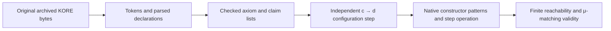

The reader accepts one alias followed by zero or more axioms or claims. It
handles ASCII identifiers, line comments, nonnested block comments and all
documented string escapes, including Unicode escapes with scalar-value checks.
A **Unicode scalar value** is a code point at most `U+10FFFF` outside the
surrogate range `U+D800`–`U+DFFF`. Lists reject missing punctuation and trailing
commas. Unknown forms and trailing tokens fail the complete read. Sorts are
ground zero-argument sorts; applications have at most two arguments in this
profile. **Ground** means there are no sort variables to instantiate.

The input retains constructor names, instantiated sorts, variable names, alias
application and five string-valued metadata attributes. The checker validates:

- The complete alias signature and its constructor body.
- Argument order, distinct captured names and their sorts.
- Empty sort-parameter lists and the metadata whitelist.
- An alias name distinct from every fixed profile sort, constructor and
  metadata name.

Axiom rules and claim goals are stored separately: claims add no transition
edges. Unsupported declarations fail the whole input.

`parsed_archived_bytes` and `checked_archived_bytes` compute the parser and
checker on the two original archived files through Lean's kernel, without
normalizing their whitespace. `check_source` recovers the actual parse and
validated alias from any successful check. `checkInput_axioms_iff` proves that
the installed rules are exactly those obtained from the parsed axiom
declarations. `declaration_matching_sound` uses that source membership to prove
native matching validity. The earlier normalized serialization equalities remain
separate structural checks; their whitespace-stripped strings are not reader
round-trip examples.

`Config` and `Step` independently describe ordinary data and operational rule
instantiation. The native matching model interprets six sorts and actual state,
injection, sequence, cell and top-cell constructors. Compiled configuration
patterns denote exactly their source singleton values. The designated step
operation denotes predecessor reachability, with an exact successor-set theorem.
The one-path-next encoding has exactly the source rule's satisfaction condition;
a generated step proves finite reachability and the existing μ-matching
sentence. Here **μ** denotes a least fixed point: repeatedly closing a set under
one-step predecessors gives precisely finite reachability in this encoding.

The concrete example proves that the checked text generates exactly the
independent `c → d` relation for every captured tail and counter. Its matching
validity theorem composes the text check with that independent relation.

The controls exercise both accepted and rejected input:

- Changing the source state to the escaped string `"\u0061\x62"` gives the rule
  `ab → d`, demonstrating structural parsing beyond the pinned state names.
- Comment markers inside strings remain string contents; comments between
  tokens act as whitespace.
- Duplicate captures, alias-name collisions, wrong alias results, unknown
  semantic attributes, malformed strings, illegal Unicode values, unterminated
  comments, trailing commas and trailing declarations reject.
- The earlier tree checks reject reversed alias arguments, changed captures,
  wrong sorts, sort parameters and unsupported next declarations.
- A changed endpoint is not a source step. Parsed claim-only input has no
  transitions.

For a small Lean client:

```lean
import Silmaril.Logic.Kore.Operational.Text.Examples

open Silmaril.Logic.Kore.Operational.Text

example : check Examples.sourceBytes = some Examples.sourceProgram :=
  Examples.checked_archived_bytes

example (p : CheckedProgram) (h : check Examples.claimBytes = some p)
    (x y : Silmaril.Logic.Kore.Operational.Config) :
    ¬ Silmaril.Logic.Kore.Operational.Step p.checked.axioms x y :=
  Examples.claim_only_no_step p h x y
```

The adjacent upstream `test.k` and emitted `definition.kore` disagree on AB/AC
conditions and configuration fields at this revision. They are archived
separately; this slice formalizes the emitted CD specimen and does not assert a
translation theorem from that K source. Full K configurations, modules, imports,
recursive aliases, hooks, priorities, side conditions, arbitrary domain-value
semantics and frontend completeness remain pending. The separate
conditional all-path extension now proves
finite-complete-path partial correctness for installed guarded rules under an
explicit enabled-competitor exclusivity condition, including the checked AB/AC
source. It retains arbitrary integer captures and reuses the existing matching
translation. General all-path source rule-system soundness, termination and
all-path native Wasm simulation remain outside that result.
The generic all-path progress API proves a guarded
invariant principle for the existing finite-complete-path partial-correctness
semantics, including the existing reachability institution. It does not yet
supply the K source rule calculus or frontend completeness theorem.
The existing Wasm execution clients remain separate: this slice does not claim
a Wasm-to-KORE compiler or configuration simulation.

To check the header API, concrete source correspondence, rejection controls and
exact axiom allowlists, run from the guarded worktree:

```sh
bin/mor build --no-pool Silmaril.Logic.Kore.Operational.Examples Silmaril.Logic.Kore.Operational.Audits Silmaril.Logic.Kore.Operational
bin/mor build --no-pool Silmaril.Logic.Kore.Operational.Text.Examples Silmaril.Logic.Kore.Operational.Text.Audits Silmaril.Logic.Kore.Operational.Text
bin/mor check
bin/mor layout
bin/mor isar lint Silmaril/Logic/Kore/Operational Silmaril/Proofs/Logic/Kore/Operational --deny
git diff origin/main...HEAD --check
```

The package guard and host build slot still apply with `--no-pool`. The original
operational receipt and
text-reader receipt
record their exact commands and source hashes. These record targeted builds;
full builds run in CI. The axiom guards check that selected declarations use at
most Lean's standard `propext`, `Classical.choice` and `Quot.sound` axioms.
Registry and textual checks do not validate mathematical statements.

| Claim | Source under `Silmaril/Logic/Kore/Operational/` |
| --- | --- |
| Lexer, parser, complete-input and alias checks | `Text/Defs.lean` |
| Checked-source recovery and exact axiom origin | `Text/Thms.lean` |
| Original bytes, independent steps and text controls | `Text/Examples.lean` |
| Structural constructor and next/reachability semantics | `Defs.lean`, `Thms.lean` |
| Exact axiom dependencies | `Audits.lean`, `Text/Audits.lean` |

The current whole-page source review checked the lexer/parser, profile checks,
source-origin proofs, constructor denotations and example controls against the
retained original bytes. The receipt results and axiom checks above are
historical: this documentation audit ran no Lean, Cargo, test or producer and
performed no new transitive axiom audit. CD uses a natural-number counter; the
separate conditional AB/AC model uses integer value and counter cells.


## Named positive KORE fixed points

The isolated `Silmaril.Logic.Kore.FixedPoint` pattern frontend connects named KORE
text to the existing native matching-logic fixed-point semantics. A **set
variable** such as `@X:S{}` denotes a set of values of sort `S`; an element
variable such as `x:S{}` denotes one value. The binder `\mu{}(@X:S{},p)` takes
the smallest set unchanged by evaluating its body, and `\nu{}(@X:S{},p)` takes
the largest such set. These are the least and greatest fixed points. A pattern
is **positive** here when set variables never occur under negation; this initial
grammar excludes negation altogether.

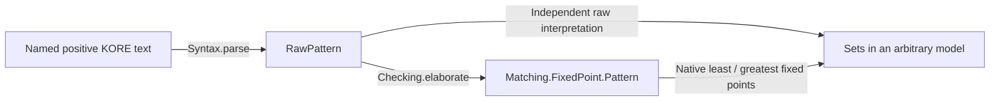

`Semantics.elaborate_sound` proves the two meanings equal whenever checking
succeeds, for arbitrary models, object valuations, set valuations and declared
symbol profiles. `Semantics.read_sound` retains actual parsing in the statement.
The raw interpretation recurses on named syntax and original symbol lookup; it
never calls elaboration or native pattern denotation. A **pre-fixed set** contains
the entire result of evaluating the body with that set as the variable's value;
a **post-fixed set** is contained in that body result. Intersecting the pre-fixed
sets gives the least fixed point, while taking the union of the post-fixed sets
gives the greatest, for accepted bodies. These bodies are **monotone**: enlarging
a set valuation cannot remove denoted values. `accepted_monotone` establishes
this property, and `closed_satisfies` transfers closed satisfaction.

For example, with `seed():S` interpreted as zero and `step(S):S` as successor:

```text
\mu{}(@X:S{},\or{S{}}(seed{}(),step{}(@X:S{})))
```

`Examples.source_reaches_all` proves that the actual source denotes every
natural number. The proof uses induction and leastness, covering arbitrarily
many successor steps. On another model with a self-loop at `true` and a dead
end at `false`, `\nu{}(@X:S{},step{}(@X:S{}))` denotes exactly `{true}`
(`source_forever_loop_only`). No reachability predicate is added as an operation.

The checker has separate sorted object/set contexts. Nearest bindings shadow
older names before sort checking. Controls distinguish `mu X.X` (empty) from
`nu X.X` (universe), and nested same-name `mu X.nu X.X` denotes universe.
Rejection controls cover negative set occurrences, wrong binder sorts, missing
variables/symbols, wrong arity, malformed set names, unsupported builtins and
trailing tokens. Mixed-sort object quantification and separate variable
namespaces have positive controls.

This is a positive monomorphic **pattern** subset: element/set variables,
ordinary applications, top/bottom, binary and/or, exists/forall and mu/nu. It
reuses the existing `Modules.Scope.signature` with actual declaration origins
and arbitrary arities. Free contexts are explicit; no automatic universal
closure or alias expansion is added by the standalone reader. A separate
positive module profile now shares the parameterized
complete envelope/checker and infers universally quantified free contexts. Negation, implication, full polarity normalization, domain values,
rewrites, next and polymorphism remain outside these frontends. No K execution, compiler or backend-completeness claim follows.

Fuel exhaustion and unsupported raw children can produce empty fallback sets
under semantic binders; raw interpretation is not an input-validity checker.
The adequacy and monotonicity theorems require successful checking at the same
fuel. They make no claim about failed inputs or arbitrary fuel changes.

The grammar source remains pinned under
The lexer is a local adaptation of `Operational.Text.lex`, adding authentic
`@` names while reusing its ASCII/comment/string helpers. The native fixed-point
model and interpretation supply the frontend's target meaning.

The targeted remote `lake build --wfail Silmaril.Logic.Kore.FixedPoint.Audits`
checks the complete new module closure. Its 27 exact declaration guards permit
only `propext`, `Classical.choice` and `Quot.sound`, including the generic
adequacy theorem and concrete source properties. Structural registry/layout
checks do not establish these semantic claims. The grammar correspondence is
source-reviewed; no formal parser-correctness theorem against the whole
upstream grammar, full-repository CI pass or timing-gate pass is asserted here.


## Positive fixed points in complete KORE modules

This private slice connects the named positive μ/ν frontend to the existing
complete module checker and shared institution presentations. It checks actual
module text, declaration origins, global name uniqueness, ordered imports and
transitive visibility. Axioms become assumptions; claims remain judgments.
It does not establish support for full K or arbitrary K-generated KORE.

A **positive** pattern here combines variables, applications, conjunction,
disjunction, element quantifiers and μ/ν binders. It has no negation or
implication. Each symbol acts on sets by taking all operation results from
arguments in those sets, so these constructors preserve inclusion of sets.
A **pre-fixed set** contains every result of applying the body to itself;
a **post-fixed set** is contained in those results. The least fixed point μ is
the intersection of pre-fixed sets. The greatest fixed point ν is the union of
post-fixed sets. These are mathematical set definitions, not finite unrollings.

## Actual source and model

[Modules/Examples.lean](../../Silmaril/Logic/Kore/FixedPoint/Modules/Examples.lean)
checks this complete input:

```text
[]
module BASE
  sort S{} []
  symbol seed{}():S{} []
  symbol step{}(S{}):S{} []
  axiom{} \mu{}(@X:S{},\or{S{}}(seed{}(),step{}(@X:S{}))) []
endmodule []
module USE
  import BASE []
  claim{} \mu{}(@X:S{},@X:S{}) []
endmodule []
```

The witness model has carrier `Nat`, seed `{0}`, and successor operation.
Induction proves that the reachability axiom contains every natural number.
The claim has empty denotation and fails at zero. The importer still has a model:
its presentation imports the axiom, and does not assume the false claim.
`imported_origin` retains the original `BASE` declaration index.

## Source institution and comparison

A source sentence stores the named scope, raw pattern, sorted free-variable
contexts, native checked pattern, and proof that the actual checker returned it.
It also stores a signature interpretation from that scope into its ambient
signature. Satisfaction independently evaluates the raw pattern in the actual
model reduct along that interpretation. It does not define source truth by
calling native denotation.

A signature morphism composes the stored interpretation. It leaves the original
raw syntax and declaration identity intact; it does not claim to rename bytes.
Lowering maps the actually checked native pattern along that interpretation.
The adequacy theorem and existing native map/reduct laws prove satisfaction
preservation and reflection. `loweringComorphism` has identity signature and
model functors and is model expansive; `entails_iff` therefore preserves and
reflects semantic consequence without an extra semantic assumption.

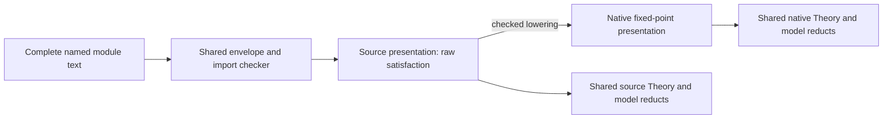

`lowerPresentation` maps actual shared presentations and their arrows.
`models_native` and `proves_native` identify their models and consequence.
`import_square` states that lowering a composite import equals composing the
lowered import arrows. Both sides use actual declaration-backed signatures.

## Reuse, controls and limits

The common module AST is parameterized by axiom/claim pattern type. The parser
accepts a pattern reader; aliases retain their original first-order syntax.
`SentenceProfile` chooses a sentence checker, visibility check and institution.
The original first-order APIs are default specializations, and their existing
`Modules.Theory.Examples` remains a compatibility target. Sorts, symbol profiles,
locations, name uniqueness, import resolution, origin retention, presentation
construction and the import/theory/reduct theorems are shared.

[Modules/Controls.lean](../../Silmaril/Logic/Kore/FixedPoint/Modules/Controls.lean)
checks hidden symbols, late/forward imports, duplicate global names, unsupported
aliases and negative occurrences, and a diamond that shares one symbol identity
while retaining two paths to the same imported axiom origin. Free element and set
variables get separate inferred contexts and universal sentence semantics.

Still pending: full polarity normalization, negative occurrences where admissible,
positive fixed-point alias expansion, polymorphic sorts and symbols, attributes
beyond the supported empty form, the remaining KORE constructs, and correspondence
with actual output from arbitrary K backends. These limits remain separate from
the proved positive-fragment institution comparison.


The separate general Boolean module profile now
admits not/implies/iff and arbitrary free set polarity with executable local
binder positivity. It uses a genuine general native target rather than claiming
that mixed-polarity source syntax normalizes into this positive-only endpoint.


## General Boolean fixed points in matching logic and KORE

`Matching.GeneralFixedPoint` adds general Boolean patterns with separate element
and set variables. `Kore.GeneralFixedPoint` reads named patterns and complete
monomorphic modules into that syntax. It removes the earlier requirement that
all free set variables occur positively. The actual restriction is local:
**each μ/ν body must be positive in its own bound recursion variable**.

Some terms used below:

- A **pattern** denotes a subset of a sort's carrier: the values it matches. Over
  `Nat`, an element variable assigned `3` matches the singleton `{3}`. A set
  variable can instead be assigned `{0, 2, 4}` or any other subset of `Nat`.
- **Positive in X** means every free occurrence of `X` has an even number of
  surrounding negations: `not (not X)` is positive; `not X` is negative.
- **Monotone** means enlarging an input set never shrinks the output set.
  Positivity guarantees this for the variable bound by a fixed point.
- **μ**, the least fixed point, chooses the smallest solution of the recursive
  set equation. `mu X.(seed or step(X))`, with seed `{0}` and successor step,
  is the smallest set containing zero and closed under successor: all `Nat`.
- **ν**, the greatest fixed point, chooses the largest solution. For the body
  `X` itself, every set is a solution: `mu X.X` gives `∅`, while `nu X.X` gives
  the whole carrier.
- A **model reduct** reads a target model using the source vocabulary through a
  signature interpretation. Here it keeps the carriers and obtains each source
  operation by looking up its interpreted target operation.
- An **institution comorphism** translates signatures and sentences forward and
  models backward by reduct, with an exact agreement of truth. **Model expansive**
  means every source model is the reduct of some target model. Both edges here
  use identity model translations, so the same model supplies that witness.

For example, these patterns are admitted:

```text
\or{S{}}(@Y:S{},\not{S{}}(@Y:S{}))
\mu{}(@X:S{},\and{S{}}(@X:S{},\or{S{}}(@Y:S{},\not{S{}}(@Y:S{}))))
\not{S{}}(\mu{}(@X:S{},@X:S{}))
```

The first has mixed free occurrences of `Y`. The second has the same mixed free
occurrences inside a fixed point, but is positive in the bound `X`. The third
negates a complete fixed point; its body is still positive in its own `X`.
`mu X.not X` is rejected, as is an inner binder whose own variable occurs
negatively. Binding is sorted, nearest-name shadowing; the two variable namespaces
remain distinct. `not`, `implies` and `iff` are recognized; the latter two expand
to their Boolean definitions while parsing. This is not a polarity-normalization
claim into the old positive-only language.

## Why local positivity suffices

A pattern denotes a set of results over the existing arbitrary nonempty sorted
carriers and arbitrary set-valued operations. The meaning of negation is set
complement. Therefore `not Y` is not monotone in free `Y`: enlarging `Y` can
remove results. `negative_free_not_monotone` proves this with actual Nat sets.

The executable `Pattern.occurs` records positive and negative occurrences of a
queried free variable, shifting its index under binders. `Pattern.admissible`
checks that every fixed-point body's bound index has no negative occurrence,
and recursively checks all nested bodies. It does not constrain the other free
variables. An admitted native sentence carries proof that this check returned
true; the named sentence checker runs it after actual sorted elaboration.

`Pattern.denote_variance` proves inclusion from the two corresponding directions
of change in set valuations. From this, `body_monotone` derives monotonicity in
the bound variable with all other valuations fixed. It supplies the actual
Mathlib order homomorphism (a function preserving inclusion) used for the
least/greatest fixed-point unfolding,
induction and coinduction laws. No monotonicity oracle is supplied by a model.
The direct greatest fixed point also equals the complement of the least fixed
point of the complement-conjugate body, reusing the existing fixed-point duality
theorem. This is a semantic conjugation law, not a new syntactic substitution API.

Raw direct denotation is defined even before admission. A **pre-fixed set**
contains every result of applying the body to that set; a **post-fixed set** is
contained in those results. The interpretation intersects all pre-fixed sets for
μ and unions all post-fixed sets for ν. Invalid bodies receive no
fixed-point/unfolding claim. The raw named interpreter also has fuel fallback
behavior under binders; adequacy only concerns successful checking at the
recorded fuel. Rejected input is not silently admitted by either interpretation.

## Genuine semantic edges

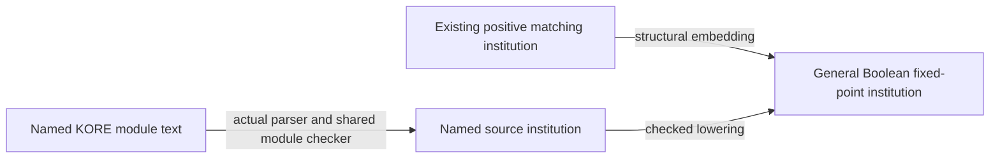

The native institution keeps the existing relational model homomorphisms and
actual signature reducts. Its signature and sentence maps preserve the local
admission check, and the denotation/reduct theorem proves satisfaction.
`positiveComorphism` embeds all existing positive patterns, including dual
applications, with exact denotation and unchanged models. It is model expansive,
so it preserves and reflects semantic consequence.

The named institution retains a scope, raw syntax, sorted free contexts, checked
native pattern and admission proof, plus an explicit signature interpretation.
Its satisfaction runs the independent raw interpreter in the actual reduct
along that interpretation. Mapping composes the interpretation and retains the
original named source; it is not a claim to rename original bytes. Adequacy
proves the lowering satisfaction law; identity model functors give model
expansiveness and consequence equivalence. `Hets.graph` registers both actual
comorphisms in the shared graph API. No global viewer/status registry is changed
by those declarations.

## Complete modules and concrete model

The module frontend uses the existing parameterized envelope, origins, globally
unique names, ordered earlier imports, transitive visibility and shared
Presentation/Theory machinery. The original first-order and positive profiles
remain compatibility targets. This alias-free entry point rejects alias
declarations. The separate general-alias profile
checks terminating aliases with both variable namespaces and proves agreement
with an independent interpreter of their original bodies. Claims remain
separate judgments and do not enter imported axiom sets.

[Modules/Examples.lean](../../Silmaril/Logic/Kore/GeneralFixedPoint/Modules/Examples.lean)
checks complete BASE→USE text. BASE declares an actual zero seed and successor
operation and a reachability axiom with double negation around its recursive
step. USE imports it, adds the mixed free-set axiom `Y or not Y`, and records the
false `mu X.X` claim. Induction proves that every natural lies in the least
successor closure, and a separate argument proves the free-set axiom for every
valuation. The actual Nat model therefore satisfies the importer's full axiom
presentation while refuting its claim at zero.

A **presentation** records a signature and its axioms. Its **theory closure**
adds every sentence true in all models of those axioms; this leaves the model
class unchanged. Source/native presentations, their theory model classes,
semantic consequence, import arrows and model reducts are instantiated.
`import_square` states that translating composite import arrows equals composing
the translated arrows. `checkText_parsed_source` retains exactly the parsed syntax tree.
Controls reject negative own-binder occurrences, bad nested shadowing,
negative implication antecedents, hidden symbols and alias declarations in
this alias-free entry point, while accepting positive implication consequents,
negated fixed points and mixed free polarity.

## Correspondence and remaining work

The local positivity rule matches Chen–Roșu 2019, Definition 17: every free
occurrence of the variable bound by μ must lie under an even number of negations.
KORE grammar bytes are likewise unchanged under `kore-first-order-fragment`.
Finite sorted contexts and fixed-sort signature maps retain the existing model
size conventions. General sort-changing transport, a normalization theorem into
the old positive syntax, and the full paper proof calculus/completeness remain
separate work. Named alias expansion is supplied by the separate general-alias
profile below.

This implements the general Boolean/local-polarity syntax and source-module
semantic comparison; it does not complete K. KORE predicates/packages, domain
values, hooked symbols, nonempty attributes, polymorphism, arbitrary K-generated
definitions and full K compiler/operational correctness remain outside this
alias-free profile. Existing scoped transition/reachability adapters
keep their own hypotheses and are not replaced by this frontend.

The native simultaneous substitution API
now handles both variable namespaces, mixed free polarity and all binder shifts.
It proves local-admissibility preservation, unrestricted set substitution
semantics, and element substitution semantics with the necessary singleton
condition, discharged for ordinary algebraic terms. This does not add aliases
to the named frontend.

A separate general-alias source endpoint
adds checked monomorphic terminating alias expansion with both formal namespaces,
independent raw semantics, and source institution/model/consequence comparisons.
It is a sibling profile; the alias-free profile described here keeps its scope.

The separate Bool/Int builtin extension keeps the
complete general-alias module envelope and adds checked domain values and exact
`INT.eq`/`BOOL.not` declarations. Its independent raw/native theorem and
fixed-scope source/native rooms use actual restricted builtin models; the
alias-free default profile here remains unchanged.


## General KORE aliases

This private implementation adds a KORE reader, checker and semantic interpretation under
`Silmaril.Logic.Kore.GeneralFixedPoint.Aliases`. It leaves `firstOrderProfile` and the
existing alias-free general profile unchanged. The scope is monomorphic aliases
whose dependency expansion terminates within the supplied fuel. It is not a
semantics for recursive alias equations or the full K language.

## Terms and the two paths

- An **alias** is a named pattern with formal parameters. Calling it supplies
  actual patterns for those parameters, like a function call that returns a set.
- **Monomorphic** means every sort in the alias is fixed; the reader does not
  instantiate sort parameters.
- **Fuel** is a finite budget for recursive checking and expansion. Running out
  rejects the input; increasing the budget can admit a deeper terminating chain.
- **μ** selects the least fixed set of an admitted body; **ν** selects the greatest.
  They describe potentially infinite sets, not a prescribed number of unfoldings.
- A **model reduct** reads a model through a map of operation symbols. A source
  operation uses the target model's graph at its mapped symbol. Alias expansion
  itself adds no operation or carrier, so its source and native models are the same.

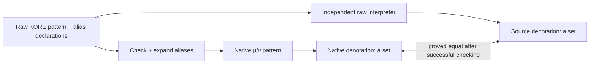

The lower path interprets the original patterns and alias bodies directly. It
never asks the compiler for the answer. The theorem compares these two paths.

## Why alias formals denote sets

A matching-logic pattern denotes a set of carrier elements. An alias argument
such as `or(seed(), step(seed()))` can denote several elements. Even an
**element-named alias formal** must therefore receive a set when it stands for
that actual pattern. It cannot silently be interpreted as one carrier element.

`Matching.GeneralFixedPoint.SetObjects` supplies this auxiliary interpretation
and proves its simultaneous substitution law without singleton premises.
`denoteSetObjects_singleton` proves agreement with the existing interpretation
when element environments contain singletons. Real element quantifiers still
range over individual carrier elements and install singleton values. The ordinary
element-variable semantics has not changed.

## What expansion and its proof do

The raw alias declaration retains the source order, names, sorts and namespaces
of all formals. The compiler checks the body in fresh formal contexts and compiles
actuals in the caller contexts. It then applies the existing native simultaneous
substitution. Under an element binder, both replacement families shift their
object indices; under a set binder, both shift their set indices. A caller's free
`x` or `@X` stays free even when the alias body binds the same source name.

The independent raw interpreter does not call the compiler or native pattern
interpretation. It evaluates actuals to sets, creates fresh formal environments,
and directly interprets the raw body. Its element quantifiers bind carrier
elements, and its μ/ν clauses are actual intersections of pre-fixed sets and
unions of post-fixed sets. `Aliases.Semantics.elaborate_sound_setObjects` proves
that successful expansion preserves this independent meaning, for arbitrary
formal environments and both fixed-point constructors. The singleton corollary
applies to ordinary source sentences.

Local positivity remains the actual Boolean `Pattern.admissible` test at every
μ/ν binder. `Aliases.Checking.expansion_admissible` applies the native preservation
proof to the very substitution used by the compiler. The module checker validates
all alias bodies, including unused ones, and checks the resulting sentence's
admission. No semantic preservation predicate is supplied as an input.

The syntactic functions are reducible Lean definitions and concrete acceptance
and rejection controls use `decide +kernel`. The native traversal definitions
use induction recursors marked `noncomputable`; this endpoint does not claim a
compiled standalone checker or native-code execution of those traversals.

## Modules and logical relationship

The common module envelope has a defaulted alias type and alias parser. Existing
APIs retain first-order alias parsing. The new complete-text reader selects the
general pattern grammar for alias bodies and mixed-namespace left-hand sides.

The new module checker enforces global declaration uniqueness, declared
formal sorts and distinctness, body closure, result sort, import order and
transitive visibility. Compilation uses an ambient symbol/alias table; a separate
visibility pass prevents that table from granting access to hidden declarations.
Every alias body is expanded at checking time, so unused cycles also reject.
Fuel exhaustion is rejection; finite but deeper expansions can require more fuel.

Checked source sentences retain their raw body, alias table, contexts and
successful compilation evidence. Satisfaction runs the raw interpreter.
`Aliases.institution` has actual operation-graph model reducts.
`loweringComorphism` translates to native general fixed-point matching logic,
with literal identity on models and a model-expansiveness proof.
`models_lower_iff`, `satisfiable_iff`, `unsatisfiable_iff` and `entails_iff` state
preservation and reflection. Checked module presentations, semantic theories and
import arrows are related to native presentations in `Aliases.Modules.Thms`.

## Concrete infinite-carrier example

The complete module fixture declares `seed`, `step`, `both` and the alias chain
`chain`, then calls `chain(or(seed(), step(seed())), top())` in an imported
module's axiom. In its Nat model, `seed()` denotes `{0, 1}` and `step` takes
successors. The element-named actual `E` therefore denotes `{0, 1, 2}`.

The μ branch is `μ X. E ∪ step(X)`. Every pre-fixed set contains zero and is
closed under successors, so induction puts every natural number in its least
fixed set. The ν branch is `ν Z. top ∩ (E ∪ step(Z))`. All of Nat is postfixed:
zero belongs to `E`, and every successor has its predecessor in Nat. Its greatest
fixed set is therefore also all of Nat. Their conjunction denotes all of Nat.

`ModuleExamples.source_axiom_all` proves that the independent raw interpreter
of the actual accepted alias call returns this set. `axiom_expansion` connects
the actual native compiler output to the displayed μ/ν pattern. Its proof uses a
semantics-preserving canonical presentation of finite argument functions and
first-order leaves; it assumes no preservation oracle or syntax equality.

## Source pin and limits

The pinned grammar is
`kore-syntax.md`,
Haskell revision `ec0486c03af923071544fd61e35e9426507aac33`, SHA256
`4a73aa604e2bef4727aeb0c82fb800df8122e5975b875fcc31b3875071e6fafd`.
Its variable-pattern grammar permits both namespaces. Its alias validity rules
require distinct formals, declared arity and sorts, a correctly sorted body and
no extra free variables. The implementation's termination restriction is an
explicit scope restriction, not a claim that the grammar bans recursion.

Unsupported polymorphic sorts, attributes, recursive aliases and other KORE
constructs remain outside this endpoint. The full module fixtures, rejection
controls and declaration-level axiom guards accompany the source; targeted Lean
and structural check results must be reported separately from these claims.


## KORE Bool/Int domain values and hooks

This sibling of the general alias frontend
adds checked `\dv{SortInt{}}("-2")` and exact `true`/`false` Boolean domain
values, plus declared `INT.eq` and `BOOL.not` hooks. It keeps the existing
monomorphic module/import/declaration envelope, arbitrary ordinary symbols,
terminating aliases with both variable namespaces, Boolean connectives, and
locally positive general μ/ν bodies. Integer text is nonempty decimal digits
with an optional leading minus; whitespace, plus signs and digit separators
reject. The reader accumulates actual unbounded integers, and generated names
use decimal digits rather than unary encoding. It does not specialize the input to one
fixture or alias body.

The entry point is
[`Builtins.Checking.checkText`](../../Silmaril/Logic/Kore/GeneralFixedPoint/Builtins/Modules/Defs.lean).
The parser accepts only the supported hook attribute and its exact profile:
`(SortInt, SortInt) → SortBool` for integer equality and
`SortBool → SortBool` for Boolean negation. Unsupported hooks, other nonempty
attributes, malformed literals, wrong profiles, hidden declarations and
unresolved imports reject. The ordinary sibling entry points retain their
previous rejection of domain values and hooked symbols.

## A small example

- A **domain value** is a sorted literal, such as integer `-2` or Boolean `false`.
- A **hook** names a built-in operation on a declaration with an exact profile;
  here equality compares actual integers and negation flips actual Booleans.
- A **room** bundles sentences, a model category, and satisfaction. The source
  and native rooms below share the same restricted builtin models.

```kore
[]
module ZERO
  sort SortInt{} []
  sort SortBool{} []
  hooked-symbol eqInt{}(SortInt{},SortInt{}):SortBool{} [hook{}("INT.eq")]
  hooked-symbol notBool{}(SortBool{}):SortBool{} [hook{}("BOOL.not")]
  axiom{} \or{SortBool{}}(
    eqInt{}(\dv{SortInt{}}("0"),\dv{SortInt{}}("0")),
    \not{SortBool{}}(eqInt{}(\dv{SortInt{}}("0"),\dv{SortInt{}}("0")))) []
endmodule []
```

The axiom says a pattern or its complement covers the Boolean carrier. The
individual equality call computes `{true}`. The concrete Lean model checks these
separate computations:

| Integer input `x` | `INT.eq(x, 0)` | `BOOL.not(INT.eq(x, 0))` |
| --- | --- | --- |
| `0` | `{true}` | `{false}` |
| `-2` | `{false}` | `{true}` |

`Canonical.zero_guard`, `negative_zero_guard`, `zero_nonzero_guard`, and
`negative_nonzero_guard` state the corresponding operation-graph equalities.
The raw source interpreter and the adequacy theorem connect such computations
to successfully elaborated source patterns.

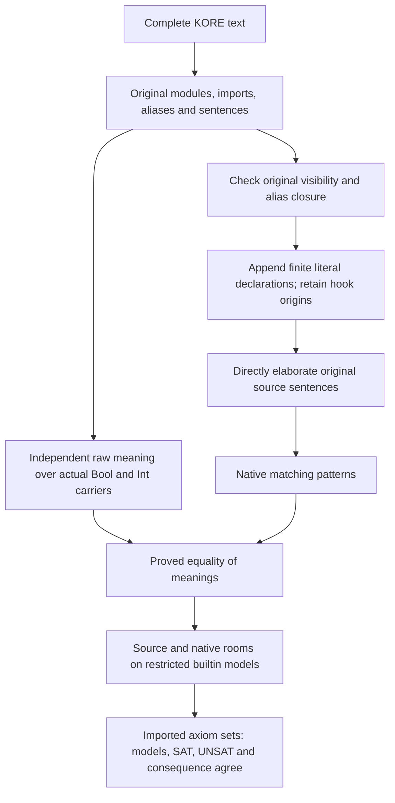

## Original syntax and native patterns

The checker first checks an original-visibility skeleton using the complete
existing alias/module checker. Replacing literals by top in this check does not
confer visibility on a previously undeclared source application. It then appends
only the finitely used literal constants to each module. Generated names start
with a prefix longer than every original declared name. Original declarations,
locations and declaration indices are retained, including through imports.

The checked record stores equations tying both skeleton and native lowering to
the original source. A module package additionally stores the successful
compilation of the original modules, each local axiom/claim list and ordered
import inheritance. Alias bodies retain their defining module's literal
namespace when called by another module.

[`Semantics.denote`](../../Silmaril/Logic/Kore/GeneralFixedPoint/Builtins/Semantics/Defs.lean)
interprets the original raw syntax independently. Integer/Boolean literals denote
actual carrier elements through explicit equivalences with Lean `Int`/`Bool`.
It interprets original alias bodies, set-valued alias formals, arbitrary model
operation graphs, and complete prefixed/postfixed-set fixed points. It does not
call lowering, the elaborator, or native denotation.

The [adequacy proof](../../Silmaril/Proofs/Logic/Kore/GeneralFixedPoint/Builtins/Adequacy.lean)
shows that successful direct elaboration has precisely this raw meaning under
arbitrary object and set valuations. The proof explicitly uses the literal
interpretation laws. The compiled native presentation is the lower-image of
these directly compiled original sentences; an AST equality with the auxiliary
alias checker's lowered output is not assumed.

## Models, theories and the semantic boundary

A [builtin model](../../Silmaril/Logic/Kore/GeneralFixedPoint/Builtins/Model/Defs.lean)
is an actual native matching model together with the carrier equivalences and
laws for the exact finite literal bindings and exact declared hook symbols.
The hook laws constrain every semantic argument tuple to the corresponding
singleton result, including arguments never written as literals. Unrestricted
interpretations of fresh constants do not satisfy these requirements automatically.
The category retains all actual native relational homomorphisms between these
restricted models. This does not assert that homomorphisms preserve complement
satisfaction.

The [fixed-scope source/native rooms](../../Silmaril/Logic/Kore/GeneralFixedPoint/Builtins/Institution/Defs.lean)
use this same restricted model category. Their corridor preserves and reflects
satisfaction, models of axiom sets, satisfiability, unsatisfiability, and semantic
consequence. The [module bridge](../../Silmaril/Logic/Kore/GeneralFixedPoint/Builtins/Modules/Defs.lean)
instantiates these facts for original local and imported axioms. Claims remain
obligations and never become extra premises. General transport between different
signatures must preserve carrier/hook/literal laws; it is outside this fixed-scope
corridor.

A hook call returning `{true}` is a Boolean *computation*, not a globally valid
matching sentence over a two-element Boolean carrier. Global source satisfaction
quantifies every result element. Point-membership/singleton computation examples
and validity of top or excluded-middle axioms therefore establish different
facts. The [concrete model](../../Silmaril/Logic/Kore/GeneralFixedPoint/Builtins/Modules/Canonical.lean)
uses actual Int/Bool carriers (Unit at other sorts), zero, a negative integer,
both Boolean values and both total hook graphs. It is tied to a successfully
checked source package with satisfiable top axioms. The separate
[module controls](../../Silmaril/Logic/Kore/GeneralFixedPoint/Builtins/Modules/Examples.lean)
exercise arbitrary importing modules and original aliases.

This bounded profile does not supply K source compiler correctness, every
K-generated definition, polymorphism, arbitrary attributes, predicates or
packages, cross-signature builtin transport, a guard-to-SMT proof bridge, or a
full K operational simulation. The existing conditional operational/update
adapters retain their own assumptions and scope.

For monomorphic hooked-sort metadata and arbitrary declared integer/Boolean
names, see declared builtin sorts. The canonical frontend
described here remains its legacy specialization.


## KORE builtin membership and quantified SMT

SMT means **satisfiability modulo theories**: logical formulas interpreted with
background theories, here integer arithmetic and Booleans.

The general typed compiler correctness theorem passed strict remote Lean checking
at `a48cc1a3820b`, job `154-5019c6b3`. It proves that the generated SMT formula
holds exactly when its output belongs to the typed source pattern's denotation,
for every supported pattern, valuation and output term. The proof connecting
original raw KORE syntax to that typed semantics also passed strictly at
`09a2d5d6f457`, job `269-f8f5e843`; its public interface and unconditional raw comparisons passed in the strict Audits closure
at `352f09ebf5b2`, job `293-586cf14d`.

A pattern denotes a **set** of possible values. A **characteristic formula** is
a formula that tests membership in that set. A **hook** is a declared builtin
operation with a checked argument/result profile. The compiler uses existing
`Uflia.Quantified.Term`; integer equality introduces two existential integer
witnesses, and Boolean value negation introduces one Boolean witness. A free
object variable becomes a unary membership predicate, so its value can be empty
or contain several elements.

For example, let `X` denote `{0, 1}`. The pattern `INT.eq(X,X)` can produce both
Boolean results: the two argument occurrences choose their members independently.
Its membership formula has the shape

```text
exists x y : Int, member_X(x) and member_X(y) and out = (x = y)
```

Choosing `x = 0` and `y = 1` admits `out = false`. Matching negation complements
a set; the `BOOL.not` hook instead negates each Boolean value in its argument set.

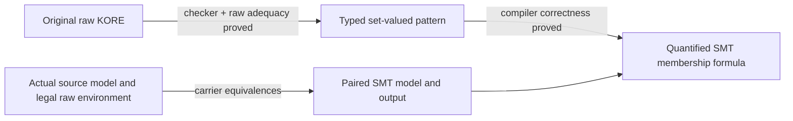

The supported language includes:

- Integer/Boolean object variables and literals, top, bottom, complement,
  intersection and union.
- The exact declared `INT.eq` and `BOOL.not` hooks with arbitrary supported
  children, including empty and nonsingleton sets.
- Arbitrary declared builtin sort names and source carriers equipped with the
  existing integer/Boolean equivalences and hook laws for every argument tuple.

The checker resolves the first actual source symbol and verifies its hook
profile. It rejects unsupported syntax, including ordinary symbols, aliases,
binders, fixed points and set variables. `LegalObjects` separately requires each
referenced raw binding to exist at its exact sort. Conflicting uses of one free
name at different sorts cannot satisfy this premise; the checker does not itself
perform a whole-pattern name-consistency check.

| Artifact | Checked frontier |
| --- | --- |
| `Smt.Defs`, `Smt.Checking`, `Smt.Source` | Strict remote Lean PASS, including typed syntax/compiler, raw checker, carrier transport definitions and legal-environment premise. |
| Private `Translation.compile_correct` | General typed correctness theorem strict PASS at `a48cc1a3820b`, job `154-5019c6b3`. Public theorem wrapper also strict PASS at `622c63cb65b0`, job `162-36b44764`. |
| Original raw-source adequacy | Private `rawAdequacy_task : Task.rawAdequacy` and RawHooks strict PASS at `09a2d5d6f457`, job `269-f8f5e843`, for the full original statement. Public wrapper and unconditional raw API strict PASS in the Audits closure at `352f09ebf5b2`, job `293-586cf14d`. |
| Typed rooms/theory SAT, UNSAT and consequence comparisons; typed renaming | Strict remote Lean PASS at `622c63cb65b0`, job `162-36b44764`. |
| Hook graphs, source base/connective lemmas, raw rooms/theory comparisons | Strict remote Lean PASS at `d7d603e12d97`, job `174-4924929e`; unconditional raw comparisons subsequently pass in the public Audits closure293. |
| Symbolic contradiction, empty/nonsingleton and repeated-variable controls | Strict remote Lean PASS at `1b0fc44b8a31`, job `193-66bded25`. |
| Lifted source models | Strict remote Lean PASS at `bc99d8b101f6`, job `199-d365afda`, including every original hook/literal law. |

At `19ca8e8d1420`, job `220-9dc694a0`, the 12 typed/supplementary
modules succeeded individually, but the job failed overall in RawHooks.
The raw-hook proof uses explicit operation/tuple transport; it and the full
raw-adequacy induction subsequently passed in job `269-f8f5e843`. Public
interface integration, original-source concrete controls and all 30 transitive
axiom ceilings then passed in job `293-586cf14d`.

A **room** packages sentences, models and satisfaction; a **corridor** relates
two rooms while preserving satisfaction. The raw room/corridor and raw theory
SAT, UNSAT and consequence comparisons now supply the proved adequacy theorem
internally, with strict checking in the public Audits closure. The original paired
model boundary is unchanged.
Each raw theory shares one finite context, one actual builtin model, one legal
set valuation and one source output. Its target models are paired with exactly
that source data. These statements do not establish expansion into arbitrary
unrestricted SMT models.

For that shared model, valuation and output interpretation:

- **SAT (satisfiable)** means some allowed model satisfies every sentence together.
- **UNSAT (unsatisfiable)** means no allowed model satisfies every sentence together.
- **Consequence** means every allowed model satisfying the theory also satisfies
  the stated conclusion.

This work does not establish full KORE acceptance, the full generated backend
frontend, a solver result or a replay checker. Registry and textual layout checks
passed at `352f09ebf5b2` (21035 modules); they do not elaborate Lean or audit axioms. No
local Lean build or solver call ran for this bridge. Full CI and PR readiness
remain held. Exact checkpoints and unchanged validation logs are retained in

The checked concrete controls instantiate Canonical's actual finite scope, six
operations, complete builtin laws and a binding containing two distinct integer
values; `INT.eq(X,X)` contains false in the original raw semantics, including
on the concrete lifted model. Of the 30 audited declarations, 28 depend on
`propext`, `Classical.choice` and `Quot.sound`; `rename_denote` uses only
`propext` and `Quot.sound`, and the typed `Examples.repeated_variable_false`
uses only `propext`. All exact records are retained with the build logs.


## K builtin signatures with changing sorts

This interface lets a signature map rename sorts, merge ordinary sorts and map
operations while retaining their integer, Boolean and literal behavior.

## Names, values and models

- A **signature** lists the sort names and operation profiles in a K scope,
  the declarations visible at a module. An operation profile gives its input
  sorts and result sort.
- Each signature designates its integer and Boolean sorts. Their names can
  differ between signatures: `KInt` can map to `Z`, and `KBool` to `B`.
- A **carrier** is the set of values assigned to a sort. A **model** assigns
  carriers and operation interpretations. These operation interpretations are
  relations, so an application can denote a set of results.
- A builtin model also contains bijections from its designated carriers to
  Lean's `Int` and `Bool`, and proofs of its declared literal and hook laws.
  A **hook** marks an operation such as integer equality or Boolean negation.
- A **model homomorphism** gives a function on each carrier and preserves the
  operation relations.
- A declaration's **label** records which literal or hook it implements.
  Labels attach to the declaration itself, including its origin and profile.
  They are not inferred from its printed name.

For example, a map may send both ordinary sorts `CfgA` and `CfgB` to the target
Boolean sort. It must still send the designated integer and Boolean sorts to
their respective target sorts, which remain distinct. It must also retain the
labels of every mapped operation. Dropping the label on literal zero would
discard a model constraint, so such a map is rejected.

The [signature definitions](../../Silmaril/Logic/Kore/GeneralFixedPoint/Builtins/SortMaps/Defs.lean)
give the category of these maps. A **category** provides identity maps and
composition, with their laws proved.

## What moves in each direction

A signature map sends patterns forward. Models move backward: a target model
is read using the source sort and operation names. This backward model action
is called a **reduct**.

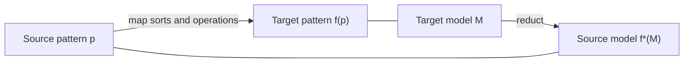

The satisfaction theorem says that `f(p)` holds in `M` exactly when `p` holds
in the reduct. A **room** packages sentences, models and their satisfaction
relation. A **corridor** provides these two actions and proves that equivalence.
An **institution** supplies compatible rooms and corridors for a category of
signatures.

The reduct retains the actual integer and Boolean carrier bijections. Its
identity and composition proofs compare those data, as well as the native
model. The literal and hook laws are proved from the retained target labels;
the caller does not supply a separate soundness assumption.

## Boolean patterns and fixed points

The typed pattern action includes:

- First-order patterns, relational application and free set variables.
- Complement, conjunction and existential object binders.
- Least fixed points, written `μ`, and greatest fixed points, written `ν`.

A pattern denotes a set of values. Complement means complement in its result
carrier. A sentence holds when its pattern contains every value of that carrier,
for every valuation of its free variables. In particular, the singleton pattern
`{true}` is different from the pattern containing all Boolean values.

For a simple fixed-point example, consider `F(X) = {true} ∩ X` on Boolean sets.
Its least fixed point is the empty set; its greatest fixed point is `{true}`.
Both use the same body. The difference is which fixed point the binder selects.
The admission check rejects a recursion variable under one negation, as in
`μ X. ¬X`; it accepts double negation. Free variables may occur in both
polarities. These are local binder checks, not a requirement that every pattern
be positive.

## Interfaces and checks

```lean
import Silmaril.Logic.Kore.GeneralFixedPoint.Builtins.SortMaps.Institution
import Silmaril.Logic.Kore.GeneralFixedPoint.Builtins.SortMaps.Forgetful
import Silmaril.Logic.Kore.GeneralFixedPoint.Builtins.SortMaps.Raw
import Silmaril.Logic.Kore.GeneralFixedPoint.Builtins.SortMaps.SurfaceControl
import Silmaril.Logic.Kore.GeneralFixedPoint.Builtins.SortMaps.Checker.Institution.Defs

open Silmaril.Logic.Kore.GeneralFixedPoint.Builtins.SortMaps

#check Hom.reduct
#check Hom.reductFunctor
#check nativeInstitution
#check forgetful
#check mapTop_satisfies
#check Silmaril.Logic.Matching.SortMaps.Hom.generalSatisfaction
#check Silmaril.Logic.Matching.SortMaps.fixedSortGeneral
#check SurfaceControl.lower_native
#check Surface.Step.elaborate_forward
#check Surface.SourceSentence.mapPath
#check Surface.SourceSentence.mapPath_lower
#check Surface.sourceInstitution
#check Surface.sourceLowering
```

| Interface | Role |
| --- | --- |
| `Hom.reduct`, `Hom.reductFunctor` | Restricted builtin models and all their native model homomorphisms. |
| `Hom.reductFunctor_id`, `Hom.reductFunctor_comp` | Identity and composition for the whole model functor. |
| `Matching.SortMaps.Hom.generalPattern` | Typed pattern action across arbitrary sort maps. |
| `Matching.SortMaps.Hom.generalSatisfaction` | Satisfaction equivalence for the full typed Boolean and fixed-point syntax. |
| `nativeInstitution` | Rooms and corridors using those typed sentences and restricted builtin models. |
| `Matching.SortMaps.fixedSortGeneral` | Natural inclusion of the existing fixed-sort Boolean/fixed-point institution. |
| `forgetful` | Institution morphism from builtin models to unrestricted matching models, with the model-functor square proved. |
| `renameRaw` | Bounded syntactic renaming of raw sort annotations and application names. |
| `mapTop`, `mapTop_satisfies` | Constructed checker receipts and satisfaction equivalence for visible top patterns. |
| `Surface.Step`, `Surface.toSemantic` | Ordered structural source steps and their semantic signature maps. Paths compose by concatenation. |
| `SurfaceControl.lower_native`, `SurfaceControl.source_square` | Direct checker-to-typed equality and raw satisfaction equivalence for the populated alias example. |
| `Surface.Step.elaborate_forward` | Every successful raw checker run maps to an exact target run at the same fuel and module index, after literal-profile validation. |
| `Surface.SourceSentence.mapPath` | Total action on actual checked receipts using each package's fixed alias list. |
| `Surface.SourceSentence.mapPath_lower` | Exact equality between lowering the mapped receipt and mapping its typed sentence. |
| `Surface.sourceInstitution`, `Surface.sourceLowering` | Raw-source satisfaction transport, identity/composition laws, and natural lowering to the typed institution. |

The [populated controls](../../Silmaril/Logic/Kore/GeneralFixedPoint/Builtins/SortMaps/PopulatedControls.lean)
retain six canonical operations and use the existing concrete builtin model.
They check the literal and both hook laws, ordinary sort merging, and rejection
of erased labels. The
[native controls](../../Silmaril/Logic/Kore/GeneralFixedPoint/Builtins/SortMaps/NativeControls.lean)
evaluate complement, an existential binder, and the two fixed points above in
that model. They give both satisfied and refuted sentences on the source and
target sides. A further
[operation control](../../Silmaril/Logic/Kore/GeneralFixedPoint/Builtins/SortMaps/OperationControls.lean)
maps `cfgStep : CfgA → CfgB` to Boolean negation after merging the two profile
sorts; its actual result changes from true to false and from false to true.
The
[raw controls](../../Silmaril/Logic/Kore/GeneralFixedPoint/Builtins/SortMaps/RawControls.lean)
apply Boolean negation to integer equality of two zero literals through a real
zero-argument alias. Source and target receipts are computed by the checker;
missing aliases and exhausted fuel are rejected. The
[structural source control](../../Silmaril/Logic/Kore/GeneralFixedPoint/Builtins/SortMaps/SurfaceControl.lean)
also preserves the declaration origins and proves that lowering those receipts
agrees with the typed map. Its raw satisfaction equivalence follows through that
equality and the independent typed satisfaction theorem.

The targeted remote strict build passed on source commit
`587caeea8991819b5ce9c6906920b68ce7822f1b`, including the checker examples,
`Usage.Defs`, and axiom checks for 104 declaration roots. These
checks reject dependencies on axioms beyond Lean's standard `propext`,
`Classical.choice` and `Quot.sound`; they also inspect dependencies through
imported theorems. The build receipt and logs
record this targeted result. Full ready-PR integration CI is tracked in

## Checked source text

A **checker receipt** records the raw pattern, variable names and sorts, module
index, fuel, and the successful checker equation. **Fuel** bounds recursive
checker calls, including alias expansion. **Lowering** forgets names and the
checker receipt, retaining the typed pattern and its admission proof.

The [source API](../../Silmaril/Logic/Kore/GeneralFixedPoint/Builtins/SortMaps/Checker/Institution/Defs.lean)
provides a general action on these receipts. `SourceSentence A` checks against
exactly `A.aliases`; its alias environment cannot vary independently of the
package. `ofChecked` converts an existing receipt when its alias list equals
the package's list.

A structural step retains declaration order and origins, renames symbol names
injectively, and maps all sort annotations. Sort maps may identify ordinary
sorts. The recursive theorem derives target success for every raw constructor:

- Literals, object variables, set variables, top and bottom.
- Declared applications and aliases, with both parameter namespaces.
- Complement, conjunction, disjunction, existential and universal binders.
- Least and greatest fixed-point binders, including nested alias substitution.

The theorem preserves the same fuel and module index. Alias bodies use the
alias's defining module; actual arguments use the caller's module. Nearest-name
variable shadowing and first-match declaration lookup retain their order.
Substitution avoids capture: substituting a free variable beneath a binder does
not turn it into that binder's variable.

`ValidatedPackage` checks that each literal binding is nullary and has the
result sort of its actual literal. For example, a binding for integer zero must
have no arguments and return the package's designated integer sort. This check
prevents a malformed earlier binding from becoming the selected literal when
ordinary sorts are merged. Every actual `CheckedDefinition` passes this check
by `checkedSource_literalProfiles`; `validatedSource` packages that proof.
Validation is preserved along structural paths.

The lower/native equation holds for every mapped source sentence:

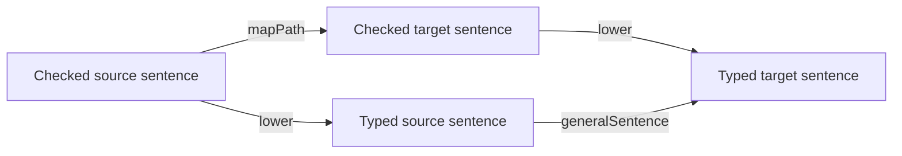

Following either route produces the same typed sentence. This equality and the
independent raw-interpreter adequacy theorem give raw satisfaction equivalence
against the actual restricted builtin-model reduct. `sourceInstitution` proves
identity and composition for the sentence and model actions; `sourceLowering`
proves this square commutes along every structural path.

The [generic alias example](../../Silmaril/Logic/Kore/GeneralFixedPoint/Builtins/SortMaps/Checker/Examples/Thms.lean)
uses literal zero, integer equality and Boolean negation inside an alias. It
supplies the source receipt, constructs the target receipt through `mapPath`,
and proves the lowering and satisfaction equations while merging `CfgA` and
`CfgB`. The earlier direct alias example remains useful when inspecting the
checker calculation; the generic version uses the reusable source action.

The checker theorem preserves successful source checks. It does not reflect
success from the target: after sort identification, a formerly wrong-sort
annotation can become well typed.


## Declared builtin sort names

The monomorphic `HookedSorts` frontend resolves integer and Boolean sorts from
exact `INT.Int` and `BOOL.Bool` declaration hooks. Source names such as `Number`
and `Truth` have no special meaning until those declarations select them.

```kore
[]
module DOMAINS
  hooked-sort Number{} [hook{}("INT.Int")]
  hooked-sort Truth{} [hook{}("BOOL.Bool")]
  hooked-symbol eq{}(Number{},Number{}):Truth{} [hook{}("INT.eq")]
  hooked-symbol not{}(Truth{}):Truth{} [hook{}("BOOL.not")]
  alias isZero{}(Number{}):Truth{}
    where isZero{}(X:Number{}) := eq{}(X:Number{},\dv{Number{}}("0")) []
  axiom{} \top{Truth{}}() []
  claim{} not{}(isZero{}(\dv{Number{}}("-2"))) []
endmodule []
```

`HookedSorts.checkText` reads the whole definition, resolves the two declarations,
and uses those names throughout the checked builtin compiler. The example is
constructed for this supported profile. It is not an unmodified generated K
output or an extracted upstream fixture.

The profile requires exactly one declaration of each builtin sort hook in the
whole definition, with distinct names. All original import visibility and name
checks still apply. Both declarations are required even if a definition uses
only one builtin domain. Unknown sort and symbol hooks reject; symbols must
have the exact profiles selected by the declarations. Literal syntax remains
signed decimal integers and exactly `true`/`false`. An ordinary declaration named
`SortInt` does not establish an integer domain in this frontend. A control even
assigns `INT.Int` to `SortBool` and `BOOL.Bool` to `SortInt`.

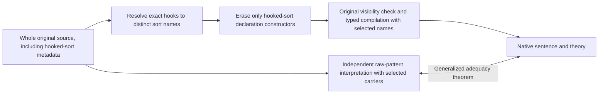

`Package` retains the original located source and the successful resolution
equation. Its underlying checked package is tied to `erase source`: erasure
changes only `hookedSort name hook` to `sort name`. It preserves module order,
locations, sort names, symbol declarations, imports, alias bodies and all original
raw sentences. No sort renaming or pattern translation is hidden in erasure.
The original alias compiler still distinguishes the defining module of an alias
body from the calling module of its arguments.

The existing builtin foundations are generalized once over `SortBindings`.
The canonical fallback instance keeps the prior `Builtins` frontend's
`SortInt`/`SortBool` behavior; that reader and all older siblings still reject
hooked-sort syntax. The shared adequacy proof is reused, with an additional
sort-binding parameter. Configurable binding instances intentionally coexist
with the canonical fallback, so the concrete-instance advisory lint is disabled
only in the generic foundation modules. New package clients should use
`letI := package.bindings` when projecting dependent semantic fields, or use the
explicit `Package.CheckedModule` and `Package.Model` wrappers.

For any selected names, restricted models supply carrier equivalences with real
`Int` and `Bool`. Literal laws constrain the actual finite declared literal
operations by exact symbol identity. `INT.eq` and `BOOL.not` laws constrain every
semantic argument tuple. Fixed-scope source and native Rooms retain all native
relational homomorphisms between these restricted models. Generic model,
SAT/UNSAT and consequence correspondence uses the same independent raw
interpreter and existing generalized adequacy theorem. The new package exports
model and SAT/UNSAT equivalences specialized to its computed sort bindings.

`HookedSorts.ExampleModel` is a variant of the earlier canonical example using
`Number`/`Truth` hooked-sort declarations. It constructs a real model of its
successfully checked package and proves source/native theory satisfiability.
Its six operation graphs realize both hooks and the literals `0`, `-2`, `true`,
and `false`. Original-source computations yield `{true}`, `{false}`, `{true}`,
and `{false}` for `eq(0,0)`, `eq(-2,0)`, `not(eq(-2,0))`, and `not(eq(0,0))`.
These singleton computations are not global matching validity over two-element
Bool. The satisfiable example uses a top axiom; its claims remain obligations.

The import/alias controls use complete constructed two-module definitions and
check selected names, original declaration origins, imported axiom inheritance,
separate claims, swapped conventional names, and failures for unknown hooks,
wrong profiles, malformed literals, conventional undeclared literal sorts,
missing imports, equal names, duplicate hooks and absent hook declarations.

Twenty-four unmodified complete upstream parser fixtures are pinned at
`runtimeverification/haskell-backend` commit
`ec0486c03af923071544fd61e35e9426507aac33`, with file hashes, exact bytes and its
BSD license under
`UpstreamControls` includes those exact files and kernel-checks whole-file
rejection. This is a supported-profile boundary, not a claim that the upstream
files are all valid or passed an upstream verifier. The broader search found
no complete fitting positive fixture among the pinned parser builtin fixtures.

Additional attributes (`functional`, `constructor`, `hasDomainValues`), further
hooks, `equals`/`in`, and sort/symbol polymorphism remain distinct next work.
Accepting empty braces or dropping an attribute is not a proof of those
semantics. This frontend does not establish complete K compilation or
operational correctness. See builtin domains for the
underlying model restrictions and source/native distinction.

The separate Boolean-only builtin profile admits the
complete pinned `test-bool-1.kore` using all Boolean hooks and retained
`hasDomainValues` metadata. The two-domain frontend described here keeps its
existing rejection controls and grammar.

The shared reader also supports explicit typed external registrations,
with independent operation graphs and exact-source models for the complete
pinned `test-hooks-1.kore` and `test-hooks-2.kore` fixtures. External hook meanings
are explicit interpretation contracts; unknown hooks remain rejected.


## Explicit external KORE hook registrations

`HookedSorts.External.checkText` extends the shared hook reader with a typed,
explicit registry. A registration binds source sort names to exact external
hook strings and assigns typed mathematical graphs to symbol hooks. The
existing builtin and Boolean readers retain their policies and use the shared
attribute reader. This extension assigns no builtin meaning to `S.S` or `S.f`.

The reader preserves the complete located source definition. Resolution checks
exact source-name/hook bindings and rejects duplicate sort and symbol hooks.
Symbol profiles must match registered argument and result sorts. Only the hook
metadata constructors are erased before the existing whole-definition alias
checker runs. Import visibility, unused alias checking, termination, typing,
axiom/claim separation and general fixed points use that checker unchanged.
The package records successful whole-text parsing, resolution and compilation
as equations, together with the original text, source, fuel and metadata.

The registry supplies carrier types and independent typed operation graphs.
A model supplies equivalences from its registered carriers and **exact graph
equality on every actual argument tuple** for each original hooked symbol,
including its original module/declaration origin. Ordinary sorts and symbols
remain unrestricted. These graph equalities are explicit external interpretation
hypotheses. They do not assume satisfaction, compiler correctness, adequacy, or
correctness of a runtime implementation. Source satisfaction uses the existing
independent raw alias/fixed-point interpreter. Its proved adequacy yields a
fixed-signature source/native corridor, literal model expansion, model, SAT,
UNSAT and consequence transport over the same restricted model class. No
cross-signature registry transport is asserted.

The complete unchanged pinned parser fixtures are:

| Fixture | SHA-256 | Proved model behavior |
| --- | --- | --- |
| `test-hooks-1.kore` | `12b0978f4929f151716852ccec91ff9866b42952aefb24f7a839198e6673d816` | `S` equivalent to Bool; nullary hooked `f` denotes `{false}` |
| `test-hooks-2.kore` | `bdb7307ab7de6f22a9efc4ce3f19c98ad15a7807aefa1109cdb450d6382696cd` | ordinary `g` denotes the whole carrier; raw alias `f := g` contains both elements |

Both files come from `runtimeverification/haskell-backend` at
`ec0486c03af923071544fd61e35e9426507aac33`; the existing
traced fixture library and private provenance
retain the exact files and BSD license. These are parser fixtures; acceptance
here does not assert acceptance by the upstream verifier or production K.
Both contain no axioms: exact-source SAT is vacuous at their axiom sets, while
existence of two-element models and their operation laws is proved separately.
Models are constructed for every carrier `B` with `B ≃ Bool`.

A complete additional unary source control registers `S.f` as Boolean negation
and proves the actual checked native operation's graph on **both** arguments.
A full-carrier interpretation of the nullary hooked `f` is proved to violate
the registry. Original negative fixtures and custom controls check unknown
hooks, mismatched source bindings, wrong profiles, duplicate hooks, hidden
sorts and trailing input. Deliberately invalid fixtures are controls, not
outstanding feature debt.

The larger complete `bool.kore` fixture remains outside this registry profile.
The separate ordinary Boolean theory frontend now
checks that unchanged source, retains constructor/functional contracts, proves
independent cross-sort equality/overlap and uniform result-sort schemes, and
provides a populated model satisfying all thirteen axioms. It derives source
Boolean laws and transports whole native families over canonical definedness
expansions. This does not add those features to the external-hook parser or
claim general sort/symbol polymorphism.

This registry does not claim full KORE, full K, or external runtime verification.
Verification details are in the
private receipt.


## Checked monomorphic KORE modules

`Silmaril.Logic.Kore.Modules` reads actual KORE definition/module text and checks
monomorphic first-order declarations, import scopes and aliases before producing
intrinsically sorted KORE sentences. Each module has an actual shared institution
presentation and semantically closed theory. Axioms constrain models; claims are
kept separately and can be tested or proved as semantic consequences.

This implements a general module frontend, independently of the earlier two-rule
operational/native compiler. It does not add another source-graph arrow.

## Source and supported subset

The syntax/validity source is the existing archived official Haskell backend
`docs/kore-syntax.md` at `ec0486c03af923071544fd61e35e9426507aac33`, SHA-256
`4a73aa604e2bef4727aeb0c82fb800df8122e5975b875fcc31b3875071e6fafd`.
The source record is here.
The following scope refers to the new module reader; older operational readers
have their own supported profiles.

| Source construct/rule | Supported scope |
| --- | --- |
| Definition and module wrappers | Nonempty definitions; complete read; distinct module names |
| Imports | Earlier modules only, imports before non-import declarations, transitive scope |
| Sort declarations | Monomorphic nullary named sort constructors |
| Symbol declarations/applications | Monomorphic named symbols, arbitrary finite arity, exact argument/result sorts |
| Aliases | Monomorphic typed distinct formals, exact left profile, no additional free variables; checked expansion including forward local alias references |
| Element variables | Explicit sort annotations, free names universally closed, conflicting free sorts rejected |
| Connectives | Top, bottom, not, binary and/or, implies/iff |
| Quantifiers | Named exists/forall, shadowing and sorted de Bruijn elaboration |
| Axiom/claim declarations | Distinct retained source identities; only axioms enter module presentations |
| Locations | Lexer-token offset and length, including surrounding declarations/modules; these are not byte/line locations |
| Global uniqueness | Sort, symbol and alias names share one globally unique namespace |
| Attributes | Empty lists only; nonempty attributes fail rather than being discarded |
| Unsupported | Sort parameters/polymorphism, hooked declarations, strings/domain values, equality/definedness, rewrites, next, set variables and fixed points |

The table describes the default first-order profile. The
positive fixed-point module profile uses the same
parameterized module envelope and checker for named set variables and mu/nu.
It retains independent raw satisfaction and a proved native institution comparison.
The standalone pattern frontend also remains available.

The lexer is reused from `Operational.Text`: ASCII identifiers, escaped quoted
strings and comments have their existing handling. The new parser rejects string
patterns because they lack a supported semantic interpretation here.
All raw traversals and elaboration use explicit fuel. Insufficient fuel rejects
an input; acceptance supplies a complete pattern. Cyclic alias expansions reject.
No completeness or automatic sufficient-fuel theorem is claimed.

## Declaration identity, scope and signatures

A declaration's origin is its module name and zero-based declaration index,
including import declarations in that index. Imported scopes preserve this
identity. Scope union removes duplicate declarations from a diamond instead of
allocating new symbols. Imported checked axioms retain the original source
identity and exact intrinsic sentence; the axiom list may repeat the same origin
along two paths, while the presentation uses a set of sentences.

Every module in one checked definition uses the same ambient signature formed
from that definition's actual symbol declarations. Its operations are subtypes
of original named symbols at their exact declared profile. This is a fixed
`String` sort universe, with nonempty carriers even for unused names, following
the existing first-order matching model class. It does not reconstruct a minimal
sort universe or a separate minimal signature for each module. The checker
separately enforces each module's local/transitive visibility, so a declaration
in an unrelated later module does not make a source reference legal.

`Scope.inclusion` also supplies actual declaration-preserving maps whenever one
scope's symbol list includes another. Module import arrows in this increment
use identity maps on the explicit common ambient signature. Cross-definition
renaming, independent linking and a minimal-signature frontend remain separate
requirements.

## Capture avoidance

An alias application first elaborates all actual arguments in the caller's
context. It then elaborates the alias body with a fresh name environment whose
entries are precisely its formal names bound to those typed arguments. A binder
shadows names and weakens existing patterns. This prevents both capture of an
argument by an alias's binder and leakage of caller-local names into an alias.

`denote_weaken` proves for every model and every new bound value that this
weakening preserves the independent KORE denotation of an arbitrary intrinsic
pattern. Its proof uses the general `denote_rename` theorem, including both
binders and arbitrary-arity applications. This is a general semantic fact, not
an assertion checked only on one example. The raw adequacy development
now supplies independent fuel-indexed named raw semantics and general successful
elaboration adequacy for this complete accepted monomorphic fragment, including
aliases, contexts and binders. Unbounded recursive aliases and full K remain outside scope.

## Presentations, theories and claims

`checkText fuel text` composes the complete text reader with ordered definition
checking. `CheckedModule.validated` certifies the actual declaration checks;
every `CheckedSentence` retains its raw AST, token location, origin, fuel and
exact successful intrinsic-elaboration equation. `checkText_source` binds
success to an actual parsed definition.

`CheckedModule.presentation` uses the existing
`Silmaril.Logic.Institution.Presentation` of the KORE first-order institution.
Its axiom set consists exactly of local axioms plus the cached axiom sets of
direct imports, which already include transitive imports. Claims are absent
from this equation. `models_iff` proves the corresponding exact decomposition
of model satisfaction. It does not assert imported axioms are satisfiable.

`importHom` is an actual syntactic presentation morphism, and `importTheoryHom`
uses the shared semantic-closure functor to produce an actual theory morphism.
The existing shared model categories and reduct functor supply `importReduct`.
The two composites of a diamond are equal as presentation and theory arrows.
`proves_import` transports semantic consequence from an imported module.
No new copy of theory closure or institution machinery is introduced.

The upstream source is a syntax/validity specification. The axiom/model and
claim/consequence interpretation here is newly supplied using the existing
arbitrary-set-valued first-order KORE semantics. It is not a theorem that all
K backend module, hook, rewrite or reachability semantics coincide with it.

## Checked examples and trust boundary

`Modules/Theory/Examples.lean` contains manually authored actual text with four
modules, a diamond, a ternary symbol, a forward local sort reference, a bound
alias, free variables, exists/forall and separate claims. The capture example
expands the body `exists Y. X` of `hold(X)` with actual argument Y to de Bruijn index 1 under
the inner binder. It proves the resulting actual compiled claim and supplies a
Bool model/false claim control. Negative controls reject missing/late imports,
duplicate modules and declaration names, invisible sorts, wrong arity/sorts,
extra alias free variables, duplicate formals, recursive aliases, conflicting
free-variable sorts, unknown binder sorts and trailing input.

Text acceptance is executable checking, not a proof of every KORE validity rule
or a native K backend run. Intrinsic typing, the semantic weakening theorem,
module-presentation laws, general raw-to-typed adequacy and the example source
claims are kernel-checked Lean results.
There is no source K compiler extraction or whole-K adequacy/termination claim.


## Conditional emitted KORE operational rules

KORE is the K framework's intermediate language of sorted patterns. A **hook**
names an operation whose interpretation is supplied separately; this profile
selects mathematical integer equality and Boolean negation. The checked frontend
reads the original emitted TEST.AB and TEST.AC axioms from
`test/rpc-server/execute/branching/definition.kore` at Haskell backend revision
`ec0486c03af923071544fd61e35e9426507aac33`. It proves their guarded operational
steps and native matching/reachability interpretations. The exact private bytes,
line extractions and hashes are in
the source record.

AB changes `a` to `b` when the integer value is zero. AC changes `a` to `c` when
it is nonzero, including negative integers. Both preserve the complete captured
K tail, value cell and generated counter:

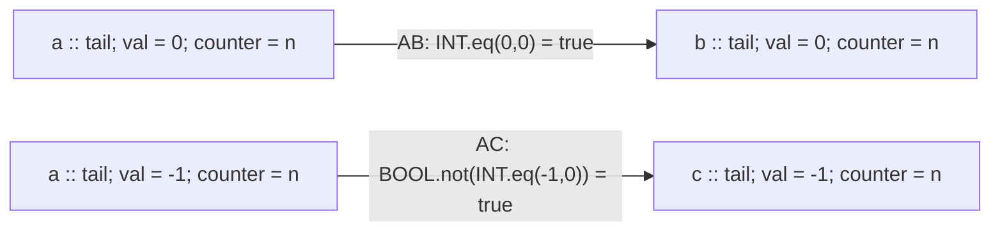

These are universally quantified constructor-profile results, not just the two
pictured executions. `zero_step`, `nonzero_step` and `negative_step` retain
arbitrary tails and integer counters.

## Source and captures

The branching fixture is distinct from the earlier
CD fixture. Its actual AB/AC axioms are conditional and have
an extra T/val configuration layer. The earlier resources/a-to-f emitted file
has unconditional AB/AC; the adjacent K file alone was insufficient evidence.
No source bytes were regenerated or normalized.

| Source item | Exact archived location | Lean correspondence |
| --- | --- | --- |
| INT.Int / BOOL.Bool | definition lines83/88; hook-declarations.kore | `Carrier` uses Lean `Int` and `Bool` |
| INT.eq / BOOL.not | lines126/197; hook-declarations.kore | `intEqual`, total singleton `model` operations; `guard_bool_denote` |
| TEST.AB | ab-axiom.kore, definition719–727 | `ab`, `Guard.zero`, `checked_archived_bytes`, `archived_bodies` |
| TEST.AC | ac-axiom.kore, definition730–738 | `ac`, `Guard.nonzero`, the same source checks |
| `val(X) ∧ Gen5` | both left configurations | `valuePattern true`, `as_pattern_mem` |
| Boolean equals-to-true | both left guards | `source_guard_iff_compile` |
| Checked axiom origin | complete parsed declaration list | `check_source`, `checked_iff`, `axioms_iff`, `declaration_matching_sound` |

The four variable captures remain distinct: arbitrary `tail : List String`,
`x : Int`, `capturedVal : Int` representing the captured ValCell, and
`counter : Int` representing the generated-counter cell. The source as-pattern
is an actual intersection, `and{SortValCell}(val(X), Gen5)`. It requires
`x = capturedVal`; the RHS retains `capturedVal`. This is not permission to drop
the capture or replace it with a fresh value. The generated-counter declaration
also contains an integer, separate from the value cell. CD's existing natural
counter profile stays separate.

## Semantics and proofs

`Step.rule` is defined independently of matching satisfaction. A step requires
rule membership, an explicit valuation, the as-pattern equality, and the guard
being true. `step_iff` exposes exactly these premises. `nextSentence_satisfies_iff`
and `compile_satisfies_iff` hold for arbitrary relations on these configurations;
`compiled_matching_sound` specializes the existing native μ reachability
translation to installed guarded rules.

The selected interpretation gives INT.eq and BOOL.not total singleton Boolean
results. For these results, the emitted source Boolean equality to true is
equivalent to the definedness of `guard ∧ true`. `source_guard_iff_compile` proves
that equivalence. It does not identify arbitrary set equality with nonempty
intersection. The native ceil operation is independently universal on each
Boolean argument, so its set extension tests whether that intersection has a
value; it contains no stored sentence-truth premise.

The checker uses the existing lexer and declaration parser, with minimal shared
recognition/rendering for `\equals`. Unlike CD, these direct axioms have no
alias. It accepts a complete declaration-only list, checks every declaration's
entire constructor/guard tree, sorts, distinct captures and metadata, and rejects
unsupported shapes. Claims are validated goals and never transition axioms.
`axioms_iff` requires a successful complete check and returns an actual source
declaration, its elaboration and its membership in the aligned checked list.
The concrete matching examples invoke that checked-source theorem.

## Checked controls and limits

`Conditional.Examples` checks the original included bytes in the kernel, plus:

- zero/nonzero and negative integer steps;
- disabled AB and AC guards admitting no step;
- a mismatched captured value cell excluded from the source as-pattern;
- malformed equality sort, duplicate capture and unknown equality symbol rejection;
- trailing input rejection and checked claim-only input with no transition edges.

`Conditional.Audits` guards exact theorem axiom sets. Original CD operational and
text examples/audits are rebuilt after the shared Raw/text change. The
input-tracked fixture library
is the `KoreOperationalFixtureText` library in `lakefile.toml`; its four source
inputs include the existing CD alias/axiom and the new AB/AC axioms. Lean CI's
sparse checkout retains these four files.

This formalizes a declaration profile with an explicitly selected mathematical
hook interpretation. It is not a proof that a backend hook implementation,
whole K module, K compiler or arbitrary KORE guard has these semantics. Modules,
imports, guard comparisons against integer literals other than zero, arbitrary hooks,
priorities, general as-patterns and frontend completeness remain outside scope.
The state/value/counter carrier representation is the chosen constructor model,
not a classification of all models of the full emitted definition.

The separate all-path extension proves
finite-complete-path partial correctness under an explicit enabled-competitor
condition, including the checked AB/AC rules. It merged in
`f507b60a07d00faebafdbfc4d94064a199acf143` after successful exact-head
at `e2660b81eedec28a63dc47b4f8cb9061302eca76`. Frozen local receipts preserve
their earlier checkpoint status. It does not establish termination or a general
K source proof calculus.

The separate native Wasm branch client
relates this checked AB/AC profile to actual initialized-local reads and native
`if` selection for signed-i32 represented values/counters. It preserves source
fields and native context without executing branch bodies or claiming a K compiler.

**Historical validation.** Commands, source pins and earlier build attempts are
retained in
the private validation receipt.
Local validation used targeted builds; no producer was executed.

CI repair checkpoint `94bffecc3` replaces the flagged membership proof with
Batteries traversal alignment and a declarative filterMap proof under `Proofs`.
Public statements and assumptions are unchanged. CI42882136882 passed Lean and
correctness but failed the Isar gate; its failure is retained in the receipt.
Frozen CLI `12edc18e8` passed targeted header, examples and seventeen exact
axiom guards with `--wfail`, Isar (0/9 flagged), `mor check` and textual layout.
Initial repair elaboration failures are retained. Independent final review and
passed at exact head `321f8143bde8d5ccb806b51c5a641453b160e2e5`, including
merged as `224d3db505f1ace24c0f4cf1f2ec45e7556dc3d8`.
The retained local receipt describes the earlier targeted commands; the CI link
records the later full integration check.

The current whole-page source review includes the checker, independent steps,
denotation proofs, original-byte examples and separate all-path/branch contracts.
No Lean, Cargo, test or producer ran, and no new transitive axiom audit was
performed. `Defs.lean` and `Thms.lean` under
`Silmaril/Logic/Kore/Operational/Conditional/` state the public contracts;
`Silmaril/Proofs/Logic/Kore/Operational/Conditional/{Denotation,Checking}.lean`
contains the supporting proofs. Historical pending-review text in retained
source/validation receipts describes those earlier checkpoints.


## Conditional KORE rules as first-order formulas

A conditional KORE rule describes a rewrite enabled by a **guard**, a condition
such as `x = 0`. This bridge expresses the selected rule profile in **first-order
logic (FOL)**: formulas built from variables, constructors, equality, logical
connectives and quantifiers. Each installed rule becomes a source formula (**lhs**, left-hand
side) and a target formula (**rhs**, right-hand side).

The edge theorem proves that the transitions defined by these formulas are
exactly the independently defined `Conditional.Step` relation. The definitions,
bridge proof and controls passed targeted Lean checks.

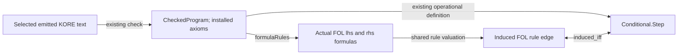

A **signature** lists the sorts and constructor symbols. This one has four sorts:
state names, code lists, integers and configurations. For each finite rule list,
its symbols are finite: two state constants per rule, list cons, configuration
construction and integer zero. It has no relation symbols. Its independently
interpreted **structure** uses actual strings, lists, integers and configurations;
it does not store transitions or formula truth.

A **rule telescope** lists the sorts of its independently assigned variables. A
**capture** keeps its assigned value across the rewrite. The slots are:

- Slot 0: the current configuration.
- Slot 1: the remaining code list, called its tail.
- Slots 2 and 3: the separate integer captures `x` and `capturedVal`.
- Slot 4: the integer counter.

The lhs requires `x = capturedVal`, the rule’s guard and equality with the
constructed source configuration. The rhs requires equality with the constructed
target configuration. Zero and nonzero guards use integer equality and its
negation. Both endpoints use the same capture assignment.

With an installed zero-guard rule from state a to b, `x = capturedVal = 0` gives the edge
`(a, 0) → (b, 0)`. A nonzero rule from a to c permits `(a, -1) → (c, -1)`.
These abbreviated configurations omit the tail and counter, which remain
unchanged. If two rules are enabled at the same input, both successors remain.

`induced_iff` ranges over the entire installed rule list, including overlapping
competitors. It assumes no exclusivity. `edgeFormula_holds` also connects the
existing FOL existential/disjunction edge formula to `Conditional.Step`, while
retaining arbitrary outer claim captures. `checked_induced_iff` specializes the
result to a program's entire installed axiom list.

An arbitrary `CheckedProgram` value is not evidence that the checker accepted
some bytes. The archived-text client reuses the
existing `checked_archived_bytes` proof and specializes the bridge to that exact
program. It also constructs a closed FOL Step derivation and applies its
soundness theorem. The generic bridge itself does not prove source acceptance.

The controls preserve zero and negative nonzero executions, reject capture
mismatch and disabled guards, retain both enabled competing successors, and
preserve terminal and empty-program deadlocks. The generic bridge proves a
one-step correspondence. The separate archived client supplies its own all-path
derivation. Arbitrary KORE modules, general hooks, frontend correctness,
termination and completeness remain outside these results. See the existing
first-order Step adapter and
conditional all-path slice for their separate
contracts.

Sources are under `Silmaril/Logic/Kore/Operational/Conditional/FirstOrder/` and
`Silmaril/Proofs/Logic/Kore/Operational/Conditional/FirstOrder/Bridge.lean`.
The four implementation targets passed guarded Lean builds with one Lean thread,
using inherited warm dependencies. Seventeen exact axiom guards passed. The
constructor evaluation, lhs/rhs evaluation and `induced_iff` depend only on
`propext`; the quantified edge adapter and program specialization additionally
use `Classical.choice` and `Quot.sound`. Registry and textual layout checks
passed. The package guard reported inherited older-version dependency artifacts,
so these local checks do not establish a clean full build. Historical
passed at exact head `4839c7dc2c26601604c8cb236c776446b786f45c`, including
Lean, aggregate CI and the CI time budget. The pre-edit guide and all five bridge
source files match between that CI head and this review’s pinned main base.

The current source and claim review
records the exact inspected source and retained validation. It ran no compiler;
local build and axiom-guard results remain historical.


## Conditional KORE modules and imports

This frontend reads definition, module and import envelopes around the existing
conditional AB/AC constructor profile. It checks the complete source before
executing a selected module's visible axioms. The archived example labels AB and
AC name the leading-state rewrites a→b and a→c. See the existing
conditional execution guide for the exact rule
profile, guards and captured fields.

The first complete source validation passed in
at commit 43ea1fab7505029c38d7eb1812e510ec3cc1ed26: all four new Lean modules,
including every source control, compiled in the full 63,965-job Lean build.
All twelve printed theorem dependency lists were exactly
`[propext, Classical.choice, Quot.sound]`. The run had 14 successful jobs and two
skips; its 228.6/240-second timing result was partial because Proof reuse skipped.
The Audits module checks those observed lists. Validation of subsequent candidate

## Terms

| Term | Meaning here |
| --- | --- |
| Definition | Leading attributes followed by one or more named modules. |
| Import | A named dependency on a module declared earlier in the definition. |
| Visible declaration | A declaration in the selected module or a transitively imported module. |
| Profile | The exact conditional constructor, capture and guard shapes accepted by the existing elaborator. |
| Configuration | The current code/instruction list, integer value and counter fields. |
| Capture | A named part of the source pattern retained when a rule matches. |
| Coherent captures | The independently captured values denote the same integer; the rule requires this equality. |
| Route witness | A finite proposed import path, checked against the original module imports. |
| Source step | An enabled source axiom with coherent captures, interpreted on an ordinary conditional configuration. |

## Import scope

The pinned KORE syntax requires unique module names, imports to earlier modules,
and import sentences before other declarations. Scope includes local and
transitively imported declarations. These are source requirements, rather than
an arbitrary restriction added by this frontend. The exact documentation pin is
recorded in the source catalogue;
see the validity clauses.

A diamond can import the same source module along two paths:

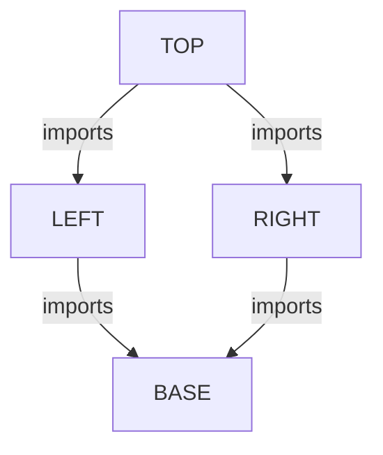

The definition orders these modules as BASE, LEFT, RIGHT, TOP. If BASE contains
one AB axiom and TOP contains one AC axiom, TOP sees each source module once.
For value zero, AB produces one successor even though two import paths reach
BASE. Two AB declarations written inside BASE produce two successors: source
declarations and nondeterministic results retain their multiplicity.

The Examples module wraps unchanged archived AB/AC axiom bytes in authored module
envelopes. The full archived definition also contains unsupported signature and
hook declarations; these examples do not establish its acceptance.

## Complete checking and execution

The parser retains definition, module, import and declaration attributes.
Every metadata field must pass the existing metadata checker, and every
declaration must pass the existing exact-profile elaborator. This applies even
to modules outside the selected target's import scope. Unsupported sentences
and trailing tokens reject; the frontend does not skip them.

The prefix resolver generates finite route witnesses from previously resolved
modules. The actual source checker validates every witness against the original
imports, checks local visibility, and checks closure under each import.
ImportChain independently defines visibility using named raw imports.
The checked resolve_complete proof shows that structurally valid earlier-import
definitions generate certificates that pass. accepts_valid_profile consequently
requires parsing, ordering and complete profile validity, with no externally
assumed certificate or closure.

Visible modules are filtered from the original module list, so diamond paths
cannot multiply a source module's declarations. Claims remain checked goals and
never supply executable transitions. The checked source retains the original declarations,
captures and metadata alongside the executable rules.

SourceStep independently describes transitions using raw module membership,
named import chains, declaration elaboration, coherent captures and guards.
The checked successor equivalence covers every ordinary Config, including
arbitrary tails, signed integer values and counters. It introduces no priority
or first-match policy. Rejection returns none; an accepted deadlock returns
some []. An unknown target also rejects.

## Source controls and audit scope

The source controls cover diamond imports, duplicate declarations, signed guards,
claim-only and empty-code deadlocks, unknown targets/imports, forward/cyclic or
duplicate modules, late imports, unsupported unused content and metadata, and
trailing input. Every control elaborated successfully in the source-validation
run above. The Examples module prints actual theorem dependencies, and the
Audits module records those twelve observed lists as exact message guards.
The PR checks record which candidate heads passed these exact guards.

The slice supports this conditional constructor profile, with its existing
explicit hook interpretation. It does not claim full KORE syntax or validity,
acceptance of full archived definitions, or classification of all KORE models.


## Finite exploration of conditional KORE rules

This implementation adds finite exploration to the existing conditional KORE
constructor profile. It keeps every enabled rule, so it supports competing
successors without a first-match or exclusivity policy. It adds no new
institution and does not extend the accepted text grammar.

| Term | Meaning here |
| --- | --- |
| KORE | The K framework's intermediate language of sorted patterns |
| Configuration | The current code-token list, integer value and integer counter |
| Guard | A rule's zero or nonzero test on the current value |
| Axiom / claim | An installed transition rule / a goal that adds no transitions |
| Frontier | Endpoints after exactly the given number of transitions |
| Bounded exploration | Endpoints after at most the given number of transitions |
| Deadlock | A configuration with no source successor |

`successors? source c` checks the complete original source text before
enumerating installed axioms. Rejected or unsupported text returns `none`.
Accepted text with no enabled successor returns `some []`. These outcomes have
different meanings: rejection supplies no operational conclusion.

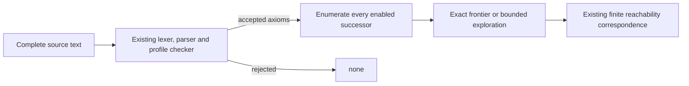

For example, `a → b` is enabled when the value is zero:

```lean
def rule : Rule := ⟨"a", "b", .zero⟩
-- successors [rule] ⟨["a", "tail"], 0, 7⟩
-- returns [⟨["b", "tail"], 0, 7⟩].
-- At value -1 the same rule has no successor.
```

The tail, value and counter are preserved. Two enabled rules `a → b` and
`a → c` both contribute results, in input order. Duplicate rules retain
duplicate results. The exact proof contract is
`d ∈ successors rules c ↔ Step rules c d`, using the independent source
relation already present. The text API additionally identifies an actual
successful complete check and the exact output list, retaining multiplicity.

`frontier rules n c` enumerates exactly `n` transitions.
`explore rules n c` enumerates endpoints after at most `n` transitions,
including `c`. Their contracts use an independent relational length index
`Runs rules n c d` built from existing source steps.

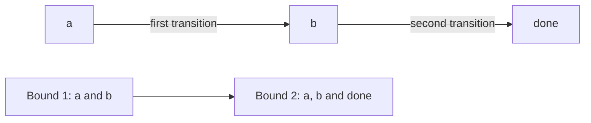

A stuck state has an empty positive frontier but remains in bounded exploration.
No stuttering transition is added. Existing `Reachability.Reaches` to an exact
endpoint holds precisely when that endpoint appears at some finite bound.
Failure at one bound proves no unbounded unreachability claim. Search may grow
exponentially, retains duplicates, and supplies no termination or all-path result.

The proof controls cover original archived AB/AC installation, negative guards,
competing rules, duplicates, wrong heads, empty code, disabled guards, exact
two-step bounds and checked claim-only input. A separate `Runtime.lean` module
contains twelve guarded `#eval` controls: direct calls to existing
`intEqual`/`Guard.eval`, successor/search computations and complete text checking
on original fixture bytes, malformed suffixes and claim-only source. These use
Lean's compiled evaluator; they are distinct from the `by decide` proof controls.
Full CI built this exact module and passed all twelve guarded evaluations.
Matching `#guard_msgs` messages are suppressed; successful compilation checks
the expected `true` results. This is compiled execution evidence in addition to
the kernel-checked proof controls.

This is new private code over the existing headers at base
`9223520a6fe946c2e7e85da169a56e86648d2591`. No external code or paper text is
copied and no solver/backend producer runs are added. General K modules,
imports, aliases, hooks, priorities, side conditions, contextual rewriting,
frontend completeness, Wasm branch-body execution and general operational
correspondence remain open. CommonLogic, Prolog, egg and egglog remain separate
parts of the wider programme.

`643d18fa0c118367521b126aa9fc0ce3b5ca8a55` after
passed at exact head `df728e7edb99d7739eafdbd40cfdcc4237597fc3`.
The full Lean `--wfail` build completed 63,957 jobs, including the compiled
runtime controls, and all 14 selected CI jobs passed. The timing gate passed
at **210.9/240 seconds**; its report is partial because Proof reuse was correctly
skipped.

All 23 selected dependency outputs were observed once and matched the source
print list and programmatic ceiling list in order: six declarations were
axiom-free, six used only `propext` and `Quot.sound`, and eleven used only
`propext`, `Classical.choice` and `Quot.sound`. The
retains the full logs, exact 23-declaration matrix and compiled-runtime source
binding. The earlier failed run and its narrow elaboration repair remain
separate historical receipts. These are historical integration results; this
status update ran no new build or producer. The complete guide was subsequently
reviewed against its six Execution modules, the original conditional source
interfaces, and the archived runtime and audit evidence. That review covers
this page and its stated constructor profile; it adds no execution result or
broader frontend-completeness claim.

The normal targeted workflow prefers the remote worker:

```sh
scripts/prove.sh Silmaril.Logic.Kore.Operational.Conditional.Execution.Examples Silmaril.Logic.Kore.Operational.Conditional.Execution.Runtime Silmaril.Logic.Kore.Operational.Conditional.Execution.Audits
bin/mor check
scripts/check-layout.sh
```

Use guarded `bin/mor build` with the same explicit targets only when the remote
worker is unavailable and local resources permit it. Actual logs, runtime
outputs and observed axioms belong in a validation receipt.


## All-path claims for checked conditional KORE rules

as `f507b60a07d00faebafdbfc4d94064a199acf143` after successful exact-head
at `e2660b81eedec28a63dc47b4f8cb9061302eca76`. The validation records below
retain their earlier checkpoint status.
This slice extends the checked conditional AB/AC profile,
not the KORE grammar or the number of institution graph edges.

KORE is the K framework's intermediate language. Here a rule changes a state
name at the head of a code list, preserving its captured tail, integer value
and integer counter. AB changes `a` to `b` when the value is zero; AC changes
`a` to `c` when it is nonzero. The as-pattern capture must equal that value.
The original source integers remain arbitrary; there is no signed-i32 premise.

A **finite complete path** is a finite sequence of transitions ending at a
state with no successor. The existing reachability API's **all-path partial
correctness** says every such path from a pre-state visits a post-state. It
makes no termination assertion and does not quantify over infinite executions.
This slice reuses that definition exactly.

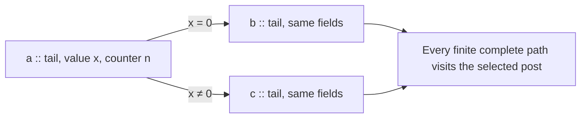

A **guard** is a condition enabling a rule. A coherent capture means the tested
value equals the independently captured value cell. The generic theorem needs
two explicit facts. The selected rule is installed,
so an enabled coherent pre-state has a successor (**progress**). Every other
enabled rule at the same source state must have the same target state
(**exclusivity**). `Exclusive` states this semantic guard condition.
`SyntacticExclusive` offers a decidable sufficient condition: competing rules
have either the same target or different zero/nonzero guards. Different guards
cannot both hold at the same integer value.

`successor_exact` shows that every successor is the original captured post,
including tail, value and counter. `allPartial` uses installed progress to rule
out a zero-length complete path, then uses position one as the post witness.
It covers arbitrary rule lists satisfying the explicit criterion.

The separate nondeterministic RuleSystem certificate
allows overlapping enabled rules with different successors. A certificate is a
finite family of configuration predicates: outside the target, each node must
have an enabled rule, and every rule-generated successor must satisfy the target
or another node. It can prove a disjunctive target or a multi-step common target
without `Exclusive`. It does not remove `Exclusive` from this selected-rule,
exact captured singleton-post theorem: the overlapping-rule counterexample below
still refutes that narrower postcondition. Both results concern finite-complete-path
partial correctness, not termination, fairness or the full source proof calculus.

`compileAll_satisfies_iff` characterizes the generated all-path sentence for
**every relation** on the original configurations, not only generated rule
systems. `compileAll_sound` specializes it to the independent source `Step`
relation. `compiled_matching_sound` composes the existing reachability encoding
into native fixed-point matching. A **least fixed point** is the smallest set
closed under a chosen operation. Here the existing encoding collects starting
configurations of finite post-avoiding paths ending at a stuck state. It seeds
the set with post-avoiding stuck configurations, then repeatedly adds
post-avoiding **predecessors**: configurations with a step into the collected
set. The all-path mode excludes these starting configurations. No new matching
or execution semantics is added.
`declaration_matching_sound` also requires actual checked axiom origin.

The examples import the original archived-byte check and exact installed-axiom
classification, then apply these theorems to AB and AC. Zero, nonzero and negative
instances retain arbitrary tails and integer counters. They do not replace the
accepted source with a separately authored list whose provenance is unproved.

The counterexamples explain the hypotheses:

- Add an overlapping zero-guard rule `a → c` alongside AB. Finite existential
  correctness of AB still holds, but the complete path `a → c` ends at the wrong
  deadlock and refutes its all-path claim. Exclusivity fails.
- Successfully checked claim-only bytes install no transition rules. The
  zero-length complete path from `a` refutes the nontrivial `b` postcondition.
- A relation with a successor everywhere has no finite complete path. Its
  all-path partial-correctness judgment holds even for the false postcondition.
  This vacuity is deliberate and is not a liveness theorem.

The interface is `Silmaril.Logic.Kore.Operational.Conditional.AllPath.Thms`.
The examples are in the sibling `Examples` module; longer generic proofs live
under `Silmaril/Proofs/Logic/Kore/Operational/Conditional/AllPath/`.

Full K modules/imports, arbitrary hooks and guards, a source proof calculus,
backend correctness and general frontend completeness remain separate work.
The Wasm branch-selection client still does
not execute branch bodies or prove all-path native-program simulation. This
source-profile theorem does not remove that adapter's boundaries.

**Historical validation.** The definitions, proof interface, checked-source
examples and controls passed
targeted `--wfail` validation at `3a92bcce0d`. All 22 exact axiom guards passed;
the actual lists use only subsets of `propext`, `Classical.choice` and
`Quot.sound`. Build03 completed in 3 seconds with peak resident memory 1.4 GiB,
zero errors/warnings and no memory-cap kill. The initial control elaboration
failure and subsequent unused-simp warning are retained separately.

The remote `hiloop` CLI was unavailable. Authorized local validation used a
frozen `mor` binary, the package guard, a host build slot, an 8 GiB resident-memory
cap and actual `-j1` Lean invocations. The temporary Lake configuration was
restored. Existing cache and foreign olean metadata warnings remain; this is
not a strict clean-toolchain or full local build. No producer or Cargo build ran.

The private receipt
records exact source, guide, command/configuration, argv traces and log hashes.
The frozen receipts preserve their own checkpoint status. See
and exact integration-head full-CI results.

The current whole-page source review read the definitions, generic soundness
proof, examples, exact axiom guards and retained receipts. No Lean, Cargo, test
or producer ran for this documentation audit; the guards were read, not rerun.
No new transitive axiom audit or clean-toolchain validation is claimed.

| Claim | Source |
| --- | --- |
| Captured all-path sentence and exclusivity criteria | `Silmaril/Logic/Kore/Operational/Conditional/AllPath/Defs.lean` |
| Exact successors, installed progress and checked-source matching | `Silmaril/Proofs/Logic/Kore/Operational/Conditional/AllPath/Soundness.lean` |
| Original-byte AB/AC applications and all three counterexamples | Sibling interface `Examples.lean` |
| Finite complete paths and post-avoiding fixed point | `Silmaril/Logic/Reachability/Defs.lean`, `Silmaril/Proofs/Logic/Reachability/Semantics.lean` |


## Checked KORE rewrites

This interface reads KORE rewrite declarations, checks their sorts and visibility,
and relates their source meaning to typed matching rules in Lean.
Source snapshot: `76a8e39543cb2f393c9758d38666d793c250edda`.

- **KORE** is K's textual representation of sorts, symbols, patterns and rules.
- A **configuration sort** is the type of states a rule connects; here it is `Cfg`.
- A **relation** records possible steps: `R w v` means state `w` can step to `v`.
- A **guard** is a condition that must hold for a rule to apply.
- **Captures** are free named variables with assigned values of their declared sorts.
  One assignment is shared by a rule's left side, guard and right side; each rule
  has its own captures. For example, `X:Cfg{}` names a captured configuration.
- An **axiom** installs a rewrite rule. A **claim** is checked separately and is
  never installed as a rule, including through imports.

## A branching example

This is the complete input stored as `SemanticExamples.branchText`:

```kore
[]
module Branches
  sort Cfg{} []
  symbol start{}():Cfg{} []
  symbol left{}():Cfg{} []
  symbol right{}():Cfg{} []
  axiom{} \rewrites{Cfg{}}(start{}(),left{}()) []
  axiom{} \rewrites{Cfg{}}(start{}(),right{}()) []
endmodule []
```

A **model** supplies nonempty carrier sets and an interpretation of each symbol.
Patterns denote sets of values; an operation may return zero, one or several values.
The example model interprets the three constants as distinct singleton sets.
In that model the two installed rules give exactly these steps:

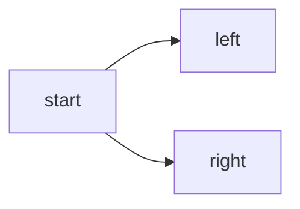

Both successors are terminal: no installed rule applies there. The source
symbol declarations alone do not require singleton or distinct interpretations.

```lean
import Silmaril.Logic.Kore.GeneralFixedPoint.CheckedRewrites.Source.SemanticExamples

open Silmaril.Logic.Kore.GeneralFixedPoint.CheckedRewrites.Source
open Silmaril.Logic.Kore.GeneralFixedPoint.CheckedRewrites.Source.SemanticExamples

example : (checkText "Cfg" 8 branchText).isSome = true := branch_checked
#check branch_derivation
#check branch_all_partial
```

`checkText cfg fuel text` returns a `Package` on success. Its `fuel` bounds recursive
checking; it is not an execution-step limit. The package retains the successful
complete parse and definition check. Project a selected module's `system` to get
its installed local and imported axioms, with claims excluded.

## What the reachability proof says

`AllPartial R Q w` means every **finite complete execution** from `w` visits `Q`.
“Complete” means its final state has no successor. The visit may be at the initial
state or later. Infinite executions remain unconstrained.

- `branch_derivation` constructs the existing calculus's `Derives.step` rule by
  proving coverage of `start` and accounting for every installed successor.
- `branch_all_partial` applies soundness with target `{left, right}`.
- `rightComplete` supplies an actual finite complete execution; `initial_not_post`
  shows the initial state is outside the target.
- `cannot_ignore_right` shows why a target containing only `left` fails the Step
  rule's successor requirement: the competing rule also reaches `right`.

`RawWellDefined` is a separate, per-rule condition: for every capture assignment,
if the left side contains a state and the guard holds, the right side contains
some value. The soundness theorem requires this condition.
`emptyText` replaces the right side by `\bottom{Cfg{}}()`, which denotes the empty
set. That source checks, but its rule is enabled at `start` and has no successor:
`empty_not_well_defined` establishes the failed obligation.

## Equality guards compare whole sets

For the same example interpretation, let `p` denote `{left}` and `q` denote
`{left, right}`. Their sets overlap but differ:

| Source guard | Meaning | Result |
| --- | --- | --- |
| `\equals{Cfg{},Cfg{}}(p,q)` | The complete denotation sets are equal. | False |
| `\in{Cfg{},Cfg{}}(p,q)` | The denotation sets have a common value. | True |

Here `p` and `q` abbreviate `left{}()` and
`\or{Cfg{}}(left{}(),right{}())`; `guardText` contains the complete declarations.
The guard is the second operand of the rule's left-side `\and`.
The parser tries this guarded form first whenever that operand parses as a
supported predicate, including `\top`. Otherwise it retries the original left
side as an unguarded value pattern.
`checked_equality_guard_false` and `checked_membership_guard_true` establish the
source distinction. `equality_native_lhs_disabled` and
`membership_native_lhs_enabled` preserve it in Lean's typed matching representation.

## Supported profile and API

- Concrete named sorts, ordinary symbols of arbitrary arity, complete definitions,
  and imports of earlier modules. Imports precede other declarations in a module;
  a rule can use only local or imported declarations.
- Value patterns with Boolean connectives and sorted quantifiers; least and
  greatest fixed points (`\mu`, `\nu`) for recursive sets. Each bound set
  variable must occur positively: every occurrence is under an even number of
  negations inside that binder body after Boolean syntax expansion. Negations
  outside the binder do not affect this test.
- Guards with top/bottom, negation, conjunction, disjunction, existential
  quantification, whole-set equality and overlap. Free object captures are
  collected jointly from both endpoints and all guard operands.
- Only empty attributes `[]` and empty sort parameters `{}`. This profile excludes
  aliases, hooks, domain-value builtins, free set variables and polymorphic sorts.

For a simple fixed-point example, the equation `X = {left} ∪ X` has many
solutions. Its least solution is `{left}`; its greatest solution is the entire
carrier. These correspond to the least and greatest fixed-point meanings.

| API | Purpose | Source |
| --- | --- | --- |
| `checkText`, `Package`, `CheckedModule.system` | Checked text and installed rules. | [Source definitions](../../Silmaril/Logic/Kore/GeneralFixedPoint/CheckedRewrites/Source/Defs.lean) |
| `package_installed_source_with_scope`, `package_installed_is_axiom` | Trace installed entries through original import paths to axiom declarations and their actual declaring scopes. | [Source theorems](../../Silmaril/Logic/Kore/GeneralFixedPoint/CheckedRewrites/Source/Thms.lean) |
| `RawStep`, `RawWellDefined`, `lowerSchemes` | Source relation, total-RHS obligation and typed rule interpretations. | [Core definitions](../../Silmaril/Logic/Kore/GeneralFixedPoint/CheckedRewrites/Defs.lean) |
| `induced_raw_iff_lowered`, `derivation_sound` | Step equivalence and semantic calculus soundness. | [Core theorems](../../Silmaril/Logic/Kore/GeneralFixedPoint/CheckedRewrites/Thms.lean) |
| `branchText`, `emptyText`, `guardText` | Populated models, execution and derivation examples. | [Semantic examples](../../Silmaril/Logic/Kore/GeneralFixedPoint/CheckedRewrites/Source/SemanticExamples.lean) |

The derivation object uses Lean's existing semantic eight-rule calculus. This
interface does not parse K proof scripts or add a new institution translation.


## Checked counter updates on finite complete native paths

Import Update/Thms.lean
for the checked counter-update all-path interface. This is a separate successor to
branch selection: it executes the selected
literal assignment and reaches the actual source/native post-relation before
running the continuation.

The main theorem is `NativeAllPath.allPath`, in the namespace
`Silmaril.Logic.Kore.Operational.Conditional.UpdateDraft.NativeAllPath`.
Its implementation and contracts
remain in the same-topic Raw module; clients use the public header above.
The original checked update definitions
provide `Native.postRelated`, the source rules and checker.

## What the path claim means

A **finite complete path** is a finite sequence of actual native `Core.Step`
transitions whose last configuration has no successor. It can end normally,
be stuck, or end at a trap. Completeness here means that this finite path cannot
be extended by another step; it does not mean that every execution terminates.

[`Reachability.AllPartial`](../../Silmaril/Logic/Reachability/Defs.lean) requires every
such path from the initial configuration to contain a configuration satisfying
the postcondition. The hit can occur before the last configuration. Infinite
executions need not hit it, so this is all-path partial correctness, without an
infinite-path eventual-hit or termination claim.

**Forced** is the pinned Wasm library's finite-prefix witness: each intermediate
configuration has an actual closed-host step and every closed-host successor is
that same successor. `entry_forced` proves this witness by instruction inversion;
it does not assume global native determinism. `forced_allPartial` then shows that
every finite complete path under the supplied host must hit the prefix endpoint.
The prefix contains no host call; later host behaviour remains unrestricted.

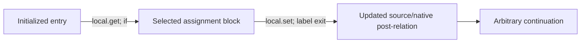

## Initial premises and resulting state

`allPath` accepts any profile, host, store, older operand stack and continuation,
subject to these explicit initial premises:

- Value and counter local indices differ, and the counter index is in bounds.
- `LocalsAgree` observes initialized i32 locals holding condition `q` and counter
  `k` in the initial frame.
- The zero and nonzero bodies are exactly `BodyDraft.assignBody` for the counter
  local and the i32 representations of integer literals `z` and `n`.
- The block type resolves in the frame's module to empty input and output lists.
- Both literals satisfy `-(2^31) ≤ z < 2^31` and `-(2^31) ≤ n < 2^31`.

The signed bounds ensure that converting the chosen Int literal to i32 and back
recovers that Int, rather than a wrapped value. They constrain both update
literals initially, not the arbitrary later continuation. The endpoint preserves
the store and older operands, writes the selected literal to the counter local,
preserves the distinct value local, and leaves the exact tail and continuation.
`postRelated` also identifies the actual updated source configuration and checks
that signed interpretation agrees with its counter field.

## Small examples and controls

These are instances or controls of the linked theorem contracts, not additional
solver runs or claims about a general K compiler.

| Initial situation | Actual theorem and outcome |
| --- | --- |
| Local 0 holds i32 `0`, local 1 holds i32 `7`; empty block type; bodies assign `11` and `13` to local 1 | `allPath`, with `q = 0`, `k = 7`, `z = 11`, `n = 13`, reaches the relation with counter `11` on every finite complete path. A nonzero `q` selects `13`. This instantiates the generic theorem with the listed body and local premises. |
| Empty frame at compiler entry | `empty_frame_counterexample` refutes the original task without initialization premises. `localGet_stuck` proves actual deadlock; `empty_frame_no_allPath_matching` rejects the same post-relation in the native matching model. |
| A single native `unreachable` instruction | `unreachable_actualTrap` proves an actual execution to `[trap]`. `unreachable_no_false_allPath_matching` rejects an impossible all-path target under the closed host. |
| Native `loop { br 0 }` | `loop_actualDivergence` supplies an actual infinite transition trace under every host and profile. This control alone asserts no all-path satisfaction result. |

## Checked source and matching interface

`compiled_iff_allPartial` identifies satisfaction of the encoded all-path sentence
in `Reachability.WasmExpr.predicateModel` with `AllPartial` for the actual native
step relation. `checked_allPath_matching` uses that equivalence and `allPath`.
It accepts a checked program, proof of `check input = some program`, installation
of exactly `rules L z n`, and an actual source `Step` from the specified entry.

The checked premise is retained in the theorem's interface but its proof is
unused: the derivation uses the installed-rule equality and actual source step
to identify the updated source configuration. This wrapper does not establish
parser soundness, infer rule installation from arbitrary input, or verify a
source-to-Wasm compiler. The earlier checker and authored examples are unchanged.

The selected axiom audit
prints eleven endpoint dependency sets and rejects axioms outside `propext`,
`Classical.choice` and `Quot.sound`. It covers the generic contract, checked
matching wrapper and operational controls; it is not an audit of every theorem
in the repository.


## Checked raw KORE updates to native strong AF

The compiler consumes the axiom list produced by the existing complete text
checker. For the supported pair of complementary counter rules, it constructs
the native layout and both literal assignment instruction lists. Clients no
longer supply an installation equality, instruction-body equalities, signed
literal hypotheses or an empty-block type hypothesis to obtain native progress.

**KORE** is K's core representation of definitions and execution rules. This
compiler accepts exactly two axioms in zero/nonzero order:

- Both start at the same entry state, with three distinct state names overall.
- Both assign a signed 32-bit integer literal to the counter cell.
- Their conditions are complementary: the condition local is zero or nonzero.

Claims do not become axioms. Other rule sets reject. The accepted profile is a
small executable part of KORE; general definitions, contexts and modules need
further compiler support.

**CTL** means computation tree logic. Its **strong AF** property says that every
maximal execution eventually reaches the stated target. A maximal execution is
infinite, or finite with no available next step. A **modal fixed-point formula**
expresses that property using recursion on reachable states. The final
**pointed matching** statement expresses it as a matching-logic predicate at the
chosen initial native state.

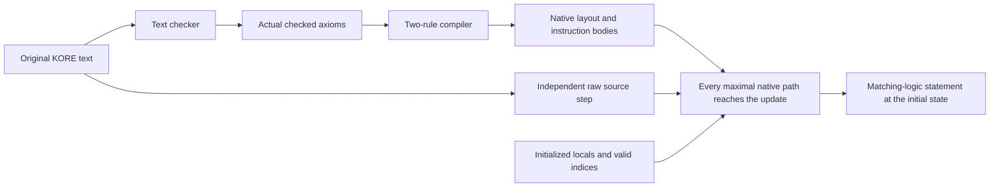

`compileText` first runs the existing `check`, then compiles its actual axiom
list. The result retains the checked program and the computed layout. The
compiler checks the literal range and stores the resulting proofs, generates an
empty block type, and sets each body to the actual `i32.const; local.set`
instructions. A caller supplies a counter local and an interpretation of the
unchanged code tail as continuation code. This continuation is an external
compilation context, not a verified translation of arbitrary source code.

`compileText_raw_matching` consumes success of that executable text compiler
and an actual independently interpreted `Source.RawStep` of its original
parsed declarations. Source checking supplies `rawStep_iff_step`; computed
installation supplies the exact native rule list. These determine the actual
source successor and the target relation of the compiled native execution.
The existing forced-prefix proof establishes strong CTL AF on the unchanged
`Core.Step` relation, then the existing CTL→modal μ→pointed matching maps carry
that same claim to matching logic. This includes infinite maximal paths;
arbitrary later continuation may diverge after reaching the update.

Runtime premises remain explicit: the condition and counter locals are
initialized with the observed i32 values, their indices differ, and the counter
local is in bounds. The frame/store/operand stack and untouched continuation
remain part of the native post-relation. The signed range restriction avoids
silently comparing wrapping machine arithmetic with source integers.

The examples concatenate the two existing unchanged manually authored byte
fixtures; no backend production is claimed. They establish actual text
compilation, emitted names and literal bodies, independent raw source moves,
and pointed native matching progress for a populated frame. A byte-level
renaming/literal change produces different native bodies and source moves.
Missing/duplicated branches, claim-only input, mismatched entries, unsupported
value-cell targets, extra competing axioms, coincident states and out-of-range
literals are negative controls.

This connects the previously separate raw-source adequacy and native strong-AF
clients. It adds no institution graph arrow and establishes neither general
K compiler correctness nor parser completeness nor termination of arbitrary
continuations. The targeted remote strict audit passed all five Lean modules with zero
errors or warnings. Fifteen exact kernel dependency guards check
`propext`, `Classical.choice` and `Quot.sound`. Registry/catalogue and textual
layout checks passed; neither structural check elaborates Lean. Full ready-head
CI remains a separate requirement. Private research receipts retain every
validation attempt and source hashes. No local Lean build was run.

The value-update compiler extends instruction
selection to the already checked value-cell profile and records its separate
validation status.


## Checked value updates to actual Wasm execution

The value-update compiler selects two complementary checked KORE rules. In a
small source example, the rules mean:

```text
state a, value X, counter K
  X = 0  → state b, value 1, counter K
  X ≠ 0  → state c, value 0, counter K
```

A **guard** is the condition selecting a rule. The value is stored in an actual
initialized Wasm local. The generated code reads that local, branches on zero,
and writes the selected literal back to the same local. Thus a subsequent guard
observes the new value: zero becomes nonzero and nonzero becomes zero. The
separate counter local retains its original value.

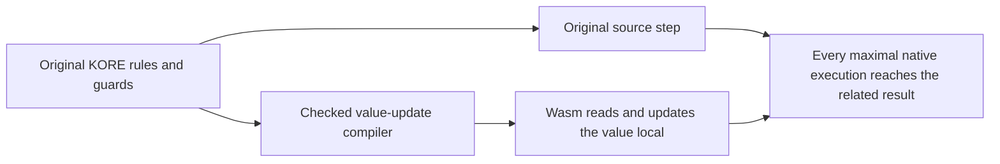

The examples retain complete authored KORE declaration bytes under
`ValueCompiler/Examples.lean`.
They are authored fixtures, not newly captured backend output. Parser acceptance,
whole-profile checking, exact generated code and independent raw-source steps
are separate Lean declarations.

`compileText_raw_af` connects successful text compilation and an original
`Source.RawStep` to **strong eventuality** over the pinned Wasm `Core.Step`:
every infinite execution and every finite execution ending in deadlock reaches
the specified source/native postcondition. The postcondition preserves the
store, older operand stack, code tail and administrative continuation. Its
explicit `Frame.setLocal` records the entire resulting frame, changing only the
value local; both the new value and preserved counter are observed in that
frame. The endpoint may have a divergent continuation: eventual arrival does
not assert termination.

Runtime premises require initialized **i32** locals (32-bit integer values), a writable value-local index
and distinct value/counter indices. Signed-i32 literal bounds are checked by the
compiler, so the source integer agrees with the actual updated bit-vector.
Installation checks the entire original axiom list. Claims do not become rules.
Unsupported input, mixed update targets, malformed declarations and extra rules
are rejected by the bounded checker/compiler profile.

The compiler shares `Compiler.Plan` and the existing instruction-selection
computation through `Compiler.planFor`. Target normalization is internal to code
generation; an exact installation equation still checks the unmodified source
rules. Native prefix inversion and infinite-path progress reuse the existing
results. The CTL (computation tree logic) and matching-logic translations express
the same execution claim through the existing interfaces. The matching endpoint is
`compileText_raw_matching`.

Examples include both populated native branches, actual observed guard changes,
a wrong source literal, a wrong source cell target, a native write to the wrong
local, claims-only input and malformed trailing input. The audit module imposes
the usual axiom ceilings on twenty declarations.

The strict targeted Lean build passed with 3,707 jobs, including all twenty
axiom ceilings and the existing counter-update examples as a regression check.
Registry, textual layout and source/documentation whitespace checks passed;
normal full CI remains pending. It extends the existing
counter-update compiler; arbitrary control-flow
graph compilation, arithmetic updates and general K frontend correctness remain
outside this slice.


## Actual native progress on infinite and finite maximal paths

The public interface is
`Silmaril.Logic.Kore.Operational.Conditional.Update.Total.Thms`. It extends the
checked counter-update and finite-all-path interfaces already in Silmaril.

A **maximal execution** is either an infinite sequence of native steps, or a
finite sequence whose last state has no next step. A **post-relation** records
the actual updated source state and native configuration. **Eventually** means
that this relation holds at some point along the execution; it need not hold
forever and the execution need not stop there.

The existing checked-update theorem covers every finite maximal path. Its
`Reachability.AllPartial` semantics intentionally allows infinite paths that
never reach the target. This increment instead uses the existing
`CTL.AllEventually` and strong CTL `AF` semantics, covering both sorts of maximal
execution on the unchanged actual `Core.Step P host` relation.

```mermaid
flowchart LR
  A["Initialized entry: a, condition q, counter 7"] --> B["Read condition and choose branch"]
  B --> C["Write counter 11 or 13; source state b or c"]
  C --> D["Arbitrary continuation, possibly an infinite loop"]
```

The `entry_allEventually` proof uses exactly the earlier initialized
local, distinct-index, literal-body, block-type and signed-range premises. It
adds no termination premise. Local instruction inversion forces the finite
update prefix under every host. The new induction shows every infinite path
traverses that prefix too; the existing finite-path theorem supplies the other
half. The endpoint retains the actual store, frame write, observed locals,
operand stack and untouched continuation.

`source_entry_af` uses an actual source `Step` to identify its updated state.
`source_entry_matching` carries that same result through the existing
CTL→modal μ→pointed fixed-point matching translations. This is a stronger
liveness formula and a separate pointed model from the existing finite
`Reachability.encode .allPath` theorem. No generic graph map is added and the two
meanings are not identified.

The checked controls use actual native transitions:

- A loop with `br 0` has no finite complete executions, so finite partial
  correctness with target `False` is vacuous. Its actual infinite trace refutes
  strong `AF False` on the same relation and initial state.
- A concrete initialized update with a loop continuation reaches its update
  post-relation on every maximal path and also has an actual infinite trace.
  This shows why eventual update progress is compatible with later divergence.
- An empty frame still rejects progress; a native trap cannot satisfy an
  impossible target. Existing native counterexample proofs are reused.

The source checker, authored fixtures, finite compiler and existing native
stuck/trap/loop-trace proofs remain unchanged. This increment does not establish
raw K frontend completeness, parser soundness, general K compilation, or
termination of arbitrary continuations.

Check the six Lean modules and their audit with the targeted command:

```sh
scripts/prove.sh Silmaril.Logic.Kore.Operational.Conditional.Update.Total.Audits
```

The audit enforces exact axiom dependencies for fourteen selected declarations:
`[propext, Classical.choice, Quot.sound]`. It covers the progress theorems and
operational controls described above; it does not validate a general K compiler.


## Fuel stability for accepted KORE patterns

Increasing the recursive budget preserves an accepted pattern's exact typed
result and its meaning. The public theorems are in
`Silmaril/Logic/Kore/Modules/Fuel/Thms.lean`. They use the actual checker and the
independent raw interpreter, including alias expansion and named binders.

**Fuel** is a natural number limiting recursion. **Success** means the checker
returns `some typed`, where the returned expression's Lean type records its
sort and variable context. **Stability** means every larger budget returns
that same expression, rather than merely an expression with equal meaning.
For example, if an alias containing a binder succeeds at budget 8, it returns
the identical typed result at budget 9, 80 or `8 + extra`.

```mermaid
flowchart LR
  R["Same raw pattern and caller bindings"] --> N["Success at budget n"]
  N --> T["Typed result t"]
  N --> L["Success at every n + extra"]
  L --> T
  T --> D["Same raw denotation at both accepted budgets"]
```

`Checking.elaborate_add` is generic in scope, context, caller bindings,
expected sort, raw pattern, result and additional budget. Its proof follows
fuel recursion: every recursive child call has a smaller budget. Successful
symbol argument collection and alias argument traversal retain their exact
values. Alias bodies use the resulting fresh formal bindings; binders use
the actual weakening operation. No assumption that aliases are acyclic is
needed: a successful finite computation already contains all required calls.
This does not establish that every input eventually succeeds.

`Checking.freeVariables_add` preserves the ordered free-variable list.
`Checking.sentence_add` consequently preserves the complete universally closed
sentence, including its context, sort and body. The `_mono` forms accept an
inequality between budgets. `elaborate_unique` and `sentence_unique` show that
any two successful budgets return equal results, by increasing both budgets
to their maximum.

`Semantics.denote_add` and `denote_mono` then use raw adequacy at both budgets.
They apply to every model and every environment obtained by interpreting the
arbitrary typed caller bindings. They assume actual elaboration success, not
a proposed semantic equality. `satisfies_add` and `satisfies_mono` preserve
independent raw validity after actual sentence-checker success. Here validity
means the raw set contains every result for every valuation of its free
variables, as defined in `Semantics.Satisfies`.

The examples reuse the actual parsed alias/binder claim and false source
claim. An additional example records why success matters: raw `not top` at
budget 1 denotes the full carrier because the child exhausts its fuel, but at
budget 2 denotes the empty set. The interpreter's exhaustion defaults therefore
do not supply a general theorem for unsuccessful inputs.

Still pending: automatic sufficient-budget bounds, acceptance completeness,
unbounded recursive-alias meaning, frontend fuel stability before scope and
module checking, and whole-K backend termination. This work depends on the
raw adequacy source in #2103, pinned at `36a2940dc5fb`; it does not claim that
that change has merged or renew unrelated documentation audit results.


## Independent raw KORE semantics and elaboration adequacy

The monomorphic module frontend now has an independent semantics for its actual
accepted named raw patterns. `Semantics.elaborate_sound` proves that successful
elaboration preserves this interpretation for arbitrary models, contexts,
argument patterns, aliases, binders and supported raw constructors. The source
interpreter never calls `Checking.elaborate`, `Checking.sentence` or typed
`FirstOrder.denote`.

This closes the raw semantic adequacy gap documented by the
module frontend. It does not broaden that frontend's
syntax or establish whole-K backend semantics.

The terms used here are:

- A **raw pattern** is the parsed expression with its original names. An
  **elaborator** resolves those names and constructs an expression whose Lean
  type records its sorts. **Adequacy** means that this translation preserves
  the expression's meaning.
- A **sort** labels a type of values; its **carrier** is that type in a model.
  **Monomorphic** declarations have no sort parameters.
- The **ambient signature** is the combined symbol declarations for one
  checked definition. A **context** lists variables and their sorts; a
  **valuation** assigns a value of the right sort to each variable.
- An **alias** names a pattern with formal arguments. **Fuel** is a natural
  number limiting recursive descent through patterns and alias bodies.

```mermaid
flowchart LR
  R["Named raw pattern"] --> E["Checked elaboration"]
  E --> T["Pattern with sorts recorded in its type"]
  R --> D["Direct interpretation as a set"]
  T --> I["Typed interpretation as a set"]
  D --> Q["Adequacy: equal sets after successful elaboration"]
  I --> Q
```

## The raw interpretation

`Silmaril/Logic/Kore/Modules/Semantics/Defs.lean` interprets named patterns directly
as sets in the existing matching model of the actual whole-definition ambient
signature. The declaration lookup and model operation graph are the existing
ones, preserving original symbol identity and exact profiles.

A named environment is a list of names paired with a sort and a set in that
sort's carrier. Lookup uses the first matching name and checks its annotated
sort. Element binders extend this environment with a singleton, shadowing an
earlier name. Existential and universal patterns quantify directly over the
bound sort's carrier. Boolean pattern operations use the actual set operations
and pointwise implication/equivalence. An arbitrary-arity symbol application
uses a vector of argument values drawn from the independently interpreted
argument sets and the actual model operation relation.

Aliases are interpreted by evaluating all actual argument patterns in the
caller environment. Their resulting sets are installed simultaneously under
the formal names in a fresh environment, then the raw alias body is interpreted.
The alias body cannot see unrelated caller names. Its binders can shadow formal
names without capturing the already evaluated actual arguments.

The interpreter is fuel indexed. Each syntactic descent and alias-body descent
consumes the same unit used by the checked elaborator. At a failing lookup or
profile check, or at zero fuel, it returns the empty set; surrounding logical
operations still act on those sets. These defaults do not assert
validity of malformed patterns; the adequacy theorem applies to successful
elaboration. Accepted fuel stability now proves
that larger budgets preserve successful typed results and their raw meaning.
No unbounded recursive-alias semantics, fuel completeness or whole-K
termination theorem is claimed.

## General adequacy

`Semantics.elaborate_sound` has the following content. Choose any ambient scope,
any of its models, any typed variable context, any list of typed named
bindings and any valuation of that context. Interpret each typed binding in the
model to obtain a raw named set environment. If the actual checker returns
`some typed` on `raw`, the independent raw set at the same fuel and expected
sort equals the existing typed KORE denotation of `typed`.

There is no hypothesis asserting the desired denotation equality or supplying
an alias certificate. The proof follows successful checker execution through
all constructors, including arbitrary finite symbol arities and alias argument
lists. Its binder case uses the already proved arbitrary-pattern semantic
weakening theorem. This theorem covers arbitrary matching-pattern arguments,
including empty and multi-element denotations, rather than only scalar terms.

Raw global `Semantics.Satisfies` independently requires a successfully extracted
source free-name context and result sort, then quantifies over all named source
valuations and all result elements. It shares the frontend's syntactic
`freeVariables` and `resultSort` routines, but its truth predicate uses only the
direct raw interpreter. `Semantics.sentence_sound` proves equivalence with typed
universal closure after actual successful sentence elaboration. Context and
sort extraction exist in this definition, so invalid metadata does not obtain
validity through an empty implication premise.

## Actual module truth and claims

`Semantics.Models` means raw truth of every actual retained local and
transitively imported source axiom, at each declaration's recorded fuel.
`Semantics.Proves` quantifies over these models and asserts raw truth of the
actual retained source claim. Neither definition mentions typed satisfaction.

For every existing `CheckedSentence`, `checkedSentence_sound` uses its actual
raw AST and successful elaboration equation to prove source/typed truth
agreement. `models_sound` identifies source module models with the models of
the existing actual axiom presentation. `proves_sound` identifies raw source
consequence with the existing module presentation judgment. `proves_import`
then transports raw source consequence along the already proved actual import
presentation arrow. No extra model axiom is introduced.

`Semantics/Modules/Examples.lean` reuses the actual accepted four-module text
from the module frontend. The capture-avoidance claim is now proved as raw
source consequence for every raw source model. Its concrete Bool interpretation
satisfies all raw imported axioms; the false raw claim fails in that model and
is not a raw consequence. Direct evaluation of `hold(Y)` gives `{true}` in an
environment binding Y to `{true}`, while the bound pattern `exists Y. Y`
contains false. These controls distinguish capture and demonstrate nonvacuity;
they do not replace the general adequacy theorem.

For example, `hold(X) = exists Y. X` uses a local name `Y`. With the caller's
`Y` assigned `true`, `hold(Y)` still denotes `{true}`: the alias's local binder
does not change the supplied argument. By comparison, `exists Y. Y` denotes
both Boolean values because its body refers to the variable it binds. The
`direct_alias_capture` and `captured_variable_differs` proofs check these sets
directly in the example model.

## Remaining boundary

The existing supported subset, official source revision/hash, common ambient
signature, fixed String sort universe/nonempty carriers and checked local
visibility remain as documented in the module guide. This work does not supply
minimal per-module signatures, independent cross-definition linking, parser
correctness/completeness against the official grammar, polymorphism, hooks,
nonempty attributes, domain values, equality/definedness, fixed points or new
rewrite/reachability semantics. No source-graph arrow is added.


## Original KORE update patterns and their semantics

The checked conditional update fragment now relates its original parsed KORE
patterns to their matching-logic interpretation. For every successfully checked
input, the transitions obtained by interpreting its original axiom bodies are
exactly the installed update transitions. The unchanged authored zero/nonzero
fixtures therefore make actual source-level moves from counter 7 to 11 or 13.

This extends the conditional branch adapter
and the checked-update stack. The fixtures are manually authored variants using
the archived constructor declarations; they are not backend-emitted update
observations. No producer, parser replacement or external backend was run.

## Independent source interpretation

**KORE** is the intermediate rule language used by K. A **pattern** describes
which values match; its **denotation** is the set of matching values. An
**abstract syntax tree (AST)** stores parsed syntax as constructors and children.
A named **capture** stores a value matched by a variable. Here, an axiom supplies
an allowed transition; a claim supplies no transition.

```mermaid
flowchart LR
  T[Original KORE text] --> R[Parsed Raw tree]
  R --> S[Independent pattern meaning and RawStep]
  R --> C[Checked update rules and Step]
  S --- E[Proved exact agreement for accepted inputs]
  E --- C
```

`Source.denote` reads the existing untrusted `Operational.Raw` tree directly.
A total sorted named-variable assignment supplies each variable's value.
The interpreter does not call the rule elaborator, inspect the installed rules,
or evaluate a synthesized `Rule.pre` or `Rule.post`.

The result is `Option (Set (Carrier sort))`. `none` means unsupported or
wrongly sorted syntax. `some ∅` is a defined pattern with no matches. Each
conjunction and equality requires both children to be defined: equality of two
unsupported trees cannot manufacture a true pattern from two empty sets.

| Raw forms | Interpretation in this fragment |
| --- | --- |
| Named variables | Singleton value, requiring the exact sort tag |
| State, integer and Boolean domain values | State literal, actual `String.toInt?`, or exact `true`/`false` |
| Top and conjunction | Full carrier and set intersection, with checked sort tags |
| `inj{SortState,SortKItem}`, `kseq`, K/Val/counter/T/top cells | Independent structural constructor operations on the existing carriers |
| Hooked integer equality and Boolean negation | Actual integer comparison and Boolean negation |
| Boolean equality into the top-cell sort | Full or empty configuration set according to equality of the two defined Boolean denotations |
| Other operators, unsupported nodes and wrong profiles | Undefined |

Rewriting is an outer declaration relation, separate from pattern equality.
`RawStep` chooses an actual axiom declaration and one shared named assignment,
requires its body to be a top-cell rewrite, interprets both original children,
and requires source/target membership in their defined denotations. It contains
no call to `elaborate` and no semantic validity premise. Claims contribute no
transitions. The raw relation itself can be stated independently of checking;
the exact comparison theorem applies to the accepted fragment.

## What is proved

- `elaborate_shape` derives the complete original tree and the canonical integer
  literal-reading fact from successful existing elaboration. It does not assume
  a generic formatter/parser round trip or a desired denotation equation.
- `elaborate_adequate` proves that both original children are defined and gives
  their exact sets. The left intersection enforces equality of `X` and the
  independently captured value cell. The right handles both value-cell and
  counter-cell assignments.
- `elaborate_to_matching` proves exact agreement with the existing matching
  patterns for every named assignment and every configuration relation.
- `rawStep_iff_step` proves transition equivalence for every pair of configurations
  after successful complete text checking. All four captures are retained.
- `raw_matching_sound` carries the existing reachability-to-matching theorem into
  the independently interpreted raw-source model using that proved relation
  equality.

The generic semantic theorems assume actual acceptance by the existing checker
or elaborator. Declaration membership and axiom kind are explicit where a
single declaration is used. No transition equality, successful source step,
matching validity or native execution theorem is supplied as an assumption to
establish the comparison.

## Examples and boundaries

The existing authored byte fixtures prove source moves
`(a :: tail, 0, 7) → (b :: tail, 0, 11)` and
`(a :: tail, x, 7) → (c :: tail, x, 13)` for every nonzero integer `x`.
Separate generated raw AST examples exercise a value-cell update to 5 and a
counter-cell update to 11 from the same source. Both successors remain present;
there is no first-match or priority policy. The targets are provably distinct.
Other controls distinguish undefined syntax from a defined empty intersection,
reject a wrongly sorted variable, retain mismatched as-pattern captures as an
empty precondition, and exclude claim-only declarations from transitions.

This is a fixed constructor/model profile. It does not prove completeness or
correctness of a general K text parser, arbitrary hooks, declarations, modules,
substitution or contextual rewrite closure. It does not establish a new general
K compiler, native backend correctness or termination. Existing native
finite/maximal-path results remain separate clients with their own initialized
locals, layout and range hypotheses. No institution graph arrow is added.

## Source and validation

| Interface | Source |
| --- | --- |
| Partial raw semantics and independent transition relation | Source/Defs.lean |
| Public theorem header | Source/Thms.lean |
| Adequacy and comparison proofs | Source.lean |
| Authored byte, update-target and domain controls | Source/Examples.lean |
| Sixteen exact axiom guards | Source/Audits.lean |

The targeted remote audit at source `8ed2fadbf021` passed all five modules with
warnings denied. The sixteen measured dependency sets are exactly `propext`,
`Classical.choice` and `Quot.sound`. Private research receipts preserve all
attempts, original source hashes, remote job handles and full diagnostics.
The subsequent targeted audit at `06354444ba4e` passed all sixteen exact guards
with warnings denied. Registry/catalogue, textual layout and strict isolated
package checks also passed. Advisory proof-style lint exited zero and flagged
one of 22 tactic proofs (`rawStep_iff_step`: low SSA and bare arms). The
structural checks used the retained Rust CLI; they establish structure, not
semantic correctness. Full
ready-head CI remains an integration requirement. No full local build was run.


## Compiled guards select the archived KORE branch

This slice connects the actual retained TEST.AB/AC guard operands to quantified
SMT membership formulas and the existing conditional execution relation. Its
intended result is an exact successor for every integer value, together with a
terminal one-step execution and finite-complete-path correctness. A targeted strict
Lean check at `50d18c1b21de` passed the definitions, theorems, examples and
25 transitive axiom ceilings. Final source review and full PR CI remain merge
requirements.

KORE is the K framework's intermediate language. A pattern denotes a **set** of
values. A **guard** enables a rule when its Boolean result equals true. SMT means
satisfiability modulo theories; here the generated formulas describe membership
in an integer/Boolean pattern's set. This slice makes no solver call.

```mermaid
flowchart TD
  A[Archived AB/AC declaration bytes] --> B[Existing source parser and checked rule bodies]
  B --> C[Extract exact equality-to-true guard operand]
  H[Archived hook declaration bytes] --> I[Check extracted names and profiles]
  C --> R[Raw membership checker and proved raw adequacy]
  I --> R
  R --> F[Quantified membership formulas at one paired source point]
  S[Singleton X and true output] --> F
  F --> G[Guard truth and disjointness]
  G --> U[Unique installed successor]
  U --> T[Terminal one-step execution and all-path correctness]
```

## What the branch preserves

The archived source changes the first state name while retaining the complete
captured K tail, value cell and generated integer counter:

| Input | Enabled rule | Exact output |
| --- | --- | --- |
| `a :: tail`, value `0`, counter `n` | AB: `INT.eq(X,0)` equals true | `b :: tail`, value `0`, counter `n` |
| `a :: tail`, value `-1`, counter `n` | AC: `BOOL.not(INT.eq(X,0))` equals true | `c :: tail`, value `-1`, counter `n` |
| `a :: tail`, any nonzero integer `x`, counter `n` | AC | `c :: tail`, value `x`, counter `n` |

There is no signed-i32 bound. The generic raw semantics transports arbitrary
source carriers through their integer/Boolean equivalences. The concrete
execution uses the original coherent capture `capturedVal = x`; the source
as-pattern still rejects a mismatched captured value.

## Reading the interface

Import `Silmaril.Logic.Kore.Operational.Conditional.SmtGuard.Thms`. Under the
`Silmaril.Logic.Kore.Operational.Conditional.SmtGuard` namespace:

- `archived_guard_operands` and `archived_operand_eq` identify the operands
  extracted from the actual parsed archive. `archivedSentence` stores that
  extracted raw operand and its successful membership-check equation.
- `raw_guard_denote` states that a singleton integer input gives exactly the
  singleton Boolean guard result in the independent raw interpreter.
- `archived_compiled_enabled_iff` connects the extracted sentence's compiled
  formula at the paired source point to the existing `Guard.Holds` judgment.
- `step_iff_selected` characterizes **every** successor as `next tail x counter`.
  `selected` chooses AB when `x = 0` and AC otherwise. Guard truth and competitor
  exclusivity are proved inside this result.
- `complete_one_step` supplies an actual step ending at a state with no
  successor. `all_paths_selected` says every finite complete execution visits
  that exact selected result.

For example, the sibling `Examples` module exposes `zero_step` and
`negative_all_paths` with arbitrary tails and counters. It also checks the
original hook headers and includes rejection controls. The `Audits` module
prints the selected declarations' transitive axiom dependencies and rejects any
outside `propext`, `Classical.choice` and `Quot.sound`; all 25 guards passed the targeted strict check.

“All-path” here means the repository's existing **finite-complete-path partial
correctness**. It does not assert termination of arbitrary systems or quantify
over infinite executions. The separate terminal-step witness prevents the
concrete example from relying on absence of finite complete paths.

## Why singleton and shared-model conditions matter

Both guard formulas use the same source model, object environment and output
value true. A paired SMT model interprets each membership predicate from exactly
that source environment. This does not establish a correspondence with arbitrary
unrestricted SMT models.

For `X = {0}`, equality produces only true; Boolean value negation produces only
false. For `X = {1}`, those results reverse. But `X = {0,1}` makes equality with
zero produce **both** Boolean values. `BOOL.not` then also produces both values,
so both guards contain true in the very same model. The `actual_raw_nonsingleton_both`
control retains this behavior in the original raw semantics. Empty inputs enable
neither guard. Treating `BOOL.not` as matching-pattern complement would lose this
meaning.

Thus membership of true represents the source equality-to-true only after the
singleton-result theorem. The bridge does not identify arbitrary set equality
with a nonempty intersection.

## Exact source boundary

The source record pins
haskell-backend revision `ec0486c03af923071544fd61e35e9426507aac33` and the
unchanged `definition.kore`, AB/AC axioms and four hook declarations. Existing
fixture loading supplies the original bytes. The new header extractor consumes
those four complete headers and retains their metadata tokens, checking the
actual INT.Int, BOOL.Bool, INT.eq and BOOL.not names/profiles by computation.
It does not interpret every metadata attribute or accept the entire emitted
definition.

The semantic scope is an explicit extraction harness named `GUARD-EXTRACT`.
Its source symbol names and hook profiles match the archive; its declaration
indices do not claim to be the full TEST module's indices. A concrete total model
supplies the two hook operations and the necessary zero-literal support, with
laws over every argument tuple. Canonical's differently named `eqInt`/`notBool`
model is not substituted for these archived source symbols.

Only the supported scalar subtree is converted between the existing operational
and builtin raw ASTs. Wrong outer guard truth/sort, an unsupported hook name and
an invalid hook profile have rejection controls. This is a bridge for the actual
checked AB/AC profile. Full K frontend/backend acceptance, arbitrary hooks and
guards, priorities, a general source proof calculus, general as-pattern
completeness, termination and fairness remain separate requirements, including
the broader work tracked by issue #1384. Existing fixed-point and reachability
foundations are reused.

Related guides: raw membership compiler,
conditional source execution and
conditional all-path semantics.


## Checked KORE guards select actual Wasm branches

The checked emitted TEST.AB/AC KORE rules now have a small Wasm execution client.
AB changes state `a` to `b` when the value is zero; AC changes `a` to `c` when
it is nonzero. The client reads that value from an initialized Wasm local and
executes an actual native Core `if` selection. Zero selects its **else** body
for `b`; nonzero selects its **then** body for `c`.

For example, zero selects `b`, while signed `-1` selects `c`. The selected body
has not executed yet. The source value, captured tail and counter remain
unchanged. So do the native store, frame, older operands, chosen interpretation
of the tail and remaining continuation. The result also holds as a sentence of
the existing native fixed-point matching logic.

## The configuration relation

**KORE** is K's intermediate language for emitted definitions and rules.
**Wasm** means WebAssembly. **Core** here is the pinned small-step execution
relation: one step describes one permitted transition between native states.

A **configuration** is the state of an execution. The source configuration has
state-token code, an integer value and an integer counter. A native Wasm
configuration has a store, a frame containing locals, and administrative code.
A **local** is a numbered variable slot in that frame. **Initialized** means
that looking it up returns an actual value, rather than an absent/unset slot.
A **continuation** is the administrative code remaining after this selection.

`Related` connects these independently defined configurations. It observes both
the source value and counter through actual initialized `i32` local lookups.
The source integers are the signed interpretations `q.toInt` and `k.toInt` of
those two 32-bit values. Thus this client covers the signed range
`-2147483648 ≤ x < 2147483648` for each represented field. The general KORE API
continues to permit arbitrary integers; it has not been restricted or redefined.

The local indices may coincide when their required values agree. A missing
value local or incompatible values at a shared index cannot satisfy the
relation. The counter local is observed and preserved; the value local is
actually read by `local.get` to supply the `if` condition.

```mermaid
flowchart LR
  K["Checked KORE a :: tail; signed value and counter"] -->|"Related: initialized locals"| W["local.get valueLocal; if"]
  K -->|"zero AB / nonzero AC"| D["b :: tail / c :: tail; same fields"]
  W -->|"native Core steps"| B["zero else block / nonzero then block"]
  D -->|"same local observations and continuation"| B
  B --> M["Existing finite reachability and native μ matching"]
```

A **layout** supplies three distinct source state names, the two Wasm branch
bodies, a block type and a chosen interpretation of the captured K tail as
native code. That interpretation is retained without executing it. It need
not decode arbitrary K code or be injective. The concrete example uses an
empty zero body, a nonzero body containing `nop`, and one retained `nop` per
tail token. This distinguishes branch selection without claiming a compiler
for the tokens or branch bodies.

## What the theorems establish

- `source_step_iff` characterizes every source successor of a represented entry:
  the selected state is exact and the entire tail/value/counter are preserved.
  `selected_name_zero_iff` recovers the zero test from the distinct state name.
- `signed_representation` connects explicit signed bounds to conversion with
  `BitVec.ofInt 32`. A **bit vector** is a fixed-width integer representation;
  conversion can wrap outside the signed range.
- `native_steps` reuses the existing open-variable compiler theorem to execute
  `local.get`, then actual Core `ifTrue` or `ifFalse` steps. It retains the
  complete surrounding native context.
- `related_step` carries an actual source step to an actual native run and a
  related selected exit. It does not assert a converse for arbitrary later runs.
- `compiled_valid` reuses `WasmExpr.compiled_iff_steps`. Here **μ** is a least
  fixed point expressing finite reachability; no second execution or matching
  semantics is introduced.
- `checked_archived_selection` combines the original archived-byte check with
  exact installed-rule classification. `archived_related_step` instantiates the
  relation using those installed AB/AC axioms. Generic headers import no examples.

## Checked examples and the conversion boundary

These are verbatim declaration excerpts from the checked Examples module,
not a separately compiled standalone client:

```lean
theorem zero_selection : selected (0#32) = .zero := by decide
theorem negative_selection : selected (4294967295#32) = .nonzero := by decide
theorem negative_signed_value : (4294967295#32).toInt = -1 := by decide
theorem maximum_selection : selected (2147483647#32) = .nonzero := by decide
```

`concrete_matching` supplies an initialized two-local frame for every represented
value/counter pair, with arbitrary older operands, tail and continuation.
Additional controls cover compatible sharing, incompatible sharing, a missing
local, the original source as-pattern capture mismatch, and distinct branch bodies.

The signed premise matters: `4294967296 = 2^32` is nonzero as an integer, but
its `i32` conversion is zero. `wraparound_source_and_native` proves that actual
archived AC selects `c` for that source integer while converted native selection
takes the zero branch `b`. `unguarded_zero_test_false` refutes an unrestricted
integer/conversion zero-test equivalence. Neither control claims that a later
native execution cannot reach some other state.

| Contract | Source |
| --- | --- |
| Layout, actual-local agreement and explicit configuration relation | Defs.lean |
| Public theorem interface | Thms.lean |
| Source classification, local read, native steps and matching proof | Universal.lean |
| Original-byte instantiation, initialized frames and boundary controls | Examples.lean |
| 23 exact axiom-output guards | Audits.lean |

## Provenance and limits

These are new private adapter proofs over the existing
checked conditional KORE profile, the pinned
public Wasm Core step relation and the open-expression matching bridge.
No external code or paper text is copied, no producer was run, and no paper
correspondence claim is added. The archived bytes retain their original source
pin and meaning; this client does not infer correctness of a K compiler or backend.

This proves branch selection with initialized locals and signed represented
fields. It does not execute the selected bodies or continuation, simulate full
K/Wasm programs, classify all models/hooks, establish all-path behavior or
termination, or extend the KORE frontend. No institution graph edge or coverage
count is added. The private validation receipt
records targeted builds, historical failures and exact source/log bindings.
Root independent final source/doc/receipt review approved
`fdfad8a080193e2590d661423ef3619593ea7e72`, with narrow diagnostic-whitespace and
terminology follow-ups. The full catalogue check passed in an existing
full-catalogue worktree detached at that exact head. This later documentation
and validation-policy append changes no Lean source. The integration PR records
actual full CI at its final head; no full local Lean build is claimed.

## Separate checked-update successor

The checked counter-update all-path interface
executes literal assignment bodies under explicit initial premises and proves a
post-relation hit on every finite complete native path. It is a separate
successor; the branch-selection contract described above retains its scope.
