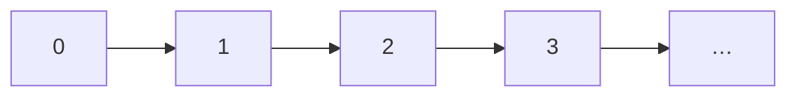
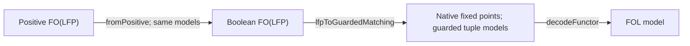
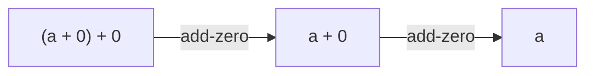
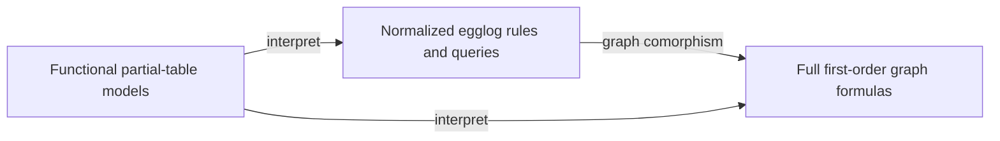
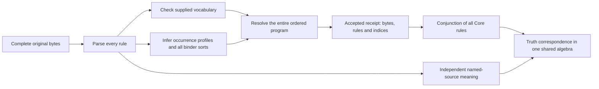

# First-order LFP, e-graph logics and definite programs

First-order logic with least fixed points (and its Boolean fragment), the egg and egglog core
logics with their named sources and the functional first-order graph institution, and definite
(Horn-clause) programs as an institution with its translation into first-order logic. Each is an
institution (`inst`) registered with its comorphisms in the [logic graph](logic-graph.md). The
sections below are the guides of each development. Replay fixtures generated by running egg are
not part of this repository.

## First-order logic with least fixed points

First-order logic (FOL) describes values, functions and relations. A least
fixed point adds recursive definitions: for example, “reachable” is the smallest
relation containing every edge and closed under extending a path.

- **Many-sorted** means variables have explicit types, such as Node and Int.
- A **predicate profile** lists the number and sorts of its arguments.
- **Positive recursion** means that enlarging a recursive predicate cannot make
  its body less true. `R(x) ∧ E(x,y)` is positive in `R`; `¬R(x)` is not.
- A **captured parameter** is an outside value held fixed during recursion,
  such as the `target` in “can this node reach target?”.
- An **assignment** supplies a value for each object variable. Recursive
  predicate variables receive sets of argument tuples instead.

`Silmaril.Logic.FirstOrderLFP` is a many-sorted positive fixed-point fragment over
the pinned public `Silmaril.Logic.Institution.Examples.FOL`. It retains arbitrary
public FOL terms and formulas in recursion-independent leaves. The new syntax
adds scoped n-ary recursive predicate applications, conjunction, disjunction,
object quantifiers and nested least fixed points. All free recursive predicate
occurrences are positive. General negation of recursive formulas is not part of
this grammar; this is not a claim of complete unrestricted FO(LFP) coverage.

A recursive predicate profile stores its arity and argument sorts. A fixed-point
body binds the fresh predicate at index zero and a fresh tuple prefix in its
object context. The rest of that context retains every ambient object parameter.
`Extends` relates the body assignment to the tuple and parameter assignment;
`extends_exists_unique` proves that exactly one such assignment exists. Thus the
universal valuation clause in the body operator really evaluates the body at the
combined assignment, including when some sort carriers are empty.

`Formula.denote` is an order homomorphism from recursive predicate environments
to sets of object assignments. Its structural proof covers object quantifiers
and nested fixed points. `lfpSet` uses Mathlib's actual set least fixed point;
`lfpSet_unfold` and `lfpSet_induction` give unfolding and prefixed-point induction.
There is no fuel, approximation cutoff, finite-carrier assumption or claim of
finite convergence on arbitrary carriers.

`Formula.denote_map` proves satisfaction invariance under sorted signature
renaming. `institution` uses actual public FOL structures with equality-only
model arrows. `folToLFP` is a natural institution comorphism from public FOL:
its signature functor is identity, its sentence component includes the original
FOL formula, and its model component returns the stored public FOL structure.
Every public FOL model expands concretely. `fol_sat_iff`, `fol_unsat_iff` and
`fol_entails_iff` give exact satisfiability, unsatisfiability and consequence transport. Richer model
arrows, recursive negation normalization and general substitution are pending.

## Reachability examples


The binary transitive-closure formula holds for `(0,2)` because there is a
two-edge path. It fails for `(2,0)`. A path with no edges is handled differently
by the two formulas below: transitive closure requires at least one edge;
reflexive reachability also allows staying at the starting node.

`Reachability.transitive` is the actual binary formula
`μR(x,y). E(x,y) ∨ ∃z. R(x,z) ∧ E(z,y)`.
`transitive_finite_path` proves equivalence to nonempty finite edge paths over
arbitrary carriers. `reaches` is the unary formula
`μR(x). x=target ∨ ∃z. E(x,z) ∧ R(z)`, with target captured from the
ambient assignment. `reaches_finite_path` proves equivalence to reflexive finite
paths. Examples include an infinite natural chain, reversed-chain nonreach, a
genuine two-state cycle with an unreachable third state, changed-target truth
values and empty-carrier quantifiers.

The [checked examples](../../Silmaril/Logic/FirstOrderLFP/Examples.lean) include:

- `natural_chain n`: state `0` reaches every natural-number state `n` using
  successor edges. The carrier is infinite, but each witness path is finite.
- `chain_nonreach`: state `1` cannot reach `0` along successor edges.
- `cycle_path` / `cycle_nonreach`: a genuine two-state cycle returns to its
  start but cannot reach a separate third state.
- `parameter_matters`: changing only the captured target changes truth.
- `empty_universal` / `empty_existential`: over an empty sort, a universal
  statement is vacuously true and an existential statement is false.

## Source evidence


A **comorphism** translates sentences forward and models backward, preserving
satisfaction. **Model expansion** supplies a target model for every source
model; this gives the converse direction needed for exact consequence transport.
Equality-only model arrows identify equal models, rather than allowing arbitrary
functions between their carriers.

| Claim | Implementation |
| --- | --- |
| Sorted syntax, positive denotation, parameter binding | [Defs](../../Silmaril/Logic/FirstOrderLFP/Defs.lean) |
| Unique combined tuple/parameter assignment; actual fixed-point laws | [FixedPoint](../../Silmaril/Proofs/Logic/FirstOrderLFP/FixedPoint.lean), `extends_exists_unique`, `bodyOperator_iff`, `lfpSet_unfold`, `lfpSet_induction` |
| Renaming satisfaction; actual FOL comorphism and expansion | [Thms](../../Silmaril/Logic/FirstOrderLFP/Thms.lean), `sat_map`, `folToLFP`, `folToLFP_modelExpansive`, `fol_entails_iff` |
| Actual formulas agree with finite paths | [Reachability proofs](../../Silmaril/Proofs/Logic/FirstOrderLFP/Reachability.lean), `transitive_finite_path`, `reaches_finite_path` |

The exact Libkin author-hosted PDF and selected chapter-10 correspondence are
pinned privately in
`libkin-2012-elements-finite-model-theory` in `references.bib`.
The book's finite-model presentation is generalized explicitly to many sorts,
captured parameters and arbitrary carriers. No expressive-completeness,
complexity-capture, model checker or proof-search result is claimed.


## Boolean first-order least fixed points

`FirstOrderLFP.Boolean` extends the existing positive first-order fixed-point
language with negation of recursive subformulas. For example, the complement of
“there is a finite path from x to y” is now a formula of the source language.
Negation is interpreted directly as complement; it is not an opaque FOL leaf or
an interpretation borrowed from matching logic.

**FOL** means first-order logic: formulas quantify over objects, such as
`∃ y, edge(x, y)`. **LFP** means least fixed point. For reachability from `x`,
start with `{x}` and repeatedly add successors. The least fixed point is the
smallest set closed under that operation. It describes all finite paths even
when the graph has infinitely many vertices.



On this forward natural-number chain, `notReaches(1, 0)` is true and
`notReaches(0, 5)` is false. Both are checked in the
[source examples](../../Silmaril/Logic/FirstOrderLFP/Boolean/Examples.lean) and after
translation in the native examples.
Negation applies to the whole recursive reachability formula.

The syntax records:

- A **signature**: object sorts and the function/predicate symbols available.
- A **tuple**: a list of objects with specified sorts. A predicate's **arity**
  is its number of tuple entries; a nullary predicate has no arguments.
- An **object context**: the variables available to the formula.
- A **recursive-predicate profile**: a predicate's arity and argument sorts.
- A **monotone** operator: one that preserves set inclusion. This is the
  condition needed to take its least fixed point.

A recursive predicate denotes a set of sorted tuples. Its **variance** records
whether enlarging that set can only enlarge or only shrink the formula's truth
set. `Formula S P Γ σ` records the signature `S`, finite recursive-predicate
profiles `P`, captured object context `Γ`, and positive/negative variance `σ`.
Negation reverses each variance. Each `lfp` binds a fresh **positive** predicate;
its outer predicates may have either variance. This syntactic discipline makes
the bound operator monotone and therefore gives it a genuine least fixed point.
Arbitrary finite arities, nullary predicates, nested binders, empty object sorts
and infinite carriers are admitted. There is no finite unfolding bound.

The semantics uses the actual public many-sorted FOL structures already wrapped
by `FirstOrderLFP.Model`, with the existing equality arrows. Boolean formulas
have independently defined open denotations for every relation valuation and
object assignment. `positive_denote` proves exact preservation of the original
positive grammar. `fromPositive` includes its institution with identity model
reduct and preserves and reflects semantic consequence. Existing positive APIs
are unchanged; no reverse syntax-normalization theorem is claimed.
Here equality arrows connect only equal model objects; arbitrary structure
homomorphisms are not included. A **denotation** is the set of variable
assignments making an open formula true. A **relation valuation** chooses sets
for its free recursive predicates.

Greatest fixed points need no new primitive constructor. `complement_lfp`
proves on arbitrary carriers that the least fixed point of
`X ↦ complement (F (complement X))` is the complement of the greatest fixed point
of `F`. This is an order-theoretic result about the independently defined
operators; it does not redefine the source semantics through a translation.

## Native matching translation

Import `Silmaril.Logic.Matching.GuardedLFP.Boolean.Thms` for the comorphism
`GuardedLFP.Boolean.lfpToGuardedMatching`. The target is the existing institution
of all native fixed-point matching sentences over the explicitly guarded
object/tuple signatures and model class. Its models satisfy structural operation
graph laws for active objects, tuple packing/projection and truth operations.
This is not an unrestricted matching-model equivalence.



An **institution** packages sentences, models and truth across signatures.
A **comorphism** translates sentences forward and decodes models backward,
proving that truth agrees. A **guard** restricts which native values represent
source objects or genuine tuples. Native carriers include inactive padding so
that empty source sorts remain possible.

The compiler keeps the existing tuple-valued native `mu` construction and
compiles Boolean negation using `Pattern.dual`. That dual complements **every
free native set valuation**. The proof tracks signed source valuations explicitly:
negative predicates use complements after raw sets are restricted to genuine
encoded tuples. Raw sets may contain inactive padding. The native least-fixed-
point proof uses an actual powerset retraction rather than equating padded and
source carriers.

`formula_denote` proves the open truth correspondence for every source formula,
active object assignment, arbitrary raw set valuation and target truth element.
`formula_map` proves syntactic naturality under arbitrary public signature maps,
including sort and symbol identification. The model component is the existing
actual `decodeFunctor`, with its whole reduct square. Source structures expand
to guarded native models; decoding is isomorphic to the original structure.
SAT, UNSAT and arbitrary-theory consequence are preserved and reflected. No
exact equality-based `ModelExpansive` claim is made for this padded expansion.

The checked source grammar includes Boolean negation and syntactically positive
least-fixed-point binders. A parser for arbitrary printed FO(LFP), a normalization
or completeness theorem for an independent raw grammar, richer model arrows,
the full 2019 matching grammar, and K frontend/source-rule completeness remain
separate work. This result strengthens the FO(LFP)→matching source relationship;
it does not complete every endpoint or every one of the graph's 27 arrows.

## Controls and validation

The source and native examples check nonreachability on the infinite natural
chain, reject its complement at an actually reachable target, distinguish two
captured outer predicate valuations inside a separate nullary fixed point, and
retain empty object carriers. The open target theorem also covers arbitrary
padded recursive sets. The source semantics and positive inclusion, model
isomorphism and both institutional headers have passed targeted guarded builds.
The final example target and 17 exact axiom guards passed build23 with zero
compiler errors or warnings. The audits contain only `propext`,
`Classical.choice` and `Quot.sound` (the two syntactic compiler checks omit
choice). Receipts and failed histories are under
two advisory findings. The author's sparse-worktree `mor check` passed
placement/library checks but failed catalogue checks. The integrator then
checked the full checkout successfully, including all 1,352 works and 1,093
files; textual layout and guide links also pass. See the
integration receipt.
Dependency metadata warnings persist; no strict replay or full local build is
claimed. Full PR CI remains a separate merge gate.


## Equations, explanations and tables in egg and egglog

The general named normalized Core presentation supplies
checked declarations, actual byte receipts and arbitrary-signature source
institutions. Its authored grammar and the frontend/engine contracts described
here remain distinct.

Egg groups expressions known to be equal in an **e-graph**, a data structure
that shares equivalent subexpressions. Egglog combines equations with rules
that add table rows and relation facts. These APIs formalize selected normalized
cores: the forms used by the semantic rules after surface syntax is resolved.
The private source records pin official revisions and per-item correspondence:
`egg-official-source-core` in `references.bib` and
`egglog-official-source-core` in `references.bib`.

## Egg: replay an explanation

`Silmaril.Logic.Egg.Core` has sorted operators, patterns, substitutions, guarded
rules, an institution and explanation certificates. A **sort** is a term's
domain; an operator profile specifies its argument and result sorts. A
**substitution** replaces pattern variables with terms of the required sorts.
A **guard** is an equality that must be established before a rule applies.

The pinned engine produces this add-zero explanation:



`Examples.fixture_certificate` manually reconstructs those two rule applications.
In the checked Nat model, `a = 7`; `fixture_sound` proves both expressions have
the same value. The guarded-rule example also shows why omitting `x = 0` from
`x + y = y` would be false when `x = 7` and `y = 0`.

Explanation replay permits reflexivity, symmetry, transitivity, congruence
(replacing an argument by an equal argument), and instantiated valid rules with
certified guards. `explanation_sound` and `unionStep_sound` require the model to
satisfy the selected rules and initial premises. `no_unjustified_union` refutes
an unexplained union of constants interpreted as `7` and `0`. Operators need
not be injective, and different operators may return the same value.

There are model-expansive **comorphisms** from equational logic and into
first-order logic: they translate sentences forward and models backward, with
exact satisfaction. The latter exposes consequence preservation and reflection.
Model-expansive means each source model has a target-model expansion.

In official egg, `Language.matches` checks operator and arity. An arbitrary
`ConditionalApplier` callback or `union_trusted` call supplies no semantic proof
of its guard or equation. `check_each_explain` checks recognized rule
substitutions; proving the rules valid in an algebra is a separate obligation.
The replay theorem states those obligations explicitly. Mutable e-graph
correctness and saturation completeness remain open.

## Egglog: partial rows and rule firing

`Silmaril.Logic.Egglog.Core` distinguishes total constructors, relation facts and
partial custom tables. A table row includes its input tuple and output. The
**functional dependency** says that a fixed input has at most one output;
there need not be any row for that input. Constructors may share values, so
they are not implicitly free constructors with distinct outputs.

The checked example has a table `next` and a relation `reachable`:

| Fact or rule | Consequence |
| --- | --- |
| `next(0) = 1` | Lookup at `0` is defined. |
| `next(x) = y → reachable(y)` | The displayed row derives `reachable(1)`. |
| No rows or initial facts | `reachable(1)` is not derivable; an empty model proves this. |
| Constructors `number(0)` and `number(1)` | May coincide in a Unit model. |

`Derivation.fire` requires every rule premise; `derivation_sound` and
`insertStep_sound` prove truth in models of the rules and initial facts.
Colliding rows with the same inputs imply equal outputs by functionality.
The separate equality-aware certificate layer
now adds equality closure and explicit predicate/table transport while preserving
this original API. Its soundness theorem concerns normalized certificates, not
raw engine replay or saturation completeness.
Definite Prolog, including existential queries, has a model-expansive comorphism
into the constructor/relation fragment. The first-order graph translation has
exact satisfaction and consequence in an institution restricted to functional
egglog models. A **room** holds sentences, models and satisfaction at one
signature. The new institution connects these rooms along sort and symbol maps;
an **institution** requires these changes of notation to preserve satisfaction.
Arbitrary first-order relations can have two outputs for one input and do not
meet this contract.

Every theory in this positive normalized Core is satisfiable. The checked
[`Positive.sat_every_theory`](../../Silmaril/Logic/Egglog/Core/Positive/Thms.lean)
uses one value per sort and makes every predicate and table row true. Rows
remain functional because all outputs coincide. This theorem covers arbitrary
abstract constructor, predicate and custom table signatures; external frontend
constraints are a separate question.

The constraint Horn extension can express a false
clause. Its checked `no_comorphism_to_positiveCore` theorem therefore rules out
any truth-preserving institution comorphism into this positive Core. The full
Graph formulas below admit false clauses and support the Horn translation.

### First-order graph institution

For example, `next(0) = 1` becomes the relation fact `next_graph(1, 0)`.
The first column is the output; the remaining columns are inputs. The same
representation handles functions with several sorted inputs.



[`Graph.institution`](../../Silmaril/Logic/Egglog/Core/Graph/Defs.lean) admits all
first-order Boolean combinations and quantifiers over the graph signature.
`Graph.fromCore` embeds the positive normalized core. Both institutions use the
same models and model homomorphisms. The comorphism is model-expansive by
identity, so translated theories have exactly the same models, SAT, UNSAT and
consequences. `Graph.sentence_map` proves that translation commutes with every
original signature map, including maps that identify sorts.

The checked examples cover:

- Choosing either of two target sorts, collapsing them, and composing the maps.
- Renaming numeral constructors so that a previously true lookup becomes false.
- A first-order formula saying that each input has at most one table output.
  It holds in every graph-institution model. An ordinary FOL structure with all
  rows refutes it, using output values `0` and `1` for the same input.
- A formula and its negation forming an unsatisfiable graph theory.

The existing endpoint uses the original Egglog model category. Its
Hets graph and viewer route remain
available as the same-model graph translation.

The independent FOL characterization starts instead
from actual public FOL structures satisfying explicit functional-dependency
axioms. It retains all FOL homomorphisms between admitted structures.
Reconstruction is full (every target map has a preimage), faithful (different
maps remain different), surjective on models and natural under signature maps.
For arbitrary additional FOL theories `H`, models of `fdTheory ∪ H` have exactly
the graph-model SAT, UNSAT and consequence behavior. Direct populated FOL controls
check output-first unary and nullary lookup reconstruction and reject a wrong
output; missing rows, empty sorts, sort collapse and noninjective maps are also
covered.

Its separate Hets graph
records the actual model-expansive normalized-core comorphism and the restriction
comorphism from unrestricted public FOL. The latter is not model-expansive:
ordinary FOL may have unequal duplicate outputs. Registration adds no engine
correctness result.

`Silmaril.Logic.Egglog.Merge` handles a different interpretation: stored values are
bounds combined by a semilattice join. A **semilattice** has a merge operation
that is associative, commutative and idempotent. Under these explicit
assumptions, `write_sound` keeps each stored value below the specified ideal value, and
`merge_order_independent` proves the displayed collision-order equation. An
exact old row can disappear after a merge; `exact_lookup_not_preserved` checks
this. `overwrite_not_commutative` demonstrates why arbitrary last-writer-wins
updates do not satisfy the same contract. Equality rows and lattice bounds have
separate semantics.

The lattice-rule institution now connects these
updates to facts, finite-premise rules, integrity constraints and queries.
For example, a rule can justify writing a lower bound of 4 at B when a sound
table witnesses a lower bound of 3 at A. `table_sound_iff` identifies the
existing `Merge.Sound` condition with satisfaction of all stored bounds;
`rule_write_sound` proves that firing a valid rule preserves that condition.
Key renaming has an exact satisfaction law, including maps that identify keys.
Identifying a required fact with a forbidden fact can destroy satisfiability.

Its Boolean specialization has an exact, model-expansive translation into
full `Egglog.Core.Graph`: every Boolean model has a target expansion, so SAT,
UNSAT and consequence agree for the translated ground theories. The rule
language also admits an empty-premise denial, which is contradictory. Since
positive Core has a model satisfying every sentence, no institution comorphism
from this entire rule language into positive Core exists. General lattice
orders, normalized ground keys and exact equality-table rows remain distinct;
this result supplies no term frontend or saturation engine.

## Reproduction and validation


```sh
```

The output is saved in `fixtures/egg/add-zero.explanation.txt`. The Rust fixture
also rejects a unary application of binary addition. The normalization into the
original Lean certificate is manual. The separate checked flat replay
now binds actual retained producer bytes to generic typed certificates for the
canonical unguarded single-sort profile, including nested and reverse rewrites.
Egglog is pinned at `6c3a0c910247f616e6d17b2c3923a757948a7841`. Source archive
hashes and licenses are recorded in the private catalogue.

Targeted facades/examples and ten standard-axiom guards passed `--wfail`.
`mor check`, scoped Isar lint, the pinned Rust fixture and formatting passed.
Authored-file whitespace checks passed; archived upstream files retain their
original whitespace. No full local build was run.

The later graph-institution extension has eight exact axiom guards, accepting
only the existing `propext`, `Classical.choice` and `Quot.sound` axioms as used.
Targeted `--wfail` builds cover the new examples, Hets path and guards, and the
existing core audit. The existing core audit remains unchanged. These checks
do not establish a raw egglog frontend or engine refinement.

Full frontend normalization, native primitives, analyses, callback validity,
deletion, subsumption, rebuild implementation, scheduling and extraction costs
remain outside this slice. No complete-engine refinement is asserted.

The separate exact source replay accepts a restricted
union-free datatype and max-merge function fragment in genuine egglog syntax.
It independently interprets partial expressions, exact current-value reads and
join updates, and compares observations and existential queries with the existing
Core and Graph semantics. Its retained recursive source passes the pinned upstream
interpreter. Its Rust producer is untrusted and its replay schedule is explicit;
it does not establish full frontend normalization or scheduler refinement.


## Named many-sorted Egg rule programs

This interface connects complete named source files to
[`Egg.Core.Rule`](../../Silmaril/Logic/Egg/Core/Defs.lean), the existing conditional
equation language. A file retains every rule in order and its original bytes.
Names can be supplied by a vocabulary or inferred from the whole file.

The syntax below is authored for this checked interface. It does not claim
compatibility with the native egg parser or its search engine. The separate
egg replay interface checks engine explanation evidence.

## Reading a program

This is the complete two-rule source in
[`Examples.completeSource`](../../Silmaril/Logic/Egg/Source/Named/Examples/Defs.lean):

```lisp
(rewrite first ((x A) (y A) (unused E))
  ((equal (var x) (var y)))
  (equal (app f A (app f A (var x))) (app f A (var y))))
(rewrite second ((right A)) ()
  (equal (app z A) (var right)))
```

- A **sort** is a type of value. Here `A` and `E` are separate types.
- A **binder** introduces a variable with its sort, such as `(x A)`.
  Every rule quantifies over its entire ordered binder list, including `unused`.
- An **application**, such as `(app f A (var x))`, names an operation and its
  result sort. Its arguments follow in order. `(app z A)` has no arguments.
- A **guard** is an equality required before the conclusion must hold. The
  first rule has the guard `x = y`; the second has no guards.
- A **program** is the entire list of rules. Both rules must hold in the same
  interpretation. Rule labels retain their source identity.

The first rule requires `f(f(x)) = f(y)` whenever `x = y`, for every assignment
to all three binders. The second requires `z = right` for every value of `right`.
The source is well typed even when its rules fail in a particular model.
Checking syntax and checking truth are separate operations.

## What inference computes

An **operation profile** lists its argument sorts and result sort. Inference
computes `f : A → A` and `z : A`, and retains both `A` and the unused sort `E`.
Mandatory result annotations make this computation possible without a supplied
type for `f`.

The checker rejects:

- Unbound or duplicate variables and duplicate rule labels.
- Inconsistent profiles for the same operation name, including changed arities.
- Equalities between different sorts and annotations inconsistent with supplied
  declarations.
- Malformed forms, unsupported commands and trailing unparsed syntax.

`acceptSupplied?` checks the original file against a finite checked vocabulary.
`acceptInferred?` computes that vocabulary from the original file, then resolves
every rule. An **accepted receipt** stores the bytes, parsed program, ordered
typed rules and equations witnessing those computations. `ProgramEntry` retains
the original file and an exact rule index.



## Models and theories

An **algebra** supplies a **carrier**, the set of possible values, for each sort
and an operation at every declared profile. Carriers may be empty when the
operation profiles permit it. A nullary operation `z : A` supplies a value of
`A`, so that carrier must be nonempty. Different operation symbols can return
the same value. No constructor freeness is assumed: writing two different
names does not require their results to differ.

These distinctions affect truth. In the control examples, `x = y` fails over
Boolean values because `false ≠ true`. Adding an unused binder of an empty sort
makes the universal rule vacuously true: there is no complete assignment to its
binders. Dropping an unused binder would therefore change the rule's meaning.

A **signature** lists sorts and operation profiles. A **signature map** interprets
the local sorts and operations in an **ambient signature**, the shared vocabulary
in which the files will be interpreted. Distinct local names may map to one ambient symbol. A **theory** is
an arbitrary set of source files, interpreted in one shared ambient algebra.
The `flatten` API collects all decoded rules from all files. Its correspondence
theorems relate:

- Satisfaction of the entire theory.
- **SAT**, existence of a model satisfying every rule.
- **UNSAT**, absence of such a model.
- **Consequence**, truth of a conclusion in every model of the premises.

Pure conditional equations always have a singleton model: give every sort one
value. Thus every theory in this positive Core language is SAT. The UNSAT
comparison is exact but supplies no inconsistent example. Denials and
disequalities require another language; the Prolog constraint Horn
interface contains those constructs.

An **institution** packages sentences, models and truth across signatures.
A **room** fixes one signature. In the **direct supplied presentation**, every
file uses that room's checked vocabulary. In the **Family presentation**, each
file carries its own local vocabulary and a map into the shared ambient one.
Both retain **algebra homomorphisms**, maps of values that preserve each
operation, including noninjective maps that identify values. Their comparison targets the existing
`SetSentences.inst Egg.Core.inst`, which interprets a set of rules conjunctively.
A whole file is never replaced by one selected rule. The direct-to-Family
comparison is per room: supplied transport changes the declaration receipt, so
strict equality of those receipts is not asserted across signatures.

## Current verification boundary

Targeted Lean checks have passed the following results at the checkpoints in the
private status record:

- Syntax, independent denotation and term, rule and whole-program resolver adequacy.
- Actual byte parser roundtrips, and accepted complete bytes for every finite
  ordered list of local typed rules.
- Accepted complete supplied files for every finite ordered list of arbitrary
  ambient Core rules, with a signature map recovering the exact list. This
  includes all unused binders and imposes no naming or nonempty-carrier assumption.
- Supplied vocabulary maps: mapping symbols before or after resolution gives
  the same typed rules and retains the original bytes.
- Complete inferred admission: every accepted supplied file also has an inferred
  receipt with the same original bytes and raw rules. Its mapped typed rule list
  is exactly the supplied one. Thus inferred files also represent every finite
  ordered list of ambient rules.
- The Family institution, shared-model theory transfer and singleton-model SAT.
- Complete two-rule source admission, malformed-source rejection, the empty-sort
  binder control and a noninjective algebra homomorphism.
- The direct supplied institution and its shared-model theory transfer.
- Two distinct complete inferred files using local sorts `A`/`B` and operations
  `z`/`w`, mapped to the same ambient rule in one populated Boolean algebra.

The finite representation theorems prove that suitable bytes and a signature
map exist, using classical finite naming. They do not provide an executable
serializer for arbitrary ambient signatures. Parsing, vocabulary inference and
acceptance checks on supplied bytes are executable.

At `7a087a9ff665`, the final strict targeted audit passed all 44 transitive
**axiom ceilings**: each named declaration and its proof dependencies use only
the allowed foundational axioms `propext`, `Classical.choice` and `Quot.sound`.
This includes the general representation results, both institutions, theory
transfer and the semantic controls above. Repository acceptance into main is
At reviewed head `11046a4f2ef9`, ready CI run
passed Lean, aggregate CI and the 191.4/240-second time budget. The main merge is
`3e0d20c14e6a`, dated 16 November 2026. Earlier
Egglog feature branch. This page describes a private release candidate.

| API | Source |
| --- | --- |
| Named syntax and constructor-only declarations | [Syntax](../../Silmaril/Logic/Egg/Source/Named/Syntax/Defs.lean) |
| Independent raw interpretation | [Denotation](../../Silmaril/Logic/Egg/Source/Named/Denotation/Defs.lean) |
| Executable vocabulary inference | [Inference](../../Silmaril/Logic/Egg/Source/Named/Inference/Defs.lean) |
| Complete-byte parser and encoding | [Parser](../../Silmaril/Logic/Egg/Source/Named/Parser/Defs.lean) |
| Whole-file receipts and rule indices | [Accepted](../../Silmaril/Logic/Egg/Source/Named/Accepted/Defs.lean) |
| Sentence-local signatures and comparison | [Family](../../Silmaril/Logic/Egg/Source/Named/Family/Defs.lean) |
| Shared-model theory transfer | [Theory](../../Silmaril/Logic/Egg/Source/Named/Theory/Defs.lean) |


## Named normalized Egglog Core

`Silmaril.Logic.Egglog.Source.Named` is an authored named presentation of every
sentence of the existing positive normalized Egglog Core. It has finite checked
declarations, complete ordered typed binder contexts, executable byte admission
and resolution, independent named satisfaction, and institutions over arbitrary
ambient Core signatures. It uses every ordinary Core model homomorphism.

Here **normalized** means one head atom per rule and explicit row atoms for
partial-table reads. **Core** is the existing typed internal syntax after names
are resolved. A **signature** declares sorts and symbols; a symbol's **profile**
is its ordered input sorts and, for constructors/tables, its output sort. A
**model** assigns carriers, operations, predicates and table rows. A **model
homomorphism** maps values between models while preserving operations, true
predicates and rows; it need not be injective or reflect truth.

This grammar is authored normalization syntax. Upstream egglog parser conformance,
frontend normalization, scheduling, saturation, callbacks, deletion, subsumption,
merge evaluation and engine refinement are separate obligations. The
exact max-state source replay and
lattice-rule semantics retain their own contracts.

## Grammar and checking

Declarations are `(sort A)`, `(constructor z () A)`, `(relation p (A A))`,
and `(function f (A) A)`. Constructors are total; custom functions are functional
partial tables. Constructor values need neither injectivity nor disjointness.
Carriers may be empty whenever the declared operations permit it.

Terms are `(var x)` and `(app z)` or `(app pair (var x) (var y))`.
Atoms are `(equal left right)`, `(relation p (argument ...))`, and
`(row f (argument ...) result)`. A partial call is a row atom with an explicit
output; it is never silently turned into a total constructor.

For example, this is one complete normalized program:

```scheme
(sort A)
(constructor z () A)
(function f (A) A)
(rule ((x A) (y A) (unused A))
  ((row f ((var x)) (var y)))
  (equal (var y) (var y)))
(query ((x A)) ((equal (app z) (var x))))
```

A rule universally closes its entire declared context. A query uses one shared
existential assignment for all goals. Unused binders remain: an existential
query with an unused empty-sort variable is false, while a universally closed
rule over the same context is vacuous. A whole program evaluates every ordered
rule/query in one model.

The checker rejects duplicate sort/symbol/binder names, undeclared sorts,
wrong symbol kinds, arities and ordered input/output profiles, and unbound
variables. The complete reader rejects unsupported trailing forms. Names satisfy
the shared writer's lexical conditions and exclude grammar tags. Structural
parser budgets are derived from the input syntax size and proved sufficient;
there is no fixed term-depth, arity, binder-count or program-length limit.

The checked example program can be admitted and typechecked directly:

```lean
import Silmaril.Logic.Egglog.Source.Named.Examples.Defs

open Silmaril.Logic.Egglog.Source.Named

example : (acceptProgram? Examples.completeSource.toUTF8.toList).isSome = true :=
  Examples.complete_source_admitted
```

This uses the complete example's existing kernel-checked executable admission
proof, covering both sentence kinds and every term/atom constructor.

## Actual receipts and presentations

`AcceptedSentence D` retains original body bytes, its exact reader equation,
raw tree, compiled Core sentence and executable resolver equation against supplied
finite declarations `D`. `AcceptedUnit` retains the original complete header and
single-sentence file with declaration checking. `AcceptedProgram` retains the
entire ordered file and compiled list. `ProgramEntry` retains that whole-program
receipt and original position; `compiledIndex`, `resolve_eq` and `resolved_holds`
prove compilation and semantics at exactly that position.

Families currently admit genuine declared-single-file or supplied-body receipts
through `LocalReceipt.declared` and `.supplied`. They do not expose a selected
program-entry corridor. Whole-program receipts and comparisons remain available
through `AcceptedProgram` and `ProgramEntry` without replacing their original bytes.

An **institution** organizes syntax and truth as signatures change. A
**comorphism** translates signatures and sentences, pulls models back, and proves
that truth agrees. A **corridor** here is its comparison at a particular pair of
rooms. **Naturality** means that translating and then changing a signature gives
the same result as changing it first and then translating.

There are three institutions:

- `Families.inst`: each sentence carries its checked receipt and an actual local
  signature map into one arbitrary ambient Core signature. Mapping the ambient
  signature retains the receipt verbatim; different local names may identify
  actual ambient sorts and symbols.
- `Supplied.Direct.inst`: sentences are exactly `AcceptedSentence` over the
  supplied declarations. Arrows carry an actual spelling-preserving local map,
  an ambient map, and their commuting interpretation square. Proved resolver
  naturality transports the same raw body and original body bytes to the target
  declarations; naturality is never assumed as an arrow field.
- `Supplied.inst`: original supplied-body receipts carry spelling-preserving
  support maps into the supplied vocabulary. Mapping preserves the original
  receipt verbatim. `Supplied.toFamilies` is a strict natural comparison.

`Supplied.toDirect` materializes an actual direct target receipt with the same
original bytes and raw tree, using proved resolver naturality. Identity adoption
followed by materialization is the original direct sentence. Materialization is
natural and preserves satisfaction in every ambient model. Direct-to-family
embedding is an exact per-room corridor; direct institutions compare naturally
through Core. Changing the supplied declarations does not make their receipt
records literally equal.


Solid arrows are institution comorphisms. The dashed direct-to-family arrow is
only a per-room corridor; it is not a strict natural institution comparison.

## Exact semantic and representation results

Independent `RawTerm.Denotes`, `RawAtom.Holds`, `RawSentence.Holds` and program
truth do not call the compiler. `resolveTerm_denotes_iff`,
`resolveAtom_holds_iff`, `resolveSentence_holds_iff` and
`AcceptedProgram.resolved_holds` prove unconditional adequacy for every existing
Core constructor and all complete contexts, valuations and models.

`finiteSupportRepresentation_task` proves that **every sentence of every ambient
Core signature** is exactly the mapped compilation of an actual `AcceptedUnit`.
It collects every binder sort and complete symbol profile, constructs finite
checked local names, proves concrete encoding/decoding retractions, and supplies
actual complete writer/read-back bytes. A **retraction** means encoding the
finite support and then decoding returns the original typed symbol exactly.
Finite-support existence uses classical finite choices; the parser, declaration
checker and resolver remain executable. The theorem assumes no global naming view,
enumerability, ambient decidable equality, constructor freeness, table totality
or inhabited carrier. `FamilySentence.decode_surjective` exposes the corresponding
coverage of the actual family institution.

All three presentations have unconditional Core and functional Graph
comorphisms, identity model expansion, and arbitrary-set theory satisfaction,
SAT, UNSAT and consequence equivalences. One ambient model interprets every
receipt in a theory. Graph models are the original functional partial-table
models, rather than unrestricted public FOL structures.

Positive normalized Core has a singleton model of every theory. Thus the exact
UNSAT equivalences do not provide an inconsistent positive-source example.
Universal rules need not be preserved by ordinary model homomorphisms; this is
compatible with retaining all those homomorphisms in each institution room.

The semantic controls include populated Boolean models with empty tables,
missing-row queries and vacuous row-premise rules, coinciding constructor values,
a noninjective Boolean-to-singleton model hom, an empty-to-Boolean hom that
changes a universal equality rule's truth, and a binary predicate that distinguishes
swapped inputs. Actual-byte alias controls map distinct named files to the same
ambient sentence and compare both in one fixed populated model.

## Modules and verification

Use `Family.Thms`, `Representation.Thms`, `Supplied.Institution.Thms` and
`Supplied.Direct.Thms` beneath `Silmaril.Logic.Egglog.Source.Named` for the corresponding
interfaces. `Hets.Thms` exposes the actual comparison graph and indexed-path
registration. Long proofs live under `Silmaril/Proofs/Logic/Egglog/SourceNamed…` and are
exposed by their own headers.

The strict targeted remote audit `Silmaril.Logic.Egglog.Source.Named.Audits.Defs`
passed at source checkpoint `a688afc661fe` (1,596 jobs; trace
`e02c707f9baf51936b069ee415a5653b`). This includes general representation,
all three institutions and theory interfaces, natural original-byte materialization,
actual-byte alias admission/shared-model controls, the guide's named admission
demo, and Hets path registration. Twenty-five exact axiom diagnostics and 38
additional transitive ceilings accept only `propext`, `Classical.choice` and
`Quot.sound` for their listed roots.

Evidence and changed-source diagnostics are retained in
the private validation notes.
Independent full-source and guide review completed without blockers at
`01d0842f5ab5929f05395699144e15f258ea4720`. The immutable
review receipt
has SHA-256 `7946b962322791d64d5eae92283c8e004ecccd1cdaf7ce01d9992a9cb1f4b4d1`.
It binds the reviewed guide bytes to SHA-256
`0dc94fd16e81126d41f67fd5f49f0a8a18894bec2a7bb951173e1065955373ae`;
subsequent edits record review and integration status. The first ready CI run,
passed the full Lean job and its 164.5/240-second time budget at
`9d700795004c`. Its aggregate check failed when the compiler worker rejected an
upload with HTTP 413; that log reports no compiler proof verdict. The final
integration retained all 37 Lean files unchanged and combined the named-source
catalogue entries with main. At head `dfd9768f8d05`, ready CI run
passed Lean, the aggregate CI check and the 185.0/240-second time budget.
`80b3bc426324` on 16 November 2026.
Structural registry/layout checks establish placement and textual boundaries;
they do not establish Lean elaboration, mathematical adequacy or axiom ceilings.


## Prolog definite-core institution

`Silmaril.Logic.Prolog.Definite` defines a declarative, many-sorted definite-clause
fragment and a translation to the public silmaril first-order institution.
FOL means first-order logic. A many-sorted language assigns each term a sort
(type), such as person or number. An institution packages signatures, sentences,
models and the relation saying when a model satisfies a sentence.

The implementation is private Silmaril work using the pinned public FOL and
equational-term APIs. The separate source frontend reads a
bounded pure definite source profile; neither layer implements an execution engine.

A **definite clause** is a rule with only positive premises and one positive
conclusion. A **ground term** has no variables. A **Herbrand model** interprets
function symbols as syntax constructors on ground terms; ordinary FOL models
can give them other meanings. A **unique-name assumption** would require distinct
constant names to denote different values. This development makes neither
of those model restrictions.

## Statements and models

An atom is a predicate applied to a correctly sorted tuple of public `EQ.Term`
terms. Constants and function applications are supported. A clause carries an
explicit finite variable context, a list of positive body atoms, and one head
atom. Its meaning is universal closure of body-implies-head. An empty body is
true, so clauses with empty bodies express universally quantified facts.

A query carries its own finite variable context and a list of goals. Its meaning
is existential closure of their conjunction. Even unused variables must receive
values. The empty conjunction is true. Sentences distinguish clauses from queries;
placing a query in a theory asserts its existential meaning.

Signatures, structures, structure homomorphisms, and signature maps are the
public many-sorted FOL ones. Signature maps can change sorts and translate
operations and predicates. Models interpret functions as total operations;
there is no Herbrand or unique-name assumption. In particular the three example
person constants need not have distinct interpretations in an arbitrary model.
The institution proves satisfaction invariance under signature translation.

## Exact translation and transport

`Clause.encode` translates a clause as the universal closure of
`¬(body ∧ ¬head)`. `Query.encode` translates a query as `¬∀vars.¬goals`.
Both use the public `EQtoFOL.closeAll`, with exact satisfaction equivalences.
The translation commutes with signature maps.

A comorphism is a translation of sentences with a corresponding model map
that preserves satisfaction. `toFirstOrder : Inst.CoHom inst FOL.inst` has the
identity signature functor
and identity model functors, including the actual model homomorphisms.
`toFirstOrder_modelExpansive` witnesses coverage of every source model by
itself. `theory_holds_iff_firstOrder`, `sat_iff_firstOrder`,
`unsat_iff_firstOrder`, and `entails_iff_firstOrder` establish exact theory,
SAT, UNSAT and consequence transport. SAT means some model satisfies every
assumption; UNSAT means no such model exists. Consequence means every model
of the assumptions satisfies the conclusion. Consequence uses the public comorphism
borrowing theorem with the proved model-expansiveness hypothesis.

Every theory in this positive fragment is satisfiable: `totalModel` assigns
Unit to every sort and makes every predicate true. `sat_every_theory` proves
this even for theories containing positive queries; `not_unsat` states the
boundary explicitly. UNSAT transport is exact, but this fragment cannot itself
express an inconsistent theory.

The constraint Horn extension adds equality atoms
and false heads, allowing inconsistent theories. It includes this definite
fragment and has exact translations to public FOL and full egglog Graph
formulas. The positive normalized egglog Core remains a different target.

## Checked examples

`Silmaril.Logic.Prolog.Definite.Examples.Thms` exposes the example results. Its
long proofs live in `Silmaril/Proofs/Logic/Prolog/DefiniteExamples.lean`.
The illustrative program is:

```prolog
parent(alice, bob).
parent(bob, carol).
ancestor(X, Y) :- parent(X, Y).
ancestor(X, Z) :- parent(X, Y), ancestor(Y, Z).
```

`ancestor_entailed` proves that every model of these four clauses satisfies
`?- ancestor(alice, carol), ancestor(alice, X)`, using Bob as an existential
witness. The Alice-to-Carol goal uses the recursive rule.
`ancestor_encoded_entailed` transports this consequence to public FOL.

The concrete `countermodel` uses natural numbers, maps the constants to 0, 1,
and 2, interprets `next` as successor, parent as successor restricted to sources
below 2, and ancestor as strict order. `countermodel_program` and `program_sat`
prove that it models the program. `countermodel_reverse` and
`reverse_not_entailed` refute the consequence `?- ancestor(carol, alice)`.
`function_query_holds` checks `?- parent(alice, next(alice))` in this model.

## Empty carriers

Public FOL permits empty carriers when the operation interpretations exist.
The constant-free `emptySignature` admits `emptyModel`, whose carrier is Empty
and whose predicates are false. `universal_empty_holds` proves its unary
universally quantified fact true vacuously. `unused_query_empty_false` proves
that a query with one unused variable and no goals is false there: no assignment
exists. `closed_empty_query_holds` proves that a query with no variables and no
goals is true. The unused-variable query is true in `totalModel`.
Corresponding encoding theorems verify that universal and existential closure
preserve these distinctions in FOL.

## Scope and verification

**SLD resolution** is backward rule search: it matches a query against a rule
head, then searches for that rule's premises. A **computed answer substitution**
records the variable values found by search. **Negation-as-failure** treats failed
search as a negative answer; it is different from classical logical negation.

These are model-theoretic proofs. Parser correctness, SLD resolution, search,
termination, computed answer substitutions, negation-as-failure, cut,
arithmetic builtins and effects remain outside this
slice. The Prolog text above is illustrative syntax, not parsed input.

The separate Herbrand least-model layer now constructs
the ground-term model for every clause program and proves positive query truth
there equivalent to consequence in all actual models, retaining empty sorts.
Its initiality extension proves the unique
public structure homomorphism from that least model to every program model.

**Historical validation.** The targeted `LEAN_NUM_THREADS=2 bin/mor build
--no-pool --mem-cap 16
Silmaril.Logic.Prolog.Definite` passed with zero Lean errors, sorry warnings or
other warnings (log `.lake/mor-build/1794284872-127799.log`). `bin/mor check`
and `git diff --check` passed. Scoped `bin/mor isar lint --deny` reported zero
of 28 tactic proofs flagged, without a baseline. A token scan of this slice found no
`sorry`, `axiom` or `native_decide`. The public ancestor entailment, encoded
entailment, reverse non-entailment,
model-expansiveness, SAT/UNSAT transport and consequence transport declarations
have transitive `#print axioms` guards accepting exactly `propext`,
`Classical.choice` and `Quot.sound`; all passed in that targeted build. A full Lean
build remains a separate check. The package guard reported existing cached
oleans (compiled Lean modules)
from 4.35.0-rc4 alongside the pinned nightly toolchain; these guard warnings
must be distinguished from the targeted Lean compiler result.

The original local log path is a historical location; that log is unavailable
in this audit checkout. These are the earlier guide's recorded results, not new builds or tests for this
documentation audit. The current source correspondence review performs no new
transitive axiom audit. The sentence/model definitions and exact encodings are
in `Silmaril/Logic/Prolog/Definite/Defs.lean`; transport and the total-model
satisfiability witness are in its `Thms.lean`; concrete controls are in
`Silmaril/Proofs/Logic/Prolog/DefiniteExamples.lean` and the example headers.
