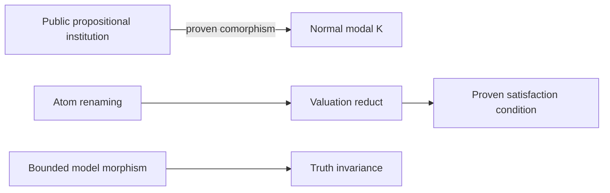
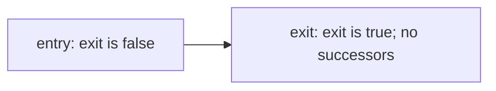
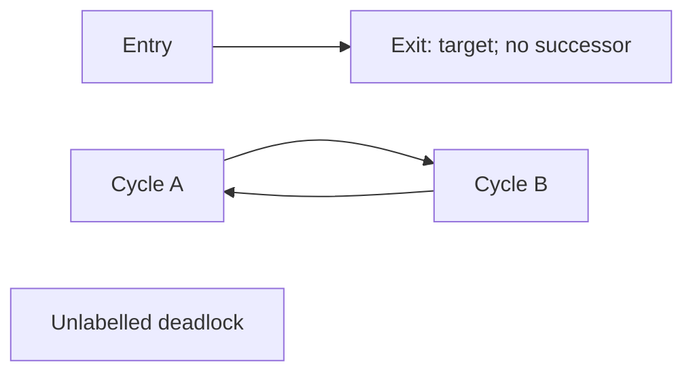
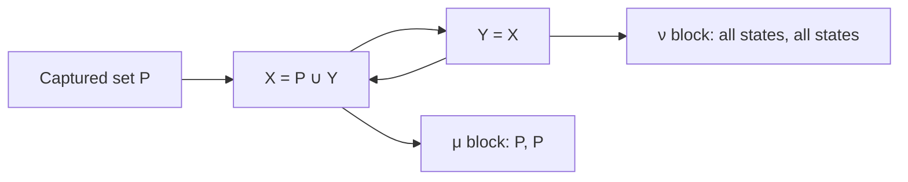
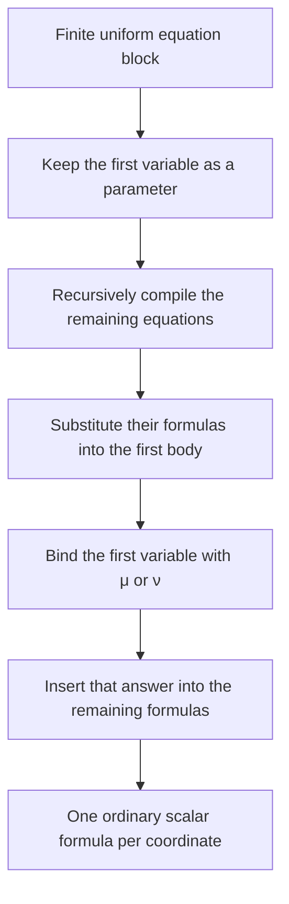
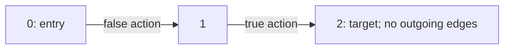
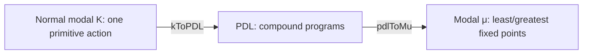
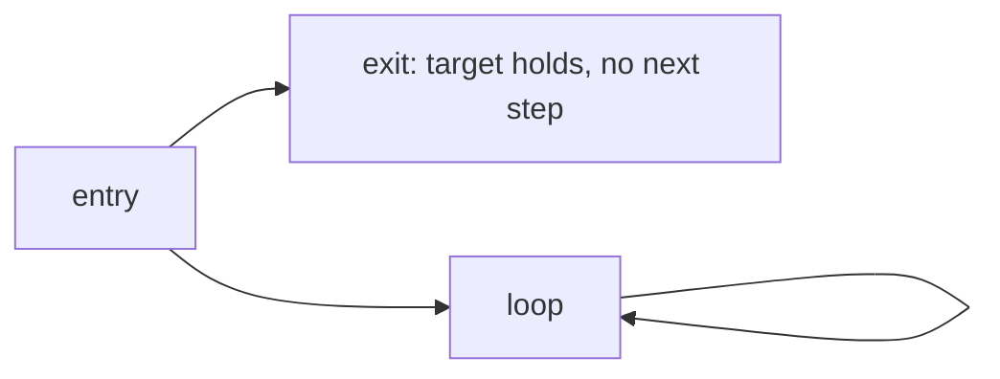
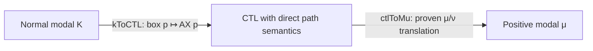

# Modal logics: K, modal μ, PDL, CTL and reachability

Normal modal logic K, the modal μ-calculus (with vectorial and finite-vector fixed points and
substitution), propositional dynamic logic, CTL, reachability logic over matching-logic fixed
points, and Wasm step observations as a modal logic. Each logic is an institution (`inst`) with
the comorphisms between them registered in the [logic graph](logic-graph.md)
(`Silmaril/LogicGraph`). The sections below are the guides of each development.

## Normal modal K

Modal logic describes what holds at a state and at its possible successors.
`□p` means “every immediate successor satisfies `p`.” Normal modal **K** is
the basic system: it makes no assumptions about which states can reach which.
It is distinct from the K language framework.

`Silmaril.Logic.Modal.institution` gives normal modal K with pointed Kripke
semantics. A **Kripke model** is a graph of states with propositions attached
to each state; **pointed** means that one state is chosen for evaluating a formula.
An **institution** packages the vocabulary, formulas, models and truth relation,
with a proof that renaming the vocabulary preserves meaning. Signatures contain atoms, signature maps rename atoms, and formulas
use bottom, implication and box. Models have a frame, an atom valuation and a
distinguished world. No reflexivity, transitivity or symmetry is imposed.

A **bounded morphism** is a map between models that preserves truth and the
possible successors in both directions. These maps form the model category
(objects are models, arrows are bounded morphisms). A morphism preserves the point,
reflects and preserves atom truth, carries accessible edges forward, and lifts
accessible successors back. The back condition is essential for preserving box
truth; an arbitrary graph homomorphism would be insufficient. Truth invariance,
category laws, reducts and the institution satisfaction condition are proved.



`propositionalToModal` is an actual institution comorphism from the public
propositional institution. It includes a signature functor, sentence translation,
point-valuation model functor, satisfaction proof and renaming naturality. Its
conjunction/disjunction encodings use classical logic.

The checked example in [Examples.lean](../../Silmaril/Logic/Modal/Examples.lean) uses:



- At entry, `□exit` is true: its only successor is the exit state.
- At entry, `exit` is false. Thus `□p → p` (axiom **T**) fails on this graph.
- At exit, even `□False` is true: there are no successors that could violate it.
- If every state has an edge to itself (**reflexivity**), T holds.

The distribution axiom K, `□(p → q) → (□p → □q)`, is proved on every frame.
A **frame** is the graph before any propositions are attached. **Necessitation**, the rule taking a universally valid `p` to `□p`, is proved from
validity across every model and world, rather than from truth at a single world.
Axiom T is proved under an explicit reflexivity hypothesis. The two-state
control-flow example verifies a box property and supplies a countermodel to T.
The deadlocked state demonstrates the intended vacuous truth of box.

This is semantic K. A Hilbert derivation system, completeness, and full
T/S4/S5 institutions are future additions. The shared institution comorphism is
available for Hets integration; no unproved diagram edge is presented as a
formal map. The [actual Wasm step observation adapter](modal-wasm-step-observations.md)
provides a direct operational interpretation and a two-DROP client. Strict remote
Lean validation passed for both. SSA execution remains a follow-up, and this
adapter does not assert a compiler theorem.

The implementation evidence is:

| Claim | Declaration |
| --- | --- |
| Truth preserved by bounded model maps | `Formula.holds_hom`, `sat_hom` |
| Vocabulary renaming preserves satisfaction | `Formula.holds_map`, `institution` |
| K, necessitation and reflexive T | `axiom_K`, `necessitation`, `axiom_T_of_reflexive` |
| PL translation and naturality | `propositionalCorridor`, `propositionalNatural`, `propositionalToModal` |
| Entry, deadlock and T counterexample | `Examples.entry_box_exit`, `Examples.deadlock_box_bottom`, `Examples.T_countermodel` |

These statements were checked against the definitions and theorem signatures in
`Defs`, `Thms`, `Propositional` and `Examples` during the documentation audit.
This prose review did not rerun the Lean build.

References:

- [Normal modal logic](https://en.wikipedia.org/wiki/Normal_modal_logic).
- Blackburn, de Rijke and Venema, *Modal Logic* (2001), Kripke semantics and
  bounded morphisms.


## Modal μ-calculus: reach a target or keep moving

The modal μ-calculus describes states and recursive properties of transitions.
`Silmaril.Logic.ModalMu` provides formulas, models and an institution: a package
whose satisfaction law says that consistently renaming symbols preserves truth.

A model has states, a chosen starting state, named transition relations and
named propositions true at selected states. This is a **pointed Kripke model**.
A transition name is called an **action**; it need not describe a deterministic
or terminating computation.

| Notation or term | Meaning |
| --- | --- |
| `◇a p` (diamond) | Some `a` successor satisfies `p`. |
| `□a p` (box) | Every `a` successor satisfies `p`; true when there are no successors. |
| `μ X. body` | The least set of states unchanged by the body's set transformer. |
| `ν X. body` | The greatest such set. |
| Monotone | Giving `X` more states cannot remove states from the body's result. |
| Positive variable occurrence | A set variable is not negated. This syntax guarantees monotonicity. |

For example, `reach a p = μ X. (p ∨ ◇a X)` is finite reachability. It includes
states already satisfying `p`, then states with a route to them. `reach_iff`
proves that this fixed point agrees exactly with explicit finite paths on every
model. By contrast, `forever a = ν X. ◇a X` includes any set in which each state
has an `a` successor in that set (`forever_of_postfixed`).



The checked [examples](../../Silmaril/Logic/ModalMu/Examples.lean) prove:

- Entry reaches Exit; both fail `forever` because Exit has no next step.
- The two-state cycle satisfies `forever` but never reaches a state labelled target.
- An unlabelled deadlock satisfies neither property.

To use the checked entry-to-exit example:

```lean
import Silmaril.Logic.ModalMu.Examples

open Silmaril.Logic.ModalMu Silmaril.Logic.ModalMu.Examples

example : Sat chain (reach () ()) := by
  apply (reach_iff chain () () false).mpr
  exact .next ⟨rfl, rfl⟩ (.here rfl)
```

Here `()` names the single action and atom. The model's entry is `false`, its
exit is `true`, and only the exit satisfies the atom. `.next` takes the one
transition and `.here` finishes at the target. This is the proof used by
`Examples.chain_reaches`; this documentation refresh did not rerun Lean.

These are statements about the actual denotations. `forever` carries no fairness
assumption or claim that every possible path continues.

## Syntax, semantics and maps

A signature contains an atom type and an action type. `Formula S n` allows `n`
free set variables, represented by `Fin n`; sentences have `n = 0`. A μ/ν body
has one extra variable. Index zero refers to the nearest binder. Syntax includes
positive/negative atom literals, false/true, conjunction/disjunction, box/diamond
and arbitrarily nested μ/ν. Only atoms may appear as negative literals.

An environment assigns each free variable a set of states. `denote` is proved
monotone in this environment. μ/ν use Mathlib's complete-lattice least/greatest
fixed points on sets. `mu_unfold`/`nu_unfold` prove unfolding; `mu_le`/`le_nu`
prove the least/greatest principles used by the reachability examples.
`denote_dual` proves complementation by swapping μ/ν, conjunction/disjunction
and box/diamond, and complementing the free-variable environment. For closed
sentences, `sat_dual` gives ordinary negation.

Renaming maps both atom and action names. Model reduction pulls back their
valuations and transition relations. `denote_map` proves exact satisfaction.
Models may have arbitrary infinite, branching or deadlocked frames. Their
category has **equality-only arrows**: arrows only identify equal model objects.
Preservation under bounded morphisms or bisimulations—maps or relations matching
transitions and atom truth—remains unproved for this interface.

`kToMu` is an institution **comorphism** from normal modal K. It translates
sentences forward and models backward, with naturality and satisfaction proofs.
The translation uses one action (`Unit`) and rewrites implication using Boolean
connectives. Its model functor sends equality arrows to identity bounded
morphisms in K's richer model category. `expandK` expands every K model with the
same frame, valuation and point; `forget_expandK`, `expandK_sat` and
`kToMu_modelExpansive` prove the exact model-expansion contract.
`k_sat_iff`, `k_unsat_iff` and `k_entails_iff` expose preservation and reflection
of satisfiability, absence of a satisfying model and semantic consequence.

## Implemented translations

The [CTL guide](ctl.md) describes `CTL.ctlToMu`, an institution comorphism with
exact denotation and model expansion. **CTL** (computation tree logic) quantifies
over paths through a branching graph. Its `Formula.toMu` compiler translates
its finite-until and infinite-path operators to actual modal μ formulas.

In the other direction, `Matching.FixedPoint.modalToMatching` translates modal
μ formulas into [positive fixed-point matching patterns](fixed-point-matching.md).
It preserves their denotations in pointed matching models and has exact model
expansion. A pattern denotes a set of values; its distinguished point plays the
role of the chosen graph state. This is the pointed presentation, distinct from
requiring a sentence to hold globally at all points.

The [LTL occurrence tableau](ltl-tableau.md) now compiles full **LTL** (linear
temporal logic, describing a single time sequence) to scalar modal μ syntax.
`Silmaril.Logic.Temporal.LTL.Tableau.ltlFormula_correct` says the result holds at a
graph state exactly when
one infinite path starting there satisfies the LTL formula. It uses the original
graph worlds and their atom valuations, including the starting world. A deadlock
has no infinite path, so it rejects these existential-path formulas. This is
not an institution comorphism from individual trace models to branching graphs;
a general CTL* translation remains separate work.

The [finite simultaneous fixed-point compiler](modal-mu-finite-vector.md)
eliminates finite uniform systems of least or greatest equations into scalar
syntax. [Variable substitution](../../Silmaril/Logic/ModalMu/Substitution/Defs.lean) replaces free
fixed-point variables with capture avoidance; it is separate from renaming
atom and action names.

## Correspondence and validation

This is original Lean code. The privately pinned Kozen 1983 source, printed
pp. 334–335 (§§2.1–2.2), supplies the selected syntax/semantics correspondence;
`kozen-1983-propositional-mu-calculus` in `references.bib`
record the exact boundary. Proof-system completeness, parsing/model checking
and concrete execution adapters remain open. The translations linked above have
their own scoped correctness theorems; they do not extend the Kozen source
coverage. The K→μ comorphism adds a formal connection without changing any of
the source diagram's 27 transcribed arrows.

The original targeted facade/examples build passed with `--wfail`. Axiom guards
check that Lean reports exactly the expected proof assumptions. These guards
report `propext`, `Classical.choice` and `Quot.sound` for semantic duality, finite
reachability and the K comorphism. Scoped
Isar lint passed (0/16), as did `mor check` and whitespace checks. No full local
build was run.


## Two simultaneous modal fixed-point equations

`Silmaril.Logic.ModalMu.Vector` compiles a uniform block of two simultaneous least
or greatest fixed-point equations into two actual scalar modal-μ formulas.
The source semantics is an independent fixed point on the product powerset
lattice, not the denotation of the compiled formulas.

A `System S n` contains two positive formula bodies. Index 0 denotes equation
variable X, index 1 denotes Y, and the remaining n indices capture arbitrary
outer set variables. The bodies may contain their own nested μ/ν binders and
modal operators. All existing pointed modal-μ models are admitted, with arbitrary
carriers/graphs and the existing equality-only model arrows. No finiteness,
finite branching, seriality or determinism assumption is added.

The vocabulary describes sets of states rather than numerical iteration:

- A **fixed point** is an input that an operation returns unchanged.
- A **lattice** here is the collection of state sets ordered by inclusion;
  arbitrary unions and intersections exist. For two equations, pairs of sets
  are ordered component by component.
- **Monotone** means that enlarging either input set cannot shrink an output.
  Positive formula bodies have this property.
- **μ** selects the least fixed point, or smallest simultaneous solution.
  **ν** selects the greatest fixed point, or largest solution.
- In the eventual automata application, an **accepting state** belongs to a
  designated accepting set. This compiler itself does not define an automaton
  or prove that a path visits accepting states repeatedly.

A simple mutually recursive example is X=P∪Y and Y=X. The least solution is
(P,P): the equations add nothing beyond the supplied set P. The greatest
solution is the pair containing every state, because that pair is also stable.
For P empty on a nonempty model, these solutions differ.



For body denotations f(X,Y) and g(X,Y), Bekič elimination first defines

```text
y(x) = μ Y. g(x,Y)
x*   = μ X. f(X,y(X))
y*   = y(x*)
```

The pair `(x*,y*)` equals the actual simultaneous least fixed point. Replacing
both displayed μ binders by ν gives the greatest-block construction.
`bekic_lfp` and `bekic_gfp` prove these generic product-lattice identities using
actual leastness/greatestness and parameter monotonicity.

The [source and compiler definitions](../../Silmaril/Logic/ModalMu/Vector/Defs.lean)
use the actual pair-powerset operator in `System.operator`, and
`System.denote greatest M ρ` selects its genuine fixed point (`false`=least,
`true`=greatest). `secondParam` swaps only X/Y indices before binding Y;
`firstScalar` substitutes that solution into the first body before binding X;
`secondScalar` instantiates the Y-solution at the first scalar solution.
Both outputs use existing `ModalMu.Formula` syntax.

The [public theorem header](../../Silmaril/Logic/ModalMu/Vector/Thms.lean) exposes
`System.compile_correct`: the pair of scalar denotations equals the independent
simultaneous solution for every model and every captured outer valuation.
`firstScalar_map` and `secondScalar_map` are syntactic naturality equalities for
arbitrary atom/action signature maps, including identifications. `denote_map`
also relates source semantics under the actual model reduct. Captured-variable
reindexing has its own source and compiled **semantic** equalities,
`denote_renameOuter` and `compile_renameOuter`; a syntactic outer-variable
commutation theorem is not asserted.

The separate [positive substitution API](../../Silmaril/Logic/ModalMu/Substitution/Thms.lean)
performs simultaneous formula insertion. It does not substitute an image again.
Under either fresh μ/ν binder, it preserves variable 0 and shifts all old images.
`Formula.denote_substitute` is an open-environment equality, and
`Formula.substitute_map` gives syntactic atom/action map naturality. This API
uses the existing positive free-variable grammar, so monotonicity does not rely
on an external positivity assumption.

The [controls](../../Silmaril/Logic/ModalMu/Vector/Examples.lean) check mutually
recursive X=P∪Y/Y=X with an arbitrary captured set P (μ gives P/P, ν gives the
full/full pair); noncapture beneath both a μ and a ν; and the coupled modal
system X=p∨◇Y/Y=◇X on a two-state toggle, where the least coordinate solutions
are distinct singleton sets. A separate accepting-empty deadlock model makes
both coordinates empty even for ν; greatest fixed points cannot invent
successors. The semantic system controls evaluate actual compiled scalar outputs as
well as the independent source solution; the nested capture control is an
exact syntax equality.

The [audit target](../../Silmaril/Logic/ModalMu/Vector/Audits.lean) passed a targeted
incremental `--wfail` build with 18 exact axiom guards and zero compiler errors
or warnings. The outputs use only Lean's standard logical axioms. Full PR CI
then passed at `bfacc6f1bee95d7caada3b278ace15114ecb6c37`
including the Lean build, tooling checks, aggregate CI and four-minute budget.
One scoped Isar finding is advisory. The earlier sparse-checkout catalogue
failures and dependency-metadata warnings remain in the historical logs; this
was not a clean dependency rebuild. Exact commands, failures, source/log hashes
and catalogue/layout results are retained under

The boundary is two equations with a uniform μ or uniform ν block. Arbitrary
finite-vector syntax/elimination, mixed-priority blocks, finite word-automaton
run/product compilation, LTL-to-automata and full CTL*-to-modal-μ correctness
remain separate. No new institution map, formal source-graph arrow or whole
CTL* acceptance theorem is declared here.


## Finite simultaneous modal μ blocks

A finite group of recursive set equations can be replaced by ordinary modal
μ formulas, one formula for each answer. This compiler works with any finite
number of equations and with arbitrary graph models.

A **fixed point** is a set assignment that reproduces itself when the equations
are evaluated. There can be several fixed points:

- **μ**, the least fixed point, chooses the smallest solution by set inclusion.
- **ν**, the greatest fixed point, chooses the largest solution.
- A **uniform** block uses the same choice, μ or ν, for every equation.
- A **coordinate** is one equation's component of the answer.
- A **scalar formula** uses ordinary single-variable μ/ν binders instead of a
  simultaneous group of binders.
- A **captured variable** is an external set parameter that the block may read
  but does not solve for.

For example, take an arbitrary external predicate P and four mutually recursive
equations:

```
X0 = P ∨ X1
X1 = X2
X2 = X3
X3 = X0
```

Every μ coordinate is P. Every ν coordinate is the full world set. The two choices
can therefore differ even though the equation bodies are identical. These claims
are checked by `Examples.captured_mu`, `captured_nu` and `captured_compiled`.

## Interface and construction

`Silmaril.Logic.ModalMu.FiniteVector.Thms` exposes `System S k n`: k positive equation
bodies with k+n free variables. Equation variables occupy the prefix, followed by
n captured variables. The Boolean `greatest` selects μ with `false` and ν with
`true`. Zero equations are allowed.

`System.denote` defines the simultaneous meaning independently of compilation:
it takes the least or greatest fixed point of the monotone operator on vectors
of world sets. Monotone means that enlarging input sets cannot shrink the output.
`System.compile_correct` proves that each emitted formula has exactly this meaning
for every model and every assignment of the captured variables.

The compiler uses **Bekič decomposition**, which solves one equation while treating
solutions of the remaining equations as functions of that first answer:



All substitution is capture-safe. The proof uses an order isomorphism that splits
a vector into its head and tail. No finite-world, finite-branching, determinism or
seriality assumption is needed.

## Laws, controls and limits

`System.compile_map` is syntactic equality under arbitrary atom/action signature
maps; `System.denote_map` gives the corresponding model reduct law. Reindexing
captured variables, including identifying two variables, is proved semantically
by `denote_renameOuter` and `compile_renameOuter`. A syntactic captured-variable
reindexing law is not claimed.

The controls include zero equations, one self-equation `X=X` separating μ from ν,
the captured four-equation cycle above, and three diamond equations on arbitrary
deadlock and serial models. Fifteen exact axiom guards record the standard Lean
axioms used, with no added axioms, `sorry` or `native_decide`.

Only uniform blocks are compiled; mixed-priority simultaneous blocks remain
pending. Existing scalar nested μ/ν formulas may occur inside the bodies. No
output-size or runtime bound is proved. The compiler now supports the separate
[Büchi formula construction on the original graph](buchi-base-formula.md), which
uses it for an inner μ block and an outer ν block. Constructing automata from LTL
or CTL*, and a full CTL* translation and institution arrow, remain pending.


## Propositional dynamic logic

Propositional dynamic logic (PDL) describes what can hold after a program runs.
For example, `⟨a;b⟩done` says that some execution of `a` followed by `b` ends
in a state labelled `done`. `[a;b]done` says that every such execution does.
`Silmaril.Logic.PDL` gives these statements a checked meaning and translates them
to the modal μ-calculus.

A model is a **pointed Kripke model**: a collection of states, a relation for
each primitive action, a set of states for each proposition, and a chosen
starting state. Neither the state set nor the number of execution steps has
a fixed finite bound. A **signature** lists the proposition and action names.

| Program | Meaning | Example |
| --- | --- | --- |
| Primitive action `a` | Follow one edge labelled `a`. | Load one value. |
| Sequence `a;b` | Run `a`, then `b`. | Load, then increment. |
| Choice `a ∪ b` | Run either branch. | Take either outgoing edge. |
| Star `a*` | Run `a` any finite number of times, including zero. | Repeat a loop body. |
| Test `p?` | Stay in place if `p` holds; otherwise block. | Check a guard. |

Formulas have atoms, false, arbitrary Boolean negation, conjunction/disjunction,
and both box `[a]p` and diamond `⟨a⟩p`. Programs and formulas are defined
together: tests can contain modal formulas, including further tests and stars.

## A checked example

The [example module](../../Silmaril/Logic/PDL/Examples.lean) has this three-state model:



Its action names are Lean `Bool` values; its single proposition holds only at
state `2`. The following definitions and result come from that module:

```lean
def sequence : Program ⟨Unit, Bool⟩ := .seq (.action false) (.action true)
def eitherStep : Program ⟨Unit, Bool⟩ := .choice (.action false) (.action true)
def reaches : Formula ⟨Unit, Bool⟩ := .diamond eitherStep.star (.atom ())

-- At the model's chosen entry state, the loop can reach the target.
theorem loop_reaches : Sat chain reaches := by
  refine ⟨2, ?_, rfl⟩
  exact Relation.ReflTransGen.head (Or.inl ⟨rfl, rfl⟩)
    (Relation.ReflTransGen.single (Or.inr ⟨rfl, rfl⟩))
```

Import `Silmaril.Logic.PDL.Examples` for the model and surrounding namespace.
Further checked results establish:

- the sequence reaches `2`, with an explicit two-step loop witness;
- testing the target at entry blocks execution; testing it after the sequence succeeds;
- reversing the actions fails;
- state `2` has no outgoing edge, but star permits its zero-step execution;
- an actual self-loop with no target-labelled state cannot reach the target;
- nested stars, modal tests and free continuation variables translate correctly.

A box at a state with no relevant executions is true: there is no execution
whose endpoint violates its postcondition. Star describes finite executions;
it does not assert that an infinite loop terminates.

## Institution maps

An **institution** packages signatures, sentences, models and satisfaction,
with a proof that renaming symbols preserves their meaning. A **comorphism**
translates signatures and sentences forward and models backward while
preserving satisfaction. **Model-expansive** means that every source model
comes from a target model, so satisfiability is reflected as well as preserved.



Both arrows are actual, signature-natural, model-expansive comorphisms:

- `kToPDL` uses a single `Unit` action and the proved K model reduct/expansion.
  Implication becomes negation/disjunction.
- `pdlToMu` keeps signatures and models. It proves equivalence for every PDL
  formula at every state, including negation and box via μ duality.

PDL and μ use equality-only model arrows: a map between models is an equality
of those models. K retains its existing bounded morphisms, which preserve
labels and satisfy both forward/backward edge conditions. Equality arrows map
to identity bounded morphisms. The current PDL API has no bisimulation or
bounded-morphism invariance theorem.

## Why repetition becomes a fixed point

A **least fixed point** is the smallest set unchanged by a given monotone set
operation. For reachability, start with states satisfying the postcondition,
then repeatedly add states that can take one program step into the set.

The translation uses a **continuation** `c`: the condition required after the
program finishes. `Program.toMu_correct` proves, for every variable environment,

```lean
w ∈ (a.toMu c).denote M ρ ↔ ∃ v, a.Rel M w v ∧ v ∈ c.denote M ρ
```

Sequence nests continuations, choice joins them, and a test conjoins its
condition with the continuation. Star introduces a fresh bound set variable:

```text
translate(a*, c) = μX.(shift(c) ∨ translate(a, X))
```

`shift` moves free variable indices past the new binder. This prevents
**capture**, where a previously free variable would accidentally refer to the
new `X`. The proof covers open continuations and nested tests/stars.

| Claim | Source evidence |
| --- | --- |
| Actual relational meanings; star is reflexive-transitive closure | [Defs](../../Silmaril/Logic/PDL/Defs.lean), `Program.Rel` |
| Star iff some finite length; relational/diamond/box unfolding | [semantic proofs](../../Silmaril/Proofs/Logic/PDL/Semantics.lean), `star_finite`, `star_unfold`, `diamond_star_unfold`, `box_star_unfold` |
| Institution renaming law | [Thms](../../Silmaril/Logic/PDL/Thms.lean), `institution` and mutual map/satisfaction proofs |
| Continuation and formula equivalence | [translation proofs](../../Silmaril/Proofs/Logic/PDL/MuTranslation.lean), `Program.toMu_correct`, `Formula.toMu_correct` |
| Capture avoidance | [variable proofs](../../Silmaril/Proofs/Logic/ModalMu/Variables.lean), `denote_renameVars`, `denote_shift`, `denote_closedAt` |
| Actual natural comorphisms and model expansion | [K proofs](../../Silmaril/Proofs/Logic/PDL/K.lean), [μ naturality](../../Silmaril/Proofs/Logic/PDL/MuNaturality.lean) |

Selected source correspondence is pinned privately under
`kozen-parikh-1981-pdl` in `references.bib`, printed
pp.113–114, and `troquard-balbiani-2023-pdl` in `references.bib`.
Kozen–Parikh omits tests; the second source supplies their definition.
The Lean semantics and categorical proofs are original. This slice supplies
neither a text parser nor an efficient model checker; concurrent,
first-order and differential dynamic logic and concrete WASM/SSA adapters
remain separate work.


## CTL: finite until and infinite paths

**CTL** means **Computation Tree Logic**. It describes states in a system with
possibly several next steps. For example, from `entry` a program might reach
`exit` or keep looping; CTL can distinguish “some execution reaches exit” from
“every execution reaches exit”. A single execution is a **path**; CTL can
quantify over paths branching from the same state.

`Silmaril.Logic.CTL` works over arbitrary **pointed Kripke frames**: a set of
states, a next-step relation, labels saying which atomic propositions hold,
and a chosen starting state. A **signature** lists the atomic propositions;
a signature map renames them. A **deadlock** is a state with no next step.
Deadlocks remain terminal.



At `entry`, `EF target` holds because the exit path exists. `AF target` fails
because the loop path never reaches the target.

The primitive state formulas are atoms, false, negation, conjunction, EX, EU and
EG. Their meanings are defined directly in `Formula.Holds`, independently of
modal μ:

| Formula | Meaning at state `w` |
| --- | --- |
| `EX p` | Some immediate successor satisfies `p`. |
| `E[p U q]` | A finite path reaches `q`, and every earlier state satisfies `p`. Length zero is allowed. |
| `EG p` | An actual sequence `path : ℕ → World` starts at `w`, follows an edge at every step, and satisfies `p` everywhere. |

For example, on `entry → exit` with a terminal labelled exit, `EX exit` and
`E[true U exit]` hold at entry. `EG true` fails: the finite chain cannot supply an
infinite path. On the genuine two-state cycle `left → right → left`, `EG true`
holds, while `EF target` fails when the target label is absent. The examples
also include an infinite natural chain, a failed until guard, and `EG(EF target)`
on a labelled cycle, whose translation nests ν around μ.

`Until` is an inductive finite-path relation. `until_iff_finite_prefix` proves
its equivalence to an explicit finite prefix indexed by a natural endpoint.
`Globally` quantifies actual infinite sequences. `globally_iff_gfp` constructs
such a sequence by choosing a successor in the greatest fixed point at each
step, and proves the converse by coinduction. These results hold on infinite
and infinitely branching carriers; no model-checking cutoff is used.

## Deadlocks and universal abbreviations

EX is strong: it is false at a deadlock. AX is its weak Boolean dual,
`¬EX¬p`, so it remains true at a deadlock, exactly like K's box. EF is
`E[true U p]`; AG is `¬EF¬p` and covers every finite reachable state, including
terminal states. These relational meanings are proved.

The serial CTL abbreviation `¬EG¬p` ignores a terminal state where `p` fails,
because that state has no infinite path. The strong, deadlock-aware AF used
here additionally excludes a finite path that delays `p` until a deadlock:

```text
AF p = ¬EG¬p ∧ ¬E[¬p U (deadlock ∧ ¬p)]
A[p U q] = ¬E[¬q U (¬p ∧ ¬q)] ∧ AF q
```

A relation is **serial** when every state has at least one successor. Thus AF
and AU require their target immediately at a terminal state. Both facts
are proved, as is recovery of the usual serial AF/AU dual equations under an
explicit seriality premise. This is a stated extension of the sources'
infinite-computation setting. It is not an assertion that all derived universal
forms quantify a single shared CTL* path-formula grammar on nonserial frames.
`Formula.af_iff_all_paths` proves that AF holds exactly when every infinite
path and every finite path ending at a deadlock reaches its target. Such a path
is **maximal**: it continues forever or stops only because no next step exists.
`Formula.au_iff_all_paths` gives the analogous exact characterization of AU:
each such path reaches q after a finite prefix satisfying p.
`finite_prefix_maximal_extension` constructs a maximal continuation of every
finite prefix using classical successor choice; path completeness and seriality
are not assumed. Full CTL* and arbitrary path-formula Boolean combinations
remain separate work.

## The actual institution maps



`institution` uses equality-only CTL model arrows. K retains its existing
bounded model morphisms; the K reduct maps equality arrows to the corresponding
identity/transport bounded morphisms. The modal μ target also has equality-only
arrows. No extra invariance theorem along bounded morphisms is assumed.

`kToCTL` uses the identity atom-signature functor. Its model reduct returns the
stored K frame, valuation and point, and every K model expands by wrapping it.
`ctlToMu` uses the existing K-to-μ signature functor: the same atoms and one
unnamed `Unit` action. Its model reduct reads that action relation and the atom
sets from **every** target model. Every CTL model expands with identical worlds,
steps, labels and point. Both maps are signature-natural, preserve and reflect
satisfaction, and are **model-expansive**: every source model has a target
expansion whose reduct is that source model. This prevents the translation
from losing source countermodels. The supplied **entailment** equivalences
(a conclusion holds in every model of the hypotheses) therefore cover actual
source and target models.

The μ translation is:

```text
EX p       ↦ ◇ p̂
E[p U q]   ↦ μX. q̂ ∨ (p̂ ∧ ◇X)
EG p       ↦ νX. p̂ ∧ ◇X
¬p         ↦ dual(p̂)
```

Here μ denotes the **least fixed point**, built by finite progress toward a
target; ν denotes the **greatest fixed point**, allowing an infinite
continuation. A binder introduces the variable `X` used in its body.

Closed translated subformulas are shifted using the existing scoped
`ModalMu.Formula.shift` before entering each fresh binder. The semantic shift
law prevents accidental capture of nested μ/ν variables. `Formula.toMu_correct`
is proved against CTL's independent direct semantics, using finite-path
induction for EU and actual infinite sequences for EG.

The authoritative source snapshots and item coverage are in
`goranko-rumberg-2024-temporal-logic` in `references.bib`,
with the separately pinned Cambridge Katsura lecture 9 reused for explicit
state/path examples. Sources, snapshots and receipts remain private. No full
CTL*, completeness, complexity bound, satisfiability procedure or model checker
is claimed.

## Source map and checks

| Claim | Definition or proof |
| --- | --- |
| Direct formulas, finite until, infinite paths and deadlock-aware operators | [`CTL/Defs.lean`](../../Silmaril/Logic/CTL/Defs.lean) |
| Explicit finite-prefix and infinite-path laws | [`CTL/Semantics.lean`](../../Silmaril/Proofs/Logic/CTL/Semantics.lean) |
| Least/greatest fixed-point equivalences | [`CTL/FixedPoint.lean`](../../Silmaril/Proofs/Logic/CTL/FixedPoint.lean) |
| AF/AU maximal-path theorems, continuation construction, terminal and serial laws | [`CTL/Derived.lean`](../../Silmaril/Proofs/Logic/CTL/Derived.lean) |
| Institution and actual K translation | [`CTL/Thms.lean`](../../Silmaril/Logic/CTL/Thms.lean) |
| Capture-safe modal μ translation and model expansion | [`CTL/Mu/Defs.lean`](../../Silmaril/Logic/CTL/Mu/Defs.lean), [`CTL/Mu.lean`](../../Silmaril/Proofs/Logic/CTL/Mu.lean) |
| Finite, cyclic, deadlocked, infinite and nested examples; axiom guards | [`CTL/Examples.lean`](../../Silmaril/Logic/CTL/Examples.lean) |

The targeted warnings-as-errors build passed, including six guards checking
that selected results use only `propext`, `Classical.choice` and `Quot.sound`.
Scoped Isar lint and `mor check` passed. These checks do not establish source
completeness or supply a model-checking algorithm.


## Reachability logic: finite reach, one-path and all-path partial correctness

A reachability sentence describes how an execution can move from a starting
condition to a target condition. For example, “starting with two values and two
`DROP` instructions, execution can reach the remaining stack” is a finite
reachability claim.

- A **configuration** is the whole execution state: code, stack, store and any
  other state needed to take a step.
- A **pattern** describes a set of configurations. The **precondition** selects
  starting configurations; the **postcondition** selects targets.
- A **sort** is a type of value. A **valuation** assigns a value of its declared
  sort to each free object variable. Both conditions use the same assignment:
  `x` cannot mean one value before execution and another afterward.
- **Validity** requires the claim for every matching starting configuration
  and every valuation. **Partial correctness** constrains terminating runs;
  it can permit infinite execution.

Here both conditions are many-sorted first-order matching patterns, including
negation and quantifiers. Their common variable context is finite.

`Silmaril.Logic.Reachability` implements three explicit modes on arbitrary nonempty
configuration carriers, including infinite carriers, branching and deadlocks:

| Mode | Meaning from each matching initial configuration |
| --- | --- |
| `finite` | Some finite execution reaches the postcondition; zero steps are allowed. |
| `onePath` | Some finite execution reaches the postcondition, or an actual infinite execution starts here. |
| `allPath` | Every finite execution ending at a deadlock visits the postcondition somewhere, including its initial or final state. |

An execution is a real sequence of transitions. `Reaches` uses the already-proved
CTL finite-until witness; `Diverges` requires an actual `Nat → World` sequence,
not an unbounded family of finite prefixes. `AllPartial` quantifies finite
prefixes ending at states with no successor. A zero-step terminal execution
therefore counts: a deadlock must already satisfy the postcondition.

These modes follow the archived primary sources:

- `rosu-stefanescu-ciobaca-moore-2013-lics` in `references.bib`,
  Definition 7: validity asks for finite postcondition reachability when the
  initial configuration terminates. For unconditional operational semantics,
  termination is absence of an infinite execution.
  `onePath_iff_terminating` proves this equivalence, classically.
- `stefanescu-ciobaca-mereuta-moore-serbanuta-rosu-2014-rta` in `references.bib`,
  §3, Definitions 3–4: a path is finite, and complete means it has no strict path
  extension. The paper explicitly defines one-path validity as finite reach or
  divergence, and all-path validity by these complete finite paths.

The 2013 source also has conditional reachability systems and a termination
dependence relation accounting for nested attempts to discharge rule premises.
This API covers the unconditional transition-relation fragment. It does not
replace that richer dependence relation with ordinary step termination.

## What the examples distinguish

A pure two-state cycle with an empty postcondition satisfies both partial modes.
It has an infinite execution and no complete finite execution. It fails finite
reachability and strong all-path eventuality (`CTL.AllEventually`). Thus partial
reachability does not assert that the target is eventually reached on infinite
runs.

A branching initial state with one good terminal successor and one bad terminal
successor satisfies the one-path rule and fails the all-path rule. A deadlock
with a false target fails both partial rules. An infinite natural-number chain
has a checked finite witness to state 17. Object-variable examples check that
μ captures the existing valuation: a variable reaches itself in zero steps,
while changing the target variable on a deadlocked two-element carrier produces
a countermodel.

The examples check the compiled matching sentences as well as the direct
semantics. They do not assume fairness, seriality, finite carriers, finite
branching or a model-checking fuel bound.

## Signatures, model arrows and the actual matching map

A signature is an existing sorted matching signature plus a distinguished unary
configuration-step symbol. Its interpretation is predecessor-oriented:

```text
R(w,v)  iff  w ∈ interpretation(step)(v).
```

Signature maps preserve all operation profiles and the designated step symbol.
Models are the existing first-order matching models: every sort has a nonempty
carrier, and operations may return empty or nondeterministic sets. Their arrows
are the existing sorted relational homomorphisms preserving operation membership.
No general preservation of negation or global validity by these arrows is
asserted. Signature reducts retain carriers and use the existing matching reduct
functor, whose satisfaction condition is proved.

This is a relational matching presentation. Ordinary deterministic configuration
algebras are included by singleton-valued old operations; no new deterministic
algebra model class is silently identified with all matching models. The step
relation is stored as a designated operation. The separate
[operational rule-system interface](reachability-rule-system.md) constructs an
induced relation from native matching-pattern rules and proves its connection
to this semantic interface. It does not certify an arbitrary rule engine.


An **institution** packages vocabularies (**signatures**), sentences, models and
truth, with a law for translating a sentence along a vocabulary map. A
**comorphism** translates signatures and sentences forward and models backward,
preserving truth exactly. **Model-expansive** means that every source model has
a target model whose backward translation recovers it.

`toMatching` forgets the designation on the signature, compiles the sentence and
uses the identity functor on actual matching models. Its naturality and exact
satisfaction theorem are proved. Every source model expands using itself, so
`entails_iff` gives semantic-consequence equivalence for translated premises and
conclusions. This is a genuine institution comorphism, not only a pointwise
translation result.

For postcondition q, write `D` for predecessor application by the step symbol,
`T` for terminality (`box bottom`), and `P` for the precondition:

```text
reach(q) = μX. (q ∨ D X)
diverge  = νX. D X
bad(q)   = μX. ((T ∧ ¬q) ∨ (¬q ∧ D X))

finite:  ¬P ∨ reach(q)
onePath: ¬P ∨ (reach(q) ∨ diverge)
allPath: ¬P ∨ ¬bad(q)
```

These are actual scoped `Matching.FixedPoint.Pattern` terms. Old patterns sit
under μ/ν as `base` leaves; the same object context remains captured, and the
new set variable is index zero. Negation of `bad` uses the proved De Morgan
dual, including μ/ν duality. The proof `encode_correct` relates this compiler to
independent direct path semantics; `allPartial_iff_no_bad` proves the finite
terminal obstruction characterization.

## A real Wasm target

`Silmaril.Logic.Reachability.Wasm` is separate from the generic facade. For every
profile, host relation, store, frame, stack prefix `vs`, and values `a,b`, it
proves two actual pinned Core steps:

```text
vs ++ [a,b]; DROP; DROP  →  vs ++ [a]; DROP  →  vs
```

The model's step operation is exactly `Silmaril.Wasm.Execution.Core.Step`.
`rule_valid` proves the finite reachability sentence between singleton initial
and final configurations; `compiled_valid` proves its actual μ-matching
translation. The store and frame are preserved. This example has an implemented
checked target adapter; it is not a new Wasm execution semantics.

The generic Hoare→reachability and rewriting→reachability institution bridges,
conditional-rule semantics, relative completeness and fairness remain separate
developments. Source proof systems now have separate guides: the
[restricted guarded derivation interface](reachability-guarded-derivation.md)
and the [full eight-rule A/C calculus](reachability-derivation-calculus.md).
Their soundness results apply to their explicit derivation constructors and
hypotheses. This semantic interface supplies the institution map to fixed-point
matching; it does not itself validate arbitrary reachability proof certificates.

## Source map and checks

| Claim | Declaration or module |
| --- | --- |
| Shared variables, three direct modes and recursive compilation | [`Defs.lean`](../../Silmaril/Logic/Reachability/Defs.lean): `Sentence.Satisfies`, `Mode.Holds`, `encode` |
| Finite-terminal obstruction and compiler correctness | [`Semantics.lean`](../../Silmaril/Proofs/Logic/Reachability/Semantics.lean): `allPartial_iff_no_bad`, `encode_correct` |
| Signature reducts, naturality, model expansion and consequence | [`Thms.lean`](../../Silmaril/Logic/Reachability/Thms.lean): `Sentence.satisfaction`, `toMatching`, `entails_iff` |
| Realizing arbitrary nonempty transition systems | [`Relational.lean`](../../Silmaril/Logic/Reachability/Relational.lean): `relationalModel`, `atomRule_iff` |
| Chain, cycle, branching, deadlock, infinite-carrier and variable controls | `Examples.lean` |
| Two pinned Wasm steps and their compiled matching sentence | [`Wasm.lean`](../../Silmaril/Wasm/Logic/Reachability.lean): `two_steps`, `compiled_valid` |

The current semantic sources were reviewed against this complete page and the
passed at `89ac0342aa1a1f4fa526435150d88d40e93a3ef1` before
semantic source modules listed above are unchanged from that checked head.
The Lean build includes `Examples.lean`, whose two exact axiom guards for
`encode_correct` and `entails_iff` expect `propext`, `Classical.choice` and
`Quot.sound`. This page review inspected those declarations and ran no new
local Lean build. The later source-system guides record their own scoped
validation and limits.


## Modal observations of actual Wasm steps

The adapter in `Silmaril.Logic.Modal.Wasm` interprets normal modal K
formulas over the pinned Wasm Core `Step P host` relation. A **configuration**
contains a store, frame and instruction list. A **profile** selects numerical
execution choices; **host semantics** describes external calls. Both parameters
remain fixed throughout each observation institution.

An **observation** assigns a predicate on configurations to each proposition
name, called an **atom**. A model supplies those predicates and a distinguished
configuration. The native `Holds` definition interprets atoms, falsehood and
implication directly. Its **box**, `□p`, means that every actual one-step successor
satisfies `p`. Its diamond abbreviation, `◇p = ¬□¬p`, means that some actual
one-step successor satisfies `p`, using classical logic. These meanings use
`Step`, rather than its reflexive-transitive closure or a separately defined
execution relation.

The interface and the client below passed strict remote Lean checking. Their
22 endpoint guards permit only Lean's standard `propext`, `Classical.choice` and
`Quot.sound` axioms.

## The two-DROP example

The client reuses `Silmaril.Logic.Reachability.Wasm` configurations. Values precede
instructions in the administrative instruction list. `DROP` removes the last
value before it:


Atoms `middle` and `finish` test equality to those actual configurations. Atom
`terminal` tests the existing native `Config.Terminal` predicate. The client theorems establish:

- `□middle` at start and `□□finish` at start: every successor, then every
  successor of that successor, has the stated form.
- `◇◇terminal` at start, using the two actual transition witnesses.
- `□False` at finish: a values-only configuration has no successor, so the
  universal condition is vacuously true.
- Failure of **axiom T**, `□p → p`, both at the live start (`p = middle`) and
  at the deadlocked finish (`p = False`). Normal K does not require self-edges.

The universal claims use the pinned
`Silmaril.Wasm.Binaryen.SimplifyLocalsLite.drop_step_unique` theorem, which
inverts every successor even for an arbitrary profile, host and continuation.
The existential claims reuse `Reachability.Wasm.first_step` and `second_step`.
Deadlock uses `Core.Step.not_vals`. An exhibited path alone would not establish
a box claim. This example makes no determinism claim about arbitrary Wasm code.

## Comparison with normal K

`toModal` forgets the operational presentation while keeping the same
configurations, actual step relation, predicates and distinguished point.
`holds_toModal` compares the independently recursive native truth definition
with the existing Kripke truth definition at every configuration. Native truth
is not defined by translated Kripke satisfaction.

A **bounded morphism** is a function between configuration models preserving the
point and atom truth, carrying steps forwards, and lifting target successors
back to source successors. The back condition matters for box truth. The adapter
retains all such morphisms; arbitrary forward simulations do not suffice.

A **reduct** renames the observations while leaving execution unchanged. The
comparison commutes with these reducts on objects and morphisms. The natural
restriction and `restrictModal` **comorphism** package that compatibility and the
satisfaction equivalence; a comorphism translates sentences forwards and models
backwards. Here formulas remain unchanged and actual execution models reduce to
Kripke models.

Consequently an execution satisfiability witness supplies a normal-K witness;
normal-K unsatisfiability and semantic consequence transfer to these execution
models. **Semantic consequence** means truth in every model satisfying the
premises. The reverse directions are not asserted: arbitrary Kripke models need
not arise from this fixed Wasm execution frame. No model-expansiveness or general
Wasm verification claim is made.

The existing propositional-to-K comorphism can be followed by this restriction.
The existing Wasm reachability and rewriting clients already describe finite
paths; this adapter adds direct one-step box observations and does not register
another abstract graph direction.

## Source and validation targets

| Interface | Module |
| --- | --- |
| Native evaluation, bounded model category and reduct | `Silmaril.Logic.Modal.Wasm.Defs` |
| Satisfaction comparison, natural comorphism and transfer directions | `Silmaril.Logic.Modal.Wasm.Thms` |
| Native two-DROP observations | `Silmaril.Logic.Modal.Wasm.TwoDrop.Defs` |
| Successor inversion, diamonds, boxes and T controls | `Silmaril.Logic.Modal.Wasm.TwoDrop.Thms` |

Strict remote validation targets the two `Thms` modules. Their long proofs
live under `Silmaril/Proofs/Logic/Modal/Wasm/`; users import the topic headers.
