# SMT-LIB theories and solver institutions

## SMT institutions and presentations

The SMT APIs include:

Each decoder accepts a stated subset of SMT-LIB. The UF/LIA presentations below
and the Real-source rooms have different model classes and source contracts.

## What the interfaces mean

An institution specifies signatures, sentences, models and satisfaction, together
with translations along signature maps:

- A **signature** declares the symbols available to a sentence, including their
  sorts and function argument/result sorts.
- A **model** gives those symbols meanings. A sentence is **satisfied** when it
  evaluates to true in that model. SAT means that at least one model satisfies
  the problem; UNSAT means that no model does.
- A **room** is the sentence/model/satisfaction interface at one signature.
- A **corridor** translates sentences forward and models backward, with a proof
  that satisfaction agrees. A **comorphism** provides these translations across
  the signatures of two institutions, compatibly with their signature maps.
- A translation is **model-expansive** when every source model is the reduct
  (the restricted interpretation) of some target model. Together with the
  satisfaction law, this gives SAT and UNSAT equivalences. Satisfaction alone
  does not generally give both directions.

For example, fix `x : Int` and `f : Int → Int`. The assertions
`(< x (f x))` and `(<= (f x) x)` form a problem over that signature. In a
whole-problem presentation, the declarations travel inside the sentence instead.
The distinction matters when comparing problems with different symbols.

The original script and UF/LIA presentations below use **discrete** model
categories: their arrows only transport equal models. Ground UF/LIA also has
homomorphism and embedding presentations, both abstract
and byte-backed, with actual functions between user carriers and functorial
model reducts. General homomorphisms can collapse distinct values; embeddings
preserve and reflect all ground assertions. Both fix every Bool and Int value.
Symbol-renaming maps belong to the signature categories in either presentation.

## Existing script fragment

These APIs use the evaluator in
[`Silmaril/Logic/Smt/Defs.lean`](../../Silmaril/Logic/Smt/Defs.lean). It supports Bool,
Int and bit-vectors, with constant declarations only: `declare-fun` must have
zero arguments. Models assign values to names.

| Presentation | Signatures | Sentences | Models |
| --- | --- | --- | --- |
| `Institution.scriptInst` | One signature | Abstract scripts, including declarations | Assignments |
| `Institution.formsInst` | One signature | S-expression scripts with successful decoding evidence | Assignments |
| `Fixed.institution` | Declaration lists | Assertion lists | Assignments satisfying those declarations |

Here `Institution` and `Fixed` refer to namespaces under `Silmaril.Logic.Smt`.
Their headers are
`Institution/Thms.lean` and
[`Fixed/Thms.lean`](../../Silmaril/Logic/Smt/Fixed/Thms.lean). Each provides rooms.
These signature categories have only equality maps; they do not implement
symbol renaming.

`Institution.decodeComorphism` translates accepted S-expressions to abstract
scripts. Models are unchanged, so it is model-expansive and gives exact SAT and
UNSAT transport. Failed decoding does not produce a sentence of the concrete
institution and does not establish UNSAT.

`Fixed.package` puts a fixed declaration list back inside a script.
`Fixed.holds_iff`, `Fixed.sat_iff` and `Fixed.unsat_iff` account for the change
from sorted assignments to unrestricted assignments. This relationship is
proved directly; it is not a total identity-model corridor that turns every
unrestricted assignment into a sorted one. Conflicting duplicate declarations
can leave the sorted model class empty; the equivalences do not assume that
such signatures have models.

Important limits of this evaluator remain:

- Integer multiplication can be nonlinear, and `set-logic` is recorded without
  enforcing a fragment. This parser is not the QF-UFLIA frontend.
- Division/modulo by zero use fixed choices `a div 0 = 0` and `a mod 0 = a`,
  rather than SMT-LIB's underspecified operations.
- An abstract `Script` can be constructed even when the concrete decoder would
  reject it. Claims about accepted files need their own decoding equality.

## Abstract UF/LIA and its typed decoder

[`Uflia/Defs.lean`](../../Silmaril/Logic/Smt/Uflia/Defs.lean) defines a separate sorted
language. Bool and Int have their standard meanings; each uninterpreted sort has
a nonempty carrier. Function symbols may have arbitrary sorted argument lists,
including Boolean arguments/results. A constant is a function with no arguments.
Terms are ground: there are no bound variables or quantifiers. Integer
multiplication is scaling by a fixed integer coefficient, not multiplication of
two arbitrary terms.

[`Uflia/Thms.lean`](../../Silmaril/Logic/Smt/Uflia/Thms.lean) supplies
`Uflia.institution`, its rooms, and the satisfaction law for symbol renaming.
These signature maps preserve the fixed sort family and operation profiles;
they do not rename sorts. An operation profile is its ordered argument sorts
and result sort; preserving it means that renaming cannot change an `Int → Int`
function into a `Bool → Int` function. There is a concrete model for every
signature, and finite problems have SAT/UNSAT definitions and examples.

The separate
[`Uflia/SExpr` frontend](../../Silmaril/Logic/Smt/Uflia/SExpr/Defs.lean) checks a
declaration prefix, then decodes individual ground assertion expressions:

```smt2
(declare-sort U 0)
(declare-const a U)
(declare-fun f (U) Int)
```

After that prefix, `(< (f a) 3)` is a well-sorted assertion; `(f true)` fails
its argument-sort check. The decoder checks names, arities and sorts and
constructs typed abstract terms. `DeclarationPrefix` retains evidence that the
declaration forms decoded; `Assertion` retains the corresponding evidence for
an assertion expression. Raw `Environment` values can also be constructed
manually, so use the checked-prefix interfaces for claims about declarations
accepted by this frontend.

The original `SExpr.institution` and `SExpr.declarationInstitution` use equality-only maps
between raw environments and checked prefixes respectively. Their decoder
comorphisms go to `Uflia.institution String`; models are unchanged and the
satisfaction laws give SAT/UNSAT equivalences.

The typed elaborator now accepts associative n-ary
operators, chains of comparisons/equalities, all-pairs distinctness and parallel
lexical `let`, lowering them to the same abstract terms. Operators follow the
inspected minimum arities; multiplication accumulates concrete coefficients
with at most one nonliteral factor. Its arbitrary-term scaling remains a
mathematical linear extension, not a proved exact official surface-grammar
membership check. The decoder rejects quantifiers, division/modulo, quoted
identifiers and incremental commands.
The separate single-query script frontend now reads a
strict whole-input command sequence into checked packaged concrete problems.
It accepts optional `QF_UFLIA` or `QF_LIA` metadata, a declaration prefix,
assertions and one terminal query with optional exit. The `QF_LIA` tag restricts
declarations to nullary Bool/Int symbols; other explicit logic names reject.
The separate concrete renaming institutions use
coherent `NameMap` arrows and executable normalization/rendering of accepted byte
representatives. Two representatives are identified precisely when their decoded
typed formulas are equal. This is a quotient by formula equality, rather than
by equal truth in all models. Normalization can remove `let` and change the bytes
even for the identity name map. Their sentence translations obey identity/composition on this quotient over raw-environment
and checked-prefix signature categories;
target models reduce along the abstract signature map. The three decoder and
prefix-forget comorphisms are model-expansive because models are unchanged at
each fixed signature. Arbitrary symbol-collapse arrows are not claimed
model-expansive: identifying two distinct constants can destroy satisfiability.
For example, `a ≠ b` has an integer model before a map sends both names to `x`;
its translated assertion `x ≠ x` has none.
These original concrete institutions define satisfaction through the typed
decoder. The separate direct presentation below supplies independent semantics
for the accepted ground fragment. Full correspondence to the pinned SMT-LIB
standard remains unfinished.

## Independent ground source semantics

`Uflia/SExpr/Surface` defines
source evaluation directly by expression rules. For example, an arithmetic rule
evaluates the operands of `(+ 2 3)` and returns `5`; it does not ask what typed
term the decoder produced. Parallel `let` right-hand sides use the caller's
scope, so `(let ((x 2) (y 3)) (+ x y))` evaluates to `5`.

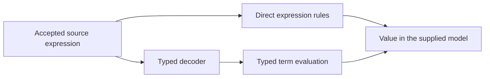

- Source values are unique even in arbitrary semantic local scopes.
- For every accepted term, source evaluation agrees with its decoded typed value.
  The agreement covers all admitted arities and parallel `let` bindings.
- Direct institutions and rooms cover accepted assertions, checked declaration
  prefixes, structured whole problems and accepted single-query scripts.
- Whole-problem and script comparisons use the same coherent global model,
  giving satisfaction, SAT and UNSAT equivalences.
- Comparing a model of a finite declaration signature with a global model needs
  injective typed names. Checked declaration prefixes supply that condition.
  The integer carrier remains the infinite integers.

The basic direct institutions use equality-only signature maps. A separate
direct renaming presentation
uses coherent symbol-name maps, including identification of names. Its direct
satisfaction law and comparisons preserve whole-theory UNSAT. Identifying
`a` and `b` still turns the satisfiable `a != b` into `x != x`; forward SAT
transport does not hold for every signature map.

## Declarations inside UF/LIA problem sentences

[`Uflia/Packaged`](../../Silmaril/Logic/Smt/Uflia/Packaged/Thms.lean) connects fixed
symbols to whole problems. A whole sentence stores its declaration environment
and assertions. A global model interprets each name at each typed operation
profile over one shared family of carriers. The same name at the same profile
has one meaning across sentences; different profiles may have different meanings.

For this section, all API names below are in `Uflia.Packaged`.

| Presentation | Institution | What one sentence contains |
| --- | --- | --- |
| Concrete, fixed symbols | `concreteFixedInstitution` | Accepted S-expression assertions at a checked declaration prefix |
| Abstract, fixed symbols | `checkedInstitution` | Typed assertion lists at that checked prefix |
| Concrete, whole problem | `concreteInstitution` | A checked prefix and accepted S-expression assertions |
| Abstract, whole problem | `institution` | An environment and typed assertions |

The four presentations above are connected by actual comorphisms; the fixed
source presentations retain checked prefixes:

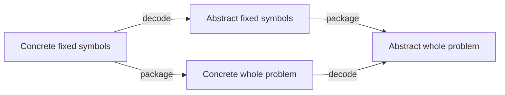

All four maps are model-expansive. Successful prefix decoding guarantees unique
declaration names; the model-extension proof uses this syntactic fact to extend
a fixed model to a global one. No SAT assumption is needed. For manually
constructed raw environments, expansion instead requires the explicit
`NamesInjective` condition: distinct declared symbols at the same profile must
retain distinct names.

`packaging_decode_square` proves equality of the two composite comorphisms:
decoding then packaging gives the same map as packaging then decoding.
`checked_sat_iff`, `checked_unsat_iff`, `concrete_sat_iff_fixed` and
`concrete_unsat_iff_fixed` provide the corresponding problem equivalences.
A concrete whole sentence stores a structured prefix and assertion list.
`Uflia.Script.parse?` now constructs such sentences from a strict single-query
script fragment; accepted scripts retain the exact text and parser equality.
Its identity-model decoder corridor and comorphism give exact SAT/UNSAT
transport to this concrete whole-problem institution.

## Connecting solver proofs

## Review evidence and open boundaries

The historical receipt predates the direct-source, quantified-script, array
witness and BV certificate additions described here. The current update checks
those overview claims against their source interfaces; it does not renew a
whole-page review of every linked guide.

Independent expression semantics and decoder correspondence are proved for the
accepted ground and quantified UF/LIA fragments. The
quantified model-map presentation already uses
ordinary UF homomorphisms, with signature reducts acting on model arrows;
`Quantified.Sentence.holds_iso` proves truth preservation and reflection under
model isomorphisms. These presentations keep user-sort names fixed and fix Bool
and Int. Ordinary homomorphisms may identify user values and need not preserve
quantified truth; even injective, nonsurjective model maps can fail to preserve
it, as the checked embedding counterexample shows.


## SAT and UNSAT across institution maps

A **room** has sentences, models and a satisfaction relation. A **theory** is a
set of sentences that must hold together in one model. The same definitions
work for SMT constraints, equations and propositional formulas:

- `R.Satisfiable Γ`: there is a model satisfying every sentence in `Γ`.
- `R.Unsatisfiable Γ`: no such model exists.
- `R.Certificate Γ`: either an actual model with its satisfaction proof, or a
  proof that `Γ` is unsatisfiable. This type supplies no decision algorithm.

The definitions reuse the public `Room.modelsOf` model class. An empty theory
is SAT exactly when the room has a model; the API does not silently assume one.

A **corridor** translates source sentences forward and target models backward.
Its backward model translation is called a **reduct**. Its satisfaction law
always gives these two directions:

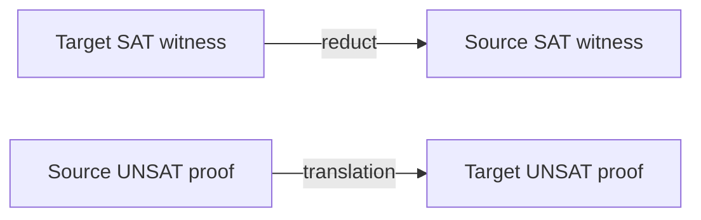

`Corridor.satisfiable_of_map` and `Corridor.unsatisfiable_map` implement them.
Every original source sentence remains an obligation of the reduced model.

For both converses, the public `Corridor.ElemExpansive` condition suffices:
each source model has a target model whose reduct satisfies exactly the same
source sentences. This is **elementary expansion**; it does not require equality
of the two model objects. The theorems
`satisfiable_map_iff_of_elemExpansive` and
`unsatisfiable_map_iff_of_elemExpansive` give both equivalences. The matching
`Inst.CoHom` theorems apply them across a whole institution comorphism, where
signatures vary. Existing public elementary-expansion composition supports
chains of these translations.

For example, the source theory `p, ¬q` is SAT: choose `p = true` and `q = false`.
Renaming both names to `r` gives `r, ¬r`, which is UNSAT. This is a valid corridor,
but it cannot have elementary expansion. `Examples.lean` proves the source
witness, target refutation and failure of that expansion condition. Its separate
empty-model room checks the empty-theory boundary.

The SMT bridge `Uflia.Problem.sat_iff_room` identifies an existing finite
QF-UFLIA problem's `Sat` predicate with the room's theory predicate. Its
`unsat_iff_room` companion does the same for refutations. For SAT and UNSAT,
assertion order and repeated assertions do not change the model class. The
existing false-assertion refutation is reused through this bridge.

An imported solver result still needs a Lean proof of the selected room's
predicate. Source-byte decoding and the source/abstract correspondence remain
the frontend's obligations; the generic room definitions do not replace them.

The API header is
[`Satisfiability/Thms.lean`](../../Silmaril/Logic/Inst/Satisfiability/Thms.lean).
The targeted validation module is `Silmaril.Logic.Inst.Satisfiability.Audits`.


## Single-query scripts for typed UF/LIA

UF means uninterpreted functions: a model supplies their meanings. LIA means
linear integer arithmetic, where multiplication by an integer coefficient is
allowed but multiplication of two arbitrary symbolic terms is not. QF means
quantifier-free: formulas have no universal or existential quantifiers.

`Silmaril.Logic.Smt.Uflia.Script.parse?` reads a complete supported SMT input and
returns an actual `Uflia.Packaged.ConcreteSentence`. Declaration and assertion
fields retain the equalities produced by the executable typed decoders. Parsing
has no solver call and accepts no external semantic certificate.

Import [`Script/Thms.lean`](../../Silmaril/Logic/Smt/Uflia/Script/Thms.lean) for the
parser and semantic transport, or
`Script/Examples/Thms.lean`
for the complete-input regressions.

For example, this whole script is accepted:

```smt2
(set-logic QF_UFLIA)
(declare-sort U 0)
(declare-const a U)
(declare-fun f (U) Int)
(assert (<= (f a) (+ (f a) 1)))
(check-sat)
(exit)
```

The accepted command order is:

1. An optional initial `(set-logic QF_UFLIA)` or `(set-logic QF_LIA)`.
2. Zero or more `declare-sort`, `declare-const` or `declare-fun` commands.
3. Zero or more `(assert formula)` commands.
4. Exactly one `(check-sat)`, optionally followed by one `(exit)`.

Omitting `set-logic` selects the UF/LIA fragment. `QF_LIA` restricts declarations
to nullary Bool/Int symbols; user sorts and positive-arity functions reject.
Other explicit logic names, including `QF_UF`, reject. Neither accepted label
claims support for every construct or exact official grammar membership. Terms
use the existing sorted decoder: ground Bool/Int/user-sort
terms built from declared symbols, with no free local variables,
typed function applications and the documented Boolean/linear arithmetic core.
The typed elaborator supports associative n-ary
operators, chained comparisons/equality, pairwise distinctness and simultaneous
lexical `let`. Associative/chain operators need at least two operands; unary
minus and ternary `ite` keep their declared arities. Multiplication allows at
most one nonliteral typed Int factor and accumulates concrete coefficients.
Its preserved arbitrary-term scaling is a mathematical linear extension;
exact membership in the official QF_LIA coefficient grammar is not claimed.

Declarations must precede assertions, reference previously declared user sorts
and use unique sort names and unique operation names within their separate
namespaces. Applications must have the declared arity and
argument sorts; assertions must be Boolean. The reader supports ASCII syntax,
whitespace and semicolon comments;
non-ASCII bytes are permitted inside comments but reject elsewhere. Quoted
identifiers, strings, malformed parentheses, unsupported
terms or commands, `push`/`pop`, extra queries, assertions after the query and
trailing commands all reject. `None` reports rejection; it never supplies an
UNSAT result. This is a strict script fragment with decoder-based semantics,
not a complete or independently verified SMT-LIB standard implementation.

## Semantics and transport

`accept?` constructs `Script.Accepted`, containing the exact text, its parsed
concrete sentence and a proof of `parse? text = some sentence`. Only these
accepted texts are sentences of the new singleton-signature institution. A
signature is the interface of available symbols; here declarations are carried
inside each sentence, as in the existing whole-problem presentation. Models
are the same coherent interpretations of typed names as `Packaged.GlobalModel`:
every occurrence of a name at the same argument and result sorts receives the
same interpretation.

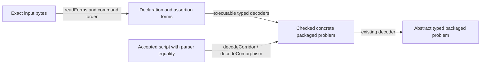

A corridor is a sentence/model translation preserving satisfaction; a
comorphism packages such translations across signatures. Here the corridor
translates accepted scripts to their parser results. Its model
map is the identity, and `holds_iff` proves satisfaction equivalence.
`decodeComorphism` gives the same map across the singleton institutions.
`decodeCorridor_modelExpansive` and `decodeComorphism_modelExpansive` state that
every source model is represented in the target; no extra model restriction
or SAT hypothesis is introduced.

SAT means some model satisfies all assertions; UNSAT means no such model
exists. `sat_iff` and `unsat_iff` give exact equivalences with the concrete packaged
sentence. `sat_iff_abstract` and `unsat_iff_abstract` continue to its abstract
packaged problem. `sat_iff_fixed` and `unsat_iff_fixed` use the existing checked
packaging theorem to relate the script to its finite sorted assertion list.
The parser itself makes no SAT/UNSAT decision.

The separate incremental session API supports a
fixed declaration prefix followed by typed assertions, push/pop and several query
snapshots. This original single-query parser retains its strict command order.


## Typed n-ary operators and parallel let

UF means uninterpreted functions, whose meanings a model supplies; LIA means
linear integer arithmetic. Elaboration translates surface syntax into typed
internal terms. The sorted frontend elaborates n-ary operators (operators with
several operands) and lexical `let` into the existing abstract UF/LIA terms. It
changes no carriers, function interpretations
or abstract operations. Accepted assertions still carry the actual equality
`decodeFormula? environment expression = some formula`; scripts obtain the
same evidence through their executable parser.

The source contract was checked against the official SMT-LIB 2.7 reference,
release 2026-09-09, §§3.6.1–2 and 3.7, and the official Core, Ints, QF_LIA and
QF_UFLIA declarations. Archived private sources, hashes, exact download commands
and per-item coverage are in
`smtlib-2-7-2026-09-09` in `references.bib`.
The PDF SHA-256 is
`c01167d7eb9241a02ceb8c93cd37e4854cb8a38529157e0b72b1cdc8ecb4a8fc`.

| Surface operator | Accepted arity and elaboration |
| --- | --- |
| `and`, `or`, `+` | At least two operands; left-associated binary fold |
| `-` | One operand for negation, otherwise at least two for left-associated subtraction |
| `*` | At least two factors; concrete integer coefficients with at most one nonliteral factor |
| `<`, `<=`, `>`, `>=`, `=` | At least two operands; conjunction of adjacent comparisons/equalities |
| `distinct` | At least two operands; conjunction of all pairwise disequalities |
| `let` | Nonempty list of distinct bindings, evaluated in parallel; typed lexical scope in the body |

The standard's associativity annotations add syntax for more than two operands;
they do not introduce zero- or one-operand identities. Thus `(+)`, `(+ 1)`,
`(and)` and `(and true)` reject. This implementation also leaves implication
and xor at their existing binary arity, and `ite` at three arguments.

All relevant operands must have matching sorts. Boolean folds require Bool;
arithmetic and ordered comparisons require Int. Equality and `distinct` work
at any one supported sort. For example, `(distinct 1 2 1)` is accepted syntax
whose value is false: the first and third operands form one of the required
pairs. Checking only adjacent disequalities would give the wrong result.

## Multiplication and its precise boundary

A literal coefficient is recognized after typed elaboration by `integerValue?`:
an integer node or nested scaling of such a node. This does not evaluate every
closed arithmetic expression; for example, `(+ 1 2)` is not a literal factor.
Numeric factors may occur anywhere: `(* 2 (f x) (- 3) 4)` elaborates to scaling
`f(x)` by `-24`. More than one nonliteral factor rejects, even if another factor
is zero: both `(* 2 x (f x))` and `(* 0 x x)` reject. This is a syntactic linear
restriction, rather than a solver simplification that discards unexamined terms.

`scaleLinear` folds literal coefficients and distributes them over addition,
subtraction and nested scaling. Other typed Int factors retain the pre-existing
arbitrary-term scale operation. In particular, `(* 2 (f x))` remains accepted.
`eval_scaleLinear_int` proves for every actual sorted model `M` that

```lean
M.eval (scaleLinear coefficient term) = coefficient * M.eval term
```

There is a scope distinction with the official logic declarations. QF_UFLIA
inherits QF_LIA's extension text describing literal coefficients multiplying
free constants. The frontend preserves the mathematically linear scaling of
compound and UF terms that it already supported, and normalizes additive terms
when possible. It does not claim an independent theorem that every accepted
surface term belongs to that exact textual grammar. The script frontend accepts
the explicit logic labels `QF_UFLIA` and `QF_LIA` (or no label). The LIA tag
restricts declarations to nullary Bool/Int symbols. This is a documented typed
dialect rather than a complete official logic-membership validator.

## Parallel lexical bindings

Let right-hand sides all decode in the outer scope. Only after they have decoded
are the new bindings prepended to the local environment for the body. Each
binding stores an already typed ground term, built from declared symbols with
no free local variables, so inner binders cannot capture
names in a stored right-hand side. New bindings can have different sorts from
shadowed variables. A local scalar also shadows a user function in application
position; a failed local application never falls back to that global function.
Theory names cannot be bound.

With the actual regression model `x = 4`, `f(n) = n + 1`:

| Expression | Value or rejection |
| --- | --- |
| `(let ((x 1) (y x)) (+ x y))` | `5`: the right-hand side of `y` sees the outer `x` |
| `(let ((x 1)) (let ((x 2) (y x)) (+ x y)))` | `3`: inner `y` sees the outer let-bound `x` |
| `(let ((y x)) (let ((x 9)) y))` | `4`: the inner `x` cannot capture the stored value of `y` |
| `(let ((x true)) (ite x 7 8))` | `7`: typed shadowing changes the local sort |
| `(let ((a 1) (b a)) b)` with no outer `a` | Rejects; sibling bindings are not sequential |
| `(let ((f 3)) (f 1))` | Rejects; local `f` shadows the global unary function |

Duplicate binding names, empty or malformed binding lists, unsupported names,
sort mismatches and references outside their scope reject. A complete supported
script can use these forms directly; the script-to-packaged corridor and its
SAT/UNSAT equivalences continue to use identical models.

The checked examples are in
`SExpr/Examples/Thms.lean`.
They include actual decoder equalities, the model values above, the old scaled-UF
value `10`, distributed and n-ary products, all-pairs/chain semantics, complete
script acceptance and rejection regressions. The normalization proof support is
in [`SExprElaboration.lean`](../../Silmaril/Proofs/Logic/Smt/Uflia/SExprElaboration.lean).
Quantifiers, strings, quoted names, attributes, other arithmetic theories and
full SMT-LIB correspondence remain outside this slice.


## Maps between ground UF/LIA models

The ground UF/LIA interfaces now offer model categories with actual functions
between carriers. **UF** means uninterpreted functions: each model chooses
their meanings. **LIA** means linear integer arithmetic, such as `2*x + y ≤ 7`.
**Ground** means that terms contain no variables or quantifiers.

The original discrete presentations remain available. A **discrete category**
has only equality transport between objects. The new presentations use the
same model objects and satisfaction, with two choices of arrows:

| Presentation | Arrows between models |
| --- | --- |
| `HomModels` | Functions on user sorts that preserve every declared UF operation |
| `EmbeddingModels` | Those functions, additionally injective on every user sort |

A **carrier** is the set of values for one sort. Both choices fix the built-in
`Bool` and `Int` carriers and every value in them. User carriers can be any
nonempty Lean types of the existing model universe. A **homomorphism** preserves
declared operations: mapping an operation's result agrees with applying the
target operation to the mapped arguments. An **embedding** is an injective
homomorphism here; it need not reach every target value.

## Why injectivity matters

Consider these declarations and assertion:

```smt2
(declare-sort U 0)
(declare-const a U)
(declare-const b U)
(assert (distinct a b))
```

- Model M interprets `U` as two values, with `a = false` and `b = true`.
  These are values of the user sort, separate from the built-in `Bool` sort.
- Model N interprets `U` as the single value `()` and both constants as `()`.
- The function sending both values to `()` preserves the declared constants,
  so it is a homomorphism. The assertion is true in M and false in N.
- An embedding cannot identify those two values. Every ground term commutes
  with an embedding, and every ground assertion has the same truth value in
  both models.

`Model.Embedding.apply`, `eval`, `holds` and `problem_holds` prove the last
claim for all ground operations, terms, assertions and finite problems.
Equality on user sorts requires injectivity. Conditionals can return user-sort
values; their Boolean conditions remain fixed.

The checked examples also include:

- two different homomorphisms between the same models;
- a nonidentity invertible embedding that swaps unnamed values;
- an embedding from the two-element model into a four-element model that
  misses two values;
- a symbol renaming that swaps `a` and `b`, acting on actual carrier maps;
- the accepted bytes `(distinct a b)`, renamed to `(distinct b a)`, with
  sentence, satisfaction and model-arrow decoder checks.

These declarations are in
`Models/Examples/Defs.lean`
and `Models/Examples/Thms.lean`.

## Abstract and source presentations

An **institution** combines signatures, sentences, model categories and
satisfaction, with compatible translation along signature maps. The abstract
and source presentations use genuine symbol maps. A **reduct** interprets a
smaller signature by looking up its symbols in a model of the larger signature;
the new reduct functors also carry every model arrow backward.

The model-category comparisons are:

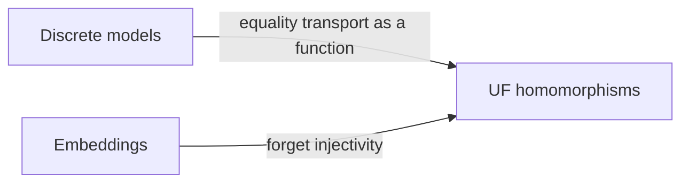

The corresponding institution comorphisms have the reverse direction because
their model functors run backward. `HomModels.toDiscrete` and
`HomModels.toEmbeddings` are actual comorphisms, including their naturality
laws on arrows.

Both `SExpr.Renaming.Concrete.HomModels` and `EmbeddingModels` provide:

- environment signatures with checked `NameMap` symbol maps;
- checked declaration-prefix signatures;
- source rooms, institutions and decoder comorphisms;
- decoder functors that retain all model arrows;
- equality of the two composite comorphisms obtained by decoding and forgetting
  injectivity in either order.

Source sentences reuse the existing **quotient** presentation: accepted
representatives retain bytes, parsed expressions and typed formulas, while
sentences identify representatives with the same decoded formula. Distinct
spellings can therefore represent the same sentence. This is not an institution
whose sentence equality compares raw byte strings.

## SAT, UNSAT and consequence

A **theory** `Γ` is any set of sentences. It can be infinite. `room.modelsOf Γ`
is the set of models satisfying all its sentences; SAT means this set is
nonempty, and UNSAT means it is empty. `room.Entails Γ φ` means that every model
of `Γ` satisfies `φ`.

Changing these model arrows retains the same model objects and truth relation.
The abstract interfaces prove SAT, UNSAT and consequence equivalences with the
original discrete rooms. For concrete theories, the decoder theorems prove
those equivalences against the image `Sentence.decode '' Γ`. They do not
require a finite list of assertions or a solver verdict.

## Source map and boundary

| Interface | Header |
| --- | --- |
| Carrier maps, homomorphisms, embeddings and reduct functors | [`Models/Defs.lean`](../../Silmaril/Logic/Smt/Uflia/Models/Defs.lean) |
| Ground evaluation and satisfaction proofs | [`Models/Thms.lean`](../../Silmaril/Logic/Smt/Uflia/Models/Thms.lean) |
| Abstract institutions and theory comparisons | `Models/Institution/Thms.lean` |
| Concrete institutions and decoder comparisons | `Models/Source/Thms.lean` |

These interfaces concern ground UF/LIA with fixed built-in sorts and existing
user-sort names. The problem-packaging variants also
retain ordinary model homomorphisms across fixed/whole and concrete/abstract
presentations. A separate pointed variant makes expansion functorial by
preserving selected defaults. Its checked-prefix comparisons use equality
transports; the abstract fixed-signature institution has genuine symbol maps.

The quantified model-map API retains ordinary
homs in quantified and single-query script rooms and proves evaluation and
satisfaction invariance under model isomorphisms. Injective maps alone do not
preserve arbitrary quantified formulas: a target can have additional elements.
Sort renaming remains separate work.


## Quantified UF/LIA terms

`Silmaril.Logic.Smt.Uflia.Quantified` adds universal and existential quantifiers
to the existing UF/LIA language:

- **UF** means uninterpreted functions: a model chooses what a declared function
  such as `f : Bool → Bool` does.
- **LIA** is linear integer arithmetic, with expressions such as `2 * x + 1`.
- A **sort** is a type of value: `Bool`, `Int`, or a declared user sort.
- A **context** lists the variables in scope and their sorts. A **binder**
  introduces a variable. A **ground term** has no free variables.

For example, every integer has an equal integer: choose `y = x`.

```smt2
(forall ((x Int)) (exists ((y Int)) (= x y)))
```

Both its exact parsed term and its truth are checked in
`SExpr.Examples`.
`Term A Γ s` records the signature `A`, context `Γ` and result sort `s` in its
Lean type. Quantified Boolean terms can occur in Boolean function arguments,
equality operands, `ite` conditionals, `let` values and nested quantifiers.

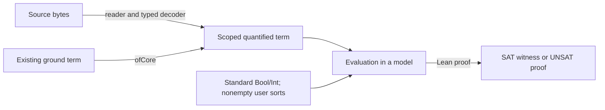

**SAT** means some model makes the sentence true. **UNSAT** means none does.
The APIs express these properties; parsing alone supplies neither a witness
nor a refutation. The existing ground APIs are unchanged.

The model class is the existing `Uflia.Model`: Bool and Int have their standard
carriers and operations; every user sort has an arbitrary nonempty carrier.
Quantifiers use classical truth values of actual universal/existential statements
over those carriers. There is no finite enumeration assumption, solver call,
or user-supplied semantic certificate. `Formula.holds_all` and `holds_ex` expose
these semantics. `eval_rename` and `eval_weaken` prove the semantics of scoped
reference maps and capture-avoiding weakening beneath nested binders.

Signature maps rename declared UF operations and fix sorts and builtins.
A **reduct** interprets old symbols through such a map in a target model.
`eval_map` proves evaluation agrees before and after taking that reduct.
`Sentence.holds_map` supplies the truth-preservation law for the institution;
its **room** packages sentences, models and truth at one signature.
The model category is **discrete**: its only arrows are identities. Sort-changing
maps and arbitrary first-order structures with empty or nonstandard core
carriers are not part of this institution.

A separate ordinary model-map presentation keeps
the same quantified sentences and model objects while admitting the existing UF
homomorphisms. Isomorphisms preserve and reflect quantified truth; arbitrary
homomorphisms need not.

## Byte boundary and scope

`Quantified.SExpr.parse? E bytes` runs the shared byte reader, requires exactly
one expression, and decodes it to a typed sentence. `accept?` retains original
bytes plus reader and decoder equations in `ByteAccepted`. Sentence and accepted
byte APIs provide satisfaction, SAT, and UNSAT. The byte-level `Sat` and `Unsat`
predicates both require successful parsing; rejected input is not UNSAT.

The decoder reuses existing declaration environments and supports simple
identifiers, nonparametric user sorts, standard Bool/Int, the existing UF/LIA
operators, parallel lexical let, and nonempty sorted forall/exists binder lists.
A bound scalar shadows a global UF symbol and cannot be applied as a function.
Repeated quantifier names are permitted: sequential nesting makes the last
same-list occurrence shadow earlier ones. Let names remain pairwise distinct;
all let right-hand sides see the original outer scope. Old local terms are
weakened when a new binder is introduced, including quantifier-valued let terms.
Here **weakening** shifts variable references to make room for a new binder.
It prevents accidental capture: in the checked example below, `y` keeps the
outer `x`, while the equality's last `x` refers to the inner binder.

```smt2
(forall ((x Int))
  (let ((y x))
    (exists ((x Int)) (= y x))))
```

The pinned SMT-LIB 2.7 reference is
`c01167d7eb9241a02ceb8c93cd37e4854cb8a38529157e0b72b1cdc8ecb4a8fc`.
Section 3.6.1, pp.30–31, specifies nonempty sequential quantifiers, repeated-name
shadowing, and parallel/distinct let bindings. Section 3.6.2, p.34, specifies
lexical shadowing of variables and user functions. This frontend accepts a
subset: quoted identifiers, attributes, polymorphic/parametric sorts, higher
order binders, division/modulo, and full quantified command sessions remain
unsupported. Multiplication inherits the ground frontend's mathematical linear
elaboration, including arbitrary-term scaling; it is not a claim of exact
membership in the textual LIA coefficient grammar. No independent completeness
or full SMT-LIB denotational-correspondence theorem is claimed.

## Reuse and controls

The new syntax/evaluation reuses `Uflia.Operation`, `Model.apply`, fixed carriers,
reducts and signature category. `Term.ofCore` and `ground_holds` preserve the
existing sorted ground semantics. Public many-sorted FirstOrder and Mathlib
ModelTheory syntax were inspected; neither directly enforces this fixed-core,
nonempty-carrier SMT model contract.

The scoped decoder's ground helper routines were copied and generalized from
`Silmaril/Logic/Smt/Uflia/SExpr/Defs.lean` at revision
`6f78d7a34ac7e637aca26d3f0d9cb050c14dbb9c`. Their backend changed from closed
terms to context-indexed terms; binder elaboration and weakening are new. The
original ground module is untouched.

`SExpr.Examples` proves exact byte-to-AST equalities for Int/user-sort alternation,
global and same-list shadowing, a lexical-let capture example, parallel let,
quantifier-valued let, a quantified UF Boolean argument, and a quantified ite
guard. It proves a SAT integer example and the UNSAT sentence
`exists x:Int, forall y:Int, x < y` using y=x. Rejection controls cover malformed
binders, unknown sorts, wrong body sorts, scalar application, reserved binders,
duplicate let names, and multiple top-level expressions.

The historical validation receipt
records the targeted build and fifteen exact axiom guards. No full local build
or external producer was run for that slice. The six quantified base modules
are unchanged from `1e5e3a740a24950beb0cbef7e04ea2b216a444e5`, where
passed. This source review ran no new Lean build. For a targeted check, use
`scripts/prove.sh Silmaril.Logic.Smt.Uflia.Quantified.Audit`; if the remote worker
is unavailable, use `bin/mor build Silmaril.Logic.Smt.Uflia.Quantified.Audit`.


## Quantified scripts and whole problems

This frontend reads declarations, quantified assertions and one query from the
original text. For example:

```smt2
(set-logic UFLIA)
(declare-sort U 0)
(assert (forall ((x U)) (exists ((y U)) (= x y))))
(check-sat)
```

A **sort** is a type of values. The declared sort `U` receives a nonempty set
of values from the model. The assertion says that every `x` has an equal `y`;
choosing `y = x` satisfies it. `Examples.user_sat` constructs a model and proves
this script satisfiable through the actual parser.

A **model** interprets all declared names and sorts. SAT requires one model
satisfying every assertion together. For example, declaring `p : Bool` and
asserting both `p` and `(not p)` is UNSAT, even though either assertion can hold
on its own.

**UF** means uninterpreted functions: their meanings come from the model rather
than fixed arithmetic laws. **LIA** means linear integer arithmetic; `UFLIA`
combines these functions with integer arithmetic. A **signature** records the
available operations and their input and output sorts, called their **profiles**.

## Source and typed meanings

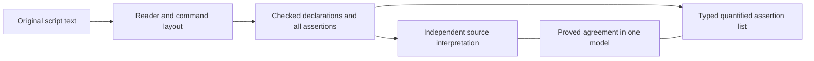

- `Accepted` retains the exact reader result, command layout, checked
  declaration prefix and the ordered list of all original assertions.
- Source truth calls the independent expression interpreter. It does not
  evaluate the decoded typed terms.
- `holds_iff` proves agreement with the typed list in the same supplied model.
- `decodeComorphism` packages that comparison as an institution map: a sentence
  translation and a model translation that preserve satisfaction.
- `sat_iff_fixed` and `unsat_iff_fixed` relate the script to its fixed-symbol
  typed problem, using one common model for the entire list.

The abstract fixed-symbol institution admits operation maps between signatures.
In the whole-problem presentation, the declaration environment moves inside each
sentence. One global model interprets each typed name consistently across those
sentences. A **reduct** restricts that global model to one local signature.
**Model expansion** extends a local interpretation to all other names;
it recovers the original interpretation exactly when names are injective at
each operation profile. Successful declaration decoding supplies this condition.
The existing QF-UFLIA expansion theorem also applies to quantified assertions,
because both use the same model and signature types.

The ordinary model-map presentation also supplies
rooms for fixed assertion lists, whole problems and accepted scripts. Its model
functors retain actual UF homomorphisms. The accepted grammar and independent
source semantics are the same as those described here.

## Command and expression scope

The accepted command order is:

- Optional `(set-logic UFLIA)` or `(set-logic LIA)`.
- A prefix of `declare-sort`, `declare-const` and `declare-fun` commands.
- Zero or more `assert` commands.
- One terminal `check-sat`, optionally followed by one `exit`.

`LIA` permits only built-in Bool/Int nullary declarations. Quantifier-free tags
are rejected here; the existing quantifier-free script frontend handles those
tags. The expression language is the existing quantified UF/linear-integer
dialect, including parallel `let` bindings and Boolean quantifiers in function
arguments and conditional guards. Its mathematical integer scaling extension
is not an exact implementation of the standard's textual coefficient grammar.

For example, `(forall ((x Int)) (let ((x 0) (y x)) (= y x)))` is false: both
right-hand sides see the original scope, so `y` contains the original `x` and
the body compares it with zero. `Examples.parallel_unsat` checks this as a
complete script. Sequential let evaluation would give the wrong answer.

Unknown commands, late declarations, duplicate names, ill-sorted assertions,
nonlinear multiplication and extra queries reject. Rejection supplies neither
SAT nor UNSAT. Incremental commands and full SMT-LIB coverage remain separate
work. This frontend does not run an external solver.

The API is [Script/Thms.lean](../../Silmaril/Logic/Smt/Uflia/Quantified/Script/Thms.lean);
the validation target is `Silmaril.Logic.Smt.Uflia.Quantified.Script.Audits`.


## Renaming quantified SMT expressions

Renaming a global function or constant can put its new name inside an existing
quantifier. The renamer freshens bound names first, preserving which binding
each occurrence refers to. This prevents **variable capture**, where a formerly
free name accidentally becomes bound by a quantifier or `let`.

This interface keeps sorts fixed. The separate
varying-sort source-rewriting interface changes
actual binder-sort syntax and full operation profiles as well.

For example, rename the global integer constant `a` to the global constant `x`:

```smt2
; Original expression
(forall ((x Int)) (= a x))

; Correct result in the example target environment
(forall (($__ Int)) (= x $__))
```

The original assertion says that every integer equals the value of `a`; it is
false in every model. The correct result retains that meaning after interpreting
the renamed global constant. Naively producing `(forall ((x Int)) (= x x))`
would make the assertion true. The checked examples distinguish these outcomes
under every target model.

## Actual syntax, bytes and typed terms

An **S-expression** is an atom or a parenthesized list. An **environment** records
the declared sorts (types) and function names. A **typed term** records the sort of each
subexpression and the binding of each variable.

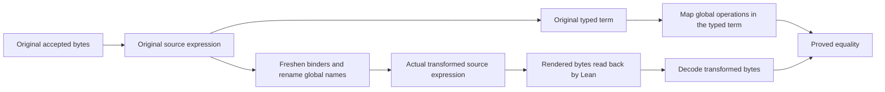

`renameSentence_success` proves that every expression admitted by the quantified
decoder produces an actual renamed expression whose decoded sentence is exactly
the mapped typed sentence. Its only source condition is successful decoding.
It covers the complete existing grammar, including quantified Boolean terms in
function arguments, equality, `ite` guards and parallel-let values.

`Presentation.renameAccepted` applies this theorem internally. It accepts the
original `ByteAccepted` value and a legal global map; callers do not supply the
desired target decoding result. It retains:

- The actual output of the concrete source renamer.
- Rendered bytes that the shared Lean reader reads back as that output.
- Successful target decoding with exactly the mapped typed sentence.

The traversal preserves source constructors, including `let`. The
[independent source semantics](../../Silmaril/Logic/Smt/Uflia/Quantified/SExpr/Surface/Thms.lean) proves agreement with
typed evaluation; the source meaning is also used for the institution below.

## Quantifiers and parallel lets

SMT `let` bindings are **parallel**: every right-hand side uses the old scope.
For example:

```smt2
(forall ((x Int))
  (let ((x 0) (y x))
    (= y x)))
```

The value assigned to `y` is the outer quantified `x`. The inner `x` is zero,
so the assertion requires every integer to equal zero and is false. Evaluating
the second binding after the first would change its meaning.

The renamer keeps both right-hand sides in the old scope and gives the inner
bindings separate fresh names. Repeated names in a quantifier block retain
sequential shadowing: the last binder with that name is selected. Duplicate
names within one parallel `let` remain rejected; freshening cannot turn a
rejected binding list into an admitted one. A local scalar in function-head
position also remains an error, even when a global function has that name.

Fresh names use `$` followed by underscores. Their lengths exceed all target
declaration names, and the supply advances under bindings. Their lexical
legality and separation from target declarations and active target locals are
proved.

## Signatures and sentence classes

A signature here contains an environment. Its maps preserve operation profiles
(the input and output sorts) and may identify global symbols. They must also preserve each successful binder
sort lookup. This extra requirement matters for a declared sort used only by a
quantifier: preserving function profiles alone would allow the target to lose
that sort. User sort names stay fixed under these maps.

Freshening can change bytes even for an identity global map. The institution
therefore uses **sentence classes**: two accepted byte expressions represent the
same sentence exactly when they decode to equal typed sentences. This is a
**quotient**, a type that identifies representatives under a specified equality.

This equality includes more than changing bound names: the decoder also
substitutes lexical lets. It is neither a claim of literal byte equality nor a
quotient by arbitrary logical equivalence. Every successfully parsed Boolean
source expression has a representative with its original bytes.

`Sentence.map` acts by the actual byte transformation, then takes its class.
Identity and composition hold for these classes, and `Sentence.decode_map`
states exact agreement with the abstract typed action. `Holds` lifts the
independent direct source interpretation; adequacy proves that changing a
representative does not change its truth.

The resulting `Presentation.institution` has standard Bool and Int carriers
and arbitrary nonempty user carriers. Its only maps between models are equality
witnesses.
Its model **reduct** interprets a target model at each mapped source operation.
`decodeComorphism` compares it with the genuine quantified typed institution:
sentences decode forward, models are interpreted identically, and satisfaction
and signature translation agree. This is a natural institution comorphism,
rather than only a comparison at one fixed environment.

## Rooms, SAT and UNSAT

A **room** fixes one signature while retaining its sentences, models and truth
relation. The source-byte room, sentence-class room and abstract typed room are
connected by `sourceCorridor` and `decodeCorridor`. Both retain the same models.
An **expansion** is a target model that reduces to the given source model;
the identity gives an exact expansion across each corridor.

At a fixed environment, decoding preserves and reflects satisfaction, SAT,
UNSAT and consequence for arbitrary theories. A **theory** is a set of sentences.
SAT means that one model satisfies every sentence; consequence means that every
model of the theory satisfies the conclusion. The theory results use one shared
model for the whole set.

Across a general global map, the proved directions are:

- Target SAT implies source SAT, by reducing the target model.
- Source UNSAT implies target UNSAT.

The reverse directions can fail when a map identifies symbols. A source
assertion saying that `a` and `b` differ is satisfiable; identifying both with
`x` gives the unsatisfiable assertion that `x` differs from itself.

## Source and checks

The public entry point is
`Silmaril.Logic.Smt.Uflia.Quantified.SExpr.Renaming.Presentation.Institution.Thms`.
Interfaces live under `Silmaril/Logic/Smt/Uflia/Quantified/SExpr/Renaming/`, with
longer proofs under the corresponding `Silmaril/Proofs/` path. The action examples
check actual rendered bytes and distinguish correct capture avoidance and
parallel binding from their incorrect alternatives.

The full scoped decoder correspondence, default decoder wrappers, actual byte
action, varying institution, arbitrary-theory wrappers and semantic controls
passed targeted strict Lean checks. Nineteen exact kernel dependency guards
permit only `propext`, `Classical.choice` and `Quot.sound`. Registry/catalogue
checks and the separate textual layout heuristic passed. No full build was run;
full PR CI remains a separate merge requirement.


## Quantified UF/LIA model maps

UF/LIA means uninterpreted functions with linear integer arithmetic: a model
chooses the meanings of declared functions, while integers and arithmetic have
their standard meanings. For example, it chooses the value of a declared user
constant `a`, but interprets integer `1 + 2` as `3`.

The APIs use these terms:

- A **homomorphism** is an operation-preserving map between models. It maps the
  value of `f(x)` to `f` applied to the mapped value of `x`. Here Bool and Int
  stay fixed; user values may be identified.
- A **signature map** translates declared symbols while preserving their sorts
  and argument types. It may send both constants `a` and `b` to one constant.
- A **reduct** interprets an earlier signature using a later model and a signature
  map. It keeps the carriers and reads each source symbol through that map.
- An **isomorphism** is an invertible homomorphism. A permutation of unnamed
  user values fixing the declared constants is one example.
- A **discrete** category admits only equality arrows, so distinct models have
  no arrows between them.
- A corridor is **model-expansive** when each model on its source side is the
  reduct of a model on its target side. Packaging a local model into a global
  named model supplies such an expansion for checked declarations.

The signature reduct acts on actual model arrows as well as model objects:

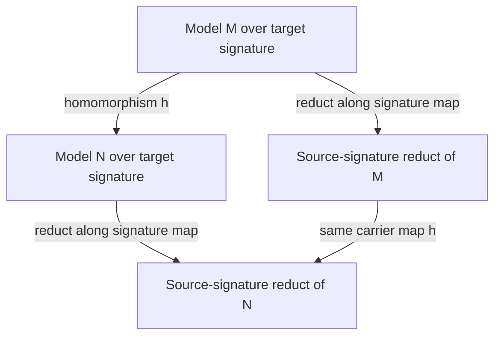

A **room** contains the sentences, models and satisfaction relation at one
signature. An **institution** organizes these rooms and their translations. A
**corridor** translates sentences forward and models backward while preserving
satisfaction.

The quantified ordinary-hom institution uses the existing `Uflia.Model.Hom`
category unchanged. Its objects have standard Bool and Int carriers and nonempty
user carriers. Its arrows fix Bool and Int and preserve the declared UF
operations; they may identify user values. Signature arrows remain the existing
fixed-user-sort UF signature maps. Reducts use `Model.reductFunctor` on actual
arrows, and the satisfaction condition uses `Quantified.Sentence.holds_map`.
An institution's satisfaction condition concerns signature reducts; it does not
require its model arrows to preserve every formula.

`Quantified.HomModels.toDiscrete` compares this institution to the existing
quantified discrete presentation, with exactly the same sentence and model
objects. Its model functor inserts equality transports as genuine homs.

`Quantified.eval_iso` proves evaluation commutes with a categorical model
isomorphism, including open terms and quantifiers in arbitrary Boolean term
positions. `Sentence.holds_iso` gives preservation and reflection of sentence
truth. The proof derives bijections on all carriers from the inverse hom;
equality uses injectivity and quantifiers use surjectivity. `isoValue_reduct`
states these bijections commute with the actual reduct functor, while
`Sentence.holds_iso_reduct` combines signature translation with model transport.

The examples reuse two populated user constants and a four-value model. A
nonidentity automorphism swaps its two unnamed values. A nested universal /
existential formula containing a UF constant transports along that automorphism.
The nested formula is `∀ x : U, ∃ y : U, y = b`: choose the interpreted value
of `b` for `y`. Explicit translation and value checks show that `b` changes to
`a`, represented by `true` and `false` in the two-value user carrier.
A genuine signature endomorphism identifies the two distinct constant symbols;
its reduct transports the automorphism and the quantified formula coherently.

Injectivity alone is insufficient. The existing embedding of the two-value model
into the four-value model preserves both constants but is nonsurjective. The
quantified sentence saying every value equals one of those constants holds in
the source and fails in the target. The API retains this embedding as an ordinary
model arrow without asserting that it preserves quantified truth.

`Quantified.Script.HomModels` supplies rich rooms for fixed lists of assertions,
abstract whole scripts, and accepted single-query source scripts. Fixed rooms
admit all existing signature maps. Whole and source signatures are still
`Disc Unit`; checked-prefix signatures are still discrete. Packaging uses the
actual `Packaged.nameMap` and its reduct functor, while decoding uses the
identity model functor and the independent source-interpreter adequacy theorem.
The checked-prefix packaging corridor is model-expansive by the existing global
expansion construction; this result concerns objects, not a new arrow expansion.

The scope is quantified UF/LIA and existing single-query scripts with fixed
user-sort names. Ranked sort translation, other interpreted theories, solver
completeness, and session semantics remain separate work.

Entry points:

- `Silmaril/Logic/Smt/Uflia/Quantified/Models/Institution/Defs.lean`
- `Silmaril/Logic/Smt/Uflia/Quantified/Models/Thms.lean`
- `Silmaril/Logic/Smt/Uflia/Quantified/Script/Models/Defs.lean`
- `Silmaril/Logic/Smt/Uflia/Quantified/Models/Examples/Thms.lean`
- `Silmaril/Logic/Smt/Uflia/Quantified/Models/Audits.lean`


## Rewriting quantified SMT source across sorts

This interface rewrites accepted quantified UF/LIA expressions into actual
target expression bytes. It changes declared names, operation profiles and
quantifier binder sorts together. **UF** means uninterpreted functions, whose
meanings a model chooses. **LIA** means linear integer arithmetic.

Status: the complete strict audit target passed locally and remotely with the
pinned Lean nightly-2026-11-05 toolchain (2,336 jobs). All 59 transitive axiom
ceilings allow only `propext`, `Classical.choice` and `Quot.sound`. Final source
and guide review found no blocker. The private
current-main integration record
keeps these retained checks separate from the integration source and its PR CI.

## Names, sorts and binders

A **sort** is a type of value. Bool and Int keep their standard meanings; a
user sort can become Bool, Int or another declared user sort. An operation's
**profile** lists its ordered argument sorts and result sort.

The concrete example uses these environments:

```text
source: U, V; a:U; b:V; f:U -> V
target: x:Int; y:Bool; g:Int -> Bool
map: U -> Int, V -> Bool; a -> x, b -> y, f -> g
```

For example, the traversal rewrites:

```smt2
(forall ((x U)) (= (f x) b))
```

to:

```smt2
(forall (($__ Int)) (= (g $__) y))
```

The binder now ranges over actual integers. Its fresh name prevents **variable
capture**, where a renamed global name accidentally refers to a local binding.
The existing symbol-only renamer keeps sorts fixed;
this interface emits the mapped binder sort syntax as well.

`NameMap` extends the ground varying-sort name map.
It records the typed sort/symbol map, actual target declaration lookup and name
coherence. It also requires admission of mapped binder sorts. This last condition
matters for user sorts that occur only in binders and in no operation profile.
The map does not assume that decoding commutes with rewriting.

## The executable and proved boundaries

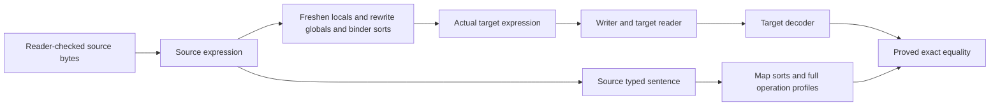

`renameSentence_success` starts from successful source decoding. It produces
an actual successful `rename?` output whose target decoding is exactly
`Hom.quantifiedSentence` of the source sentence. Open-context proofs map every
local's sort and every quantified variable context; they retain the full ordered
argument vector of each function application.

`renameAccepted` runs this traversal and renders its output. Its representative
retains target bytes and the target reader/decoder equations. Sentences use the
existing **quotient**: two accepted byte expressions represent the same sentence
exactly when their decoded typed sentences are equal. Identity and composition
hold on these classes; freshening can change bytes even for the identity map.

## Full existing grammar and lexical scope

The contract covers the complete existing quantified decoder: nonempty `forall`
and `exists` binder blocks, parallel `let`, arbitrary-arity UF applications,
Boolean operators, `ite`, equality and `distinct`, chained comparisons and the
existing linear arithmetic elaboration. Quantified Boolean terms can occur in
UF arguments, equality operands and conditional guards. The precise arithmetic
acceptance rules remain those of the source decoder.

Quantifier binders nest in source order. Repeated names in one binder block are
allowed; the last shadows earlier ones. Parallel-let right-hand sides all use
the old scope, and original duplicate let names remain rejected. A local scalar
in function-head position blocks fallback to a global function of the same name.
The accepted-byte interface requires successful source decoding before rewriting.

Binder sort expressions are atomic in this grammar. Replacing their names and
sort atoms preserves the syntax node count, so the target uses its own default
decoder budget without an assumed fuel bound.

The concrete controls combine repeated names, nested quantifiers, parallel lets,
global-name capture avoidance, changed Bool/Int carriers and quantified terms in
Boolean expression positions. Their source and target bytes are retained by
`Examples.accepted` and `Examples.targetAccepted`. Separate controls reject a
wrong target profile and an undeclared image of a binder-only user sort.
These controls passed with the complete audit target. `target_holds_iff`,
`target_true` and `target_false` distinguish two actual target models;
`source_holds_iff` establishes the same distinction in their source reducts,
whose user-sort carriers are actual Int and Bool.

## Truth, models and theories

A **model** supplies nonempty user-sort carriers and interpretations of declared
functions. A **reduct** interprets source symbols through their target images.
Here a target model's actual integers become the source `U` carrier and its
actual Booleans become the source `V` carrier. Quantifiers range over these
actual carriers, rather than treating bound variables as new constants.

Source satisfaction uses the independent named-source evaluator. Decoder
adequacy connects it to typed evaluation, and the existing varying-sort reduct
theorem gives satisfaction transport. An **institution** packages signatures,
sentences, models and this satisfaction law. The model categories retain all
ordinary operation-preserving homomorphisms; quantified truth transport uses
signature reducts, with no general truth-preservation claim for model arrows.

A **theory** is a set of sentences interpreted in one common model. Along a
coherent source map:

- Target SAT gives source SAT by reduct.
- Source UNSAT gives target UNSAT.
- Source consequence gives target consequence.

Sort maps can identify distinct source sorts. Only successful source sort checks
transport forward: a rejected equality between different sorts can become
well-sorted after identifying them. General reverse theory guarantees need an
additional model expansion hypothesis. The decoding comparison's identity model
interpretation does not supply expansion for every renaming map.

This interface translates expressions between given environments, with a
restriction to checked declaration prefixes. It does not generate declaration
command streams or implement arrays, bit-vectors, Real arithmetic, incremental
sessions or full SMT-LIB. It makes no external-solver completeness claim.

| API | Source |
| --- | --- |
| Coherent names and emitted binder sorts | [Definitions](../../Silmaril/Logic/Smt/Uflia/SortMaps/Quantified/SExpr/Renaming/Defs.lean) |
| Open-context and binder transport | [Binder semantics](../../Silmaril/Logic/Smt/Uflia/SortMaps/Quantified/SExpr/Renaming/BinderSemantics/Thms.lean) |
| Exact closed decoder transport | [Theorems](../../Silmaril/Logic/Smt/Uflia/SortMaps/Quantified/SExpr/Renaming/Thms.lean) |
| Actual accepted-byte action | [Action](../../Silmaril/Logic/Smt/Uflia/SortMaps/Quantified/SExpr/Renaming/Action/Defs.lean) |
| Institution, reducts and theory directions | [Institution](../../Silmaril/Logic/Smt/Uflia/SortMaps/Quantified/SExpr/Renaming/Institution/Defs.lean) |
| Concrete source controls | Examples |

Validation covers the targeted audit and its dependencies, not a full repository
build or an external solver run. The retained source-rewriting check used frozen Lean
source `f980558ec430` and remains bound to that source. The integration record
separately binds the later current-main targeted check and final PR CI.


## Concrete SMT symbol renaming

This guide follows an assertion from its input bytes to its typed meaning, then
explains how renaming can preserve that meaning even when it changes the text.
The byte-backed quotient, full successful-source normalization theorem,
executable representative translation, and institutions over raw environments
and checked declaration prefixes are checked. The source map below identifies
their public headers and executable controls.

The examples use these terms:

- **SMT** means satisfiability modulo theories: asking whether a formula has a
  model under theories such as integer arithmetic. **SMT-LIB** is the standard
  input notation used in the examples below.
- **UFLIA** combines uninterpreted functions and linear integer arithmetic:
  declared functions may have arbitrary interpretations, while built-in integer
  operations keep their usual meanings.
- **SAT** means that at least one model satisfies the formula; **UNSAT** means
  that no model does.
- An **S-expression** is an atom such as `x` or a parenthesized list such as
  `(+ x 1)`. Lists can contain further lists.
- A **sort** is a type, such as `Int` or `Bool`. An operation's **arity** is its
  number of arguments; an integer constant has arity zero.

## From bytes to meaning

For a declaration environment `E`, acceptance requires one actual reader result
and one actual typed decoder result:

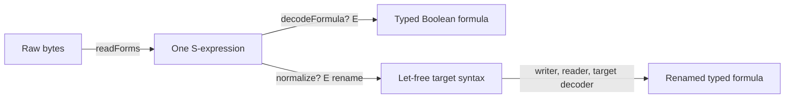

The lower route starts with an accepted source and a coherent name map.
Scoped elaboration happens inside the typed decoder: it tracks local `let`
bindings while checking expressions against declarations and sorts.

- The **reader** recognizes parentheses, atoms and comments in bytes. Success
  alone says nothing about declaration lookup or the type of an assertion.
- **Scoped syntax** gives a local name its enclosing binding. In
  `(let ((x 8)) (< a x))`, the final `x` denotes the local value `8`.
- A **typed formula** is an abstract Boolean term over `E.signature`. Decoding
  checks operation profiles, arguments and the Boolean result sort.

`Concrete.Accepted E` retains `bytes`, `expression` and `formula`, with proofs
that `readForms bytes = some [expression]` and
`decodeFormula? E expression = some formula`. Acceptance is tied to those
executable functions. The older `Assertion E` stores an expression and decoder
witness; it does not itself carry input bytes.

Normalization must start from an accepted representative. For example, it can
erase an unused binding in `(let ((x undeclared)) true)` and produce `true`,
although the source decoder rejects the undeclared right-hand side. The checked
controls include this distinction.

## Removing lets before inserting renamed globals

Suppose the declared global integer constant `a` is renamed to `x`:

```smtlib
; Source
(let ((x 8)) (< a x))
; Correct normalized target
(< x 8)
```

The target `x` is a global. Keeping the original binder while merely replacing
`a` by `x` would make both occurrences local and yield the meaning `(< 8 8)`.
This mistake is called **capture**: a binder changes what an inserted name
refers to. The checked control interprets the target global `x` as `7`; the
correct result evaluates to true, while the captured result evaluates to false.

The normalizer removes the binding and substitutes its already-normalized
value. Right-hand sides in the same binding group use the old scope, as required
by parallel SMT-LIB `let` bindings. For example:

```smtlib
(let ((x 1))
  (let ((x 2) (y x)) (+ x y)))
; Normalized result: (+ 2 1)
```

The implementation also rejects duplicate binding names and a local scalar
used as a function. Only names found in actual source declarations are renamed;
built-in operators, Boolean literals and numerals retain their roles.

## Fuel and output size

**Fuel** is a natural-number recursion budget. `normalize?` starts with
`expressionFuel` of the source, counting its syntax nodes. It walks the source
and substitutes stored syntax values without recursively normalizing each copy
again. Reusing a bound expression can therefore make the output larger than the
source. Nested reuse can cause substantial expansion; the implementation adds
no output-size cap.

The target decoder must use the produced expression's own `expressionFuel`.
Reusing the smaller source budget would confuse a limit on source traversal
with a limit on target decoding. `normalizeFormula_success` proves that an accepted source formula has a
successful normalized output whose target decoding is exactly the mapped
source formula. `normalizeTerm_success` gives the corresponding typed-term
result; `normalizeScopedFuel_success` handles the internal lexical scopes.

Writer legality is a separate checked obligation. `normalizeFuel_legal` proves
that successful normalization preserves legal atoms when the source and stored
local values are legal and the renaming is a `NameMap`. Renamed global names
are legal because actual target lookup checks `simpleSymbol`.
`Writer.read_render` then reads a legal rendered expression back exactly.
The String writer bridge also constructs actual text,
proves its UTF-8 bytes equal the emitted writer bytes and reads back the same
ordered forms, with duplicates.
An accepted source already has legal syntax by `Accepted.legal`, derived from
its actual reader witness.

## Why quotient sentences by decoded equality?

A **quotient** groups representatives according to a chosen equality rule.
Here `Concrete.Sentence E` is the actual quotient of `Accepted E`; two
representatives are related exactly when their decoded formulas are equal.

```smtlib
true
(let ((x true)) x)
```

These are different byte lists and different expressions. The checked examples
prove that their sentence classes are equal. They also prove that the `false`
class is different. The quotient uses equality of decoded typed terms; it does
not identify every pair of formulas that happen to have the same truth value
in all models.

`Sentence.decode_eq_iff` says that equality of decoded formulas is equivalent
to equality of arbitrary quotient sentences. `Holds M s` evaluates `s.decode`
in the existing UFLIA model. `holds_mk_iff_byteHolds` relates this to direct
byte semantics using the same reader and decoder witnesses.

This equality proves the concrete identity and composition laws
`Sentence.map_id` and `Sentence.map_comp`. Even identity renaming can remove lets,
change whitespace and choose rendered bytes. It need not preserve a
representative's bytes. `Sentence.decode_map` proves that decoding commutes with translation.
The abstract term-map identity and composition laws then give equality in the
quotient through `Sentence.decode_eq_iff`.

`Accepted.normalizedExpression` extracts the actual successful `normalize?`
result with `Option.get`. `Accepted.map` renders that expression to bytes and
stores proofs of actual reader and target decoder success. The precondition
proof for extraction is erased; the executable expression comes from the
normalizer. `Sentence.map` lifts this operation to the quotient.

## Signature maps and models

A **signature** records the available typed operations. A `NameMap E F` stores
both a string renaming and an abstract signature map, together with actual
lookup and target-name coherence. A symbol's **profile** consists of its arity,
argument sorts and result sort. Maps may identify symbols with the same profile.

The checked signature categories offer two kinds of objects:

- `EnvironmentSignature` retains a raw declaration environment, without a
  declaration-prefix acceptance witness.
- `PrefixSignature` retains an actual successfully decoded declaration prefix.

Both use `NameMap` arrows. Identity maps preserve names and abstract symbols;
composition composes both fields. `prefixFunctor` forgets prefix evidence, and
`environmentFunctor` forgets concrete names to the abstract UFLIA signature.
The concrete institutions use these categories and the checked quotient
sentence action.

A model assigns meanings to the operations. For a map from `E` to `F`, formulas
travel from `E` to `F`, while models travel from `F` back to `E`. This backward
operation is the **model reduct**: each source operation receives the meaning
of its mapped target operation. The existing abstract satisfaction theorem says
that a translated formula holds in a target model exactly when the source
formula holds in its reduct. `Concrete.holds_map` connects
that theorem to the byte-backed quotient action, including noninjective maps (which may merge distinct symbols).

Noninjective maps need care when discussing satisfiability. Suppose distinct
source integer constants `a` and `b` both map to target `x`:

```smtlib
; Source: satisfiable, for example with a = 0 and b = 1
(distinct a b)
; Target: unsatisfiable
(distinct x x)
```

Thus source SAT does not imply target SAT. A target model reduces to a source
model where `a` and `b` have the same interpretation; it cannot recover the
source model just given. The satisfaction condition quantifies over target
models and their reducts. It does imply target SAT gives source SAT, and source
UNSAT gives target UNSAT. The concrete control stores the actual source bytes
`(distinct a b)`, maps both declarations to `x`, and checks the emitted
expression and rendered bytes.
`ActionExamples.source_satisfiable` supplies the source model `a = 0`, `b = 1`;
`ActionExamples.target_unsatisfiable` rules out every target model. A separate
reduct control interprets the target `x` as `7` and verifies that both source
constants then receive `7`.

## Institutions and decoder model expansion

An **institution** packages signatures, sentence translation, model reducts and
the satisfaction law. `Concrete.institution` uses raw environments;
`Concrete.declarationInstitution` retains checked declaration prefixes. Their
sentences are the actual accepted-representative quotients, and their models
are the existing UFLIA models.

A **comorphism** connects two such presentations while preserving satisfaction.
`decodeComorphism` and `declarationDecodeComorphism` send quotient sentences to
their decoded formulas in the abstract UFLIA institution. Their sentence maps
commute with name-map translation by `Sentence.decode_map`.
`prefixForgetComorphism` forgets the declaration-prefix evidence.

A **corridor** compares the sentence and model presentations at a fixed pair
of signatures, with sentence translation and backward model translation.
**Model-expansive** here means that every model on the source side of a
fixed-signature decoder corridor has a model on the target side mapping back
to it. The three `*_modelExpansive` theorems hold because these corridor model
maps are identities at each fixed signature. They do not say that every source
model expands along every `NameMap`. Identifying two constants can prevent
such expansion, as the disequality example shows.

## Checked declaration map

Names below are relative to `Silmaril.Logic.Smt` unless another prefix is shown.
Links point to the public headers or the checked controls. No Lean snippets
are required to use this guide.

| Subject | Declaration(s) | Source |
| --- | --- | --- |
| Byte reader | `readForms` | [SExpr definitions](../../Silmaril/Logic/Smt/SExpr/Defs.lean) |
| Scoped typed decoder and budgets | `Uflia.SExpr.decodeScopedFuel?`, `decodeFormula?`, `expressionFuel` | [Decoder definitions](../../Silmaril/Logic/Smt/Uflia/SExpr/Defs.lean) |
| Name coherence and normalization | `Uflia.SExpr.Renaming.NameMap`, `normalizeFuel?`, `normalize?`, `syntaxBindings?` | [Renaming definitions](../../Silmaril/Logic/Smt/Uflia/SExpr/Renaming/Defs.lean) |
| Full successful-source decoding | `Uflia.SExpr.Renaming.normalizeScopedFuel_success`, `normalizeTerm_success`, `normalizeFormula_success` | [Normalization header](../../Silmaril/Logic/Smt/Uflia/SExpr/Renaming/Normalization/Thms.lean) |
| Output legality | `Uflia.SExpr.Renaming.normalizeFuel_legal`, `normalize_legal` | [Legality header](../../Silmaril/Logic/Smt/Uflia/SExpr/Renaming/Legality/Thms.lean) |
| Reader/writer bridge | `SExpr.Writer.readForms_legal`, `read_render` | [Reader header](../../Silmaril/Logic/Smt/SExpr/Reader/Thms.lean), [writer header](../../Silmaril/Logic/Smt/SExpr/Writer/Thms.lean) |
| Actual representatives and quotient | `Uflia.SExpr.Renaming.Concrete.Accepted`, `acceptedSetoid`, `Sentence`, `Holds`, `ByteHolds` | [Concrete definitions](../../Silmaril/Logic/Smt/Uflia/SExpr/Renaming/Concrete/Defs.lean) |
| Quotient equality and byte satisfaction | `Uflia.SExpr.Renaming.Concrete.Sentence.decode_eq_iff`, `Accepted.legal`, `holds_mk_iff_byteHolds` | [Concrete header](../../Silmaril/Logic/Smt/Uflia/SExpr/Renaming/Concrete/Thms.lean) |
| True/let and false controls | `Uflia.SExpr.Renaming.Concrete.Examples.true_bytes_distinct`, `true_representatives_equal`, `true_false_separated`, `true_holds`, `false_rejected` | Concrete examples |
| Capture and collapse controls | `Uflia.SExpr.Renaming.Examples.captureInput`, `captureOutput`, `capturedOutput`, `capture_source_decoded`, `capture_target_decoded`, `collapse`, `targetModel`; adjacent executable examples | Renaming examples |
| Executable concrete action | `Uflia.SExpr.Renaming.Concrete.Accepted.normalizedExpression`, `Accepted.normalized_spec`, `Accepted.map`, `Sentence.map` | [Action definitions](../../Silmaril/Logic/Smt/Uflia/SExpr/Renaming/Concrete/Action/Defs.lean) |
| Concrete action laws and satisfaction | `Uflia.SExpr.Renaming.Concrete.Sentence.decode_map`, `Sentence.map_id`, `Sentence.map_comp`, `holds_map` | [Action header](../../Silmaril/Logic/Smt/Uflia/SExpr/Renaming/Concrete/Action/Thms.lean) |
| Raw and checked institutions and decoder corridors | `Uflia.SExpr.Renaming.Concrete.institution`, `declarationInstitution`, `decodeComorphism`, `declarationDecodeComorphism`, `prefixForgetComorphism` | [Institution definitions](../../Silmaril/Logic/Smt/Uflia/SExpr/Renaming/Concrete/Institution/Defs.lean) |
| Fixed-signature model expansion | `Uflia.SExpr.Renaming.Concrete.decodeComorphism_modelExpansive`, `declarationDecodeComorphism_modelExpansive`, `prefixForgetComorphism_modelExpansive` | [Institution header](../../Silmaril/Logic/Smt/Uflia/SExpr/Renaming/Concrete/Institution/Thms.lean) |
| Noninjective byte translation and SAT loss | `Uflia.SExpr.Renaming.Concrete.ActionExamples.distinctAccepted`, `collapseNames`, `mapped_expression`, `mapped_bytes`, `source_satisfiable`, `target_unsatisfiable` | Concrete action examples |
| Identity removes let while preserving its sentence | `Uflia.SExpr.Renaming.Concrete.ActionExamples.identity_eliminates_let`, `identity_preserves_let_sentence` | Concrete action examples |
| Raw and checked signature categories | `Uflia.SExpr.Renaming.EnvironmentSignature`, `PrefixSignature`, `NameMap.id`, `NameMap.comp`, `prefixFunctor`, `environmentFunctor`, `prefixAbstractFunctor` | [Category header](../../Silmaril/Logic/Smt/Uflia/SExpr/Renaming/Category/Thms.lean) |
| Abstract reduct and satisfaction | `Uflia.Model.reduct`, `Uflia.Model.holds_map` | [UFLIA theorems](../../Silmaril/Logic/Smt/Uflia/Thms.lean) |

The private validation receipts for the checked foundations are
the byte-backed quotient and
normalization legality.
They record targeted builds, exact axiom guards, source hashes and the shared
warm-dependency caveat.


## Renaming SMT source while changing sorts

The source renamer changes declared names and user sorts together. It produces
actual target expression bytes, with a proof that the target decoder returns
the mapped typed formula. A **sort** is a type of value. Bool and Int retain
their usual meanings; a user sort can become Bool, Int or another user sort.

**UF** means uninterpreted functions: a model chooses their meanings. **LIA**
means linear integer arithmetic, such as `2 * x + y ≤ 7`. This interface uses
the existing ground UF/LIA expression decoder. A **ground** expression has no
quantifiers or free local variables; it can contain lexical `let` bindings.

## A concrete translation

The source declarations are:

```smt2
(declare-sort U 0)
(declare-sort V 0)
(declare-const a U)
(declare-const b V)
(declare-fun f (U) V)
```

The target declarations are:

```smt2
(declare-const x Int)
(declare-const y Bool)
(declare-fun g (Int) Bool)
```

Map `U` to `Int`, `V` to `Bool`, and `a`, `b`, `f` to `x`, `y`, `g`:

```smt2
; Original assertion
(let ((x a)) (= (f x) b))

; Generated target assertion
(= (g x) y)
```

The original local `x` is replaced by its value before the global `a` becomes
`x`. This prevents **variable capture**, where renaming accidentally makes a
global name refer to a local binding. Parallel `let` right-hand sides all use
the original outer scope.

## What the map records

A **signature** lists sorts and function symbols. An operation's **profile**
records its ordered input sorts and output sort; `f : U → V` becomes
`g : Int → Bool` in the example.

`NameMap` records:

- A function on concrete global names.
- The existing varying-sort signature map, fixing Bool and Int.
- Evidence that target name lookup selects exactly the mapped declaration.
- Agreement between that declaration's stored name and the generated name.

Arity and the entire ordered profile follow from the typed operation map.
Decoder commutation is proved separately. Callers do not supply that result
as part of a map.

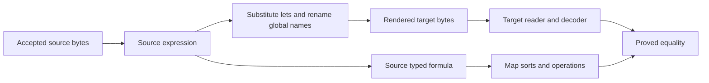

The grammar includes arbitrary-arity functions, equality and `distinct`, Boolean
operators, `ite`, chained comparisons, arithmetic and nested parallel lets.
The arithmetic elaboration retains the existing decoder's coefficient and
scaling behavior; see source syntax for its precise
acceptance rules. The target decoder uses its output expression's node budget,
including any expansion caused by substituting lets.

## Source truth and theories

A **model** chooses nonempty user-sort carriers and interpretations of function
symbols. A **reduct** interprets a source symbol using its target image. In the
example, a target model's actual integers become the source `U` carrier, and
its actual Booleans become the source `V` carrier.

The satisfaction relation uses the independent named-source interpreter.
Decoder adequacy proves agreement with the typed formula. The institution
retains all ordinary operation-preserving model homomorphisms. Truth transport
uses signature reducts; arbitrary model homomorphisms need not preserve truth.

A **room** fixes one signature, its sentences, models and satisfaction relation.
An **institution** connects these rooms along signature maps. Source sentences
use the existing quotient of accepted byte representatives: two representatives
are identified when they decode to equal typed formulas. Identity and composition
hold for these sentence classes; normalizing an identity can still change bytes.

A **theory** is any set of sentences. SAT means one model satisfies the entire
theory; UNSAT means no such model exists. Consequence means every model of the
theory satisfies a given conclusion. Along a coherent source map:

- Target SAT gives source SAT by reduct.
- Source UNSAT gives target UNSAT.
- Source consequence gives target consequence.

General reverse-direction guarantees use an additional **model expansion**
hypothesis: an appropriate target model covers each source model. Sort or symbol
identification can prevent this.
Successful source sort checks transport forward; a rejected source check can
become accepted when its two sorts have the same image.

## Scope

The checked declaration prefixes retain declaration syntax trees and successful
decoder equalities. Expression representatives retain actual reader-checked bytes.
This interface translates assertions between two given prefixes; it does not
generate declaration-command streams. A separate
quantified source-rewriting interface extends the
traversal to actual binder-sort syntax. Arrays, bit-vectors, Real arithmetic and full
SMT-LIB sessions are outside this interface; the presentation index
links the separate theory and source APIs.

The public API is under
`Silmaril.Logic.Smt.Uflia.SortMaps.SExpr.Renaming`.

| API | Source |
| --- | --- |
| Coherent names and typed signature map | [NameMap](../../Silmaril/Logic/Smt/Uflia/SortMaps/SExpr/Renaming/Defs.lean) |
| Exact decoder transport | [Normalization](../../Silmaril/Logic/Smt/Uflia/SortMaps/SExpr/Renaming/Normalization/Thms.lean) |
| Accepted-byte translation | [Action](../../Silmaril/Logic/Smt/Uflia/SortMaps/SExpr/Renaming/Action/Defs.lean) |
| Institution and theory APIs | [Institution](../../Silmaril/Logic/Smt/Uflia/SortMaps/SExpr/Renaming/Institution/Thms.lean) |
| Concrete translation and rejection controls | Examples |

The combined targeted strict Lean check and transitive axiom guards pass. The
guards allow only Lean's standard `propext`, `Classical.choice` and `Quot.sound`
axioms. Independent source and guide review found no correctness blocker.
Normal full CI at the final PR head remains a merge requirement.


## Real arithmetic: source scripts, models and refutations

`Silmaril.Logic.Smt.Lra` is a separate typed Bool/Real presentation. Real terms
have rational literal coefficients but evaluate in actual `ℝ`; rational models
are witnesses inside this real-valued semantics. This does not replace the
existing Int/UF semantics or turn the older proof-only Real intermediate path
into a Real source frontend.

**LRA** means **linear real arithmetic**: expressions are weighted sums of
variables plus constants. The coefficients here are rational numbers (**ℚ**),
such as `1/3`; models assign mathematical real numbers (**ℝ**) to variables.
For example, `x/2 ≤ 1/3` and `x ≥ 2/3` are both true at `x = 2/3`.
Changing the second inequality to `x > 2/3` makes them inconsistent.
**SAT** asks for a satisfying assignment; **UNSAT** states that none exists.

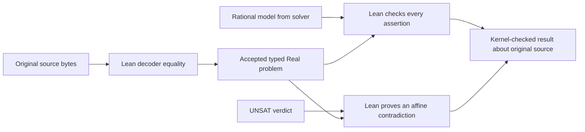

## Executable scope and semantic maps

The strict script decoder reuses `Silmaril.Logic.Smt.SExpr`'s ASCII byte reader.
It requires an initial `(set-logic QF_LRA)`, a nullary Bool/Real declaration
prefix, assertions, one final `(check-sat)`, and optionally `(exit)`. An accepted
script carries the exact `parse? text = some sentence` proof. Failed parsing
is an error and supplies no sentence to the accepted-script room.

Typed Real terms support canonical natural/decimal literals, exact rational
literals via nonzero constant division, unary minus, affine addition/subtraction,
constant multiplication and division by a nonzero closed rational literal.
Real terms also support `ite guard yes no`: the guard must be Bool and both
branches Real. Bool-valued `ite` requires a Bool guard and two Bool branches,
and elaborates to guarded conjunction/disjunction. Both branches are decoded,
including branches under constant guards. Nested conditionals are admitted;
the piecewise-affine source guide gives exact semantics,
source-bound examples and rejection controls. Conditional terms do not become
literal coefficients or denominators.
Booleans support constants, declared Bool variables, not/and/or, binary
implication/xor, equality and same-sort `distinct` (negated equality).
Equality/comparison/`distinct` operators are binary in this
slice; multiargument `+`, `-`, `*`, `and` and `or` accept at least two
arguments and fold from the left. For example, `(- x y z)` means `(x - y) - z`.
There is no Int sort, general UF, let, quantification, arrays,
bitvectors, nonlinear multiplication or variable/zero denominator. Rejection of
division by zero avoids assuming a choice for the standard's underspecified case.

The abstract room has one fixed signature of globally named Real and Bool
variables. Source declarations restrict decoding and forbid duplicate names;
abstract models assign all names, including unused ones. The source and abstract
rooms share these actual real/Boolean models. The decode corridor/comorphism is
natural over this fixed signature and **model-expansive** by identity: every
abstract model is also available to the source room. A **corridor** pairs a
sentence translation with a model reduct and an exact truth law; the
**comorphism** packages it over signatures. It establishes
exact SAT, UNSAT and semantic-consequence transport. It does not assert general
symbol-renaming naturality or an independently verified SMT-LIB standard model
correspondence. `Problem.entails_iff_unsat_not` gives the usual refutation API.

The official SMT-LIB2.7 dated PDF and retrieved `Core`, `Reals` and `QF_LRA`
table in `notes.md` distinguishes this supported affine dialect from full
standard grammar membership. A `QF_LRA` label alone is not such a certificate.

For new external evidence, the model-capture guide
and proof-capture guide prepare exact source-bound
requests and allow at most one execution per prepared directory under fixed limits. Their receipts describe
acquisition and import; a separate Lean check establishes the candidate theorem.
The evidence inventory distinguishes checked proof
pairs, solver-produced models and hand-authored witnesses.

Use the remote proof worker by default. If it is unavailable, run the same
module target with `bin/mor build` as the local fallback.

For `sat`, import requires one complete model containing exactly one correctly
sorted nullary assignment per declaration. Real assignments must be closed
rational values; Bool assignments are literal true/false. Lean independently
proves the proposed global-name model satisfies every decoded assertion, then
uses the source SAT bridge. Incomplete, extra, recursive, function-valued,
nonrational or mistyped assignments reject.

## Executed evidence and controls

Exact axiom guards permit only `propext`, `Classical.choice` and `Quot.sound`.
Kernel decoder controls reject mixed sorts, nonlinear products, bad denominators,
unsupported signatures/commands and duplicate declarations. Three retained
`.lean.txt` negative artifacts fail: a changed source coefficient fails decoder
binding, a missing local premise cannot borrow the original source assumptions,
and a wrong rational model fails satisfaction. Invalid `.lean` modules are
removed after the negative run. Rust tests also reproduce all 24 generated
artifacts and reject malformed sources and partial or mistyped model evidence.

## Source map and checks

## Binary distinct source normalization

The source decoder accepts exactly two operands of the same supported sort for
`distinct`: Real operands become negated real equality, and Bool operands become
negated Boolean equivalence. Other arities and mixed sorts reject. The original
source bytes remain unchanged; the generated decoder equality checks this
normalization in Lean. `Lra.Checks` proves the meaning in actual Real/Bool model
values, supplies source SAT witnesses, rejects the forbidden Real value, and
refutes a reflexive source disequality, with six exact standard-axiom guards.

## Models for the bounded coverage sample

All 39 complete rational/Boolean assignments import with the existing grammar
and kernel-check against the original source bytes. Their final SAT theorems
have 39 exact standard-axiom guards in
`Silmaril/Logic/Smt/Lra/SatModels/Defs.lean`. Changing only `x = 1/3` to `x = 0`
in each mode's rational-boundary model yields three expected failures at
`witness_holds`, while the source decoder still succeeds. Original verdict and
proof receipts remain unchanged. These are repeated observations of thirteen
problems, with no claim of general solver coverage.


### Synthetic direct-or proposition-list certificate

The bounded list-certificate extension
uses a constructive, axiom-free proposition-list theorem for direct `or` widths
6..64, with a separate 16384-byte rendered-leaf budget. It preserves widths 2..5,
exact ordered singleton-parent matching, universal cleared obligations and the
`not_and` 2..4 bound. Only traces using the new helper select exact wide source
identity proofs and automatic pruning of absent Boolean case splits. Retained
synthetic flat/scoped and distinct-variable checks are separate from external
solver observations: no producer call, new observed width or captured-pair count
is added. The README and receipts record measured limits and earlier memory


### Observed native conjunction elimination


### Identical native source assertions


## Piecewise-affine Real source conditionals

A **guard** is the Boolean condition deciding which **branch** supplies the
result. An affine expression uses rational constants, addition, negation and
rational scaling of variables. A **piecewise-affine** expression also makes
finitely nested choices between such expressions. Guards may contain Boolean
connectives and comparisons of terms, including nested conditionals.

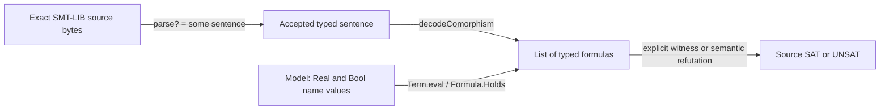

A **model** assigns a mathematical real to every Real name and a Boolean to
every Bool name. Declarations make the source decoder reject undeclared names
and reuse across sorts. A **sentence** is the decoded environment and list of
assertions. `Accepted` retains both the original source text and a proof of its
exact parsing equality. A **comorphism** translates accepted source sentences
into formula lists and translates models backward, preserving satisfaction.
Here the model map is identity, so the source and decoded sentence use exactly
the same model. The existing one-object institution, its source decoder
comorphism, and its SAT/UNSAT/consequence equivalences remain applicable.

## Exact conditional meaning

`Term` and `Formula` are now mutually recursive: formulas contain arithmetic
terms, and a Real conditional term contains a formula guard. Existing
constructors, names, and evaluation equations are preserved. The new constructor
has meaning

```text
Term.ite guard yes no  ↦  chooseReal (guard.Holds M) (yes.eval M) (no.eval M)
```

`chooseReal` selects `yes` when its proposition holds and `no` otherwise. One
fixed classical decision operation gives a source evaluator and proof renderer
an identical semantic expression. The branch and congruence theorems in
Ite/Thms expose this meaning explicitly.
A congruence proof needs a guard equivalence and an equality for each branch.
It does not infer which branch is selected from unrelated assumptions.

The [source decoder](../../Silmaril/Logic/Smt/Lra/Script/Defs.lean) accepts exactly three
arguments to `ite`. The guard must be Boolean, and both branches must have the
same sort. Real branches produce `Term.ite`; Boolean branches elaborate into
`(guard ∧ yes) ∨ (¬guard ∧ no)` using the existing formula constructors. Both
branches are decoded even when the guard is a constant.

Multiplication still requires a syntactic rational-literal factor. Division
still requires a nonzero rational-literal denominator. A conditional numerator
may be rationally scaled or divided by a nonzero literal, but a conditional is
not promoted to a literal coefficient merely because its branches are literals.
There is no variable multiplication, variable denominator, quantifier, Int
arithmetic, or arbitrary SMT-LIB command support in this fragment.

## Source-bound examples

The absolute-value source
asserts:

```smt2
(= y (ite (<= x 0) (- x) x))
(< y 0)
```

The semantic proof checks both branches: `-x` is nonnegative when `x ≤ 0`, and
`x` is positive otherwise. Thus this source is UNSAT. Its
SAT companion
uses `y ≤ 0`, witnessed by `x = y = 0`.

The Boolean-guarded source
asserts `y = ite p (x+1) (x-1)`, `p`, and `y < x`. The selected branch makes it
UNSAT. Its SAT companion
uses `y > x`, witnessed by `p = true`, `x = 0`, `y = 1`. All four source strings
are byte-for-byte copies of the previously retained authentic research inputs;
their mathematical checks use the exact accepted source and explicit semantics.

```lean
import Silmaril.Logic.Smt.Lra.Ite
import Silmaril.Logic.Smt.Lra.Ite.Examples

open Silmaril.Logic.Smt.Lra

example (M : Model) (g : Formula) (a b : Term) (h : g.Holds M) :
    (Term.ite g a b).eval M = a.eval M :=
  eval_ite_of_pos M g a b h

example (g : Formula) (a b : Term) :
    Script.apply? "ite" [.bool g, .real a, .real b] =
      some (.real (.ite g a b)) := decode_real_ite g a b

example : Ite.Examples.absoluteSat.Sat := Ite.Examples.absolute_source_sat
example : Ite.Examples.booleanUnsat.Unsat := Ite.Examples.boolean_source_unsat
```

## Controls and validation

Examples also check Boolean and nested
conditionals, rational scaling, constant division, the original affine evaluation
equation, and rejection of a Real guard, mixed/dead ill-typed branches, too few
or too many arguments, an undeclared branch name, a nonliteral product,
a conditional denominator, and a zero denominator. The source parser retains
its original complete single-query command discipline.


## Complete accepted SMT scripts over varying sorts

This candidate extends the checked source families
from a single assertion-expression receipt to an entire accepted quantified
UF/LIA script. **UF** means uninterpreted functions: the model supplies their
meaning. **LIA** means linear integer arithmetic, such as `2*x + y <= 5`;
products of two integer variables are outside this fragment. The targeted strict Lean build, semantic controls and fresh transitive axiom
guard passed, including the singleton connection, at `72a24a548da4`; the private validation receipt
records the exact scope and logs.

`Quantified.Script.Accepted` already records the original text, reader result,
command layout, checked declaration forms, every assertion and each assertion's
successful decoder result. The new `Source.Script.Family` stores this existing
receipt together with an actual map from its checked local signature to an
ambient varying-sort signature. No new parser or restricted assertion grammar
is introduced. Accepted scripts have a declaration prefix, zero or more
assertions and one terminal `check-sat`, optionally followed by `exit`. An
optional `set-logic` selects `UFLIA`, or `LIA` with only built-in nullary
declarations. The existing assertion decoder determines which expressions are
accepted; the quantified-script guide describes the command layer.

A signature specifies sorts and operations. A model gives those operations
meanings, with the ordinary Bool and Int carriers. Several programs can share
one ambient signature and one model, even if their local declaration names
differ. A signature map may identify user sorts or instantiate them with Bool
or Int, while fixing Bool and Int themselves.

Mapping a represented program postcomposes its interpretation. It retains the
whole original receipt: declaration preamble text, comments, command forms,
assertion order and duplicate assertions. It does not rewrite text, produce new
declaration bytes, or reparse a renamed script. Actual source rewriting is the
separate quantified source-renaming interface.

The source truth definition independently interprets every original assertion
in the actual ambient-model reduct. The typed decoder transports every decoded
assertion through the recorded map. Its target is a reusable finite problem
(list of quantified sentences) over any ambient sort type. Problem and source
rooms retain all ordinary operation-preserving model homomorphisms. Arbitrary
model homomorphisms need not preserve quantified or negative truth.

The comparison uses the identity functor on that entire model category. It
provides exact program SAT/UNSAT and arbitrary-theory SAT/UNSAT/consequence
comparisons. Every theory member uses the same model. Canonical packaging at a
program's own checked signature agrees with the existing whole-script SAT and
UNSAT semantics. Along an arbitrary signature map, reduct satisfaction gives
directional transport; converse consequence requires actual model expansion.
There is no blanket expansion claim for sort instantiation or aliasing.

The authored controls include:

- A complete script with a comment, declarations, two identical quantified
  assertions and the query commands. It is satisfiable over a three-element
  user carrier; moving that user sort to Bool makes it unsatisfiable. The full
  text and both assertions stay unchanged.
- Two individually satisfiable programs, `(declare-const p Bool)(assert p)` and
  `(declare-const q Bool)(assert (not q))`, each completed with `check-sat`.
  Mapping their local names to the same ambient Boolean operation makes the
  pair unsatisfiable in a shared model. Mapping `q` to another operation makes
  the pair satisfiable in one shared model, with exactly the same negative
  program receipt.
- An existing populated noninjective model homomorphism remains an arrow in
  the new source room.

The fresh transitive axiom guard covers the source/problem comparisons,
receipt retention, transport and semantic controls. It permits only `propext`,
`Classical.choice` and `Quot.sound`. Structural checks do not elaborate Lean or
establish these semantic claims. The strict targeted audit and structural
checks passed as recorded in the linked receipt; final-head full CI remains
a separate integration gate.

## Reading and using the interface

An **ambient signature** is the shared vocabulary in which several local scripts
are interpreted. An **interpretation** records which ambient sort and operation
each local declaration denotes. A **reduct** interprets a local script using an
ambient model through that map. A **theory** is a set of represented programs;
all its members must hold in the same model. **Semantic consequence** means
that every model satisfying all premises also satisfies the conclusion. A
**model homomorphism** maps user-carrier elements while preserving operations;
quantified or negative truth need not pass along that map.

- **SAT** means at least one model satisfies the program or theory; **UNSAT**
  means no model does.
- A **room** packages sentences, models and their satisfaction relation. An
  **institution** connects these rooms along changes of signature, with laws
  saying that translating syntax agrees with interpreting it through a reduct.
- A **comorphism** compares two such presentations by translating sentences and
  reducing target models to source models. Here the model comparison is the
  identity: source and typed presentations use exactly the same models and arrows.
- **Model expansion** means that every source model comes from a target model
  through the reduct. For example, replacing a three-element sort with Bool
  cannot supply every original model, because Bool has only two elements.

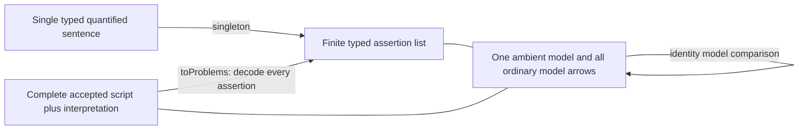

For example, these two accepted scripts are each satisfiable:

```smt2
(declare-const p Bool)(assert p)(check-sat)
(declare-const q Bool)(assert (not q))(check-sat)
```

They are separate source programs. Interpret both `p` and `q` as one ambient
Boolean constant `b`: the shared theory requires both `b = true` and
`b = false`, so it has no model. Interpret `q` as another constant `c` instead:
one model with `b = true` and `c = false` satisfies both programs. The entire
negative source receipt remains identical in both cases.

| API | Purpose |
| --- | --- |
| `Family`, `Family.Holds`, `Family.map` | Retain a complete accepted script, interpret its original assertions, postcompose its interpretation. |
| `Problem`, `Problem.inst` | Finite typed assertion lists and their institution over arbitrary ambient signatures. |
| `singleton`, `singleton_entails_iff` | Include a single typed sentence as a singleton list, with exact theory comparisons. |
| `toProblems`, `Family.decode_holds` | Decode all assertions and compare independent source truth with typed truth. |
| `program_sat_iff_decode`, `program_unsat_iff_decode` | Exact whole-program comparisons. |
| `satisfiable_iff_decode`, `unsatisfiable_iff_decode`, `entails_iff_decode` | Exact comparisons for sets of programs sharing one model. |
| `ofAccepted_sat_iff`, `ofAccepted_unsat_iff` | Agreement with the existing script semantics at its own checked signature. |

Definitions are in [the public header](../../Silmaril/Logic/Smt/Uflia/SortMaps/Source/Script/Defs.lean),
results in the theorem header,
and controls in Examples.
The Hets catalogue contains the two institutions, their actual decoder
comorphism and the singleton comorphism from the existing quantified institution. It records no additional source-renaming edge. The earlier
expression-family interface retains individual
assertion bytes; concrete ground rewriting produces
new source bytes. This interface retains complete script bytes while changing
their interpretation.
