# Temporal logics: LTL, CTL* and Büchi automata

Linear temporal logic (negation normal form, tableau, recurrence), CTL* (finite and infinite paths, terminal and maximal paths, NNF, the finite scalar and nested compilers into the modal μ-calculus and its compiler institution), and Büchi automata (base formulas, generalized acceptance, paths) as institutions, registered with their comorphisms in the [logic graph](logic-graph.md). The sections below are the guides of each development.

## Linear temporal logic: properties of one infinite run

LTL means **linear temporal logic**. A model here is an infinite trace: for each
time `0, 1, 2, …`, it says which named propositions are true. A formula is checked
at time zero. For example, `done` can be false for two instants and true thereafter:

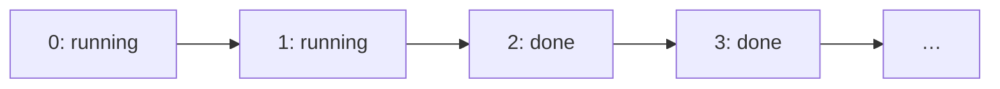

Import `Silmaril.Logic.Temporal.LTL`. Its `Formula P` uses names from the Lean type
`P`; `Model P` is an infinite sequence of truth assignments. The primitive
operators are atoms, false, negation, implication, conjunction, disjunction,
`next` and strong `until`.

| Formula | Meaning at time `n` |
| --- | --- |
| `next p` | `p` holds at time `n + 1`. |
| `eventually p` | `p` holds at some time `n + d`, allowing `d = 0`. |
| `always p` | `p` holds at every time `n + d`. |
| `until p q` | At some time `n + d`, `q` holds; `p` holds at each strictly earlier time from `n` onward. |
| `weakUntil p q` | Strong until holds, or `p` holds forever. |
| `release p q` | The Boolean dual `not (until (not p) (not q))`. |

“Strong” means `q` must eventually occur. It need not be the first occurrence of
`q`, and `p` need not hold at the chosen endpoint. In the displayed trace,
`until running done` holds, `next done` fails and `next (next done)` holds.
In a trace where `running` is always true and `done` always false:

- `always running` holds.
- `eventually done` and `until running done` fail.
- `weakUntil running done` holds.

These are theorems about the actual `completes` and `loops` models in
[`LTL/Examples.lean`](../../Silmaril/Logic/Temporal/LTL/Examples.lean). They show why a
safety claim such as “the system keeps running” does not imply completion.

## Renaming and the institution interface

An **institution** packages syntax, models and satisfaction so that consistent
renaming preserves meaning. A signature here is the type of proposition names.
A signature map is any function `P → Q`, including functions that identify names.
It renames every atom in the sentence; model reduction reads the corresponding
`Q` atom at every instant. `Formula.holds_map` proves exact satisfaction at every
time. `institution` packages those maps with their identity and composition laws.

A model arrow preserves atom truth at each time. Such an arrow can add true
atoms, so it need not preserve a formula containing negation. The institution
law concerns signature reduction, whose satisfaction equivalence is proved.

`propositionalToLtl` is a **comorphism** from public propositional logic (PL):
its sentence map includes the propositional formulas; its model map takes the
trace's initial truth assignment. Every PL model expands to a constant trace.
Consequently the inclusion preserves and reflects satisfiability (SAT), absence
of a satisfying model (UNSAT), and semantic consequence (truth in all models of
a set of assumptions).

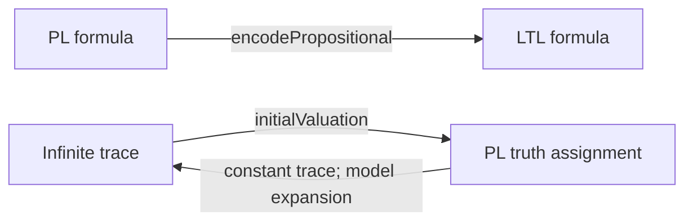

The theorem header also proves `eventually_iff`, `always_iff`, `until_now`,
`until_eventually`, `until_unfold`, `always_now` and `always_next`. The unfolding
law says that strong until either finishes now or requires `p` now and the same
until formula at the next instant. There is no executable model checker or
completeness theorem for a deductive proof system in this interface.

## Source correspondence and checks

The path syntax and semantics were compared with Katsura's *Hoare Logic and
Model Checking*, lecture 8 (2025/26), printed slides 5 and 15–16. The private
source record pins the
PDF SHA-256 `b41743ec6dfdb74385d0a56b023888fea2f3dd5a328ba9371998085cb31e6124`;
`katsura-2026-hlog-modc-lecture08` in `references.bib` give the
per-item mapping. The implementation is written here; the lecture examples were
not copied.

This is the **path** presentation. The lecture additionally defines transition
systems and satisfaction on all paths from their initial states. That separate
transition-system institution, CTL (computation tree logic), CTL* (combined state
and path formulas), fairness assumptions and deadlock completion remain open.
A path already has a next instant at every time; this definition does not choose
how to extend a deadlocked transition system. The PL inclusion does not establish
the source diagram's normal-modal-K-to-temporal or temporal-to-modal-μ arrows.

The targeted command below passed with `--wfail` on 2026-11-10, including all ten
positive/negative trace examples and the ordinary-axiom guards. Scoped Isar lint,
`mor check` and `git diff --check` passed. No full local build was run.

```sh
LEAN_NUM_THREADS=2 bin/mor build --no-pool --mem-cap 16 Silmaril.Logic.Temporal.LTL
```


## LTL with negation only at atoms

This layer rewrites every existing LTL formula so that negation appears only on
individual atoms. It preserves arbitrary temporal nesting: a negation around an
until, an implication inside next, or another negation is handled by the same
recursive normalizer. The result is a useful input language for a future finite
automaton construction; no LTL-to-automaton theorem is claimed here.

LTL describes one infinite word. At each natural-number time, an **input letter**
says which atoms are true. There is no graph, path quantifier, terminal state or
implicit repetition of a deadlock. The main ingredients are:

- **Next**, Xp, asks whether p holds at the next time.
- **Strong until**, p U q, requires q at some finite future time, and p at every
  earlier time. Keeping p true forever without ever reaching q does not suffice.
- **Release**, p R q, requires q now and at every future time unless p held
  strictly earlier. If p never holds, q must hold forever. In particular q is
  still required at the first time p holds.
- **Negation normal form**, or NNF, allows positive and negative atoms, true and
  false, conjunction, disjunction, next, until and release. It has no arbitrary
  negation or implication constructor.

`NNF.Formula.Holds` gives this language its own direct infinite-word semantics.
For a small example, p U q holds when p is true at times 0 and 1 and q is true
at time 2. If q never becomes true, p U q fails even if p stays true forever.
Negating until gives the dual law `¬(p U q) = (¬p) R (¬q)`: no finite until
witness exists.

Release is explicitly `∀ d, q(n+d) ∨ ∃ i<d, p(n+i)`; it is not defined by calling
the old LTL evaluator. `Formula.holds_dual` proves that exchanging positive and
negative atoms, conjunction/disjunction and until/release negates the meaning.

## Normalization and a nested example

`normalize false p` preserves p; `normalize true p` expresses its negation.
`normalize_holds`, `normalize_positive` and `normalize_negative` prove both claims
at every time on every existing LTL model, against the existing independent
`LTL.Formula.Holds`. The normalizer accepts the full existing input grammar,
including arbitrary negations and implications.

For example:

```
¬( X a U ¬(b U ¬a) )  →  (X ¬a) R (b U ¬a)
```

The nested example is checked as an equality of actual syntax. On the constant
word where a is always true and b always false, the inner until cannot finish,
so the result fails already at the current time. On the opposite constant word,
that until finishes immediately at every time, and the release holds forever.
Both cases, including rejection by the original LTL semantics, are checked.

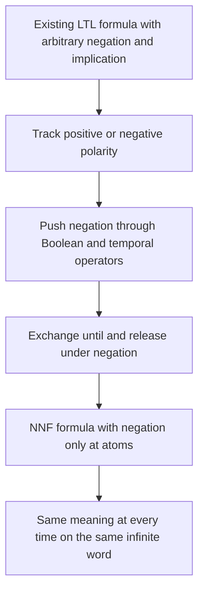

`normalize_map` proves equality of syntax under every atom map, including maps
that identify distinct atoms. `Formula.holds_map` proves the corresponding word
pullback law. No decidable equality or finiteness assumption on atoms is needed.
The controls also distinguish strong until from endless postponement, test both
release boundaries and show that identifying two atoms can turn their difference
into the contradiction p ∧ ¬p without breaking naturality.

## Tableau composition and current boundary

The occurrence tableau now supplies the finite generalized
Büchi construction and exact word-language theorem, then composes normalization
with the scalar Büchi formula compiler on original graph models. Its target is
an existential **infinite** path satisfying full LTL. Existing CTL* maximal
paths can be finite at deadlocks and need separate work. No full CTL*
translation or institution arrow follows from normalization.

The private receipt retains failed and successful targeted checks, seventeen
exact axiom guards, source hashes and the dependency-artifact limitations. No
solver producer, full local build or strict clean dependency rebuild is claimed.


## LTL occurrence tableau and original graph formulas

The private `Silmaril.Logic.Temporal.LTL.Tableau` modules compile arbitrary finite
NNF formulas to concrete finite generalized symbolic Büchi automata. Composing
with existing normalization and the generalized Büchi scalar compiler gives
`ltlFormula`: actual modal μ syntax on the original graph signature.

LTL means **linear temporal logic**: formulas describe one sequence of states
through time. An **atom** is a named proposition, such as “a response arrives,”
whose truth may change along that sequence. NNF means **negation normal form**:
negation appears only directly on atoms. A **Büchi automaton** reads an infinite
sequence and accepts when designated states recur arbitrarily late; a
**generalized** Büchi automaton has several designated sets, all of which must
recur. A **guard** is the finite Boolean condition on the current letter that
permits a transition. **Modal μ logic** describes graph states using
propositions, graph steps and least/greatest fixed points; a least fixed point
can express eventual arrival, while a greatest fixed point can express
continuing forever.

`accepts_iff` proves exact word-language correctness for NNF;
`accepts_normalize` covers the existing full LTL syntax, including nested
negation, implication, next, strong until and release. `ltlFormula_correct`
proves that a world satisfies the emitted formula exactly when **one infinite
path from that world** satisfies the source LTL formula. Every letter is the
valuation at its corresponding path world, including the initial world.

## Finite construction

An occurrence is a position in the formula tree. Two identical subformulas at
different positions remain distinct occurrences. Erasing atoms and operator
tags gives `Shape`; a state is a Boolean assignment to all its occurrences.
For m occurrences there are 2^m states. Neither finite atoms nor decidable
equality on atoms is required.

The initial states have the root bit set. Each pair of states has a concrete
finite `Guard`: literal checks use positive or negative atom guards; Boolean
consistency equations use top/bottom guards; conjunction combines checks for
all child occurrences. No transition consults semantic word acceptance.
`transition_holds` connects this guard syntax to the independently defined
local equations. At time t, with current state X and next state Y:

| Occurrence | Local equation for its bit |
| --- | --- |
| p ∧ q / p ∨ q | Current child bits combined by ∧ / ∨ |
| X p | Next state's child bit |
| p U q | q now ∨ (p now ∧ this occurrence active next) |
| p R q | q now ∧ (p now ∨ this occurrence active next) |

Literal bits agree with the current source letter; top and bottom are fixed.
These equations alone allow a strong-until obligation to postpone forever.
For example, `top U bot` can keep its root true, its left child true and its
right child false at every time. The equations hold, but the formula is false.

For a concrete example, let p mean “waiting” and q mean “response.” The formula
p U q requires a response at some finite time, with waiting at every earlier
time. If waiting is true at times 0 and 1 and a response is true at time 2,
the formula accepts: time 2 is its witness. If waiting remains true forever
and no response arrives, it rejects. This formula has three occurrences
(the until root, p and q), so its Boolean tableau has eight possible states.
The accepting condition excludes exactly the endless postponement illustrated
above; merely satisfying each local step equation is insufficient.

For each until occurrence, its accepting set requires either its root to be
inactive or its right child to be active. Every accepting set must be visited
arbitrarily late. The postponing run never visits this set and is rejected.
The implementation indexes acceptance by **all** occurrences; non-until
occurrences contribute the full state set. These additional entries are
trivially satisfied. Thus a formula without until still has a finite accepting
family, with every member trivial. The existing round-robin compiler handles
that family without any special semantic oracle.

## Why the language proof works

`active_sound` proves that each active bit implies truth of its subformula.
The until case combines its local recurrence with its own fairness condition;
the release case needs only the release recurrence. An inactive release bit
need not mean that release is false: `bot R top` admits an all-time locally
consistent inactive root although the semantic formula is true. The proof
never assumes the converse for arbitrary runs.

For completeness, `truth` assigns each occurrence its actual semantic truth
at each time. The recurrence theorems establish local consistency, and every
true strong-until obligation has a finite witness, establishing fairness.
This assignment is used in the proof; the emitted automaton contains only
finite literal and Boolean guards. `accepts_iff_run` proves that packing these
assignments into numbered finite states preserves initial, step and fairness
conditions for the same single run.


`shape_map` preserves the state shape under every atom map, including maps
that identify names. `transition_map` and `discharged_map` prove exact syntax
and acceptance transport. `automaton_map` expresses heterogeneous equality
because its finite bounds depend on the erased shape: the two index types
are related by the proved shape equality, so ordinary equality cannot yet
compare their types. `formula_map` and
`ltlFormula_map` give ordinary equality of the actual emitted scalar syntax,
including action maps and full LTL normalization. In plain terms, renaming
propositions and graph-step labels before compilation produces exactly the
same syntax as renaming them afterward. `accepts_map` is the
corresponding semantic word pullback law.

## Controls and scope

`Examples` checks nested full LTL acceptance and rejection, endless-until
postponement, inactive-but-true release, next without until, inconsistent
literals, atom collapse, deadlocks, an infinitely branching graph and initial
source timing. A graph state may have arbitrarily many successors.
A deadlock has no infinite path and hence rejects every emitted existential
infinite-path formula; no stuttering edge is added.

This is an existential infinite-path compilation. It does not supply a
trace-LTL-to-branching-model institution comorphism: such a translation would
also have to connect the two kinds of models and preserve their satisfaction
relation, beyond the existential-path theorem proved here. Nor does it supply
a full CTL* translation (CTL* can mix path and branching-state formulas).
CTL* maximal paths can be finite at deadlocks and require separate treatment.
No tableau state minimization or executable state-enumeration performance
claim is made. The construction is finite but uses classical finite packing.

The private receipt under
failed and successful checks, exact axiom guards and dependency artifact
limitations. No external mathematical source was copied.


## Local temporal obligations on one trace

The recurrence helpers turn local until/release obligations into semantic truth
on a single infinite sequence of times. They are independent of automata,
tableaux, atom names and equality tests on atoms. **NNF** means negation normal
form: negation appears only at atoms. A **tableau** here means a candidate
assignment of truth bits to subformulas at each time. A **recurrence** is a local
equation relating the current time to the next time.

For predicates P and Q on natural-number times:

- `strongUntil P Q n` means Q holds at some finite time n+d, while P holds at
  every earlier time n+i with i<d. Q may already hold now, when d=0.
- `release P Q n` means Q holds now and keeps holding until a possible P witness,
  including the time of that witness. Q holding forever also suffices.

These are exactly the offset semantics of the existing NNF until and release
constructors: `holds_until` and `holds_release` establish the direct connection.
For example, P may hold at times 0, 1 and 2, with Q first true at time 3. Strong
until is true at each of those four times. A promise to keep waiting forever
without Q never satisfies strong until.

## Until needs recurrent discharge

Let U mark times when an until obligation is selected. The local requirement is

```
U(t) → Q(t) ∨ (P(t) ∧ U(t+1)).
```

A **selected bit** is just the predicate U; its definition does not assume that
until is semantically true. The recurrence lets an obligation discharge into Q
or pass to the next time with P true. By itself it permits U and P to stay true
forever while Q stays false. `until_sound` therefore also requires

```
for every t, some s ≥ t satisfies ¬U(s) ∨ Q(s).
```

A **Büchi condition** requires a designated set of states to be visited
arbitrarily late along the same run. This discharge-or-inactive condition is the
accepting-set requirement needed by a later Büchi family. Together the two hypotheses prove `U(n) → strongUntil P Q n`
for every time n. The proof scans a finite prefix ending at a recurrent witness:
either Q appears earlier, or passing the obligation reaches that endpoint and
forces Q there.

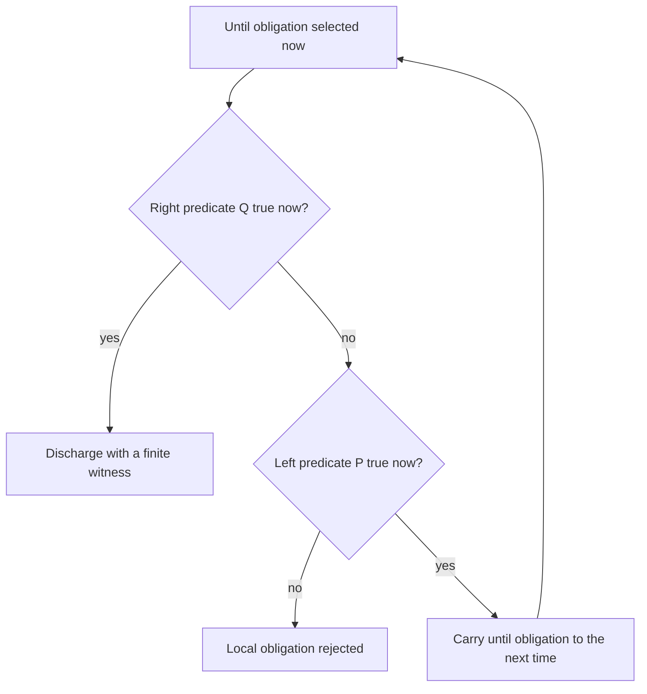

The local loop can continue forever. The additional Büchi condition prevents a
selected obligation from using that loop forever without reaching Q.

`strongUntil_unfold` proves the exact recurrence for semantic until truth.
`strongUntil_fair` proves that the canonical truth assignment always meets the
recurrent condition, without additional assumptions on P or Q. If until is
false now, that time is already inactive; if it is true, its finite Q witness
provides a discharge time.

## Release gives one-way selected-bit soundness

For a selected release bit R, `release_sound` requires only

```
R(t) → Q(t) ∧ (P(t) ∨ R(t+1)).
```

It proves `R(n) → release P Q n`, with no fairness assumption. Unfolding this
implication over any finite prefix supplies Q throughout that prefix unless a
strictly earlier P witness has appeared. This is enough for release semantics,
including an infinite sequence with Q always true and P always false.

`release_unfold` proves an equivalence for **semantic release truth itself**.
The selected-bit theorem is one-way: R may be false everywhere even when
release is true everywhere. Thus local recurrence for a selected bit does not
justify an equivalence between that bit and full release truth.

`strongUntil_mono` and `release_mono` permit operand predicates to be enlarged.
They support structural soundness proofs that first establish truth of selected
child obligations. All results quantify over arbitrary predicates and all times.

The checked controls include endless postponement satisfying the local until
rule but failing fairness and semantic until; a discharge at time three; release
with Q forever and no P witness; rejection when Q is false now despite P being
true now; and a false release bit under-approximating true release semantics.

The public interface is `Silmaril.Logic.Temporal.LTL.NNF.Recurrence.Thms`.
`Recurrence.Audits` checks exact axiom dependencies. Source hashes, targeted
build history and limits are recorded in the private receipt. Remote proving was
unavailable because `hiloop` was missing; checks used a bounded local fallback
and inherited warm dependency artifacts. These helpers do not construct an LTL
tableau or prove an LTL-to-automaton language theorem. Full CI passed at exact
head `7b3d4a93cd4df903b53093b5e1933ccac95fca2d`
this later integration check does not replace the historical local build limits.


## CTL*: state formulas and path formulas

CTL* allows temporal operations on a selected path and allows a state formula
inside that path to quantify again over paths. The
[definitions](../../Silmaril/Logic/Temporal/CTLStar/Defs.lean) use mutually inductive
`StateFormula` and `PathFormula` types with direct, mutually recursive
satisfaction. They do not define CTL* through a CTL, LTL or modal μ translation.
Models use actual pointed Kripke frames, arbitrary state carriers, transition
relations and state-dependent atom valuations.

On an infinite path, `G F write` means writing infinitely often. The serial
[branching example](../../Silmaril/Logic/Temporal/CTLStar/Examples.lean) has an infinite
spine with a write exit at every spine state; each write exit leads permanently
to a non-writing sink. Along the spine, every state has some path to a write,
so `EG EF write` is true. Every single path either stays on the spine without
writing or leaves it and writes once, so `E G F write` is false there. Under
the chosen finite-path extension, a finite path ending in a write can satisfy
`G F write`; the terminal singleton example checks this boundary. The examples
also prove the direct CTL* nesting `E G (E F write)` on that same model.
These are distinct checked formulas, not a proof of the full expressive
separation between CTL and CTL*.

A **Kripke frame** is a set of states with a transition relation; its **atom
valuation** says which proposition names hold at each state. CTL (computation
tree logic) combines each temporal operator with a path quantifier. LTL
(linear-time temporal logic) describes an individual trace. CTL* allows the
full mutual state/path grammar. `E` means some path, `A` every path, `G`
always, `F` eventually, `X` next, `U` until; `top` is true and `bottom` false.
An **institution** packages signatures, sentences, models and satisfaction.
A **comorphism** translates signatures/sentences forward and models backward;
that backward interpretation is a **model reduct**. **SAT** means some model
satisfies the chosen sentences; **UNSAT** means no model does. A **semantic
consequence** holds in every model satisfying the premises.

## Paths and terminal states

A **terminal state**, or deadlock, has no successor. A **maximal path** is an
infinite sequence with every transition present, or a finite sequence ending
at a terminal state. A frame is **serial** when every state has a successor.
A **pointed** model selects one state, so its carrier is nonempty.

The main semantics includes both sorts of maximal path. **Strong next** `X p`
requires another state and requires `p` there. **Strong until** `p U q` requires
a future `q` witness and `p` at each strictly earlier position. `G p` checks
every valid position of the selected path. Neither self-loops nor artificial
terminal states are inserted.

A path stores a natural-number sequence and an optional last index. Entries
after a finite last index are padding, not transitions. The padding-irrelevance
theorem requires a valid starting index; raw `PathFormula.Holds` at an invalid
index is outside this execution interpretation. The suffix API requires its
starting index to be valid and proves exact reindexing of satisfaction.
Classical successor choice extends every actual finite prefix to a maximal
path, without a seriality or finite-branching assumption.

At a terminal state:

| Formula | Meaning |
| --- | --- |
| `E X top` | False |
| `A X bottom` | False: the terminal singleton path has no next state |
| `E G p` | Exactly `p` now |
| `A(p U q)` | Exactly `q` now |
| Existing CTL weak `AX bottom` | True, by its deliberately vacuous modal-box convention |
| Existing CTL `EG top` | False: its EG requires an infinite path |

The terminal path laws derive weak next and Release
in this syntax and prove their unfoldings at valid positions. At a finite
endpoint, strong next fails, weak next holds, and Until and Release reduce to
their right operand.

The generic strong-until theorem characterizes universal CTL* until by actual
infinite paths and finite terminal paths. The checked examples include a
nonserial chain reaching its terminal labelled target, the branching spine,
a positive infinite-writing witness, and a state permutation fixing the point.

## The source convention and existing CTL/LTL

The pinned `goranko-rumberg-2024-temporal-logic` in `references.bib`
and Cambridge lecture9 printed slides17 and22–24 describe infinite
computations. The main semantics is an explicit maximal-path extension of that
convention. The
[independent infinite interpretation](../../Silmaril/Logic/Temporal/CTLStar/Infinite/Defs.lean)
uses direct mutual recursion on the full syntax. `StateFormula.holds_infinite`
and `PathFormula.holds_infinite` prove agreement on serial frames for every
formula. The sources' top-level initial-state-set semantics is represented here
by one selected state. Only the selected syntax and semantic clauses are
covered; the private source correspondence records exact source hashes and
these discrepancies.

`encodeCTL_holds` preserves the actual existing CTL semantics on all
frames. EX becomes `E X`; EU becomes existential path-until. Existing EG becomes
`E(G p ∧ G X top)`: the second conjunct excludes finite paths. On serial frames
the infiniteness guard is redundant, recovering the usual unguarded EG form.
This distinction preserves current CTL's finite EX/EU witnesses and infinite EG
witnesses even when a successor later deadlocks.

`encodeLTL` translates every constructor of the existing LTL
syntax into path syntax. `encodeLTL_holds` proves agreement at every index on
an actual infinite frame path with the trace of its atom valuations. This is a
formula/semantics relationship. There is no claim of a state-level comorphism
from the existing individual-trace LTL institution.

## Institution maps and model arrows

The [theorem header](../../Silmaril/Logic/Temporal/CTLStar/Thms.lean) packages atom
renamings, model reducts, sentence naturality and exact satisfaction. Both
presentations admit the same full CTL* syntax and the same model objects:

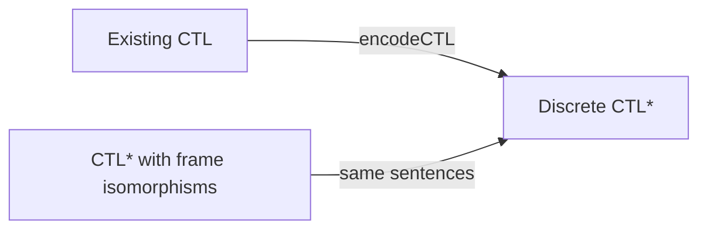

These are logical comorphism arrows. Models reduce in the reverse direction.
The left reduct is identity on existing CTL models. The right reduct maps the
discrete model category into the rich one. No functor from nontrivial rich
arrows to equality-only CTL arrows is asserted.

The rich category is the actual core of the pointed modal-model category:
arrows are categorical isomorphisms of pointed Kripke models. They can change
state names while preserving valuations and transitions. Mutual satisfaction
transport and `rich_hom_sat` prove invariance for the entire CTL* syntax. An
actual nonidentity arrow exchanges two states while fixing the chosen point.
The discrete category is needed to match the existing equality-only CTL model
category, not because CTL* requires discrete arrows.

Both comorphisms have exact model expansions. Explicit theorems preserve and
reflect satisfiability, unsatisfiability and semantic consequence. The
[Hets span](../../Silmaril/Logic/Temporal/CTLStar/Hets/Defs.lean) registers both actual
maps and an actual inclusion path using the existing typed graph machinery.
The rich-to-discrete presentation map is not an additional source-diagram
subsumption claim.

## Validation and limits

Targeted `--wfail` checks cover the direct syntax/semantics, reusable path API,
CTL/LTL relationships, full serial source agreement, rich arrows, both
institutions, semantic controls and Hets span. Exact theorem axiom guards and
hash-bound build/style receipts are retained with the example validation
artifacts. Textual layout and structural catalogue checks do not audit
mathematical meaning or transitive axioms. Reused dependency artifacts retain
their recorded foreign-version metadata warning; strict dependency replay is
not claimed.

No full-paper coverage, completeness, axiomatic proof system, complexity,
model checker, fairness or concrete K/Wasm execution adapter is claimed. The
existing temporal-to-modal-μ source relationship remains the scoped CTL map;
this development supplies no general CTL*→modal-μ translation.

The full nested-state compiler translates every
state formula to closed scalar modal μ syntax on the original graph, with
mutual correctness and actual syntax naturality. Institution mapping remains
a separate task.


## Positive CTL* path formulas with finite endpoints

**CTL*** extends **CTL** (computation tree logic) by allowing path formulas
alongside state formulas on a branching graph. A maximal path can be infinite or end at a
**deadlock**, a state with no outgoing edge. The endpoint is part of the path;
padded states beyond it do not extend the path.

This slice adds `CTLStar.NNF.Formula`, a positive path syntax. **NNF**, or
negation normal form, places negation only on leaves. The syntax includes both
strong and weak next, conjunction/disjunction, Until/Release, true and false.
It supports finite words and the existing infinite-path case without adding
any transitions to the original graph.

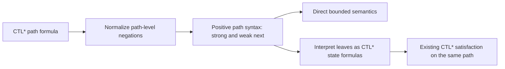

**Strong next** requires a next valid position satisfying its operand.
**Weak next** requires its operand only if the next position exists. At a finite
endpoint strong next fails and weak next holds. Consequently, the syntactic
**dual** swaps strong with weak next, Until with Release, conjunction with
disjunction, true with false, and positive with negative leaves. The checked
`Formula.holds_dual` theorem says that the dual denotes the Boolean complement.
This differs from the existing infinite-word LTL normalization, where every
position has a successor and one next constructor suffices.

`Formula.Holds last word` gives direct word semantics with an optional last
index. `some n` includes positions through `n`; `none` has no finite bound.
Until requires a valid future right-operand witness. Release constrains only
valid future positions: the right operand holds there unless the left operand
held strictly earlier. At the endpoint both Until and Release reduce to their
right operand. An Until obligation cannot be postponed into padding.

`Formula.toPathFormula leaf` interprets each leaf as an existing CTL* state
formula. `Formula.holds_toPathFormula` proves that bounded semantics agrees
with existing CTL* satisfaction on a genuine maximal path at a valid starting
position. The word evaluates each leaf using existing CTL* state satisfaction
at that path state.

`normalize false p` preserves a CTL* path formula's truth, while
`normalize true p` represents its negation. `normalize_holds` proves both
polarities against the original satisfaction relation at every valid position.
For example, `not (next true)` becomes weak next of a negative true leaf. It is
true at a singleton deadlock, where strong next of any operand is false.

Normalization treats an embedded **state formula** as one whole leaf. Such a
leaf may itself contain negation, Boolean operations or path quantifiers. Its
existing CTL* semantics is retained. For example, the leaf “there exists a path
whose next state satisfies true” still quantifies over paths from the current
state, and is false at a deadlock.
The surrounding path operators continue to read one fixed outer path. A state
leaf’s own quantifier keeps the meaning it already had; normalization does not
choose a separate outer path for each operand. This is normalization of the
outer path syntax; it does not translate nested state formulas to modal
μ-calculus.

`normalize_map` proves equality of the actual normalized syntax under a
signature renaming, mapping each embedded state formula structurally.
`Formula.holds_map` handles arbitrary leaf maps, including maps identifying
leaves. `dual_map` and `dual_dual` check compatibility and involution. No
equality test on user atoms or embedded state formulas is needed.

The examples cover a singleton deadlock, a one-edge path to a deadlock,
postponed Until, finite Release, the strong/weak dual distinction, and a nested
existential state formula. Exact axiom guards record proof dependencies. The
public CTL* correspondence statements require valid positions; they make no
claim that padding is an additional path position.

Import `Silmaril.Logic.Temporal.CTLStar.NNF.Thms` for the interface. This supplies
a finite-path NNF foundation, not a finite tableau, automaton compiler, full
CTL* translation or institution arrow. The independent existing infinite LTL
normalization remains unchanged.


## Finite CTL* path NNF to scalar modal μ

This assembly emits closed scalar modal μ syntax for an existential finite
maximal path satisfying a positive path NNF formula. It combines the
finite occurrence tableau with the
finite symbolic automaton compiler, preserving
the original world type, action relation and atom valuation.

NNF means *negation normal form*: negation occurs only at atom leaves. An atom
is a proposition naming a set of graph states. Scalar syntax binds one fixed
point variable per binder. The symbol μ denotes a least fixed point; here it
captures finite reachability to an allowed endpoint. A vector system is a
finite system of equations, with one unknown set of worlds for each encoded
tableau state.

The input has ordinary atoms and the constructors positive/negative atom,
false/true, conjunction/disjunction, strong/weak next, Until and Release.
This is a finite-path compiler slice. Combining finite and infinite paths,
compiling nested CTL* state leaves and constructing an institution mapping
remain pending.

## Actual emitted syntax

`FiniteScalar.pack` encodes every Boolean occurrence assignment with the shared
`LTL.Tableau.stateEquiv`. The initial set contains exactly assignments whose
root bit is true. Its edge field is the actual finite-tableau `transition`
guard, and its endpoint field is the actual `terminal` guard. These are
Boolean `Guard` trees; the production automaton has no semantic oracle.

`FiniteScalar.formula p a` applies the existing finite automaton scalar
compiler to that packed syntax. Each vector equation has the form

```text
Xq = (terminal(q) ∧ [a]false)
     ∨ ⋁r (transition(q,r) ∧ ⟨a⟩Xr)
```

The existing least finite-vector compiler eliminates the simultaneous system
into scalar modal μ syntax. The endpoint branch checks the final letter and
selected-action deadlock together. It consumes no extra edge or letter.

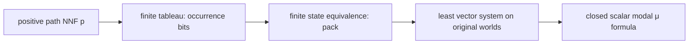

## One coherent original path

`pathRun_iff` explicitly decodes an individual packed automaton run to a Boolean
assignment sequence on the same path and edge count. It preserves the initial
assignment, source labels, transition guards, endpoint guard and deadlock.
`accepts_iff_tableau` adds the root-bit initial condition.

`accepts_iff` composes this representation transport with the finite tableau
language theorem. For a graph `R`, labels `label` and initial world `w`, its
right side is exactly

```text
∃ n, ∃ path : Nat → W,
  path 0 = w
  ∧ (∀ i < n, R (path i) (path (i+1)))
  ∧ (∀ v, ¬ R (path n) v)
  ∧ p.Holds (some n) (fun t => label (path t)) 0
```

There are `n` edges and `n+1` letters. The quantified path and assignment run
share every time position. Values after `n` are irrelevant to bounded NNF
semantics. No acyclicity or finite-world hypothesis is assumed.


The displayed two-edge run stops at `w₂`; its terminal check is part of that
same final world. For `n=0`, the initial world itself must satisfy the endpoint
guard and have no selected-action successor.

`formula_correct` gives this exact right side for membership in the emitted
formula's denotation, for every environment on the closed formula. It follows
from the existing scalar compiler correctness theorem and `accepts_iff`.
`accepts_iff_ctlstarPath` packages precisely the same finite paths into the
existing `CTLStar.Path` type. `accepts_iff_pathFormula` additionally uses
existing CTLStar satisfaction with interpreted state leaves; it preserves the
actual model, path and finite endpoint.

## Syntax naturality

`formula_map` proves equality of the actual emitted syntax under an arbitrary
modal μ signature map: rename atoms and actions before compilation or rename
the compiled formula afterwards. `pack_map` maps actual guard trees;
`pack_formula_transport` handles the equality of occurrence shapes. The proof
uses the finite tableau's actual `transition_map` and `terminal_map` lemmas
and the existing scalar compiler's syntax naturality. Atom maps may identify
previously distinct leaves.

## Controls and limits

The checked controls use the emitted scalar formula itself:

| Situation | Result |
| --- | --- |
| Deadlocked singleton, weak next false | Accepts with zero edges |
| Deadlocked singleton, strong next true | Rejects |
| Deadlocked singleton, true Until false | Rejects postponed obligation |
| Deadlocked singleton, false Release true | Accepts |
| One edge into the atom's true world | Strong next atom accepts |
| One edge, two strong next steps | Rejects |
| Atom false at source, true at successor | Source atom conjunct rejects |
| Self-loop, true formula | No finite maximal witness |
| Two terminal branches, each with its own atom | Each next-atom formula accepts |
| Conjunction of next-atom constraints on distinct branches | Rejects |
| Positive and negative distinct leaves collapsed to one atom | Rejects |

The branch control matters because two existential subformulas can hold on
different branches. Here both constraints occur inside one path NNF formula,
so they must be witnessed by the same successor position.

The module does not combine this finite result with infinite Büchi acceptance.
It does not recursively compile arbitrary CTL* state formulas or claim a
trace-to-branching institution arrow. The reused scalar compiler performs
finite-state elimination without a size or performance bound asserted here.

## Validation and provenance

Sources are pinned to approved finite tableau PR1758 at
`b4799655991eed6a493e7e79052644dbd4ecbf29` and finite automaton PR1757 at
`0d9ead5755c191119ffd17f485e5a5b36b9228a3`, then synchronized with merged main
`1665f5fcfff3b1a5457da5531bb6990a3bcf62f7`. The assembly reuses their public
headers; its finite packing and transport proofs adapt the shared LTL tableau
patterns. No external paper source was copied.

The private scope note
and receipt
retain exact sources, commands and diagnostics. Substantive source
checkpoints were pushed before their targeted builds. The remote proof command
returned 127 because `hiloop` is absent. Local checks use a frozen observed CLI,
a bounded targeted Lean build and the existing warm dependency artifacts;
those artifacts report inherited version metadata warnings. No strict clean
dependency rebuild, full local build or fresh Rust executable is claimed.

Final targeted `--wfail` build08 passes all six new Lean files, eleven controls
and twenty exact guards; each guard records exactly `propext`, `Classical.choice`
and `Quot.sound`. Isar reports zero of nineteen tactic proofs flagged. Placement
and library dependency checks pass, as does textual layout for 17567 modules.
The inherited sparse paper catalogue check fails for a missing collection and
stale index; no catalogue rewrite was made. Root and an independent peer reviewed all six Lean files, the whole polished
guide and bound evidence at `6dd9d7df23`; both approved. Exact integration-head
full CI and merge remain pending.


## A finite tableau with a genuine last letter

A **tableau** records Boolean truth bits for a formula and its subformulas at
each input position. This slice constructs a finite tableau for the
endpoint-aware CTL* path normal forms. **CTL*** extends
computation tree logic with path formulas; the present construction checks one
finite word, rather than compiling state formulas or choosing graph paths.

A word described by last index `n` has `n+1` letters, including a singleton word
when `n=0`. A **guard** is existing finite Boolean syntax built from atom
literals, true/false, conjunction and disjunction. The tableau uses that actual
syntax for both its transition and its terminal checks. No arbitrary semantic
predicate is added to the guard language.


The Boolean assignment is indexed by **occurrences**, positions in the formula
tree. Repeated equal subformulas keep separate occurrences. The construction
reuses the existing LTL tableau's shape, occurrence type, Boolean assignments
and projections. Its erased shape depends on the syntax tree, not atom names;
no atom equality test is used.

At a nonterminal position the transition guard checks literal/Boolean truth
and each temporal recurrence. Strong next and weak next both read the next
assignment because a next letter exists there. Until reads “right now, or left
now and Until next.” Release reads “right now, and either left now or Release
next.” All guards read the current input letter.

The **terminal guard** checks the final letter and all child occurrences:

- Strong-next bits must be false; weak-next bits must be true.
- Until and Release bits must equal their right operand's bit.
- Literal and Boolean bits must agree with the final letter and child bits.

For example, Until true false is rejected even on a singleton word: setting
all its bits true fails the actual terminal guard. Release false true may
finish there, while Release true false fails. A one-edge word accepts strong
next true and rejects two strong-next steps. The last letter never requires
an extra transition or an added self-loop.

`run_exact` proves more than active-bit soundness: every consistent finite run
has the correct root bit at every valid position, including false bits.
Structural induction handles subformulas, and finite backward induction uses
the terminal guard to fix each earlier temporal equation. **Büchi fairness**, a
condition that discharges obligations repeatedly along infinite runs, is not
needed for these finite words. Completeness uses the canonical assignment of
semantic subformula truth values; those values are proof witnesses, not
predicates inserted into the production guards.

`accepts_iff` equates acceptance with the existing bounded NNF semantics.
`accepts_path_iff` additionally interprets leaves as existing CTL* state
formulas on an actual finite maximal path. The original endpoint and the same
path states determine the word. This theorem adds no graph transitions and
keeps one coherent path for all outer path operators.

`transition_map` and `terminal_map` prove equality of the actual guard syntax
under arbitrary atom renaming, with the required transport of occurrence
assignments. `accepts_map` proves the corresponding word-language pullback.
A control maps two distinct atoms to one and correctly turns their positive/
negative conjunction into a contradiction.

Import `Silmaril.Logic.Temporal.CTLStar.FiniteTableau.Thms` for the checked
interface. Examples cover singleton endpoints, a one-edge word, a fake active
Until assignment, atom collapse and an actual finite CTL* graph path. Exact
axiom guards record dependencies. This slice provides no scalar modal
μ-calculus graph compiler, full CTL* translation or institution mapping; those
remain separate steps.


## Endpoint-aware CTL* NNF on infinite paths

This bridge compiles the existing endpoint-aware CTL* path syntax for an
existential infinite path. It reuses the LTL occurrence tableau
and its scalar modal μ compiler. The new code proves that interpreting the
input without a finite endpoint agrees with that existing infinite compiler.

NNF means *negation normal form*: negation appears only at atom leaves. An atom
is a proposition naming a set of graph states. A path is one sequence of
original graph states linked by the chosen action. Modal μ syntax expresses
fixed points of sets of states; scalar syntax binds one variable per fixed
point binder. A fixed point is a set unchanged by its defining equation; μ
denotes the least fixed point and ν the greatest. The existing compiler
eliminates a finite system of simultaneous
set equations into that scalar syntax.

Until `p U q` requires `q` eventually, with `p` true at every earlier position.
Release `p R q` requires `q` throughout unless `p` releases it, with `q` still
true at the release position; if no release occurs, `q` must remain true
forever.

A Büchi automaton accepts an infinite run when an accepting set is visited
infinitely often. A generalized Büchi automaton has a finite family of such
sets, and requires each set infinitely often. For example, an obligation to
reach a true `q` cannot remain pending forever: an infinite run that always
postpones `q` must be rejected. The reused tableau assigns a recurrence
requirement to every Until occurrence. No new acceptance test replaces it.

This is an infinite-path adapter. Combining finite and infinite witnesses,
recursively compiling nested state leaves and defining an institution mapping
remain pending. An institution mapping would relate logical sentence and model
interfaces while preserving satisfaction; no such mapping is constructed here.

## Exact endpoint erasure

`CTLStar.NNF.Formula` distinguishes strong next and weak next. At a finite
last position strong next is false, while weak next is true regardless of its
operand. Without a finite endpoint, every successor index is valid, so both
operators mean the operand at the next index.

`Formula.toInfinite` maps both constructors to `LTL.NNF.Formula.next` and maps
all other constructors directly. In particular, Until and Release retain their
existing meanings and syntax. `Formula.holds_toInfinite` proves, at every i,

```text
p.toInfinite.Holds word i ↔ p.Holds none word i
```

Here `none` explicitly means no finite last index. The theorem does not erase
finite endpoints. It uses structural induction on the positive path syntax;
Until retains its finite witness offset, and Release retains its condition at
every future offset.

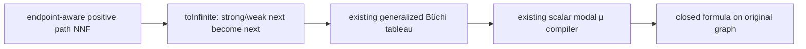

`InfiniteBridge.automaton p` is exactly `LTL.Tableau.automaton p.toInfinite`.
Its finite encoded state space, actual Boolean transition guards and entire
acceptance family come from that existing compiler. `accepts_iff` composes its
word-language theorem with `holds_toInfinite`, giving exact acceptance of
`p.Holds none word 0`.

## Fairness remains essential

A local equation for an active Until occurrence can allow this infinite
sequence of assignments:

```text
current Until bit = true
left operand bit = true
right operand bit = false
next Until bit = true
```

Repeating this assignment forever satisfies the local recurrence but fails
strong Until. The controls `postponing_local` and `postponing_not_fair` check
both facts for the actual reused tableau. Its accepting condition requires
every Until occurrence to be inactive or have its right operand true
arbitrarily far along the run. A permanently pending obligation therefore
fails acceptance. This is the fairness condition used here.

Release has a different control: `false Release true` remains true forever,
without inventing an eventual left-operand witness. The bridge preserves this
existing distinction between Until and Release.

## One coherent original path

`accepts_path_iff` states that graph acceptance is exactly one infinite
original path whose actual labels satisfy the endpoint-free input formula.
All Boolean and temporal constraints share that same path.

`InfiniteBridge.formula p a` is the existing scalar formula for
`p.toInfinite`. The new `formula_correct` theorem gives, for every environment
on this closed formula,

```text
w ∈ (formula p a).denote M ρ ↔
  ∃ path : Nat → M.World,
    path 0 = w
    ∧ (∀ i, M.step a (path i) (path (i+1)))
    ∧ p.Holds none (fun t => modelLabel M (path t)) 0
```

`modelLabel` reads the original model's atom valuation at a world. Each
transition guard reads the source-world letter before advancing. No extra
world coordinate, implicit self-loop or graph-wide seriality assumption is
introduced. Only the selected witnessing path needs successors forever.

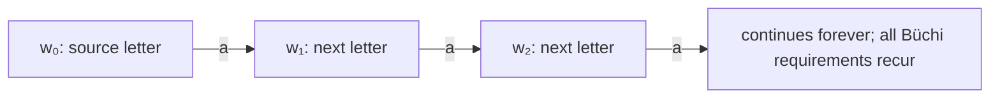

`accepts_iff_ctlstarPath` packages precisely these paths into the existing
`CTLStar.Path` type with `last=none`. Its terminal field is vacuous because
there is no finite endpoint. `formula_iff_ctlstarPath` gives the same actual
path representation for scalar satisfaction.

`accepts_pathFormula_iff` additionally proves existing CTL* satisfaction on a
specified actual infinite path with interpreted state leaves.
`accepts_normalize_iff` handles both normalization polarities of an existing
CTL* path formula. Embedded state formulas remain leaves interpreted by their
existing semantics. These statements do not recursively compile the leaves.

## Actual syntax under renaming

`toInfinite_map` and `toInfinite_dual` are equalities of the actual positive
syntax. `automaton_map` proves actual generalized automaton syntax transport,
including its finite shape-dependent dimensions. The Lean theorem uses
heterogeneous equality because those dimensions are indexed by the input
formula; it transports the existing automaton's syntax, not just its language.

`formula_map` is ordinary equality of actual emitted scalar syntax under an
arbitrary modal μ signature map, including both atoms and actions. A signature
specifies which atom and action names are available. Renaming
before compilation and renaming afterwards produce equal syntax. Atom maps
may collapse distinct leaves. `accepts_map` separately states the resulting
word-language pullback: acceptance of a relabelled word agrees with acceptance
of the corresponding renamed formula.

## Checked controls

| Input or graph | Result |
| --- | --- |
| Infinite word, weak next false | Rejects |
| Infinite word, strong next true | Accepts |
| Infinite word, weak next true | Accepts |
| Arbitrary operand on infinite words | Strong and weak next acceptance agree |
| True Until false | Rejects |
| Permanently postponed Until assignment | Locally consistent, fails fairness |
| False Release true | Accepts forever |
| False Release false | Rejects |
| Distinct positive/negative atom leaves | Distinguishing word accepts |
| Those leaves collapsed to one atom | Rejects |
| Deadlocked singleton, true formula | Rejects: no infinite witness |
| True self-loop, true formula | Accepts |
| True self-loop, true Until false | Rejects despite infinite graph path |
| Two disjoint looping branches | Each individual next-atom formula accepts |
| Conjunction of the two next-atom constraints on one path | Rejects |
| Atom false at source and true on a successor | Source conjunct rejects |

There are seventeen control theorems; the local-consistency and fairness row
has two separate proofs. The branch conjunction cannot borrow two different
successor paths. This is the coherence property needed by the path compiler.

## Validation, provenance and limits

The slice starts from pinned private main
`1665f5fcfff3b1a5457da5531bb6990a3bcf62f7`. Its private
scope note
and receipt retain exact source pins, adapted proof patterns and diagnostics.
The design source map
on the separate design checkpoint pins eleven prerequisite blobs. No external
paper source or alternate Büchi construction was copied.

The bridge and adapters are authored here; the LTL generalized tableau,
fairness soundness/completeness and scalar elimination are reused unchanged
through public headers. The none-last path construction directly uses the
existing CTLStar representation and the same original-frame path pattern as
the finite adapter.

Source checkpoints are pushed before targeted builds. Remote proof execution
returns 127 because `hiloop` is unavailable. Bounded local validation uses the
frozen observed CLI and warm dependencies; inherited dependency-version
metadata warnings remain recorded. No full local build, strict clean
dependency rebuild, fresh Rust executable or performance bound is claimed.
Root and an independent peer approved all six Lean files, the complete final
guide and bound evidence at `632cad4169`. Exact integration-head full CI and
merge remain pending.

Final targeted `--wfail` build06 passes all six new Lean files, seventeen
controls and thirty exact axiom guards (2s,1.4GiB). Isar reports zero of
twenty-seven tactic proofs flagged. Placement/library checks and textual
layout pass; the inherited sparse paper catalogue failure remains recorded.


## Scalar compilation for finite or infinite maximal paths

This assembly emits a scalar modal μ formula that holds exactly when one
actual maximal original graph path satisfies the input positive path formula.
It combines the finite scalar compiler and the
infinite Büchi bridge with one scalar disjunction.
Both existing compilers and their mathematical proofs are reused unchanged.

A graph world is a state; an atom is a proposition naming a set of worlds.
An action chooses which original graph edges the path follows. A maximal path
either stops at a world with no successor for that action, or continues
forever. A finite path includes its endpoint letter. The input is NNF,
*negation normal form*, with negation only at atom leaves. It distinguishes
strong next from weak next at a finite endpoint.

Modal μ syntax describes fixed points of sets of worlds. A fixed point is a
set unchanged by its defining equation; μ selects the least such set and ν
the greatest. Scalar syntax binds one fixed point variable per binder. This
assembly uses the existing finite and infinite scalar compilers, rather than
introducing another fixed point elimination algorithm.

The result covers one path formula in NNF over ordinary atoms. The merged
universal-path adapter also emits scalar syntax for
every actual maximal path: `UniversalPath.allFormula p a` is
`(MaximalPath.formula p.dual a).dual`. Its `formula_correct` theorem quantifies
over all original `CTLStar.Path` values from the chosen world, including finite
endpoints and infinite paths. Its `all_iff_allPaths` theorem agrees with existing
CTL* universal-path satisfaction for interpreted state leaves.

Recursive compilation of nested CTL* state formulas and an institution mapping
remain pending. An institution mapping would connect logical sentence and model
interfaces while preserving satisfaction.

## Actual syntax

`MaximalPath.formula p a` is exactly

```text
FiniteScalar.formula p a ∨ InfiniteBridge.formula p a
```

The entire input p goes to each branch. The finite branch retains its actual
transition guards, endpoint guard and selected-action deadlock requirement.
The infinite branch retains its actual generalized Büchi acceptance family:
every required accepting set must recur infinitely often along the run.
For example, true Until false cannot be accepted by postponing its unmet
right operand forever.

Until `p U q` requires q at some valid future position and p at every earlier
position; on a finite path its q witness must occur before or at the endpoint.
Release `p R q` requires q throughout unless p releases it, with q still true
at the release position. If no release occurs, q must hold at every remaining
valid position, through the endpoint on a finite path. Strong
next requires an actual next position; weak next is automatically true at a
finite last position. Both next operators have the same meaning on infinite
paths.

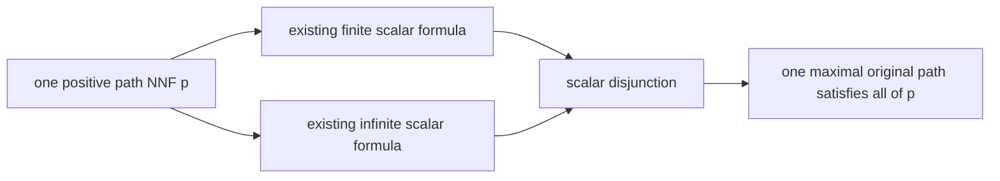

This disjunction chooses a possible witness lifetime. It does not distribute
p's conjunctions between compilers or between source paths.

## Exact original-path theorem

`AcceptsPath` independently means a finite accepting run or an infinite Büchi
accepting run from the existing interfaces. `accepts_iff` proves that this is
exactly one actual existing `CTLStar.Path` with the required NNF meaning.

`formula_iff_accepts` composes the two existing scalar compiler theorems.
`formula_correct` then states, for every environment on the closed formula,

```text
w ∈ (formula p a).denote M ρ ↔
  ∃ path : CTLStar.Path (M.step a),
    path.state 0 = w
    ∧ p.Holds path.last (fun t => modelLabel M (path.state t)) 0
```

The labels are read from the original model's atom valuation. No extra world
coordinate, implicit self-loop or graph-wide seriality assumption is added.
The existing `CTLStar.Path` enforces the correct maximality conditions.

The proof cases on `path.last : Option Nat`. If it is `some n`, the existing
finite compiler supplies the same path, with n edges and n+1 letters,
including endpoint guard and deadlock. If it is `none`, the existing infinite
compiler supplies that same path and its recurrent acceptance conditions.
Conversely each accepted branch already supplies an actual maximal path, so
the proof forgets only which lifetime branch supplied it.

## Cross-lifetime coherence

The mixed control graph has an initial choice between a deadlocked p-only
world and a q-only world that loops forever:

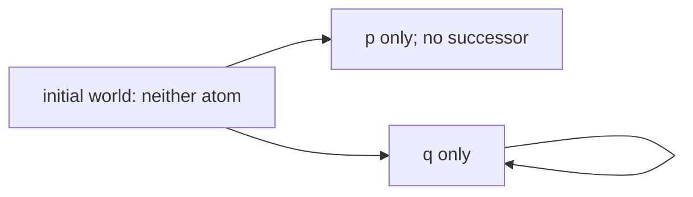

The finite branch witnesses next p. The infinite branch witnesses next q.
The path formula `(next p) ∧ (next q)` rejects because one next position
cannot be both worlds. Choosing different lifetime branches for different
conjuncts would give the wrong answer; the assembly always sends the entire
conjunction to a single witness branch.

`finitePath` and `infinitePath` are concrete actual `CTLStar.Path` values for
this model. Their endpoint fields are `some 1` and `none`, respectively.
Both fixtures and the cross-lifetime rejection have exact axiom guards.

## Existing CTL* meaning and syntax renaming

`accepts_iff_existsPath` interprets leaves by existing CTL* state formulas and
identifies the graph acceptance language with actual
`StateFormula.existsPath (p.toPathFormula leaf)` satisfaction. It uses the
same actual source model, path and leaf interpretation.

`accepts_normalize_iff` handles both normalization polarities of an existing
path formula. The polarity condition stays inside the chosen path's
satisfaction. Embedded state formulas remain interpreted leaves. These are
semantic correspondence statements; they do not recursively emit scalar
syntax for the embedded state formulas.

`formula_map` proves equality of actual emitted scalar syntax under arbitrary
atom and action renaming. A signature specifies the available atom and action
names. Both existing syntax naturality theorems apply to the actual scalar
disjunction, including maps that identify atoms. `accepts_map` separately
states relabelled-word acceptance: acceptance for a renamed formula agrees
with acceptance for the corresponding relabelled source labels.

## Checked controls

| Situation | Result |
| --- | --- |
| Deadlocked singleton, weak next false | Accepts finite zero-edge witness |
| Deadlocked singleton, strong next true | Rejects |
| True self-loop, true formula | Accepts infinite witness |
| Same loop, finite compiler alone | Rejects |
| Any graph, true Until false | Rejects both lifetimes |
| Deadlocked singleton, false Release true | Accepts |
| Self-loop, false Release true | Accepts |
| One edge to a true atom | Next atom accepts |
| One edge with two strong next steps | Rejects |
| Mixed terminal/looping graph, each next atom separately | Both accept |
| Same mixed graph, conjunction of next-atom constraints | Rejects |
| Mixed graph, atom false at source | Source conjunct rejects |
| Positive/negative distinct leaves collapsed to one atom | Rejects |

These are thirteen emitted-scalar control theorems. Two additional concrete
path fixtures check the mixed finite and infinite endpoint representations.

## Validation and provenance

The implementation is pinned to private main
`42b102b75cd4886f67b3d4dda6346d20d68be0b3`, after finite PR1760 and infinite
PR1764 merged with their exact full CI runs. The private
scope note
and receipt retain exact commands, source pins and diagnostics. The separate
private design checkpoint is `30ba589aef`; no external paper source was copied.

New mathematics is the Option endpoint assembly and direct correspondence to
existing actual CTL* existential semantics. The finite/infinite tableau
proofs, guard syntax, scalar elimination and fairness proofs are reused via
public headers. No additional mathematical assumption is introduced.

Source checkpoints are pushed before targeted builds. The remote proof
command returns 127 because `hiloop` is absent. The local fallback uses a
frozen observed CLI and warm dependencies; inherited version metadata warnings
remain recorded. No full local build, strict clean dependency rebuild, fresh
Rust executable or performance bound is claimed. Complete independent
source/whole-guide/evidence review approved the complete slice at
passed at exact head `a5119f53347a435ae9819bd8485cd344c2eefc55`, including
then merged as `e5333f1697ce59aa87ba6f865455a6789841c9fc`.
The earlier receipts retain their pre-integration status; this status correction
adds no new local build.

Final targeted `--wfail` build04 passes all six new Lean files, thirteen
controls and twenty-two exact axiom guards (2s,1.3GiB). Those guards cover
seven assembly results, thirteen controls and the two actual mixed path
definitions. Isar reports zero of nineteen tactic proofs flagged. Placement
and library checks pass; textual layout passes. The inherited sparse paper
catalogue failure remains recorded.


## CTL* at a terminal path position

CTL* (**computation tree logic**) combines formulas about a state with formulas about one path through a
branching graph. A **maximal path** either continues forever or ends at a
**deadlock**, a state with no outgoing edge. The existing `CTLStar.Path` records
this endpoint explicitly. Its stored states beyond that index are padding and
do not extend the represented path; next requires a valid position.

Import `Silmaril.Logic.Temporal.CTLStar.Terminal.Thms` for the new path laws.
`PathFormula.weakNext` and `PathFormula.release` are derived formulas in the
existing syntax; their theorems refer directly to the existing `Holds` semantics.


On this one-edge path, strong next of true holds at position 0. Two strong next
steps fail. At position 1, strong next of any formula fails, while weak next of
any formula holds. No self-loop is added at the endpoint.

**Strong next** requires a next valid position satisfying its operand.
**Weak next** requires its operand only if a next valid position exists.
Consequently, negating strong next gives weak next of the negated operand.
The infinite-word law that uses strong next on both sides does not extend to
finite maximal paths.

Release is defined explicitly as `not ((not p) until (not q))`.

**Until** requires its right operand at some valid future position and its left
operand at all earlier positions. **Release** is the Boolean dual of Until:
its right operand must hold at each valid position unless the left operand has
already held at an earlier position. It also permits the right operand to hold
through the entire path without any left-operand witness.

At a valid starting position, the checked unfolding laws say:

- Until holds exactly when the right operand holds now, or the left operand
  holds now and strong next Until holds.
- Release holds exactly when the right operand holds now, and either the left
  operand holds now or weak next Release holds.

At the final position both reduce to the right operand. An Until obligation
cannot remain postponed beyond the endpoint. Release with right operand true
can finish there even when its left operand is false.

`Terminal.Examples` checks a singleton deadlock and the pictured one-edge path.
`Terminal.Audits` records exact axiom dependencies. A **kernel check** is Lean's
verification of the constructed proof term. The examples use actual paths and
existing satisfaction, rather than a separate finite-word interpretation.

These laws apply to finite and infinite maximal paths. The unfolding hypotheses
explicitly require a valid starting index; formulas evaluated on padding are
not promoted to meaningful path positions. This slice supplies no tableau,
finite automaton, CTL* translation or new institution connection. Those remain
separate work, described in the private continuation design note.


## Universal scalar compilation on actual maximal paths

This adapter emits a scalar modal μ formula that holds exactly when every
actual maximal original graph path satisfies one path formula in negation normal form.
It complements the existential maximal-path compiler
for the temporal dual of the input. The existing finite and infinite path
compilers remain unchanged.

A world is a graph state; an atom is a proposition naming a set of worlds.
An action selects the original edges followed by paths. A maximal path either
ends at a world with no successor for that action, or continues forever. A
finite path includes its endpoint letter. NNF means *negation normal form*:
negation appears only at atom leaves. The input here is ordinary path NNF;
nested CTL* state formulas are not recursively compiled.

Modal μ syntax describes fixed points of sets of worlds: μ selects a least
fixed point and ν a greatest one. A fixed point is a set unchanged by its
defining equation. Scalar syntax binds one fixed point variable per binder.
A closed formula has no free fixed point variables. The target's structural
dual complements a closed formula's truth, swapping atom literals,
conjunction/disjunction, box/diamond and μ/ν.

## Actual emitted syntax

`UniversalPath.allFormula p a` is exactly

```text
(MaximalPath.formula p.dual a).dual
```

The inner temporal dual negates the path NNF input: it swaps positive and
negative leaves, strong and weak next, Until and Release, conjunction and
disjunction. The outer scalar dual complements the compiled existential
counterexample formula. The target has no arbitrary-negation constructor;
the code emits this actual structural scalar dual.

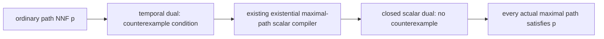

Strong next requires a next valid position; weak next is true automatically
at a finite endpoint. Until `p U q` requires q at a valid future position,
with p at earlier positions; q must occur before or at a finite endpoint.
Release `p R q` requires q until p releases it, including the release position.
If release never occurs, q is required at every remaining valid position,
through the endpoint when finite.

The existential compiler already handles finite endpoint guards and deadlock,
and infinite Büchi fairness. Büchi acceptance requires designated accepting
sets to recur infinitely often; here it prevents an Until obligation from
remaining pending forever. Dualizing the proved compiler preserves those
conditions without introducing another tableau or fairness algorithm.

## Exact original-path theorem

`AllPaths` independently means that the existing finite-or-infinite accepting
run language has no counterexample for the temporal dual. `all_iff` proves
that this is exactly universal quantification over actual `CTLStar.Path`
values, with their existing finite or infinite endpoint representation.

`closed_dual_correct` proves scalar complement at every environment on a
closed formula. Existing scalar duality complements free-variable environments;
for a closed formula those environments have domain `Fin 0`, so the
complemented environment equals the original one.

`formula_iff_all` combines that result with the existing existential compiler.
`formula_correct` gives, for every environment ρ,

```text
w ∈ (allFormula p a).denote M ρ ↔
  ∀ path : CTLStar.Path (M.step a),
    path.state 0 = w →
      p.Holds path.last (fun t => modelLabel M (path.state t)) 0
```

The world type, selected-action relation and atom valuation are those of the
original model. `modelLabel` reads an atom's truth at an original world.
The proof negates the existential counterexample proposition and uses the
existing endpoint-aware NNF dual theorem at that same actual path. It adds
no graph-wide seriality premise or implicit self-loop.

A deadlock has a zero-edge maximal path. It is therefore included in this
universal quantifier: weak next false holds there, while strong next true
fails. Universal path semantics is not obtained by considering only infinite
paths.

## Mixed finite and infinite controls

The reused mixed graph has one p-only terminal successor and one q-only
looping successor:


Existential next p and existential next q each hold. Universal next p fails
on the looping path; universal next q fails on the terminal path. Universal
next(p OR q) holds because every actual maximal path must take one of the two
successors. Universal next(p AND q) fails. This checks both witness lifetimes
and prevents separate existential witnesses from being treated as universal
truth.

The proof that every mixed path has a next position uses its actual maximality:
a path stopping immediately at the initial world would violate its terminal
deadlock condition. It then reads the original first edge and its source model
valuation. No finite-world path enumeration is used in the compiler theorem.

## Existing CTL* interpretation and actual renaming

`all_iff_allPaths` interprets leaves by existing CTL* state formulas and gives
actual `StateFormula.allPaths (p.toPathFormula leaf)` satisfaction in that
same source model. Each leaf remains interpreted by its existing semantics.
This correspondence does not recursively emit scalar syntax for nested state
formulas.

`formula_map` proves equality of actual emitted scalar syntax under arbitrary
atom and action renaming. A signature lists the available atom and action
names. The proof composes actual temporal-dual, existential-compiler and
scalar-dual syntax equalities; atom maps may identify distinct leaves.
`all_map` separately gives the corresponding relabelled-path meaning.

## Checked controls

| Situation | Result |
| --- | --- |
| Deadlocked singleton, universal weak next false | Accepts |
| Deadlocked singleton, universal strong next true | Rejects |
| Self-loop, universal strong next true | Accepts |
| Self-loop, universal true Until false | Rejects |
| Mixed graph, each existential next atom | Both accept |
| Mixed graph, universal next p | Rejects infinite counterexample |
| Mixed graph, universal next q | Rejects finite counterexample |
| Mixed graph, universal next(p OR q) | Accepts |
| Mixed graph, universal next(p AND q) | Rejects |
| Mixed graph, universal false Release true | Accepts both lifetimes |
| Mixed graph, atom false at source | Rejects |
| Identified positive/negative atom constraints | Rejects contradiction |

These are twelve control theorems over the emitted scalar formulas, including
one reused existential control for comparison.

## Validation, provenance and remaining scope

The implementation starts at exact merged maximal-path main
`e5333f1697ce59aa87ba6f865455a6789841c9fc`. The private
scope note
and receipt retain exact commands, source pins and diagnostics. The authorized
private design is `76ee5f0afa`. No external source was copied.

The new proofs compose existing endpoint-aware NNF duality, modal scalar
duality and existential correctness. The singleton, loop and mixed model/path
fixtures are reused through the maximal-path Examples header. No terminal,
Büchi, fixed point elimination or nested-state algorithm is reimplemented.

Source checkpoints are pushed before targeted builds. The remote proof command
returns 127 because `hiloop` is absent. Bounded local fallback uses the frozen
observed CLI and existing warm dependencies, whose inherited version metadata
warnings are retained. No strict clean dependency rebuild, full local Lean
build, fresh Rust executable or performance bound is claimed. At the source
review checkpoint `9fd6fcc1e8` on 2026-11-11, root and an independent peer had
approved all six Lean files, this complete guide and bound evidence. Exact
integration-head full CI and merge were still pending at that checkpoint;
the receipt and inventory preserve that historical review status.

The separate full nested-state compiler now supplies
recursive state compilation; this adapter retains its ordinary-NNF interface. No
institution mapping is claimed: such a mapping would connect logical sentence
and model interfaces while preserving satisfaction.

Final targeted `--wfail` build06 passes all six new Lean files, twelve controls
and nineteen exact axiom guards (3s,1.3GiB). Every guard records exactly
`propext`, `Classical.choice` and `Quot.sound`. Isar reports zero of eighteen
tactic proofs flagged. Placement/library checks and textual layout pass; the
inherited sparse paper catalogue failure remains recorded.


## Full nested CTL* state compilation

`Compiler.compileState` emits a closed scalar modal μ formula for every CTL*
state formula, including arbitrarily nested state/path quantifiers. Its
correctness theorem uses the original graph worlds, edges, atom valuation and
point. The result holds at every world and under every target environment.
Actual syntax also commutes with arbitrary atom renaming, including maps that
identify distinct atoms. These are Lean theorems; an institution mapping is
still outside this slice.

## The two kinds of source formula

A **state formula** is evaluated at one graph world. It has atoms, false,
negation, conjunction and existential path quantification `E`. A **path
formula** is evaluated at a position on one chosen path. It has embedded state
formulas, negation, conjunction, strong next `X`, and strong Until `U`.
Disjunction, universal path quantification `A`, eventually `F`, globally `G`,
weak next and Release are derived syntax. Thus an embedded state formula may
start another path quantifier, with a fresh choice of path from that position.

A **maximal path** either ends at a deadlock, including that endpoint, or
continues forever. Strong next requires a valid successor position. Weak next
is vacuously true at the endpoint. Finite paths contain padding in their total
state functions, but temporal validity guards prevent reading that padding as
another path step. No self-loop is added to a deadlock.

The target is **scalar modal μ syntax**: formulas describe sets of worlds,
with one fixed point variable per binder. A least fixed point `μ` captures
finite progress; a greatest fixed point `ν` can capture persistent behavior.
A closed formula has zero free fixed point variables. Its structural **dual**
complements truth, exchanging positive/negative literals, conjunction/disjunction,
box/diamond and least/greatest fixed points. The compiler uses this actual
syntax operation for source negation.

## Fused structural recursion

There are two mutually defined functions:

```text
compileState   : StateFormula S → Closed S
compilePathNNF : Bool → PathFormula S → NNF.Formula (Closed S)
```

`NNF` means negation normal form: negation has been pushed to literal leaves.
The Boolean is the requested polarity: false means the original formula and
true means its negation. The path helper both normalizes polarity and compiles
embedded state leaves. Its atom type is already-compiled closed target formulas.

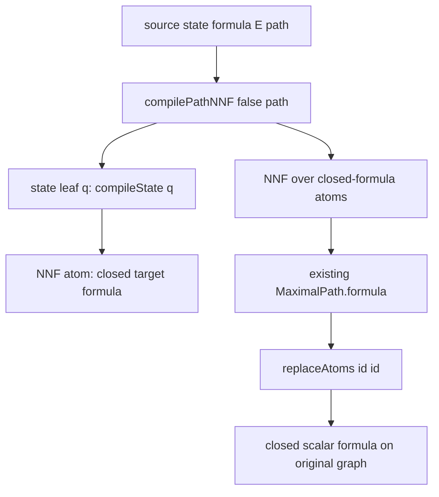

Every recursive call follows an original direct source child. The compiler
does not normalize a whole input and then recurse over the newly computed
normal form. It uses no size measure, count, Below table, fuel or well-founded
staging. Lean accepts the mutual definitions and proofs by structural recursion.

| Source case | Actual emitted operation |
| --- | --- |
| State atom / false | Positive scalar atom / scalar false |
| State negation | Structural dual of compiled child |
| State conjunction | Conjunction of compiled children |
| State `E p` | Maximal-path compilation of fused NNF, then closed-atom replacement |
| Path state leaf `q`, positive / negative polarity | Positive / negative literal of `compileState q` |
| Path negation | Flip polarity |
| Path conjunction, positive / negative polarity | Conjunction / disjunction of recursively normalized children |
| Path next, positive / negative polarity | Strong next / weak next |
| Path Until, positive / negative polarity | Until / Release |

The temporary signature for maximal-path compilation has closed target formulas
as atoms and `Unit` as its action type. `replaceAtoms id id` replaces each such
atom with that formula itself; the first identity maps the action and the second
maps the closed-formula atom. It is total substitution on already compiled
syntax. It does not call the recursive compiler inside substitution or consult
a semantic oracle. Negative temporary literals use the structural dual of the
replacement formula. Existing substitution handles lifting under binders.

The finite and infinite acceptance construction, including finite endpoint
checks and infinite Büchi fairness, is inherited from the
maximal-path compiler. Büchi fairness ensures that
an Until obligation cannot remain postponed forever. This slice composes that
construction rather than rebuilding its automata or fixed point elimination.

## What the theorems say

`compilePathNNF_eq` is an equality of actual syntax:

```text
compilePathNNF b p = (NNF.normalize b p).map compileState
```

This proves agreement with the established endpoint-aware normalization while
keeping the definition's recursive calls on original source children.

`encodeModel M` has exactly `M`'s worlds, point and atom valuation. Its only
action is `Unit`, whose edge relation is exactly the original accessibility.
No formula-dependent model is used in the public result.

`compileState_correct p M ρ w` proves:

```text
w ∈ denote (compileState p) (encodeModel M) ρ ↔ p.Holds M w
```

The theorem quantifies over every `ρ : Env World 0`; closedness is not silently
identified with a particular external environment. The companion path theorem
holds at every index and both polarities. Its leaves evaluate compiled state
formulas at the very same original path world. Together they form a mutual
semantic proof following the source grammar.

`replace_path_correct` first isolates the generic composition of closed-atom
replacement and maximal-path correctness. This makes the frame and temporary
atom interpretation explicit before recursive compiler terms enter the proof.
It also avoids an elaborator heartbeat timeout seen when the same composition
was attempted directly inside the mutual proof. No heartbeat limit was raised.

For `f : S ⟶ T`, `compileState_map` proves actual scalar syntax equality:

```text
(compileState p).map (toMuMap f) = compileState (p.map f)
```

The mutual path theorem maps the already-compiled closed-formula atoms. The
existential case composes existing maximal-path naturality and target-side
replacement naturality with the new generic `Formula.map_replaceAtoms`
source-precomposition lemma. This is stronger than equality of truth values.

## Why nested path choices matter

Consider an infinite spine where each position offers an exit to a writing
state, followed by a non-writing sink:

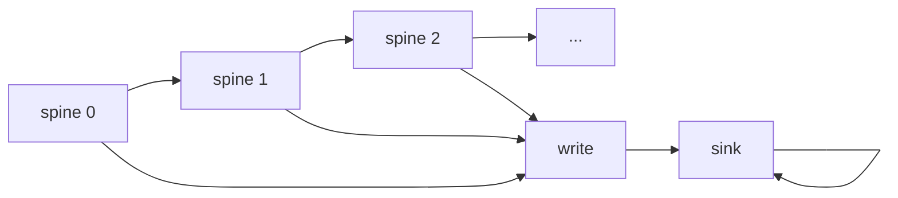

`E G (E F write)` holds: keep the outer path on the spine, and choose a fresh
inner writing exit at each position. `E G F write` fails: one path that takes
a writing exit is committed to the sink. The compiled controls prove both
results on the same original model. Treating a nested state leaf as an
uninterpreted source atom, or flattening its quantifier into the outer path,
would lose this distinction.

A second model separates one finite branch from one infinite branch:

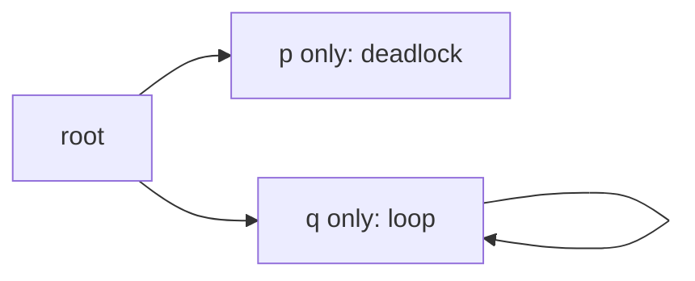

`E state((E X p) ∧ (E X q))` holds: the two inner quantifiers choose different
paths. `E ((X p) ∧ (X q))` fails: the single outer path cannot combine the two
successor labels. Both facts concern the emitted scalar formulas. The finite
nested-next control also reads its atom at the reached successor, not at the
source world.

## Checked controls and limits

| Emitted scalar control | Result |
| --- | --- |
| Terminal `E weakNext false` | Accepts |
| Terminal `E X true` | Rejects |
| Finite `E state(E X atom)` | Accepts at the unlabelled predecessor |
| Terminal `E state(¬ E X true)` | Accepts |
| Terminal `E state(A weakNext false)` | Accepts |
| One edge, `E X state(E weakNext false)` | Accepts at the true terminal successor |
| Spine `E G state(E F write)` | Accepts |
| Same spine `E G F write` | Rejects |
| Infinite writing loop `E G F write` | Accepts |
| Mixed graph, independent nested choices | Accepts |
| Mixed graph, one path combining incompatible labels | Rejects |
| Noninjective atom collapse | Actual emitted syntax commutes |

The full source state syntax compiler is proved. This does not yet construct
an institution mapping, a model-arrow action, a parser, an efficient executable
compiler, or a complexity bound. The definitions are noncomputable because the
inherited scalar construction uses classical finite enumeration. The examples
are semantic controls through the public correctness theorem; they do not
claim that Lean evaluated the generated automata by computation.

## Evidence and provenance

Implementation is in [Compiler/Defs.lean](../../Silmaril/Logic/Temporal/CTLStar/Compiler/Defs.lean),
with [language and correctness proofs](../../Silmaril/Proofs/Logic/Temporal/CTLStar/Compiler/Language.lean),
[syntax naturality](../../Silmaril/Proofs/Logic/Temporal/CTLStar/Compiler/Naturality.lean),
[controls](../../Silmaril/Logic/Temporal/CTLStar/Compiler/Examples.lean) and
[exact axiom guards](../../Silmaril/Logic/Temporal/CTLStar/Compiler/Audits.lean).
The receipt
binds revisions, file hashes, source correspondence and raw logs.

No external source was copied. The path semantic proof follows the existing
`NNF.normalize_all` proof patterns; state negation reuses closed dual correctness.
The source-precomposition lemma adapts the existing replacement/map induction
to the other side of substitution. The compiler definitions and composition
proofs are new local work.

At the validated source freeze `d04b5a5f8e199304965a6d8812ffbc1e691bf8c5`, targeted
`Compiler.Audits` passed `--wfail` in 3 seconds with 1.3 GiB peak memory. Every
compiler theorem and control has an exact guard for standard axioms only
(`propext`, `Classical.choice`, `Quot.sound`); the new substitution helper uses
only `propext`. Isar lint reports zero flagged proofs. Placement and library
checks pass; the sparse paper checkout causes the documented catalogue failure.
Warm package oleans from 4.35.0-rc4 were accepted with a warning by the pinned
nightly toolchain, so this is not a clean dependency rebuild claim.

The initial definition-shape review accepted the fused direct-child design;
that historical checkpoint did not review the completed proof. Complete peer
review, current-head full CI and merge remain integration steps at this guide's
checkpoint. The receipt records subsequent evidence without retroactively
changing what an earlier review established.


## CTL* compiler institution packaging

The packaging and controls passed targeted `--wfail` validation, and all 28 exact
axiom guards passed. No existing model categories were changed.

CTL* is Computation Tree Logic with arbitrary state/path nesting. This packaging
uses the full nested compiler. Its output is
**scalar** (ordinary single-set fixed-point binders) and **closed** (no free
set variables).

A **comorphism** translates sentences forward and models backward, with an exact
satisfaction equivalence. Here it translates every CTL* state formula into a
closed scalar modal μ-calculus formula. Its signature translation keeps the atom
type and adds one action, `Unit`, for the source accessibility relation.

```mermaid
flowchart LR
  CS[CTL* sentences] -->|compileState| MS[Modal μ sentences]
  MM[Modal μ models with one action] -->|decodeModel| CM[CTL* pointed models]
```

The model reduct, `decodeModel`, reads the relation at the unique action `()`.
It retains worlds, valuations and the distinguished point. The inverse expansion,
`encodeModel`, puts source accessibility at every action. Because the action type
has exactly one inhabitant, both round trips recover the original model. Models
are independent of the formula being translated.

The rich source institution includes actual pointed frame isomorphisms, including
world permutations. A **pointed frame isomorphism** is a bijection preserving
the distinguished point, accessibility edges and atom truth. The target
institution uses equality-only model arrows.
This causes no obstruction: the comorphism's model functor goes from target to
source, sending target equalities to rich source isomorphisms. It makes no claim
that arbitrary source isomorphisms become target equality arrows. The discrete
source institution, whose model arrows are equalities, has a second comorphism
using the same sentence translation.

**Strict naturality** means the whole model functors agree when a signature map
is applied before or after decoding, including their actions on arrows. Sentence
naturality is equality of the emitted syntax, established by the nested compiler.
Atom maps may identify different source atoms; they need not be injective.

**Model expansion** means every source model is the reduct of a target model.
Here the witness is `encodeModel`. Together with the satisfaction equivalence,
this gives exact entailment, satisfiability and unsatisfiability equivalences for
arbitrary sets of source formulas, for both rich and discrete source institutions.

For a set of assumptions, **satisfiability (SAT)** means some pointed model
satisfies every assumption; **unsatisfiability (UNSAT)** means no such model
exists. **Entailment** means every model satisfying all assumptions also
satisfies the conclusion. The equivalences above preserve these meanings
when the assumptions and conclusion are compiled.

For example, `E G (E F write)` says there is a path along which each position
has some path eventually reaching `write`. Its inner path may be chosen anew
at every position. The compiler guide illustrates the spine and exit model
where this holds but `E G F write`, requiring repeated writing along one path,
fails. Both comorphisms package this actual nested compilation.

For a concrete rich-arrow control, the examples use two Boolean-world deadlock
models pointed at `false` and `true`. Boolean negation swaps their worlds and
preserves the constant valuation. The source models differ, yet their compiled
sentences agree in satisfaction for every source formula. For an atom-collapse
control, the source sentence `a ∧ ¬b` is translated after mapping both atoms to
one target atom; every target model rejects the resulting contradiction.

The interface is `Silmaril.Logic.Temporal.CTLStar.Compiler.Institution.Thms`.
The controls are in the sibling `Examples` module. No existing model category is
changed, and no bounded-morphism invariance for modal μ-calculus is assumed.
The packaging does not provide a decision procedure or a complexity bound.

## Validation and limits

The core and controls passed build05 at source `1fcb6bc87c` (2 seconds,
1.3 GiB peak resident memory). The 28 exact axiom guards passed build07 at
`760ea3742f` (2 seconds, 1.3 GiB). Every guarded declaration uses only a subset
of `propext`, `Classical.choice` and `Quot.sound`; the guards record the actual
list separately for each declaration. Four initial elaboration failures remain
in the receipt directory; later runs corrected equality orientation, dependent
rewriting and an impossible dependent-point comparison.

Both builds used the frozen CLI, the package guard, host build slots, an 8 GiB
resident-memory cap and an actual `-j1` Lean invocation. The temporary Lake
configuration was restored after each run. They used existing build artifacts;
this is not a strict clean-toolchain validation. The package guard reported
foreign olean version metadata as warnings, as recorded in the logs.

The full local `mor check` passed: 25 regions, 17618 registered placement entries,
17619 library assignments, 1352 works and 1093 catalogue files, plus Wasm and
problem manifests. The separate textual layout checker passed for 17619 modules;
it does not elaborate mathematics. Isar lint flagged 0 of 11 tactic proofs in
the new modules. These are retained source-stage validation results.

PR #1774 subsequently merged as `f76270d0b0` after full CI 42985178007
at head `ead42fea259a67673cc281e814bb4621272d5079` passed. The shared
documentation inventory and graph now record that integration. This status
update performs no fresh Lean replay.

The private validation record is


## Finite Büchi word automata and graph products

A word is an infinite sequence of input letters. A finite **Büchi automaton**
reads one letter per step, chooses a next automaton state, and accepts when one
infinite run visits its accepting states arbitrarily late. Nondeterminism means
there may be several choices; acceptance requires one coherent accepting run.

The [definitions](../../Silmaril/Logic/Temporal/Buchi/Automaton/Defs.lean) use
`Automaton Letter n` with states `Fin n`, sets of initial and accepting states,
and a transition relation `step q letter r`. An empty state set is allowed.
`IsRun`, `Recurrent`, `AcceptsFrom` and `Accepts` are defined directly using
sequences of automaton states, independently of graph-path acceptance.
The generic alphabet need not be finite. No transition totality, determinism
or decidability is assumed.

A labeled graph has worlds W, an edge relation R and a label at each world.
`AcceptsPath A R label w` requires one infinite graph path p starting at w and
one accepting automaton run on exactly the word `label (p k)`.
It cannot choose a different graph path or run for each requested accepting time.

The synchronous product has states `(w,q)`. Its edge relation is

```text
(w,q) → (v,r)  iff  R w v ∧ A.step q (label w) r.
```

The transition consumes the **source** world's label. At time zero it reads
the starting world's label, then advances both coordinates. The accepting
product states are exactly those whose automaton coordinate is accepting.

```mermaid
flowchart LR
  P["One graph path p"] --> L["Word: label(p 0), label(p 1), …"]
  L --> R["One automaton run r"]
  P --> S["Product path: (p k, r k)"]
  R --> S
  S --> F["Arbitrarily late accepting visits"]
```

The [bridge theorems](../../Silmaril/Logic/Temporal/Buchi/Automaton/Thms.lean) pair and
project these independently specified sequences:

```text
AcceptsPath A R label w
  ↔ ∃ q ∈ A.initial, Buchi.Accepts productStep productAccepting (w,q)
  ↔ ∃ q ∈ A.initial, (w,q) ∈ ν Z. μ Y. ((F ∩ EX Z) ∪ EX Y).
```

The final equivalence reuses the proved Büchi path theorem.
Here F is the product accepting set and `EX X` means having a product successor
in X. The inner **least fixed point** μ searches a finite prefix for an
accepting state that can continue into Z; the outer **greatest fixed point** ν
permits that search to repeat forever. Graphs may have arbitrary infinite
branching and deadlocks. An accepting deadlock cannot supply an infinite run.

The [modal connection](../../Silmaril/Logic/Temporal/Buchi/Automaton/Modal.lean)
constructs an actual pointed product model and the closed scalar formula
`ν Z. μ Y. ((accepting ∧ ◇ Z) ∨ ◇ Y)`. `acceptsPath_iff_formula` proves the
same equivalence for that actual syntax, at some initial product point.
This formula lives on the product graph.

## Concrete guards for the base-model compiler

The [symbolic interface](../../Silmaril/Logic/Temporal/Buchi/Automaton/Symbolic.lean)
gives every pair of finite states one finite propositional `Guard Atom`.
Guards contain positive/negative atoms, true/false, conjunction and disjunction.
Their letters are actual atom valuations `Atom → Prop`; there is no arbitrary
semantic-predicate constructor. Multiple enabled target states remain possible.

`Guard.toFormula` translates every guard into actual positive modal μ syntax,
at any free-variable scope. `toFormula_denote` proves its exact meaning on every
model and environment. `Symbolic.productStep_iff` identifies an enabled product
edge with the graph edge and satisfaction of this actual guard formula at its
source. The base-model compiler uses this interface to
eliminate the finite automaton state component into actual scalar formulas.

Generic alphabet pullback preserves acceptance. For symbolic automata,
`productStep_map` and `acceptsModel_map` prove atom/action renaming against the
actual model reduct, with the same worlds and automaton coordinates.

## Checked controls and boundary

The [examples](../../Silmaril/Logic/Temporal/Buchi/Automaton/Examples.lean) include:

- A nondeterministic two-state automaton with both accepting and rejecting runs.
- A three-state automaton that waits in state 0, visits accepting state 1 once,
  then stays in rejecting state 2. Every requested late time has a complete
  initial run visiting acceptance then, but no single run accepts infinitely.
- A graph whose initial label fails a required guard while every subsequent
  label passes it. Source-label consumption rejects; shifting all labels by
  one accepts, making the timing convention observable.
- An accepting deadlock and an empty automaton state set, both rejected.
- A concrete symbolic automaton on an infinitely branching model, with checked
  product fixed-point membership and actual product-formula satisfaction.

New mathematics is authored here; the nested fixed-point/path theorem and
positive modal semantics are reused through public headers. No automaton is
constructed from LTL or CTL* syntax in this slice. The separate
base-model compiler now eliminates the finite state
component into scalar formulas on the original graph. A full LTL/CTL* automaton
construction, CTL* translation and its institution arrows remain pending. No
assumptions of those desired correctness results are introduced.

Target `Silmaril.Logic.Temporal.Buchi.Automaton.Audits` checks 26 exact axiom guards.
The private receipt
records source hashes, targeted build attempts and limitations. Remote proving
was unavailable because `hiloop` was missing; bounded targeted local checks
used inherited dependency artifacts with warning-only toolchain metadata.
No full local build or strict clean dependency rebuild is claimed. Exact-head
full CI remains a separate integration gate.


## A Büchi automaton formula on the original graph

`Silmaril.Logic.Temporal.Buchi.Automaton.Base.Thms` translates every finite symbolic
Büchi automaton into an actual closed scalar `ModalMu.Formula` on the original
model. The signature and world type stay those of the original model: no product
world or extra accepting-state atom is needed to interpret the emitted formula.

The ingredients are:

- An **input letter** records which atoms are true at the current world.
- A **guard** is a finite Boolean formula on that letter, such as `p ∧ ¬q`,
  deciding whether an automaton transition is enabled.
- **Diamond**, written `◇a P`, means that some next world reached by action a
  satisfies P.
- **μ** chooses the smallest recursive set solution; **ν** chooses the largest.
- A **scalar formula** uses ordinary single-variable μ/ν binders, rather than
  simultaneous blocks. The finite compiler guide
  defines the block interface and gives a small equation example.

A Büchi automaton accepts when one infinite run starts in an initial state and
visits an accepting state arbitrarily late. Here the run reads the atom valuation
at the current graph world before advancing both the graph and automaton. The
underlying graph may branch infinitely or have deadlocks. Acceptance still needs
one infinite path and one coherent run on that path.

For each pair of states q,r, a finite propositional guard supplies syntax for the
current letter. `next` forms the finite disjunction of `guard(q,r) ∧ ◇a Xr`.
An empty disjunction is false. For n states, the compiler then builds

```
ν (Zq)q. μ (Yq)q. ((q is accepting ∧ next(Z)q) ∨ next(Y)q).
```

Each inner μ block is compiled using the finite uniform compiler, leaving the n
outer Z variables free. Those n resulting actual formulas become the bodies of
an outer uniform ν block, compiled by the same compiler a second time. A final
finite disjunction selects the initial states.

```mermaid
flowchart TD
  A[Finite automaton and transition guards] --> B[Write inner simultaneous μ equations]
  B --> C[Compile μ to scalar formulas with outer variables free]
  C --> D[Use those formulas as outer simultaneous ν bodies]
  D --> E[Compile ν to closed scalar formulas]
  E --> F[Disjoin the initial-state formulas]
  F --> G[Evaluate on the original graph model]
```

Membership tests on the finite
initial and accepting state subsets use classical decisions; no new syntax
constructor carries a semantic acceptance oracle.

`formula_correct` proves, for every model M, every world w and the empty outer
environment, that w satisfies the emitted formula exactly when the independently
defined `AcceptsPath` holds. The proof identifies vectors of world sets with sets
of world/state pairs by an order isomorphism, transports the inner least and outer
greatest fixed points, and uses the existing product acceptance theorem. This
product is a proof device; the emitted formula denotes on M itself.

`formula_map` and `coordinate_map` are syntactic equalities under arbitrary atom
and action maps. The controls evaluate actual emitted formulas: nondeterministic
acceptance on an infinitely branching Nat model; rejection at arbitrary deadlocks;
zero states producing false; rejection when only the successor label satisfies a
source guard; and a three-state automaton with arbitrarily late individual
accepting visits but no single recurrent run.

For a simple timing example, let the graph be `0 → 1 → 2 → …`, and let atom p
be false at 0 and true everywhere thereafter. A one-state accepting automaton
whose only transition requires p rejects at world 0: it must read p at the source
world before taking the first edge. Testing p at world 1 instead would change
the answer. `Examples.source_guard_rejected` checks rejection of the actual
emitted formula, not just the automaton semantics.

The construction starts from finite propositional transition guards. It does not
construct automata from LTL or CTL*, translate path formulas under arbitrary state
formula contexts, or provide a CTL* institution arrow. No output-size or runtime
bound is proved. The nineteen exact axiom guards and retained targeted build logs
are recorded with the source hashes in the private receipt.


## One run meeting several Büchi requirements

A generalized Büchi automaton has a finite family of accepting state sets. It
accepts when **one infinite run** visits every set infinitely often. Different
runs meeting different requirements do not suffice. An empty family imposes no
fairness requirement, but still needs an infinite valid run from an initial state.

`Automaton.Generalized.Symbolic Atom n k` stores n states, initial states, finite
propositional transition guards and k accepting sets. A **guard** tests the atoms
true at the current graph world; it is read before the transition advances to the
next world. The independent `IsRun`, `Recurrent`, `Accepts` and `AcceptsPath`
definitions keep this one-run condition explicit. No finite-branching or seriality
assumption is imposed on the graph.

## The finite monitor

The compiler pairs each automaton state with a phase in `Fin (k+1)`. Phases below
k wait for the corresponding accepting set; phase k is an accepting sentinel
marking a completed round. For two requirements, a round looks like this:

```mermaid
flowchart LR
  A[Phase 0: wait for F0] -->|source state belongs to F0| B[Phase 1: wait for F1]
  B -->|source state belongs to F1| C[Phase 2: accepting sentinel]
  C -->|next original transition| A
```

Waiting phases stay put until their test succeeds. Each transition also checks
the original source guard, including the sentinel's reset transition. It is safe
to skip fairness tests during a reset: infinitely many completed rounds still
visit every requirement infinitely often, and a recurrent requirement cannot be
lost by skipping finitely many steps in any one round.

For example, a run alternating between state 0 in F0 and state 1 in F1 completes
rounds forever. Two absorbing branches, one visiting only F0 and the other only
F1, have individual recurrent witnesses but no accepting generalized run.

The state pair is packed into `Fin (n*(k+1))`, so `Symbolic.compile` returns the
existing ordinary finite symbolic Büchi type. Its only accepting states have
phase k; its initial phase is zero. With k=0 the only phase is always accepting,
which gives precisely infinite valid initial runs. With n=0 there is no run.
Finite state-subset membership uses classical decisions; transition guards remain
actual finite syntax.

## What is proved

- `recurrent_iff` proves the generic counter argument independently of automata:
  for any sequence following `advance`, sentinel recurrence is equivalent to
  recurrence of every input requirement. It works from any initial phase.
- `compile_step` identifies the emitted transition with the original source guard
  and the exact phase update.
- `accepts_compile` proves equality of word languages by projecting and lifting
  actual coherent run witnesses. `acceptsPath_compile` preserves the very same
  graph path.
- `compile_map` is equality of emitted ordinary automata under arbitrary atom
  maps, including maps identifying atoms. `accepts_map` proves semantic pullback.
- `Generalized.Modal` composes the monitor with the existing
  base-model scalar compiler. `Symbolic.formula` is an
  actual closed scalar modal μ formula on the original signature and model;
  `formula_correct` equates its meaning with generalized `AcceptsPath` at every
  world. `formula_map` gives syntactic atom/action naturality.

The controls check alternating acceptance, incompatible absorbing witnesses,
zero-requirement acceptance and source-label rejection even with no requirements.
If p is false initially and true at every successor, a source guard requiring p
rejects before the first transition; an always-accepting monitor does not bypass
that guard.

This construction starts from a finite symbolic automaton. It does not construct
one from LTL syntax, prove a tableau truth lemma or provide a CTL* institution
arrow. No output-size or runtime bound is proved. All mathematics is authored
here, reusing the ordinary automaton and finite fixed-point compilers.

Target `Silmaril.Logic.Temporal.Buchi.Automaton.Generalized.Audits` checks the exact
axiom guards. The private receipt records source and log hashes, independent
review and build limits. Remote proving was unavailable because `hiloop` was
missing; targeted local checks used one thread, an 8 GiB cap and inherited warm
artifacts with warning-only metadata. Exact-head full CI is a separate merge gate.


## Büchi paths and nested fixed points

`Silmaril.Logic.Temporal.Buchi` characterizes the existence of one infinite path
that visits an accepting set arbitrarily late:

```text
Accepts R F w ↔ w ∈ ν Z. μ Y. ((F ∩ EX Z) ∪ EX Y)
```

Here `EX X` is the set of states with an actual `R`-successor in `X`.
`Accepts` independently quantifies a sequence `p : Nat → W`, starts it at `w`,
requires every transition, and requires `∀ n, ∃ m ≥ n, p m ∈ F` on that same
sequence. The graph and carrier are arbitrary: no seriality, finiteness,
finite branching, decidable equality or determinism is assumed. An accepting
deadlock fails because it cannot continue to `Z`.

An **accepting state** is a state in the chosen set F. Acceptance here means
that one infinite execution visits F repeatedly; it does not require every
execution to do so. On the natural-number chain, choose the even numbers as F:

```mermaid
flowchart LR
  z["0: accepting"] --> o["1"] --> t["2: accepting"] --> h["3"] --> f["4: accepting"] --> more["…"]
```

The chain accepts because, however far along it we look, a later even number
is still reachable on that same path. A finite path that reaches one accepting
state and then stops does not accept.

The fixed-point notation describes sets of states:

- A **fixed point** of an operation is a set that the operation leaves unchanged.
- The **lattice** here is the collection of all state sets ordered by inclusion.
  It has unions and intersections for arbitrary families of sets.
- An operation is **monotone** when enlarging its input set cannot shrink its
  output set. The operators used here have this property.
- **μ** chooses the least fixed point, the smallest solution under inclusion.
  The inner μ searches along a finite prefix for an accepting state that can
  continue into Z.
- **ν** chooses the greatest fixed point, the largest solution. The outer ν
  retains states from which that finite search can be repeated indefinitely.

The [definitions](../../Silmaril/Logic/Temporal/Buchi/Defs.lean) expose `Accepts`,
exact-length finite `ReachIn`, and the monotone `inner`/`outer` operators.
The [theorems](../../Silmaril/Logic/Temporal/Buchi/Thms.lean) expose
`accepts_iff_gfp`, generic deadlock exclusion and monotonicity under enlarging
edges/accepting sets. The proof uses actual Knaster–Tarski fixed points.

For the forward direction, suffixes of one accepting path form a postfixed
set; its finite prefix reaches an accepting state with an accepting suffix.
For the reverse direction, every state in the greatest fixed point has finite
distance to `F ∩ EX Z`. Choose a successor that decreases the minimal such
distance while the state is nonaccepting. At an accepting state, take an
actual successor in `Z` and restart. Natural-number well-foundedness forces
arbitrarily late accepting visits on the single recursively chosen path.
Classical choice supplies these unrestricted graph choices.

The separate [modal connection](../../Silmaril/Logic/Temporal/Buchi/Modal.lean)
defines the actual closed syntax
`ν Z. μ Y. ((p ∧ ◇a Z) ∨ ◇a Y)` as `infinitelyOften a p`.
`infinitelyOften_denote` proves exact equality with the independently defined
set fixed point; `infinitelyOften_iff` then applies the path theorem.
`infinitelyOften_map` checks arbitrary atom/action signature maps. This uses
the existing pointed modal-μ models and their equality-only model arrows;
no richer model-category invariance or new institution map is claimed.

The [controls](../../Silmaril/Logic/Temporal/Buchi/Examples.lean) check an infinite
natural chain with separated even-number accepting visits, rejection of a
single accepting visit, an accepting deadlock, an empty carrier, and a hub
with infinitely many successors. A separate branching graph always offers an
accepting successor along its waiting path, but taking that branch enters a
nonaccepting trap. It therefore rejects replacement of one repeatedly
accepting path by separately chosen eventuality witnesses. Positive and
negative controls also evaluate the actual modal formula.

[Audits](../../Silmaril/Logic/Temporal/Buchi/Audits.lean) contain 19 exact foundational
axiom-output guards. The final targeted incremental `--wfail` build passed
with zero compiler errors or warnings. Full PR CI then passed at
`31724f5abe793d8cbde7eca13e499de664e25b03`
including the Lean build, tooling checks, aggregate CI and four-minute budget.
The earlier sparse-checkout catalogue failures and dependency-metadata warnings
remain in the historical logs; this was not a clean dependency rebuild.
Scoped Isar lint has one advisory finding in the branching example. Exact
commands, source/log hashes and failed iterations are retained under

This is a marked-graph Büchi path prerequisite. Separate proved layers now supply
finite word automata and their independent accepting-run product,
finite simultaneous fixed-point elimination/Bekič,
and scalar formulas on the original graph.
Generalized fairness lowers several accepting sets to
ordinary Büchi acceptance on one coherent run. LTL-to-automata construction and
a complete CTL*-to-modal-μ translation remain pending. There is no new full CTL*
source arrow, fairness logic or K frontend completeness claim.
