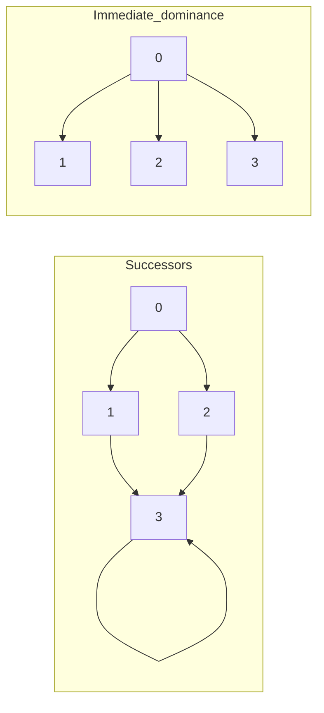

# Abstract tree-indexed regions and CFGs

Tree regions are primitive judgments, independent of any CFG. A proposed tree
need not already be certified as a dominator tree, and a region family does
not determine its outgoing control flow. This layer extends the
[abstract lattice core](region-lattices.md) and preserves the separate
[first-exit interpretations and adapter obligations](region-extraction.md).

## Definitions and proof map

| Public headers | Main results |
| --- | --- |
| [`Tree/Defs`](../../Silmaril/Semantics/Region/Tree/Defs.lean), [`Thms`](../../Silmaril/Semantics/Region/Tree/Thms.lean) | Tree data, annotation embeddings, sparse frontiers, boundary/support projection, currying, raw/lawful complete lattices |
| [`Tree/CFG/Defs`](../../Silmaril/Semantics/Region/Tree/CFG/Defs.lean), [`Thms`](../../Silmaril/Semantics/Region/Tree/CFG/Thms.lean) | Independent adjacency; existential flat projection; exact lifting bounds; candidate coverage |
| [`Tree/Finite/Defs`](../../Silmaril/Semantics/Region/Tree/Finite/Defs.lean), [`Thms`](../../Silmaril/Semantics/Region/Tree/Finite/Thms.lean) | Connection to existing finite `(entry, support, exits)` and `(entry, exits)` predicates |
| [`Tree/Examples/Thms`](../../Silmaril/Semantics/Region/Tree/Examples/Thms.lean) | A rooted sparse label-leaf tree, contraction, missing annotations, internal leaves, anonymous-source loss |
| [`Automata/Graph/RegionTree/Thms`](../../Silmaril/Automata/Graph/RegionTree/Thms.lean) | Optional bridge to existing finite rooted-graph dominance, with explicit exit policy |
| [`Automata/Graph/RegionTree/Examples/Thms`](../../Silmaril/Automata/Graph/RegionTree/Examples/Thms.lean) | Diamond: successor edges differ from dominator children; loops survive; adjacency is not determined by region data |

Proofs longer than a few lines live in the corresponding `Proofs` region.
The abstract `Tree` headers do not import `Automata`, machine semantics or
function extraction. No region dependency-map change is needed.

## Shape, segments, labels and boundaries

`Shape V` is immediate parent data with a distinguished root over an arbitrary
vertex carrier V. It requires no ordering, finite enumeration or equality
decision. `Child p c` means exactly `parent c = some p`.
`Descendant` is its reflexive transitive closure; it includes the node itself.
`Rooted` is a separate structural certificate: the root has no parent and
every vertex has a finite chain from the root. These are structural tree
links. They are never interpreted as successor edges by default.

`AnnotatedTree V Seg Lab Ann` labels every tree vertex with either:

- `segment support annotation`, for a segment or generalized region payload;
- `label l`, for an explicit label leaf.

The common `SegTree` representation uses `Ann := Option Lab`. `FullTree` uses
`Ann := Lab`, while `BareTree` uses Unit. `TerminalLeaves` separately requires
explicit label leaves to have no tree children. `CompleteLeaves` requires all
terminal tree vertices to be label leaves. `LabelLeafTree` is the optional
strict profile with `Rooted`, `TerminalLeaves` and `CompleteLeaves` certificates.
The sparse example inhabits that profile. Raw/generalized trees also admit
terminal segment nodes; the graph-node dominance bridge uses that broader
profile. Its existence theorem is not asserted for every stricter tree type.

A `Boundary Body Lab Exits` carries the **external entry and declared exits**
separately from its body. `TreeRow` uses a SegTree body and `Set Lab` exits.
An external entry need not equal an internal annotation until a chosen
well-formedness/interpretation policy proves it. Leaves are not assumed to be
exits. A terminal dominator-tree leaf can have CFG successors, including loops.

`labels` collects every present annotation and label leaf; `entryLabels`
collects segment entry annotations; `leafLabels` collects explicit leaves.
`labels_eq` proves `labels = leafLabels ∪ entryLabels`. None of these operations
adds the boundary exit allowance to the internal annotations. `LabelRole`
tags internal annotations and declared exits separately, with a proved
constructor inequality even if the underlying labels coincide. Disjointness
of their underlying label sets is an optional policy, not a raw theorem.

`RegionPiece Support Lab` carries a node's own entry, support and declared
exits without asserting semantic validity. `pieceTree` makes such pieces into
a tree whose present node labels are those entries (`pieceTree_labelAt`).
Choosing `Support := Set Seg` or `Finset Seg` gives nodes of the requested
`(Lab, Seg*)` shape, with arbitrary children. No constituent BB certification,
child-to-parent validity, or single-entry property is inferred automatically.

## Annotation conversion and loss

`embedFull` inserts `some` at each segment annotation and keeps explicit leaves.
It is injective. A sparse tree has a full completion exactly when
`FullyAnnotated` holds (`fullyAnnotated_iff`). `complete` requires this proof;
it never supplies a default label. `embed_complete` and `complete_embedFull`
prove both round trips on this image. The sparse fixture has an unlabeled
intermediate segment and provably has no full-tree preimage.

`RootOnlyRow` stores a bare tree plus its external boundary. `embedRootOnly`
labels the root segment with that external entry and leaves other segments
unlabeled; explicit label leaves stay unchanged. If the root is itself a
label leaf, its existing label stays unchanged. This convention does not
silently equate the external entry and that leaf. `erase_embedRootOnly`,
`embedRootOnly_injective`, and `embed_eraseRootOnly_of_image` prove the
appropriate embedding/retraction results. Arbitrary optional annotations need
not belong to this root-only image.

`toLabTree` erases segment payloads, preserving shape and all present labels
(`toLabTree_labelAt`). It produces an optionally labeled tree; it does not
invent labels for anonymous nodes. `frontier` additionally contracts unlabeled
intermediate vertices: `Frontier` crosses a direct child link or extends
through an unlabeled intermediate vertex. Endpoints of exported child links
must actually be labeled, and the endpoint/root theorems prove no invention.
For roots, a labeled original root remains the single root; an unlabeled root
exports its first labeled frontiers, possibly none or several.

`LabelForest` is this proposed labeled frontier relation. A malformed raw
shape need not be a tree, and quotienting distinct vertices with equal labels
can identify branches. No certified forest theorem is asserted for those
inputs. `Rooted` and an injective labeling policy are additional structural
obligations when a consumer needs a literal forest of distinct labels. The
checked sparse chain `0 → anonymous → 2` exports the frontier child `0 → 2`.

## Region relations, currying and complete lattices

`RegionPred Img Assum Tree` is exactly `Img → Assum → Tree → Prop`.
`ContextRegionPred (Img × Assum) Tree` is the grouped-context signature.
`contextEquiv` proves their equivalence. `RegionModel Context Tree` is the set
of `(context, tree)` atoms; `curryEquiv`, `curryOrderIso`, `uncurry_curry` and `curry_uncurry`
prove a true model/predicate equivalence. The tree carrier may be SegTree,
TreeRow, the strict label-leaf profile, a generalized tree, or any supplied
abstract tree type. No graph is required to state or solve Region membership.

Raw models are the powerset complete lattice ordered by judgment inclusion.
`LawfulRegionModel rules` is the abstract core's positive-rule closed lattice
on the same fixed atoms: meets are intersections, joins are closure of unions,
bottom is closure of empty, and top contains all typed atoms. Rules and their
side conditions remain fixed independently of the model. `lawfulCurryEquiv`
and the `CurriedLawfulModel` complete lattice also transport this construction
to split-context predicates; `curried_lawful_le_iff` exposes the same inclusion
order. CFG relation variants reuse these constructions with CFG payloads.
Helpers, dominance certificates and graph interpretations do not enter these
lawful-model definitions. The earlier fixed-ceiling theorem remains available.

`TreeRow.flattenWith elements` explicitly interprets a generalized payload's
segment support. `flatten` specializes to singleton segment payloads, producing
`FlatRegion` data `(entry, Set Seg, Set Lab)`. `boundary` forgets support too,
producing `(entry, Set Lab)`. Neither needs a finite or computable tree.
`flat_boundary_image` proves that staged and direct boundary erasure agree.

For **relations**, `image flatten M` means a flat row has a certified tree
witness from M (`image_holds`). `tree_yields_image` proves the forward direction;
the converse returns that witness, without claiming a unique reconstruction.
For an independently specified flat predicate N, `Refines` supplies the forward
proof and `HasWitnesses` supplies representability. Only together do they prove
`image flatten M = N` (`image_iff_of_witnesses`). Raw images preserve arbitrary
joins (`image_sSup`); no meet or general lawful-join preservation is claimed.

The optional finite bridge uses `FiniteView`, requiring extensional finite
support and exit witnesses to match the existing `SegmentRow` API. `finiteReg`
projects to its `(Lab, Finset Seg, Finset Lab)` signature; `labelReg` projects
to `(Lab, Finset Lab)`. `finite_implies_label` proves forgetting support.
`label_to_finite_of_support` requires an explicit finite support witness for
each admitted tree. Arbitrary abstract supports cannot silently become Finsets.

## CFG adjacency and precise converse bounds

`SegCFG` pairs a TreeRow with `successors : V → Set Lab`, including successors
of explicit label leaves. `FlatCFG` independently carries entry, internal
labels, declared exits and outgoing adjacency. Flattening retains **every**
successor of every labeled source, including outward, loop and cross edges;
it unions observations if source labels collide. `flatten_successor` proves
preservation, and `flatten_successors_unique` gives equality for a uniquely
labeled source. Anonymous sources have no invented label: the sparse CFG
fixture proves one of their edges cannot be exported to any labeled source.
A label-indexed export without that loss needs a coverage/labelling certificate.

`LabelCover r g` requires the same entry/exits, exact internal-label coverage,
and no adjacency originating outside g's internal sources. For a fixed r,
`lift_exists_iff` proves the exact bound:

```
(∃ tree, tree.region = r ∧ tree.flatten = g) ↔ LabelCover r g
```

The constructor lifts each flat successor set to every source vertex with
that label. This theorem concerns observations, not dominance. `eraseCFG_iff`
separately makes the model-level flat relation exactly the existence of an
admitted non-flat witness. `Covers candidate actual` states the additional
candidate overapproximation obligations; `ExactOn` states adjacency equality
on actual internal sources. Coverage composes (`covers_trans`). `RegionCandidate` decorates a CFG with
membership of its underlying tree in an independently chosen primitive region
relation. `CoveredCandidate` additionally requires actual-graph coverage;
`covered_successor` proves preservation of actual outgoing edges.
These proof decorations have no asserted complete lattice. Region membership
alone supplies none of these execution/graph obligations.

The diamond example distinguishes the two structures:



`cross_not_child`, `child_not_edge` and `loop_preserved` prove these differences.
`adjacency_not_determined` gives two different CFG enrichments of the very same
primitive region tree. Distinct region families therefore cannot be assumed
to determine a unique actual CFG.

## Optional actual dominance and remaining boundaries

The Automata bridge reuses the existing finite Nat-indexed `Digraph`,
`DomExact`, `idom_exact` and `exact_eq_idom` APIs. Its `ExitPolicy` explicitly
chooses normal outgoing labels and exits, requires internal adjacency agreement,
classifies every target as reachable internal or declared exit, and separates
those sets. This is a graph policy, not a machine operational-coverage proof.

`Witness g policy r` identifies labels with reachable internal graph vertices,
fixes entry/root/exits, requires terminal label leaves, and certifies `DomExact`
for the proposed parent map. `witness_immediate` identifies immediate children
with actual `idom` links; `witness_ancestors` identifies all strict ancestors
with strict dominators. `witness_descendants` relates the new reflexive
descendant relation to equality or strict domination. Root-parent, live-parent
closure and label uniqueness are proved separately. `witness_rooted` proves parent-chain closure for each
reachable vertex. Inactive Nat indices carry no exported labels and are outside
this claim; the whole Nat carrier is not claimed rooted.

`proposal_witness` constructs such a tree using the existing `idom` and a
supplied segment-payload function. `exists_dominator_lift` then gives a genuine
CFG lifting with both this dominance witness and equality after flattening.
It applies to the selected reachable finite graph and explicit exit policy,
not arbitrary graphs, arbitrary label encodings, or every strict tree subtype.
It selects no canonical region partition and certifies no new machine semantics.

Generic certified contraction into a literal label forest, arbitrary-label
operational CFG/dominance adapters, and automatic candidate/semantic coverage
are outside this layer's theorems. Earlier Wasm byte-map/operational bridging,
ELF placement and wider x86 call/indirect-transfer gates remain unchanged.

Build the new proof/example roots with the pinned toolchain:

```sh
lake build --wfail Silmaril.Semantics.Region.Tree.Examples.Thms \
  Silmaril.Automata.Graph.RegionTree.Examples.Thms
```

The task report records the scoped `make check`, regression and axiom-audit
results. No new axiom, proof placeholder or `native_decide` is used.
