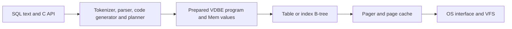
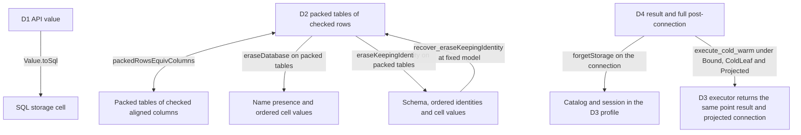

# SQLite relational semantics (Track D)

Import `Silmaril.Semantics.SQLite.Relational.All` for SQL values, bounded write
affinity, checked logical tables and the catalog-backed point-read semantics.
Import `Silmaril.Machine.SQLite.Relational.All` when the caller also needs the
Pager/VFS bridge. Both expose declarations in `Silmaril.SQLite.Relational`.
Machine can depend on Semantics, and the Semantics entry has no Track A or
Machine dependency. Each entry has a consumer check that imports only that
entry. [Core](../../../Silmaril/Semantics/SQLite/Relational/All.lean) ·
[Bridge entry](../../../Silmaril/Machine/SQLite/Relational/All.lean) ·
[Track E handoff v1](handoff-v1.md) · [Region map](../../../regions.toml)

## SQLite 3.54.1 reference

The reference is SQLite **3.54.1** (2026-10-16), source ID
`2026-10-16 14:45:20 555e07ef33f69a0957d24d8e555b702464a131d6f1607f4c3c1e4551e8e6ca76`.
The source tree in the SQLite Git mirror is
`57520227c95396ce39ba6ecaac8d475b78dd3964`. The release zip SHA-256 is
`0a9c8e34352dad46006aa82836d5383bff9dc6bc9ce5a60553c05aa30e6ad1f9` and
its `sqlite3.c` SHA-256 is
`0c657666d819f261cc4007526ad57e1669de9949df7a8ea847aa284a2bf0ee52`.
The committed amalgamation has the same digest.
[Architecture](https://sqlite.org/arch.html) ·
[Release notes](https://sqlite.org/releaselog/3_54_1.html) ·
[Release archive](https://sqlite.org/2026/sqlite-amalgamation-3540100.zip) ·
[Pinned source](https://github.com/sqlite/sqlite/tree/57520227c95396ce39ba6ecaac8d475b78dd3964)

This diagram follows the upstream architecture. Its arrows omit callback
dispatch, error paths, planner alternatives and storage state. Track D starts
with typed, normalized input and supplies a separate Lean model at selected cuts.

| Upstream cut | Representative Track D operation and boundary |
| --- | --- |
| C API, preparation and planning | `sqlite3_prepare_v2` sends SQL text to `sqlite3LockAndPrepare`. D2 receives resolved schema and object metadata. D3 `CatalogExecutor.classify` and `resolve` consume a typed one-column rowid point-read request over normalized names. The model has no SQL text, catalog decoding, code generation or plan search. [Prepare source](../../../corpus/sqlite/upstream/sqlite-amalgamation-3540100/sqlite3.c#L149388) · [Schema table](https://sqlite.org/schematab.html) · [Query planner](https://sqlite.org/queryplanner.html) |
| VDBE `Mem` and column writes | D1 `SqlValue`, `Value` and `ColumnType.apply` cover storage classes, selected API observations and bounded logical write/readback affinity. D2 `CheckedTable.check` validates supplied logical rows and `Snapshot.ForeignKeysValid` relates tables under the supplied `TableSemantics`. Register flags, encoding conversions, allocation, full numeric parsing and constraint bytecode are outside those models. [Datatype rules](https://sqlite.org/datatype3.html) · [Declaration source](../../../corpus/sqlite/upstream/sqlite-amalgamation-3540100/sqlite3.c#L128492) · [STRICT check source](../../../corpus/sqlite/upstream/sqlite-amalgamation-3540100/sqlite3.c#L99714) · [Record construction source](../../../corpus/sqlite/upstream/sqlite-amalgamation-3540100/sqlite3.c#L99865) |
| Bind, seek, project and return | `sqlite3_bind_int64` sets a parameter after checking its range. The integer `OP_SeekRowid` path uses `sqlite3BtreeTableMoveto` with a miss branch. `OP_Column` and `OP_ResultRow` illustrate the projection and return cuts. D3 `Executor.execute` returns a materialized zero-or-one row observation and complete post-connection. The model omits native step timing, cursor state and arbitrary bytecode. [Bind source](../../../corpus/sqlite/upstream/sqlite-amalgamation-3540100/sqlite3.c#L95107) · [Seek source](../../../corpus/sqlite/upstream/sqlite-amalgamation-3540100/sqlite3.c#L101908) · [Projection source](../../../corpus/sqlite/upstream/sqlite-amalgamation-3540100/sqlite3.c#L99323) · [Result source](../../../corpus/sqlite/upstream/sqlite-amalgamation-3540100/sqlite3.c#L98083) · [Step API](https://sqlite.org/c3ref/step.html) |
| B-tree, Pager and VFS | D4 `Bridge.execute` delegates to Track A's designated packed rowid-leaf reader. The pinned Pager main-file branch reads `pageSize` bytes at `(pgno - 1) * pageSize` through `sqlite3OsRead` and the VFS `xRead` method. The model observes the supplied handler, owned slot, actual backing/cache poststate and ordered completed exchanges. Tree descent, locking, WAL and native cache policies are outside this cut. [B-tree lookup source](../../../corpus/sqlite/upstream/sqlite-amalgamation-3540100/sqlite3.c#L78564) · [Pager source](../../../corpus/sqlite/upstream/sqlite-amalgamation-3540100/sqlite3.c#L62034) · [VFS dispatch source](../../../corpus/sqlite/upstream/sqlite-amalgamation-3540100/sqlite3.c#L27753) · [VFS short-read contract](https://sqlite.org/c3ref/io_methods.html) |

## Observation maps and their limits

- D1 `Value.toSql` drops subtype and pointer identity, with pointers observed
  as SQL NULL. `Value.forgetPointers` keeps subtypes on ordinary values but
  identifies pointers with an ordinary NULL. See
  `Value.toSql_not_injective` and `Value.forgetPointers_not_injective`.
  [D1 value and affinity contract](../sqlite-relational-d1.md)
- D2 checked transposition uses `CheckedTable.rowsEquivColumns` for each
  table and preserves cell order, row identity and validity.
  The row-only erasure preserves absent versus present-empty tables and
  drops schemas, row identities and certificates. The identity-retaining
  encoding has unique-preimage recovery for packed tables at the same model
  and evaluator. Snapshot object declarations travel separately in
  `Snapshot.objects`. Recovery is a logical operation using classical choice.
  [D2 catalog and erasure contract](../sqlite-relational-d2.md)
- D3 `SelectResult.toOutput` retains the column label and the empty versus
  singleton ordered observation, including a singleton SQL NULL. It maps
  the successful result only. Statement errors and connection state live in
  the surrounding outcome. `HostRequest.collapse_explicit` erases the explicit
  reason on collapse to catastrophic UB. A preparation, bind or run error
  and a scope rejection are defined observations. The modeled finalized
  bind is UB. [D3 executor and UB contract](statement-executor.md)
- D4 `forgetStorage` drops backing, cache and completed exchanges. The
  successful two-read theorem uses `CatalogExecutor.execute_eq` to give the
  exact D3 reply and final connection for one invocation on the erased input.
  The full two-read result still carries both poststates, the actual Pager
  returns and a valid completed exchange. The general one-read theorem relates
  the D4 result and poststate to both handled Track A interpretations. It
  preserves the label on success or the typed error on failure, the input
  catalog and session, the actual backing and cache, and the prior exchange
  history extended by the validated suffix. Text transfer re-encodes decoded
  characters as UTF-8, dropping original encoding and bytes. Admitted REAL
  bits, integers and blobs transfer directly. NaN transfer is a typed error.
  [D4 correspondence](read-bridge.md)

### Selected Track A trace

`Silmaril.Machine.SQLite.TrackA.Read.Adapter.Thms` supplies
`interpretations_agree` for a single handled call, `pagerTwice_agrees` for
threading the actual file, cache and history through two calls, and
`pagerTwice_readOnly_cold_warm` for an admitted read-only repeat on the same
leaf. `Silmaril.Machine.SQLite.TrackA.Read.Interaction.Thms` supplies
`vfsTree_corresponds` for the open VFS tree.
[Adapter theorems](../../../Silmaril/Machine/SQLite/TrackA/Read/Adapter/Thms.lean) ·
[Open-tree theorem](../../../Silmaril/Machine/SQLite/TrackA/Read/Interaction/Thms.lean)

`Adapter.Observes` asserts membership of the finite typed VFS request/reply
trace selected by the backing handler's actual replies. The trace ends at
`.returned (outcome.result, outcome.cache)`, with return type
`Read.Result × PageRead.Cache`. It hides administrative Pager and silent
steps and leaves the rest of the open observation set unconstrained. The
handled poststates supply the backing file separately, and `Trace.Valid`
validates the completed exchange suffix against the backing transition.
Track A proves these properties of its Lean read models. The D3 executor
equality requires the D4 hypotheses, and native refinement remains outside
this scope. [Observation definition](../../../Silmaril/Machine/SQLite/TrackA/Read/Adapter/Defs.lean)

## Admission and coverage

D3 checks the shape `SELECT column FROM table WHERE rowid = ?1` for a fresh
invocation. At the checked catalog entry, a view, a table whose schema does
not resolve `rowid` as the actual rowid, or a generated projection yields
ordinary scope rejection. Missing names yield preparation errors. An unset
parameter selects no row without consulting the backend. A bind outside
index 1 is a defined failure. The generic executor's batch retains the
successful prefix and stops at the first error with that call's poststate.
Its session projection keeps autocommit, direct and total changes, and last
insert rowid. These fields remain fixed by this read-only executor.
[Statement executor](statement-executor.md)

D4's `Bound` supplies successful D3 classification, plan resolution and a
signed 64-bit binding at slot 1. A caller-supplied `Locate` assigns the
resolved target its physical Pager slot and page. For the two-read result,
`ColdLeaf` requires agreement of file bytes with the image, the image page
view and page size, a live handle, a valid read range, an owned vacant slot
and successful leaf decoding. Track A supplies the 512-byte packed
two-field rowid-leaf profile and uses the second field. `Projected` requires
that catalog ordinal and agreement at the key: a leaf miss must be a catalog
miss, and a hit must convert to the catalog cell. The theorem then gives
two equal results with a resident cache and one full-page exchange after
the original prefix. One catalog-only D3 invocation from `forgetStorage db`
returns `(.statement (.ok result), forgetStorage after)` for that pair.
This equality uses the successful-pair hypotheses. Physical location and
catalog/leaf agreement are caller obligations. [Track A leaf admission](../sqlite-track-a/read-case.md) ·
[Bridge definitions](../../../Silmaril/Machine/SQLite/Relational/Bridge/Defs.lean)

The proof boundary is between Lean models. A concrete difference is that a
D4 short read is a typed acquisition failure with its completed exchange,
while SQLite's main-file Pager branch can proceed with zero-filled data.
The profile leaves out arbitrary SQL and comparison semantics, schema
bootstrap and reprepare, native C status/lifetime semantics, multi-page
storage, overflow, secondary-index execution, writes, rollback, WAL,
locking and concurrency. The checked snapshot stores index, view, trigger,
collation and function metadata without proving their execution. Any
native simulation or expansion of the admitted fragment needs a separate
contract and evidence. [Track A adapter](../sqlite-track-a/typed-read-adapter.md) ·
[Pager short-read branch](../../../corpus/sqlite/upstream/sqlite-amalgamation-3540100/sqlite3.c#L62052)
