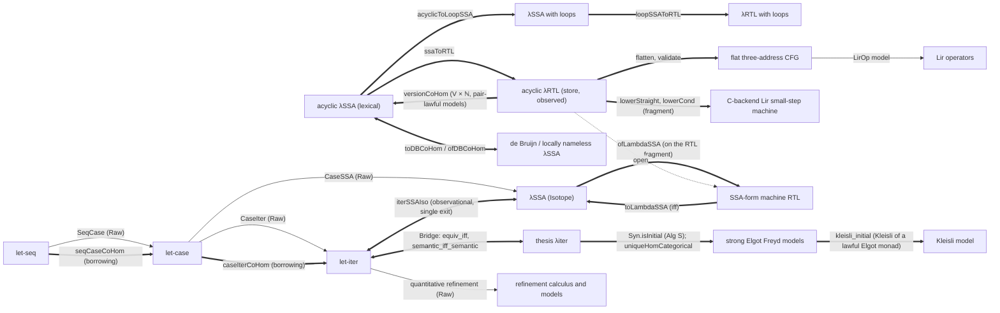

# SSA calculi, λRTL and the SSA-form machine RTL

This project collects Silmaril's effectful SSA calculi and the register-transfer
languages around them: the let-family calculi (let-seq, let-case, let-iter), λSSA,
λRTL (λSSA's dominator-tree syntax read with overwritable registers), a flat
three-address CFG with a validator, and the SSA-form machine RTL with its
translations to and from λSSA. It is the IR layer of the System V x86 lifting and
C correspondence problems: an IR function here has a semantics, a typed syntax and
checked translations, so a problem can state "this RTL/λSSA function is a lift of
that machine function" against definitions a reviewer can read.

Every module is in the root `Silmaril` library; there is no executable.

The [LambdaIter family matrix](lambda-iter-family.md) records the assumptions of
the semantics comparisons and the forward flat SSA/RTL commuting square.

## The calculi and translations



Double arrows are checked institution comorphisms, isomorphisms or checked
semantic translations; single arrows are Raw syntactic translations with their
own Raw soundness developments; the dashed arrow is an open obligation (below).
"thesis λiter" is the Raw port of the thesis formalisation (`Silmaril.Thesis`), a
second copy of the let-iter calculus beside `Silmaril.Isotope.LetIter`; the
bridge relates the two.

## Modules

| Area | Header | Contents |
| --- | --- | --- |
| λRTL, acyclic | `Silmaril.SSA.LambdaRTL.{Defs,Thms}` | `Region V L F` (values, operands, `let1`, `let2`, `case`, `join`, `br`), the lexical reading `evalSSA`, the store reading `evalRTL`/`evalObs`, `NoClobber`, `IsSSA`; agreement theorems and the clobbering counterexample |
| Institutions | `Silmaril.SSA.LambdaRTL.Institution.Defs` | `ssa R`, `rtlObs R`, `rtlFull R` over instruction-alphabet signatures, the comorphism `ssaToRTL R`, the Hets logic graph `hets R` |
| Loops | `Silmaril.SSA.LambdaRTL.Loop.{Defs,Thms}`, `.Loop.Institution.Defs` | `loop r ℓ x t` (a self-recursive `where`) over a lawful Elgot monad; frame lemma, agreement, necessity counterexample; `loopSSA`, `loopRTLObs`, `loopSSAToRTL`, `acyclicToLoopSSA` |
| Versioning | `Silmaril.SSA.LambdaRTL.Version.{Defs,Thms}`, `.Version.Institution.Defs` | `versionTop : Region V L F → Region (V × ℕ) L F` (fresh versions, live-ins packed through jumps), SSA-ness, soundness, `versionCoHom` |
| Names | `Silmaril.SSA.LambdaRTL.Nameless.{Defs,Thms}`, `.LocallyNameless.{Defs,Thms}`, `.Nameless.Institution.{Defs,Thms}`, `.Quotient.Defs` | de Bruijn and locally nameless presentations, `Supply V`, adequacy, round trips, α-equivalence, comorphisms both ways and their inverse pair modulo semantic equivalence |
| Flat CFG | `Silmaril.SSA.LambdaRTL.CFG.{Defs,Thms}` | three-address `CFG`, `flatten`, `toRegion`, relabelling, the syntactic validator `validate` |
| Lir operators | `Silmaril.Machine.LambdaRTLLir.{Defs,Thms}` | instruction alphabet `LirOp`, values `LVal`, `model : Model LirOp Option LVal` built from `Lir.Unop.eval`/`Lir.Binop.eval`; the validated `absDiff` example |
| λRTL to Lir | `Silmaril.Machine.LambdaRTLLir.Sim.{Defs,Thms}` | lowering of a word fragment of λRTL (straight-line `let1` code, then one `br` or one test-`case`) to `Lir` functions, with exact simulation theorems against the C-backend `Lir` small-step machine `Silmaril.Machine.Lir.step`/`Behaves` |
| Machine RTL | `Silmaril.Machine.RTL.Thms` | re-exports the SSA-form RTL (`Silmaril.Raw.Machine.RTL`: syntax, small-step and big-step semantics with call oracles, behaviours, dominance, `Lir` syntax, little-endian words), `toLambdaSSA` and `ofLambdaSSA` |
| RTL fragment of λSSA | `Silmaril.Machine.OfLambdaSSA.{Defs,Thms}` | `Shape`, `TmFits`, `RegionFits`, `RootFits`; correctness of `ofLambdaSSA` on the fragment and two counterexamples outside it |
| λSSA and the let family | `Silmaril.SSA.Isotope.Thms` | re-exports the Raw let-seq, let-case, let-iter and λSSA developments (`Silmaril.Raw.SSA.Isotope`: locally nameless syntax, typing, equational theories, monadic, operational, categorical and machine semantics, observations, the let-family translations); the reviewed λSSA headers `Silmaril.SSA.Isotope.{LambdaSSA,Types}` were already public |
| Elgot iteration | `Silmaril.Semantics.Elgot.{Defs,Thms}`, `Silmaril.Semantics.ElgotMonads.{Defs,Thms}` | `Iterate`, `LawfulElgotMonad` (fixpoint, naturality, codiagonal, uniformity); instances for `Part`, `SetM`, `StateT`, `ReaderT`, `ExceptT`, `OptionT`, `WriterT` |
| Categorical support | `Silmaril.Semantics.Categories.Thms` | re-exports Raw premonoidal, Freyd, distributive Freyd and Elgot-monad category theory used by the categorical let-iter semantics |
| Behaviours | `Silmaril.Semantics.Behaviour.Thms` | re-exports Raw labelled traces, contracts, refinement, the compilation relation `Implements`, simulation conventions and equivalence over `Silmaril.Machine.Behaviour` |
| LetIter denotational soundness | `Silmaril.SSA.Isotope.LetIter.Thms` | proof-relevant typed equations preserve direct monadic denotations and the corresponding categorical arrows in the Kleisli model of a lawful Elgot monad |
| λSSA categorical semantics | `Silmaril.SSA.Isotope.LambdaSSA.Categorical.{Defs,Thms}` | expression and region denotation graphs, totality for exact typing, and uniqueness under the respective coherence hypotheses |
| Let-family institutions | `Silmaril.SSA.Isotope.Institution.Thms` | re-exports the Raw equational institutions of let-seq, let-case and let-iter, inclusion comorphisms with borrowing, syntactic initiality, refinement institutions and `eqToRef`, observational institutions and `iterSSAIso` |
| Native relational institutions | [Sequential Isotope institutions](isotope-relational-institutions.md) | Exact typed LetSeq, LetCase and LetIter equations, primitive relational models, and satisfaction under signature change |
| Free UB | [Construction and coverage](ssa-ub.md) | Fresh instruction symbols, a monad on ordered specifications, greatest elements in the initial syntax quotient, and a typed LetCase translation |
| Thesis initiality | `Silmaril.SSA.Thesis.Thms` | re-exports the Raw port of the thesis λiter and λcase (`Silmaril.Raw.SSA.Thesis`): `Syn.isInitial` in `Alg S`, equational completeness |
| Thesis categorical models | `Silmaril.SSA.Thesis.Categorical.Thms` | λiter derivations denoted in strong Elgot Freyd categories, `Alg.ofCategorical`, initiality into those models, non-vacuity of `Alg S` |
| Thesis Kleisli model | `Silmaril.SSA.Thesis.Kleisli.Thms` | the Kleisli category of a lawful Elgot monad as a λiter model: `TypingCoherent` and `LawfulModel` instances, initiality into it, and the instance at `Part` |
| Quantitative refinement | `Silmaril.SSA.Isotope.Refinement.Thms` | usage-annotated typing, rewrite theories, ordered constructor models, and strict categorical models of letseq, letcase and letiter |
| Let-iter bridge | `Silmaril.SSA.Isotope.Bridge.{Defs,Thms}` | term and context translations between `Silmaril.Isotope.LetIter` and the thesis λiter, preservation of typing, axioms and equivalence, agreement of the two completeness theorems |
| Dataflow | `Silmaril.Calculi.Dataflow.{Defs,Thms}` | round-robin (Gauss–Seidel) iteration over `Silmaril.Semantics.Dataflow` equation systems |

## Main results

See the [pinned LambdaSSA theorem crosswalk](lambdassa-theorem-crosswalk.md)
for the scope of the paper and Lean results and the conventional φ-node
to block-argument port plan.

λRTL and λSSA (acyclic), in `Silmaril.SSA.LambdaRTL.Thms`:

- `Region.evalSSA_congr`: the lexical semantics reads only free variables.
- `Region.evalRTL_frame`: λRTL writes only registers it assigns (bind-congruence
  form, any lawful monad).
- `Region.evalObs_eq_evalSSA`: under `NoClobber` the observable store semantics
  equals the lexical semantics; `Region.noClobber_of_isSSA` and
  `Region.evalObs_eq_evalSSA_of_isSSA` give it for dominance-scoped SSA.
- `clobber_counterexample`: without `NoClobber` the readings differ, so reading
  λRTL as λSSA by the identity is not semantics-preserving.

Loops (`Loop.Thms`), in every lawful Elgot monad: `Loop.Region.evalRTL_frame`,
`Loop.Region.evalObs_eq_evalSSA(_of_isSSA)`, the embedding lemmas
`evalSSA_ofAcyclic`/`evalRTL_ofAcyclic`, `selfClobber_counterexample` (the loop
clause of `NoClobber` is necessary), and `evalObs_eq_evalSSA_part` (the hypotheses
hold for `Part`).

Versioning (`Version.Thms`): `versionTop_isSSA` (every acyclic λRTL region becomes
dominance-scoped SSA), `versionTop_evalSSA` and `versionTop_evalObs`
(`(versionTop r).evalSSA m ρ = r.evalObs m σ` when `ρ (y, 0) = σ y`), assuming the
model is pair-lawful (`unpair (pair a b) = pure (a, b)`).

Deversioning (`RoundTrip.Thms`): `roundTrip_evalObs` compares acyclic λRTL with
its versioned region renamed back to the original register type. Both runs use
the same initial store and have equal computations of the exit label and
payload. The theorem assumes a lawful monad, a pair-lawful model, decidable
register and label equality, and infinitely many register names. Deversioning
fixes version-zero registers and injectively assigns the remaining versions
used by the region to fresh names.

For cyclic named CFGs, [`Cyclic.Versioning.roundTrip_run_obs`](../../Silmaril/SSA/LambdaRTL/CFG/Cyclic/RoundTrip/Thms.lean)
gives the same-store equality of the whole Elgot computation of the exit
label and payload. The mutable readback keeps each incoming packet and its
decoder. A block receives its live-ins in that packet, so decoding never
depends on stale register values. The result adds lawful Elgot iteration to
the acyclic assumptions and projects away the final store.

In the lexical-to-mutable-to-lexical direction, [`Cyclic.RoundTrip.runSSA_deversion_reversion`](../../Silmaril/SSA/LambdaRTL/CFG/Cyclic/RoundTrip/Thms.lean)
compares the original and re-versioned graphs in the same lexical environment.
The entry reads only version-zero names and each labelled body reads its free
inputs from its packet parameter. The general renaming theorem only requires
agreement on the entry's free inputs after renaming. The source can use a
handwritten packet layout, as in the [non-image back-edge regression](../../Silmaril/Proofs/SSA/LambdaRTL/CFG/Cyclic/RoundTrip/Regression.lean).

[Named cyclic observational classes](../../Silmaril/SSA/LambdaRTL/CFG/Cyclic/Comparison/Thms.lean)
fix the register and label types, instruction alphabet, value carrier and
lawful Elgot monad. Equivalence compares the entire exit-label and payload
computation for every pair-lawful model and every common store on the original
register type. Lexical entry inputs are the corresponding version-zero values,
and every block has a singleton packet context. `classEquiv` makes versioning
and deversioning inverse maps on these classes, including admitted handwritten
tables. The satisfaction theorems transport equations between classes in each
common model, with signatures held fixed.

[Named cyclic equation institutions](../../Silmaril/SSA/LambdaRTL/CFG/Cyclic/Institution/Thms.lean)
use primitive alphabets as signatures and functions as renamings. The model
category at each signature is discrete on the pair-lawful models. Reduct
precomposes the primitive interpretation and preserves the packet operations.
Both signature actions preserve identity and composition and satisfy the
change-of-signature law on equations. `comparisonIso` is a natural isomorphism
of room functors over this signature category. Its sentence translations
commute with renamings on observational classes, with identity on models.

[Named cyclic refinement](../../Silmaril/SSA/LambdaRTL/CFG/Cyclic/Institution/Refinement/Thms.lean)
uses the same signatures and the inclusion order on `Part`. A sentence
`lhs ≤ rhs` requires every terminating exit and payload of `lhs` to be
returned by `rhs` at the same store. Divergence and failure both give the
empty result, and the final store is projected out. Versioning and
deversioning give an order isomorphism on the observational classes and a
natural isomorphism of the two refinement institutions. The comparison
transports semantic refinement between the named interfaces.

[Plugging exit continuations](../../Silmaril/SSA/LambdaRTL/CFG/Cyclic/Institution/Refinement/Plugging/Thms.lean)
is monotone in both the program and a pointwise ordered continuation on the
exit label and packet. A continuation can use a common external store. For a
raw handler called with the producer's final store, independence from that
store is equivalent to factoring through the observed label and packet.
A packet-closed continuation table has this property: each labelled body
reads its free inputs from the incoming packet, even across back edges.
With a store-reading continuation, a single discarded assignment suffices
to [distinguish equal classes](../../Silmaril/Proofs/SSA/LambdaRTL/CFG/Cyclic/Institution/Refinement/Plugging/Regression.lean).

[Executable cyclic linking](../../Silmaril/SSA/LambdaRTL/CFG/Cyclic/Link/Thms.lean)
uses finite input and output ports carrying one value of the common carrier.
Every private address names a packet-closed block. Linking allocates disjoint
private ranges and a forwarding block per intermediate port. The right stage
can loop within its own range and can exit through its public ports. Running
the resulting ordinary named CFG agrees with staged exit plugging.
Observational classes of these graphs form a category with the wire identity
and linker composition, which is monotone for terminating-result inclusion.

[The named refinement interpretation](../../Silmaril/SSA/LambdaRTL/CFG/Cyclic/Link/Institution/Thms.lean)
widens private addresses to naturals and keeps public ports tagged. It maps
each packet arrow to one named program class per input port, with the packet
in the designated register. Refinement of the arrow agrees with named
refinement at every port. Primitive renaming commutes with the executable
linker and wire identity and acts by monotone functors on classes. The named
interpretations commute with this action. Versioning and deversioning
compare the images on classes. The ordinary versioner wraps internal
transfers in a carry tuple, including version-zero live-in slots at entry,
so the resulting syntax can have a wider entry interface than a single wire.

[Syntactic packet CFG simulation](../../Silmaril/SSA/LambdaRTL/CFG/Cyclic/Link/Simulation/Thms.lean)
checks a finite map on private labels and preserves public exits. A source
block either matches a target block after relabelling or forwards its packet
unchanged to the same mapped address. The forwarding check tracks which
registers hold the packet, starting with the block parameter. A copy reads
from that context before adding its destination. A final variable jump must
read from the resulting context. The typed body returns exactly the checked
jump target and incoming packet in every lawful monad. The simulation preserves
every terminating `Part` result, and the executable linker combines the
certificates, including at handoff blocks.

Against direct wiring, `CopyChain.check` follows each chain of typed forwarding
bodies for at most the number of private blocks. A terminating chain cannot
revisit a private label, so that bound finds its unique terminal port.
`CopyChain.certificate` maps each private block to its computed port and checks
the wire's routing at each input. With a common pair-lawful `Part` model, the
check is complete for refinement when every private block reaches a public
port through typed forwarding bodies, including blocks unused by the inputs.

For a table of typed forwarders, a failed terminal search at an input implies
`Part.none` there. The older one-way simulation may still certify inclusion
from a cycle into a wire, since the cycle contributes no terminating result.
The total traversal also rejects cycles in unused blocks, even when their
absence from all input paths makes them observationally invisible. The
[regressions](../../Silmaril/Proofs/SSA/LambdaRTL/CFG/Cyclic/Link/Simulation/Regression.lean)
exercise a linked multi-block chain and both reachable and unused cycles.

`CopyChain.refinement?` decides the same comparison on the larger fragment in
which only private blocks reachable from the inputs must be typed forwarders.
It visits each private label at most once per input. A repeat witnesses a
reachable typed cycle and `Part.none`, including when all private labels have
been visited. A terminating path must match the wire's port, while any
reachable unsupported body yields `none` for the decision. Unused blocks can
contain cycles or unsupported bodies. The decision gives a proved semantic
verdict. `CopyChain.certificate` is the separate total-table API for obtaining a
label map usable with the linker.

`CopyChain.refinementBetween?` compares two entry-typed graphs with the same
external ports. A source cycle contributes no result and refines either
supported target outcome. A source return requires a target return at the same
port. Unsupported syntax reached on either side gives `none`. With a common
pair-lawful `Part` model, the verdict decides refinement for these graphs.
Using a wiring graph as the target gives the same verdict as `refinement?`.
The decision is exact for satisfaction by the compiled named SSA classes at
every input port and initial store in each pair-lawful `Part` model. When
compiling after primitive renaming, the same verdict applies by model reduct.

Entry outcomes compose through the executable linker. A left cycle ends the
scan in its own stage. A left return selects a right input through the matching
handoff port, and private diagnostics use the linked address of their stage.
The linked graph is entry-typed exactly when the left inputs are supported and
the right inputs are supported at the intermediate ports those inputs return.

[Packet field routing](../../Silmaril/SSA/LambdaRTL/CFG/Cyclic/Link/Fields/Thms.lean)
checks named blocks that copy registers, build pairs, and destructure known
pairs. The interface uses one fixed width and the usual right-nested pairs
ending in unit. Each output slot selects an input slot, so blocks can permute
fields or discard a field by duplicating another. The executable traversal
composes these selections along the path and checks for repeats. Checked
cycles stay private and preserve packet shape even when the payload changes.

The verdict compares actual `Part` observations on packed inputs. Soundness
holds in every pair-lawful model. Completeness in a given model requires that
distinct field maps can be distinguished by some packed input. Pair-lawfulness
and two distinct field values suffice. Width-changing projections would need
a packet shape at each port and private label. Branches, primitive calls, and
destructuring opaque fields are outside the checker.

Names (`Nameless.Thms`, `LocallyNameless.Thms`, `Nameless.Institution.Thms`):
`Region.eval_toDB` (adequacy), `DB.Region.toDB_ofDB` (round trip),
`Region.alphaEq_ofDB_toDB`, `Region.evalSSA_eq_of_alphaEq`, `Region.close_toLN`
(`close ∘ toLN = toDB`), `Region.alphaEq_iff_toLN_eq`, `Region.evalObs_rename`
(register renaming), and `ofDB_toDB_quot`/`toDB_ofDB_quot` (the comorphisms are
mutually inverse on sentences modulo semantic equivalence).

Flat CFG (`CFG.Thms`): `run_flatten`
(`(flatten r).run m σ = (fun e => (inl e.1, e.2)) <$> r.evalRTL m σ`),
`run_eq_toRegion`, `run_relabel`, and validator soundness `run_of_validate` in every
model and lawful monad.

λRTL to `Lir` (`Machine.LambdaRTLLir.Sim.Thms`): `prefix_sim` (the lowered
operations and the λRTL prefix fail or succeed together, keeping the store and
frame in agreement); `behaves_straight_iff` and `lowerStraight_behaves_iff`
(straight-line code: `Behaves p s b ↔ b = expect (k.evalObs cmodel σ) s.mem`, in
both directions), with `straight_returned_iff` and `straight_stuck_iff`;
`behaves_cond_iff` (one conditional lowered to `branch c 1 2` and two returning
blocks); the `|x - y|` example `absDiffProg_behaves`, with the `Lir` run
evaluated by `decide`.

Machine RTL (`Machine.RTL.Thms`, `Machine.OfLambdaSSA.Thms`):
`toLambdaSSA_eval_iff` (SSA-form RTL to λSSA preserves finite outcomes exactly,
assuming the call oracle matches the signatures), `ofLambdaSSA_eval_iff` (the
converse compiler is correct on the RTL fragment `RootFits`),
`pairExample_differs` and `aliasRegion_not_compiles` (what the fragment excludes).

Let-family institutions (`Silmaril.SSA.Isotope.Institution.Thms`):
equational institutions `Silmaril.Isotope.Institution.{LetSeq,LetCase,LetIter}.inst`
with `entails_base_iff`/`entails_theory_iff` (semantic consequence is derivable
equivalence); comorphisms `seqCaseCoHom`, `caseIterCoHom` with unconditional
borrowing (`seqCase_entails_iff_of_any`, `caseIter_entails_iff_of_any`);
`syntaxIsInitial` and `syntacticModelIsInitial` with completeness `semantic_iff`
(initiality among algebras of the equational presentation); `Refinement.eqToRef`
(`eqToRef_modelExpansive`); observational institutions with the compilations
`Observational.caseIter`, `Observational.iterSSA` and the isomorphism
`Observational.iterSSAIso` in `CoIns` between let-iter and single-exit λSSA modulo
observational equivalence.

LetIter denotational soundness (`Silmaril.Isotope.LetIter.ProofRelevant.Semantics`).
`sound` and `related_sound` preserve the denotations at the given proof-relevant
typing endpoints. `categorical_denote_eq` identifies the associated Kleisli arrow
pointwise with the direct semantics, and `categorical_sound` gives equality
of the arrows. For exact LetIter, `Bridge.toThesis_categorical_sound` transports
an equation to the thesis syntax at any free and bound contexts and applies
categorical soundness there. It assumes matching type formers, instruction
types and effects, and the thesis model laws and typing coherence. The existing
algebraic completeness theorem ranges over operation algebras of the presentation.

Exact categorical LetIter soundness has a model-interface obstruction.
`Silmaril.SSA.Isotope.LetIter.Counterexample.Thms` exhibits a strong Elgot
Freyd model admitted by the current interface in which closed let-η changes
the denotation. The model uses a writer effect in the structural unit and
tensor isomorphisms. The paper's Freyd interface instead takes the
computation unit and tensor as Cartesian structure in the pure wide
subcategory. [The Denotational Semantics of SSA, Definition 5.3](https://arxiv.org/abs/2411.09347)

λSSA categorical semantics (`Silmaril.Isotope.LambdaSSA.Semantics.Categorical`).
`denote_spec` and `denoteRegion_spec` witness the expression and region graphs
at every exactly typed input. Expression models are distributive Freyd
categories. Region models additionally provide strong Elgot iteration.
Variable contexts are products and exit contexts are finite coproducts. A CFG
with zero local labels denotes its entry. A nonempty CFG dispatches a finite
family of possibly differently typed local labels, with outward jumps on the
left and local iteration on the right. `Denotes.eq_denote` and
`RegionDenotes.eq_denote` require separate typing coherence hypotheses.
`Silmaril.SSA.Isotope.LambdaSSA.Rewrite.Thms` proves categorical soundness
for empty-CFG elimination and constructor-valued entry branches. Soundness
for the full rewrite theory and its syntactic initial model remain open.
[Ghalayini and Krishnaswami, *The Denotational Semantics of SSA*, §5](https://arxiv.org/abs/2411.09347)

λSSA Kleisli agreement (`Silmaril.SSA.Isotope.LambdaSSA.Kleisli.Thms`).
The direct monadic denotation threads a typed product of variable values
and returns a typed destination from the label context. The graph comparison
sends every monadic witness to a categorical witness at the matching
environment. `categoricalTermDenote_eq` and `categoricalRegionDenote_eq`
identify the chosen arrows under the corresponding coherence assumptions,
with the latter transporting typed exits along the finite-coproduct
equivalence. Region agreement includes nested CFGs in a lawful Elgot monad.

Subtyped λSSA (`Silmaril.SSA.Isotope.LambdaSSA.Subtyping.Categorical.Thms`).
`Subtyping.Exact.tm` and `Subtyping.Exact.region` embed exact typing into the
derivation-valued typing system. A subtyping step in an expression composes
with the value morphism of the supplied coercion. The structural graph gives
a unique arrow for each expression and region derivation. The nonempty
dispatcher is determined by its restrictions to the typed blocks. The
region semantics retains coercions in the entry and block expressions.
`Subtyping.Kleisli.Thms` proves agreement with the direct monadic denotation
for each fixed derivation. `LambdaSSA.Renaming.Thms` proves that monadic term
and region denotations commute with typed variable renaming in both typing
presentations.

Thesis ports (`Silmaril.SSA.Thesis.Thms`, `.Categorical.Thms`), for a signature
`S`: `Syn.isInitial : IsInitial (Syn S)` in `Alg S` and `Syn.denote_eq_iff_eqv`
(λiter; λcase analogues `Syn.denote_eq_iff_equiv`); `Alg.ofCategorical` and
`Categorical.uniqueHomCategorical` (the unique algebra morphism from syntax into a
strong Elgot Freyd model computes the categorical denotation), conditional on the
coherence classes `TypingCoherent` and `LawfulModel`; `Alg.const_not_terminal`,
`Alg.constHom_ne_id`, `Alg.powReindex_ne_id`.

Thesis Kleisli model (`Silmaril.SSA.Thesis.Kleisli.Thms`), for a lawful Elgot monad
`m` with a monadic instruction model: `kleisli_typingCoherent` and
`kleisli_lawfulModel` (the instances the categorical initiality assumed), and
`uniqueHomKleisli`/`kleisli_initial` (exactly one algebra morphism from `Syn S`
into the Kleisli model, computing the denotation); `uniqueHomKleisliPart` at `Part`.

Thesis syntactic category (`Silmaril.SSA.Thesis.SyntacticCategory.Thms`).
`Syn.SynCat S` has the signature's types as objects and one-variable
terms modulo `Eqv` as arrows. The empty type is initial and, with binary
coproducts, gives finite coproducts. `elgotCategory` packages fixpoint,
naturality and codiagonal for the syntactic iteration. `iterate_uniformity`
holds along arrows with a syntactically pure representative.
`Silmaril.SSA.Thesis.SyntacticCategory.Values.Thms` constructs the Cartesian
value category on those arrows and proves that its inclusion into the
computation category preserves finite coproducts. Premonoidal computation
structure, Freyd strength, and categorical model initiality remain open.

Quantitative refinement (`Silmaril.SSA.Isotope.Refinement.Thms`, namespace
`Silmaril.Isotope.Refinement`): `Models.syntaxIsInitial`, `Models.fold_unique`,
`Models.syntacticModelIsInitial`, `Models.orderedSyntacticModelIsInitial`,
completeness `Models.{refinement,mutual_refinement,equation}_iff_all_models`,
`RewriteSystem.generatedTheory_{renaming,substitution}`, the contextual categories
`Theory.{refinement,equational}Functor`, and the categorical interpretation
`Models.Denotation.denote{Seq,Case,Iter}` with `fold_unique`.

The quantitative categorical results use the free types `Ty α` and a fixed
instruction signature. Their objects are sequential ordered symmetric
premonoidal models, distributive branching models, and iterative models with
strong directed Conway iteration, respectively. Morphisms preserve the chosen
structure strictly.

- `Models.Denotation.{seq,case,iter}WitnessCoherent` and
  `{seq,case,iter}_validates_refines` give typing witness coherence and
  soundness for every quantitative context. The iterative result covers
  effectful directed uniformity.
- `Models.Interpretation.free{Seq,Case,Iter}ModelIsInitial` gives the free
  native singleton-term quotient's initiality. `{seq,case,iter}IsInitial`
  gives initiality for a formed `RewriteSystem` closed under quantitative
  renaming and native pure substitution. The initiality categories place
  homs in the instruction universe.
- `Models.Interpretation.{seq,case,iter}_{refines,equates}_iff_models` gives
  completeness for terms with one input `Syntactic.input A`. The native
  presented models validate their rewrite systems in arbitrary contexts.

These declarations correspond to the quantitative refinement development at
source revision `cc9b669ac91832336c04eac000dbc9cf34913bd9`, under
`Models/Denotation`, `Models/Syntactic` and `Models/Interpretation`.
The λSSA categorical semantics above treats the general multi-exit region
judgment, whose codomain is a finite coproduct of exit types.

Bridge (`Silmaril.SSA.Isotope.Bridge.Thms`), under the explicit compatibility
hypotheses `TypeCompat`, `InstrCompat`, `EffCompat` (each discharged by `rfl` for
the canonical instances): `hasType_iff`, `pure_iff`, `coreAxiom_iff` (the same 19
axiom schemes), `equiv_iff` (in every free context), and `semantic_iff_semantic`
(closed terms: validity in every Isotope equational model iff validity in every
thesis algebra).

### Structured acyclic λSSA and LetCase

[`Silmaril.SSA.Isotope.Bridge.Acyclic.Thms`](../../Silmaril/SSA/Isotope/Bridge/Acyclic/Thms.lean)
compares exact, single-exit λSSA with LetCase over the same typed instruction
alphabet. It admits open positional contexts, nested cases and nested joins.
Each join has one local label. Its entry transfers to that label, and the
continuation receives the passed payload and the context captured at the join.
The continuation cannot jump back to its own label.

- `Code.toSSA_hasType` checks the embedding in the existing λSSA syntax.
  `Code.toLetCase` replaces a join by one let. `Code.ofLetCase` reifies
  LetCase and `Code.toLetCase_ofLetCase` recovers its exact derivation.
  In the other direction `Code.eval_roundtrip_iff` gives equivalence of finite
  observations, since reification may change the placement of SSA binders.
- `Code.eval_iff_denote` is the finite-outcome square. At matching inputs, an SSA
  execution to the requested external label with a given payload and final state
  exists exactly when that outcome belongs to the translated LetCase
  `StateT σ SetM` denotation. Primitive instructions must agree on finite
  outcomes at typed inputs. `Code.denote_ofLetSeq` composes the same translation
  with the existing LetSeq inclusion in any shared typed monadic model.
  The [branch/join regression](../../Silmaril/SSA/Isotope/Bridge/Acyclic/Examples/Thms.lean)
  checks both tags, the captured value and the order of their effects.
- The square gives preservation and reflection of finite outcomes for this
  observation class. Equational completeness is a separate result relative to
  the operation algebras in
  [`Isotope.Institution.Thms`](../../Silmaril/SSA/Isotope/Institution/Thms.lean)
  and to the thesis λcase [`Alg S`](../../Silmaril/SSA/Thesis/Thms.lean).
  The [quantitative categorical results](../../Silmaril/SSA/Isotope/Refinement/Models/Initiality/Thms.lean)
  concern the quantitative syntax at a fixed signature, with completeness for
  singleton-input judgments.
- `denote_underBinder` proves that weakening a continuation drops the arm's
  payload and retains its newly bound result. `denote_bindLetCase` then
  validates the exact [`bindLetCase` equation](../../Silmaril/Raw/SSA/Isotope/LetCase/LocallyNameless/Equiv.lean#L172)
  in the distributive Freyd model. It uses centrality of
  `J.map (duplicate E) ≫ (tensorIso E E).inv` at the original environment
  `E`, because the bind retains that environment across effectful branches.
  The LetCase law uses distributive Freyd structure and this local condition.
  A shared tensor comparison supplies centrality by
  `denote_bindLetCase_of_sharedTensor`. Agreement of independently chosen
  typing derivations uses the separate `TypingCoherent` hypothesis.
  [Exact LetCase denotation and laws](../../Silmaril/SSA/Isotope/LetCase/Categorical/Thms.lean)
- `Code.denote_toSSA` relates the compiled LetCase arrow to the existing
  categorical denotation of `Code.toSSA`, with a map of environments on
  input and the selected label injection on output. The latter semantics uses
  strong Elgot iteration, so the proof unfolds the one-block dispatcher and
  shows that the block immediately exits it. This comparison uses a central
  unit and region typing coherence. With the same local diagonal condition
  as LetCase, `Code.denote_toSSA_distributeJoin` proves equality of the
  original and rewritten λSSA regions.
  [Categorical comparison](../../Silmaril/SSA/Isotope/Bridge/Acyclic/Categorical/Realization/Thms.lean)
- The [central-unit Freyd counterexample](../../Silmaril/SSA/Isotope/LetIter/Counterexample/Diagonal/Thms.lean)
  shows that a central unit alone can fail to centralize the transported
  diagonal in a plain Freyd category. The checked shared-tensor hypothesis
  gives a sufficient condition in the distributive setting.

### Exact equations and signature change

- `Code.toLetCase_mapSignature` and `Code.ofLetCase_mapSignature` commute
  with primitive and type translation, including the exact derivations.
  `Code.toSSA_mapSignature` identifies the resulting positional code with
  the existing λSSA instruction map. These statements use preservation of
  unit, products, sums and the empty type. [Typed signature change](../../Silmaril/SSA/Isotope/Bridge/Acyclic/Signature/Thms.lean)
- The existing [LetCase institution](../../Silmaril/Raw/SSA/Isotope/Institution/LetCase.lean#L61)
  has exact equation sentences and operation-algebra models over
  `InstrSig τ ε`. Its primitive maps fix types and effects.
  `reify_mapSentence` commutes with its actual sentence map in positional
  syntax. Reification into positional code is independent of the typing
  derivation. The more general type-changing `SignatureMap` acts on syntax
  and contexts outside that fixed-type signature category.
  [Signature category](../../Silmaril/Raw/SSA/Isotope/Institution/InstrSig.lean)
- For small signatures and an empty named context, `reifyCorridor` sends
  LetCase equations to the exact structured SSA room at each signature.
  The model functor goes back from the discrete class of
  `CoherentRegionModel` objects to LetCase operation algebras. The class
  uses a fixed strong Elgot Freyd category with central unit and locally
  small arrows, with interpretations satisfying region typing coherence.
  `sat_compile_iff` and `sat_reify_iff` give satisfaction in both directions
  under this reduct. `denote_eq_of_sameTerm` gives agreement for independently
  chosen exact derivations in this class.
  [Exact equation comparison](../../Silmaril/SSA/Isotope/Bridge/Acyclic/Institution/Thms.lean)
- `ssaInst` extends these rooms to the primitive signature category.
  `mapEquation` preserves the actual typed operand derivations chosen by
  the LetCase algebra fold. The model reduct restricts primitive arrows
  and transports their domains and codomains along the signature map's
  type equalities. Relabelling the region denotation witnesses transfers
  typing coherence from the target model. Both maps preserve identity
  and composition, and `ssaSat_map_iff` gives satisfaction invariance.
  `reifyComorphism` bundles reification and the LetCase algebra reduct
  over the identity signature functor on the stated coherent model class.
  [Exact institution and comorphism](../../Silmaril/SSA/Isotope/Bridge/Acyclic/Institution/Functor/Thms.lean)
- For type-changing `SignatureMap`s, `pullbackTypes` and
  `pullbackInstructions` reuse the target's chosen type-former isomorphisms
  and primitive arrows with equality transport. They preserve identity and
  composition. The value context tensor and finite coproduct of exits agree
  with the target interpretations of the mapped contexts.
  `RegionWitnessPullback` is equivalent to source typing coherence
  together with preservation of the selected region denotations.
  [Dependent model pullback](../../Silmaril/SSA/Isotope/Bridge/Acyclic/Institution/Pullback/Thms.lean)
- `mapTermWitness` and `mapRegionWitness` prove forward relabelling for
  the existing relational semantics. For a nonempty CFG the proof transports
  the entry and block witnesses, preserves the two finite-label routing
  arrows, and checks each summand restriction of the transported collective
  arrow. This supplies `RegionWitnessPullback` in every supported coherent
  target, including non-thin computation categories. The Maybe Kleisli
  case-and-join probe identifies two distinct source payload types.
  [Witness transport](../../Silmaril/SSA/Isotope/Bridge/Acyclic/Institution/Pullback/Witness/Thms.lean) ·
  [Case-and-join probe](../../Silmaril/SSA/Isotope/Bridge/Acyclic/Examples/TypeChange/Thms.lean)
- `TypeSignature` bundles primitive signatures with their type and effect
  universes. Its maps preserve the full type syntax. `ssaTypeInst` extends
  `ssaSignatureCorridor` to this category. Its sentence laws retain the exact
  derivations, with context and result transports justified explicitly.
  The probe exercises a composite between three type universes.
  [Exact SSA institution](../../Silmaril/SSA/Isotope/Bridge/Acyclic/Institution/TypeChange/Thms.lean)
- `letCaseTypeInst` uses the existing presentations and operation-algebra
  reduct. Its initial-algebra fold agrees with `mapCaseSignature`, and the
  algebra of a coherent SSA pullback is exactly the LetCase reduct.
  `typeReifyComorphism` bundles the natural satisfaction comparison.
  On the included primitive maps, both signature actions and the
  reification components agree with the fixed-type comorphism.
  The comparison uses forward transport of source witnesses.
  [Type-changing comorphism](../../Silmaril/SSA/Isotope/Bridge/Acyclic/Institution/TypeChange/Comparison/Thms.lean)
- Given a chosen distributive Freyd interpretation of the types, the
  exact LetCase arrow carriers determine where to read back each primitive
  arrow. The algebra has that Freyd presentation exactly when all its
  operations agree with the readback interpretation. This already
  interprets single-exit acyclic code on the SSA context and exit objects.
  For expansion into the existing SSA room, the ambient computation
  category needs strong Elgot iteration on the same distributive structure
  and central unit. The recovered interpretation must also satisfy
  `RegionTypingCoherent`, which requires two region denotation witnesses
  at the same typing to yield equal arrows. With these data, the selected
  SSA denotation agrees with the iteration-free interpretation, and the
  expansion preserves exact satisfaction. Reification reflects equational
  consequence on the class of algebras in the image of the reduct.
  [Expansion criterion and section](../../Silmaril/SSA/Isotope/Bridge/Acyclic/Institution/Expansion/Thms.lean)
- A validated LetCase algebra carries this presentation and coherence on
  chosen types. Its reduct uses the existing LetCase operation map, with
  carriers identified by the dependent type pullback. Primitive readback
  after reduct gives exactly the restricted instruction model. Expanding
  the reduced algebra therefore gives the same coherent SSA model as
  expanding first and applying the witnessed SSA pullback.
  [Object-level expansion square](../../Silmaril/SSA/Isotope/Bridge/Acyclic/Institution/Expansion/TypeChange/Thms.lean)
- The validated LetCase institution keeps the original exact equations,
  with equality arrows between models carrying a chosen presentation.
  Expansion and validation are inverse model functors onto the entire
  discrete coherent SSA room. Forgetting the chosen presentation has
  the same object image as the original SSA reduct. The algebra arrows
  it carries are exactly the transports along equalities of validated
  models. Reification and compilation are natural over the type-changing
  signature category and preserve satisfaction. Compiling a reified
  equation gives the original LetCase equation. Reifying a compiled SSA
  equation can change the structured code while preserving truth in every
  coherent model. Its fixed points are exactly the reified sentences.
  Equational consequence agrees on the validated class.
  [Validated institutional retraction](../../Silmaril/SSA/Isotope/Bridge/Acyclic/Institution/Expansion/Institution/Thms.lean)
- The retraction becomes an institution isomorphism when each sentence
  is taken up to agreement on satisfaction in every model of its room.
  Signature maps respect this relation by evaluating each mapped sentence
  in the target model's reduct. Compilation and reification are inverse
  on the quotient classes, and their discrete model functors are the same
  inverse pair as before. The checked straight-line let and its reified
  join have distinct exact code and the same semantic class, including
  after the composite signature change. Completeness of a syntactic
  rewrite theory still requires deriving equivalence from this model-wise
  agreement.
  [Semantic quotient isomorphism](../../Silmaril/SSA/Isotope/Bridge/Acyclic/Institution/Expansion/Institution/Quotient/Thms.lean) ·
  [Let-to-join regression](../../Silmaril/SSA/Isotope/Bridge/Acyclic/Examples/TypeChange/Thms.lean)
- The two-exit comparison uses native positional regions with exits
  `[A, B]`. Its structured fragment has left and right branches, case
  trees, and the acyclic binary dispatcher for existing single-exit code.
  Encoding uses `A ⊕ B` and the decoder dispatches to the original labels.
  An isomorphism identifies the two native label summands with the
  singleton carrying that coproduct. The actual positional denotations
  commute with these maps, so the exact compiled LetCase equation and
  the native two-exit equation have the same satisfaction in each
  coherent model. The typed equation translation and native satisfaction
  both commute with type-changing reduct, even if it identifies the two
  payload types. Every existing validated algebra expands on this
  fragment with the same coherence and central-unit assumptions.
  The joined guarded finite-interface comparison treats a separate
  quotient and model interface.
  [Native encoding](../../Silmaril/SSA/Isotope/Bridge/Acyclic/TwoExit/Categorical/Thms.lean) ·
  [Two-exit satisfaction and signature squares](../../Silmaril/SSA/Isotope/Bridge/Acyclic/TwoExit/Institution/Thms.lean) ·
  [Joined guarded comparison](https://github.com/hiloopai/silmaril-lean/pull/3532)
- The native structured fragment extends to every finite ordered label list.
  Its branches select an index, case trees share the outward interface, and
  single-entry joins bind one local payload with a continuation that cannot
  jump back to that label. Encoding uses the existing right-associated sum
  ending in the empty type. At nonempty interfaces, the acyclic decoder
  dispatches to the original labels and uses an abort expression only on
  the impossible empty summand. Both round trips preserve the corresponding
  arrows in coherent models with central unit. The empty interface is
  uninhabited by this structured syntax because every path must have an
  outward branch. The binary embedding retains the exact native regions
  and their arrows. The three-label probe retains all positions when their
  types collapse and checks composite signature change.
  The finite-exit institution evaluates its sentences using native
  positional denotation and compares to validated LetCase by a
  comorphism. This construction covers the stated structured region
  forms at arbitrary finite interfaces.
  [Finite-exit typing](../../Silmaril/SSA/Isotope/Bridge/Acyclic/FiniteExit/Thms.lean) ·
  [Categorical round trips](../../Silmaril/SSA/Isotope/Bridge/Acyclic/FiniteExit/Categorical/Thms.lean) ·
  [Native institution](../../Silmaril/SSA/Isotope/Bridge/Acyclic/FiniteExit/Institution/Thms.lean)
- A positional table uses the existing typed jump and case blocks. Every
  block reads its own payload, and the entry can evaluate an arbitrary
  exact operand in its surrounding context. The executable checker uses
  successive sink removal on the local targets of **all** blocks. It accepts
  exactly when the local graph has no directed cycle, including cycles
  unreachable from the entry. The removal rounds rank the original
  labels, so even backward numeric edges can be unfolded. The actual
  native positional arrow is preserved at the original ordered exits.
  The checked LetCase translation uses the existing context comparison
  and exit decoder. The diamond regression exercises two incoming paths
  to one shared classifier and two outward positions, with the selected
  arm running before that classifier. Unfolding can duplicate shared
  block code. The fragment covers one CFG table of payload-only blocks.
  [Checker and lowering](../../Silmaril/SSA/Isotope/Bridge/Acyclic/Positional/Defs.lean) ·
  [Cycle criterion](../../Silmaril/SSA/Isotope/Bridge/Acyclic/Positional/Thms.lean) ·
  [Denotation](../../Silmaril/SSA/Isotope/Bridge/Acyclic/Positional/Categorical/Thms.lean) ·
  [Diamond and cycle regressions](../../Silmaril/Proofs/SSA/Isotope/Bridge/Acyclic/Positional/Regression.lean)
- Ranked positional blocks can read the shared typed ambient context as
  well as their newest packet. The checker still uses all local targets.
  The structured lowering projects away intervening packet binders while
  preserving the shared values and the current packet. The native proof
  unfolds the contextual dispatcher once at each ranked block. It retains
  the ambient context through the current computation and then runs the
  selected continuation. This gives the same native arrow at the ordered
  exits in coherent strong Elgot Freyd models with central unit. Primitive
  arrows may have ordered effects. A backward-numbered diamond reads a
  shared bias in both arms and again at their common successor. Its
  state-trace examples record the entry, classifier, selected arm and
  shared computation in order.
  [Captured tables](../../Silmaril/SSA/Isotope/Bridge/Acyclic/Positional/Capture/Defs.lean) ·
  [Denotation square](../../Silmaril/SSA/Isotope/Bridge/Acyclic/Positional/Capture/Categorical/Thms.lean) ·
  [Diamond trace](../../Silmaril/Proofs/SSA/Isotope/Bridge/Acyclic/Positional/Capture/Regression.lean)
- Every successful captured lowering produces a LetCase term in a typed
  grammar of an entry binder, jumps, cases and indexed outward returns.
  A witness for this grammar allows reverse compilation of the actual term
  to a typed positional table that passes the same global rank checker.
  Lowering the rebuilt table returns the exact LetCase term. The native
  round trip preserves the arrow at the original ordered exits for any
  ambient context and primitive interpretation under the captured model
  assumptions. Numbering the grammar tree can duplicate shared blocks.
  The reverse compiler requires a grammar witness, which the successful
  forward lowering supplies.
  [Grammar and certification](../../Silmaril/SSA/Isotope/Bridge/Acyclic/Positional/Capture/Reverse/Thms.lean) ·
  [Ordered-exit round trip](../../Silmaril/SSA/Isotope/Bridge/Acyclic/Positional/Capture/Reverse/Categorical/Thms.lean) ·
  [Three-exit state traces](../../Silmaril/Proofs/SSA/Isotope/Bridge/Acyclic/Positional/Capture/Reverse/Regression.lean)
- At fixed source syntax, value context, and exits, lifting all target
  denotation witnesses up to equality of transported arrows is equivalent
  to reflection of region typing. Once the source judgement is typable,
  forward transport and target coherence give the arrow equality. A
  type-former-preserving reverse signature map that is a left inverse on
  types and primitives suffices for reflection. A collapsing type map
  makes a branch between distinct source types well-typed at the target.
  Even for a split map, a target typing can choose an unused local
  parameter outside the image. Reflection recovers the judgement, and
  that particular local layout has no preimage.
  [Witness lifting criterion](../../Silmaril/SSA/Isotope/Bridge/Acyclic/Institution/Pullback/Witness/Lift/Thms.lean) ·
  [Split and collapsing probes](../../Silmaril/SSA/Isotope/Bridge/Acyclic/Examples/TypeChange/Thms.lean)
- In a distributive Freyd interpretation with central unit, binding a term
  and returning the newest variable satisfies let-η. The exact LetCase room
  also contains a Boolean operation algebra that rejects the closed unit
  instance, so unrestricted entailment reflection fails. Separately,
  ordinary total functions cannot interpret unrestricted coproduct iteration:
  a loop that always takes the recursive arm would give a function from the
  unit type to the empty type. The branch/join calculation compares a
  shared block applying a primitive to the passed payload with copies of
  that block in the two arms. It uses the transported-diagonal centrality
  condition from the case/continuation law, and the same equality holds
  for the actual SSA regions in the coherent expansion.
  [Let-η obstruction](../../Silmaril/SSA/Isotope/Bridge/Acyclic/Institution/Expansion/Laws/Thms.lean) ·
  [Branch/join satisfaction](../../Silmaril/SSA/Isotope/Bridge/Acyclic/Institution/Expansion/BranchJoin/Thms.lean) ·
  [Checked examples](../../Silmaril/SSA/Isotope/Bridge/Acyclic/Examples/Expansion/Thms.lean)
- The existing [λSSA observational institution](../../Silmaril/Raw/SSA/Isotope/Institution/Observational/Calculi.lean#L160)
  uses scoped operational sentences over discrete scope signatures.
  Soundness of the full exact equational presentation remains separate.

## Guarded iteration and resumptions

CALCO 2019 article 13, Definition 19, identifies ordinary Elgot monads with the
totally guarded special case. LetIter and the λSSA CFG dispatcher use an
iteration operation on every arrow `X ⟶ Y ⨿ X`, and their Freyd interface
requires uniformity against mapped value arrows and strength for the carried
context. A guarded-only model would need proofs of guardedness for each
lowered loop, including silent back edges. The paper's Corollary 26 provides
guarded iteration on a coinductive resumption monad, and Theorem 28 gives its
free-extension property under the stated existence assumption.

`Silmaril.SSA.Isotope.Calco2019.Resumption.Thms` connects the λSSA
instruction-resumption machine to that guarded iteration. The next control
and external state lie under a suspension after each successful instruction.
The initial observation factors through the left coproduct injection, so the
body is guarded even under the least guard on observations. For deterministic
instruction models and a chosen final coalgebra with the stated suspension
and head-reading operations, `Machine.room_return_iff` preserves and reflects
the existing room's finite returns at every exit. Faults, divergence,
scheduling, and the free-extension property are separate claims.
[Levy and Goncharov, *Coinductive Resumption Monads: Guarded Iterative and Guarded Elgot*](https://doi.org/10.4230/LIPIcs.CALCO.2019.13)

## Status

| Item | Status |
| --- | --- |
| Acyclic λRTL: syntax, both semantics, frame, agreement under `NoClobber` and on SSA, counterexample | proved |
| Institutions `ssa`, `rtlObs`, `rtlFull`, comorphism `ssaToRTL`, logic graph `hets` | proved (functoriality, satisfaction conditions) |
| λRTL/λSSA with a self-recursive `where` over lawful Elgot monads, loop institutions, `loopSSAToRTL`, `acyclicToLoopSSA` | proved |
| Versioning λRTL → λSSA, soundness, `versionCoHom` | proved; assumes pair-lawful models (a hypothesis of the theorems, not an axiom) |
| de Bruijn and locally nameless presentations, round trips, α-equivalence, comorphisms, inverse pair modulo semantic equivalence | proved; infinitude enters only through `Supply V` |
| Flat CFG, `flatten`, validator soundness | proved for acyclic CFGs; the validator is syntactic (flattenings up to relabelling) |
| λRTL over `Lir` operators, `absDiff` example | proved (`decide` / kernel evaluation, no `native_decide`) |
| `toLambdaSSA` exact for finite outcomes; `ofLambdaSSA` correct on `RootFits` | proved (Raw development and `Proofs`), under the stated call-oracle and frame hypotheses |
| Let-family and λSSA Raw developments, Elgot instances, behaviour refinement | proved (Raw: valid, unrefined) |
| Let-family equational, refinement and observational institutions; borrowing; `syntacticModelIsInitial`; `iterSSAIso` | proved (Raw) |
| Thesis λiter/λcase initiality in `Alg S`, equational completeness | proved (Raw port); initiality among algebras of the presentation, not among Freyd or Elgot categories |
| Thesis λiter initiality into strong Elgot Freyd models | proved (Raw port), assuming the coherence classes `TypingCoherent` and `LawfulModel` (hypotheses) |
| Instances of `TypingCoherent` and `LawfulModel` for the Kleisli category of a lawful Elgot monad; initiality into the Kleisli model, and at `Part` | proved (Raw port) |
| Quantitative refinement calculus: initiality among algebraic and ordered models, completeness, categorical interpretation | proved (Raw); initiality among algebras of the presentation, not among Freyd/Elgot categories |
| Proof-relevant LetIter typed equations in the associated Kleisli model | proved under a lawful Elgot monad and the typed instruction model |
| Exact LetIter equations translated to thesis categorical models | proved under signature compatibility, typing coherence and lawful model hypotheses |
| Exactly typed λSSA expressions and nested CFG regions have structural categorical denotations | proved, with uniqueness under the corresponding coherence class |
| Quantitative categorical soundness and initiality | proved for letseq, letcase and letiter over the fixed signature |
| Quantitative categorical completeness | proved for singleton-input refinement and equations |
| Bridge: typing, axioms, equivalence, completeness agreement | proved under `TypeCompat`, `InstrCompat`, `EffCompat` |
| A translation of models between the Isotope equational models and `Alg S`; equivalence of the model categories; bridges for let-seq and let-case | open |
| The paper's "syntax is the initial distributive Elgot category" | open |
| Mutually recursive `where` | open |
| Syntactic round trip λSSA → λRTL → λSSA up to α; an equivalence of the SSA subinstitutions | open: erasing version tags is not a left inverse; register-renaming invariance is proved for global injective renamings only |
| Typing (first-order types, effects) on λRTL and typed sentences | open |
| Categorical (distributive Freyd–Elgot) models for λRTL; categorical initiality for λseq, λcase, acyclic λSSA, λSSA, λRTL | open |
| Lowering of the word fragment (straight-line code, one conditional) to `Lir` with exact simulation against the C-backend small-step machine | proved; hypotheses: the frame agrees with the store on the free registers, the block is entered at index 0 with an empty call stack, the `case` payload binders are dead |
| Lowering whole flat CFGs to `Lir.Func` (several conditionals, `join`, `let2`, sums, `abort`, several exits, loops, calls, memory) with a validator, for translation validation | open |

There is no `sorry`, no `axiom` declaration, no `native_decide` and no `Task`
declaration in this project. Every constant in its modules depends only on
`propext`, `Classical.choice` and `Quot.sound`.

## Building

```sh
lake build --wfail Silmaril.SSA.LambdaRTL.Thms Silmaril.SSA.LambdaRTL.CFG.Thms \
  Silmaril.Machine.LambdaRTLLir.Thms Silmaril.Machine.OfLambdaSSA.Thms \
  Silmaril.SSA.Isotope.Thms Silmaril.SSA.Isotope.Institution.Thms \
  Silmaril.SSA.Isotope.Bridge.Categorical.Thms Silmaril.SSA.Thesis.Categorical.Thms \
  Silmaril.SSA.Isotope.LetIter.Thms Silmaril.SSA.Isotope.LambdaSSA.Categorical.Thms \
  Silmaril.SSA.Isotope.LambdaSSA.Kleisli.Thms \
  Silmaril.SSA.Thesis.Kleisli.Thms Silmaril.SSA.Isotope.Refinement.Thms \
  Silmaril.SSA.Isotope.Bridge.Acyclic.Examples.Thms \
  Silmaril.SSA.Isotope.Bridge.Acyclic.Categorical.Realization.Thms \
  Silmaril.SSA.Isotope.Bridge.Acyclic.Institution.Functor.Thms \
  Silmaril.SSA.Isotope.Bridge.Acyclic.Institution.TypeChange.Comparison.Thms \
  Silmaril.SSA.Isotope.Bridge.Acyclic.Examples.TypeChange.Thms
```

The root target `lake build --wfail Silmaril` builds all of them.

## Layout notes

- The Raw trees (`Silmaril.Raw.SSA.Isotope`, `Silmaril.Raw.Machine.RTL`,
  `Silmaril.Raw.Semantics.{Behaviour,Categories}`) are valid but unrefined proofs
  behind thin headers. They are not an API; use the headers.
- The RTL closure's `Lir` syntax and little-endian words, and the behaviour layer's
  traces and refinement, re-export `Silmaril.Machine.CBackend.Lir.Syntax.Defs`,
  `Silmaril.Machine.LittleEndian`, `Silmaril.Machine.Trace` and
  `Silmaril.Machine.CBackend.Behaviour.Refinement.Defs`: the copies declared the same
  names. The C-backend modules are those of the Cerberus wave, copied unchanged.
- `Silmaril.Semantics.Behaviour` and its Raw tree import
  `Silmaril.Machine.Behaviour.{Outcome,Semantics}`, an exception to the region map
  (`Semantics` does not list `Machine`). Moving them under `Machine` is a
  follow-up.
- Several Raw modules use `Silmaril.Foundations.InfiniteTrace`, which is not a
  region, like the existing x86 and process modules.
- `Silmaril/Raw/SSA/Isotope/Logic/Metatheory/Theory/` extends the public
  `Silmaril.Logic.Metatheory` theory-model API (reindexing, ordered models,
  generated congruences) for the let-family institutions; it declares into that
  namespace but adds no clashing names. Its promotion into `Logic` is a follow-up.
- The Raw modules that no header imported are imported by
  `Silmaril.SSA.Isotope.Institution.Thms` and `Silmaril.SSA.Thesis.Categorical.Thms`,
  so the root build checks them.
- The flowgraph-to-λSSA translation of the Cambridge optimising-compilers
  exercises is not included: it depends on an exercise course, and library
  regions do not import courses.

## Sources

- Ghalayini and Krishnaswami, *The Denotational Semantics of SSA* (2024), arXiv
  preprint: three-address code and dominator trees (§2.1), λSSA syntax (§3), the
  equational theory (§4) and distributive Freyd–Elgot semantics (§5).
- Ghalayini, *Categorical Imperative Programming* (PhD thesis), and its
  formalisation, [imbrem/thesis](https://github.com/imbrem/thesis) at
  `69a8126f2d3eb6d32050e0bd9511251b33dbcea7` (CC0-1.0). `Silmaril/Raw/SSA/Thesis/`
  (71 modules) is a port of its λiter and λcase formalisation; the module map and the
  licence are in [`NOTICES/imbrem-thesis`](../../NOTICES/imbrem-thesis/README.md).
  The Elgot interfaces follow
  its Freyd–Elgot and monad-transformer chapters by content; the CFG flattening's
  structural block addresses are modelled on
  `formalization/thesis/Isotope/TAC/Bridge/DomFlat.lean`, with a new construction;
  the Raw let-family `RawTheory` modules follow its locally nameless presentation.
  None of those modules is a copy of thesis code.

Apart from the thesis port (CC0), the code in this project originates in Silmaril
and is released under the repository's MIT licence. No other third-party code, no
fixtures and no binaries are included.
