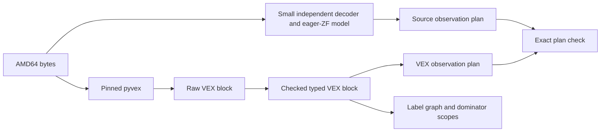

# AMD64Scalar: a checked x86-64 to VEX slice

`AMD64Scalar` validates one direct-control-flow block at a time, observing
`RAX`, `RDI`, `RSI`, `ZF`, and the selected successor `RIP`. Four real LibVEX
lifts from locally assembled x86-64 machine bytes pass. This is not an angr
CFG recovery implementation, a full x86 semantics, or a verified lifter.



## What is interpreted

| Layer | Scope |
| --- | --- |
| [`Scalar.Defs`](../../Silmaril/Machine/Vex/Scalar/Defs.lean) | An extensible untyped tree with raw guest offsets and operator names, plus tagged opaque nodes for unsupported extensions. `check` recognizes `IMark`, `WrTmp`, `Get`, `Put`, `I1`/`I64` literals and temporaries, `Add64`, `CmpEQ64`, `1Uto64`, `64to1`, one optional **final** `Exit` and a constant `NEXT`; both edges must be `Ijk_Boring` and commit to the AMD64 RIP slot. |
| [`Execution.Defs`](../../Silmaril/Machine/Vex/Execution/Defs.lean) | Ordered guest-register writes and lexical temp snapshots; `IMark` is metadata. The shared functional `RegisterFile` stores VEX guest slots. `Block.lower` produces a separate first-order `Plan` over entry values, without VEX offsets, temp IDs, or lazy flags. Running the program instantiates and evaluates that plan; inter-block fetch is not part of the model. |
| [`X86.Defs`](../../Silmaril/Machine/Vex/X86/Defs.lean) | Exact encodings `48 89 f8` (MOV), `48 01 f0` (ADD), `48 39 f7` (CMP), and `eb`, `74`, `75` followed by a signed byte (JMP, JE, JNE). The decoder rejects trailing bytes after the terminator. The evaluator does concrete modular arithmetic and updates ZF eagerly; it does not use VEX operations, statements, or flag recipes. This decoder does not replace the [general x86 models](x86.md). |
| [`Validate.Thms`](../../Silmaril/Machine/Vex/Validate/Thms.lean) | Acceptance ties the decoded source and checked VEX artifacts to their inputs, including the entry address and instruction marker addresses and lengths. It proves equality with the independent concrete x86 model for **all** projected inputs at that entry, with both sides returning. |

Checking requires declared temp types, single assignment, and bind-before-use.
Typed expressions carry a width index and a scoped reference; erasure preserves
names and types in the untyped form. `check_word_erase` proves the literal
round-trip for all words and scopes; the replay tests compare re-erased blocks
against the four original untyped trees. There is no general VEX AST round-trip
claim. The exporter maps the pinned API fields without optimizing or rewriting
the lift. It fails on unknown object forms; the raw AST's opaque nodes are an
explicit extension point, not a semantics for arbitrary VEX.

The entry relation agrees on the projected input state and entry PC. VEX starts
with a `COPY` thunk (`CC_OP = 0`, input ZF in bit 6 of `CC_DEP1`, other thunk
words zero). On exit the observer recognizes `COPY`, `ADDQ` (`4`: sum equals
zero), and `SUBQ` (`8`: operands equal) for ZF only. An unrecognized or
nonliteral recipe is a static observation rejection. The final relation
requires a returned target and the same next RIP; the observation compares
the three registers and ZF. The checker uses exact residual syntax rather
than an SMT solver. Semantically equivalent but differently written plans can
be rejected. `Term.selectBit_sound` justifies the small bit-projection
normalizations; `X86.Block.lower_sound` connects the source residualizer to
the concrete eager source model.

## Behaviour order and limits

`BoundaryAgreement` treats the entry relation, final state relation and
observable result as separate inputs. `validate_refines` maps successful
slices into the existing `Behaviour.Refines` in strict mode: on related,
source-safe inputs, each **target** behaviour must match a **source**
behaviour. With identical observations this is target-set inclusion in the
source set. The source-UB law is the existing `Safe` guard: a source state with
a possible `.undefined` behaviour imposes no obligation; target UB cannot
match a safe source. Strict mode does not conflate faults, traps, exhaustion,
or divergence with one another or with returns. For this slice each side has
exactly one returned result (`boundary_beh`), so there is neither UB vacuity
nor a target stuck-with-no-behaviours loophole. Parse, unsupported instruction,
observation and validator errors occur **outside** that behaviour set.

This is a model of admitted scalar instruction effects, not an execution
claim for a loaded executable. No memory, fetch/permission or canonical-address
checks, other flags, partial registers, helper calls, indirect jumps, or
instruction-level traps are modeled. Infinite execution would require
composing blocks and defining traces; a branch to the same address is still
one boundary result here. Neither LibVEX correctness nor agreement of the
small byte model with Silmaril's full x86 model has been proved.

## Flat CFG and lexical scoping

[`CFG.Defs`](../../Silmaril/Machine/Vex/CFG/Defs.lean) indexes labeled checked
blocks in a shared `Machine.Graph.Digraph`. Its reachability analysis follows
both edges without deciding guards. `CFG.scope` accepts a nonempty reachable
array in forward topological order with unique labels, resolved internal
edges and separately declared external labels. It uses the existing immediate
dominator tree, keeps each original block intact, binds child labels in the
parent region and its descendants, and checks every target against the visible
labels. The converter also checks that flattening covers each input index
exactly once. Flattening is tree preorder, not necessarily input order.

The synthetic diamond regression puts a join that neither arm dominates in
their common dominator's scope; the registers carry values across edges while
VEX temporaries stay local. This implements lexical control scoping in the
style of [λRTL](ssa.md), not a lowering to its `Region` syntax or an SSA φ-node
construction. A backward edge (including a self-loop) is rejected before
scoping. This treats reducible loops, irreducible graphs, and even unsorted
DAGs uniformly as outside this converter; it is not a reducibility test. No
whole-CFG semantic preservation theorem is claimed.

## Replay

The [fixture report](../../examples/vex/lifts.md) has bytes, independent GNU
disassembly, original IRSB output and SHA-256 digests. Each fixture is a raw
`.text` section, lifted at `0x1000` with optimization level 1; successors are
boundary addresses, not a linked executable to run. The tested replay is
Linux x86-64, Python 3.13.5, GNU binutils 2.44. The lock file pins the wheels by
SHA-256. No Python dependency is needed for the checked-in Lean regression.

```sh
python3.13 -m venv /tmp/silmaril-vex
/tmp/silmaril-vex/bin/pip install --only-binary=:all: --require-hashes -r examples/vex/requirements.txt
/tmp/silmaril-vex/bin/python examples/vex/export.py --check
lake build --wfail VexTests
make check CHECK_TARGETS=VexTests
```

MOV/JMP tests check preservation of both incoming ZF values; ADD checks
wraparound and resulting ZF; CMP/JE and CMP/JNE test both edges. Swapped lifts,
altered successors/markers, trailing bytes and unsupported flag recipes are
rejected. The malformed VEX and multi-block graph tests are synthetic.
`VexTests` prints the main theorem axiom sets (only the standard allowed
axioms) and runs with warnings as errors.

Next: give a versioned structured interchange for larger pyvex/angr exports,
link the byte model to the existing x86 decoder/semantics, validate recovered
edges against executable image layouts, then add memory and faults, more flag
recipes, and a loop-aware scoping validator with a preservation theorem.

## Upstream references

- [angr's IR guide](https://docs.angr.io/en/latest/advanced-topics/ir.html)
- [pyvex 9.2.179](https://github.com/angr/pyvex/tree/db7fd67c135c9b4394e0605bc0f8f517bde06578)
  and [archinfo 9.2.179](https://github.com/angr/archinfo/tree/54495fe429ee595550d5ddc6619d348e45bfbe64)
- Pinned LibVEX: [IR header](https://github.com/angr/vex/blob/421bf0d9ec800df09fe4f8d90a8c13a0c63325e3/pub/libvex_ir.h),
  [AMD64 guest layout](https://github.com/angr/vex/blob/421bf0d9ec800df09fe4f8d90a8c13a0c63325e3/pub/libvex_guest_amd64.h),
  [AMD64 flag encodings](https://github.com/angr/vex/blob/421bf0d9ec800df09fe4f8d90a8c13a0c63325e3/priv/guest_amd64_defs.h),
  and [flag helper semantics](https://github.com/angr/vex/blob/421bf0d9ec800df09fe4f8d90a8c13a0c63325e3/priv/guest_amd64_helpers.c)
