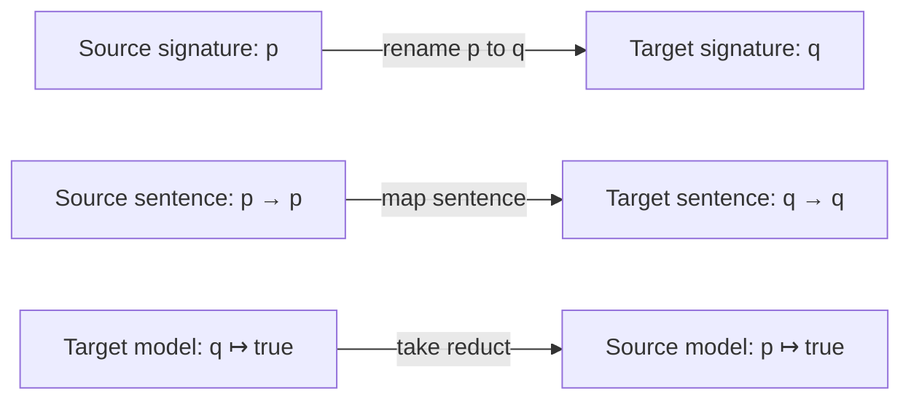
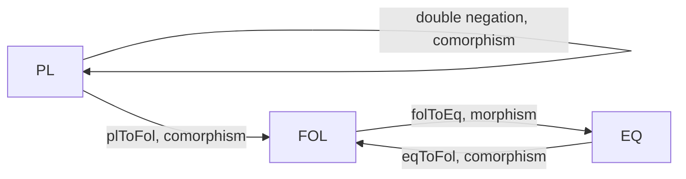

# Institutions over Wasm: a guide

An **institution** packages a language and its meaning so that consistent symbol
renaming preserves truth. Silmaril's institution core is `Silmaril.Logic.Institution`;
the facade `Silmaril.Inst` ([logic-inst.md](logic-inst.md)) supplies shorter names, builders,
transfer lemmas and typed logic graphs over those types. The Wasm institutions themselves are
listed in the [Wasm catalogue](wasm-catalog.md#institutions-over-these-shapes).

The worked examples live in `Silmaril.Wasm.Institution.Guide.Examples` and
`Silmaril.Wasm.Institution.Guide.Facade`.

## Start with a symbol-renaming example

In propositional logic, a **signature** is a set of proposition names. A
**sentence** is a formula using those names; a **model** assigns each name a
truth value. **Satisfaction**, written `M ⊨ φ`, means that φ is true in M.

Rename `p` to `q`. The sentence `p → p` becomes `q → q`. A target model assigning
`q` a truth value gives a source model by assigning that same value to `p`.
This backward model operation is called a **reduct**. The satisfaction condition
says the renamed sentence is true exactly when the original sentence is true
in the reduct.



The API exposes this law as `Institution.sat_map_iff`:

```text
M' ⊨[A] A.map σ φ  ↔  A.reduct σ M' ⊨[A] φ
```

Here A is an institution and σ is a signature map. A **room** packages the
sentences, model category and satisfaction relation at one signature. A
**corridor** maps sentences forward and models backward between rooms, with
this satisfaction equivalence. An institution also proves identity and
composition laws for its signature maps. A **category** consists of objects and
composable arrows with identities. A **functor** maps objects and arrows between
categories while preserving identities and composition. Here models form a
category, and model reducts are functors between model categories.

## Choose the import boundary

| Import | Use |
| --- | --- |
| `Silmaril.Logic.Inst.Core.Defs` | Facade types, projections, satisfaction notation and semi-comorphisms over the public institution core |
| `Silmaril.Logic.Inst.Builders.Core.Defs` | Function-based institution and comorphism builders without Hets graph or borrowing imports |
| `Silmaril.Logic.Inst.Core.Thms` | Satisfaction transfer, naturality, composition laws and semi-comorphism transfer over the public institution core |
| `Silmaril.Logic.Inst.Thms` | Compatibility entry point: the core lemmas plus model expansiveness and consequence borrowing |
| `Silmaril.Logic.Inst.Builders.Defs` | Compatibility builder entry point, including the model-expansion theorem for `ofIso` |
| `Silmaril.Logic.Inst.Graph.Defs` | Typed graph edges, graph construction and path borrowing |

A **facade** is a thin naming interface over an existing API. `Institution`,
`Comorphism`, `Morphism` and `Theory` refer to the public Silmaril types.
The facade does not introduce another institution core.

For an institution A and signature S:

| Expression | Meaning |
| --- | --- |
| `A.Sen S` | Sentences over S |
| `A.Mod S` | Models over S |
| `M ⊨[A] φ` | Satisfaction with A specified explicitly |
| `M ⊨ φ` | Satisfaction through the `Satisfies` instance |
| `A.map σ φ` | Sentence renamed along σ |
| `A.reduct σ M` | Model restricted along σ |
| `A.Entails Γ φ` | Every model satisfying all sentences in Γ satisfies φ |
| `A.Valid φ` | Every model satisfies φ |
| `A.Theory` | Signatures equipped with semantically closed sets of sentences |

A semantically **closed theory** contains every semantic consequence of its
sentences.

Use `open Silmaril.Inst` or `open scoped Silmaril.Inst` for the notation. The universe
aliases abbreviate Lean type levels: `Institution₀` has signatures, sentences
and models in `Type`; `Institution₁` permits signatures in `Type 1`;
`Institution₀₁` permits models in `Type 1`; `Institution₁₁` permits both.
These are type-level choices, not claims about finite signatures or models.

## Build a language from ordinary functions

`Plain` takes sentence and model families, sentence maps, model reducts,
satisfaction, and their identity/composition/satisfaction proofs. `Plain.toInst`
constructs the room functor. It gives models a **discrete category**: a model
arrow is an equality. Use a functor into rooms directly when model arrows must
carry richer structure, such as algebra homomorphisms.

`Plain.ofSat` is a particular construction: sentences are predicates on models,
and renaming precomposes each predicate with the reduct. It does not turn an
independently specified source grammar into those predicates automatically.

The compiled `natOut` example uses finite lists as programs and sets of natural
numbers as possible outputs. Its refinement relation is set inclusion.
`natOut_one_le` proves that the outputs of `[1]` are included in those of
`[1, 2]`. The integer-output version measures refinement only on natural-number
outputs; its chosen relation is part of the example's definition.

## Translate between languages

For a **comorphism** `f : Comorphism A B`:

- `f.sig S` translates signatures from A to B.
- `f.sen S` translates source sentences forward.
- `f.mod S` translates target models backward.
- `Comorphism.sat_sen_iff` proves exact satisfaction equivalence.
- **Naturality** says these translations commute with signature renaming and
  model reducts. `Comorphism.sen_map` and `mod_reduct` expose those laws.

```text
M' ⊨[B] f.sen S φ  ↔  f.mod S M' ⊨[A] φ
```

A **morphism** has the same signature direction, with sentences backward and
models forward. Its satisfaction law is `Morphism.sat_sen_iff`. Check which
kind of map a diagram labels; sentence and model arrows have different variance.

Choose a builder matching the data already proved:

| Builder | Required data |
| --- | --- |
| `Institution.ofFunctor` / `ofClassic` | Room functor / public classic institution |
| `Comorphism.ofCorridors` | Signature functor, corridors and naturality |
| `Comorphism.ofTranslation` | Sentence functions, model functors, satisfaction and both naturality laws |
| `Comorphism.ofPlain` | Corresponding functions and laws between `Plain` presentations |
| `Comorphism.ofIso` | Natural isomorphism of room functors on a common signature category |
| `Comorphism.ofBehaviour` | Exact behavior and sentence translations, plus naturality |
| `Comorphism.ofObs` | Wasm observational-semantics translation, from `Silmaril.Wasm.Institution.Api.Defs` |

The observational example embeds natural outputs into integer outputs. Models
reduce by retaining the natural outputs. `natToInt_surjective` constructs an
integer-output set over every natural-output set; `natToIntC_modelExpansive`
then supplies the condition used for consequence reflection.

## Transfer a proof and compose translations

These are the transfer and composition forms used by the compiled facade
companion. **PL** means propositional logic; **FOL** means first-order logic.
The `dn` example double-negates a PL sentence, using classical truth values.
`plToFol` encodes propositions as **nullary predicates** in FOL: predicates
with no arguments, whose interpretations are truth values.

```lean
import Silmaril.Wasm.Institution.Guide.Facade

open Silmaril.Inst
open Silmaril.Logic.Institution.Examples
open Silmaril.Wasm.Institution.Guide.Facade

example (P : PLf.Sign) (v : PLf.Mod (dnC.sig P)) (φ : PLf.Sen P) :
    v ⊨[PLf] dnC.sen P φ ↔ dnC.mod P v ⊨[PLf] φ := by
  simp

example : Comorphism PLf FOLf := dnC ≫ᶜ plToFol
example : 𝟙ᶜ PLf ≫ᶜ dnC = dnC := Comorphism.id_comp dnC
```

Composition `f ≫ᶜ g` runs f's sentence translation, then g's. The model map
runs in reverse order. Identity and composite projections simplify through
`id_sen`, `comp_sen`, `id_mod` and `comp_mod`.

A comorphism preserves consequence. To reflect consequence, the API's
`ModelExpansive` condition requires every source model to be **equal** to the
reduct of a target model. `Comorphism.entails_iff` and `valid_iff` use that
condition. An isomorphic model is not automatically an equal model; an
isomorphism-based expansion needs its own truth-transport argument.

**Borrowing** means using those equivalences to discharge a source obligation
in the target language. The compiled `pl_entails_iff_dnFol'` proves consequence
equivalence for double negation followed by `plToFol`.

## Register translations in a graph

`GraphSpec` stores typed `CoEdge` and `MorEdge` lists: each edge's map has the
institution types of its stated endpoints. `toLogicGraph` constructs the public
logic graph. A **path** is a composable sequence of edges; `pathComor` composes
its comorphisms.

The compiled `spec` example has these connections. **EQ** means equational logic.



`spec_allModelExpansive` proves expansion for each listed comorphism.
`GraphSpec.pathModelExpansive` then proves it for every comorphism path;
`entails_path_iff` and `valid_path_iff` provide borrowing along those paths.
A drawn edge or a `MorEdge` entry does not supply that hypothesis.

## Related families and restricted maps

The facade companion checks these applications against their actual APIs:

| Family | Checked example / topic guide |
| --- | --- |
| Wasm observational semantics | `natToIntC`, `intOut_valid_one_le'`; [Wasm catalogue](wasm-catalog.md#institutions-over-these-shapes) |
| Unified Wasm institution | `Uf`, signature-inclusion satisfaction examples; `Silmaril.Wasm.Unified.Inst` |
| Games | `refReading`, `refC`, `gameSpec_allModelExpansive`; [games](games.md), counter cell `Silmaril.Games.Examples.Counter` |
| SpecTec grammars | `fullC`, `fullCoHom_modelExpansive`; `Silmaril.Wasm.SpecTec.GrammarInst` |
| Trace specifications (`Spec.Format`) | Identity/composition and satisfaction along `LogicMap.coHom`; `Silmaril.Wasm.Spec.InstFacade` |
| Atlas charts | `chartPlain`, `chartInst`, conditional `transitionSemi`; `Silmaril.Wasm.Atlas` |

A **semi-comorphism** records selected satisfaction directions on a specified
class of sentences. It does not require naturality. `ofSimulation` supplies
one direction when the chosen class is preserved by a simulation;
`ofBisimulation` supplies both from an invariance proof.

The atlas example needs a **section** of its forward point map: a chosen source
point over every target point. That choice supplies the backward model map.
`transitionSemi` still keeps the transition's sentence class and direction
conditions. An arbitrary atlas transition is not thereby a full comorphism.

## Scope: core modules and components

The Wasm institutions come in two families, built the same way (an observational semantics
`ObsSemantics`, made an institution by `Institution.ofObs`):

| Family | Institutions | Models |
| --- | --- | --- |
| Core modules | `Wasm.Institution.Entry` (single invocations, `ModuleRefines`), `Wasm.Institution.Session` (calls sharing a store), `Wasm.Institution.{Graph, Games, GameGraph, DivGames}` (reduction, LTS and game readings) | Core 3.0 stores and instances |
| Components | `Wasm.Institution.Components`, `Wasm.Institution.CompGraph` (`compGraph`, `fullGraph₂`: wrapping and flattening) | components over **any** core semantics `C : CoreSem M` |

**Over Core 3.0.** The component institutions are parametric in `CoreSem`;
`Wasm.Institution.Core3Graph` instantiates them at `core3Sem P`
(`Wasm.Component.Reference.Core3Sem`: numeric Core 3.0 instances): `core3Graph P`, and
`fullGraph₃ P host Env` with the core-module graph beside it, with borrowing along wrapping and
flattening (`valid_wrap_iff`, `valid_flatten_iff`) and along every path (`pathModelExpansive`).

**Where they meet.** `Wasm.Institution.CoreComp` sends both families into the institution of
game semantics `Silmaril.Games.GInst`: `reductionToGInst P host` (Wasm instances under the
Core 3.0 reduction), `core3ModuleToGInst P` (numeric Core 3.0 instances as components' core
modules) and `componentToGInst P` (components). All three are model-expansive, so validity and
entailment borrow both ways (`reduction_valid_iff`, `core3Module_valid_iff`,
`component_valid_iff`, `core3Module_entails_iff`). `CoreComp.Examples` carries the refinement
`x ⊑ x` of the module logic into `GInst` and back.

**What is not there.** No direct comorphism between the two families: inside `fullGraph₃` the
core-module logics (export signatures with behaviours, `exportSig`) and the component logics
(the IR's game signatures, `sigU`) have no edges between them, and in `GInst` their sentences
live over different games. Relating a Wasm instance to the numeric instance built from it needs a
game morphism between those signatures and an adequacy argument. Component-level adequacy is proved only for `Simple` components
([component-caveats.md](component-caveats.md)).

## Check and locate the claims

```sh
lake build --wfail Silmaril.Wasm.Institution.Guide.Facade
```

The companion imports the direct examples. Its five guarded axiom checks cover
`intOut_valid_one_le'`, `pl_entails_iff_dnFol'`, `spec_borrow`,
`gameSpec_pathModelExpansive` and `transitionSemi`, each with exactly
`propext`, `Classical.choice` and `Quot.sound`. The direct companion has three
additional guarded statements. These are scoped checks, not an axiom audit of
every institution reachable through the imports.

| Claim | Source |
| --- | --- |
| Facade types, notation, universes and semi-comorphism contract | `Silmaril/Logic/Inst/Core/Defs.lean` |
| Plain/discrete presentations and builder obligations | `Silmaril/Logic/Inst/Builders/Core/Defs.lean` |
| Satisfaction transfer and naturality | `Silmaril/Logic/Inst/Core/Thms.lean` |
| Borrowing hypotheses | `Silmaril/Logic/Inst/Thms.lean` |
| Typed graph construction and path borrowing | `Silmaril/Logic/Inst/Graph/Defs.lean` |
| Natural/integer outputs and public PL/EQ/FOL examples | `Silmaril/Wasm/Institution/Guide/Examples.lean` |
| Facade versions and the related-family examples above | `Silmaril/Wasm/Institution/Guide/Facade.lean` |
